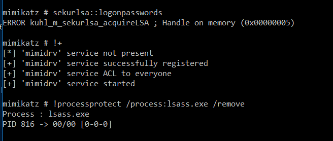
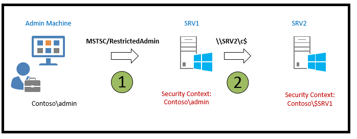

# Bảo vệ thông tin xác thực Windows

{{#include ../../banners/hacktricks-training.md}}

## WDigest

Giao thức [WDigest](<https://technet.microsoft.com/pt-pt/library/cc778868(v=ws.10).aspx?f=255&MSPPError=-2147217396>), được giới thiệu cùng Windows XP, được thiết kế để xác thực qua giao thức HTTP và **được bật theo mặc định trên Windows XP đến Windows 8.0 và Windows Server 2003 đến Windows Server 2012**. Thiết lập mặc định này khiến **mật khẩu được lưu dưới dạng văn bản thuần trong LSASS** (Local Security Authority Subsystem Service). Kẻ tấn công có thể dùng Mimikatz để **trích xuất thông tin xác thực này** bằng cách thực thi:<sup>[[8]](#references)</sup>

```bash
sekurlsa::wdigest
```

Để **tắt hoặc bật tính năng này**, các khóa registry _**UseLogonCredential**_ và _**Negotiate**_ trong _**HKEY_LOCAL_MACHINE\System\CurrentControlSet\Control\SecurityProviders\WDigest**_ phải được đặt thành "1". Nếu các khóa này **không tồn tại hoặc được đặt thành "0"**, WDigest sẽ **bị vô hiệu hóa**:

```bash
reg query HKLM\SYSTEM\CurrentControlSet\Control\SecurityProviders\WDigest /v UseLogonCredential
```

## Bảo vệ LSA (các tiến trình được bảo vệ bằng PP & PPL)

**Protected Process (PP)** và **Protected Process Light (PPL)** là **các cơ chế bảo vệ cấp kernel của Windows**, được thiết kế để ngăn truy cập trái phép vào các tiến trình nhạy cảm như **LSASS**. Được giới thiệu trong **Windows Vista**, **mô hình PP** ban đầu được tạo ra để thực thi **DRM** và chỉ cho phép bảo vệ các binary được ký bằng **chứng chỉ media đặc biệt**. Một tiến trình được đánh dấu là **PP** chỉ có thể được truy cập bởi các tiến trình khác cũng là **PP** và có **mức bảo vệ bằng hoặc cao hơn**; ngay cả khi đó, quyền truy cập vẫn **bị giới hạn**, trừ khi được cho phép cụ thể.

**PPL**, được giới thiệu trong **Windows 8.1**, là phiên bản linh hoạt hơn của PP. Nó hỗ trợ **nhiều trường hợp sử dụng hơn** (ví dụ: LSASS, Defender) bằng cách đưa ra các **"mức bảo vệ"** dựa trên trường **EKU (Enhanced Key Usage)** của **chữ ký số**. Mức bảo vệ được lưu trong trường `EPROCESS.Protection`, là một cấu trúc `PS_PROTECTION` gồm:
- **Type** (`Protected` hoặc `ProtectedLight`)
- **Signer** (ví dụ: `WinTcb`, `Lsa`, `Antimalware`, v.v.)

Cấu trúc này được đóng gói trong một byte và xác định **tiến trình nào có thể truy cập tiến trình nào**:
- **Signer có giá trị cao hơn có thể truy cập signer có giá trị thấp hơn**
- **PPL không thể truy cập PP**
- **Các tiến trình không được bảo vệ không thể truy cập bất kỳ PPL/PP nào**
  
### Những điều cần biết từ góc độ tấn công

- Khi **LSASS chạy dưới dạng PPL**, các nỗ lực mở tiến trình này bằng `OpenProcess(PROCESS_VM_READ | QUERY_INFORMATION)` từ ngữ cảnh admin thông thường **sẽ thất bại với `0x5 (Access Denied)`**, ngay cả khi `SeDebugPrivilege` được bật.
- Bạn có thể **kiểm tra mức bảo vệ của LSASS** bằng các công cụ như Process Hacker hoặc đọc giá trị `EPROCESS.Protection` theo cách lập trình.
- LSASS thường có `PsProtectedSignerLsa-Light` (`0x41`), chỉ có thể được truy cập **bởi các tiến trình được ký bằng signer cấp cao hơn**, chẳng hạn như `WinTcb` (`0x61` hoặc `0x62`).
- PPL là một **giới hạn chỉ ở Userland**; **code cấp kernel có thể vượt qua hoàn toàn cơ chế này**.
- LSASS chạy dưới dạng PPL **không ngăn được việc dump credential nếu bạn có thể thực thi shellcode ở kernel** hoặc **tận dụng một tiến trình có đặc quyền cao với quyền truy cập phù hợp**.
- **Bật hoặc gỡ bỏ PPL** cần khởi động lại hoặc thay đổi **cài đặt Secure Boot/UEFI**; các cài đặt này có thể duy trì PPL ngay cả sau khi hoàn tác thay đổi trong registry.
  
### Tạo tiến trình PPL khi khởi chạy (API được tài liệu hóa)

Windows cung cấp một cách được tài liệu hóa để yêu cầu mức Protected Process Light cho tiến trình con trong quá trình tạo bằng danh sách thuộc tính khởi chạy mở rộng. Cách này không vượt qua yêu cầu về chữ ký — image mục tiêu phải được ký cho lớp signer được yêu cầu.

Luồng tối thiểu trong C/C++:

```c
// Request a PPL protection level for the child process at creation time
// Requires Windows 8.1+ and a properly signed image for the selected level
#include <windows.h>

int wmain(int argc, wchar_t **argv) {
    STARTUPINFOEXW si = {0};
    PROCESS_INFORMATION pi = {0};
    si.StartupInfo.cb = sizeof(si);

    SIZE_T attrSize = 0;
    InitializeProcThreadAttributeList(NULL, 1, 0, &attrSize);
    si.lpAttributeList = (PPROC_THREAD_ATTRIBUTE_LIST)HeapAlloc(GetProcessHeap(), 0, attrSize);
    if (!si.lpAttributeList) return 1;

    if (!InitializeProcThreadAttributeList(si.lpAttributeList, 1, 0, &attrSize)) return 1;

    DWORD level = PROTECTION_LEVEL_ANTIMALWARE_LIGHT; // or WINDOWS_LIGHT/LSA_LIGHT/WINTCB_LIGHT
    if (!UpdateProcThreadAttribute(
            si.lpAttributeList, 0,
            PROC_THREAD_ATTRIBUTE_PROTECTION_LEVEL,
            &level, sizeof(level), NULL, NULL)) {
        return 1;
    }

    DWORD flags = EXTENDED_STARTUPINFO_PRESENT;
    if (!CreateProcessW(L"C\\Windows\\System32\\notepad.exe", NULL, NULL, NULL, FALSE,
                        flags, NULL, NULL, &si.StartupInfo, &pi)) {
        // If the image isn't signed appropriately for the requested level,
        // CreateProcess will fail with ERROR_INVALID_IMAGE_HASH (577).
        return 1;
    }

    // cleanup
    DeleteProcThreadAttributeList(si.lpAttributeList);
    HeapFree(GetProcessHeap(), 0, si.lpAttributeList);
    CloseHandle(pi.hThread);
    CloseHandle(pi.hProcess);
    return 0;
}
```

Ghi chú và các ràng buộc:
- Dùng `STARTUPINFOEX` với `InitializeProcThreadAttributeList` và `UpdateProcThreadAttribute(PROC_THREAD_ATTRIBUTE_PROTECTION_LEVEL, ...)`, sau đó truyền `EXTENDED_STARTUPINFO_PRESENT` cho `CreateProcess*`.<sup>[[2]](#references)[[3]](#references)[[4]](#references)</sup>
- Có thể đặt `DWORD` của protection thành các hằng số như `PROTECTION_LEVEL_WINTCB_LIGHT`, `PROTECTION_LEVEL_WINDOWS`, `PROTECTION_LEVEL_WINDOWS_LIGHT`, `PROTECTION_LEVEL_ANTIMALWARE_LIGHT` hoặc `PROTECTION_LEVEL_LSA_LIGHT`.
- Tiến trình con chỉ khởi chạy dưới dạng PPL nếu image của nó được ký cho lớp signer đó; nếu không, quá trình tạo tiến trình sẽ thất bại, thường với `ERROR_INVALID_IMAGE_HASH (577)` / `STATUS_INVALID_IMAGE_HASH (0xC0000428)`.
- Đây không phải là một cách bypass — đây là API được hỗ trợ, dành cho các image được ký phù hợp. Hữu ích để tăng cường bảo mật cho công cụ hoặc xác thực cấu hình được PPL bảo vệ.

Ví dụ CLI dùng một loader tối giản:<sup>[[1]](#references)</sup>
- Signer Antimalware: `CreateProcessAsPPL.exe 3 C:\Tools\agent.exe --svc`
- Signer LSA-light: `CreateProcessAsPPL.exe 4 C:\Windows\System32\notepad.exe`

**Các tùy chọn bypass bảo vệ PPL:**

Nếu muốn dump LSASS bất chấp PPL, có 3 tùy chọn chính:
1. **Dùng kernel driver đã ký (ví dụ: Mimikatz + mimidrv.sys)** để **gỡ cờ bảo vệ của LSASS**:



2. **Bring Your Own Vulnerable Driver (BYOVD)** để chạy mã kernel tùy chỉnh và vô hiệu hóa cơ chế bảo vệ. Các công cụ như **PPLKiller**, **gdrv-loader** hoặc **kdmapper** giúp thực hiện việc này.
3. **Lấy cắp một handle LSASS hiện có** từ tiến trình khác đang mở handle đó (ví dụ: tiến trình AV), sau đó **nhân bản handle đó** vào tiến trình của bạn. Đây là cơ sở của kỹ thuật `pypykatz live lsa --method handledup`.
4. **Lạm dụng một tiến trình có đặc quyền** cho phép bạn tải mã tùy ý vào không gian địa chỉ của nó hoặc bên trong một tiến trình có đặc quyền khác, qua đó bypass các hạn chế của PPL. Bạn có thể xem ví dụ tại [bypassing-lsa-protection-in-userland](https://blog.scrt.ch/2021/04/22/bypassing-lsa-protection-in-userland/) hoặc [https://github.com/itm4n/PPLdump](https://github.com/itm4n/PPLdump).

**Kiểm tra trạng thái hiện tại của cơ chế bảo vệ LSA (PPL/PP) cho LSASS**:

```bash
reg query HKEY_LOCAL_MACHINE\SYSTEM\CurrentControlSet\Control\LSA /v RunAsPPL
```

Khi chạy **`mimikatz privilege::debug sekurlsa::logonpasswords`**, lệnh có thể thất bại với mã lỗi `0x00000005` do cơ chế bảo vệ này.

- Để biết thêm thông tin về kiểm tra này, xem [https://itm4n.github.io/lsass-runasppl/](https://itm4n.github.io/lsass-runasppl/)<sup>[[5]](#references)</sup>


## Credential Guard

**Credential Guard**, một tính năng chỉ có trên **Windows 10 (các phiên bản Enterprise và Education)**, tăng cường bảo mật cho thông tin xác thực của máy bằng **Virtual Secure Mode (VSM)** và **Virtualization Based Security (VBS)**. Tính năng này tận dụng các phần mở rộng ảo hóa của CPU để cô lập những tiến trình quan trọng trong một vùng bộ nhớ được bảo vệ, ngoài phạm vi truy cập của hệ điều hành chính. Cơ chế cô lập này đảm bảo rằng ngay cả kernel cũng không thể truy cập bộ nhớ trong VSM, qua đó bảo vệ thông tin xác thực khỏi các cuộc tấn công như **pass-the-hash**. **Local Security Authority (LSA)** hoạt động trong môi trường bảo mật này dưới dạng một trustlet, còn tiến trình **LSASS** trong hệ điều hành chính chỉ đóng vai trò liên lạc với LSA của VSM.

Theo mặc định, **Credential Guard** không hoạt động và cần được kích hoạt thủ công trong tổ chức. Tính năng này đóng vai trò quan trọng trong việc tăng cường bảo mật trước các công cụ như **Mimikatz**, vốn bị hạn chế khả năng trích xuất thông tin xác thực. Tuy nhiên, kẻ tấn công vẫn có thể khai thác lỗ hổng bằng cách thêm **Security Support Providers (SSP)** tùy chỉnh để thu thập thông tin xác thực ở dạng clear text trong các lần đăng nhập.

Để kiểm tra trạng thái kích hoạt của **Credential Guard**, có thể kiểm tra khóa registry _**LsaCfgFlags**_ tại _**HKLM\System\CurrentControlSet\Control\LSA**_. Giá trị "**1**" cho biết tính năng đã được kích hoạt với **UEFI lock**, "**2**" là không có khóa, còn "**0**" nghĩa là tính năng chưa được bật. Kiểm tra registry này là một dấu hiệu đáng tin cậy, nhưng không phải là bước duy nhất để bật Credential Guard. Có thể tìm thấy hướng dẫn chi tiết và script PowerShell để bật tính năng này trên mạng.

```bash
reg query HKLM\System\CurrentControlSet\Control\LSA /v LsaCfgFlags
```

Để hiểu toàn diện và xem hướng dẫn bật **Credential Guard** trong Windows 10 cũng như tính năng tự động kích hoạt trên các hệ thống tương thích chạy **Windows 11 Enterprise và Education (phiên bản 22H2)**, hãy truy cập [tài liệu của Microsoft](https://docs.microsoft.com/en-us/windows/security/identity-protection/credential-guard/credential-guard-manage).<sup>[[9]](#references)</sup>

Hướng dẫn triển khai SSP tùy chỉnh để thu thập thông tin xác thực được cung cấp trong [hướng dẫn này](../active-directory-methodology/custom-ssp.md).

## RDP RestrictedAdmin Mode

**Windows 8.1 và Windows Server 2012 R2** giới thiệu một số tính năng bảo mật mới, bao gồm _**chế độ Restricted Admin cho RDP**_. Chế độ này được thiết kế để tăng cường bảo mật bằng cách giảm thiểu rủi ro liên quan đến các cuộc tấn công [**pass the hash**](https://blog.ahasayen.com/pass-the-hash/).

Thông thường, khi kết nối với máy tính từ xa qua RDP, thông tin xác thực của bạn được lưu trên máy đích. Điều này gây ra rủi ro bảo mật đáng kể, đặc biệt khi sử dụng tài khoản có đặc quyền nâng cao. Tuy nhiên, với sự ra đời của _**chế độ Restricted Admin**_, rủi ro này giảm đi đáng kể.

Khi bắt đầu kết nối RDP bằng lệnh **mstsc.exe /RestrictedAdmin**, quá trình xác thực với máy tính từ xa diễn ra mà không lưu thông tin xác thực của bạn trên máy đó. Cách này đảm bảo rằng nếu xảy ra lây nhiễm malware hoặc người dùng có ý đồ xấu truy cập được máy chủ từ xa, thông tin xác thực của bạn sẽ không bị xâm phạm vì chúng không được lưu trên máy chủ.

Lưu ý rằng trong **chế độ Restricted Admin**, các lần truy cập tài nguyên mạng từ phiên RDP sẽ không sử dụng thông tin xác thực cá nhân của bạn; thay vào đó, hệ thống sẽ dùng **danh tính của máy tính**.

Tính năng này đánh dấu một bước tiến đáng kể trong việc bảo mật các kết nối máy tính từ xa và bảo vệ thông tin nhạy cảm khỏi bị lộ trong trường hợp xảy ra sự cố bảo mật.



Để biết thêm thông tin chi tiết, hãy truy cập [tài nguyên này](https://blog.ahasayen.com/restricted-admin-mode-for-rdp/).<sup>[[6]](#references)</sup>

## Thông tin xác thực được lưu vào bộ nhớ đệm

Windows bảo vệ **thông tin xác thực miền** thông qua **Local Security Authority (LSA)**, hỗ trợ các quy trình đăng nhập bằng những giao thức bảo mật như **Kerberos** và **NTLM**. Một tính năng quan trọng của Windows là khả năng lưu vào bộ nhớ đệm **mười lần đăng nhập miền gần nhất**, để đảm bảo người dùng vẫn có thể truy cập máy tính ngay cả khi **domain controller ngoại tuyến** — rất hữu ích cho người dùng laptop thường xuyên ở ngoài mạng của công ty.

Số lần đăng nhập được lưu vào bộ nhớ đệm có thể điều chỉnh thông qua một **khóa registry hoặc group policy** cụ thể. Để xem hoặc thay đổi thiết lập này, hãy sử dụng lệnh sau:

```bash
reg query "HKEY_LOCAL_MACHINE\SOFTWARE\MICROSOFT\WINDOWS NT\CURRENTVERSION\WINLOGON" /v CACHEDLOGONSCOUNT
```

Quyền truy cập vào thông tin xác thực đã lưu trong bộ nhớ đệm này được kiểm soát chặt chẽ; chỉ tài khoản **SYSTEM** có đủ quyền cần thiết để xem chúng. Quản trị viên cần truy cập thông tin này phải thực hiện việc đó với đặc quyền của người dùng SYSTEM. Thông tin xác thực được lưu tại: `HKEY_LOCAL_MACHINE\SECURITY\Cache`

Có thể sử dụng **Mimikatz** để trích xuất thông tin xác thực đã lưu trong bộ nhớ đệm bằng lệnh `lsadump::cache`.

Để biết thêm chi tiết, [nguồn gốc](http://juggernaut.wikidot.com/cached-credentials) cung cấp thông tin toàn diện.<sup>[[7]](#references)</sup>

## Protected Users

Việc tham gia **nhóm Protected Users** mang lại một số cải tiến bảo mật cho người dùng, giúp tăng cường bảo vệ chống lại hành vi đánh cắp và lạm dụng thông tin xác thực:

- **Ủy quyền thông tin xác thực (CredSSP)**: Ngay cả khi cài đặt Group Policy **Allow delegating default credentials** được bật, thông tin xác thực dạng văn bản thuần của thành viên Protected Users sẽ không được lưu vào bộ nhớ đệm.
- **Windows Digest**: Kể từ **Windows 8.1 và Windows Server 2012 R2**, hệ thống sẽ không lưu thông tin xác thực dạng văn bản thuần của thành viên Protected Users vào bộ nhớ đệm, bất kể trạng thái Windows Digest.
- **NTLM**: Hệ thống sẽ không lưu thông tin xác thực dạng văn bản thuần hoặc hàm một chiều NT (NTOWF) của thành viên Protected Users vào bộ nhớ đệm.
- **Kerberos**: Với thành viên Protected Users, xác thực Kerberos sẽ không tạo **khóa DES** hoặc **RC4**, cũng không lưu thông tin xác thực dạng văn bản thuần hoặc khóa dài hạn vào bộ nhớ đệm sau khi lấy Ticket-Granting Ticket (TGT) ban đầu.
- **Đăng nhập ngoại tuyến**: Khi thành viên Protected Users đăng nhập hoặc mở khóa, hệ thống sẽ không tạo verifier lưu trong bộ nhớ đệm, do đó các tài khoản này không hỗ trợ đăng nhập ngoại tuyến.

Các biện pháp bảo vệ này được kích hoạt ngay khi người dùng thuộc **nhóm Protected Users** đăng nhập vào thiết bị. Nhờ đó, các biện pháp bảo mật quan trọng được áp dụng để bảo vệ khỏi nhiều phương thức xâm phạm thông tin xác thực.

Để biết thêm thông tin chi tiết, hãy tham khảo [tài liệu](https://docs.microsoft.com/en-us/windows-server/security/credentials-protection-and-management/protected-users-security-group) chính thức.<sup>[[10]](#references)</sup>

**Bảng từ** [**tài liệu**](https://docs.microsoft.com/en-us/windows-server/identity/ad-ds/plan/security-best-practices/appendix-c--protected-accounts-and-groups-in-active-directory)**.**<sup>[[11]](#references)</sup>

| Windows Server 2003 RTM | Windows Server 2003 SP1+ | <p>Windows Server 2012,<br>Windows Server 2008 R2,<br>Windows Server 2008</p> | Windows Server 2016          |
| ----------------------- | ------------------------ | ----------------------------------------------------------------------------- | ---------------------------- |
| Account Operators       | Account Operators        | Account Operators                                                             | Account Operators            |
| Administrator           | Administrator            | Administrator                                                                 | Administrator                |
| Administrators          | Administrators           | Administrators                                                                | Administrators               |
| Backup Operators        | Backup Operators         | Backup Operators                                                              | Backup Operators             |
| Cert Publishers         |                          |                                                                               |                              |
| Domain Admins           | Domain Admins            | Domain Admins                                                                 | Domain Admins                |
| Domain Controllers      | Domain Controllers       | Domain Controllers                                                            | Domain Controllers           |
| Enterprise Admins       | Enterprise Admins        | Enterprise Admins                                                             | Enterprise Admins            |
|                         |                          |                                                                               | Enterprise Key Admins        |
|                         |                          |                                                                               | Key Admins                   |
| Krbtgt                  | Krbtgt                   | Krbtgt                                                                        | Krbtgt                       |
| Print Operators         | Print Operators          | Print Operators                                                               | Print Operators              |
|                         |                          | Read-only Domain Controllers                                                  | Read-only Domain Controllers |
| Replicator              | Replicator               | Replicator                                                                    | Replicator                   |
| Schema Admins           | Schema Admins            | Schema Admins                                                                 | Schema Admins                |
| Server Operators        | Server Operators         | Server Operators                                                              | Server Operators             |

## References

- [1] [CreateProcessAsPPL – trình khởi chạy tiến trình PPL tối giản](https://github.com/2x7EQ13/CreateProcessAsPPL)
- [2] [Cấu trúc STARTUPINFOEX (Win32 API)](https://learn.microsoft.com/en-us/windows/win32/api/winbase/ns-winbase-startupinfoexw)
- [3] [InitializeProcThreadAttributeList (Win32 API)](https://learn.microsoft.com/en-us/windows/win32/api/processthreadsapi/nf-processthreadsapi-initializeprocthreadattributelist)
- [4] [UpdateProcThreadAttribute (Win32 API)](https://learn.microsoft.com/en-us/windows/win32/api/processthreadsapi/nf-processthreadsapi-updateprocthreadattribute)
- [5] [LSASS RunAsPPL – bối cảnh và nội bộ](https://itm4n.github.io/lsass-runasppl/)
- [6] [Chế độ Restricted Admin cho RDP](https://blog.ahasayen.com/restricted-admin-mode-for-rdp/)
- [7] [Thông tin xác thực đã lưu trong bộ nhớ đệm - Juggernaut AppSec Wiki](http://juggernaut.wikidot.com/cached-credentials)
- [8] [Xác thực WDigest (Microsoft TechNet)](<https://technet.microsoft.com/pt-pt/library/cc778868(v=ws.10).aspx?f=255&MSPPError=-2147217396>)
- [9] [Quản lý Windows Defender Credential Guard (Microsoft Learn)](https://docs.microsoft.com/en-us/windows/security/identity-protection/credential-guard/credential-guard-manage)
- [10] [Nhóm bảo mật Protected Users (Microsoft Learn)](https://docs.microsoft.com/en-us/windows-server/security/credentials-protection-and-management/protected-users-security-group)
- [11] [Phụ lục C: Tài khoản và nhóm được bảo vệ trong Active Directory (Microsoft Learn)](https://docs.microsoft.com/en-us/windows-server/identity/ad-ds/plan/security-best-practices/appendix-c--protected-accounts-and-groups-in-active-directory)
{{#include ../../banners/hacktricks-training.md}}
