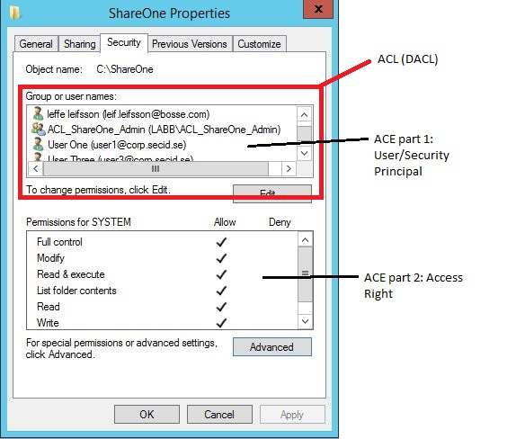
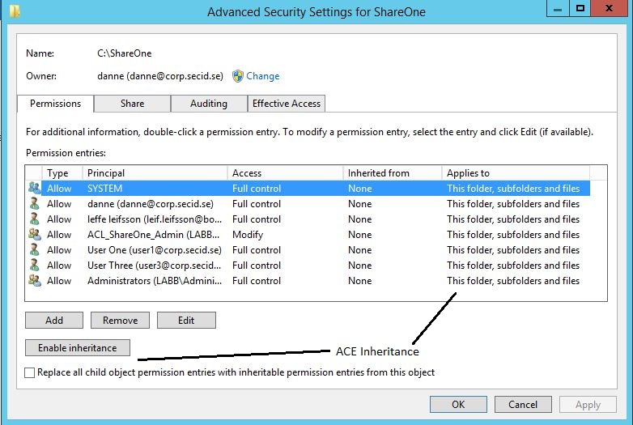
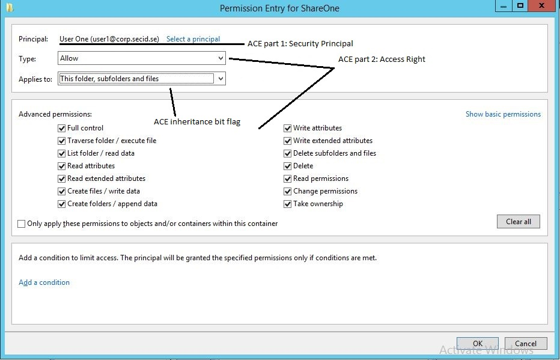
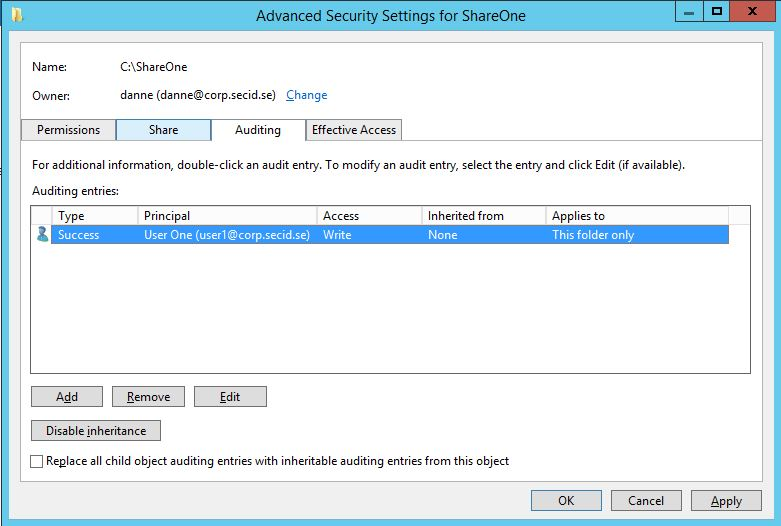

# ACLs - DACLs/SACLs/ACEs

{{#include ../../banners/hacktricks-training.md}}

## **Access Control List (ACL)**

Access Control List (ACL) gồm một tập hợp có thứ tự các Access Control Entry (ACE), quy định các biện pháp bảo vệ cho một đối tượng và các thuộc tính của nó. Về cơ bản, ACL xác định những hành động nào của các principal bảo mật (người dùng hoặc nhóm) được cho phép hoặc bị từ chối trên một đối tượng cụ thể.

Có hai loại ACL:

- **Discretionary Access Control List (DACL):** Chỉ định những người dùng và nhóm nào có hoặc không có quyền truy cập vào một đối tượng.
- **System Access Control List (SACL):** Quản lý việc kiểm tra các lần truy cập vào một đối tượng.

Khi truy cập một tệp, hệ thống kiểm tra security descriptor của đối tượng đối chiếu với access token của người dùng để xác định có cấp quyền truy cập hay không và phạm vi quyền truy cập, dựa trên các ACE.[[1]](#references)

Khi thư mục cha cấp Full Control nhưng một tệp con từ chối quyền đọc, hãy kiểm tra riêng DACL hiệu lực, chủ sở hữu và cơ chế kế thừa của **tệp con**. Để thay đổi DACL của tệp đó, cần có quyền `WRITE_DAC` trên tệp hoặc quyền tương ứng của chủ sở hữu; [Microsoft định nghĩa `WRITE_DAC`](https://learn.microsoft.com/en-us/windows/win32/secauthz/standard-access-rights) và [mô tả quyền truy cập mặc định của chủ sở hữu](https://learn.microsoft.com/en-us/windows/win32/secauthz/owner-of-a-new-object). Chỉ riêng quyền trên thư mục cha không chứng minh rằng có thể đọc tệp con hoặc thay đổi DACL của nó.

### **Các thành phần chính**

- **DACL:** Chứa các ACE cấp hoặc từ chối quyền truy cập vào một đối tượng cho người dùng và nhóm. Về cơ bản, đây là ACL chính quy định quyền truy cập.
- **SACL:** Được dùng để kiểm tra quyền truy cập vào các đối tượng; các ACE xác định những loại truy cập sẽ được ghi vào Security Event Log. Điều này rất hữu ích để phát hiện các lần truy cập trái phép hoặc khắc phục sự cố về quyền truy cập.[[1]](#references)

### **Cách hệ thống tương tác với ACL**

Mỗi phiên người dùng được liên kết với một access token chứa thông tin bảo mật liên quan đến phiên đó, bao gồm danh tính người dùng, nhóm và các đặc quyền. Token này cũng bao gồm logon SID, định danh duy nhất cho phiên.

Local Security Authority (LSASS) xử lý các yêu cầu truy cập đối tượng bằng cách kiểm tra DACL để tìm ACE khớp với principal bảo mật đang yêu cầu truy cập. Quyền truy cập được cấp ngay nếu không tìm thấy ACE liên quan. Nếu có, LSASS so sánh các ACE với SID của principal bảo mật trong access token để xác định quyền truy cập.[[1]](#references)

### **Tóm tắt quy trình**

- **ACL:** Xác định quyền truy cập thông qua DACL và quy tắc kiểm tra thông qua SACL.
- **Access Token:** Chứa thông tin người dùng, nhóm và đặc quyền của một phiên.
- **Quyết định truy cập:** Được đưa ra bằng cách so sánh các ACE trong DACL với access token; SACL được dùng để kiểm tra.[[1]](#references)

### ACEs

Có **ba loại Access Control Entry (ACE) chính**:[[1]](#references)

- **Access Denied ACE**: ACE này từ chối rõ ràng quyền truy cập vào một đối tượng đối với những người dùng hoặc nhóm được chỉ định (trong DACL).
- **Access Allowed ACE**: ACE này cấp rõ ràng quyền truy cập vào một đối tượng cho những người dùng hoặc nhóm được chỉ định (trong DACL).
- **System Audit ACE**: Nằm trong System Access Control List (SACL), ACE này chịu trách nhiệm tạo nhật ký kiểm tra khi người dùng hoặc nhóm cố gắng truy cập một đối tượng. ACE ghi lại việc truy cập được cho phép hay bị từ chối, cũng như loại truy cập.

Mỗi ACE có **bốn thành phần quan trọng**:[[1]](#references)

1. **Security Identifier (SID)** của người dùng hoặc nhóm (hoặc tên principal của họ trong biểu diễn đồ họa).
2. **Cờ** xác định loại ACE (từ chối truy cập, cho phép truy cập hoặc kiểm tra hệ thống).
3. **Cờ kế thừa** xác định liệu các đối tượng con có thể kế thừa ACE từ đối tượng cha hay không.
4. [**Access mask**](https://docs.microsoft.com/en-us/openspecs/windows_protocols/ms-dtyp/7a53f60e-e730-4dfe-bbe9-b21b62eb790b?redirectedfrom=MSDN), một giá trị 32 bit chỉ định các quyền được cấp trên đối tượng.

Quyết định truy cập được thực hiện bằng cách lần lượt kiểm tra từng ACE cho đến khi:[[1]](#references)

- Một **Access-Denied ACE** từ chối rõ ràng các quyền được yêu cầu đối với một trustee được xác định trong access token.
- Một hoặc nhiều **Access-Allowed ACE** cấp rõ ràng tất cả các quyền được yêu cầu cho một trustee trong access token.
- Sau khi kiểm tra tất cả ACE, nếu có quyền được yêu cầu nào **chưa được cho phép rõ ràng**, quyền truy cập sẽ bị **từ chối ngầm định**.

### Thứ tự ACE

Cách sắp xếp **ACE** (các quy tắc xác định ai có thể hoặc không thể truy cập một thứ gì đó) trong danh sách **DACL** rất quan trọng. Điều này là do sau khi hệ thống cấp hoặc từ chối quyền truy cập dựa trên các quy tắc này, nó sẽ ngừng kiểm tra các quy tắc còn lại.[[1]](#references)

Có một cách tối ưu để sắp xếp các ACE này, gọi là **"thứ tự chuẩn" (canonical order)**. Cách sắp xếp này giúp mọi thứ hoạt động trơn tru và nhất quán. Sau đây là cách áp dụng cho các hệ thống như **Windows 2000** và **Windows Server 2003**:

- Trước tiên, đặt tất cả quy tắc được tạo **riêng cho đối tượng này** lên trước các quy tắc được kế thừa từ nơi khác, chẳng hạn như thư mục cha.
- Trong nhóm quy tắc riêng này, đặt các quy tắc **"từ chối"** trước các quy tắc **"cho phép"**.
- Với các quy tắc được kế thừa, bắt đầu từ **nguồn gần nhất**, chẳng hạn như thư mục cha, rồi lần lượt đến các nguồn xa hơn. Một lần nữa, đặt quy tắc **"từ chối"** trước quy tắc **"cho phép"**.

Cách sắp xếp này mang lại hai lợi ích chính:

- Đảm bảo rằng nếu có một quy tắc **"từ chối"** cụ thể, quy tắc đó sẽ được áp dụng bất kể có những quy tắc **"cho phép"** nào khác.
- Cho phép chủ sở hữu đối tượng **quyết định cuối cùng** về việc ai được truy cập, trước khi áp dụng các quy tắc từ thư mục cha hoặc các nguồn xa hơn.

Với cách sắp xếp này, chủ sở hữu tệp hoặc thư mục có thể kiểm soát chính xác ai được quyền truy cập, đảm bảo đúng người được vào và những người không phù hợp thì không.

Vì vậy, **"thứ tự chuẩn"** nhằm đảm bảo các quy tắc truy cập rõ ràng và hoạt động hiệu quả: đặt các quy tắc cụ thể lên trước và sắp xếp mọi thứ một cách hợp lý.

### Ví dụ về GUI

[**Ví dụ tại đây**](https://secureidentity.se/acl-dacl-sacl-and-the-ace/)[[2]](#references)

Đây là tab bảo mật quen thuộc của một thư mục, hiển thị ACL, DACL và các ACE:

Nếu nhấn nút **Advanced**, chúng ta sẽ có thêm các tùy chọn như kế thừa:

Và nếu thêm hoặc chỉnh sửa một Security Principal:

Cuối cùng là SACL trong tab Auditing:

### Giải thích quyền kiểm soát truy cập theo cách đơn giản

Khi quản lý quyền truy cập vào tài nguyên, chẳng hạn như một thư mục, chúng ta sử dụng các danh sách và quy tắc gọi là Access Control List (ACL) và Access Control Entry (ACE). Chúng xác định ai có thể hoặc không thể truy cập dữ liệu nhất định.[[1]](#references)

#### Từ chối quyền truy cập cho một nhóm cụ thể

Giả sử bạn có một thư mục tên Cost và muốn mọi người truy cập được, ngoại trừ nhóm marketing. Bằng cách thiết lập quy tắc đúng cách, chúng ta có thể đảm bảo nhóm marketing bị từ chối quyền truy cập rõ ràng trước khi cho phép những người khác. Việc này được thực hiện bằng cách đặt quy tắc từ chối nhóm marketing trước quy tắc cho phép mọi người truy cập.

#### Cho phép một thành viên cụ thể thuộc nhóm bị từ chối truy cập

Giả sử Bob, giám đốc marketing, cần truy cập thư mục Cost dù nhóm marketing nói chung không được phép truy cập. Chúng ta có thể thêm một quy tắc (ACE) cụ thể cấp quyền cho Bob và đặt quy tắc đó trước quy tắc từ chối nhóm marketing. Nhờ vậy, Bob vẫn được truy cập dù nhóm của anh ấy bị hạn chế nói chung.

#### Tìm hiểu về Access Control Entry

ACE là các quy tắc riêng lẻ trong một ACL. Chúng xác định người dùng hoặc nhóm, chỉ rõ quyền truy cập nào được cho phép hoặc từ chối, đồng thời quy định cách các quy tắc này áp dụng cho các mục con (kế thừa). Có hai loại ACE chính:

- **Generic ACEs**: Áp dụng rộng rãi, ảnh hưởng đến mọi loại đối tượng hoặc chỉ phân biệt giữa container (như thư mục) và đối tượng không phải container (như tệp). Ví dụ: quy tắc cho phép người dùng xem nội dung thư mục nhưng không cho phép truy cập các tệp bên trong.
- **Object-Specific ACEs**: Cung cấp quyền kiểm soát chính xác hơn, cho phép đặt quy tắc cho các loại đối tượng cụ thể hoặc thậm chí từng thuộc tính riêng lẻ trong một đối tượng. Ví dụ: trong một thư mục người dùng, quy tắc có thể cho phép người dùng cập nhật số điện thoại nhưng không cho phép thay đổi giờ đăng nhập.

Mỗi ACE chứa thông tin quan trọng như đối tượng áp dụng quy tắc (dùng Security Identifier hoặc SID), quyền mà quy tắc cho phép hoặc từ chối (dùng access mask) và cách quy tắc được các đối tượng khác kế thừa.

#### Những khác biệt chính giữa các loại ACE

- **Generic ACEs** phù hợp với các tình huống kiểm soát truy cập đơn giản, trong đó cùng một quy tắc áp dụng cho mọi khía cạnh của một đối tượng hoặc cho tất cả đối tượng trong một container.
- **Object-Specific ACEs** được sử dụng trong các tình huống phức tạp hơn, đặc biệt trong các môi trường như Active Directory, nơi bạn có thể cần kiểm soát quyền truy cập vào từng thuộc tính cụ thể của một đối tượng theo các cách khác nhau.

Tóm lại, ACL và ACE giúp xác định quyền kiểm soát truy cập chính xác, đảm bảo chỉ những cá nhân hoặc nhóm phù hợp mới có thể truy cập thông tin hoặc tài nguyên nhạy cảm. Đồng thời, chúng cho phép điều chỉnh quyền truy cập đến từng thuộc tính hoặc loại đối tượng riêng lẻ.

### Cấu trúc Access Control Entry

| Trường ACE | Mô tả                                                                                                                                                                                                                                                                                                                                                                                                                                                                                                     |
| ----------- | --------------------------------------------------------------------------------------------------------------------------------------------------------------------------------------------------------------------------------------------------------------------------------------------------------------------------------------------------------------------------------------------------------------------------------------------------------------------------------------------------------------- |
| Type        | Cờ cho biết loại ACE. Windows 2000 và Windows Server 2003 hỗ trợ sáu loại ACE: ba loại ACE chung được gắn vào tất cả các đối tượng có thể bảo vệ; ba loại ACE dành riêng cho đối tượng có thể xuất hiện trên các đối tượng Active Directory.                                                                                                                                                                                                                                                            |
| Flags       | Tập hợp các cờ bit kiểm soát việc kế thừa và kiểm tra.                                                                                                                                                                                                                                                                                                                                                                                                                                                         |
| Size        | Số byte bộ nhớ được cấp phát cho ACE.                                                                                                                                                                                                                                                                                                                                                                                                                                                       |
| Access mask | Giá trị 32 bit có các bit tương ứng với quyền truy cập trên đối tượng. Các bit có thể được bật hoặc tắt, nhưng ý nghĩa của trạng thái đó phụ thuộc vào loại ACE. Ví dụ: nếu bit tương ứng với quyền đọc quyền hạn được bật và loại ACE là Deny, ACE sẽ từ chối quyền đọc quyền hạn của đối tượng. Nếu cùng bit đó được bật nhưng loại ACE là Allow, ACE sẽ cấp quyền đọc quyền hạn của đối tượng. Thông tin chi tiết hơn về Access mask có trong bảng tiếp theo. |
| SID         | Xác định người dùng hoặc nhóm mà quyền truy cập được kiểm soát hoặc giám sát bởi ACE này.                                                                                                                                                                                                                                                                                                                                                                                                                                 |

### Cấu trúc Access Mask

| Bit (Phạm vi) | Ý nghĩa                            | Mô tả/Ví dụ                       |
| ----------- | ---------------------------------- | ----------------------------------------- |
| 0 - 15      | Quyền truy cập dành riêng cho đối tượng      | Đọc dữ liệu, Thực thi, Nối dữ liệu           |
| 16 - 22     | Quyền truy cập tiêu chuẩn             | Xóa, Ghi ACL, Ghi chủ sở hữu            |
| 23          | Có thể truy cập security ACL            |                                           |
| 24 - 27     | Dành riêng                           |                                           |
| 28          | Generic ALL (Đọc, Ghi, Thực thi) | Tất cả các quyền bên dưới                          |
| 29          | Generic Execute                    | Tất cả những gì cần thiết để thực thi chương trình |
| 30          | Generic Write                      | Tất cả những gì cần thiết để ghi vào tệp   |
| 31          | Generic Read                       | Tất cả những gì cần thiết để đọc tệp       |

## References

- [1] [Cách hệ thống sử dụng ACL - NTFS.com](https://www.ntfs.com/ntfs-permissions-acl-use.htm)
- [2] [ACL, DACL, SACL và ACE - secureidentity.se](https://secureidentity.se/acl-dacl-sacl-and-the-ace/)
{{#include ../../banners/hacktricks-training.md}}
